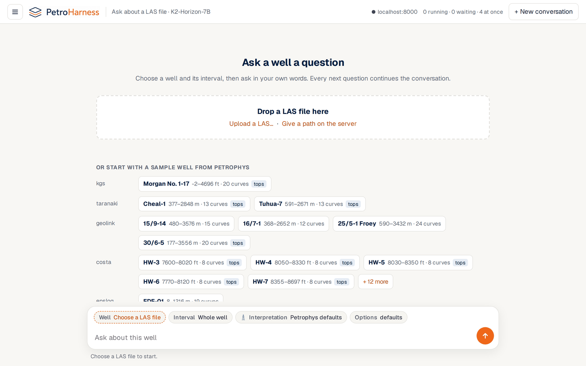
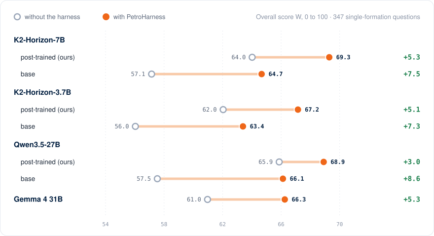
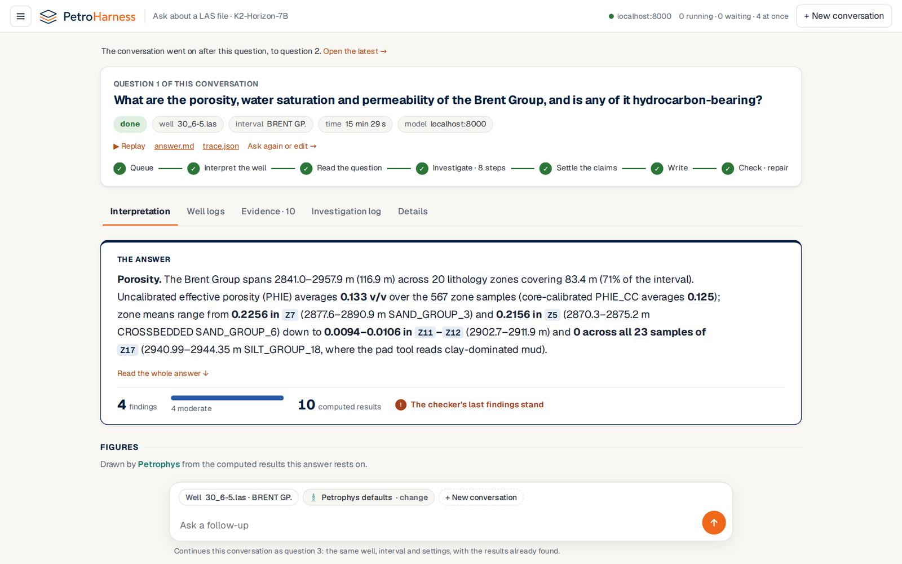
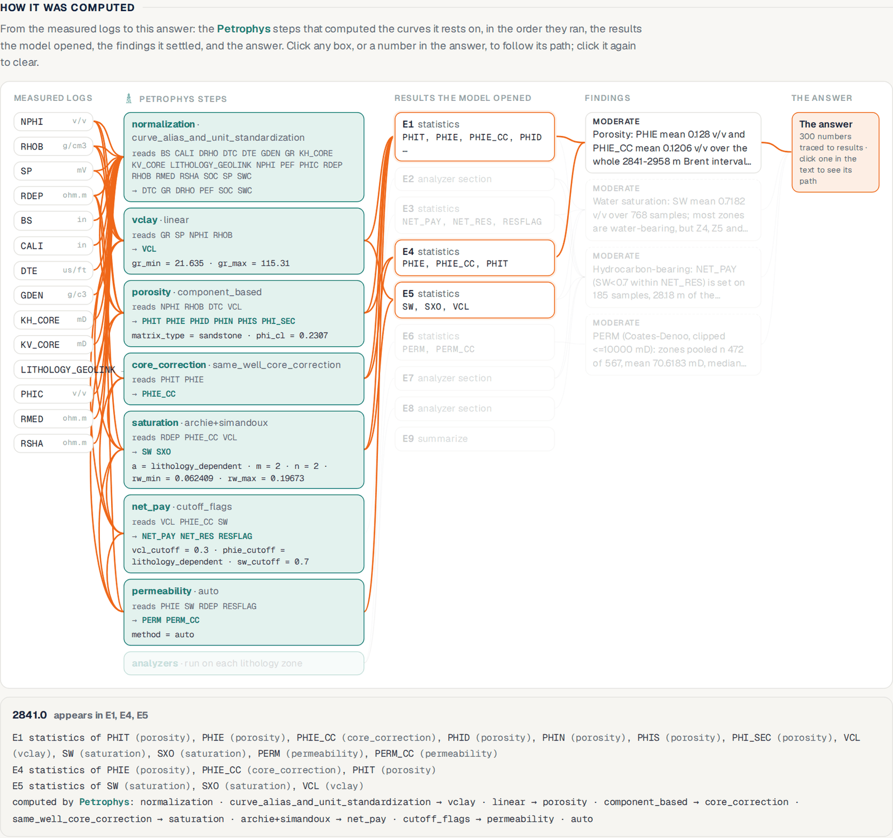
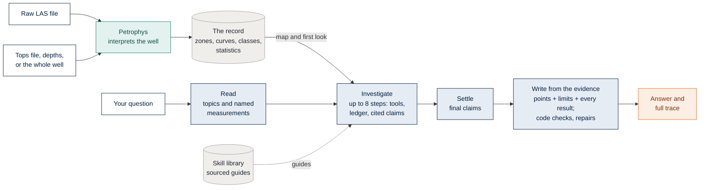

<div align="center">


### An agentic harness that makes formation evaluation<br>auditable and more accurate.

Give it a raw LAS file and a question in plain language. A language model investigates the well step by step,
Petrophys does every calculation, and code checks and records each step, so every number in the answer traces back
to the log.

**[Website](https://welllogbench.com/petroharness/) · [Documentation](https://welllogbench.com/petroharness/docs/) · [Quick start](#quick-start) · [Results](#results) · [Features](#features)**

[](CHANGELOG.md)
[](#quick-start)
[](https://welllogbench.com/petroharness/docs/models.html)
[](https://github.com/sambalshikhar/petrophys)
[](LICENSE)



</div>

## Quick start

**1. Install**

```bash
python3.10 -m venv .venv
.venv/bin/pip install -r requirements.lock
.venv/bin/pip install "petrophys @ git+https://github.com/sambalshikhar/petrophys.git@3a9378e27eaab54077d326ba5fbbfc6de569f56b"
.venv/bin/pip install -e . --no-deps
source .venv/bin/activate
```

**2. Connect a model**

PetroHarness works with any chat model behind an OpenAI-compatible endpoint, with a context window of 64k tokens or
more. Serve one, then point PetroHarness at it:

```bash
# vLLM
vllm serve Qwen/Qwen3-32B --port 8000 --max-model-len 65536
export PETROHARNESS_MODEL_URL=http://localhost:8000/v1

# or Ollama (its default context window is too small, so raise it)
OLLAMA_CONTEXT_LENGTH=65536 ollama serve
ollama pull qwen3:32b
export PETROHARNESS_MODEL_URL=http://localhost:11434/v1
```

Name the model you serve with `--model` (`--model Qwen/Qwen3-32B`, `--model qwen3:32b`). K2-Horizon-7B is the
default and needs no `--model`. Several endpoints go in one variable, comma-separated. SGLang, a hosted API with your
key, and serving K2-Horizon-7B: [Models](https://welllogbench.com/petroharness/docs/models.html).

**3. Launch the UI**

```bash
petroharness --launch-ui                       # K2-Horizon-7B, at PETROHARNESS_MODEL_URL
petroharness --launch-ui --model qwen3:32b     # any other model, by the name it is served under
```

The UI opens at http://localhost:7860. Pick one of Petrophys's sample wells or drop your own LAS file, choose the
interval, and ask in your own words. On a remote machine, forward the port first (`ssh -L 7860:localhost:7860 HOST`)
and open the same address. More: [Web UI](https://welllogbench.com/petroharness/docs/ui.html).

**4. Or ask from the command line**

GeoLink well 30/6-5 ships with Petrophys, so this runs as it is:

```bash
LAS=$(python -c "import petrophys; print(petrophys.sample('30/6-5'))")
TOPS=$(python -c "import petrophys; print(petrophys.sample('formations_30_6-5.csv'))")

petroharness --las $LAS --tops $TOPS --formation "BRENT GP." \
  --question "What are the porosity, water saturation and permeability of the Brent Group, and is any of it hydrocarbon-bearing?"
```

The answer is printed, and `answer.md` and `trace.json` (every model call and every result opened) go to
`./petroharness-out/<LAS name>/`.

<details>
<summary>Go further</summary>

| To | Run | Read |
|---|---|---|
| Ask in the browser | `petroharness --launch-ui` (`petroharness ui` starts the server without opening a browser) | [Web UI](https://welllogbench.com/petroharness/docs/ui.html) |
| Use another model | `--model NAME --model-url URL`, or `--model-card FILE` | [Models](https://welllogbench.com/petroharness/docs/models.html) |
| Keep asking about the interval | `petroharness chat --las $LAS --tops $TOPS --formation "BRENT GP." --session brent` | [Conversations](https://welllogbench.com/petroharness/docs/sessions.html) |
| Audit every answer of a conversation | `petroharness audit brent` | [Audit an answer](https://welllogbench.com/petroharness/docs/evidence.html) |
| Use your own well | `--las FILE` with `--tops FILE --formation NAME`, or `--top D --base D`, or neither for the whole log | [Evaluate a formation](https://welllogbench.com/petroharness/docs/usage.html) |
| Call it from Python | `from petroharness.ask import ask` | [Python API](https://welllogbench.com/petroharness/docs/python-api.html) |

</details>

## Results

**More accurate with PetroHarness.** On the 347 single-formation questions of
[WellLogBench](https://welllogbench.com), the models we tested score +3.0 to +8.6 points higher with PetroHarness.
Our post-trained K2-Horizon-7B goes from 64.0 to 69.3.



<sub>W is WellLogBench's overall score, from 0 to 100. Without the harness, the same model answers from the well's
full Petrophys interpretation, given to it in one prompt. Post-trained (ours): after our WellLogLLM post-training for
well logs. Base: the open model as released.</sub>

<details>
<summary>The numbers, with 95% confidence intervals</summary>

| Model | Without the harness | With PetroHarness | Gain (95% CI) |
|---|--:|--:|--:|
| K2-Horizon-7B post-trained (ours) | 64.02 | 69.29 | **+5.27** (+3.95 to +6.58) |
| K2-Horizon-7B base \* † | 57.15 | 64.67 | **+7.51** (+6.00 to +9.10) |
| K2-Horizon-3.7B post-trained (ours) | 62.04 | 67.15 | **+5.10** (+3.67 to +6.54) |
| K2-Horizon-3.7B base \* | 56.04 | 63.39 | **+7.35** (+5.97 to +8.77) |
| Qwen3.5-27B post-trained (ours) | 65.87 | 68.91 | **+3.04** (+1.70 to +4.34) |
| Qwen3.5-27B base | 57.54 | 66.12 | **+8.58** (+7.19 to +9.98) |
| Gemma 4 31B | 60.97 | 66.25 | **+5.28** (+3.76 to +6.79) |

Each model runs inside PetroHarness unchanged. Gains are paired per question; two runs are averaged for our
post-trained K2-Horizon-7B and Qwen3.5-27B. \* On 346 of the 347 questions. † Its run without the harness read a
truncated context.

</details>

Every score, by component: [welllogbench.com/petroharness](https://welllogbench.com/petroharness/#bench).

## Features

#### Ask anything

<table>
<tr>
<td width="33%" valign="top">

**Any LAS file**<br>
A raw LAS file is all it needs, with tops from any table, a depth window or the whole well. Feet or metres, with
or without a lithology log.

[Evaluate a formation →](https://welllogbench.com/petroharness/docs/usage.html)

</td>
<td width="33%" valign="top">

**Any question**<br>
No fixed list of questions. What the well's record does not hold, the model has Petrophys compute: another method,
a what-if, an estimate, from about 300 functions.

[Tools →](https://welllogbench.com/petroharness/docs/tools.html) · [Worked examples →](https://welllogbench.com/petroharness/docs/examples.html)

</td>
<td width="33%" valign="top">

**Conversations**<br>
Keep an interval open and keep asking. A follow-up builds on what the earlier questions found, and answers carry
figures drawn by Petrophys.

[Conversations →](https://welllogbench.com/petroharness/docs/sessions.html)

</td>
</tr>
</table>

#### Check everything

<table>
<tr>
<td width="33%" valign="top">

**Every number traced**<br>
Click a number in the answer and follow it back to the Petrophys step that computed it and the measured log it
starts from.

[Audit an answer →](https://welllogbench.com/petroharness/docs/evidence.html)

</td>
<td width="33%" valign="top">

**The work on screen**<br>
Watch each step as it happens: what the model looked at, the results it opened, the findings it added and its
reasoning.

[Read the work →](https://welllogbench.com/petroharness/docs/trace.html)

</td>
<td width="33%" valign="top">

**Checked before you read it**<br>
Code checks every number and citation in the draft and sends back what nothing supports. It never rewrites a grade
or a verdict.

[Writer and checker →](https://welllogbench.com/petroharness/docs/writer-and-checker.html)

</td>
</tr>
</table>

#### Make it yours

<table>
<tr>
<td width="33%" valign="top">

**Custom skills**<br>
Teach it how your team interprets. Plug in your own library of interpretation guides with `--skills PATH`, with no
code change.

[Write a skill library →](https://welllogbench.com/petroharness/docs/skills.html#10-writing-your-own-library)

</td>
<td width="33%" valign="top">

**Your model, your machines**<br>
Any chat model behind an OpenAI-compatible endpoint: vLLM, SGLang, Ollama, LM Studio or a hosted API. Serve it
yourself and the well data stays with you.

[Models →](https://welllogbench.com/petroharness/docs/models.html)

</td>
<td width="33%" valign="top">

**Your interpretation**<br>
Set Rw, Archie's a, m and n, the cutoffs, the lithology domain and the zone rule, and preview the zones on your well
before you ask.

[Interpretation settings →](https://welllogbench.com/petroharness/docs/interpretation-settings.html)

</td>
</tr>
</table>

Three ways in: a [web UI](https://welllogbench.com/petroharness/docs/ui.html), a
[command line](https://welllogbench.com/petroharness/docs/cli.html) and a
[Python API](https://welllogbench.com/petroharness/docs/python-api.html). To add a tool, a report style or a model
card, follow the recipes in [Extending](https://welllogbench.com/petroharness/docs/extending.html).

## See it work

One question on GeoLink well 30/6-5, Brent Group, from the first page to an answer you can check. The same tour,
screen by screen: [A tour in pictures](https://welllogbench.com/petroharness/docs/tour.html).



**The answer.** Conclusion first, then its findings by confidence, the computed results they rest on, and the
checker's outcome.



**Every number, traced.** A click on 0.1988 v/v lights its path: the measured logs, the Petrophys steps that computed
the curve, the two results that show it, the finding that cites them and the answer.

<sub>Data: GeoLink, CC BY-SA 4.0.</sub>

## How it works

**Petrophys calculates · the model investigates · the harness records · you decide**



| Stage | What happens |
|---|---|
| **1 · The well** | Petrophys interprets the raw LAS and cuts it to your interval, zoned by its lithology. |
| **2 · Read** | The model reads the question: its topics, the measurements it names, and whether a lookup answers it or it needs an investigation. |
| **3 · Investigate** | Up to eight steps. The model opens results with tools, has Petrophys compute what the record does not hold, and builds claims that cite them. |
| **4 · Settle** | With every opened result in view, the claims become final. |
| **5 · Write and check** | The writer concludes from the evidence. A checker sends back any number that nothing supports, for repair. |

In depth: [Architecture](https://welllogbench.com/petroharness/docs/architecture.html) ·
[The question graph](https://welllogbench.com/petroharness/docs/graph.html) ·
[Design rules](https://welllogbench.com/petroharness/docs/design.html).

## What you can ask

Ask what you would ask a petrophysicist, about a formation, a depth window or the whole log.

| Ask it to | For example |
|---|---|
| **Interpret** | Where are the best reservoir intervals, and is any of them hydrocarbon-bearing? |
| **Check the data** | Where is the hole washed out, and does it affect the density log? |
| **Recompute with another method** | Compute saturation with Simandoux and give me the statistics. |
| **Test a what-if** | How does net pay change if the water saturation cutoff is 0.5? |
| **Estimate a parameter** | What cementation exponent does a Pickett plot give? |

<details>
<summary>More kinds of question, and the topics the skill library covers</summary>

| Ask it to | For example |
|---|---|
| **Describe and compare** | Is porosity higher where shale volume is lower? · Which zone has the highest resistivity? |
| **Classify** | What minerals make up this formation? · Define flow units. · Is there any moveable hydrocarbon? |
| **Summarize** | Net pay, net-to-gross and hydrocarbon pore thickness per zone at a 0.5 SW cutoff. · What would the oil in place be for a 640-acre drainage area? |
| **Calibrate and model** | Fit a saturation-height function with the free-water level at 870 m. · Predict the shear sonic from the compressional sonic. |
| **Go further** | Split the shale into laminated, dispersed and structural parts with Thomas–Stieber. · How heterogeneous is the permeability (Lorenz, Dykstra–Parsons)? |

When a method needs what the well does not carry (Rwb for dual water, CEC for Waxman–Smits, a normal-compaction trend
for Eaton), the answer says what is missing.

The skill library holds a sourced guide for each of these topic areas, and the model picks the guides a question
needs. They guide the investigation; they do not limit what you can ask.

| Rock | Fluids | Reservoir quality | Data and methods |
|---|---|---|---|
| lithology and mineralogy | water saturation | porosity | data quality |
| shale and clay | hydrocarbon detection | permeability and rock quality | statistics and data analysis |
| log facies and stratigraphy | fluid contacts | net reservoir and pay | core-log integration |
| elastic properties | invasion and movability | | |

</details>

Eleven questions worked through on wells that ship with Petrophys:
[Examples](https://welllogbench.com/petroharness/docs/examples.html).

## Built on Petrophys

<table>
<tr>
<td width="200" align="center" valign="middle">
<a href="https://github.com/sambalshikhar/petrophys">

</a>
</td>
<td valign="middle">

[Petrophys](https://github.com/sambalshikhar/petrophys) turns well logs into traceable petrophysical
interpretations: clay volume, porosity, water saturation, permeability, rock quality and net pay. Every step records
its method, inputs, outputs and parameters. PetroHarness reads that record and never recomputes petrophysics on its
own. Documentation: [petrophys.netlify.app](https://petrophys.netlify.app).

</td>
</tr>
</table>

## Documentation

The documentation site: **[welllogbench.com/petroharness/docs](https://welllogbench.com/petroharness/docs/)**. The
same pages live in this repository under [docs/](docs/README.md).

| Start | Use | Understand |
|---|---|---|
| [A tour in pictures](https://welllogbench.com/petroharness/docs/tour.html) | [Evaluate a formation](https://welllogbench.com/petroharness/docs/usage.html) | [Architecture](https://welllogbench.com/petroharness/docs/architecture.html) |
| [Worked examples](https://welllogbench.com/petroharness/docs/examples.html) | [Conversations](https://welllogbench.com/petroharness/docs/sessions.html) | [The question graph](https://welllogbench.com/petroharness/docs/graph.html) |
| [Web UI](https://welllogbench.com/petroharness/docs/ui.html) | [Models](https://welllogbench.com/petroharness/docs/models.html) | [Design rules](https://welllogbench.com/petroharness/docs/design.html) |
| [Read the work](https://welllogbench.com/petroharness/docs/trace.html) | [Interpretation settings](https://welllogbench.com/petroharness/docs/interpretation-settings.html) | [Extending](https://welllogbench.com/petroharness/docs/extending.html) |
| [Audit an answer](https://welllogbench.com/petroharness/docs/evidence.html) | [Skills](https://welllogbench.com/petroharness/docs/skills.html) | [Development and testing](https://welllogbench.com/petroharness/docs/development.html) |

Contributing: [CONTRIBUTING.md](CONTRIBUTING.md). Releases: [CHANGELOG.md](CHANGELOG.md).

## Citation

If you use PetroHarness in your work, please cite the paper:

> **PetroHarness: An Open-Source Agentic Harness for Auditable Formation Evaluation**<br>
> S. Shikhar, Z. Kabashev, S. Umurzak, M. Lee, L. Barillas, S. Bharadwaj, J. Thomas, J. Lahoud, F. Castanedo, H. Cholakkal<br>
> ADIPEC 2026, paper SPE-236034-MS<br>
> Mohamed bin Zayed University of Artificial Intelligence (MBZUAI) · Khalifa University · Inception42 · AIQ; Abu Dhabi, United Arab Emirates

```bibtex
@inproceedings{shikhar2026petroharness,
  title     = {PetroHarness: An Open-Source Agentic Harness for Auditable Formation Evaluation},
  author    = {Shikhar, S. and Kabashev, Z. and Umurzak, S. and Lee, M. and Barillas, L. and Bharadwaj, S. and Thomas, J. and Lahoud, J. and Castanedo, F. and Cholakkal, H.},
  booktitle = {ADIPEC 2026},
  number    = {SPE-236034-MS},
  publisher = {Society of Petroleum Engineers},
  year      = {2026}
}
```

## Licence

PetroHarness is released under the [Creative Commons Attribution 4.0 International licence](LICENSE) (CC BY 4.0):
you may share and adapt it, with credit. Petrophys and the benchmark datasets keep their own licences.

<div align="center">
<br>

&nbsp;&nbsp;&nbsp;

</div>
