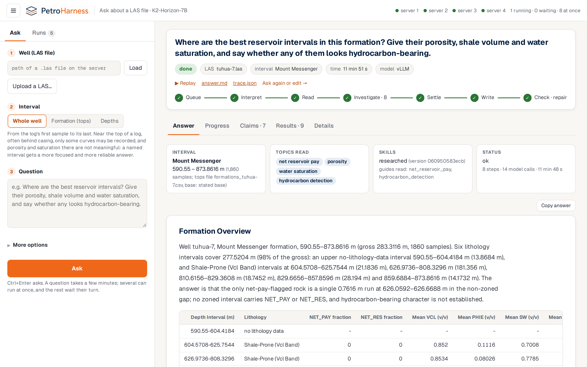
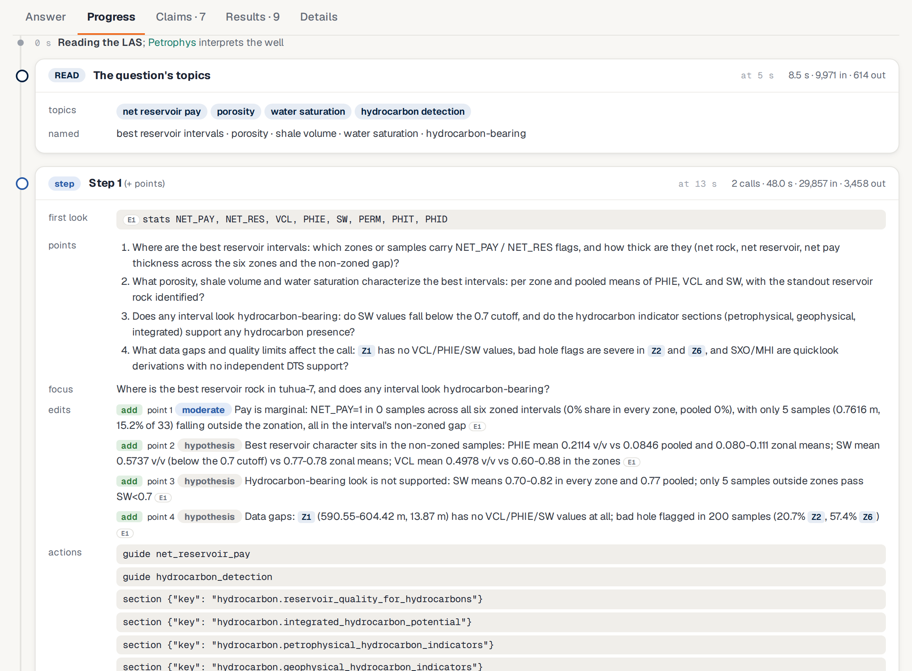
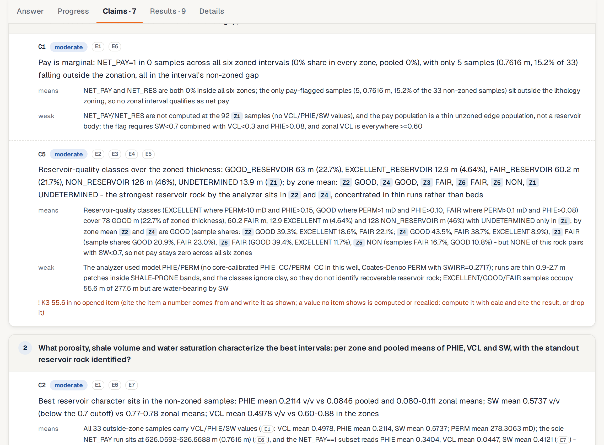
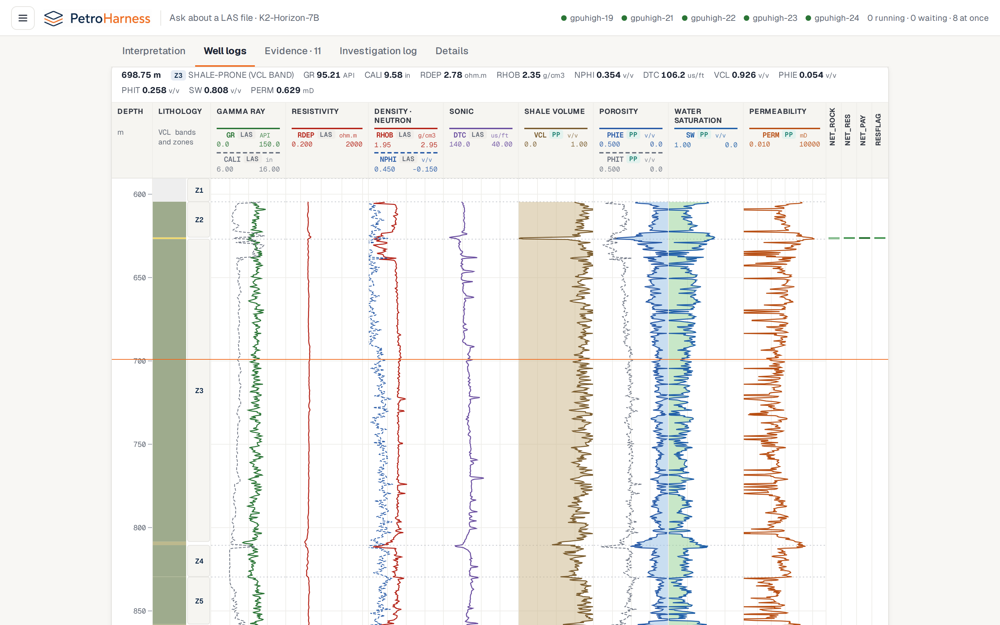
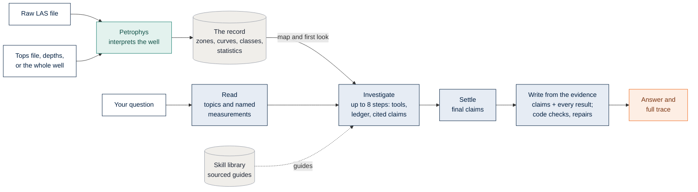

<div align="center">


### Ask a well a question. Get an answer you can audit.

PetroHarness turns a raw LAS file and a question in plain language into a petrophysical interpretation.<br>
Petrophys computes it, a language model investigates it step by step, and code checks the result.<br>
Every number in the answer traces back to the log.

**Petrophys calculates · the model investigates · the harness records · you decide**

[](CHANGELOG.md)
[](#install)
[](docs/MODELS.md)
[](docs/MODELS.md)
[](https://github.com/sambalshikhar/petrophys)
[](#citation)

[Quick start](#quick-start) · [How it works](#how-it-works) · [Your own wells](docs/USAGE.md) · [Models](docs/MODELS.md) · [Web UI](docs/UI.md) · [Architecture](docs/ARCHITECTURE.md) · [Citation](#citation)



</div>

## Why PetroHarness

Interpreting a well log is a chain of small expert decisions. Which curves can be trusted? Which zones matter? Which
cutoff applies? What does a reading mean? A language model handed the whole log at once guesses at them. PetroHarness
gives the model a petrophysicist's way of working instead, and keeps a record of every step.

<table>
<tr>
<td width="33%" valign="top">

#### Every number is traceable
Each number in an answer cites the result it came from. Each result keeps the tool call that opened it, and each
value in it names its source: a measurement, or the Petrophys step that computed it. The trace can rebuild every
prompt.

</td>
<td width="33%" valign="top">

#### An investigation, not a data dump
The model reads a map of the well, then opens only what it needs, zone by zone, over up to eight steps. Along the way
it builds claims that cite their evidence.

</td>
<td width="33%" valign="top">

#### Any LAS file
You give a raw LAS file, and formation tops from any table, a depth window or the whole well. No lithology log? The
well is zoned by shale volume. Depths can be in feet or metres, even mixed.

</td>
</tr>
<tr>
<td valign="top">

#### Petrophys calculates
Clay volume, porosity, saturation, permeability, net pay, analyzer classes and statistics all come from
[Petrophys](https://github.com/sambalshikhar/petrophys). Ask for another method (Simandoux, Timur, a new Rw, other
cutoffs) and the model has Petrophys compute it, from about 300 of its functions.

</td>
<td valign="top">

#### Code checks, the model decides
Code checks each claim's citations and numbers, and any statement that data is missing, and shows the model the
facts it finds. Code never rewrites a grade, a verdict or a sentence.

</td>
<td valign="top">

#### Bring your own model
Use any chat model behind an OpenAI-compatible endpoint: vLLM, SGLang, Ollama, LM Studio or a hosted API.
K2-Horizon-7B is the default. Serve the model yourself and the well data stays on your machines.

</td>
</tr>
</table>

## See how the answer was reached

<table>
<tr>
<td width="50%" valign="top"></td>
<td width="50%" valign="top"></td>
</tr>
<tr>
<td valign="top"><b>Follow the reasoning.</b> The answer comes first, then each part of the question: its finding, how sure it is, a chart of the zone values it rests on against the cutoff, and what could change it.</td>
<td valign="top"><b>Check every claim.</b> Each claim shows what it means, what weakens it and the computed results it rests on; open them under the claim. Click any number in the answer to see the results that show it.</td>
</tr>
<tr>
<td colspan="2" valign="top"></td>
</tr>
<tr>
<td colspan="2" valign="top"><b>See the well.</b> The interval as Petrophys interpreted it, track by track, with the lithology zones the investigation works in. Move over the logs to read every curve at a depth; click a zone to pick it.</td>
</tr>
</table>

## What you can ask

Ask what you would ask a petrophysicist, about a formation, a depth window or the whole log. There is no fixed list
of questions. The model reads the well's interpretation record, and when the record does not hold the answer, it has
Petrophys compute it: another method, an estimate, a what-if, a fit, or any of about 300 Petrophys functions.

| Ask it to | For example |
|---|---|
| **Interpret** | Where are the best reservoir intervals, and is any of them hydrocarbon-bearing? · Is there a fluid contact in this sand, and at what depth? |
| **Describe and compare** | Is porosity higher where shale volume is lower? · Which zone has the highest resistivity? |
| **Check the data** | Where is the hole washed out, and does it affect the density log? · Are there held readings in any log? |
| **Recompute with another method** | Compute saturation with Simandoux and give me the statistics. · Recompute porosity with a limestone matrix. · Use Coates permeability with an irreducible water saturation of 0.25. |
| **Test a what-if** | How does net pay change if the water saturation cutoff is 0.5? · How sensitive is water saturation to m between 1.8 and 2.4? · Compare Archie, Simandoux and Indonesia. |
| **Estimate a parameter** | What cementation exponent does a Pickett plot give? · Estimate the formation water resistivity and compare it with the Rw used. |
| **Classify** | What minerals make up this formation? · Define flow units. · Is there any moveable hydrocarbon? |
| **Summarize** | Net pay, net-to-gross and hydrocarbon pore thickness per zone at a 0.5 SW cutoff. · What would the oil in place be for a 640-acre drainage area? |
| **Calibrate and model** | Fit a saturation-height function with the free-water level at 870 m. · Predict the shear sonic from the compressional sonic. · Elastic properties by zone. |
| **Go further** | Split the shale into laminated, dispersed and structural parts with Thomas–Stieber. · How heterogeneous is the permeability (Lorenz, Dykstra–Parsons)? |

When a method needs what the well does not carry (Rwb for dual water, CEC for Waxman–Smits, a normal-compaction
trend for Eaton), the answer says what is missing. The tools and the functions behind them: [docs/TOOLS.md](docs/TOOLS.md).

**Skill guides.** For the topic areas below, the skill library holds a sourced guide, and the model picks the guides
a question needs. They guide the investigation; they do not limit what you can ask.

| Rock | Fluids | Reservoir quality | Data and methods |
|---|---|---|---|
| lithology and mineralogy | water saturation | porosity | data quality |
| shale and clay | hydrocarbon detection | permeability and rock quality | statistics and data analysis |
| log facies and stratigraphy | fluid contacts | net reservoir and pay | core-log integration |
| elastic properties | invasion and movability | | |

## How it works



| Stage | What happens |
|---|---|
| **1 · The well** | Petrophys interprets the raw LAS and cuts it to your interval. The interval is zoned by its lithology log, or by shale-volume bands when there is none. |
| **2 · Read** | The model chooses the topic areas the question touches, lists the measurements the question names, and says whether the question is direct (a value, a setting, a count that one or two lookups state) or needs an investigation. A direct question skips stages 3 and 4: one or two lookups, then a short answer with its basis, in about a quarter of the model's work. Where the lookups do not state what is asked, it gets the investigation after all. `--investigate` gives every question the full investigation. |
| **3 · Investigate** | Up to eight steps, each one model call rebuilt from the state. The model opens results with tools (statistics zone by zone, analyzer classes as located depth runs, profiles, comparisons, crossplots, overlaps, arithmetic), has Petrophys compute what the record does not hold (another method, an estimate, a what-if, any of its functions), and adds, revises or drops claims that cite them. Code checks each claim as it arrives. |
| **4 · Settle** | With every opened result in view, the claims become final. |
| **5 · Write and check** | The writer concludes once, from all the evidence: the settled claims, every result the investigation opened (where they differ, the results decide) and a card of what each curve is and how its values were made. A checker sends back numbers no result shows, statements the record contradicts and leftover working notes, for repair. |

The parts in detail: [docs/ARCHITECTURE.md](docs/ARCHITECTURE.md). The question graph, node by node:
[docs/GRAPH.md](docs/GRAPH.md). The design rules: [docs/DESIGN.md](docs/DESIGN.md).

## Quick start

### Install

```bash
python3.10 -m venv .venv
.venv/bin/pip install -r requirements.lock
.venv/bin/pip install "petrophys @ git+https://github.com/sambalshikhar/petrophys.git@916ca46c37980ceac56a0c4ac94b2eb0f8d8632c"
.venv/bin/pip install -e . --no-deps
```

This installs the `petroharness` command. Petrophys is pinned at commit `916ca46`.

### Connect a model

Point PetroHarness at any OpenAI-compatible endpoint:

```bash
export PETROHARNESS_MODEL_URL=http://localhost:8000/v1     # several servers: comma-separated
```

The default model is K2-Horizon-7B. To use any other chat model, give its served name with `--model`:

```bash
petroharness --model Qwen/Qwen3-32B --las well.las --question "..."
```

How to serve a model with vLLM, SGLang or Ollama, a reasoning model's settings, a hosted API, and model cards:
[docs/MODELS.md](docs/MODELS.md).

### Ask

```bash
petroharness --las well.las --tops tops.csv --formation "Mount Messenger" \
    --question "Where are the best reservoir intervals, and is any of them hydrocarbon-bearing?"
```

| You have | Choose the interval with |
|---|---|
| a tops file | `--tops tops.csv --formation NAME` (CSV, TSV or Excel; its columns are found by meaning) |
| depths | `--top 5340 --base 5600 --depth-unit ft` |
| neither | nothing: the whole well is the default |

The answer is printed. `answer.md` and `trace.json` are written to `./petroharness-out/<well>/`; the trace holds
every model call and every result opened. With no lithology log, the well is zoned by shale volume
(`--lithology-curve` names one the harness does not find, and `--formation-lithology` states what you know). Every
option, with examples on three wells: [docs/USAGE.md](docs/USAGE.md).

### Keep asking

```bash
petroharness chat --las well.las --tops tops.csv --formation "Mount Messenger"
```

One interval stays open and you ask as many questions as you like. A later question starts from what the earlier ones
found: ask about an answer, try another method or parameter, or go further. Where a plot says it better, the answer
carries figures drawn by Petrophys. [docs/SESSIONS.md](docs/SESSIONS.md).

### Audit an answer

```bash
petroharness audit ./petroharness-sessions/well-20261114-101500
```

For each answer: the claims and the results they cite, each number with the results that show it, the curves those
results read, the Petrophys steps and parameters behind the curves, and the LAS file's hash. It is read from the
session folder alone. [docs/EVIDENCE.md](docs/EVIDENCE.md).

### In the browser

```bash
petroharness ui                      # http://127.0.0.1:7860
```

In the browser you can:

- pick a LAS file and the interval, and ask your question;
- read the answer as a story: the conclusion, the well with the zones it names, and each finding with the zone values
  it rests on;
- see the interval's logs as Petrophys interpreted them;
- trace any number in the answer to the results that show it, check each claim against its evidence, and follow
  every step of the investigation in its log.

Runs are saved, and can be rated and replayed. See [docs/UI.md](docs/UI.md).

### From Python

```python
from petroharness.ask import ask

result = ask("well.las", "Are there any hydrocarbon indicators?", tops="tops.csv", formation="Oread",
             model="Qwen/Qwen3-32B", model_url="http://localhost:8000/v1")
print(result.answer)          # result.trace: every call and every result opened
```

## Make it yours

| Part | How to change it |
|---|---|
| **Models** | Any chat model, by name or by a model card with its own request settings. See [docs/MODELS.md](docs/MODELS.md). |
| **Petrophys tools** | Every public Petrophys function is reachable by request; a function added to Petrophys appears with no change here. See [docs/TOOLS.md](docs/TOOLS.md). |
| **Skill library** | Plug in your own guides with `--skills PATH`, or run with none (`--skills none`). A library is checked as it loads. See [skills/README.md](src/petroharness/resources/skills/README.md). |
| **Reporting conventions** | Your data's own conventions (a basis, how units are named) go in its data config, never in the code. See [docs/DEVELOPMENT.md](docs/DEVELOPMENT.md#the-data-config). |
| **Interpretation** | Petrophys's default workflow, a Petrophys context profile (`--profile`), or an interpreter of your own. See [docs/DEVELOPMENT.md](docs/DEVELOPMENT.md#configuration). |
| **Benchmark mode** | Run a question file with reference answers in parallel, for validation (`petroharness benchmark`). See [docs/DEVELOPMENT.md](docs/DEVELOPMENT.md#benchmark-mode). |

## Built on Petrophys

<table>
<tr>
<td width="200" align="center" valign="middle">
<a href="https://github.com/sambalshikhar/petrophys">

</a>
</td>
<td valign="middle">

[Petrophys](https://github.com/sambalshikhar/petrophys) turns well logs into traceable petrophysical
interpretations: clay volume, porosity, water saturation, permeability, rock quality and net pay. Every step records
its method, inputs, outputs and parameters, and every skipped step records why. PetroHarness reads that record. It
never recomputes petrophysics on its own. Documentation: [petrophys.netlify.app](https://petrophys.netlify.app).

</td>
</tr>
</table>

## Documentation

| Guide | What it covers |
|---|---|
| [docs/USAGE.md](docs/USAGE.md) | asking about your own wells: intervals, tops files, units, lithology, output, the Python API |
| [docs/SESSIONS.md](docs/SESSIONS.md) | conversations: follow-up questions on one interval, figures, the session folder, resume |
| [docs/EVIDENCE.md](docs/EVIDENCE.md) | the evidence graph and the audit trail of an answer |
| [docs/SETUP.md](docs/SETUP.md) | the setup record: what answers a question, with one hash |
| [docs/TOOLS.md](docs/TOOLS.md) | the tools by request, and Petrophys's functions: calculate, estimate, what_if, check, classify, summarize, calibrate |
| [docs/MODELS.md](docs/MODELS.md) | models: serving, model cards, reasoning models, hosted APIs |
| [docs/UI.md](docs/UI.md) | the web UI: options, the parts of the page, its API |
| [docs/ARCHITECTURE.md](docs/ARCHITECTURE.md) | the parts, and how a question flows through them |
| [docs/GRAPH.md](docs/GRAPH.md) | the question graph, node by node |
| [docs/SESSION_GRAPH.md](docs/SESSION_GRAPH.md) | the session graph and the later-question graph |
| [docs/DESIGN.md](docs/DESIGN.md) | the design rules and the generality contract |
| [docs/DEVELOPMENT.md](docs/DEVELOPMENT.md) | configuration, benchmark mode, testing and the code layout |
| [CONTRIBUTING.md](CONTRIBUTING.md) | where a contribution goes and how to show a change is safe |
| [tests/gate/README.md](tests/gate/README.md) | the gates: the public mini set, the golden tapes, the request gate |
| [AGENTS.md](AGENTS.md) | the rules for changing the code |
| [CHANGELOG.md](CHANGELOG.md) | the releases |

## Citation

If you use PetroHarness in your work, please cite the paper:

> **PetroHarness: An Open-Source Agentic Harness for Auditable Formation Evaluation**<br>
> S. Shikhar, Z. Kabashev, S. Umurzak, M. Lee, L. Barillas, S. Bharadwaj, J. Thomas, J. Lahoud, F. Castanedo, H. Cholakkal<br>
> ADIPEC 2026, paper SPE-236034-MS<br>
> Mohamed bin Zayed University of Artificial Intelligence (MBZUAI) · Khalifa University · Inception42 · AIQ; Abu Dhabi, United Arab Emirates

```bibtex
@inproceedings{shikhar2026petroharness,
  title     = {PetroHarness: An Open-Source Agentic Harness for Auditable Formation Evaluation},
  author    = {Shikhar, S. and Kabashev, Z. and Umurzak, S. and Lee, M. and Barillas, L. and Bharadwaj, S. and Thomas, J. and Lahoud, J. and Castanedo, F. and Cholakkal, H.},
  booktitle = {ADIPEC 2026},
  number    = {SPE-236034-MS},
  publisher = {Society of Petroleum Engineers},
  year      = {2026}
}
```

<div align="center">
<br>

&nbsp;&nbsp;&nbsp;

</div>
