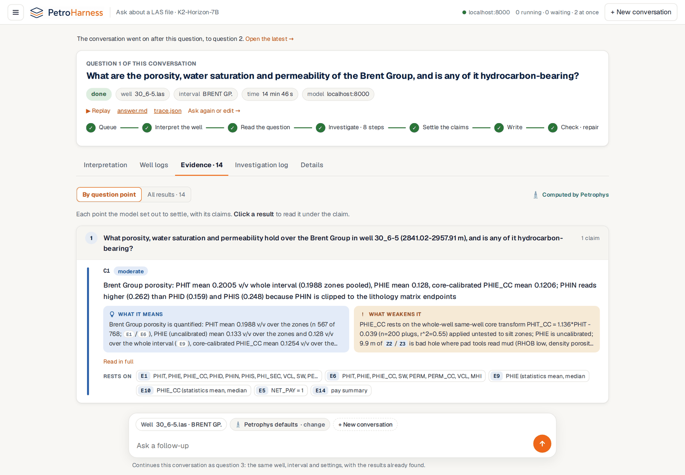
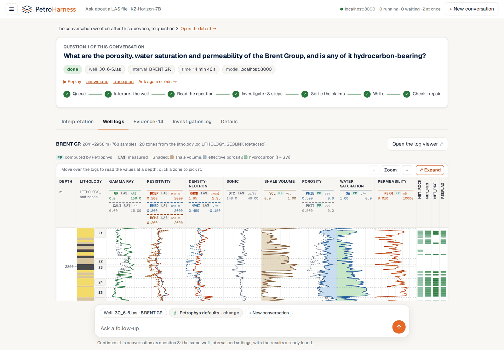
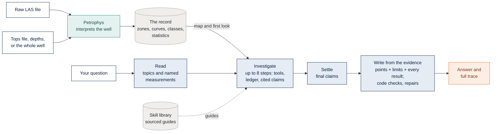
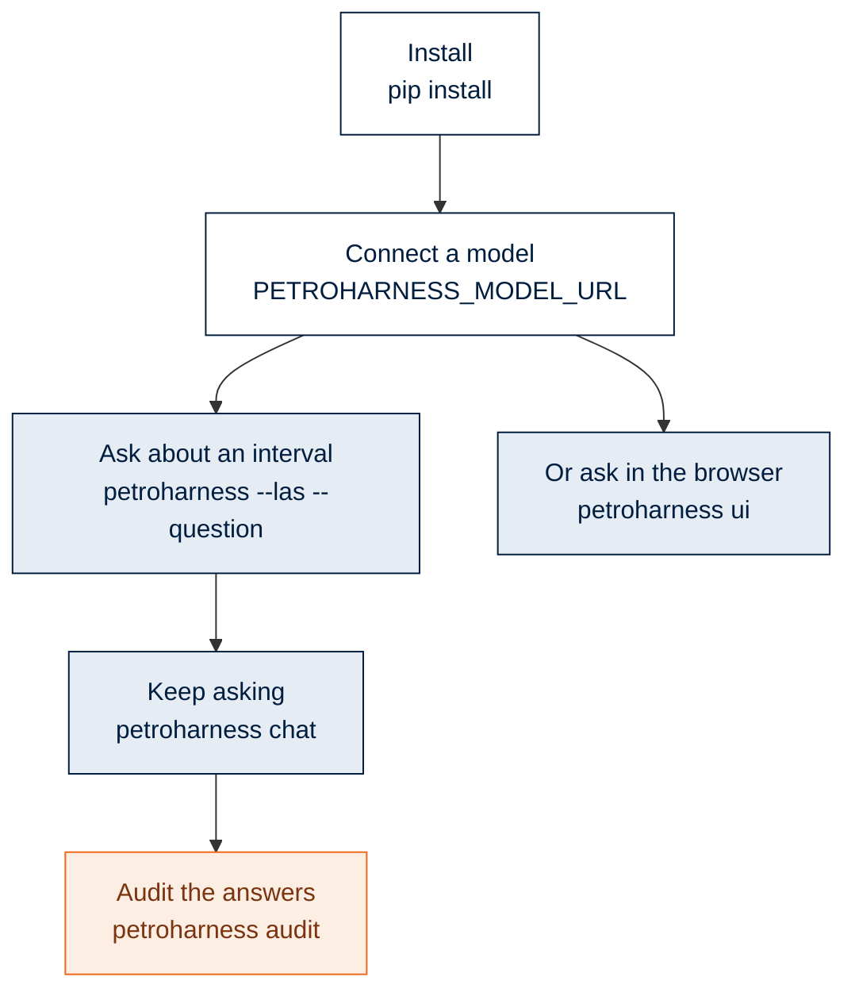
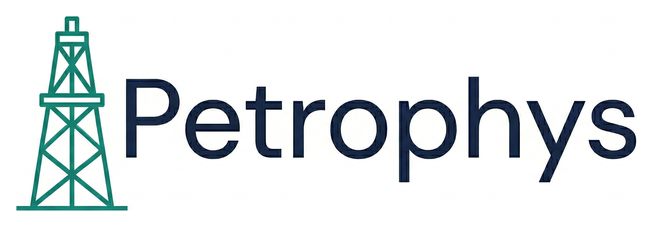

<div align="center">


### Ask a well a question. Get an answer you can audit.

PetroHarness turns a raw LAS file and a question in plain language into a petrophysical interpretation.<br>
Petrophys computes it, a language model investigates it step by step, and code checks the result.<br>
Every number in the answer traces back to the log.

**Petrophys calculates · the model investigates · the harness records · you decide**

[](CHANGELOG.md)
[](#install)
[](docs/MODELS.md)
[](docs/MODELS.md)
[](https://github.com/sambalshikhar/petrophys)
[](#citation)

[Quick start](#quick-start) · [How it works](#how-it-works) · [Evaluate a formation](docs/USAGE.md) · [Models](docs/MODELS.md) · [Web UI](docs/UI.md) · [Architecture](docs/ARCHITECTURE.md) · [Citation](#citation)


</div>

## Why PetroHarness

Interpreting a well log is a chain of small expert decisions. Which curves can be trusted? Which zones matter? Which
cutoff applies? What does a reading mean? A language model handed the whole log at once guesses at them. PetroHarness
gives the model a petrophysicist's way of working instead, and keeps a record of every step.

<table>
<tr>
<td width="33%" valign="top">

#### Every number is traceable
Each number in an answer cites the result it came from. Each result keeps the tool call that opened it, and each
value in it names its source: a measurement, or the Petrophys step that computed it. A conversation keeps every
request the model was sent, and its reply.

</td>
<td width="33%" valign="top">

#### An investigation, not a data dump
The model reads a map of the well, then opens only what it needs, zone by zone, over up to eight steps. Along the way
it builds claims that cite their evidence.

</td>
<td width="33%" valign="top">

#### Any LAS file
You give a raw LAS file, and formation tops from any table, a depth window or the whole well. No lithology log? The
well is zoned by the lithology Petrophys's mineral solver gives. Depths can be in feet or metres, even mixed.

</td>
</tr>
<tr>
<td valign="top">

#### Petrophys calculates
Clay volume, porosity, saturation, permeability, net pay, analyzer classes and statistics all come from
[Petrophys](https://github.com/sambalshikhar/petrophys). Ask for another method (Simandoux, Timur, a new Rw, other
cutoffs) and the model has Petrophys compute it, from about 300 of its functions.

</td>
<td valign="top">

#### Code checks, the model decides
Code checks each claim's citations and numbers, and any statement that data is missing, and shows the model the
facts it finds. Code never rewrites a grade, a verdict or a sentence.

</td>
<td valign="top">

#### Bring your own model
Use any chat model behind an OpenAI-compatible endpoint: vLLM, SGLang, Ollama, LM Studio or a hosted API.
K2-Horizon-7B is the default. Serve the model yourself and the well data stays on your machines.

</td>
</tr>
</table>

## See how the answer was reached

<table>
<tr>
<td colspan="2" valign="top"></td>
</tr>
<tr>
<td colspan="2" valign="top"><b>Watch the work.</b> Each step as it finishes: what it looked at, the results it opened, the findings it added or revised, and the model's reasoning for the call, streamed while it thinks. <a href="docs/TRACE.md">How to read it</a>.</td>
</tr>
<tr>
<td width="50%" valign="top"></td>
<td width="50%" valign="top"></td>
</tr>
<tr>
<td valign="top"><b>Trace every number.</b> Click a number in the answer and follow it back: the results that show it, the Petrophys steps and parameters that computed them, and the measured logs they start from.</td>
<td valign="top"><b>Check every claim.</b> Each point of the question with its claims, graded: what each means, what weakens it, what the code checked, and the computed results it rests on.</td>
</tr>
<tr>
<td colspan="2" valign="top"></td>
</tr>
<tr>
<td colspan="2" valign="top"><b>See the well.</b> The interval as Petrophys interpreted it, track by track, with the zones from the lithology log the investigation works in. Move over the logs to read every curve at a depth; click a zone to pick it. Data: GeoLink, CC BY-SA 4.0.</td>
</tr>
</table>

## What you can ask

Ask what you would ask a petrophysicist, about a formation, a depth window or the whole log. There is no fixed list
of questions. The model reads the well's interpretation record, and when the record does not hold the answer, it has
Petrophys compute it: another method, an estimate, a what-if, a fit, or any of about 300 Petrophys functions.

| Ask it to | For example |
|---|---|
| **Interpret** | Where are the best reservoir intervals, and is any of them hydrocarbon-bearing? · Is there a fluid contact in this sand, and at what depth? |
| **Describe and compare** | Is porosity higher where shale volume is lower? · Which zone has the highest resistivity? |
| **Check the data** | Where is the hole washed out, and does it affect the density log? · Are there held readings in any log? |
| **Recompute with another method** | Compute saturation with Simandoux and give me the statistics. · Recompute porosity with a limestone matrix. · Use Coates permeability with an irreducible water saturation of 0.25. |
| **Test a what-if** | How does net pay change if the water saturation cutoff is 0.5? · How sensitive is water saturation to m between 1.8 and 2.4? · Compare Archie, Simandoux and Indonesia. |
| **Estimate a parameter** | What cementation exponent does a Pickett plot give? · Estimate the formation water resistivity and compare it with the Rw used. |
| **Classify** | What minerals make up this formation? · Define flow units. · Is there any moveable hydrocarbon? |
| **Summarize** | Net pay, net-to-gross and hydrocarbon pore thickness per zone at a 0.5 SW cutoff. · What would the oil in place be for a 640-acre drainage area? |
| **Calibrate and model** | Fit a saturation-height function with the free-water level at 870 m. · Predict the shear sonic from the compressional sonic. · Elastic properties by zone. |
| **Go further** | Split the shale into laminated, dispersed and structural parts with Thomas–Stieber. · How heterogeneous is the permeability (Lorenz, Dykstra–Parsons)? |

When a method needs what the well does not carry (Rwb for dual water, CEC for Waxman–Smits, a normal-compaction
trend for Eaton), the answer says what is missing. The tools and the functions behind them: [docs/TOOLS.md](docs/TOOLS.md).
Eleven questions worked through on wells that ship with Petrophys: [docs/EXAMPLES.md](docs/EXAMPLES.md).

**Skill guides.** For the topic areas below, the skill library holds a sourced guide, and the model picks the guides
a question needs. They guide the investigation; they do not limit what you can ask.

| Rock | Fluids | Reservoir quality | Data and methods |
|---|---|---|---|
| lithology and mineralogy | water saturation | porosity | data quality |
| shale and clay | hydrocarbon detection | permeability and rock quality | statistics and data analysis |
| log facies and stratigraphy | fluid contacts | net reservoir and pay | core-log integration |
| elastic properties | invasion and movability | | |

## How it works



| Stage | What happens |
|---|---|
| **1 · The well** | Petrophys interprets the raw LAS and cuts it to your interval. The interval is zoned by its lithology log; without one, by the lithology Petrophys's mineral solver gives; with neither, by shale-volume bands. |
| **2 · Read** | The model chooses the topic areas the question touches, lists the measurements the question names, and says whether the question is direct (a value, a setting, a count that one or two lookups state) or needs an investigation. A direct question skips stages 3 and 4: one or two lookups, then a short answer with its basis, in about a quarter of the model's work. Where the lookups do not state what is asked, it gets the investigation after all. `--investigate` gives every question the full investigation. |
| **3 · Investigate** | Up to eight steps, each one model call rebuilt from the state. The model opens results with tools (statistics zone by zone, analyzer classes as located depth runs, profiles, comparisons, crossplots, overlaps, arithmetic), has Petrophys compute what the record does not hold (another method, an estimate, a what-if, any of its functions), and adds, revises or drops claims that cite them. Code checks each claim as it arrives. |
| **4 · Settle** | With every opened result in view, the claims become final. |
| **5 · Write and check** | The writer concludes once, from all the evidence: the question's points with the limits the settled claims found, every result the investigation opened and a card of what each curve is and how its values were made. A checker sends back numbers that nothing the writer was shown supports, statements the record contradicts and leftover working notes, for repair. |

The parts in detail: [docs/ARCHITECTURE.md](docs/ARCHITECTURE.md). The question graph, node by node:
[docs/GRAPH.md](docs/GRAPH.md). The design rules: [docs/DESIGN.md](docs/DESIGN.md).

## Quick start



### Install

```bash
python3.10 -m venv .venv
.venv/bin/pip install -r requirements.lock
.venv/bin/pip install "petrophys @ git+https://github.com/sambalshikhar/petrophys.git@7aa9968e72e7c09a28e68af383471184af9f5f52"
.venv/bin/pip install -e . --no-deps
source .venv/bin/activate
```

This installs the `petroharness` command. Petrophys is pinned at commit `7aa9968`, and its sample wells are the ones
the examples below ask about.

### Connect a model

```bash
export PETROHARNESS_MODEL_URL=http://localhost:8000/v1     # any OpenAI-compatible endpoint; several: comma-separated
```

The default model is K2-Horizon-7B. For any other chat model, give its served name with `--model Qwen/Qwen3-32B`.
Serving with vLLM, SGLang or Ollama, reasoning models, hosted APIs and model cards: [docs/MODELS.md](docs/MODELS.md).

### Ask

GeoLink well 30/6-5 ships with Petrophys. Its Brent Group (2841–2958 m) has a lithology log and core:

```bash
LAS=$(python -c "import petrophys; print(petrophys.sample('30/6-5'))")
TOPS=$(python -c "import petrophys; print(petrophys.sample('formations_30_6-5.csv'))")

petroharness --las $LAS --tops $TOPS --formation "BRENT GP." \
  --question "What are the porosity, water saturation and permeability of the Brent Group, and is any of it hydrocarbon-bearing?"
```

> **30_6-5: BRENT GP.** · 2841-2958 m, 768 samples · zones from the lithology log LITHOLOGY_GEOLINK (detected) ·
> status ok, 8 investigation steps
>
> **Hydrocarbon potential.** No zone is confirmed to hold hydrocarbons. The integrated analyzer flags
> **PRIME_OIL_TARGET on 23.6 m (28.4 % of the zoned thickness)** in Z1, Z4–Z5, Z6, Z7, Z8 and Z9. […]

| You have | Choose the interval with | A sample well that shows it |
|---|---|---|
| a tops file (CSV, TSV or Excel) | `--tops FILE --formation NAME` | GeoLink 30/6-5, `--formation "BRENT GP."` |
| depths | `--top D --base D` | GeoLink 25/5-1, `--top 2990 --base 3290` (its cored section) |
| neither | nothing: the whole log | Teapot 17-WX-21, in feet from surface (`petrophys.sample('teapot_17-wx-21')`) |

The answer is printed, and `answer.md` and `trace.json` (every model call and every result opened) go to
`./petroharness-out/<LAS name>/`. A well with no lithology log, such as Taranaki tuhua-7, is zoned by the lithology
Petrophys's mineral solver gives. More: [docs/USAGE.md](docs/USAGE.md).

Data: GeoLink, CC BY-SA 4.0; Teapot Dome (NPR-3), RMOTC, U.S. Department of Energy; Taranaki Basin Curated Well Logs
Dataset (New Zealand Petroleum & Minerals), CDLA-Sharing-1.0.

### Keep asking

```bash
petroharness chat --las $LAS --tops $TOPS --formation "BRENT GP." --session brent
```

One interval stays open for as many questions as you have. A later question starts from what the earlier ones found:
ask about an answer, try another method or parameter, or go further. Answers carry figures drawn by Petrophys where a
plot says it better. [docs/SESSIONS.md](docs/SESSIONS.md).

### Audit an answer

```bash
petroharness audit brent                 # every answer's trail; --question N for one
petroharness report brent                # the whole conversation as one document
```

Each answer's claims and the results they cite, and each number's path back through the curves and the Petrophys
steps to the LAS file, read from the session folder alone. [docs/EVIDENCE.md](docs/EVIDENCE.md).

### In the browser

```bash
petroharness ui                          # http://127.0.0.1:7860
```


Pick a LAS file and the interval, and ask. The page shows the well as Petrophys interpreted it, then the work as it
happens (each step with what it looked at, the results it opened, the findings it added and the model's reasoning),
then the answer, conclusion first, with its figures and every number traceable to the results that show it. Runs are
saved, and can be rated and replayed. A tour in pictures: [docs/TOUR.md](docs/TOUR.md). The page in full:
[docs/UI.md](docs/UI.md).

### From Python

```python
import petrophys
from petroharness.ask import ask

result = ask(petrophys.sample("30/6-5"), "Which zone has the best reservoir quality?",
             tops=petrophys.sample("formations_30_6-5.csv"), formation="BRENT GP.",
             model_url="http://localhost:8000/v1")
print(result.answer)          # result.trace: every call and every result opened
```

## Make it yours

| Part | How to change it |
|---|---|
| **Models** | Any chat model, by name or by a model card with its own request settings. See [docs/MODELS.md](docs/MODELS.md). |
| **Petrophys tools** | Every public Petrophys function is reachable by request; a function added to Petrophys appears with no change here. See [docs/TOOLS.md](docs/TOOLS.md). |
| **Skill library** | Plug in your own guides with `--skills PATH`, or run with none (`--skills none`). A library is checked as it loads. See [skills/README.md](src/petroharness/resources/skills/README.md). |
| **Reporting conventions** | Your data's own conventions (a basis, how units are named) go in its data config, never in the code. See [docs/DEVELOPMENT.md](docs/DEVELOPMENT.md#the-data-config). |
| **Interpretation** | Petrophys's default workflow, a Petrophys context profile (`--profile`), or an interpreter of your own. See [docs/DEVELOPMENT.md](docs/DEVELOPMENT.md#configuration). |
| **Benchmark mode** | Run a question file with reference answers in parallel, for validation (`petroharness benchmark`). See [docs/DEVELOPMENT.md](docs/DEVELOPMENT.md#benchmark-mode). |

## Built on Petrophys

<table>
<tr>
<td width="200" align="center" valign="middle">
<a href="https://github.com/sambalshikhar/petrophys">

</a>
</td>
<td valign="middle">

[Petrophys](https://github.com/sambalshikhar/petrophys) turns well logs into traceable petrophysical
interpretations: clay volume, porosity, water saturation, permeability, rock quality and net pay. Every step records
its method, inputs, outputs and parameters, and every skipped step records why. PetroHarness reads that record. It
never recomputes petrophysics on its own. Documentation: [petrophys.netlify.app](https://petrophys.netlify.app).

</td>
</tr>
</table>

## Documentation

Start at **[docs/README.md](docs/README.md)**: the map of the documentation, with reading paths by goal. Every command,
field, setting, tool and record is described in the [reference](docs/README.md#4-reference).

| Guide | What it covers |
|---|---|
| [docs/README.md](docs/README.md) | the map of the documentation: guides, concepts and the full reference |
| [docs/TOUR.md](docs/TOUR.md) | a tour in pictures: one question from start to finish in the web UI, with the command that does the same |
| [docs/EXAMPLES.md](docs/EXAMPLES.md) | eleven questions worked through, on wells that ship with Petrophys |
| [docs/USAGE.md](docs/USAGE.md) | evaluating a formation in your own wells: intervals, tops files, units, lithology, output, the Python API |
| [docs/SESSIONS.md](docs/SESSIONS.md) | conversations: follow-up questions on one interval, figures, the session folder, resume |
| [docs/EVIDENCE.md](docs/EVIDENCE.md) | auditing an answer: the evidence graph, the audit trail, the report, and the setup record with its hash |
| [docs/TOOLS.md](docs/TOOLS.md) | the tools by request, and Petrophys's functions: calculate, estimate, what_if, check, classify, summarize, calibrate |
| [docs/MODELS.md](docs/MODELS.md) | models: serving, model cards, reasoning models, hosted APIs |
| [docs/UI.md](docs/UI.md) | the web UI: options, the parts of the page, its API |
| [docs/TRACE.md](docs/TRACE.md) | reading the work behind an answer: each step's results, findings and reasoning |
| [docs/ARCHITECTURE.md](docs/ARCHITECTURE.md) | the parts, and how a question flows through them |
| [docs/GRAPH.md](docs/GRAPH.md) | the three graphs: the question graph node by node, the later-question graph and the session graph |
| [docs/DESIGN.md](docs/DESIGN.md) | the design rules and the generality contract |
| [docs/DEVELOPMENT.md](docs/DEVELOPMENT.md) | configuration, benchmark mode, testing and the code layout |
| [CONTRIBUTING.md](CONTRIBUTING.md) | where a contribution goes and how to show a change is safe |
| [tests/gate/README.md](tests/gate/README.md) | the gates: the public mini set, the golden tapes, the request gate |
| [AGENTS.md](AGENTS.md) | the rules for changing the code |
| [CHANGELOG.md](CHANGELOG.md) | the releases |

## Licence

PetroHarness is released under the [Creative Commons Attribution 4.0 International licence](LICENSE) (CC BY 4.0):
you may share and adapt it, with credit. Petrophys and the benchmark datasets keep their own licences.

## Citation

If you use PetroHarness in your work, please cite the paper:

> **PetroHarness: An Open-Source Agentic Harness for Auditable Formation Evaluation**<br>
> S. Shikhar, Z. Kabashev, S. Umurzak, M. Lee, L. Barillas, S. Bharadwaj, J. Thomas, J. Lahoud, F. Castanedo, H. Cholakkal<br>
> ADIPEC 2026, paper SPE-236034-MS<br>
> Mohamed bin Zayed University of Artificial Intelligence (MBZUAI) · Khalifa University · Inception42 · AIQ; Abu Dhabi, United Arab Emirates

```bibtex
@inproceedings{shikhar2026petroharness,
  title     = {PetroHarness: An Open-Source Agentic Harness for Auditable Formation Evaluation},
  author    = {Shikhar, S. and Kabashev, Z. and Umurzak, S. and Lee, M. and Barillas, L. and Bharadwaj, S. and Thomas, J. and Lahoud, J. and Castanedo, F. and Cholakkal, H.},
  booktitle = {ADIPEC 2026},
  number    = {SPE-236034-MS},
  publisher = {Society of Petroleum Engineers},
  year      = {2026}
}
```

<div align="center">
<br>

&nbsp;&nbsp;&nbsp;

</div>
