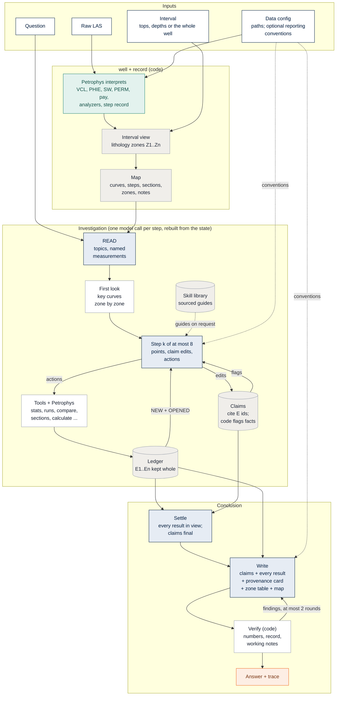

# Architecture

One question: a well's raw LAS, an interval of it, a question. The answer is built in four layers; each reads only
the layer below it.

```
well      raw LAS -> Petrophys interpretation -> prepared well -> interval view (samples, zones, curves)
record    the interpretation's record as evidence: analyzer sections, the evidence catalog, the record's facts
agent     the map; the investigation (tools, ledger, claims, skills) as a graph of single-turn model calls; the writer
cli       one question, the web UI, or a batch of questions run, saved, resumed
```



Blue boxes are model calls, white boxes code, grey the state the harness keeps outside the model, green Petrophys.
The model sees the data only through the map and the results it opens; code keeps every result and checks every
number, and never writes a reading for the model.

## well (`petroharness.well`)

- `prepare.py` reads the LAS and has Petrophys interpret it. The data config chooses how: `interpret` (options for
  `petrophys.interpret`, such as a context profile), `interpreter` (a Petrophys batch interpreter), or, with neither,
  the policy (`resources/policy/reference_v2.yaml`): the pinned engine it names, run in a subprocess by `runner.py`,
  or the installed library with the policy's corrections. The cutoffs the interpretation used are checked against the
  policy's. Prepared wells are cached by the LAS content, the interpretation settings and the Petrophys build.
- `formation.py` finds the interval: a formation named in the tops table (the named top down to the next deeper top),
  or a depth interval; with neither, the whole well. It zones the interval by the lithology log: runs of one
  lithology, runs thinner than the zone minimum dropped. A well without a lithology log is zoned by shale-volume bands.
  With `zone_layout: formation` the interval is one zone.
- `view.py` is the interval view every later layer reads: samples, zones, curves, units, formatting. Depths are shown
  in the policy's unit, or the one the data config sets.
- `derived.py`, `calculations.py`, `stats.py`: the curves the analyzers derive, the calculations the well was
  interpreted with, and curve statistics, all from Petrophys.
- `summary.py` is the one summary layer. Every tool that summarises a curve takes its bases, statistics, rankings,
  thresholds and class views from it:
  - **where:** each zone, then the zones pooled, then the whole interval where samples outside the zones add to it,
    followed by what those samples hold (runs thinner than the zone minimum: a labelled gap, not a zone);
  - **which statistics:** the ones asked for, or the default set (n of N, mean, median, P10, P90, min, max). Positive
    values spanning more than two orders of magnitude also get the geometric mean, with percentiles read on log10
    values. The shape of the data decides this, never the curve's name;
  - **what the values are,** read from their shape over the well, never from the curve's name: 0/1 values are a flag
    (the share set); a few whole numbers are class codes (the share of each class, labelled where the record maps the
    codes); anything else is values;
  - **rankings** by each statistic shown, side by side; none is called the best;
  - **thresholds** named with their source (the workflow's rule, or the model's);
  - **classes** both ways: each zone's class from its mean, and the share of its samples in each class.

  Every value line names its basis and its curve. Depth orders carry their direction in words. The layer picks no
  convention: the model chooses and says why.

## record (`petroharness.record`)

- `sections.py` runs Petrophys's analyzers on each lithology zone and keeps their classes as depth runs; `store.py`
  holds every section plus the curves the analyzers derive (the workflow store).
- `catalog.py` is the evidence catalog: deterministic queries over the view (zone statistics, lithology tables,
  class runs, flags, relations). Each is a Petrophys call or a listed generic data operation
  (`tests/test_petrophys_integration.py` checks this).
- `card.py` reads the facts of the workflow's step record: which method each step used, with which inputs,
  parameters and decisions, and where each curve comes from.

## agent (`petroharness.agent`)

The model never sees all the data at once. It reads a map, asks for results with tools, and states its answer as
claims that cite those results. Every step is one model call rebuilt from the state; there is no multi-turn
conversation inside the investigation.

- **Map** (`inventory.py`, `map.py`, `notes.py`, `routes.py`). The inventory is the model of the interval's input
  and record: curves, units, steps, sections, zones (code only, no model calls). The map writes it as plain facts:
  the interval and its zones; the raw input curves and what each one is; the workflow's steps with their methods,
  inputs and outputs; its sections; notes on the interval's record (routes, fallbacks, cutoffs), scoped to the
  analyzer families of the topics the model chose.
- **Tools** (`engine.py`, `tools.py`, `compute.py`, `schemas.py`). What the model can ask for:
  - lookups: `stats`, `runs` (the depth runs of a condition), `compare`, `overlap` (two conditions side by side),
    `profile`, `crossplot`, `lag_correlation`, `section` (an analyzer section), `step` (a step record);
  - named computations: `lithology_stats`, `zone_contrast`, `curve_order`, `threshold_exceedance`, `spike_flags`,
    `adjacent_jumps`, `vertical_sequence`, `pay_summary`, `core_vs_log`, `zone_classes`, `formation_summary`,
    `data_record`, `unit_roles`;
  - on the ledger: `get` (an item, or its lines matching a term), `find` (a term across every item) and `calc`
    (arithmetic on shown numbers, kept as an item of its own so the result can be cited);
  - over Petrophys (`library.py`, `library_check.py`, `library_classify.py`, `library_summarize.py`,
    `library_calibrate.py`, `library_api.py`): the verbs `calculate` (a property recomputed by Petrophys's workflow
    step with another method or parameters, and the steps that read its outputs), `what_if`, `estimate`, `check`,
    `classify`, `summarize` and `calibrate`, each with its shortcuts and with `search` and `run` over every public
    Petrophys function. The registry is generated from the installed library; one binder fills a function's inputs
    (curves by role or name, conditions as masks, the record's numbers, the interval's limits) and turns its outputs
    into curves of the question, values and parts. The brief lists every tool under its verb. `docs/TOOLS.md`.

  A call goes through one door (`schemas.call`) that reads its arguments and says back what it could not use. Every
  summary comes from the summary layer; the workflow's own outputs (analyzer classes, flow roles, its curves) pass
  through as the workflow's. An analyzer section shows each class as located runs: its criterion, its runs from top
  to base zone by zone, each zone with its rock (`Z2 (SAND) 4245.0-4253.6`), then its thickness and share; a long
  list cut to its thickest runs says so and names the `get` of every run. Each curve's label says what it is and what
  the record knows about it (`engine.status`: measured, model output, parameter, uncalibrated, quicklook or fallback
  input, not computed). `compare` and `crossplot` lead with the zone level and label each coefficient with its n,
  ranges and transform; on one scale, `compare` gives each difference with its size against its spread (the zone
  means' mean difference against the sd of a - b, and `mean / sd` on each row). A text cut to the size limit ends
  with a line naming what is not shown and the `get` that fetches it.
- **Ledger** (`ledger.py`). Every opened result is kept in full outside the model, with an id (`E1`, `E2`, ...). The
  same call opens the same item. A step's prompt shows the new results whole within a budget (NEW), the earlier ones
  as digests (OPENED), and a result held back for the budget comes first at the next step.
- **Claims** (`claims.py`, `checks.py`). The answer is a list of claims the model adds, revises and drops by id, each
  under one of its points, with what it means, its weaknesses, a grade and the items it cites. Code checks each claim
  as it arrives and shows the findings under it as flags: an item cited but not opened, a number no cited item shows
  (and which items do hold it), 'high' on one line of evidence, data said missing that the interval has, a property
  whose flags or classes have data but no opened item shows them, a negative resting on a screen that could not run
  here. The checks never change a claim's content, grade or verdict.
- **Vocabulary** (`vocabulary.py`). What the question names, read through the curve registry's vocabulary
  (mnemonics, synonyms, question terms, named measurements). A name none of whose curves has data here is said once
  under the question ("Named but not in this well's record"). This is the one place where code reads the question's
  words, and it reads them only as vocabulary.
- **Skills** (`direction.py`, `resources/topics.yaml`, `resources/skills/`). The harness owns the 14 topic areas;
  each lists the analyzer families it reads and its key curves for the first look. A skill library is a folder of
  guides, plugged by one setting (`skills: <path> | none`; `PETROHARNESS_SKILLS` overrides it) and checked as it
  loads. The default is the packaged researched library. With a library the model always sees the index (DIRECTION:
  one line per guide under the areas it serves, the topics it chose first) and reads guides on demand, up to two a
  step. A guide read stays in the GUIDES block: whole at the next step, short after that. The first time a guide is
  read, code also opens the workflow sections it names for the families of the model's first topic, and up to two
  `stats` of workflow curves it names. With no library there is no index and no guide action.
- **Graph** (`graph.py`, `loop.py`). A LangGraph state graph: `build`, `read`, `first_look`, then the steps (`ask`,
  `plan` at step 1, `decide`, `act`), `close`, `settle`, then the writer (`write`, `verify`, `repair`, `finalize`).
  Code nodes route; the model never judges its own completion. Every node, state field and route:
  `docs/GRAPH.md`, drawn from the code in `docs/graph.mmd`.
- **Writer** (`writer.py`, `compose.py`, `checks.py`). The investigation finds the evidence; the writer concludes
  once, from all of it. Its prompt holds the question (and what it names that the record lacks), the data's
  reporting conventions when its config sets any, the settled claims under their points (readings made as the results
  came in), every result the investigation opened, in full up to 60,000 characters, and a provenance card of the
  curves they name: each curve's meaning, status and the record's cautions, and what its zoned values show about how
  they were made (constant, or held at a limit). Then the zone table and the map. Where the claims and the results
  differ, the results decide. C9's write text sets the reporting rules; with a zone table inserted, its rule says
  the table is not to be repeated. The checker is code: numbers no opened result, the card, the map, the zone table
  or the question shows; words about the investigation rather than the formation; statements the record
  contradicts; working notes left in the text. Each finding goes back to the model as a repair request (up to two
  rounds); a repair much shorter than the draft keeps the draft. `finalize` places the code-composed zone table and
  removes citation ids.

### Reporting settings

Two optional keys of the data config set how a dataset's own reports are made. Both are empty by default, and then
every prompt is the general one.

- `data.basis: zones` gives the tools' statistics on the lithology zones only (each zone and the zones pooled; the
  whole interval is left out of the tool output, and stays in the record).
- `data.conventions` is a list of sentences, each a reporting convention of the data ("Flow units are reported per
  lithology zone ..."). They are shown in the head of every step prompt and to the writer, as the data's
  conventions, to be followed in the answer without being named.

They live in the data config, never in the package: a company's reporting standard, or a benchmark's, belongs to
its data. Setting them for a benchmark is benchmark mode, and results with them are reported as such.
`docs/DEVELOPMENT.md` has an example.

### Components

Every fixed text the model reads belongs to one of ten components (`agent/components/`, README there): C1 system
(the brief), C2 guardrails (the checks' messages and repair requests), C3 memory (claims and ledger as shown), C4
tools (tool descriptions, argument vocabularies), C5 orchestration (each stage's instructions), C6 skills (the index
and the GUIDES block), C7 scripts (tool outputs and the map), C8 middleware (hook notes: actions left out, results
withheld, edits not applied), C9 answer (the writer's prompt and rules), C10 reading (how evidence is read and
graded). A component's version hashes its texts and the code whose output it frames. Every model call in a trace is
attributed span by span to its components. A change touches one component, so its version shows which calls
the change reaches.

### Switches

`agent/options.py` holds the switches under test. A switch exists only while a comparison needs it: it defaults off,
and once measured it becomes the default or goes. This release defines none. `PETROHARNESS_SET` sets them for one
run, and every trace records the options in force.

## Resources (`petroharness/resources`)

- `policy/`: the interpretation policy (the engine, the cutoffs, the depth unit, the lithology code table, the zone
  rules, the report style it uses);
- `profiles/report_style.yaml`: how answers are laid out (sections, length, the by-interval zone table, the
  limitations rule), never a basis or a conclusion;
- `rules/`: the registries (curves, judgements, shapes, checks, catalog, topics, relations);
- `topics.yaml`: the topic areas;
- `skills/`: the skill libraries (`researched/` the default; the format in `skills/README.md`);
- `models/`: the model card.

## One question, end to end

`cli.main` -> `agent.graph.answer`:

1. **build**: prepare the well, build the view, the workflow store, the inventory and the map;
2. **read**: the READ call; the model's topics and named measurements; the map's notes scoped to the topics;
3. **first look**: the key curves of the topics, the curves the READ reply names, and the interval's clay volume,
   effective porosity, water saturation and permeability, each with its core-calibrated twin where the record holds
   one: the default statistics, zone by zone, opened for the model;
4. **steps 1..k**, one call each: read the reply (JSON; an unreadable one is salvaged, or the model fixes its own
   syntax), apply the claim edits, run the actions into the ledger, check the done rule;
5. **settle**: one call with every opened result; the claims become final;
6. **write** (the claims, every opened result, the provenance card, the zone table, the map), **verify**, **repair**
   (at most twice), **finalize**;
7. the answer, its status and the trace.

## The trace

Each question's trace holds what it needs to be audited and replayed:
- the task id, well, interval, the commit, the model key, the skill library (`skills`) and each component's version
  (`components`);
- the READ reply and the topics; what the question names that the record lacks (`absent`); the first look's call;
- every step: its prompt size, its reply, the edits and their messages, the actions run, the results withheld, the
  guides read, the done issues;
- the points, every opened result's call (`opened`), the claims with their history, the dropped claims;
- the settle step, the writer's rounds and findings (`verify_rounds`), the zone table; the writer's prompt with the
  provenance card is in its call;
- every model call (`calls`) with its spans attributed to components, and token use per call (`usage`);
- the status, the time taken, and on a failure the error and its traceback.

The tapes (`petroharness.tape`) record every request and reply at the model boundary, so a question can be replayed
with no server (`tests/agent/test_golden_tapes.py`).
