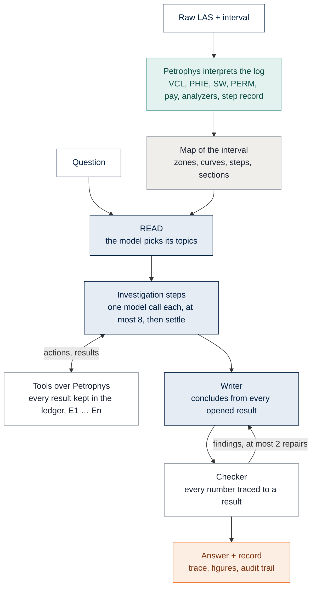

# Architecture

Petrophys interprets the raw LAS, code maps the interval, a language model investigates it step by step with
Petrophys's tools, and a writer concludes once, under a checker that is code. The model sees the data only through the
map and the results it opens; code keeps every result, checks every number and never writes a reading for the model.



Blue boxes are model calls, white boxes code, grey the state kept outside the model, green Petrophys, orange what you
get. Each step is one model call rebuilt from the state: there is no multi-turn conversation inside the investigation.

## One question, end to end

`cli.main` → `agent.graph.answer`, on the first question of a conversation on GeoLink 30/6-5, as its trace records it:
"What are the porosity, water saturation and permeability of the Brent Group, and is any of it hydrocarbon-bearing?"

| Stage | What happens | On the Brent Group |
|---|---|---|
| **build** | Petrophys interprets the LAS (cached); the interval view, its zones, the workflow store, the inventory and the map | 2841–2958 m, 768 samples, 20 zones from the lithology log `LITHOLOGY_GEOLINK` |
| **read** | One call: the model's topic areas, the measurements the question names, and whether it is direct or needs an investigation; the map's notes are scoped to the topics | `porosity`, `water_saturation`, `permeability_rock_quality`, `hydrocarbon_detection`; an investigation |
| **first look** | The topics' key curves, the curves the READ reply names, and the interval's VCL, PHIE, SW and PERM, each with its core-calibrated twin where the record holds one: the default statistics, zone by zone | E1: PHIT, PHIE, PHIE_CC, PHID, PHIN, PHIS, PHI_SEC, VCL, SW, PERM, PERM_CC |
| **steps** | One call each: the reply read as JSON (an unreadable one is salvaged, or the model fixes its own syntax), the claim edits applied, the actions run into the ledger, the done rule checked | 8 steps (the cap), 2 guides read, E2–E10 opened |
| **settle** | One call with every opened result; the claims become final | 9 claims, each citing its results |
| **write, verify, repair, finalize** | The writer drafts; the checker flags numbers no result shows and words about the work; at most two repairs | The first draft stated 4 numbers no result shows and 2 phrases about the work; one repair cleared them |
| **after the answer** | In a conversation: the methods and parameters, the number links, and figures Petrophys draws | 2 log displays and a Buckles plot |

The answer, its status (`ok`), the figures and the record of every step go to the output folder
([Evaluate a formation](USAGE.md)); the session log keeps what the [audit trail](EVIDENCE.md) is written from.

## The same stages on other wells

The stages do not change from well to well; what `build` finds does, and the map says it. Prepared with no model call:

| Well and interval | The case | What `build` gives |
|---|---|---|
| GeoLink 30/6-5, Brent Group | A lithology log, core, a tops file | 20 zones from `LITHOLOGY_GEOLINK` (sand, silt, coal, cross-bedded sand); 768 samples |
| Taranaki cheal-1, Moki Formation | No lithology log | 37 lithology zones from Petrophys's mineral solver (shale and sandstone); 3,359 samples |
| GeoLink 16/7-1, 2133.5–2568.45 m, by depth | No neutron and no PEF log; evaporites | 2 zones from the lithology log, anhydrite and halite; the map names the missing logs (below) |
| COSTA HW-3, Kharaib-2 | A carbonate logged in feet; one tops table for many wells | The HW-3 row of the table: 7805–8020 ft, 431 samples, reported in feet |
| Teapot 17-WX-21, no interval given | An old well in feet; a whole-log question | The whole log, 0–5649.5 ft: 11,300 samples; 102 lithology zones from Petrophys's mineral solver, the first (0–500 ft) and the last (5641–5649.5 ft) labelled NO_LITHOLOGY_DATA |
| Taranaki tuhua-7, Manganui | A name its tops file lists twice | Stopped before any model call (below) |

Data: GeoLink, CC BY-SA 4.0. Taranaki Basin Curated Well Logs Dataset (New Zealand Petroleum & Minerals),
CDLA-Sharing-1.0. Costa Gomes, Geiger and Arnold (2022), COSTA model, Heriot-Watt University, CC BY. Teapot Dome
(NPR-3), RMOTC, U.S. Department of Energy.

On 16/7-1, the map tells the model what the record lacks and what the interpretation did instead:

```text
measured logs not in the input: NPHI (Neutron Porosity), PEF (Photoelectric Factor),
  DTS (sonic log), RXO (Resistivity - Flushed Zone)
[…] Density-only porosity: PHIT = PHID because PHIN was unavailable […]
```

On tuhua-7, an interval the tops file does not settle is refused, with what to do:

```text
WHAT: formation 'Manganui' is listed 2 times in formations_tuhua-7.csv
(line 3: top 874.014, base 1250.75; line 10: top 2164.99, base 2347.42).
WHY: a repeated name (e.g. a repeated section) does not say which interval is meant.
FIX: choose the one you mean by its top: --formation NAME --tops FILE --top D,
or give its depths alone: --formation NAME --top D --base D.
```

## The parts

Each layer reads only the layer below it.

| Layer | Package | What it does |
|---|---|---|
| well | `petroharness.well` | Reads the LAS, has Petrophys interpret it, finds the interval and its zones; the one summary layer |
| record | `petroharness.record` | The interpretation's record as evidence: analyzer sections, the evidence catalog, the step record's facts |
| agent | `petroharness.agent` | The map, the tools, the ledger and claims, the question graph, the writer and its checker |
| cli | `petroharness.cli`, `ask`, `ui` | One question, a conversation, the web UI, benchmark mode |

A conversation adds three parts, none of which changes how its first question is answered:

| Part | Package | What it does |
|---|---|---|
| session | `petroharness.session` | The session graph: `open → turn → project → figures → commit`, one run per question; the session log is the record ([GRAPH](GRAPH.md#the-session-graph)) |
| evidence | `petroharness.evidence` | The evidence graph rebuilt from the session log; the audit trail and the report ([EVIDENCE](EVIDENCE.md)) |
| core | `petroharness.core` | The setup record: what answers a question, under one hash ([EVIDENCE](EVIDENCE.md#the-setup-record)) |

## The trace

Each question's `trace.json` holds what it needs to be audited and replayed:

| Fields | What they hold |
|---|---|
| `task_id`, `well`, `formation`, `harness`, `commit`, `model`, `skills`, `components`, `setup` | What answered: the package version and commit, the model, the skill library, each component's version, the setup hash (a single question also holds its parts, `setup_parts`) |
| `read`, `topics`, `absent`, `overview` | The READ reply and the topics; what the question names that the record lacks; the first look's call |
| `steps` | Every step: its prompt size, reply, edits and their messages, the actions run, the results withheld, the guides read, the done issues |
| `points`, `opened`, `claims`, `dropped` | The points, every opened result's call, the claims with their history, the dropped claims |
| `settle`, `verify_rounds`, `zone_table`, `draft`, `answer` | The settle step, the checker's rounds and findings, the zone table, the writer's last draft as written, the answer delivered from it |
| `calls`, `usage` | Every model call with its spans attributed to components; token use per call |
| `status`, `seconds` | The status and the time taken; on a failure, the error and its traceback |

`graph.delivered(draft, zone_table)` gives the answer from the draft, so a change to delivery can be measured on the
same drafts. The tapes (`petroharness.tape`) record every request and reply at the model boundary, so a question can
be replayed with no server ([GRAPH](GRAPH.md#reproducing-a-run-tapes)).

## In detail

<details>
<summary>well: from the LAS to the interval view</summary>

`petroharness.well`:

- `prepare.py` reads the LAS and has Petrophys interpret it. The data config chooses how: `interpret` (options for
  `petrophys.interpret`, such as a context profile), `interpreter` (a Petrophys batch interpreter), or, with neither,
  the policy (`resources/policy/reference_v2.yaml`): the pinned engine it names, run in a subprocess by `runner.py`,
  or, when it names none, `petrophys.interpret` with the policy's cutoffs. The cutoffs the interpretation used are
  checked against the policy's. Prepared wells are cached by the LAS content, the interpretation settings and the Petrophys build.
- `formation.py` finds the interval: a formation named in the tops table (the named top down to the next deeper top),
  or a depth interval; with neither, the whole well. It zones the interval by the lithology log: runs of one
  lithology, runs thinner than the zone minimum dropped. A well without a lithology log is zoned by the lithology
  Petrophys's mineral solver wrote, and a well with neither by shale-volume bands. With `zone_layout: formation` the
  interval is one zone.
- `view.py` is the interval view every later layer reads: samples, zones, curves, units, formatting. Depths are shown
  in the policy's unit, or the one the data config sets.
- `derived.py`, `calculations.py`, `stats.py`: the curves the analyzers derive, the calculations the well was
  interpreted with, and curve statistics, all from Petrophys.

</details>

<details>
<summary>The summary layer</summary>

`well/summary.py` is the one summary layer. Every tool that summarises a curve takes its bases, statistics, rankings,
thresholds and class views from it:

- **where:** each zone, then the zones pooled, then the whole interval where samples outside the zones add to it,
  followed by what those samples hold (runs thinner than the zone minimum: a labelled gap, not a zone);
- **which statistics:** the ones asked for, or the default set (n of N, mean, median, P10, P90, min, max). Positive
  values spanning more than two orders of magnitude also get the geometric mean, with percentiles read on log10
  values. The shape of the data decides this, never the curve's name;
- **what the values are,** read from their shape over the well, never from the curve's name: 0/1 values are a flag
  (the share set); a few whole numbers are class codes (the share of each class, labelled where the record maps the
  codes); anything else is values;
- **rankings** by each statistic shown, side by side; none is called the best;
- **thresholds** named with their source (the workflow's rule, or the model's);
- **classes** both ways: each zone's class from its mean, and the share of its samples in each class.

Every value line names its basis and its curve. Depth orders carry their direction in words. The layer picks no
convention: the model chooses and says why.

</details>

<details>
<summary>record: the interpretation as evidence</summary>

`petroharness.record`:

- `sections.py` runs Petrophys's analyzers on each lithology zone and keeps their classes as depth runs; `store.py`
  holds every section plus the curves the analyzers derive (the workflow store).
- `catalog.py` is the evidence catalog: deterministic queries over the view (zone statistics, lithology tables,
  class runs, flags, relations). Each is a Petrophys call or a listed generic data operation
  (`tests/test_petrophys_integration.py` checks this).
- `card.py` reads the facts of the workflow's step record: which method each step used, with which inputs,
  parameters and decisions, and where each curve comes from.

</details>

<details>
<summary>The map</summary>

`agent/inventory.py`, `agent/map.py`, `agent/notes.py`, `record/routes.py`. The inventory is the model of the interval's input and record:
curves, units, steps, sections, zones (code only, no model calls). The map writes it as plain facts: the interval and
its zones; the raw input curves and what each one is; the workflow's steps with their methods, inputs and outputs; its
sections; notes on the interval's record (routes, fallbacks, cutoffs), scoped to the analyzer families of the topics
the model chose.

</details>

<details>
<summary>The tools</summary>

`engine/`, `tools.py`, `compute.py`, `toolset.py`, `schemas.py`. Each tool is defined once, a `Tool` in
`toolset.py` (`petroharness.tools.spec`): its function, arguments, description, group and how a call of it is listed;
every list of tools is read from the definitions ([TOOLS](TOOLS.md), [Extending](reference/EXTENDING.md)). What the
model can ask for:

| Kind | Tools |
|---|---|
| Lookups | `stats`, `runs` (the depth runs of a condition), `values_at` (curves read at depths), `compare`, `overlap` (two conditions side by side), `profile`, `crossplot`, `section` (an analyzer section), `step` (a step record) |
| Named computations | `lithology_stats`, `zone_contrast`, `curve_order`, `threshold_exceedance`, `spike_flags`, `adjacent_jumps`, `lag_correlation`, `vertical_sequence`, `pay_summary`, `core_vs_log`, `zone_classes`, `formation_summary`, `data_record`, `unit_roles` |
| On the ledger | `get` (an item, or its lines matching a term), `find` (a term across every item), `calc` (arithmetic on shown numbers, kept as an item of its own so the result can be cited) |
| Over Petrophys | the verbs `calculate`, `what_if`, `estimate`, `check`, `classify`, `summarize` and `calibrate`, each with its shortcuts, and `search` and `run` over every public Petrophys function |

The Petrophys verbs live in `library.py`, `library/check.py`, `library/classify.py`, `library/summarize.py`,
`library/calibrate.py` and `library/api.py`. `calculate` recomputes a property with Petrophys's workflow step under
another method or parameters, with the steps that read its outputs. The registry is generated from the installed
library; one binder reads the inputs the model names as Petrophys declares them (curves, conditions as masks,
numbers, choices), adds the question's scope (the prepared well, the interval's limits), and turns the outputs into
curves of the question, values and parts. The brief lists every tool
under its verb.

A call goes through one door (`schemas.call`) that reads its arguments and says back what it could not use. Every
summary comes from the summary layer; the workflow's own outputs (analyzer classes, flow roles, its curves) pass
through as the workflow's.

- An analyzer section shows each class as located runs: its criterion, its runs from top to base zone by zone, each
  zone with its rock (`Z2 (SAND) 4245.0-4253.6`), then its thickness and share. A long list cut to its thickest runs
  says so and names the `get` of every run.
- Each curve's label says what it is and what the record knows about it (`engine.status`: measured, model output,
  parameter, uncalibrated, quicklook or fallback input, not computed).
- `compare` and `crossplot` lead with the zone level and label each coefficient with its n, ranges and transform. On
  one scale, `compare` gives each difference with its size against its spread (the zone means' mean difference
  against the sd of a - b, and `mean / sd` on each row).
- A text cut to the size limit ends with a line naming what is not shown and the `get` that fetches it.

</details>

<details>
<summary>The ledger, the claims and the vocabulary</summary>

- **Ledger** (`ledger.py`). Every opened result is kept in full outside the model, with an id (`E1`, `E2`, ...). The
  same call opens the same item. A step's prompt shows the new results whole within a budget (NEW), the earlier ones
  as digests (OPENED), and a result held back for the budget comes first at the next step.
- **Claims** (`claims.py`, `checks.py`). The answer is a list of claims the model adds, revises and drops by id, each
  under one of its points, with what it means, its weaknesses, a grade and the items it cites. Code checks each claim
  as it arrives and shows the findings under it as flags: an item cited but not opened; a number no cited item shows
  (and which items do hold it); 'high' on one line of evidence; data said missing that the interval has; a property
  whose flags or classes have data but no opened item shows them; a negative resting on a screen that could not run
  here. The checks never change a claim's content, grade or verdict.
- **Vocabulary** (`vocabulary.py`). What the question names, read through the curve registry's vocabulary
  (mnemonics, synonyms, question terms, named measurements). A name none of whose curves has data here is said once
  under the question ("Named but not in this well's record"). This is the one place where code reads the question's
  words, and it reads them only as vocabulary.

</details>

<details>
<summary>Skills</summary>

`direction.py`, `resources/topics.yaml`, `resources/skills/`. The harness owns the 14 topic areas; each lists the
analyzer families it reads and its key curves for the first look.

- A skill library is a folder of guides (`<path>` or `none`), chosen by `--skills`, else `PETROHARNESS_SKILLS`, else
  a model card's `skills:` (the data settings file has no skills key), and checked as it loads. The default is the
  packaged researched library.
- With a library the model always sees the index (DIRECTION: one line per guide under the areas it serves, the topics
  it chose first) and reads guides on demand, up to two a step. A guide read stays in the GUIDES block: whole at the
  next step, short after that.
- The first time a guide is read, code also opens the workflow sections it names for the families of the model's
  first topic, and up to two `stats` of workflow curves it names.
- With no library there is no index and no guide action.

</details>

<details>
<summary>The graph</summary>

`graph.py`, and the investigation's modules `state.py` (the session), `prompts.py` (the brief), `read.py` (the READ call, the scope, the question back), `replies.py` (reading the model's replies) and `settle.py`. A LangGraph state graph: `build`, `read`, `first_look`, then the steps (`ask`, `plan` at step
1, `decide`, `act`), `close`, `settle`, then the writer (`write`, `verify`, `repair`, `finalize`). Code nodes route;
the model never judges its own completion. Every node, state field and route: [GRAPH](GRAPH.md), drawn from the code
in `docs/graph.mmd`.

</details>

<details>
<summary>The writer and the checker</summary>

`writer.py`, `compose.py`, `checks.py`. The investigation finds the evidence; the writer concludes once, from all of
it. Its prompt holds:

1. the question, and what it names that the record lacks;
2. the data's reporting conventions, when its config sets any;
3. the question's points and the limits the settled claims found (their weakness notes, by point; not the claims
   themselves);
4. every result the investigation opened, in full up to 60,000 characters;
5. a provenance card of the curves they and the claims name: each curve's meaning, status and the record's cautions,
   and what its zoned values show about how they were made (constant, or held at a limit);
6. the zone table and the map without its notes.

C9's write text sets the reporting rules; with a zone table inserted, its rule says the table is not to be repeated.

The checker is code. It flags numbers that no opened result shows, nor anything else the writer was shown (the card,
the map, the zone table, the points and limits), nor the question; words about the investigation rather than the
formation; statements the record contradicts; working notes left in the text. Each finding goes back to the model as
a repair request: two rounds with the writer variant `open`, which every user run uses; one with `""`. A repair much
shorter than the draft keeps the draft. `finalize` keeps the writer's last draft as written in the trace and delivers
the answer from it (`graph.delivered`).

</details>

<details>
<summary>Delivery: the answer the reader gets</summary>

`compose.py`, `writer.strip_ids`, `writer.report_numbers`. The code-composed zone table is placed on lines of its own,
numbers are written as the results show them, and every evidence and claim id is taken out, in whatever form the model
wrote it:

| The model wrote | The reader gets |
|---|---|
| A citation in brackets: `[E1, E4]`, `(E3)` | nothing |
| A bracket that cites and says something: `(E10, n = 161)` | what it says: `(n = 161)` |
| A label naming a part of what the writer was shown: `(E1, MAP)`, `(E6, Point 3 Limit)` | nothing: the label goes with its id |
| A chain: `E2/E5`, `C8b/E7` | nothing |
| An id as the noun of its phrase: `of E6 alone` | `of the result alone` |
| An id that qualifies a noun or cites a sentence | deleted |

The checker reads the draft as delivered this way, so what it flags is what the reader would see.
`tests/test_citations.py` holds the forms.

</details>

<a id="stretches-of-the-well"></a>
<details>
<summary>Stretches of the well: focus, reach, frame and scope</summary>

Petrophys interprets the whole LAS once; every stretch of it is read from that one interpretation, and reaching
another stretch computes nothing new.

- **The focus** is the interval the question is asked about (a unit of the tops file, a top and base, or the whole
  well). It is what a tool reports on when a call names no stretch, and what the map, the first look and the zone
  table describe.
- **The reach** (`data.reach`) says what a tool's `zones` may name. `well`, the default: a zone of the focus, a
  lithology, a unit of the tops file, a depth range, or several of them (`agent/selection.py`); one stretch is read as
  a view of its own (`FormationView.stretch`), several as one row each. `focus` (a benchmark's data config): only the
  focus's zones.
- **The frame** is the set of zones the answer is reported by: your zones when you give them (`--zones`, in place of
  the lithology zones, which stay available as `L1..`), else the lithology zones (lithology-log runs, else runs of
  Petrophys's solved lithology, else shale-volume bands). Every summary reports each zone of the frame, the zones
  pooled, and the whole selection.
- **The scope** is the stretches a question is about, read from its words by the READ call (units, your zones, depth
  ranges, the whole well) and used by every call of that question; a name the tops file lists more than once, or a
  name close to several units, is asked back instead (status `ask_user`). In a conversation, `/scope`, `/frame` and
  `/zones` set them for the next questions ([SESSIONS.md](SESSIONS.md)); each change is logged and named in the
  prompts.

The model never changes the scope or the frame on its own (G8): a change comes from the user's words or commands, and
code applies it.

</details>

<a id="reporting-settings"></a>
<details>
<summary>Reporting settings</summary>

Two optional keys of the data config set how a dataset's own reports are made. Both are empty by default, and then
every prompt is the general one.

- `data.basis: zones` gives the tools' statistics on the lithology zones only (each zone and the zones pooled; the
  whole interval is left out of the tool output, and stays in the record).
- `data.conventions` is a list of sentences, each a reporting convention of the data ("Flow units are reported per
  lithology zone ..."). They are shown in the head of every step prompt and to the writer, as the data's
  conventions, to be followed in the answer without being named.

They live in the data config, never in the package: a company's reporting standard, or a benchmark's, belongs to its
data. Setting them for a benchmark is benchmark mode, and results with them are reported as such.
[DEVELOPMENT](DEVELOPMENT.md#benchmark-mode) has an example.

</details>

<details>
<summary>Components</summary>

Every fixed text the model reads belongs to one of ten components (`agent/components/`, README there):

| Id | Component | Id | Component |
|---|---|---|---|
| C1 | system (the brief) | C6 | skills (the index and the GUIDES block) |
| C2 | guardrails (the checks' messages and repair requests) | C7 | scripts (tool outputs and the map) |
| C3 | memory (claims and ledger as shown) | C8 | middleware (hook notes: actions left out, results withheld, edits not applied) |
| C4 | tools (tool descriptions, argument vocabularies) | C9 | answer (the writer's prompt and rules) |
| C5 | orchestration (each stage's instructions) | C10 | reading (how evidence is read and graded) |

A component's version hashes its texts and the code whose output it frames. Every model call in a trace is attributed
span by span to its components. A change touches one component, so its version shows which calls the change reaches
([Prompt components](reference/PROMPT_COMPONENTS.md)).

</details>

<details>
<summary>Switches</summary>

`options.py` holds the switches under test. A switch exists only while a comparison needs it: it defaults off,
and once measured it becomes the default or goes. Two are defined, `tight_numbers` and `cell_thickness`
([EXTENDING](reference/EXTENDING.md#12-make-a-behaviour-change-a-switch)); `depth` (the direct route for every
question: [GRAPH](GRAPH.md#the-direct-route)) was measured on the whole benchmark with both models and is the code.
`PETROHARNESS_SET` sets switches for one run, and every trace records the options in force.

</details>

<details>
<summary>Resources</summary>

`petroharness/resources`:

- `policy/`: the interpretation policy (the engine, the cutoffs, the depth unit, the lithology code table, the zone
  rules, the report style it uses);
- `profiles/report_style.yaml`: the answer format, never a basis or a conclusion: the zone table's style
  (`format.zone_table`: one row per interval);
- `rules/`: the registries (curves, judgements, shapes, checks, catalog, topics, relations);
- `topics.yaml`: the topic areas;
- `skills/`: the skill libraries (`researched/` the default; the format in `skills/README.md`);
- `models/`: the model card.

</details>

<details>
<summary>A conversation: session, evidence, core</summary>

- **The session log** (`session/log.py`) is one append-only file per conversation, with the texts it names kept by
  hash. Resuming re-opens the recorded results in order. What a later question is shown of the earlier ones is built
  from the log by code ([Conversations](SESSIONS.md)).
- **The later-question graph** is the question graph without `build`, with one more route: after settling, the
  writer node follows the answer length the model chose in step 1. Step 1 is asked for the length only where the READ
  call does not read the route (`--investigate`) ([GRAPH](GRAPH.md#the-later-question-graph)).
- **What comes after an answer** hangs on the session graph: the projections (the methods and parameters, the number
  links) are code, and the figures are one model call plus Petrophys' own plots. Neither can change an answer's text.
- **The evidence graph** needs only the session folder ([EVIDENCE](EVIDENCE.md)).

</details>
