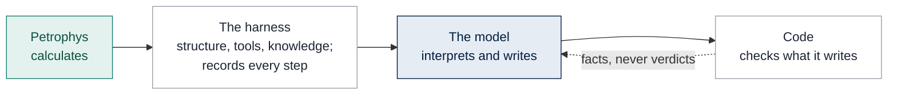

# Design

PetroHarness lets a small model run formation evaluation on any well, in a way a petrophysicist can audit. Petrophys
calculates; the harness gives the model structure, tools and knowledge, and records every step; the model interprets
and writes; code checks what it writes. The rules below keep that division, each with its reason and, for the
generality contract, the test that guards it.

## Progressive discovery

**Rule.** The model discovers what the record holds step by step; it is never given all the data at once.

**Why.** A small model reads a long context poorly, and a dump of everything hides what the question needs. Asking
for results one at a time also leaves a record: what the model looked at, in what order, and what each claim rests on.

On the first Brent Group question (GeoLink 30/6-5), the model started from the map of 20 zones and a first look at 11
curves, then opened nine more results over eight steps; each step's prompt held between 18,149 and 38,843 tokens.

What the model sees, step by step

- It starts from a map of the interval (its zones, its curves and what each one is, the workflow's steps and
  sections), then a first look at the key curves of the topics it chose.
- It asks for every further result with a tool. Each result is kept whole in the ledger with an id. A step's prompt
  shows the new results whole within a budget, the earlier ones as digests, and a result held back for the budget
  comes first at the next step. `get` and `find` fetch any line again.
- Guides are listed in an index and read on demand.
- The settle step sees every opened result, and the writer sees every opened result with the question's points and
  the limits the settled claims found.

## The model decides; code structures and checks

**Rule.** Code provides data, tools, structure, knowledge and bookkeeping. The model makes every content decision.

**Why.** The harness exists to make the model's interpretation auditable, not to replace it. A check that pushes a
verdict hides the model's reading behind the harness's, and a rule that does the model's job holds only for the cases
it was written for. Every code path that writes to a model output is bookkeeping, a shown fact or structure.

| Code may | Code never |
|---|---|
| compute facts, through Petrophys (`tests/test_petrophys_integration.py`) | rewrites the model's text, or changes its grades or verdicts |
| give structure: the steps, the state, the record of the model's reasoning (points, claims, grades, citations), the stopping rule, the report format | adds or drops its points or claims |
| give knowledge: the guides, as methods and criteria, never as answers | puts a conclusion into tool output (presence, fluid, mobility, flow units, controls, rankings and verdicts are the model's readings) |
| keep the books: ids, citations, caps, which result a number came from, which points are still open | flags a content choice as wrong |
| show the model a fact that contradicts what it wrote | |

A shown fact, from the checker on the second Brent question: "WHAT: the answer says core-calibrated
porosity/permeability is unavailable. WHY: PHIE_CC/PERM_CC exist in this interval (calibrated on core from this well;
see the card)." What the answer does with it is the model's decision.

Every step is one model call rebuilt from the state, with no multi-turn conversation inside the investigation. What
the model sees at each step is exactly what the trace records.

## General mechanisms, not case rules

**Rule.** Each need gets one general rule and one shared mechanism. There are no rules per property, per curve or per
question.

**Why.** A case rule fits the cases it was written for and fails on the next well or the next wording. A shared
mechanism is tested once and behaves the same everywhere.

The Brent answer gives the pooled PERM_CC as "342 mD (n=363, geometric mean 273.6 mD)". The geometric mean is there
by a rule on the shape of the data that holds for any curve, and the tool output says so: "positive values spanning
6.3 orders of magnitude: the geometric mean is added and the percentiles are read on log10 values".

The shared mechanisms in the code

- One summary layer (`petroharness.well.summary`) serves every tool that summarises a curve, so every tool shows the
  same bases, statistics, rankings and thresholds.
- What a curve's values are (a flag, class codes, values), and whether it gets a geometric mean, is read from the
  shape of its data, never from its name.
- One guideline for bases and conventions (C9 `aspects_rule`) reaches the settle step, where the claims become final
  (the writer is not given it): "Where the way a number is summarised changes the answer ..., give the results that
  differ and say which you lead with and why".
- One vocabulary lookup finds what a question names and what of it this well's record lacks, for any measurement.
- Dataset facts (paths, tops, lithology codes, the lithology log's name) live in the data config, never in code,
  rules or prompts (`tests/test_lint.py`).

## The generality contract (G1-G8)

`tests/test_generality.py` holds the tests named below unless another file is given.

| Rule | In short | Guarded by |
|---|---|---|
| G1 | The run takes a question, a well and an interval | `test_no_benchmark_inputs` |
| G2 | Every line the model reads has a stated provenance | `tests/agent/test_skills.py`, `tests/agent/test_components.py`, `direction.load` |
| G3 | The harness states no conclusion | `test_no_prescriptions` |
| G4 | No rule is keyed to question wording | `test_no_question_patterns`, `test_the_zone_table_follows_no_question_wording`, `test_no_question_form_or_scope_rules` |
| G5 | No evaluation text or words in what the model reads | `test_no_benchmark_words`, `test_no_benchmark_overlap`, `tests/test_lint.py` |
| G6 | Where several bases or conventions are valid, the tools show them and the model chooses | `test_no_preference_phrases`, `test_the_one_guideline_reaches_the_settle_step`, `tests/agent/test_summary.py` |
| G7 | Lithology zones are the unit of analysis | `tests/test_zones.py`, `tests/test_formation_zone_layout.py`, `tests/agent/test_section_zones.py` |
| G8 | The model decides; code never decides for it or corrects its decisions | `test_no_overrides`, `test_the_checks_are_the_approved_fact_checks`, `tests/agent/test_b6_claims.py` |

G1. The run takes a question, a well and an interval

No evaluation label (a question's category, sub-category or id) enters the run. The model reads the question and
chooses its own topic areas (the READ call); the topics key the first look, the guide index, the sections a guide
opens and the map's notes.

**Why.** A label the model would not have on a new well would make the harness depend on how its questions were
grouped.

**Guard.** `test_no_benchmark_inputs`: no `category` parameter in `graph.answer`, `Session.build` or `cli.answer`; no
`category` field in `Run` or `Session`; no `.category` or `category=` in the agent's code; the runner passes no
group to the run. Benchmark mode uses its question file's groups only to name output folders.

G2. Every line the model reads has a stated provenance

Each model-facing line is one of: (a) literature, with a reference; (b) a workflow fact, computed or generated from
the record; (g) a general guideline; (f) report style. A line is never justified by how one question was answered.

**Why.** A reader can check each line against its source, and nothing enters the prompts because it fixed one case.

**Guard.** Each guide line (Decide, Know, Easily misread, Do not state) has its row in the guide's `sources.yaml`,
class `a` with references defined in `refs.yaml`, `g`, or `b` with its fact named. The library is checked as it loads
(`direction.load`) and by `tests/agent/test_skills.py` (`test_every_line_has_its_provenance`,
`test_every_reference_is_defined_and_every_entry_is_cited`). Every fixed text belongs to exactly one component, and
every model call is attributed span by span to its components (`tests/agent/test_components.py`). Tool output and the
map are computed from the record by code. The report style lives in `resources/profiles/report_style.yaml`.

G3. The harness states no conclusion

Presence, fluid, mobility, flow units, controls, rankings and verdicts are the model's. The guides give methods,
criteria and what logs cannot establish; the tools give facts.

**Why.** A conclusion written into a prompt or a tool output becomes the answer whether or not the data in hand support
it.

**Guard.** `test_no_prescriptions`: none of a list of conclusion forms ("each zone is a", "is the ... candidate", "name
that as", ...) appears in any text the model reads (the components, the topic areas, the guides of every packaged
library). A match allowed to stay would be listed in the test with its reason (`PRESCRIPTION_ALLOWED`); the list is
empty. `test_the_prescription_patterns_catch_the_conclusion_forms` checks the patterns.

G4. No rule is keyed to question wording

The model reads the question. Code matches only vocabulary: curve and property names from the curve registry.

**Why.** A rule keyed to wording breaks on a paraphrase and cannot handle ambiguity; the model can.

**Guard.** `test_no_question_patterns`: outside the vocabulary resolver (`agent/vocabulary.py`), agent code runs no
pattern (`re.search`, `match`, `fullmatch`, `findall`) over the question text.
`test_the_zone_table_follows_no_question_wording`: the writer's zone table is the same whatever statistic the
question's words name. `test_no_question_form_or_scope_rules`: no question-form rules, no asked-absent stand-ins and
no topic scope that drops the model's points exist in the package.

G5. No evaluation text or words in what the model reads

No text from evaluation questions or reference answers, and no words about evaluation ("benchmark", "judge",
"reference answer", "the references", "GT"), in any model-facing text.

**Why.** Text copied from an answer key teaches the answer key, not petrophysics.

**Guard.** `test_no_benchmark_words`; `test_no_benchmark_overlap`: no 6-gram of a model-facing text is in an
evaluation question or reference answer (curve lists exempt; the allowed textbook phrases are listed in the test, each
with its reason). It runs when the question files are configured, and skips otherwise. `tests/test_lint.py`: no
well, formation or dataset names, and no depth literals, in code, rules or prompts.

G6. Where several bases or conventions are valid, the tools show them and the model chooses

Each zone, the zones pooled and the whole interval; zone-mean classes and sample shares; mean, median and, by the
shape of the data, the geometric mean; rankings by each statistic; the record's thresholds and the model's. The model
says which it leads with and why.

**Why.** The right basis depends on the question and the data. A harness that picks one convention fits whoever chose
it.

A dataset's own reporting conventions are its owner's choice, and they live in its data config, never in the package:
`data.basis: zones` (the tools' statistics on the zones only) and `data.conventions` (sentences shown to the
investigation and the writer as the data's conventions). Both are empty by default, and then every prompt is the
general one. Results with them set for a benchmark are reported as benchmark mode, apart from the general harness.

**Guard.** `test_no_preference_phrases`: none of a list of phrases that choose a basis for the model is in any text
the model reads, including the strings of the code that writes tool output, the map and the prompts.
`test_the_one_guideline_reaches_the_settle_step`: one guideline for bases and conventions, in the settle step (the
writer module has no such rule); the report style holds the format only. `tests/agent/test_summary.py`: every
summarising tool shows each zone, the zones pooled and the whole interval in order; rankings side by side, none called
the best; each threshold named with its source; the shape rule the same whatever the curve's name.

G7. Lithology zones are the unit of analysis

The interval is split into zones by its lithology log (shale-volume bands without one). Every tool can report per
zone, and the analyzers run per zone. In the Brent Group of GeoLink 30/6-5, the lithology log `LITHOLOGY_GEOLINK`
gives 20 zones of sand, silt, coal and cross-bedded sand. Taranaki cheal-1 has no lithology log, and its Moki Formation
is split into 50 zones of shale-volume bands ([Evaluate a formation](USAGE.md)).

**Why.** Petrophysical properties change with rock type, and a value pooled over different rocks describes none of
them.

**Guard.** `tests/test_zones.py`, `tests/test_formation_zone_layout.py`, `tests/agent/test_section_zones.py`, and the
per-zone tests of `tests/agent/test_summary.py`.

G8. The model decides; code never decides for it or corrects its decisions

Code does not rewrite the model's text, change its grades or verdicts, add or drop its points or claims, put
conclusions into tool output, or flag a content choice. It may provide data, tools, structure, knowledge and
bookkeeping, and show the model a factual contradiction with the record; the model decides what to do with it.

**Why.** See "The model decides; code structures and checks" above.

**Guard.** `test_no_overrides` feeds claims and an answer that a verdict-pushing check would change and asserts they
reach the settle step and the answer unchanged. `test_the_checks_are_the_approved_fact_checks` pins the claim flags
and the repair texts to the fact checks the test lists. `tests/agent/test_b6_claims.py` checks that the grade is the
model's: a claim that cites results and has no readable grade is refused with a message, never graded by code.

## Changing the code

The rules for a change, each with its reason, are in [AGENTS](../AGENTS.md).
