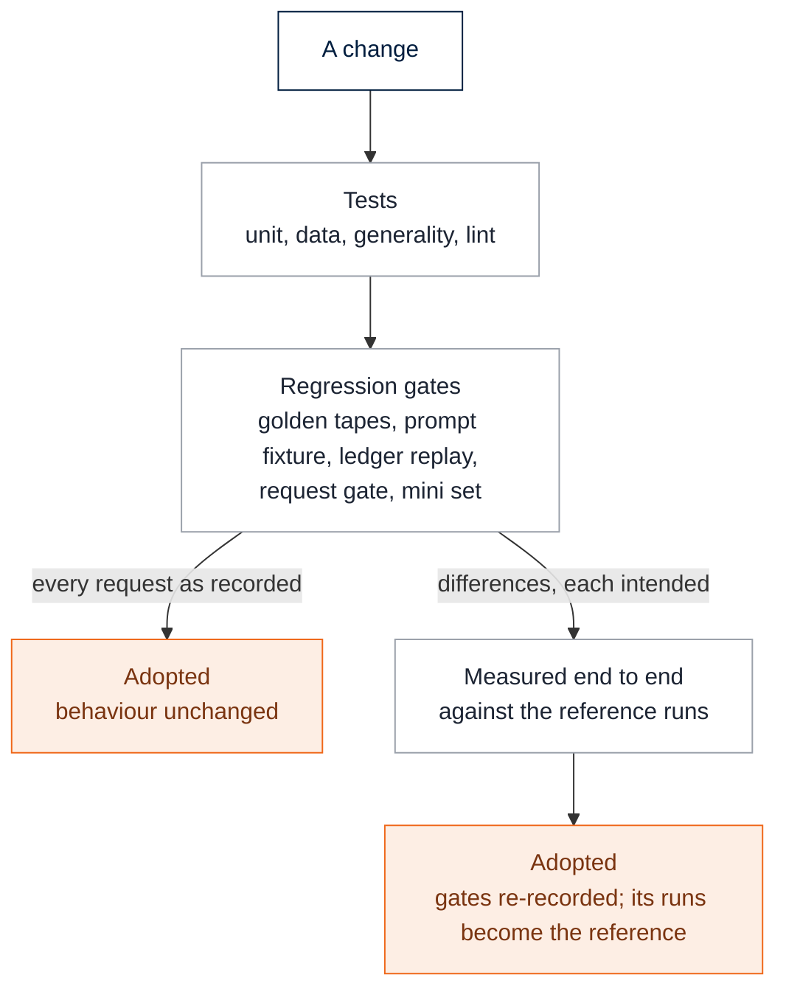

# Development

Configuration, benchmark mode, testing and the code layout. To install and evaluate a formation, see the
[README](../README.md) and [Evaluate a formation](USAGE.md); for models, see [MODELS](MODELS.md).



How a change is shown safe: it alters nothing it does not mean to, and what it means to alter is measured.

| To | Run |
|---|---|
| Point the harness at your data | `export PETROHARNESS_DATA=/path/to/data.yaml` |
| Run the tests | `.venv/bin/python -m pytest -o addopts= -q -n 16 -p no:cacheprovider tests` |
| Run a question set with reference answers | `.venv/bin/petroharness benchmark --arm NAME --ids ids.json --gt-dir DIR` |
| Print what answers a question | `petroharness setup` ([SETUP](SETUP.md)) |
| Replay the golden tapes | `.venv/bin/python -m pytest -q tests/agent/test_golden_tapes.py` |

## Configuration

A run is configured by the data config (where the data is and how it is interpreted), the skill library (the guides
the model reads) and a few environment variables. The model is configured by its card ([MODELS](MODELS.md)).

### The data config

The data config says where the data is. Copy `configs/data.example.yaml` to `configs/data.local.yaml` (untracked), or
point `PETROHARNESS_DATA` at a file like it. A misspelt key is an error. `src/petroharness/config.py` documents every
key.

The COSTA carbonate wells that ship with Petrophys, as a data config: one LAS file per well, logged in feet, and one
tops table for all of them.

```yaml
data:
  las_dir: /path/to/costa                       # one LAS file per well, named <well>.las: HW-3.las, HW-24.las, ...
  tops_csv: /path/to/formations_costa.csv       # one tops table for every well, with a well column
  tops_columns: {well: well, name: formation_name, top: top_depth}
  depth_unit: ft                                # depths shown in feet, as the wells are logged (default metres)
  interpret: {vcl_cutoff: 0.3, sw_cutoff: 0.7}  # petrophys.interpret options: here the policy's net-pay cutoffs
```

A question about `KHARAIB-2` then reads each well's own row: on HW-3 the interval starts at 7805 ft (431 samples), on
HW-24 at 8364 ft (433 samples). Data: Costa Gomes, Geiger and Arnold (2022), COSTA model, Heriot-Watt University, CC
BY.

`petroharness --las` passes the policy's net-pay cutoffs to Petrophys itself; a data config states them. With
`interpret: {}`, Petrophys's defaults used other cutoffs on these wells, and the run stops before any model call:

```text
WHAT: the engine used cutoffs {'vcl_cutoff': (0.4, 0.3), 'sw_cutoff': (0.6, 0.7)} (engine, policy).
WHY: the policy describes the engine's workflow.
FIX: make the policy's cutoffs match the engine.
```

<details>
<summary>Every key of the data config</summary>

| key | meaning |
|---|---|
| `data.las_dir` | one LAS file per well, named `<well>.las` |
| `data.tops_csv` | the tops table, for intervals given by a formation name; `tops_columns`, `top_name_pattern` and `tops_depth_unit` describe it |
| `data.lithology_curve` | the lithology log's mnemonic (or a list; the first with data is used). Left out: the LAS curve whose mnemonic or description names a lithology or facies log and holds integer codes |
| `data.lithology_nomenclature` | a workbook mapping lithology codes to labels (overrides the library's table); `lithology_columns` names its columns |
| `data.zone_layout` | `lithology_runs` (default: runs of the lithology log, thin runs dropped) or `formation` (the whole interval is one zone) |
| `data.depth_unit` | the unit depths and thicknesses are shown in: `m`, `ft` or `las` (each file's own); default metres |
| `data.interpret` | options for `petrophys.interpret`, which then interprets each LAS (below) |
| `data.interpreter` | a Petrophys batch interpreter, `module:function` or `/path/adapter.py:function`, that interprets the data instead |
| `data.engines_dir` | the folder of pinned interpretation engines, when the policy names one |
| `data.cache_dir` | where interpreted wells are cached (default `.cache/wells`), keyed by the LAS content and the interpretation settings |
| `data.basis` | `all` (default: each zone, the zones pooled and the whole interval) or `zones` (the tools' statistics on the zones only; the record keeps all three) |
| `data.conventions` | the data's reporting conventions, each a sentence, shown to the investigation and the writer (default none; [Benchmark mode](#benchmark-mode)) |
| `eval.*` | question and reference files, read only by benchmark mode, the tests and evaluation scripts; a task never sees them |

</details>

<details>
<summary>How each LAS is interpreted</summary>

With `interpret` set, `petrophys.interpret` interprets the LAS with those options (`{}` for the library's defaults).
With `interpreter` set, that function does. With neither, the policy
(`src/petroharness/resources/policy/reference_v2.yaml`) decides: the pinned engine it names, from `engines_dir`, run in
a subprocess, or the installed library with the policy's corrections. Setting both `interpret` and `interpreter` is an
error.

**Context profiles.** For wells that belong to a Petrophys context package, `interpret: {context_profile: <name>}`
interprets each well as that package's context does: its preparation, the workflow, its QC and recomputation, with
every calculation in the step record the harness reads.

```yaml
data:
  las_dir: /path/to/las
  tops_csv: /path/to/formation_tops.csv
  interpret: {context_profile: <name>}
```

</details>

### The skill library

The guides the model reads come from a pluggable skill library, chosen by `--skills` (`skills=` in Python), else
`PETROHARNESS_SKILLS`, else a model card's top-level `skills:` key (the harness configuration's `skills`; the data
settings file has none). The default is the packaged library, `skills/researched`: one guide per topic area and two
common guides (`answer`, `route`), written from the petrophysics literature, with the sources of every line.

```bash
export PETROHARNESS_SKILLS=/path/to/my_library   # another library: library.yaml, refs.yaml,
                                                 # <guide>/SKILL.md, <guide>/sources.yaml
export PETROHARNESS_SKILLS=none                  # no library: no DIRECTION index, no guide action
```

<details>
<summary>Topic areas, checks and the trace</summary>

A library's value is a folder (absolute, or relative to `src/petroharness/resources`) or `none`. The harness owns the
topic areas (`src/petroharness/resources/topics.yaml`); a library's guides declare the areas they serve. A library is
checked as it loads, and a bad one stops the run before its first question, with each problem as WHAT / WHY / FIX.
Each trace records the library it read (`skills`: its name and a hash of its files). The format and the checks:
`src/petroharness/resources/skills/README.md` ([Skills](reference/SKILLS.md)).

</details>

### Environment variables

| variable | meaning |
|---|---|
| `PETROHARNESS_DATA` | the data config (default `configs/data.local.yaml`) |
| `PETROHARNESS_MODEL_URL` | the model endpoints, comma-separated ([MODELS](MODELS.md)) |
| `PETROHARNESS_API_KEY` | the API key sent to the endpoints (a model card can name another variable) |
| `PETROHARNESS_SKILLS` | the skill library: a folder or `none` |
| `PETROHARNESS_COMPONENTS` | another copy of the component texts (`src/petroharness/agent/components`), to compare two versions |
| `PETROHARNESS_SET` | switches under test, `name=true,...`; none is defined (`agent/options.py`) |

Hosted tracing stays off: the harness refuses to start when `LANGSMITH_TRACING` (or a LangChain equivalent) is on,
because LangSmith would send every prompt, with the well data, to its service.

## Benchmark mode

Benchmark mode runs a question file with reference answers, in parallel, and saves an answer and a trace for each. It
is for validating the harness on a question set; to evaluate your own wells, use the default command
([Evaluate a formation](USAGE.md)).

```bash
export PETROHARNESS_DATA=/path/to/data.yaml
export PETROHARNESS_MODEL_URL=http://host-a:8000/v1,http://host-b:8000/v1
.venv/bin/petroharness benchmark --arm run1 --cats porosity,saturation --ids ids.json --gt-dir /path/to/reference_files \
    --workers 40
```

**The question file** is the data config's `eval.questions`: a JSON list with one row per question. Two rows on the
COSTA wells of the data config above, each interval named by its top:

```json
[{"qa_id": "q0001", "question": "What are the porosity and water saturation of the Kharaib-2?",
  "las_path": "HW-3.las", "formation": "KHARAIB-2", "category": "porosity"},
 {"qa_id": "q0002", "question": "Which part of the Kharaib-2 has the best reservoir quality?",
  "las_path": "HW-24.las", "formation": "KHARAIB-2", "category": "permeability"}]
```

<details>
<summary>The question file's fields</summary>

- `las_path`: only the file name is used; the file is read from the data config's `las_dir`.
- `formation`: a top name, whose interval the tops table gives (the named top down to the next deeper top), or a
  depth interval, `{"name": ..., "top": ..., "base": ..., "depth_unit": "m" | "ft"}` (depths in the LAS's own depth
  unit when `depth_unit` is left out; an optional `"lithology"` states the formation's lithology).
- `category`: a group name. `--cats` selects groups, and the group names the output folder. The run itself never
  sees it.
- `qa_id`: the question's id. The run sees only an opaque task id made from it (`t` and 10 hex digits).

</details>

<details>
<summary>Every option of the benchmark command</summary>

| option | meaning |
|---|---|
| `--arm NAME` | a name for the run; it starts every output folder's name |
| `--cats A,B` | the groups to run (default `hydrocarbon`) |
| `--ids FILE` | a JSON file `{"qa_ids": [...]}`: the questions to run |
| `--gt-dir DIR` | a folder of reference files, one per group (`single_formation_<group>_qa_pairs.json`); the runner copies the rows of the run's questions to `runs/gt_subsets/`, for scoring outside the harness. No question's run reads it. |
| `--rep N` | the run number (default 1); above 1 it is added to the folder names, and it changes which server a question uses |
| `--models KEY` | the model registry key (default `k2-horizon-7b`: K2-Horizon-7B's card) |
| `--model NAME` | any chat model, by its served name (the generic card; instead of `--models`) |
| `--model-card CARD` | a model card: a YAML file or a packaged card's name (instead of `--models`; [MODELS](MODELS.md)) |
| `--workers N` | questions run at once (default 12) |
| `--max-steps N` | the step cap (default 8) |
| `--writer open` | the writer's repair rounds: `open` (default) allows two, `''` one |
| `--format profile` | the answer format: the report style's (`profile`, default) or the writer's own (`default`) |
| `--investigate` | every question gets the full investigation (default: the model first says whether a question is direct, as for a user's question; [GRAPH](GRAPH.md#the-direct-route)) |

</details>

<details>
<summary>The output, the status and resuming</summary>

Under `runs/` in the checkout:

```
runs/<arm>_<model>[r<rep>]_<group>/traces/<task_id>.json        one per question: the answer, its status, every call
runs/<arm>_<model>[r<rep>]_<group>/responses/single_formation_<group>_qa_pairs.json
                                                                 the answers: {metadata, qa_pairs: [{qa_id, question, answer}]}
runs/gt_subsets/<arm>_<model>[r<rep>]/single_formation_<group>_qa_pairs.json
                                                                 the reference rows of the run's questions
runs/summaries/run_<arm>_r<rep>.json                             counts: ok, unresolved numbers, errors; mean steps
                                                                 and opened results per question
```

A question's status is `ok`, `unresolved_numbers` (the checker still found numbers no result shows after the
repairs), `error: <type>` (the trace holds the error and its traceback; the run goes on) or `error: empty answer
(the writer's last draft was empty)`. A run resumes: a question whose trace was written at the same commit, without
an error, is not run again. The commit is the checkout's (with `+dirty` when `src/` has uncommitted changes).

</details>

<details>
<summary>A benchmark's reporting settings</summary>

A benchmark whose reference answers follow reporting conventions of their own (a basis, a way of naming units) states
them in its data config, never in the package. The answers are then benchmark mode's, and are reported apart from the
general harness's ([Reporting settings](ARCHITECTURE.md#reporting-settings)):

```yaml
data:
  las_dir: /path/to/las
  tops_csv: /path/to/formation_tops.csv
  basis: zones                     # the tools' statistics on the lithology zones (the whole interval left out)
  conventions:                     # shown in every step prompt and to the writer, to be followed without being named
    - "Flow units are reported per lithology zone: each zone is named as a flow unit with its FZI class, porosity,
      permeability and quality."
```

</details>

### The reference runs

A change is judged against reference runs: two benchmark runs of each measured model on the head, with the head's
route, kept outside the repository with the benchmark data. Their scores are what a change is compared with (two
runs, so that the difference between them shows the run-to-run noise), and the request gate's base is recorded from
them ([tests/gate/README.md](../tests/gate/README.md)). When a change is adopted because it was meant to alter what
the model is sent, its measured runs become the new reference runs, and the gate's base is recorded again from them.
Runs made with `--investigate` stay the reference of that route.

## Testing

```bash
PETROHARNESS_DATA=/path/to/data.yaml .venv/bin/python -m pytest -o addopts= -q -n 16 -p no:cacheprovider tests
```

Tests marked `data` need the files the data config names; they skip where a dataset lacks what a test needs.
`tests/test_generality.py` holds one test per rule of the generality contract ([DESIGN](DESIGN.md)), and
`tests/test_lint.py` keeps well, formation and dataset names and depth literals out of the code, rules and prompts.
The gates that anyone can run, and the request gate over every saved run, are in `tests/gate/`
([tests/gate/README.md](../tests/gate/README.md)): the public mini set (`tests/gate/mini/brent/`) replays a recorded
conversation of three questions on the Brent Group of GeoLink 30/6-5, a Petrophys sample well, with no model server
and no benchmark data.

| Regression gate | What it proves |
|---|---|
| Golden tapes (`tests/agent/test_golden_tapes.py`) | Every model request equals the recorded one field by field; the answer, status and trace equal the recording |
| The prompt fixture (`tests/agent/test_skill_library.py`) | Five prompts for each of 12 tasks render byte for byte as recorded |
| The ledger replay (`tests/agent/replay.py`) | Saved investigations rebuild through the ledger with the same opened results and claim flags |

<details>
<summary>Tests that need data outside this repository</summary>

They skip without it:

- the golden tapes (`tests/golden/`) and the prompt fixture (`tests/agent/fixtures/prompts.json.gz`) are recorded on
  benchmark wells and kept with that data; the golden tests also read the data configs from `$WELLLOGBENCH`;
- the end-to-end tests of the own-well command and the web UI read sample wells from `$PETROHARNESS_SAMPLE_LAS`;
- the tests of saved runs read `$PETROHARNESS_RUNS` (a glob of run folders).

</details>

<details>
<summary>The three regression gates in detail</summary>

They run wherever their data is present: record golden tapes and a fixture on wells you have with the tools below. A
change that alters behaviour on purpose re-records the gate it changes, after checking that every difference is
intended.

- **Golden tapes** (`tests/agent/test_golden_tapes.py`). `tests/golden/<dataset>/` holds, for each recorded question,
  every model request and reply (`<task>.tape.jsonl.gz`) and the result the code gave (`<task>.result.json.gz`). The
  test replays each question through the question graph with no server: every request must equal the recorded one
  field by field, and the answer, status and trace (component versions included) must equal the recording.
  `tests/agent/record_golden.py replay` rewrites the results from the tapes, and refuses when the code makes a request
  a tape does not hold; `record_golden.py live` records new tapes from the servers. The data configs are read from
  `$WELLLOGBENCH/<dataset>.yaml`.
- **The prompt fixture** (`tests/agent/test_skill_library.py`). `tests/agent/fixtures/prompts.json.gz` holds five
  prompts for each of 12 tasks: the brief, the READ prompt, the step-1 prompt with its first look, the DIRECTION
  index, and the step-2 prompt after two guides and an action the harness does not read. They are rendered with a stub
  model, and the test compares them byte for byte. `tests/agent/prompt_fixture.py` renders them.
- **The ledger replay** (`tests/agent/replay.py`). `replay.py PREFIX OUT.json --baseline` rebuilds each saved
  investigation of `runs/PREFIX_*/traces/` through the ledger, with no model call: the traced tool calls run again in
  order, and the claims are restored and re-checked. It reports how many rebuild exactly: the same opened results and
  the same claim flags. Without `--baseline` it also runs the settle step and the writer on each rebuilt session
  (this needs the servers).

</details>

## Layout

The package is `src/petroharness/`; `configs/` holds `data.example.yaml`, `tests/` the suite and the gates, `docs/`
these pages.

<details>
<summary>The source tree, folder by folder</summary>

```
src/petroharness/
  cli.py        the command line: a question about one well (default), chat, audit, setup, ui and benchmark mode
  session/      a conversation on one interval: the session graph (graph.py), the session log (log.py), the
                earlier-questions block, `petroharness chat` (docs/SESSIONS.md, docs/SESSION_GRAPH.md)
  evidence/     the evidence graph rebuilt from a session log, the well's record as data, the number links, the
                audit trail (docs/EVIDENCE.md)
  core/         what every part shares: the setup record (docs/SETUP.md)
  figures.py    an answer's figures: Petrophys' plots chosen by the model, bound to the interval
  basis.py      the methods and parameters an answer rests on, read from the record
  ask.py        a question about any LAS file: the interval, the settings, the run, the output (and its Python API)
  ui/           the web UI: a standard-library server over ask, the page, saved runs
  config.py     the configuration (data config, model, resources, skill library)
  tasks.py      a question as the harness sees it: question, well, interval, LAS path
  llm.py        the client: token accounting, retries, the reasoning field
  tape.py       record and replay at the model boundary
  models.py     the model: model cards (resources/models) and endpoints
  profile.py registry.py   the report style, the registries
  well/         the raw LAS read and interpreted by Petrophys, viewed interval by interval; the summary layer;
                the tops reader (well/tops.py)
  record/       the workflow's record as evidence: analyzer sections, the evidence catalog, the record's facts
  agent/        the map, the tools, the ledger and claims, the question graph, the writer; toolset.py: each tool
                defined once; library*.py: the verbs over Petrophys and the registry of its functions (docs/TOOLS.md)
  tools/        the tool definition and the set that holds the definitions (spec.py); no tool of its own
  agent/components/   every fixed text the model reads, by component (C1-C10)
  resources/    the policy, the report style, the registries, the topic areas, the skill libraries, the model cards
configs/        data.example.yaml
tests/          unit and data tests; tests/agent the harness's own; tests/golden the tapes; tests/gate the public
                mini set and the request gate; tests/session, tests/evidence, tests/core, tests/figures
docs/           the guides (USAGE.md, SESSIONS.md, UI.md, MODELS.md, TOOLS.md), the concepts (ARCHITECTURE.md,
                GRAPH.md and graph.mmd, SESSION_GRAPH.md, EVIDENCE.md, SETUP.md, DESIGN.md), DEVELOPMENT.md (this
                file), reference/, images/
```

</details>

`AGENTS.md` holds the rules for changing the code; `CHANGELOG.md` the releases.
