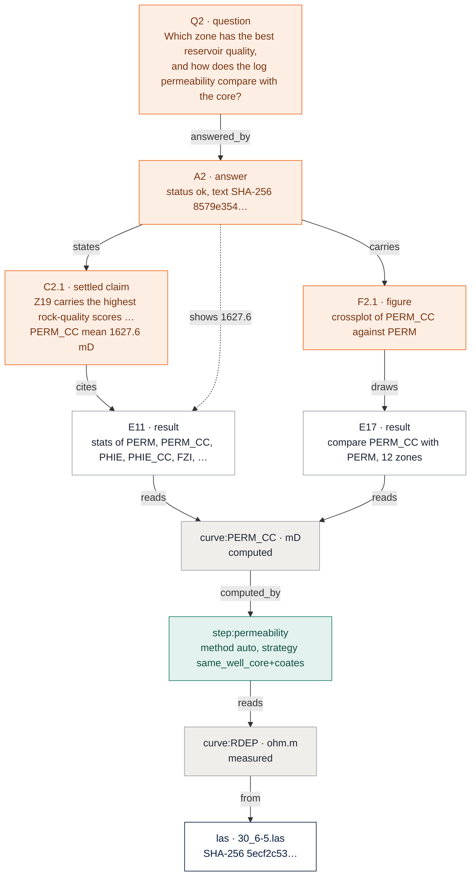
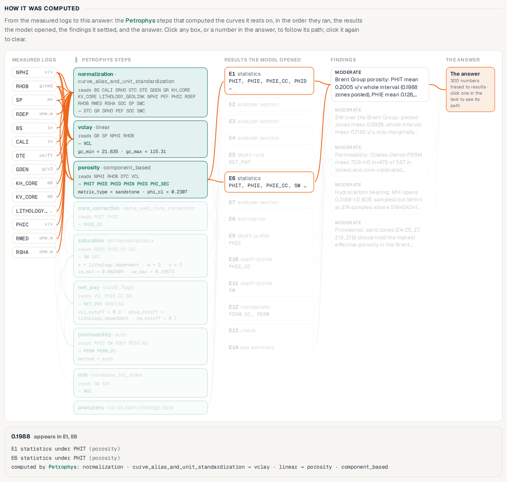
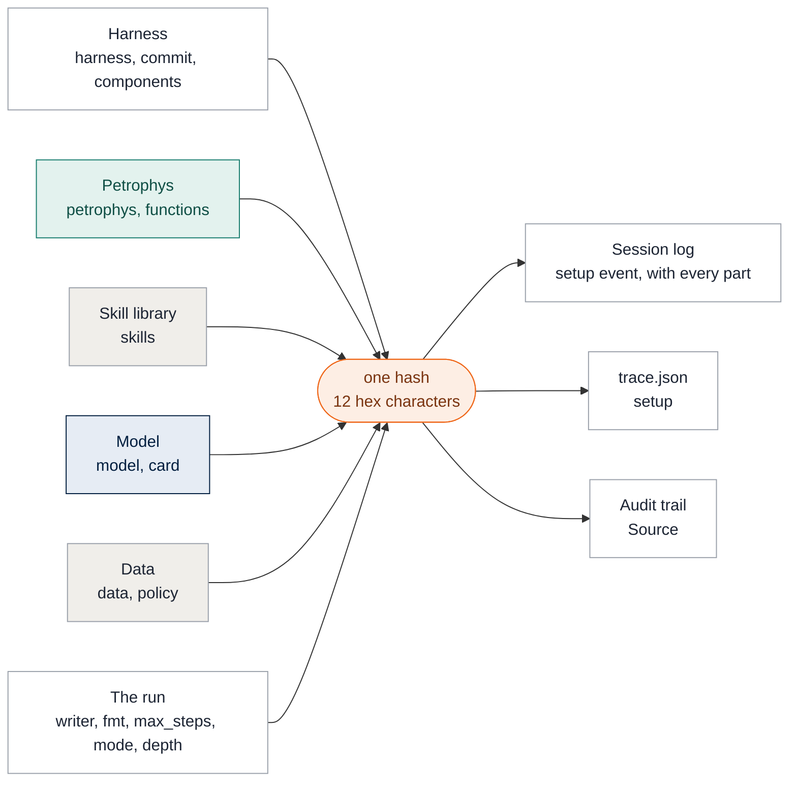

# Audit an answer

An answer is audited on two counts: what it rests on, and what it was answered under.

- **What it rests on.** Every answer rests on results, every result on curves, every computed curve on a Petrophys
  step with its parameters, and every measured curve on the LAS file. The evidence graph holds those links as data,
  rebuilt from a conversation's session folder alone. The audit trail is that graph written out for one answer.
- **What it was answered under.** The setup record names every part that answers a question, under one hash
  ([The setup record](#the-setup-record)).



One path through the graph of the Brent Group conversation on GeoLink 30/6-5: a claim of the second answer, back to
the LAS file. The whole graph of that conversation holds 153 nodes (2 questions, 2 answers, 15 claims, 18 results, 6
figures, 90 curves, 18 steps, the LAS file and the session) and 287 links.

## Get an audit trail

```bash
petroharness audit SESSION                 # every answered question of the conversation
petroharness audit SESSION --question 2    # one question
petroharness audit SESSION --json          # the whole graph as JSON (with --question: that question's trail)
petroharness audit SESSION --out FILE      # write to a file instead of standard output
```

`SESSION` is a conversation's folder ([Conversations](SESSIONS.md)). The command needs nothing else: no well, no
Petrophys run and no model. For each answer it writes these sections:

| Section | What it lists |
|---|---|
| Claims and the results they cite | The claims the investigation settled, each with its grade and the results it cites |
| Numbers the answer states and the results that show them | Each number, with every result that shows it |
| Results | Each result: the question it was opened in, its call, the curves it read, the SHA-256 of its text |
| Curves | Each curve: measured (the LAS file) or computed, and by which step |
| Steps Petrophys ran | Each step: its method, what it read, its parameters |
| Figures | Each figure, with the result it was drawn from |
| Source | The LAS file with its SHA-256, the Petrophys build, the harness commit, the model and the setup hash ([The setup record](#the-setup-record)) |

An excerpt of `petroharness audit brent --question 2`, the second Brent question (`[…]` marks what is left out):

```markdown
# Audit trail: question 2

**Question:** Which zone has the best reservoir quality, and how does the log permeability compare with the core?

**Answer:** status ok; text SHA-256 `8579e354dcdbb2060f80a6f2eedd9e87c9d671807cbd9afa3140d918d785b32c`
[…]
## Claims and the results they cite

1. Z19 carries the highest rock-quality scores: RQI mean 2.4187, FZI mean 9.2246 and PERM_CC mean 1627.6 mD (E11), but its SW mean is 1, so it is a clean, porous, fully water-bearing sand rather than a hydrocarbon-producing unit. (moderate): E11, E15
[…]
## Numbers the answer states and the results that show them

| Number | Shown by |
|---|---|
| 2951.66 | E1, E2, E3, E4, E5, E6, E8, E9, E10, E11, E12, E13, E14, E15, E16, E17 |
| 2955.01 | E1, E2, E3, E4, E5, E6, E8, E9, E10, E11, E12, E13, E14, E15, E16, E17 |
| 1627.6 | E1, E9, E10, E11, E17 |
[…]
## Results

| Result | Asked in | Call | Curves it read | Text SHA-256 |
|---|---|---|---|---|
| E11 | question 2 | `stats(curves=["PERM", "PERM_CC", "PHIE", "PHIE_CC", "FZI", "RQI", "VCL", "PHIT", "SW"])` | PERM, PERM_CC, PHIE, PHIE_CC, FZI, RQI, VCL, PHIT, SW | `54e8013eac8c2c69` |
| E15 | question 2 | `section(key="permeability.overall_permeability_interpretation")` | - | `81b73733aac4b624` |
| E17 | question 2 | `compare(a="PERM_CC", b="PERM", zones=["Z1", "Z4", "Z5", "Z6", "Z7", "Z9", "Z13", "Z14", "Z15", "Z18", "Z19", "Z20"], tolerance=0.1)` | PERM_CC, PERM | `0a605f176a00227d` |
[…]
## Curves

| Curve | Unit | Where it comes from |
|---|---|---|
| PERM | mD | computed by step `permeability` |
| PERM_CC | mD | computed by step `permeability` |
[…]
| RDEP | ohm.m | measured (the LAS file) |
[…]
## Steps Petrophys ran

- **permeability**: auto. Read PHIE, SW, RDEP, RESFLAG. Parameters: bvw_irr = 0.0637761; core_min_points = 3; empirical_method = coates; fallback_method = coates; method = auto; peer_core_enabled = no; peer_core_models = 0; peer_wells_considered = 0; perm_max_clip_md = 10000; same_well_core_models = 1; strategy = same_well_core+coates; swirr_app_method = buckles_bvw_irr; swirr_source = buckles_bvw_irr.
[…]
## Source

- LAS file: `[…]/petrophys/datasets/geolink/30_6-5.las`, SHA-256 `5ecf2c53826981f978c2efb47fe016abf94dac62e83dbdb54eee115596f801b9`
- Petrophys: 3.0.0@files-c5de047fe601
- PetroHarness commit: <commit>
- Model: K2-Horizon-7B
- Setup (petroharness setup; the session log's setup event holds its parts): d70dbbf039dd

Every result's text is kept in the session folder under its SHA-256 (`blobs/`).
```

The same trail is in the web UI: the "Audit trail" link under an answer opens it, and "How it was computed" draws the
graph behind the answer.



A whole conversation can be written as one document, with each answer, its figures, its methods and parameters and its
audit trail:

```bash
petroharness report SESSION                # writes SESSION/report.md (--out FILE for another place)
```

## What the graph holds

Nine kinds of node and ten kinds of link. A result opened in an earlier question and cited by a later one is one node:
the ids go on across the conversation.

<details>
<summary>Every node kind</summary>

| Node | What it is |
|---|---|
| `las` | The LAS file: its path and SHA-256 |
| `session` | The conversation: its mode, interval, model, Petrophys build and harness commit; the settings changes; the setup hashes (every one, and the last) |
| `curve:<NAME>` | A curve: measured or computed, with its unit |
| `step:<name>` | A workflow step Petrophys ran: its method and parameters |
| `Q<n>` | Question n |
| `E<k>` | A result the investigation opened: the tool, its arguments, the SHA-256 of its text |
| `A<n>` | The answer to question n |
| `C<n>.<k>` | A settled claim of question n |
| `F<n>.<k>` | A figure of answer n |

</details>

<details>
<summary>Every link kind</summary>

| Link | From, to |
|---|---|
| `from` | A measured curve, the LAS file |
| `computed_by` | A computed curve, the step that wrote it |
| `reads` | A step, a curve it read. A result, a curve its call names |
| `opened` | A question, a result opened while answering it |
| `answered_by` | A question, its answer |
| `states` | An answer, a claim it settled |
| `cites` | A claim, a result it rests on |
| `shows` | An answer, a result that shows a number the answer states (the link carries the numbers) |
| `carries` | An answer, a figure |
| `draws` | A figure, the result it plots |

</details>

## In Python

On the Brent session folder:

```python
from petroharness.evidence import EvidenceGraph

g = EvidenceGraph.from_log("brent")
trail = g.trail(2)                      # what answer 2 rests on, back to the LAS file
trail["numbers"]["1627.6"]              # ['E1', 'E9', 'E10', 'E11', 'E17']
[s["step"] for s in trail["steps"]]     # the Petrophys steps behind it: ['permeability', 'porosity',
                                        # 'core_correction', 'rock_quality', 'vclay', 'saturation', 'net_pay',
                                        # 'normalization']
g.out("C2.1", "cites")                  # ['E11', 'E15']: the results a claim cites
g.to_json()                             # the whole graph, in a fixed order
```

A trail holds the question, the answer, its claims, numbers, results, curves and steps, the settings changes made
before it, its figures, the LAS file and the session.

## How the graph is built

- **From the session log alone.** `log.jsonl` and `blobs/` hold everything the graph needs. Building it twice gives
  the same graph, and resuming a conversation does not change it.
- **Nothing here reaches a prompt.** The graph is read off the record of a conversation, after each answer is final,
  so it cannot change an answer. This is the session graph's `project` node ([GRAPH](GRAPH.md#the-session-graph)).

<details>
<summary>The well's record, generations and the number links</summary>

- **The well's record is kept once.** When the first question has run, the curves and steps as Petrophys recorded them
  are written to the log (a `record` event naming a blob). A new one is written only when the record changes, for
  example after a curve is computed on request.
- **Generations after a settings change.** A settings change ([Conversations](SESSIONS.md), "Changing a setting")
  interprets the well again: its record from then on is a new generation, with its own curve and step nodes
  (`curve:SW@gen2`, `step:saturation@gen2`). A result links to the curves of the generation in force when it was
  opened, so each answer's trail shows the parameters it was made with, and lists the changes made before it. A
  conversation without a change builds the graph it built before.
- **The number links use the checker's own matching.** The check that every number of an answer comes from a result
  is applied result by result, so the graph says which results show each number. The answer is read as the checker
  reads it: the well's name and the checks' ignore patterns removed, small counts left out.

</details>

## Limits

- A link from a result to a curve comes from the curve names in the result's call. A result that reads curves its
  call does not name (a section of the record) has no curve links: E15 in the excerpt above reads "-".
- A number that is supported by arithmetic on two shown numbers, or only by what else the writer was shown (the zone
  table, the map, the curve card, the points and limits) or by the question, has no single result and is not listed.
- The trail stops at the LAS file's hash. Checking the file against it is the reader's step.

## The setup record

A setup is one flat record of what answers a question: the harness code and its prompt components, the Petrophys build
and the functions it offers, the skill library, the model's request settings and the data settings. One hash stands for
the record, and the same parts give the same hash in every process. Two runs with the same hash were made of the same
parts; where the hashes differ, the records say in which part.



Where a model is reached (the endpoint, the API key, timeouts, retries) is not part of a setup, and neither are the
folders on this machine: they do not change what answers.

### Print a setup

```bash
petroharness setup                              # the default model; the data settings of PETROHARNESS_DATA, if set
petroharness setup --model-card my_card.yaml --settings field.yaml
petroharness setup --json
petroharness setup --las $LAS --tops $TOPS --formation "BRENT GP."     # a question about this interval
```

For the Brent Group of GeoLink 30/6-5 (`LAS` and `TOPS` as in [Evaluate a formation](USAGE.md)). `[…]` marks lines
left out; the served model's name is replaced, and the hash is the one computed with it:

```text
setup 63669f4be296
  harness: 2.0.1
  commit: <commit>
  petrophys: 3.0.0@files-c5de047fe601
  components:
    C1: 6f8f4c39893a
    […]
    C10: 20c9aaaad36a
  functions: 1e177d0c7ca2
  skills:
    library: researched
    version: 18c03ad5d3f8
  model: <served model name>
  card: 33012b760d52
  data: 61dcbf7ecfe4
  policy: 7631a4a859eb
  writer: open
  fmt: profile
  max_steps: 8
  mode: interactive
  depth: True
```

With `--las` and the interval options of a question, the data settings are built from that well as the question
builds them, and the hash is the one the question answers under. Without `--las`, the data part covers the settings
file alone (`--settings`, else `PETROHARNESS_DATA`, else none), so it differs from a question's: printed on the same
checkout with no options, `data` is `1c824f0cf710` and the hash `b2112028164d`.

The options are the ones `petroharness` and `petroharness chat` take for the model, the settings and the skills
([Evaluate a formation](USAGE.md)); the endpoint (`--model-url`) is not one of them.

### What a setup holds

| Part | What it is |
|---|---|
| `harness`, `commit` | The package's version, and its commit for a source checkout (with `+dirty` when `src/` has uncommitted changes; empty for an installed package) |
| `petrophys` | The Petrophys build: its version and its own commit, or a hash of its installed files |
| `components` | Each prompt component with its version: the texts every model call is built from |
| `functions` | One hash over the Petrophys functions the tools offer (name, verb, parameters). The list is part of the investigation's brief, so a Petrophys release that adds a function changes it |
| `skills` | The skill library: its name and version |
| `model`, `card` | The model's name as served, and a hash of its request settings (temperature, token caps, template settings) |
| `data`, `policy` | A hash of the data settings in force (interpretation, zones, bases, conventions), and of the interpretation policy file |
| `writer`, `fmt`, `max_steps` | The writer's repair rounds, the reader format, the investigation's step cap |
| `mode` | `interactive` (a LAS file and a question) or `tasks` (prepared questions) |
| `depth` | Whether the model first says if a question is direct (a short route) or needs an investigation |

### Where it is recorded

| Where | What |
|---|---|
| The session log | A `setup` event with the hash and every part, written before the first question and again only when the setup changes (for example a conversation resumed after an upgrade) |
| Every question's trace | `trace.json`, `setup`: the hash. The trace of a single question (`petroharness`, `ask()`, benchmark mode) also holds every part, as `setup_parts`, since it has no session log to hold them |
| The audit trail | `petroharness audit`: the hash, in its Source section ([Get an audit trail](#get-an-audit-trail)) |

### Compare two setups

```python
from petroharness.core import setup

setup.differences(record_a, record_b)   # the parts that differ, a component by its id
                                        # ("components.C9"); [] for the same setup
```

A record is a single question's `setup_parts`, a session log's `setup` event, or what `petroharness setup --json`
prints, each without its `hash` (and the event without its `seq`, `time`, `turn` and `type`).

Records of questions on three wells, and of the Brent conversation, each compared with the Brent setup above by
`setup.differences`:

| The record | Hash | Differs from Brent in |
|---|---|---|
| GeoLink 30/6-5, Brent Group (above) | `63669f4be296` | |
| Taranaki cheal-1, Moki Formation: no lithology log | `63669f4be296` | `[]` |
| COSTA HW-3, Kharaib-2: a carbonate logged in feet, from a multi-well tops table | `63669f4be296` | `[]` |
| GeoLink 30/6-5, Brent Group, with `--investigate` | `cd5b85c6f3aa` | `['depth']` |
| No well (`petroharness setup --json`) | `b2112028164d` | `['data']` |
| The Brent conversation's session log, the one the audit trail above reads | `d70dbbf039dd` | `['commit']` |

The well is what a question is about, not part of what answers it: here the data settings built from the three LAS
files are the same, so the three questions answer under one setup. The LAS file itself is recorded beside the setup,
with its SHA-256, in the session log and the audit trail.

<details>
<summary>Check that a question was answered under the setup in place</summary>

To check whether the setup in place is the one a question you asked (`petroharness`, `petroharness chat`, the web UI)
was answered under, print the setup of the same question and compare the hashes:

```bash
petroharness setup --las well.las --tops tops.csv --formation "NAME" --json    # and the run's other options: model,
                                                                                # settings, skills, --max-steps,
                                                                                # --investigate
```

Its `hash` equals the run's `setup` when nothing has changed; otherwise `setup.differences` on the two records names
the parts.

</details>
