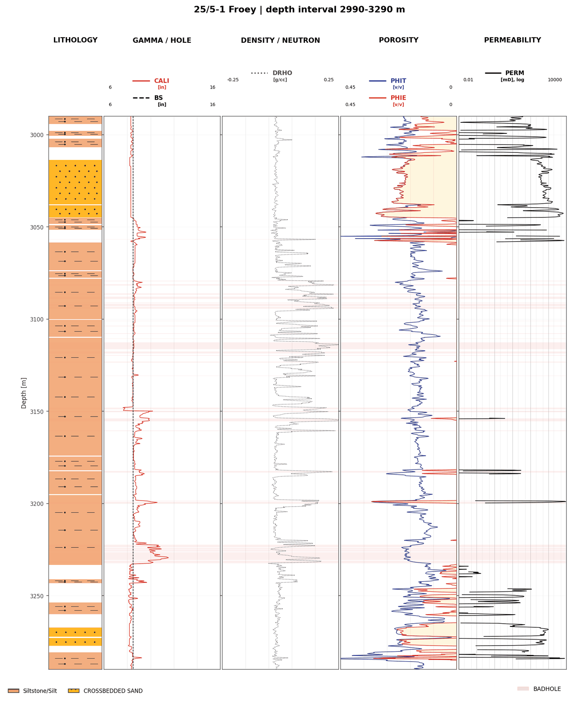
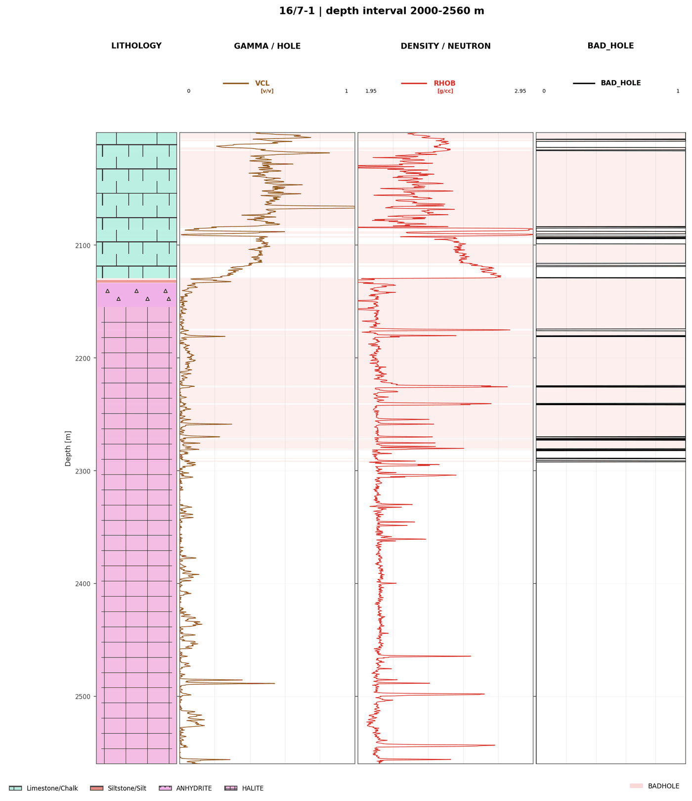
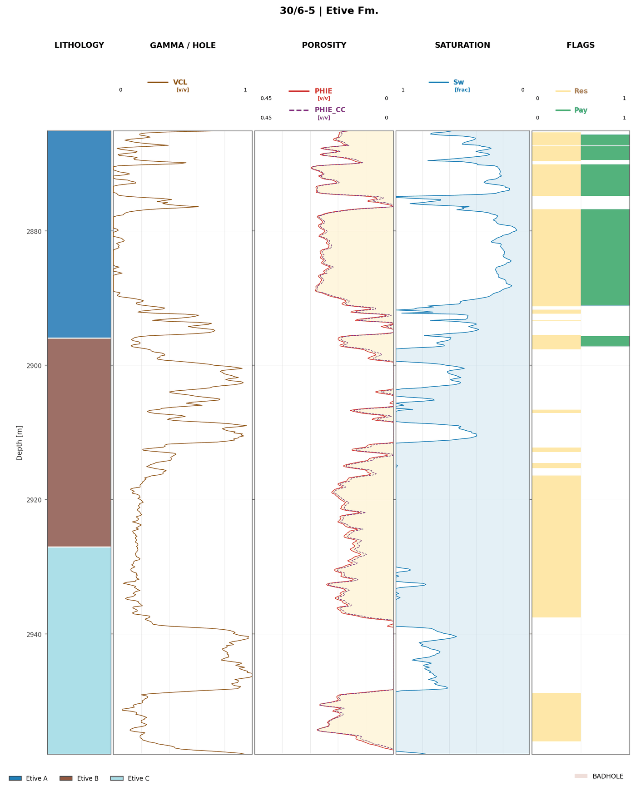

# Examples

Eleven questions a petrophysicist would ask, each on a well that ships with Petrophys, answered by the default model
(K2-Horizon-7B). Most need more than a lookup: two formations compared inside a group, a sensitivity study, the logs
set against core, a well missing its neutron and PEF logs, a carbonate against a clastic reading, a fluid contact, a
whole well screened, your own layers ranked, the solved minerals set against the lithology log. One is a direct
question, and one is a conversation that changes a setting on the way. Each answer below is quoted from the run, cut
where marked […]; the figures are the answers' own, drawn by Petrophys. Examples 7 to 11 also list the steps the
investigation took, read from its trace.

| # | Question | Well | What it shows |
|---|---|---|---|
| 1 | [Ness against Etive](#1-two-formations-inside-a-group) | GeoLink 30/6-5, Brent Group | the tops file's formations inside the interval, compared zone group by zone group |
| 2 | [Net pay's sensitivity](#2-how-sensitive-is-net-pay) | GeoLink 30/6-5, Brent Group | what-if runs of the saturation model and of m, zone by zone |
| 3 | [Logs against core](#3-logs-against-core) | GeoLink 25/5-1, 2990–3290 m | core fits refused below their gate, a depth offset found, where permeability fails |
| 4 | [No neutron, no PEF](#4-a-well-missing-its-neutron-and-pef-logs) | GeoLink 16/7-1, 2000–2560 m | what can still be said, and what the missing logs leave unconfirmed |
| 5 | [A carbonate](#5-a-carbonate-against-a-clastic-reading) | COSTA HW-3, KHARAIB-2 | field notes that set the interpretation, and a sandstone what-if |
| 6 | [A fluid contact](#6-a-fluid-contact) | Taranaki tuhua-7, McKee Formation | a negative answer, with the evidence weighed |
| 7 | [A direct question](#7-a-direct-question) | Taranaki tuhua-7, McKee Formation | the short route: two lookups and an answer in two minutes |
| 8 | [A conversation](#8-a-conversation-that-changes-a-setting) | Taranaki cheal-1, Mount Messenger Formation | three questions: a first read, a figure asked for, and the pay cutoffs changed on the way |
| 9 | [A whole well](#9-screening-a-whole-well) | Teapot 17-WX-21, the whole log | no interval given: where the pay flags run from top to base, in feet |
| 10 | [Your own zones](#10-your-own-zones) | GeoLink 30/6-5, Etive Formation | a zones file frames the answer by your layers |
| 11 | [Minerals against the lithology log](#11-the-solved-minerals-against-the-lithology-log) | GeoLink 15/9-14, 3380–3545 m | two sources set against each other, and which to trust where |

The commands use the bundled wells by name:

```bash
export PETROHARNESS_MODEL_URL=http://localhost:8000/v1        # any OpenAI-compatible endpoint (MODELS.md)
w() { python -c "import petrophys, sys; print(petrophys.sample(sys.argv[1]))" "$1"; }
```

Every answer also comes with its trace: each step, the results the model opened and how every number in the answer
was computed ([Audit an answer](EVIDENCE.md)).

## 1. Two formations inside a group

```bash
petroharness --las $(w 30/6-5) --tops $(w formations_30_6-5.csv) --formation "BRENT GP." \
  --question "Compare the Ness and Etive formations within the Brent Group: which has the better reservoir quality, and is the difference driven by clay content, porosity or permeability?"
```

The tops file lists Ness (2841–2865 m) and Etive (2865–2958 m) inside the Brent Group, so the question carries them.
The model read the lithology zones by formation, Z1–Z3 for Ness and Z4–Z20 for Etive, and set clay, porosity and
permeability against each other with zone statistics, crossplots and a zone contrast (8 steps, 13 results opened).

> **Etive (Z4–Z20, 2865–2957.9 m) holds the better reservoir-quality rock; Ness (Z1–Z3, 2841.3–2861.7 m) is
> predominantly a clay- and water-bearing unit.** The contrast is clay-driven, not sandiness-driven alone. […]
>
> Mean VCL over Ness Z1–Z3 is **0.5279** (median 0.643, n = 68); over Etive Z4–Z20 it is **0.2930** (median 0.193,
> n = 499). […] PHIE_CC falls with VCL: pooled fit PHIE_CC = 0.1964 − 0.2213·VCL (R² = 0.6105, n = 567) […]
> Where PERM_CC is defined, it separates by clay: lower-VCL zones mean 360.1 mD versus higher-VCL zones 25.3 mD. […]
> In Ness, PERM_CC exists only in Z1 (n = 20 of 30, mean 135.98 mD); Z2 and Z3 have **no PERM_CC**.

 against clay volume (VCL) over the Brent Group's 20 zones, 567 samples coloured by depth, with the least-squares line. Drawn by Petrophys. Data: GeoLink, CC BY-SA 4.0.")

## 2. How sensitive is net pay

```bash
petroharness --las $(w 30/6-5) --tops $(w formations_30_6-5.csv) --formation "BRENT GP." \
  --question "How sensitive is net pay in the Brent Group to the saturation model and the Archie exponents? Compare Archie, Simandoux and Indonesia, and vary m between 1.8 and 2.2."
```

Two what-if runs: the saturation step rerun with each model, and with m at 1.8 and 2.2, every other input the record's
(8 steps). The tool said the rerun's baseline differs from the record at 10 of 768 samples, and the answer reads the
changes against the baseline accordingly.

> Fixed **Simandoux** gives a pooled NET_PAY share of **31.5697%**, and fixed **Indonesia** gives **32.2751%**. The
> changes are confined to **Z1, Z8 and Z9**; Z4–Z7 are unchanged across all three models. […] Sweeping m to **2.2**
> gives a pooled share of **26.455%**, with **Z1 at 20%** […] **Z8 at 0%** and **Z9 at 0%**. […]
>
> **Z7 is invariant at 100%** across all model and m runs […] The sensitivity is concentrated in the **marginal
> clay/shallow zones Z1, Z8 and Z9**, where SW sits near or above the 0.7 cutoff and where model routing and m exponent
> flip samples across the boundary.

, the net-pay flag and the reservoir flag beside the sand zones that carry pay. Drawn by Petrophys. Data: GeoLink, CC BY-SA 4.0.")

## 3. Logs against core

```bash
petroharness --las $(w 25/5-1) --top 2990 --base 3290 \
  --question "How well do the log porosity and permeability match the core in this interval, zone by zone, and where should the log permeability not be trusted?"
```

The interval is given by depths. The model fitted the log to the core plugs with Petrophys, zone by zone, scanned the
core against the log for a depth offset, and read permeability where it is computed (8 steps, 10 results opened).

> Core covers 203 of 1638 zoned samples (12.4%) […] There is **no core in Z8–Z15** […] Because no calibrated core
> curve was written (r² 0.08 < 0.5 threshold), there is no core-anchored porosity transform […]
>
> Log PERM (Coates–Denoo, clipped at 10000 mD) carries values in only 445 of 1638 zoned samples. It agrees with core
> KH_CORE in order of magnitude only in the clean crossbedded sands Z4, Z5 and Z19; Z19 is close (log 316.3 mD mean vs
> KH_CORE 311.9 mD mean). It should **not** be trusted in Z9 and Z11 (PERM not computed, no SWIRR_APP) […] and in Z20
> (mean 960.0 mD vs KH_CORE mean 0.37 mD). […]
>
> The only lag scan ran on PHIC–PHIT and found r 0.2879 at zero lag, rising […] to r 0.5948 at dz = −2.7423 m (PHIC
> reads 2.74 m shallower than PHIT).



## 4. A well missing its neutron and PEF logs

```bash
petroharness --las $(w 16/7-1) --top 2000 --base 2560 \
  --question "This well has no neutron or PEF log. What can still be said about porosity and lithology in this interval, and where are the logs unreliable?"
```

The model read the bad-hole flags, the lithology-log consistency check and the log-quality assessments, and said
which products the missing logs disable (8 steps, 8 results opened).

> With no NPHI and no PEF log in 16_7-1, **porosity is density-only**: PHIT equals PHID because no neutron integrated
> porosity (PHIN) curve exists in the well's data […] **SILT, ANHYDRITE and HALITE are classed NO_LOG_LITHOLOGY_MATCH
> across 100% of their samples**, so those zonal lithologies are unconfirmed by the logs present. Bad-hole flags are
> severe: 77.6% of Z1 samples, 100% of Z2, 100% of Z3 and 30.3% of Z4 samples […]
>
> Density-derived porosity means, by zone: **Z1 Limestone 0.1924 v/v, Z2 Silt 0.4506 v/v, Z3 Anhydrite 0.4635 v/v,
> Z4 Halite 0.0008625 v/v** […] Neutron–density clay volume is not computed; RHOB is present throughout, so the
> absence of the neutron input is what disables this product.



## 5. A carbonate against a clastic reading

A field notes file states what the team knows of the reservoir, and sets the interpretation from the start:

```yaml
name: KHARAIB-2 carbonate study
settings:
  lithology_domain: carbonate
  matrix_type: limestone
notes:
  - KHARAIB-2 is a limestone reservoir.
```

```bash
petroharness --las $(w HW-3) --tops $(w formations_costa.csv) --formation KHARAIB-2 --field-notes kharaib.yaml \
  --question "Interpreted as a carbonate, what are the porosity, water saturation and net pay of KHARAIB-2, and how do they change against a clastic reading with a sandstone matrix?"
```

Petrophys interpreted the interval as a carbonate (a calcite–dolomite solve on a 2.71 g/cm³ matrix). The well has no
lithology log, so the zones are the solver's: nine, limestone with one dolomite. The model read the record,
summarized pay, and had Petrophys rerun porosity and saturation under a clastic reading (8 steps, 13 results
opened). The tops table holds several COSTA wells; the rows of HW-3 are used, in feet.

> KHARAIB-2 is logged as a 215-ft gross interval (7805–8020 ft, 431 samples at 0.5-ft spacing) split into nine
> labelled zones (Z1–Z9, 179 ft of zoned thickness). Under a carbonate reading, the available data give:
>
> - **Porosity** — effective porosity PHIE (uncalibrated model output) pools to **0.2063 v/v** over the 367 zoned
>   samples (0.1981 over the whole 431-sample interval), while the core-calibrated PHIE_CC pools to **0.233** over
>   the 287 zoned samples where it exists and **0.2443** over the whole interval (n = 351 of 431). […]
> - **Water saturation** — the Archie SW (core-calibrated PHIE_CC where present, PHIE fallback where absent) pools
>   to **0.2103** over the zones and **0.1943** over the whole interval. […]
> - **Net pay** — the record's flags: NET_ROCK 431 samples / **215.5 ft** (VCL < 0.3), NET_RES **390 samples / 195
>   ft**, NET_PAY **388 samples / 194 ft** (adds SW < 0.7). […]
> - **Sandstone/clastic reading** — the available lithology outputs carry **VQUAR = 0** over the entire well […] A
>   quartz-matrix porosity recomputation was attempted, but the default quartz density and slowness values are not
>   recorded and the recomputed per-sample porosity is not available in the record text, so the shift on
>   PHID/PHIT/PHIE cannot be graded numerically. […]
>
> The field notes state KHARAIB-2 is a limestone reservoir. The data show limestone-dominant carbonate (VCALC mean
> 0.7365–0.825) with a dolomite band (Z4), zero quartz volume, and no sandstone-matrix indicator — so the
> "sandstone/clastic" reading is hypothetical and not supported by the lithology outputs.

The answer keeps to what was computed: it reports the pay flags as the record holds them, and where the sandstone
rerun gave it no porosity it could grade, it says so and does not guess.

. Drawn by Petrophys. Data: Costa Gomes, Geiger and Arnold (2022), COSTA model, Heriot-Watt University, CC BY.")

## 6. A fluid contact

```bash
petroharness --las $(w tuhua-7) --tops $(w formations_tuhua-7.csv) --formation McKee \
  --question "Is there a hydrocarbon-water contact in the McKee Formation? If so, at what depth, and how strong is the evidence?"
```

The well has no lithology log, so the zones are runs of the lithology Petrophys's mineral solver gives: 11 zones of
shale and sandstone. The model read the fluid-contact, hydrocarbon and gas analyzers and saturation by depth (3 steps,
8 results opened).

> There is **no supported hydrocarbon-water contact** in the McKee Formation in well **tuhua-7** (1935.0–2017.8 m).
> The saturation workflow returns water saturations of 0.82–1.0 v/v across all 11 lithological zones, with a pooled
> zone mean of **0.872 v/v**; every hydrocarbon, gas, and petrophysical indicator classifies the interval as
> **NO_INDICATION** / **NO_GAS_EFFECT**, the neutron-density crossover flag is set in **zero** samples, and
> **NET_PAY** is set in **zero** samples. The only fluid-contact detector marks **0.448 m** of transition-zone
> status (0.77% of the 58.2 m zoned thickness) at ~1958.9 m and ~1992.0–1995.4 m, but these sit in intervals with
> high bad-hole density and lack any supporting resistivity or core evidence. No depth can be assigned to a
> hydrocarbon-water contact with confidence.

, CDLA-Sharing-1.0.")

## 7. A direct question

```bash
petroharness --las $(w tuhua-7) --tops $(w formations_tuhua-7.csv) --formation McKee \
  --question "What water resistivity did the saturation use, and how was it derived?"
```

Before anything else, the model says whether a question is direct: a value, a setting or a fact that one or two
lookups state. This one is. It read the record of the `rw` step and of the `saturation` step beside the first look
(3 results), and the answer was written from them: 4 model calls, 127 s, against 14 to 18 minutes for the
investigations on this page. The number check is the same.

> The saturation (step, archie+simandoux) used formation water resistivity RW of **0.05702–0.05838 ohm.m** across
> the McKee interval (1935.0228–2017.776 m), mean **0.05771 ohm.m** over 393 zoned samples; it was derived in step
> (**rwa_clean_wet_p5**) as the **5th percentile of RDEP × PHIE² / 0.81** for the **1287** samples with VCL < 0.3
> and PHIE > 0.05, each converted to **75 degF** and then corrected to formation temperature (**108.9921–156.1557
> degF**, salinity estimated **64609.7915 ppm**).
>
> RW is model output, not a confirmed fluid property. The main limit is coverage: only 1287 of the well’s 13652
> samples qualified for the percentile because of the VCL and PHIE cutoffs.

`--investigate` gives every question the full investigation.

 the saturation used, by zone, over the 393 zoned samples of the McKee Formation. Drawn by Petrophys. Data: Taranaki Basin Curated Well Logs Dataset (New Zealand Petroleum & Minerals), CDLA-Sharing-1.0.")

## 8. A conversation that changes a setting

```bash
petroharness chat --las $(w cheal-1) --tops $(w formations_cheal-1.csv) --formation "Mount Messenger" --session messenger
```

A conversation keeps the interval open: each question starts from what the earlier ones found. Taranaki cheal-1 has
no lithology log, and the mineral solver's lithology puts almost all of the Mount Messenger Formation (1757–1814 m)
in one shale zone. Three questions, typed at the prompt, and one setting changed between the second and the third.

**Question 1: Where is the best reservoir rock in the Mount Messenger, and is any of it likely pay?** (8 steps, 15
results opened)

> **Answer in one line:** The only reservoir-quality rock is the thin unzoned stretch below Z1 (roughly
> 1808.5–1813.9 m); the zoned Mount Messenger shale Z1 (1757.02–1807.77 m) fails every cutoff. Pay exists only
> there, as a thin, low-confidence sliver (2.1279 m, 3.7% of the 56.8 m gross) in 1810.6644–1812.798 m […]

**Question 2: Plot neutron porosity against bulk density over the interval. What does the crossplot say about the
lithology?** (7 steps; it opens 11 results of its own, E16 to E26)

> Over the Mount Messenger interval (1757.0196–1813.8648 m), the NPHI–RHOB crossplot shows **no clear lithology
> separation**. […] Lithologically, the plot is **consistent with, but not diagnostic of, the SHALE_GROUP_1 label**.
> It rules out limestone/dolomite because RHOB never reaches the carbonate thresholds (max 2.5189 g/cm³ < 2.6 g/cm³;
> carbonate indicator is NON_CARBONATE across 100 % of Z1).

, CDLA-Sharing-1.0.")

**A setting changed.** The team's pay cutoffs are stricter than the defaults, so they are set before the next
question:

```text
question> /set sw_cutoff=0.6 phie_cutoff=0.1
from question 3: sw_cutoff the default (0.7) -> 0.6; phie_cutoff the default (0.08) -> 0.1 (the well was interpreted again)
```

**Question 3: With these stricter cutoffs, how does the net pay change from your first answer, zone by zone?**
(5 steps; its findings cite E1 and E7 of question 1 beside nine results of its own; the answer's header names the
change)

> Under the stricter cutoffs (VCL < 0.3, PHIE > 0.1, SW < 0.6 — replacing the first answer's VCL < 0.3, PHIE > 0.08,
> SW < 0.7), net pay shrinks from **2.1279 m (14 samples)** to **1.5199 m (10 samples)**, and the entire loss sits
> in the unzoned beds below Z1; Z1 stays at zero. NET_RES does not shrink — it remains **15 samples / 2.2799 m**.
> The PHIE tightening (0.08 → 0.1) removed nothing; the SW tightening (0.7 → 0.6) removed the 4 pay samples.

The first answer's results stay in the conversation, marked as resting on the earlier settings, so the third answer
could set the two readings side by side. The whole conversation is one folder: `petroharness chat --resume messenger`
goes on with it, `petroharness audit messenger` prints each answer's audit trail, and `petroharness report messenger`
writes it up as one document ([Conversations](SESSIONS.md)).

## 9. Screening a whole well

```bash
petroharness --las $(w teapot_17-wx-21) \
  --question "Screen the whole well: which intervals are the best reservoir candidates, and what in the logs limits the evaluation?"
```

No tops file and no depths, so the interval is the whole log: 0–5649.5 ft, 11,300 samples. The well has no lithology
log, and the mineral solver's lithology gives 102 zones. The model listed where the pay and reservoir flags run from
top to base, read the statistics of the zones that carry them and the hole condition there, and read the data record
for the logs the well lacks (8 steps, 11 results opened).

| Step | What it worked on, in the model's words | What it asked for |
|---|---|---|
| 1 | Where is the net pay / best reservoir candidate, and how thick is it? | 2 `guide`, 2 `section`, 2 `get`, 1 `runs` |
| 2 | Where NET_PAY and NET_RES run in depth (points 2 and 3): the pay runs top to base, and the reservoir-curve statistics over net-pay samples. | 2 `runs`, 1 `stats`, 1 `get` |
| 3 | Where does NET_PAY sit in depth and which zones carry reservoir quality (Z16 vs the pay zones), so the net-pay location claim can be rewritten with […] | 4 `get`, 1 `runs`, 1 `section` |
| 4 | Confirm the best-reservoir zones and their hole condition: NET_PAY runs in Z93-Z95, Z98-Z100 and Z16 stands out in porosity but misses pay cutoffs […] | 5 `get`, 1 `stats` |
| 5 | Where NET_PAY sits in depth, how thick it is, what the pay-zone means carry (Z93-Z100), and whether PRIME_OIL_TARGET is consistent with NET_PAY (all […] | 5 `get`, 1 `section` |
| 6 | Corroborate pay-zone claims with E8's full run list and E9's BAD_HOLE split, then close | nothing more: it said the points were settled (a result it had not read yet was shown to it first) |
| 7 | Point 4 (evaluation limits) and corroboration of pay-zone classes from E10 | 2 `get`, 1 `data_record` |
| 8 | Finalize point claims from E10 (petrophysical hydrocarbon indicator zone means) and E1 (zone-level NET_PAY, PHIE, SW, PERM), fix uncited numbers, and […] | nothing more: it said the points were settled |

> Net pay in teapot_17-wx-21 is a thin, qualified set. The whole log interval (0–5649.5 ft, 11300 samples) carries
> **82.4927 ft of NET_PAY** (165 samples) […] The best reservoir-quality units are **Z16** (sandstone, 2793–2808 ft;
> NET_RES fraction 0.3548; VCL mean 0.3118 v/v, PHIE mean 0.1506 v/v, SW mean 0.7282 v/v, PERM mean 1.002 mD) […]
> but these are water-bearing (SW > 0.7) and fail the SW < 0.7 pay cutoff. The largest in-zone pay is **Z93**
> (sandstone, 5402.5–5471.5 ft; NET_PAY 0.230, NET_RES 0.827; PHIE mean 0.1003 v/v; SW mean 0.7871 v/v; PERM mean
> 0.03643 mD), but it is wet and low-permeability.
>
> Confidence in the evaluation is limited by **bad-hole condition** (3237 of 11300 samples, 1618.3568 ft), **missing
> logs** (SP, PEF, RXO, DTS, BS absent) […] **model outputs without core calibration** (PHIE, PERM, SW, MHI), and
> **inferred lithology** (mineral solver QC-flagged 1072 of 11300 samples, record).

, RMOTC, U.S. Department of Energy.")

## 10. Your own zones

A zones file gives the layers you work with, here the Etive Formation cut into three layers of a reservoir model:

```text
zone,top,bottom
Etive A,2865,2896
Etive B,2896,2927
Etive C,2927,2958
```

```bash
petroharness --las $(w 30/6-5) --tops $(w formations_30_6-5.csv) --formation "Etive Fm." --zones etive_layers.csv \
  --question "Rank my three Etive layers by reservoir quality and net pay, and say which lithologies make up each one."
```

Your zones frame the answer as Z1 to Z3 under your names; the lithology log's zones stay available. The model ranked
the layers with zone statistics and Petrophys's pay summary, and read the lithology log's classes layer by layer
(8 steps, 10 results opened; the checker sent the draft back twice).

| Step | What it worked on, in the model's words | What it asked for |
|---|---|---|
| 1 | Rank the three Etive layers by reservoir quality and net pay | 1 `guide`, 2 `section`, 1 `get`, 2 `stats` |
| 2 | Point 1-3: confirm the Z1 > Z2 > Z3 ordering on reservoir quality and net pay with zone-level stats, and open mineral volumes + lithology consistency […] | 2 `stats`, 2 `get`, 1 `summarize`, 1 `section` |
| 3 | Confirm the zone-level PERM_CC/VCL/PHIE_CC/SW statistics (E1) and per-zone lithology shares and consistency (E7), so points 2 and 4 can be settled […] | 3 `get` |
| 4 | Lock in the four points: rewrite C1-C4 as settled findings from E1/E7/E8/E9, and fetch the remaining E6 per-zone mineral lines and E4 per-zone […] | 2 `guide`, 2 `get` |
| 5 | Verify FZI per-zone counts behind the K3 flags in C1/C2 and check deviation flags for C4 (K8), so the ranking claims carry cited numbers. | 3 `get`, 1 `section` |
| 6 | Zone-level reservoir-quality and net-pay numbers (PERM, PERM_CC, VCL, PHIE_CC, SW, NET_ROCK per zone) to finish the Z1/Z2/Z3 ranking and settle […] | 6 `get` |
| 7 | Verify per-zone lithology/mineral-consistency and per-zone pay summary (E6, E7, E8) so point 4 and C1's lithology clause can be fully supported, then […] | 5 `get` |
| 8 | Finalize the four-point answer with the step-7 pay summaries, per-zone mineral volumes, and consistency scores; remove hypothesis framing now that […] | nothing more: it said the points were settled |

> **Highest overall: Z1 Etive A (2865.0986–2895.8835 m).** It ranks first in both reservoir quality and net pay. It
> is the only zone with meaningful pay: **NET_PAY = 74.4% of samples (151/203), thickness 22.90 m** […] Its
> core-calibrated permeability is high (median PERM_CC 337.3 mD) and its water saturation is the only low one (mean
> SW 0.365, median 0.282).
>
> **Z3 Etive C (2927.1255–2957.9102 m)** has intermediate-to-high rock quality but **zero net pay: NET_PAY = 0/203
> (0 m)**. Mean SW 0.906 (median 1.0), 88.2% WATER_BEARING, yet it still holds 37.4% EXCELLENT_RESERVOIR samples —
> the locally excellent rock is water-bearing, not pay.
>
> **Z1 Etive A:** SAND 43.8%, CROSSBEDDED SAND 28.1%, SILT 28.1% — no shale or carbonate. […] **Reservoir quality
> (rock properties):** Z1 > Z3 > Z2. […] **Net pay:** Z1 > Z2 > Z3.



## 11. The solved minerals against the lithology log

```bash
petroharness --las $(w 15/9-14) --top 3380 --base 3545 \
  --question "Does the mineralogy Petrophys solves from the logs agree with the lithology log in this interval, zone by zone? Where do they disagree, and which should be trusted there?"
```

The well has a lithology log, so the zones are its runs: 31 of them in these 165 m. Petrophys also solves mineral
volumes from the logs, and the question sets the two against each other. The model read the mineral volumes zone by
zone against the log's classes, profiled calcite and dolomite along depth, and checked the hole condition and the
lithology cross-checks at the places where they part (8 steps, 15 results opened).

| Step | What it worked on, in the model's words | What it asked for |
|---|---|---|
| 1 | Per-zone solver mineral fractions vs the lithology log's clastic-only classes (SAND / SHALY SANDSTONE / SILT) over Z1-Z31 | 1 `guide`, 6 `section`, 1 `stats`, 1 `step`, 2 `get` |
| 2 | Point 1 — per-zone solver mineral fractions: verify zone-level carbonate tails (Z9, Z11, Z14, Z15) against the lithology labels now confirmed by […] | 4 `get` |
| 3 | – | 1 `guide`, 1 `calc`, 1 `stats`, 2 `get`, 1 `values_at` |
| 4 | Where solver mineral output and the retained lithology log disagree, and which source is more trustworthy (points 3 and 4) | 2 `profile`, 1 `stats` |
| 5 | Point 3 — where solver minerals and the vendor lithology log disagree zone by zone: corroborate bad-hole exposure of the carbonate-spike zones (Z11 […] | 6 `get` |
| 6 | Confirm lithology classes across all 31 zones and resolve the deviation-zone flag (K8) before closing points 2-3 | 2 `get`, 1 `section` |
| 7 | – | 3 `get` |
| 8 | Does the mineralogy Petrophys solves from the logs agree with the lithology log in this interval, zone by zone? Where do they disagree, and which […] | 1 `stats`, 1 `find` |

> Across the 31 zones of the 3380.0857–3544.9827 m interval, the vendor lithology log assigns **only clastic
> classes**: 26 CROSSBEDDED SAND / SHALY SANDSTONE zones (GT_SANDSTONE, 105.16 m, 88.2% of the zoned thickness) and
> 5 SILT zones (GT_SILT, 14.02 m, 11.8%).
>
> The canonical multi-mineral solver, run on RHOB and NPHI alone (PEF has no values in this interval; DTS is not in
> the input), returns a **carbonate tail against those labels**: mean VCALC of 0.0976 v/v and mean VDOLO of 0.0270
> v/v in Z11 (3434.80–3442.57 m) […]
>
> **Where they disagree (chiefly Z11, Z17, Z18, Z24), neither source is confirmed.** The solver's carbonate signal
> is uncorroborated — no PEF, no DTS, no core, and the carbonate cross-check returns CARBONATE_UNDETERMINED at 100%
> of the zoned thickness. The lithology log is a retained vendor log consistent with GR on 88.2% of the zoned
> thickness. In the spike zones the **log + GR/VCL picture is preferred over the uncorroborated mineral inversion**,
> but the solver marks exactly where the unconfirmed signal sits; it should be re-run if PEF or core becomes
> available.

 and effective porosity, beside the lithology log's classes for the zones the answer names; the calcite spikes sit in zones the log calls sand. Bad hole is shaded. Drawn by Petrophys. Data: GeoLink, CC BY-SA 4.0.")


The wells ship with Petrophys. Data: GeoLink, CC BY-SA 4.0; Taranaki Basin Curated Well Logs Dataset (New Zealand
Petroleum & Minerals), CDLA-Sharing-1.0; Costa Gomes, Geiger and Arnold (2022), COSTA model, Heriot-Watt University,
CC BY; Teapot Dome (NPR-3), RMOTC, U.S. Department of Energy.
