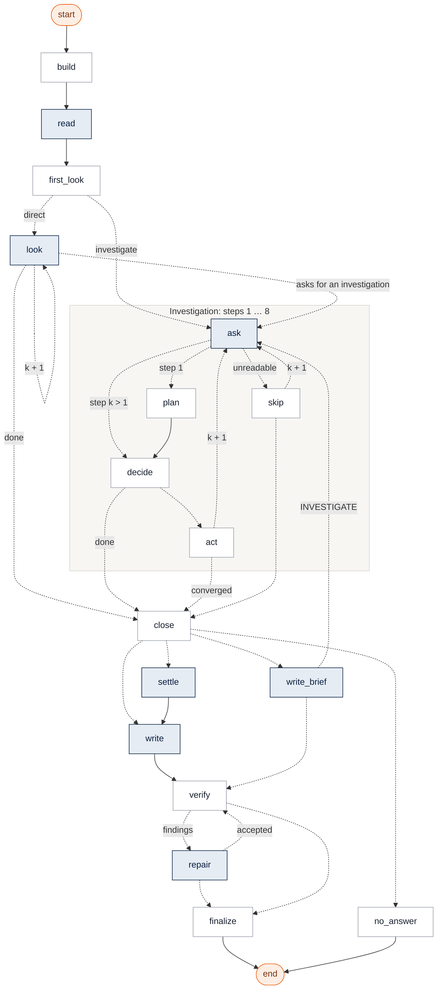

# The question graph

PetroHarness answers a question as a LangGraph state graph. This page is its blueprint: every node, state field and
route below exists under the same name in `src/petroharness/agent/graph.py`, `docs/graph.mmd` is the graph drawn from
the code, and `tests/agent/test_graph_flow.py` keeps both equal to the code.



Blue nodes are model calls, white nodes code. A solid arrow is always taken; a dotted one is a route that code
decides. The model never judges its own completion: `decide` (the claims' done rule) and `verify` (the number check)
are code, and they route.

## A real path

The first question of the Brent Group conversation on GeoLink 30/6-5 ("What are the porosity, water saturation and
permeability of the Brent Group, and is any of it hydrocarbon-bearing?"), as its trace records it:

| Nodes | What happened |
|---|---|
| `build → read → first_look` | 20 zones from `LITHOLOGY_GEOLINK`; the READ call chose four topics and an investigation; the first look opened E1 |
| `ask → plan → decide → act` | Step 1: the points, the first claims, 2 guides read and 2 analyzer sections opened |
| `ask → decide → act`, six times | Steps 2–7: lookups and sections into the ledger, E4–E10 |
| `ask → decide → close` | Step 8, the cap: done |
| `settle → write → verify` | 9 claims settled; the draft stated 4 numbers no result shows and 2 phrases about the work |
| `repair → verify → finalize` | One repair; the check passed; status `ok` |

Twelve model calls in the graph: READ, eight steps, settle, the writer and one repair.

## Why a graph

- **Branches and retries:** a step can be unreadable and skipped, refused as done, converged, or capped; the answer
  can go round the repair loop.
- **State worth keeping:** each step's record, the claims, and what was opened.
- **Verifiable results:** the claims' done rule and the writer's number check are code, and they route.
- **Independent units:** questions, run as a batch.

Each stopping decision is a route that can be read, tested and logged on its own.

## Run context and state

The domain state (the interval, the ledger, the claims, the trace) lives in the run context, outside the graph state,
on purpose: a checkpoint cannot restore it, and a node must not be retried, so the tapes, not LangGraph's checkpoints,
are how a run is reproduced. The graph state is the control data that routes, and each step's scratch.

<details>
<summary>Run context</summary>

`Run`, one per question, private to the nodes; never part of a state update:

- the inputs, set once: `task`, `cfg`, `llm`, `usage`, `writer`, `fmt`, and the token caps `max_tokens` and
  `max_tokens_writer`. No evaluation label is among them: the model's topics come from the `read` node;
- the domain state, changed in place by the nodes: `session` (the interval, the ledger, the claims, the points and
  the model's topics) and `trace` (the record of the run);
- prompt pieces built once by a node and reused: `system`, `head`, `first_look` (by `first_look`), `w_messages` and
  `w_table` (by `write`).

</details>

<details>
<summary>State fields</summary>

**State** is the control data that routes, and each step's scratch:

| field | merge | meaning |
|---|---|---|
| `k`, `max_steps` | overwrite | the step being taken (1..max_steps); the cap (default 8) |
| `new` | overwrite | NEW: what the last actions returned, shown in the next step |
| `shown_new` | overwrite | ids the last step's NEW shows whole (left out of OPENED's digests) |
| `withheld` | overwrite | ids the last step opened or asked again that NEW's budget left out: first in the next step's NEW |
| `guides_new` | overwrite | the guides the last step read: whole in the next prompt's GUIDES block, short after that |
| `refused`, `polish` | overwrite | done refused once by the done rule; steps in a row that only rephrased a settled answer |
| `text`, `user`, `reply`, `call_errors` | overwrite | this step's reply as recorded, its prompt, its step object (None: unreadable), call messages |
| `rec` | overwrite | this step's record |
| `steps` | append | the step records |
| `acts`, `notes`, `msgs`, `raw_edits`, `settled_before` | overwrite | `decide`'s hand-off to `act` |
| `finished` | overwrite | the investigation ended at `decide` or `act` |
| `draft` | overwrite | the writer's draft |
| `rounds` | append | the checker's rounds |
| `answer`, `status` | overwrite | the final answer and its status |

</details>

## Nodes

Seven nodes call the model: `read`, `look`, `ask`, `settle`, `write`, `write_brief` and `repair` (`plan` adds one call
at step 1 when the reply's edits number points it does not list). The others are code.

What a code node adds depends on the well. GeoLink 16/7-1 has no neutron and no PEF log; asked "What do the neutron
porosity and the photoelectric factor show in the halite, and how resistive is it?", `first_look` puts this line under
the question (here from the question's own words; in a run, the measurements the READ reply names are read too):

```text
Named but not in this well's record: neutron (NPHI); photoelectric (PEF)
```

<details>
<summary>Every node and what it does</summary>

| node | kind | does |
|---|---|---|
| `build` | code | `Session.build`: the well prepared, the interval view, the workflow store, the inventory; the map |
| `read` | model | the READ call: one schema-guided call (one retry when unreadable) in which the model chooses the question's topic areas, most important first, and lists the measurements it names; the map's notes follow the topics' families |
| `first_look` | code | the note of what the question names that this well's record lacks; the key curves of the model's topics, the curves its READ reply names and the interval's reservoir curves, each with its core-calibrated twin where the record holds one (each zone, the zones pooled and the whole interval, with the default statistics), before step 1 |
| `look` | model | the direct route's step ("The direct route" below; off with `--investigate`): one call that says the opened results state what is asked, or names up to 4 lookups, which run into the ledger; no points and no claims. A reply that asks for an investigation, or cannot be read, starts the investigation |
| `ask` | model | build step k's prompt from the state (GUIDES with the guides read, the last step's whole and the earlier ones short, before NEW); one call (one retry after an empty reply); read the reply. The protocol is JSON (`parse`: read, salvage, or the model fixes its own syntax) |
| `skip` | code | an unreadable reply: the step is recorded, and NEW says so |
| `plan` | code (+ model once) | step 1 only: what the question asks, the points, the intent, the claims. One extra call when the reply's edits number points it does not list |
| `decide` | code | apply the claim edits; read the actions; a guide read the first time opens what bears on the READ's first topic: its sections of that topic's families and, for a guide on that topic, the workflow curves it names (no topics: nothing; with no skill library a guide call is said back as not run); the done check |
| `act` | code | run the actions into the ledger; build NEW within its budget from results only: the results the last step withheld first, a call opened before and a `get` without a term shown whole again, a result that does not fit withheld for the next step; a guide read goes to GUIDES, outside NEW; the convergence check |
| `close` | code | the investigation's record (steps, points, opened, claims) |
| `ask_user` | code | the question back to the user, nothing computed: a unit the tops file lists more than once, a unit whose row the tops reader cannot use, a name close to several units, or a bare name several units share (which one is meant is the user's to say, status `ask_user`, with the choices); or a request outside what the harness does (status `outside`, with example questions)
| `no_answer` | code | the question fails: step 1 was unreadable, so there are no claims to write from |
| `settle` | model | the final step with every opened result; the claims made final |
| `write` | model | the writer's draft from the question's points and the limits the settled claims found (their weakness notes; the claims themselves are not in the prompt), every opened result, the provenance card of the curves they and the claims name, the zone table and the map without its notes; a retry after an empty reply, and the working-notes check |
| `write_brief` | model | the short answer of a direct question (and, in the later-question graph, of a later question the model chose to answer briefly): the writer's call under the short brief, with no zone table; the checker and the repair rounds follow as for `write`. A direct question's writer may hand the question to an investigation instead of answering, where the results do not state what is asked |
| `verify` | code | the checker: numbers no result (or the rest of what the writer was shown: the card, the map without its notes, the zone table, the points and limits; or the question) shows, words about the process, statements the record contradicts, working notes left in the text |
| `repair` | model | one repair round on the checker's findings (at most two with the `open` writer, one otherwise) |
| `finalize` | code | the draft kept in the trace; the answer delivered from it (`delivered`: the zone table placed, evidence ids out, numbers as the results show them); the status (`ok`, `unresolved_numbers`, or an error when the last draft is empty) |

</details>

## The direct route

The READ call also says what kind of answer the question asks for: `direct` for a value, a setting, a count, a depth or
a yes or no that one or two lookups will state, `investigate` for an interpretation that takes several results weighed
together. The decision is the model's; the graph carries it. Every question can take this route: a user's
(`petroharness`, `petroharness chat`, the web UI) and a benchmark's.

| | An investigation | A direct question |
|---|---|---|
| Thinking | the model card's normal setting | the same: every call thinks as the card says |
| Steps | up to 8, with points and claims | up to 2 `look` steps of at most 4 lookups |
| Settle | one call | none |
| Answer | the report form | the short form: the answer first, then only what it rests on |
| Check | every number traced to a result; repairs | the same |

`--investigate` (the command, chat, benchmark mode; `direct=False` in Python; "A full investigation for every
question" in the web UI) leaves the route out of the READ call, and every question gets the investigation, a route the
request gate proves unchanged.

<details>
<summary>When a direct question gets an investigation after all</summary>

A direct question starts its own investigation from step 1, with the results already open, in three cases:

1. a `look` reply that asks for it;
2. a `look` reply that cannot be read, or whose lookups cannot be read;
3. the writer: where the results do not state what is asked, and do not show why it cannot be had, the writer replies
   with the one word INVESTIGATE instead of an answer, so a value is called missing only after an investigation has
   looked for it.

The writer reads every result the `look` steps were shown: the ones they opened, and on a later question of a
conversation the earlier questions' results they read again (a short answer has no claims to cite them by).

</details>

<details>
<summary>Why the direct route thinks as every call does</summary>

What a direct question saves is the route: no points, no claims, no settle call, a short answer. Every call on it
thinks as the model card says. Reduced thinking in the `look` steps (the lowest effort, or thinking off) was measured
on both models: the direct answers lost about 7 points of reference alignment, because the step stopped at a result
near what was asked or chose a weaker lookup, and no time was saved that could be measured. A writer at the lowest
effort was seen to deny a fact its results stated.

</details>

## Routes

Every route is a function of the state that code evaluates; the table lists each with its condition.

<details>
<summary>Every route, with its condition</summary>

| after | condition | to |
|---|---|---|
| `build` | always | `read` |
| `read` | `after_read`: the question is asked back (an ambiguous or unusable unit, reach well) or is outside what the harness does | `ask_user`, else `first_look` |
| `ask_user` | always | END |
| `first_look` | `after_first_look`: the READ call read the question as direct | `look`, else `ask` |
| `look` | `after_look`: done, nothing to open, or the last look step | `close` |
| `look` | the reply asks for an investigation, or cannot be read | `ask` (the investigation's step 1, at normal thinking) |
| `look` | otherwise | `look` (k+1; NEW shows what was opened) |
| `ask` | reply unreadable | `skip` |
| `skip` | the skipped step was step 1, or the last step | `close` |
| `skip` | otherwise | `ask` (k+1; NEW says the reply could not be read) |
| `ask` | readable and k = 1 | `plan` |
| `ask` | readable and k > 1 | `decide` |
| `plan` | always | `decide` |
| `decide` | done, no actions or last step, and (done rule holds, done already refused once, or last step) | `close` |
| `decide` | otherwise | `act` (when done was refused: NEW says why, and the actions are dropped if the model set done) |
| `act` | converged (POLISH_STEPS steps in a row only rephrased) | `close` |
| `act` | otherwise | `ask` (k+1; `decide` always ends the last step, so `act` never runs at k = max_steps) |
| `close` | no answer state (step 1 unreadable) | `no_answer` |
| `close` | a direct question | `write_brief` |
| `close` | claims and opened results exist | `settle` |
| `close` | otherwise | `write` |
| `settle` | always | `write` |
| `write` | always | `verify` |
| `write_brief` | `after_write_brief`: a direct question its writer handed to an investigation | `ask`, else `verify` |
| `verify` | issues, rounds left, draft not empty | `repair` |
| `verify` | otherwise | `finalize` |
| `repair` | the repaired draft was kept (60% of the draft or shorter, or empty) | `finalize` |
| `repair` | accepted | `verify` |
| `finalize` | always | END |

</details>

## Reproducing a run: tapes

What the model sees is logged, so a run can be reconstructed from its log.

- **Record.** `petroharness.tape` records every model request and reply of a run. `tests/agent/record_golden.py live`
  records the golden questions (`tests/golden/`) from the servers.
- **Replay.** `tests/agent/test_golden_tapes.py` reruns each golden question through the graph from its tape, with no
  server. Every request must equal the recorded one field by field: the same prompts, in the same order, with the same
  parameters. The answer, the status and the trace (timings aside) must also equal the recording.
- A change to a node that should not alter behaviour is accepted only when every tape replays.
