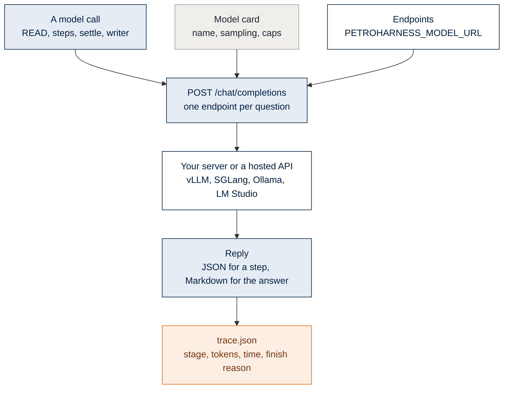

# Models

PetroHarness works with any chat model behind an OpenAI-compatible chat completions endpoint: a model you serve
yourself with vLLM, SGLang, Ollama or LM Studio, or a hosted API. A model card says how to call it. With nothing set,
the model is WellLogLLM-3.7B, our post-trained model, as a GGUF in Ollama on your computer
([Install and set up](INSTALL.md)); the web UI's Model dialog connects any other.



The harness sends plain chat requests, with no native tool calling. The model replies with one JSON object at each
investigation step and in Markdown when it writes the answer.

## What the model needs

| Need | Why |
|---|---|
| An OpenAI-compatible endpoint | A base URL ending in `/v1` that answers `POST /chat/completions`, and lists its models at `GET /models` (the web UI's health check) |
| A context window of 64k tokens or more | Prompts run up to about 40,000 tokens (39,340 at most in the [Conversations](SESSIONS.md) example on GeoLink 30/6-5), and each reply needs room on top. A request that does not fit is sent once more with a smaller output allowance |
| JSON replies on request | Each investigation step asks, in its prompt, for one JSON object. A reply that is not valid JSON is salvaged where it can be, or sent back once to be fixed. The READ call and the figure choice also carry their reply's JSON schema, for servers that support structured output (`structured_output` below). A server that types a reply by a grammar may let whitespace stand between its tokens, and a model now and then writes nothing else up to the token cap; these two calls are read as they stream, and a reply that runs 400 characters of whitespace on end is ended there and asked again |

## Choosing the model

| You want | How |
|---|---|
| WellLogLLM-3.7B on your computer | nothing: with no model set, Ollama runs it, downloaded the first time ([Install and set up](INSTALL.md#3a-welllogllm-on-this-computer-ollama)) |
| to choose in the page | **Model**, top right of the web UI: Ollama on this computer, a vLLM server, or OpenRouter. The choice is kept for the next start and for the command |
| WellLogLLM-7B or -3.7B on your vLLM server | `--model-card welllogllm_7b` (or `welllogllm_3_7b`) `--model-url URL` |
| K2-Horizon-7B | `--model-url URL`, or `PETROHARNESS_MODEL_URL`: with an endpoint and no card, its card is the default |
| any chat model, by its served name | `--model NAME`: the generic card, with that name |
| full control over the request | `--model-card FILE`: a model card of your own |

Which model a run uses, first match wins: the options above; `PETROHARNESS_MODEL_URL`; the model chosen last in the web
UI; WellLogLLM-3.7B in Ollama ([where the choice is kept](INSTALL.md#5-where-petroharness-keeps-your-choice)).
Benchmark mode uses the options and `PETROHARNESS_MODEL_URL` only.

The endpoints come from `--model-url` or `PETROHARNESS_MODEL_URL`, comma-separated. A batch spreads its questions over
them, and the web UI sends each question to the least busy one. The API key is read from the environment variable the
card names (`PETROHARNESS_API_KEY` unless the card says otherwise); a local server accepts any key.

The same options work for the command, the web UI (`petroharness ui --model ...`), benchmark mode
(`petroharness benchmark --model ...`) and Python (`ask(..., model="...", model_card="...")`).

## The Model dialog

**Model** (top right of the web UI, on the model's name) connects a model while the server runs; the questions already
asked keep theirs.

| Route | What PetroHarness does |
|---|---|
| On this computer | Checks Ollama (and says how to install it when it is missing) and this computer (memory, GPU, disk), pulls WellLogLLM-3.7B as a GGUF or any model you name, makes a copy of it with a 65,536-token context, loads it and says where Ollama put it (all on the GPU, part on the CPU, or on the CPU). The page follows the download; what is not ideal is marked, with what to do |
| A vLLM server | Shows the commands that serve WellLogLLM-7B and -3.7B, lists the models the server at your address serves (with its API key if it has one), and chooses the card from the model's name: WellLogLLM and K2-Horizon models get the WellLogLLM card, others the generic one |
| OpenRouter | Checks your key, lists OpenRouter's text models with their context window, price, reasoning and JSON support, and writes a hosted-API card for the one you choose |

It writes the card it uses into `cards/` of PetroHarness's folder, and keeps any key you give in `keys.json` there,
readable by you only ([where](INSTALL.md#5-where-petroharness-keeps-your-choice)): the page is told whether a key is
kept, never the key. A server started with `--host` other than a loopback address keeps the model it was started with.

## Serve a model

With vLLM, then a question about the Brent Group of GeoLink 30/6-5 (a well that ships with Petrophys):

```bash
vllm serve Qwen/Qwen3-32B --port 8000 --max-model-len 65536

LAS=$(python -c "import petrophys; print(petrophys.sample('30/6-5'))")
TOPS=$(python -c "import petrophys; print(petrophys.sample('formations_30_6-5.csv'))")
petroharness --model Qwen/Qwen3-32B --model-url http://localhost:8000/v1 \
  --las $LAS --tops $TOPS --formation "BRENT GP." --question "Which zone has the best reservoir quality?"
```

<details>
<summary>SGLang</summary>

```bash
python -m sglang.launch_server --model-path Qwen/Qwen3-32B --port 30000 --context-length 65536
petroharness --model Qwen/Qwen3-32B --model-url http://localhost:30000/v1 --las $LAS --question "..."
```
</details>

<details>
<summary>Ollama</summary>

The Model dialog does this for you (**Another model in Ollama**): it pulls the model and makes a copy with a 64k-token
context. By hand, Ollama's default context window is far smaller than the harness needs, so raise it:

```bash
OLLAMA_CONTEXT_LENGTH=65536 ollama serve
ollama pull qwen3:32b
petroharness --model qwen3:32b --model-url http://localhost:11434/v1 --las $LAS --question "..."
```
</details>

<details>
<summary>WellLogLLM-7B and WellLogLLM-3.7B</summary>

Our post-trained K2-Horizon models ([`sambal/WellLogLLM-7B`](https://huggingface.co/sambal/WellLogLLM-7B),
[`sambal/WellLogLLM-3.7B`](https://huggingface.co/sambal/WellLogLLM-3.7B)), served by vLLM 0.30 or later under the
names their cards give:

```bash
vllm serve sambal/WellLogLLM-7B --served-model-name welllogllm-7b --port 8000 \
  --max-model-len 65536 --trust-remote-code \
  --reasoning-parser k2_horizon --chat-template-content-format string
petroharness --launch-ui --model-card welllogllm_7b --model-url http://localhost:8000/v1
```

WellLogLLM-3.7B as a GGUF, for Ollama and llama.cpp on any computer (on a Mac, on its GPU through Metal):
[`sambal/WellLogLLM-3.7B-GGUF`](https://huggingface.co/sambal/WellLogLLM-3.7B-GGUF), in Q8_0, Q6_K, Q5_K_M and Q4_K_M
([Install and set up](INSTALL.md#3a-welllogllm-on-this-computer-ollama)). WellLogLLM-7B is for a GPU server.
</details>

<details>
<summary>K2-Horizon-7B</summary>

Served by vLLM 0.30 or later. Serve it under the name in its card (`model:` in
`src/petroharness/resources/models/k2_horizon_7b.yaml`) and no model option is needed. Under any other name, pair the
card with that name:

```bash
vllm serve /path/to/K2-Horizon-7B --served-model-name k2-horizon-7b --port 8000 \
    --trust-remote-code --dtype bfloat16 --max-model-len 131072 \
    --reasoning-parser k2_horizon --chat-template-content-format string \
    --enable-auto-tool-choice --tool-call-parser k2_horizon
export PETROHARNESS_MODEL_URL=http://localhost:8000/v1
petroharness --model-card k2_horizon_7b --model k2-horizon-7b --las $LAS --question "..."
```

`--chat-template-content-format string` is required: the model's chat template reads each message's content as a
string, and without the flag the user's text does not reach the model.
</details>

## Model cards

A model card is a YAML file with one section, `model`: the served model's name and how to call it. The packaged cards
are in `src/petroharness/resources/models/`:

- `k2_horizon_7b.yaml`: K2-Horizon-7B, the default card with an endpoint given (registry key `k2-horizon-7b`). It
  thinks at high effort, and at low effort for the one retry after an empty reply and for the call that chooses an
  answer's figures.
- `welllogllm_7b.yaml`, `welllogllm_3_7b.yaml`: WellLogLLM-7B and -3.7B on vLLM, served as `welllogllm-7b` and
  `welllogllm-3.7b`, called as K2-Horizon-7B's card calls it.
- `welllogllm_3_7b_gguf.yaml`: WellLogLLM-3.7B as a GGUF in Ollama (`welllogllm-3.7b:q8_0` at
  `http://localhost:11434/v1`): the same, with JSON asked for in the prompt alone (`structured_output: none`) and three
  hours for a request (`timeout_s`), since a computer without a GPU writes far more slowly.
- `generic.yaml`: any chat model, named with `--model`. It sends no sampling settings and no chat-template variables,
  so the model's own defaults apply. Its output caps are 16,384 tokens for a step and for the writer; raise them for
  a model that thinks at length.

`--model-card` takes a card's file, or a packaged card's name (`--model-card generic`). With both `--model` and
`--model-card`, `--model` names the model the card describes. A misspelt field stops the run before its first
question.

### A hosted API

Hosted APIs reject fields they do not know, and some models accept only their default sampling:

```yaml
model:
  model: your-model-name
  label: Your Model
  api_key_env: OPENAI_API_KEY                      # the variable that holds your key
  send_template_kwargs: false                      # no chat_template_kwargs in the request
  send_temperature: false                          # the model's default sampling
  max_tokens_param: max_completion_tokens          # the cap's name on APIs that use it
  reasoning: true
  replay_reasoning_field: false
  max_tokens_spec: 32768
  max_tokens_writer: 32768
```

```bash
export OPENAI_API_KEY=...
petroharness --model-card my_api.yaml --model-url https://api.openai.com/v1 --las $LAS --question "..."
```

With a hosted API, the prompts go to that provider, and the prompts include the well's data.

<details>
<summary>A reasoning model</summary>

A model that thinks before it answers needs two things:

- the server's reasoning parser, so that the thinking arrives apart from the reply (vLLM's `--reasoning-parser` for
  the model's family, for example);
- a card that says so:

```yaml
model:
  model: Qwen/Qwen3-32B
  label: Qwen3-32B
  reasoning: true                                  # a reply cut off by the token cap is a failed reply
  chat_template_kwargs: {enable_thinking: true}
  retry_template_kwargs: {enable_thinking: false}  # the one retry after an empty reply: a plain answer
  temperature: 0.6
  top_p: 0.95
  max_tokens_spec: 32768                           # thinking counts against the output cap
  max_tokens_writer: 32768
  timeout_s: 3600
```
</details>

<a id="fields"></a>
<details>
<summary>Fields</summary>

| Field | Default | Meaning |
|---|---|---|
| `model` | (required) | the served model's name, as the server lists it at `/v1/models` |
| `label` | `model` | the model's name as people read it: shown in the web UI and in `answer.md` |
| `api_key_env` | `PETROHARNESS_API_KEY` | the environment variable that holds the API key |
| `temperature` | `0.0` | sampling temperature (sent when `send_temperature`) |
| `top_p` | the server's | nucleus sampling |
| `max_tokens_spec` | `3000` | the output cap of an investigation step and of the settle step |
| `max_tokens_writer` | `6000` | the output cap of the writer and of a repair |
| `timeout_s` | `600` | the time one request may take, in seconds |
| `max_retries` | `3` | the client's retries after a connection error or a server error |
| `reasoning` | `false` | the model thinks before it answers: a reply cut off by the token cap is discarded, and the step retries or keeps its last draft |
| `chat_template_kwargs` | `{enable_thinking: <enable_thinking>}` | chat-template variables sent with each request (vLLM, SGLang) |
| `enable_thinking` | `false` | the template variable sent when `chat_template_kwargs` is not set |
| `retry_template_kwargs` | none | the template variables of the one retry after an empty reply |
| `light_template_kwargs` | none | the template variables of a call that needs little reasoning, for example `{reasoning_effort: low}` or `{enable_thinking: false}`. Used by the call that chooses an answer's figures. Without it every call thinks alike |
| `reasoning_end` | none | where the server leaves the reasoning in a light call's reply, the marker that ends it; the reply is the text after the last marker |
| `send_template_kwargs` | `true` | whether to send `chat_template_kwargs` at all |
| `send_temperature` | `true` | whether to send `temperature` |
| `max_tokens_param` | `max_tokens` | the name of the output cap: `max_tokens` or `max_completion_tokens` |
| `structured_output` | `json_schema` | how JSON replies are requested: `json_schema` (the reply's schema), `json_object`, or `none` (the prompt alone) |
| `replay_reasoning_field` | as `reasoning` | whether replayed assistant turns carry an empty `reasoning` field (some chat templates need it; some APIs reject it) |
| `base_url` | `http://localhost:8000/v1` | the endpoint when the card is loaded on its own; a run's endpoint comes from `--model-url` or `PETROHARNESS_MODEL_URL` |
</details>

## The model in the record

- Each answer's `answer.md` names the model.
- `trace.json` records every request to the model and its reply: the stage, the tokens in and out, the time taken and
  the finish reason. A conversation also keeps each question's requests and replies in `tape.jsonl`.
- The web UI shows the model in its header and on each run.
