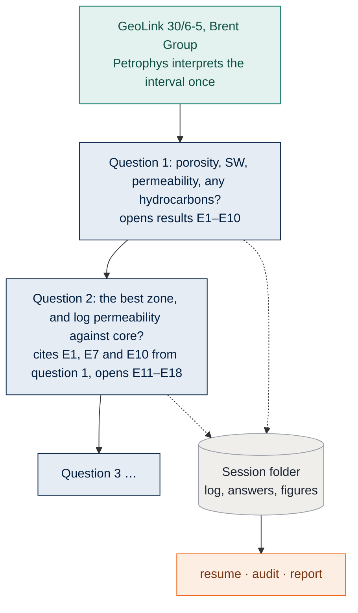
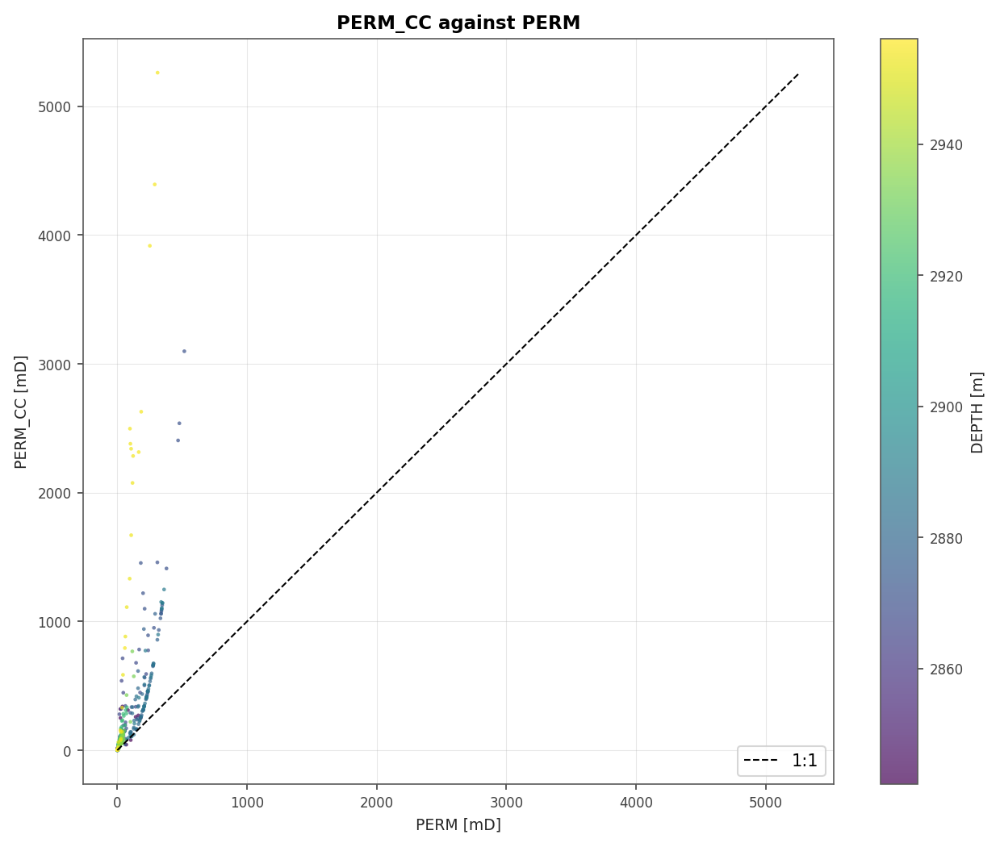
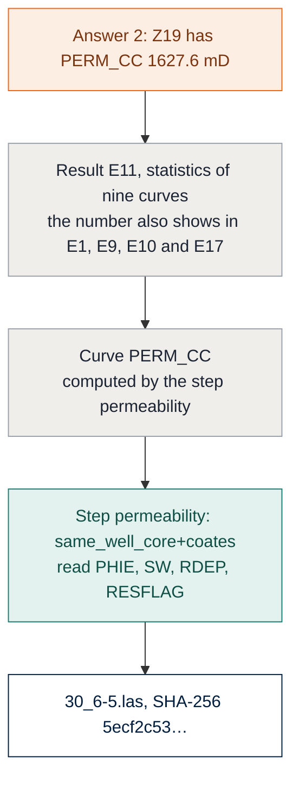

# Conversations

A conversation keeps one interval of one well open for as many questions as you have. Each question starts from what
the earlier ones found, each answer is checked and illustrated like a first answer, and the whole conversation is kept
in one folder: resume it later, audit any answer back to the LAS file, or write it up as one report.



The examples on this page come from one real conversation: two questions about the Brent Group of GeoLink well
30/6-5, a well that ships with Petrophys.

## Start one

```bash
LAS=$(python -c "import petrophys; print(petrophys.sample('30/6-5'))")
TOPS=$(python -c "import petrophys; print(petrophys.sample('formations_30_6-5.csv'))")

petroharness chat --las $LAS --tops $TOPS --formation "BRENT GP."
```

Type a question at `question>` and press Enter; an empty line or Ctrl-D ends the conversation. The interval, model,
settings and skills options are those of `petroharness` ([Evaluate a formation](USAGE.md)). Questions can also be given
up front, with `--question` (repeatable) or `--questions-file` (one per line):

```bash
petroharness chat --las $LAS --tops $TOPS --formation "BRENT GP." --session brent \
  --question "What are the porosity, water saturation and permeability of the Brent Group, and is any of it hydrocarbon-bearing?" \
  --question "Which zone has the best reservoir quality, and how does the log permeability compare with the core?"
```

Answers go to standard output, and what was run to standard error:

```text
conversation in …/brent
30_6-5.las: 2841-2958 m (768 samples; tops file formations_30_6-5.csv, base: stated base)
the interval's log display (Petrophys): …/brent/overview.png

--- question 1 (ok; 8 investigation steps, 903.5 s; …/brent/turns/01) ---
```

## What a later question can do

Anything a first question can, starting from what is already known. The model reads the question with the conversation
in view and decides what it needs:

| Ask | For example |
|---|---|
| About an earlier answer | "What formation water resistivity did the saturation use?" (read again, not recomputed) |
| For another method or parameter | "What if I use the density porosity instead?" (computed, and compared) |
| To go further | "Which zone has the best reservoir quality, and how does the log permeability compare with the core?" |
| To narrow down | "And only in the cross-bedded sands?" |

Question 2 of the Brent conversation went further. It cited three results question 1 had opened (E1, E7 and E10),
opened eight of its own (E11 to E18), and began:

> **Z19** (Sand, 2951.66–2955.01 m) has the strongest permeability […] but it is water-bearing (SW = 1.0 in all 23
> samples, PRIME_OIL_TARGET 0), so it is the best rock unit, not a hydrocarbon candidate. **Z7** (Sand,
> 2877.60–2890.85 m) has the best combined rock quality: cleanest mean clay (VCL 0.0268), […] core-calibrated PERM_CC
> 416.0 mD, and the largest flow capacity (k·h = 5516 mD·m; […]).

A later answer is checked as a first answer is: every number in it must come from a result.

A question stopped from the web UI ([Stopping a question](UI.md#stopping-a-question)) stays in the conversation as a
question with no answer: its `turn_end` in the log has the status `stopped`, the results it had opened keep their
ids, and the next question is shown it as `(not answered: the user stopped it)`.

## Figures

An answer carries up to three figures where a plot says it better than text. After the answer is written, one more
model call sees the question, the answer and the plots that can be drawn from what the answer rests on, and picks
which to show, or none. Petrophys draws them (`petrophys.visualization`); the harness has no drawing code, and the
answer's text never goes back through the model.

  beside the zones' lithology. Data: GeoLink, CC BY-SA 4.0.")

Figures are files in `turns/NN/figures/`, linked at the end of `answer.md`, each captioned with the Petrophys function
and the result or curves it drew. When a conversation starts, Petrophys's log viewer also draws the whole interval once
(`overview.png`). `--no-figures` turns figures off; a benchmark run draws none.

<details>
<summary>The plots an answer can get</summary>

- **The plot of a result the answer's claims cite:** a histogram of each curve by zone and the log viewer of its
  curves (a statistics result), the crossplot with its line (a crossplot or a comparison), the log viewer (a profile).
- **A standard display of the interval**, where the interval holds its curves and the answer's results rest on them:
  density-neutron, M-N and MID crossplots, Pickett, Hingle and Buckles plots, the flow-unit plot, the triple combo and
  the net pay summary.

The harness gives Petrophys only what a plot needs from the question: the interval's samples as the results read
them, the zones as the lithology track, and each number the plot takes, stated in the caption with its source (a
Pickett plot's Rw is the median of the interval's Rw curve). A missing plot belongs in Petrophys; one line in
`petroharness/figures.py` (`DISPLAYS`) then offers it. More: [Petrophys integration](reference/PETROPHYS_INTEGRATION.md).
</details>

## Methods and parameters

Every answer file ends with the Petrophys steps behind the curves the answer names, with their parameters. Code reads
them from the well's record after the answer is final; the model neither writes nor sees them. Two of the steps under
question 2's answer:

> - **saturation**: archie+simandoux. computed SW, SXO. read RDEP, PHIE_CC, VCL. parameters sw_model =
>   archie+simandoux; […] m = 2; n = 2; […] rw_min = 0.0624088; rw_max = 0.196732; rcl = 2.906; […]
> - **net_pay**: cutoff_flags. computed PRIME_OIL_TARGET, NET_PAY. read VCL, PHIE_CC, SW. parameters vcl_cutoff =
>   0.3; phie_cutoff = lithology_dependent; sw_cutoff = 0.7; lithology = per-depth; seal_vcl_cutoff = 0.8.

The list also holds the steps those read from, and a curve computed on request (a what-if) under its label. The same
list is in `trace.json` (`basis`) and in `Turn.basis`.

## Changing a setting

The interpretation settings (Petrophys's, such as `m`, `rw` and the cutoffs, and the zone rule; the web UI's settings
panel lists them) can change in the middle of a conversation, from the next question on. On the resumed Brent
conversation:

```text
question> /set sw_cutoff=0.6
from question 3: sw_cutoff the default (0.7) -> 0.6 (the well was interpreted again)
question> /settings
settings in force: sw_cutoff=0.6
changed before question 3: sw_cutoff the default (0.7) -> 0.6
```

`/set` takes several `name=value` pairs; `name=default` restores a default. In Python: `c.adopt({"sw_cutoff": 0.6})`
(None for the default). The next question's prompts say what changed:

> Settings changed before question 3 (by the user): sw_cutoff the default (0.7) -> 0.6. The well was interpreted
> again with them. Results E1 to E18 and the answers before rest on the earlier settings; read again, a result says so.

<details>
<summary>What a settings change does</summary>

- **The well is interpreted again** under the settings in force, and every later question reads it.
- **The ledger goes on**, its ids continuing. An earlier result says, when read again, that it rests on the earlier
  settings; the same call asked again is computed anew.
- **The change is recorded:** in the answer's header, in its methods and parameters, as a `settings` event in the log
  (replayed in its place on resume), and in the audit trail ([Audit an answer](EVIDENCE.md)).
- **Only you change settings.** A question such as "what if m were 1.8?" is answered as a comparison and changes
  nothing; with no change, no request differs.
- **A setting that cannot be used is refused**, and nothing changes:
  `not changed: WHAT: interpretation settings that cannot be used: q: not a setting this panel knows. FIX: correct or reset them.`
- **A context profile fixes its own settings:** with `--profile`, only the zone rule can change.
- **A zone rule change re-zones the interval.** Taranaki cheal-1 has no lithology log, so its Moki Formation
  (2336–2848 m) is zoned by the lithology Petrophys's mineral solver gives: 37 zones at the default minimum
  thickness of 2 m. A 1 m minimum gives 58:

  ```text
  question> /set zone_min_thickness_m=1
  from question 1: zone_min_thickness_m the default (2) -> 1 (the well was interpreted again)
  ```

  The `settings` event records the 58 zones the well was interpreted into, and the 37 of before. Data: Taranaki
  Basin Curated Well Logs Dataset (New Zealand Petroleum & Minerals), CDLA-Sharing-1.0.
- **When a change cuts the zones anew, a zone id no longer names the stretch it named before.** A zone rule does
  it, and so do the lithology domain of a well without a lithology log and zones of your own. The next questions are
  shown the zones as they were, each with where its depths lie now; a result opened before says that its zone ids
  are the zones of then; and a zone asked of such a result is found by the zones it was opened under. On KGS Morgan
  No. 1-17, Lansing-Kansas City, after `/set lithology_domain=carbonate matrix_type=limestone`:

  ```text
  The zones were cut anew: 4 before, 3 now. A zone id in a result or an answer from before names the zone as it was then, and the same id may name another stretch now:
    then Z1 SHALE 4010-4021.5 ft: now outside any zone
    then Z2 SANDSTONE 4031.5-4048.5 ft: now inside Z2 LIMESTONE (4031.5-4051 ft)
    then Z3 SANDSTONE 4050-4059.5 ft: now Z2 LIMESTONE over 4050-4051 ft; the rest outside any zone
    then Z4 SHALE 4060-4068 ft: now Z3 NO_LITHOLOGY_DATA (the same depths)
  ```

  Data: Kansas Geological Survey (kgs.ku.edu).
</details>

## Changing the scope, the frame or the zones

A conversation's stretches of the well can change from one question to the next, as its questions do.

```text
question> /scope Dunlin GP., 2900-3000
from question 4: scope Dunlin GP., 2900-3000
question> /frame lithology
from question 4: by the lithology zones
question> /zones ness_etive.csv
from question 4: your zones from ness_etive.csv
```

- **Each question's own scope.** The model reads which stretches a question is about (a unit, a depth range, your
  zones, the whole well) and every lookup of that question computes on them (a call's `"zones": ["ALL"]` is every
  row of the scope; a call that names other zones computes on those). The next question reads its own: one that
  names none is about the interval.
- **`/scope ITEMS`** (comma-separated) sets a default for the questions from the next one on, until you change it. A
  question that names other stretches is computed on those, for that question only. `/scope` alone returns to the
  interval. A scope that names nothing in the well is refused when you give it.
- **`/frame lithology`** reports every lookup by the lithology zones (where your zones frame the interval); `/frame
  zones` takes it back.
- **`/zones FILE`** gives your zones from the next question on (the well is not interpreted again; earlier results say
  they were read under the earlier zones, and the next questions are shown the zones of before with where each lies
  in yours, as after [a setting that cuts the zones anew](#changing-a-setting)). `/zones none` takes them away. A
  file that cannot be used changes nothing.

In Python: `c.set_scope(["Dunlin GP."])`, `c.set_frame("lithology")`, `c.adopt_zones("ness_etive.csv")`. Each change
is logged with the question it takes effect at, the next questions' prompts name it, and a resumed conversation
replays it in place. Under `reach: focus` (a benchmark's settings) `/scope` is refused: those questions stay on their
interval.

## Field notes

A field notes file holds a team's standing choices for a field or study: settings in force from the start, and notes
in words that go with every question.

```yaml
name: Brent Group study
settings:              # in force from the start (the settings panel's names)
  m: 1.8
  sw_cutoff: 0.6
notes:                 # standing choices in words, read with every question
  - Report water saturation from the Indonesia model.
  - Call the sands below 2865 m the Etive sands.
```

Give it with `--field-notes FILE` (`petroharness` and `petroharness chat`), `field_notes=` in Python, or in the web
UI's Options. The model reads the notes as your statement:

> (The user's field notes for this field, Brent Group study: Report water saturation from the Indonesia model. Call
> the sands below 2865 m the Etive sands.)

<details>
<summary>How field notes apply</summary>

- Settings you give at the start take precedence over the notes' settings, and a later change is yours.
- The answer's header names the notes. The log keeps what the file held, with its SHA-256, so a resume does not read
  the file again.
- A file that cannot be used is refused with what is wrong and the fix: an entry other than `name`, `settings` and
  `notes`, a setting that cannot be used, or more than 20 notes or a note over 300 characters.
- A benchmark run never reads field notes.
</details>

## The session folder

A conversation lives in one folder: `--session DIR`, by default `./petroharness-sessions/<LAS name>-<time>`.

```text
brent/
  log.jsonl              the events, in order: what a resume, an audit and a report read
  overview.png           the interval's log display by Petrophys
  blobs/                 results, answers and the well's record, once each, by SHA-256
  turns/01/answer.md     question 1's answer with its header, figures, methods and parameters
  turns/01/trace.json    its full trace
  turns/01/tape.jsonl    every model request and reply of the question
  turns/01/figures/      its figures
  turns/02/…
  .cache/                the interpreted well
```

The Brent conversation's `log.jsonl` holds 32 events: `session_start`, `display`, `setup`, two `question`, 18
`result`, one `record`, six `figure` and two `turn_end`. A settings change adds `settings`, a resume
`session_resume`. Every field of every event: [Records](reference/RECORDS.md).

## Resume

```bash
petroharness chat --resume brent
```

```text
resumed …/brent: 2 questions so far
```

The well is prepared again from the cache and every recorded result is opened again, in order. Each must come back
with the same id and text; the Brent conversation's 18 did (`"differences": []` in its `session_resume` event). A
difference, after a Petrophys upgrade for example, is written to that event and the conversation goes on. A settings
change is replayed where it was made.

## Audit and report

```bash
petroharness audit brent --question 2     # one answer's trail; all answers without --question
petroharness report brent                 # the conversation as one document: brent/report.md
```

Both read the session folder alone: no well, no Petrophys run, no model. The audit trail follows each number from
the answer back to the LAS file. One number of question 2:



The report holds the interval, the model and the Petrophys build, the interval's display, each question with its
answer, figures, methods and parameters, then each answer's audit trail. What the trail lists:
[Audit an answer](EVIDENCE.md#get-an-audit-trail).

## More

<details>
<summary>From Python</summary>

```python
import petrophys
from petroharness.session import Conversation

c = Conversation.start(petrophys.sample("30/6-5"), "brent-py", formation="BRENT GP.",
                       tops=petrophys.sample("formations_30_6-5.csv"), model_url="http://localhost:8000/v1")
first = c.ask("What are the porosity, water saturation and permeability of the Brent Group?")
second = c.ask("Which zone has the best reservoir quality?")
for figure in second.figures:
    print(figure["caption"], second.folder / figure["file"])

later = Conversation.resume("brent-py", model_url="http://localhost:8000/v1")
later.adopt({"sw_cutoff": 0.6})              # from the next question on (None: back to the default)
later.ask("How much net pay is there now?")
print(later.settings, later.sources(), later.changes())
```

`field_notes="brent-study.yaml"` starts under a field notes file. A `Turn` has `number`, `question`, `answer`,
`status`, `trace`, `folder`, `figures` and `basis`. Every method: [Python API](reference/PYTHON_API.md).
</details>

<details>
<summary>How a later question is answered</summary>

- **One well, one ledger.** The well is prepared once. Result ids go on across questions (E1 to E10, then E11 to
  E18), and a later question can read any earlier result with `get` or `find` and cite it.
- **The same question graph, one extra block.** A later question starts at the READ call. Its prompts carry EARLIER IN
  THIS SESSION: each earlier question, how its answer opened, and its settled claims with their result ids, built by
  code from the log (newest in full, older in short, the oldest as a count; 6,000 characters at most).
- **Stale results are marked.** When a later question computes a curve again under the same name, earlier results that
  read the old values say so when read again.
- **The first question is unchanged.** With no earlier question the block is empty, and every request is the one a
  single `petroharness` run sends; the request gate checks this on recorded runs.

The graph a later question runs: [The later-question graph](GRAPH.md#the-later-question-graph).
</details>

<details>
<summary>Limits</summary>

- One interval per conversation. Another interval of the same well is another conversation.
- A what-if is a comparison. It does not change the settings later questions use; `/set` (or the web UI's settings,
  or `adopt`) does.
- The model does not change settings when asked in words.
- A later question costs about as many model calls as a first question when it needs new results.
</details>
