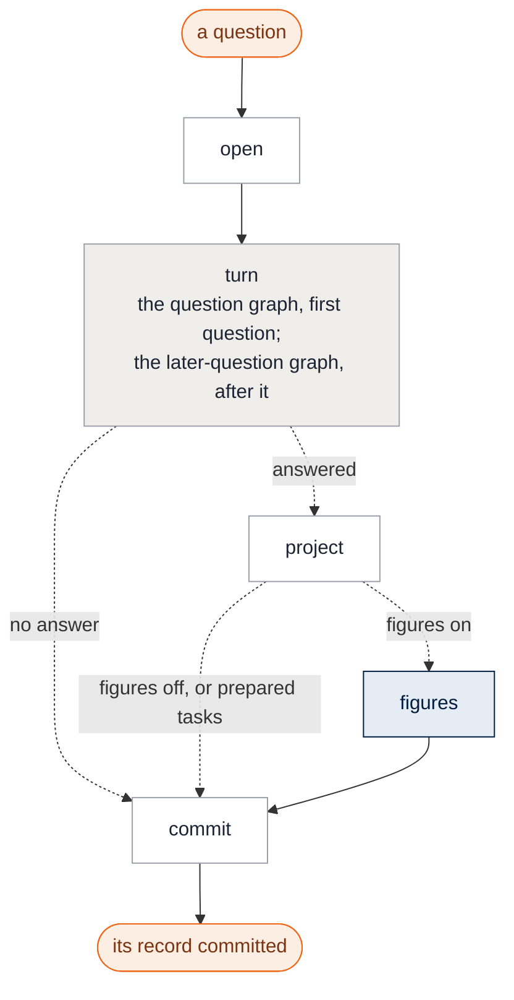

# The session graph and the later-question graph

A conversation is a sequence of questions about one interval of one well ([Conversations](SESSIONS.md)). Two more
LangGraph graphs carry it, beside the question graph ([GRAPH](GRAPH.md)): the session graph takes each question from
the message to its committed record, and the later-question graph answers every question after the first. Every node
and route below exists under the same name in `src/petroharness/session/graph.py` and `src/petroharness/agent/graph.py`;
`docs/graph_session.mmd` and `docs/graph_later.mmd` are the graphs drawn from the code, and
`tests/session/test_session_graph.py` keeps these files equal to the code.

Blue is a model call, white code, grey a graph run inside a node. What comes after the answer cannot change it.

## The three graphs

| Graph | Runs | Entry | Blueprint |
|---|---|---|---|
| Question graph | The first question: the well is built, read, investigated, settled, written and checked | `agent.graph.GRAPH` | [GRAPH](GRAPH.md), `graph.mmd` |
| Later-question graph | Every later question, on the session the earlier ones left | `agent.graph.LATER` | this page, `graph_later.mmd` |
| Session graph | One question of a conversation, from the message to its committed record; a question graph runs inside its `turn` node | `session.graph.SESSION` | this page, `graph_session.mmd` |

The question graph is the measured one. Nothing on this page changes it: the first question of a conversation sends
exactly the requests a single `petroharness` run sends.

## Two questions on the Brent Group

The conversation on GeoLink 30/6-5, Brent Group, as its session log records it. Question 1 asks for the porosity,
water saturation and permeability, and whether any of it is hydrocarbon-bearing; question 2 asks which zone has the
best reservoir quality, and how the log permeability compares with the core.

| Node | Question 1 | Question 2 |
|---|---|---|
| open | The setup logged (hash `d70dbbf039dd`), then the question | The question only: the setup had not changed |
| turn | The question graph; 10 results logged (E1–E10) and the well's record | The later-question graph on the same ledger; 8 more results (E11–E18) |
| project | The steps and parameters the answer rests on; the results behind each number | The same |
| figures | Two log displays and a Buckles plot | A crossplot of PERM_CC against PERM and two log displays |
| commit | `turns/01/`: `answer.md`, `trace.json`, `figures/`; a `turn_end` event | `turns/02/`, the same |

 against the uncalibrated log permeability (PERM) in the 12 zones where both exist, 343 samples, with the 1:1 line. Drawn by Petrophys from result E17. Data: GeoLink, CC BY-SA 4.0.")

## The session graph

**Run context** (`Ctx`): the conversation. Its log, its live session (the interval, the ledger, the claims) and its
list of questions are the domain state, changed in place by the nodes. Nothing is checkpointed: the log is how a
conversation is resumed.

**State**: the question (`task`, `question`, `sent`), what the first node sets (`n`, `folder`, `start`, `shown`), what
the question graph's node returns (`got`, `items`, `settled`, `cited`), then `rests`, `shows`, `figs` and the
committed `out`.

### Nodes

| Node | Kind | What it does |
|---|---|---|
| `open` | code | Logs the setup when it differs from the last one logged, then the question, and moves the session to it with the earlier questions as the prompts will show them |
| `turn` | graph | Runs the question graph (first question) or the later-question graph; logs each result it opened, and the well's record when it changed; reads its settled claims |
| `project` | code | Reads off the answer what the reader and the evidence graph need: the steps and parameters it rests on, and which results show each number it states |
| `figures` | model | One call chooses among the plots Petrophys can draw from what the answer rests on; Petrophys draws them |
| `commit` | code | Writes the question's files and its `turn_end` event, and adds it to the conversation |

### Routes

| From | Route | To |
|---|---|---|
| `open` | always | `turn` |
| `turn` | `after_turn`: the question has an answer | `project`, else `commit` |
| `project` | `after_project`: the conversation draws figures | `figures`, else `commit` |
| `figures` | always | `commit` |

`project` and `figures` read the answer and its results, and the answer's text is never passed back through the model.
A conversation on prepared tasks (a benchmark run) takes no model call and no plot from them.

## The later-question graph

The question graph without `build` (the well is not prepared again; the ledger and its ids go on), entered at `read`,
with one more route: after an investigation, a later question can also be answered in the short form.

| From | Route | To |
|---|---|---|
| `close` | `after_close_later`: as the question graph's `after_close`; where that goes to the full writer, `reply_form` picks the node | `no_answer`, `settle`, `write`, `write_brief` |
| `settle` | `reply_form`: the answer length the model chose in step 1 (`"reply": "brief"` or `"full"`) | `write`, `write_brief` |

The length is the model's decision, said in step 1 of a later question; the route only carries it to the writer node.
Where the READ call reads the route (a user's conversation, by default: [GRAPH](GRAPH.md#the-direct-route)), step 1 is
not asked for the length. Every node and every other route is the question graph's.

## Where additions attach

| A feature that | Attaches as |
|---|---|
| reads an answer (an export, a check list, a sensitivity table) | a node of the session graph after `turn`, with its own route |
| changes how a later question is answered | a node or a route of the later-question graph |
| changes how the first question is answered | nothing: the question graph takes no additions; a change to it is a measured change ([DEVELOPMENT](DEVELOPMENT.md)) |
