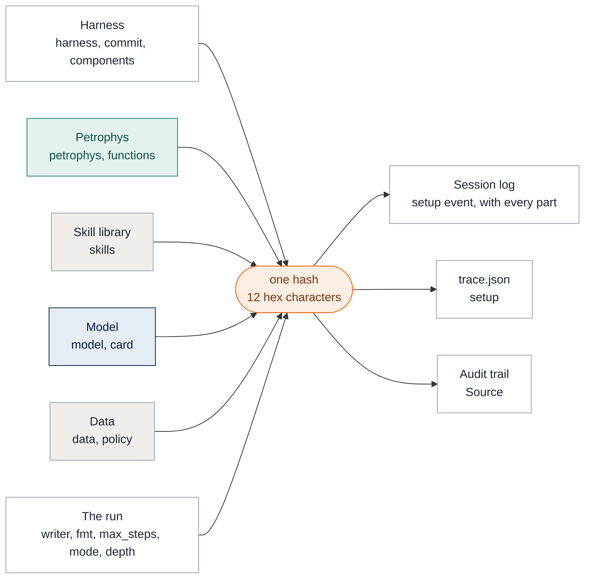

# The setup of a run

A setup is one flat record of what answers a question: the harness code and its prompt components, the Petrophys build
and the functions it offers, the skill library, the model's request settings and the data settings. One hash stands for
the record, and the same parts give the same hash in every process. Two runs with the same hash were made of the same
parts; where the hashes differ, the records say in which part.



Where a model is reached (the endpoint, the API key, timeouts, retries) is not part of a setup, and neither are the
folders on this machine: they do not change what answers.

## Print it

```bash
petroharness setup                              # the default model; the data settings of PETROHARNESS_DATA, if set
petroharness setup --model-card my_card.yaml --settings field.yaml
petroharness setup --json
petroharness setup --las $LAS --tops $TOPS --formation "BRENT GP."     # a question about this interval
```

For the Brent Group of GeoLink 30/6-5 (`LAS` and `TOPS` as in [Evaluate a formation](USAGE.md)). `[…]` marks lines
left out; the served model's name is replaced, and the hash is the one computed with it:

```text
setup 63669f4be296
  harness: 1.5.0
  commit: <commit>
  petrophys: 3.0.0@files-c5de047fe601
  components:
    C1: 6f8f4c39893a
    […]
    C10: 20c9aaaad36a
  functions: 1e177d0c7ca2
  skills:
    library: researched
    version: 18c03ad5d3f8
  model: <served model name>
  card: 33012b760d52
  data: 61dcbf7ecfe4
  policy: 7631a4a859eb
  writer: open
  fmt: profile
  max_steps: 8
  mode: interactive
  depth: True
```

With `--las` and the interval options of a question, the data settings are built from that well as the question
builds them, and the hash is the one the question answers under. Without `--las`, the data part covers the settings
file alone (`--settings`, else `PETROHARNESS_DATA`, else none), so it differs from a question's: printed on the same
checkout with no options, `data` is `1c824f0cf710` and the hash `b2112028164d`.

The options are the ones `petroharness` and `petroharness chat` take for the model, the settings and the skills
([Evaluate a formation](USAGE.md)); the endpoint (`--model-url`) is not one of them.

## What it holds

| Part | What it is |
|---|---|
| `harness`, `commit` | The package's version, and its commit for a source checkout (with `+dirty` when `src/` has uncommitted changes; empty for an installed package) |
| `petrophys` | The Petrophys build: its version and its own commit, or a hash of its installed files |
| `components` | Each prompt component with its version: the texts every model call is built from |
| `functions` | One hash over the Petrophys functions the tools offer (name, verb, parameters). The list is part of the investigation's brief, so a Petrophys release that adds a function changes it |
| `skills` | The skill library: its name and version |
| `model`, `card` | The model's name as served, and a hash of its request settings (temperature, token caps, template settings) |
| `data`, `policy` | A hash of the data settings in force (interpretation, zones, bases, conventions), and of the interpretation policy file |
| `writer`, `fmt`, `max_steps` | The writer's repair rounds, the reader format, the investigation's step cap |
| `mode` | `interactive` (a LAS file and a question) or `tasks` (prepared questions) |
| `depth` | Whether the model first says if a question is direct (a short route) or needs an investigation |

## Where it is recorded

| Where | What |
|---|---|
| The session log | A `setup` event with the hash and every part, written before the first question and again only when the setup changes (for example a conversation resumed after an upgrade) |
| Every question's trace | `trace.json`, `setup`: the hash. The trace of a single question (`petroharness`, `ask()`, benchmark mode) also holds every part, as `setup_parts`, since it has no session log to hold them |
| The audit trail | `petroharness audit`: the hash, in its Source section ([EVIDENCE](EVIDENCE.md)) |

## Compare two

```python
from petroharness.core import setup

setup.differences(record_a, record_b)   # the parts that differ, a component by its id
                                        # ("components.C9"); [] for the same setup
```

A record is a single question's `setup_parts`, a session log's `setup` event, or what `petroharness setup --json`
prints, each without its `hash` (and the event without its `seq`, `time`, `turn` and `type`).

Records of questions on three wells, and of the Brent conversation, each compared with the Brent setup above by
`setup.differences`:

| The record | Hash | Differs from Brent in |
|---|---|---|
| GeoLink 30/6-5, Brent Group (above) | `63669f4be296` | |
| Taranaki cheal-1, Moki Formation: no lithology log | `63669f4be296` | `[]` |
| COSTA HW-3, Kharaib-2: a carbonate logged in feet, from a multi-well tops table | `63669f4be296` | `[]` |
| GeoLink 30/6-5, Brent Group, with `--investigate` | `cd5b85c6f3aa` | `['depth']` |
| No well (`petroharness setup --json`) | `b2112028164d` | `['data']` |
| The Brent conversation's session log, an earlier commit | `d70dbbf039dd` | `['commit']` |

The well is what a question is about, not part of what answers it: here the data settings built from the three LAS
files are the same, so the three questions answer under one setup. The LAS file itself is recorded beside the setup,
with its SHA-256, in the session log and the audit trail ([EVIDENCE](EVIDENCE.md)).

<details>
<summary>Check that a question was answered under the setup in place</summary>

To check whether the setup in place is the one a question you asked (`petroharness`, `petroharness chat`, the web UI)
was answered under, print the setup of the same question and compare the hashes:

```bash
petroharness setup --las well.las --tops tops.csv --formation "NAME" --json    # and the run's other options: model,
                                                                                # settings, skills, --max-steps,
                                                                                # --investigate
```

Its `hash` equals the run's `setup` when nothing has changed; otherwise `setup.differences` on the two records names
the parts.

</details>
