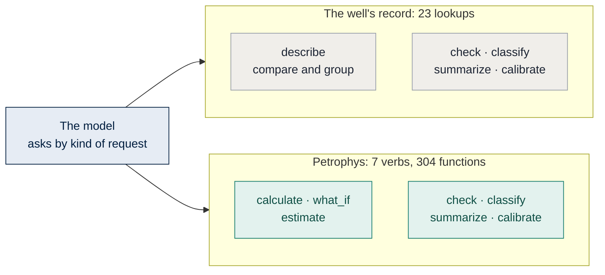

# Petrophys tools

PetroHarness answers from the well's interpretation record, and when the record does not hold what is asked, the model
has Petrophys compute it: another method, an estimate, a what-if, a fit to core, or any of about 300 public Petrophys
functions. Petrophys does every calculation. Inputs the call does not name come from the record, every result says
where each input came from, and every call is kept in the trace.



## The tools by request

The model sees its tools grouped by the kind of request. Each group holds the record's lookups for it, and a verb over
Petrophys where the record cannot give the answer.

| Group | What users ask | The record's lookups | Over Petrophys |
|---|---|---|---|
| **describe** | "what is the porosity in Z2?", "where is SW below 0.5?" | stats, profile, runs, values_at, section, step, formation_summary | |
| **compare and group** | "is porosity higher where shale is lower?", "by rock type?" | compare, crossplot, overlap, lithology_stats, zone_contrast, curve_order, vertical_sequence | |
| **check** | "where are the washouts?", "held readings?", "is core depth-matched?" | spike_flags, adjacent_jumps, threshold_exceedance, data_record, lag_correlation | `check` |
| **calculate** | "SW with Indonesia", "porosity with a dolomite matrix", "what Rw does the well suggest?", "what is m?" | | `calculate`, `what_if`, `estimate` |
| **classify** | "what minerals?", "is there gas?", "what flow units?" | zone_classes, unit_roles | `classify` |
| **summarize** | "net pay and HCPT per zone at a 0.5 SW cutoff?" | pay_summary | `summarize` |
| **calibrate** | "does log porosity match core?", "predicted shear?" | core_vs_log | `calibrate` |

Each verb over Petrophys has two parts: **shortcuts**, named objects for common requests ([below](#shortcuts)), and
**search and run**, which reach every public Petrophys function.

## Calls on real wells

Each case below comes from a sample well that ships with Petrophys, with the result exactly as the model reads it.

| Case | Well | Call |
|---|---|---|
| A what-if on a cutoff | GeoLink 30/6-5, Brent Group | `what_if` |
| Log against core, an interval given by depths | GeoLink 25/5-1, 2990–3290 m | `calibrate` |
| A log the method needs is missing | GeoLink 16/7-1 (no neutron, no PEF), 2100–2651 m | `estimate` |
| An input only the user can give | GeoLink 30/6-5, Brent Group | `calculate` |

**"How does net pay change if the water saturation cutoff is 0.5 or 0.6?"** on the Brent Group asks for

```json
{"what_if": {"property": "net_pay", "parameter": "sw_cutoff", "values": [0.5, 0.6, 0.7], "target": "NET_PAY"}}
```

and Petrophys runs the net-pay step once per value, every other input taken from the record (zones Z10 to Z20 hold
no pay at any cutoff and are cut here):

```text
net_pay: sw_cutoff tried at 0.5, 0.6, 0.7 (the record's: 0.7); NET_PAY (share set (%)), zones pooled and each zone; every other input is the record's
  baseline (record's parameters): 29.9824 pooled; Z1 43.3333; Z2 0; Z3 0; Z4 95.8333; Z5 90.9091; Z6 33.3333; Z7 100; Z8 6.25; Z9 60; […]
    the baseline reproduces the record's NET_PAY (every sample within 1%)
  sw_cutoff 0.5: 24.8677 pooled; Z1 13.3333; Z2 0; Z3 0; Z4 83.3333; Z5 87.8788; Z6 26.6667; Z7 95.4545; Z8 0; Z9 0; […]
  sw_cutoff 0.6: 27.1605 pooled; Z1 23.3333; Z2 0; Z3 0; Z4 91.6667; Z5 87.8788; Z6 33.3333; Z7 100; Z8 0; Z9 20; […]
  sw_cutoff 0.7: 29.9824 pooled; Z1 43.3333; Z2 0; Z3 0; Z4 95.8333; Z5 90.9091; Z6 33.3333; Z7 100; Z8 6.25; Z9 60; […]
```

**"Does the log porosity match the core plugs?"** on 25/5-1 between 2990 and 3290 m (no tops file: the interval is
given by depths) asks for `{"calibrate": {"what": "porosity"}}`, and Petrophys fits the log to the plugs in the LAS,
pooled and zone by zone:

```text
PHIE against core PHIC (Petrophys calibrate_porosity: R2 of the core-log correlation, bias = mean(log - core), RMSE, and the fitted line log = slope * core + intercept; a slope near 1 with a small bias is a calibrated log). core_vs_log gives the values side by side.
  zones pooled: n 331 plugs, R2 0.1853, bias -0.03806 (log - core), RMSE 0.094; line: log = 0.6065 * core + 0.02465
  […]
  Z4: n 89 plugs, R2 0.1129, bias 0.01446 (log - core), RMSE 0.03795; line: log = -0.2562 * core + 0.2613
  […]
```

**A log the method needs is missing.** 16/7-1 has no neutron log. Asked for the shale's neutron-density clay point
between 2100 and 2651 m, where its lithology log runs from limestone through anhydrite into halite,
`{"estimate": {"parameter": "clay_point"}}` comes back:

```text
needs one of NPHI; none has data here
```

**An input only the user can give.** On the Brent Group, dual-water saturation needs a bound-water resistivity the
well does not carry, and Petrophys refuses in its own words, so the answer can say what to provide:

```text
Petrophys saturation: Invalid steps.saturation() parameters:
  - model='dual_water' needs rwb= (bound-water resistivity, ohm.m); it is not estimated
```

Every number an answer states must come from results like these. Data: GeoLink, CC BY-SA 4.0.

## Shortcuts

<details>
<summary>calculate: recompute a property with another method or parameter</summary>

`{"calculate": {"property": ..., "method": ..., "parameters": {...}, "label": ...}}`

- **What it recomputes:** a property with Petrophys's own workflow step: clay volume, porosity, water resistivity,
  mud-filtrate resistivity, saturation, permeability, rock quality, BVW, MHI, net pay or temperature.
- **Where the methods come from:** the step catalog Petrophys ships. For example:
  - saturation: archie, simandoux, modified_simandoux, indonesia, north_sea, nigeria_schlumberger, dual_water,
    waxman_smits, auto;
  - permeability: timur, coates, wyllie_rose, lith_vcl;
  - clay volume from GR with linear, Larionov, Steiber or Clavier transforms.
- **Downstream:** the steps that read the property's outputs run after it, so a new SW carries into BVW and pay.
- **What it shows:** the change against a baseline run with the record's parameters, zones pooled and each zone.
- **New curves:** each is written as `<CURVE>_<LABEL>`, for example `SW_INDONESIA`, and every lookup and condition
  reads it.
- **An input another property computes** (Rw, VCL, PHIE) is changed by calculating that property:
  `{"property": "water_resistivity", "parameters": {"rw": 0.03, "rw_meas_temp": "105 degF"}}`.
- **With the property alone,** it lists the step's parameters with the record's values and the choices.
</details>

<details>
<summary>what_if: an input's effect on a target</summary>

`{"what_if": {"property": ..., "parameter": ..., "values": [...], "target": ..., "parameters": {...}}}`

Petrophys recomputes for each value (6 at most), with every other input taken from the record; `parameters` holds
inputs fixed for every run. For example the SW cutoff against net pay (above), m against SW, or the saturation models
side by side (`"parameter": "model"`).
</details>

<details>
<summary>estimate: a parameter from the well's data</summary>

`{"estimate": {"parameter": ..., "method": ..., "zones": [...]}}`

| Parameter | Methods |
|---|---|
| rw | rwa (apparent water resistivity over clean, porous samples), pickett, sp (needs Rmf) |
| archie_m | pickett (a, m and n) |
| clay_point | neutron_density (the shale's NPHI and RHOB) |
| gr_endpoints | percentiles (as the clay-volume step picks them) |
| matrix | apparent (RHOMAA, and UMAA with PEF) |
| temperature | gradient (a BHT refines it) |

Each estimate is shown against the record's value of the same parameter.
</details>

<details>
<summary>check: data quality Petrophys can test</summary>

`{"check": {"what": ...}}`

- **held_readings:** stuck or padded readings (one value repeated over 10 or more samples) per measured log, by depth
  run and zone.
- **bad_hole:** the parts of bad hole (washout, large hole, caliper rugosity, low density, PEF out of range), each as
  a flag curve with its depth runs.
- **depth_shift:** the shift that ties core plugs in the LAS to a log, with the correlation before and after.
</details>

<details>
<summary>classify: gas, minerals, flow units, electrofacies, moveable hydrocarbons</summary>

`{"classify": {"what": ..., "method": ..., "k": ...}}`

- **gas:** neutron-density gas effect, as GAS_FLAG with its depth runs.
- **minerals:** mineral volumes from the multi-mineral solver, with its poor-fit flag, or calcite and dolomite.
- **flow_units:** hydraulic flow units per sample from FZI.
- **electrofacies:** electrofacies classes from k-means.
- **moveable_hydrocarbons:** moveable and residual oil saturation, where SXO comes from a flushed-zone log.

On GeoLink 15/9-14 between 2700 and 3200 m (46 zones from its lithology log), `{"classify": {"what": "minerals"}}`
begins (Data: GeoLink, CC BY-SA 4.0):

```text
minerals by Petrophys MultiMineralSolver (v2: porosity solved with the minerals, VCL given) on rows RHOB, NPHI, PEF, DT; solved 100.0% of samples; poor fit (residual over the library's tolerance) 7.4%
  quartz mean volume over solved samples: Z45 0.4433; Z2 0.4306; Z43 0.4296; Z1 0.4123; Z4 0.3625; Z44 0.3069; Z42 0.2945; Z40 0.1044; Z41 0.0879; Z28 0.06492; Z12 0.05345; Z46 0.04966 (34 other zones lower); pooled 0.1865
  calcite mean volume over solved samples: Z6 0.8518; Z15 0.8393; Z9 0.8101; Z8 0.7932; Z7 0.7789; Z11 0.7692; Z22 0.7689; Z21 0.7481; Z26 0.7471; Z25 0.7423; Z20 0.7402; Z23 0.7393 (34 other zones lower); pooled 0.3766
  […]
  written: V_QUARTZ, V_CALCITE, V_DOLOMITE, V_ANHYDRITE, MM_POOR_FIT (curves of this question)
```
</details>

<details>
<summary>summarize: net pay at any cutoffs</summary>

`{"summarize": {"what": "pay", "sw_cutoff": 0.5}}`

Net rock, reservoir and pay thickness, net-to-gross, pay averages and hydrocarbon pore thickness, per zone and pooled.
It takes any cutoffs given; `pay_summary` gives the record's own flags.
</details>

<details>
<summary>calibrate: logs against core, shear and elastic properties</summary>

`{"calibrate": {"what": ...}}`

- **porosity, permeability, saturation:** the fit of a log to core (R2, bias, RMSE and the line); `core_vs_log` gives
  the statistics side by side.
- **poro_perm:** a porosity-permeability transform.
- **shear:** shear slowness predicted from DTC (Greenberg-Castagna).
- **elastic:** dynamic elastic properties.
</details>

## Where a call computes: zones, where and by

Every tool takes `zones`. A zone id of the interval (`"Z3"`) works as it always has. With `reach: well` (the
default outside a benchmark) `zones` can also name:

| You name | It computes on | Example |
|---|---|---|
| a unit of the tops file | that unit, framed by its own lithology zones (rows R1, R2, ... of that result) | `"zones": ["Dunlin GP."]` |
| one of your zones | that zone, anywhere in the well | `"zones": ["Etive"]` |
| a depth range | that stretch, in metres or feet | `"zones": ["2870-2890"]`, `"zones": ["9100-9400 ft"]` |
| several of these | one row each, in depth order (a sample on a shared boundary goes to the deeper one) | `"zones": ["Ness Fm.", "3000-3050"]` |

The result begins with a `Selection:` line naming what it computed on. Tools that read zones themselves (`calculate`,
`what_if`, `formation_summary`, `vertical_sequence`, `pay_summary`) and a verb's `run` compute on the selection too.
`section` and `zone_classes` read the workflow's results for the interval and refuse other stretches; `step` is the
same for any stretch.

A verb's call (a curated object or a `run`) also takes `where`, a condition on curves: it computes on the samples
where it holds. A Pickett plot of the water leg: `{"estimate": {"parameter": "archie_m", "method": "pickett",
"where": "SW > 0.95"}}`, or `{"estimate": {"run": "pickett_analysis", "args": {"rt": "RDEP", "phi": "PHIE", "vcl":
"VCL"}, "where": "SW > 0.95"}}`. A function that reads the whole well or a depth window is refused under `where`
(select by zones or a depth range instead). A unit written in `where`, or a depth window that reaches outside the
interval, is refused, with the `zones` call to write.

Where your zones frame the interval, `"by": "lithology"` reports a call by the lithology zones (L1, L2, ...).

`runs` lists every interval where a condition holds, top to base, with each interval's thickness and the zones it
crosses, then the thickness each zone holds.

## Search and run: every Petrophys function

Each verb also takes `search` and `run`:

```json
{"calibrate": {"search": "saturation height"}}
{"calibrate": {"run": "fit_saturation_height_from_well", "args": {"fwl": 870, "sw_curve": "SW", "vertical": true}}}
```

A search lists the matching functions with what each input takes and what this well has for it. On 30/6-5, Brent
Group, the search above begins:

```text
calibrate: Petrophys functions matching 'saturation height' (30 found; 52 serve calibrate); run one with {"calibrate": {"run": "<name>", "args": {...}}}
  fit_saturation_height: Fit an empirical saturation-height function to Sw versus height above the FWL. Needs height (curve); sw (curve, v/v; SW here: SW v/v). Optional: model (one of power/cuddy/skelt_harrison; default 'skelt_harrison'); phi (curve, v/v; Effective Porosity here: PHIE v/v); fit_offset (true or false; default False); min_height (number; default 0.0); height_unit (text; default '')
  fit_saturation_height_from_well: Fit a saturation-height function to a well's log Sw above a known FWL. It reads the well's curves itself. Needs fwl (number). Optional: tvd_curve (curve name); vertical (true or false; default False); model (one of power/cuddy/skelt_harrison; default 'skelt_harrison'); sw_curve (curve names; SW here: SW v/v; default ('SW',)); phi_curve (curve names; Effective Porosity here: PHIE v/v; default ('PHIE', 'PHIT')); mask (condition); fit_offset (true or false; default False)
  […]
```

<details>
<summary>The registry</summary>

The registry is generated from the installed Petrophys. It holds every public function of its interpretation,
evaluation and preprocessing packages, filed under the verb its package serves. With the pinned Petrophys build:

| Verb | Functions | Groups (from the Petrophys modules) |
|---|---|---|
| calculate | 83 | clay volume (GR, SP, Thomas-Stieber), invasion, porosity and its corrections, saturation models, permeability, Eaton |
| estimate | 62 | Rw, Rwa, Pickett, Archie parameters, Rmf, salinity, temperature, apparent matrix |
| calibrate | 51 | core calibration, grain size, NMR calibration, saturation height, capillary pressure, SCAL, formation pressure, rock physics, elastic properties |
| summarize | 39 | net pay, averages, net-to-gross, ranking, zone summaries, screening, hydrocarbon pore volume |
| classify | 39 | flow units, rock quality, MHI, zonation, heterogeneity, clay typing, spectroscopy, lithology crossplots, mineral solvers |
| check | 25 | washout detection, held readings, value ranges, normalization, imputation, depth matching |
| what_if | 5 | sensitivity, uncertainty |

A function Petrophys adds appears with no change to the harness. A search finds matches under every verb, its own
verb's first.
</details>

<details>
<summary>How a function gets its inputs, and what its output becomes</summary>

The model names each input; the binder reads it as Petrophys declares the parameter (a curve, a curve name, a number,
a choice, a condition such as `VCL > 0.6`) and adds only the question's scope: a copy of the prepared well for a
function that reads one, with the interval's top and bottom. An input the call does not name keeps Petrophys's default.
A required input it leaves out is asked for, with the curves this well has for it (by Petrophys's alias map: RT and
RDEP are both deep resistivity) and the record's value of that name. Each input is listed with its source.

An array over the interval becomes a curve of the question (`<FUNCTION>_<PART>`), a number a value, a dataclass, dict
or tuple its parts, and class codes class shares. In full: [Petrophys integration](reference/PETROPHYS_INTEGRATION.md).
</details>

## Adding a tool

A calculation belongs in Petrophys: the verbs' search and run reach every public Petrophys function with no change
here. A tool of the harness itself (a lookup of the record, a computed table, an object of a verb) is one definition,
a `Tool` in `src/petroharness/agent/toolset.py`:

```python
Tool("adjacent_jumps", K.adjacent_jumps, CHECK, _text("adjacent_jumps"),
     {"curve": CURVE, "threshold": {"type": "number"}, "zones": ZONES},
     ("curve", "threshold"), main="curve", lead="curve", table=True),
```

Everything that lists tools reads these definitions: the functions the call door runs, the schemas, the brief's tool
text and its groups, the names the reply parser knows, the ledger's listings, the web UI's groups, and what a tool's
zones reach (`stretch`: the selection, the whole well, or the focus only). A wrong definition
(a name used twice, a group the brief does not list, a required, main or lead argument it does not define) is reported
when the harness is imported. `tests/agent/test_tool_registration.py` checks every definition.

A new tool changes what the model is sent on every question, so it is a measured change
([CONTRIBUTING.md](../CONTRIBUTING.md), "Show that a change is safe").

Each field of a definition, and the steps: [Extending](reference/EXTENDING.md), "Add a tool".

Every tool's arguments and results: [Tools reference](reference/TOOLS_REFERENCE.md).
