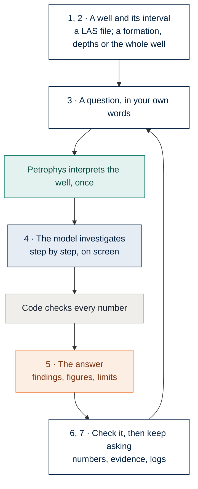
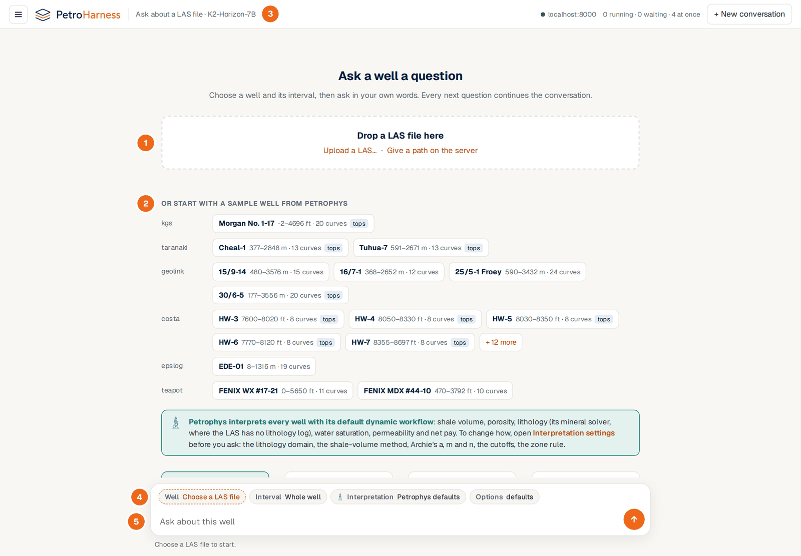
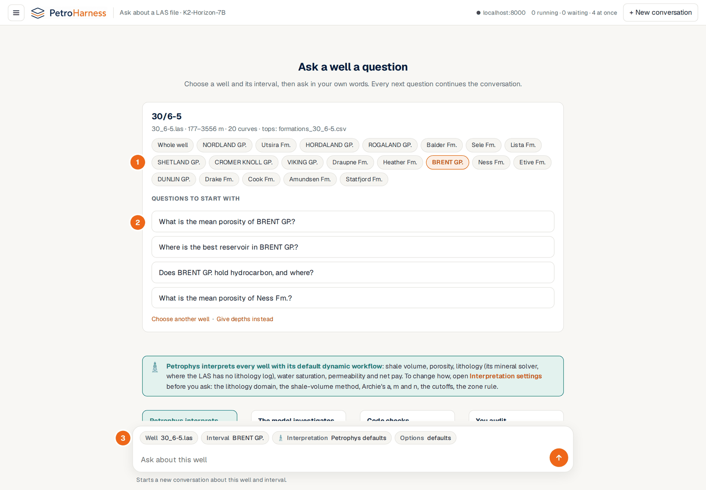
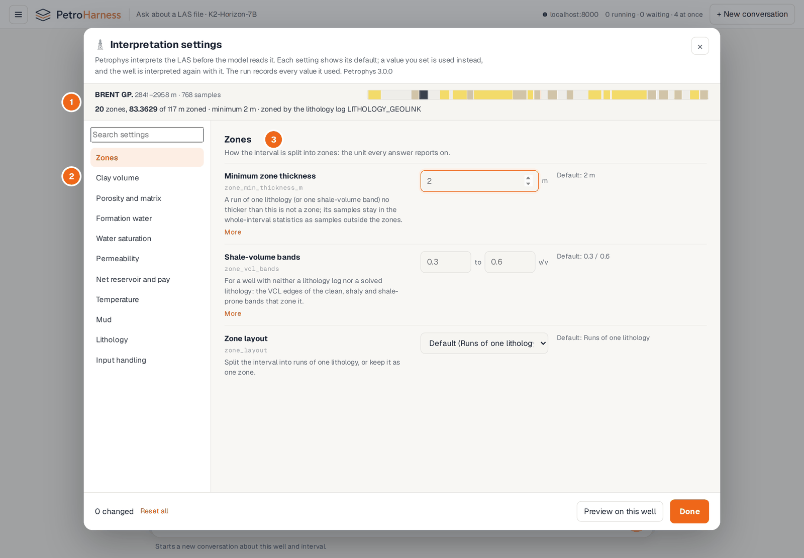
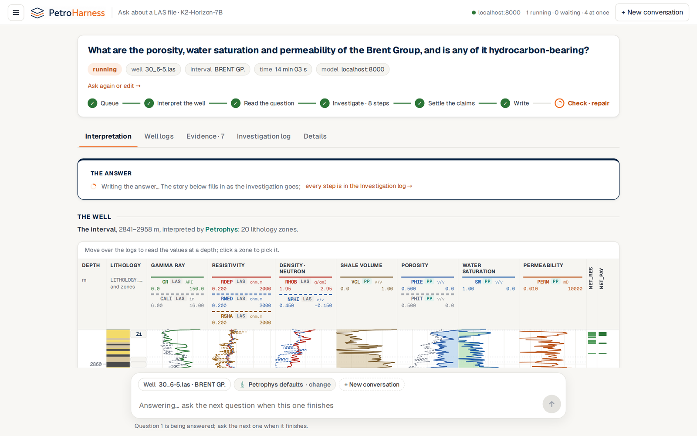
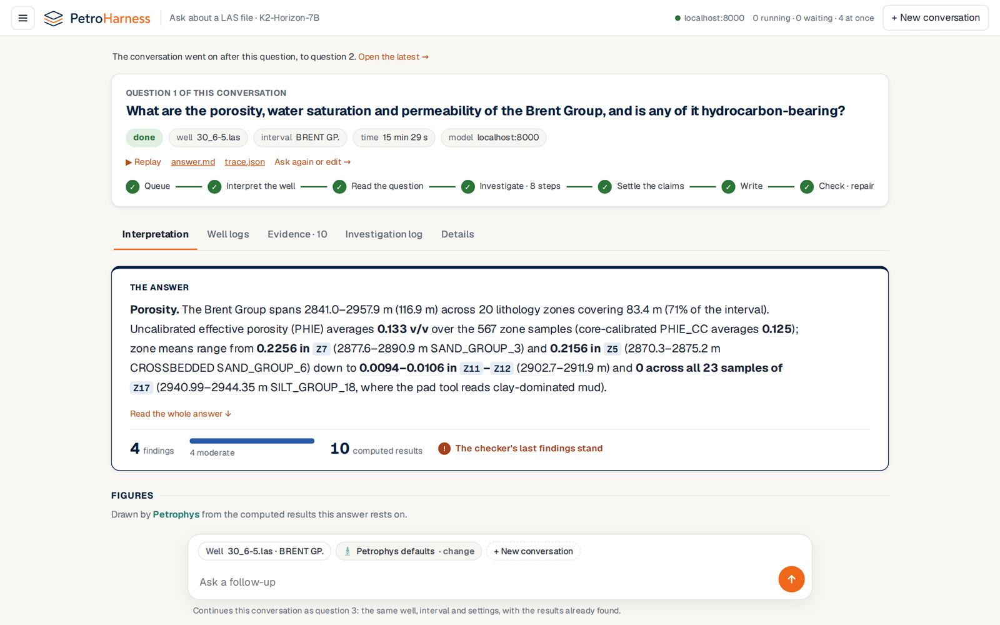
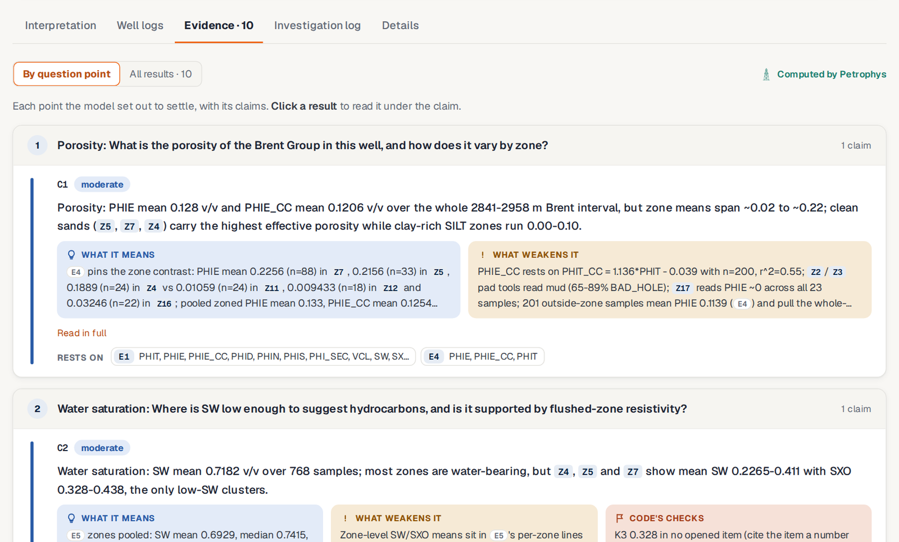

# A tour in pictures

One question from start to finish in the web UI, screen by screen: choose a well, choose the interval, ask, watch the
work, read the answer, check it, keep asking. Each step also gives the command that does the same. The well is GeoLink
30/6-5, which ships with Petrophys; the model is the default one, K2-Horizon-7B.



The white boxes are yours. The rest runs by itself: Petrophys calculates, the model investigates and writes, code
checks and records.

## Start the page

```bash
export PETROHARNESS_MODEL_URL=http://localhost:8000/v1    # the model server (MODELS.md)
petroharness ui                                           # http://127.0.0.1:7860
```

Installing, and serving a model: [Quick start](../README.md#quick-start), [Models](MODELS.md).

## 1. Choose a well



Drop a LAS file on the page, or click a sample well. This tour clicks **30/6-5**: its LAS file and its tops file load
together.

On the command line: `--las FILE`.

## 2. Choose the interval



Every formation of the tops file is a button. Without a tops file, *Give depths instead* takes a top and a base, and
*Whole well* asks about the whole log. A named interval gets a more focused answer than the whole well.

On the command line: `--tops FILE --formation "BRENT GP."`, or `--top 2841 --base 2958`, or neither for the whole
log ([Evaluate a formation](USAGE.md#choose-the-interval)).

## 3. Look at the interpretation (optional)



Petrophys interprets the well before the model reads anything: shale volume, porosity, lithology, water saturation,
permeability, net pay. The defaults suit a first question. Change a setting when you know better than the default: a
carbonate, a measured Rw, your own cutoffs. The panel previews the zones on your interval before you ask.

On the command line: a field notes file (`--field-notes FILE`), or `/set name=value` in a conversation
([Interpretation settings](reference/INTERPRETATION_SETTINGS.md)).

## 4. Ask, and watch the work

Type the question and press Enter. This tour asked:

> What are the porosity, water saturation and permeability of the Brent Group, and is any of it hydrocarbon-bearing?



The page fills from top to bottom as the run goes: the well as Petrophys interpreted it, then the work, one block per
model call. A finished step shows what it produced: what it looked at, the results it opened and the findings it added
or revised. Under them, in grey, are the last lines of the model's reasoning for that call. The call in flight streams
its reasoning as the model writes it.

The model first reads the question and says whether it is direct. A direct question (a value, a setting, a fact one or
two lookups state) gets a short answer in a minute or two. This one needs an investigation: at most 8 steps, about
15 minutes here.

How to read each line of the work: [Read the work](TRACE.md). To end a question before it is answered, press
**Stop**: while a question runs, it is the button of the box at the bottom ([Stopping a question](UI.md#stopping-a-question)).

On the command line: `petroharness --las FILE ... --question "..."` writes `answer.md` and `trace.json` when it is
done; the steps are in the trace.

## 5. Read the answer



When the answer is in, the work folds to one line, and the answer block opens with:

- **the answer's opening sentences**, with *Read the whole answer* for the rest;
- **the findings**, counted and drawn by confidence;
- **the computed results** the investigation opened;
- **the checker's outcome**: every number traced to a computed result, or which were not.

Under it come the answer's figures, drawn by Petrophys, then how the answer was reached: the parts the model split the
question into, each with its findings, the zone values they rest on, why they matter and what could change them.

, why it matters, what could change it, and a link to the 6 computed results it rests on.")

On the command line: `answer.md` in the output folder, with the same text, the figures and the methods and parameters
the answer rests on.

## 6. Check it

Three ways, from quick to thorough.

**A number.** Click any number in the answer to see every computed result that shows it. *How it was computed* then
lights its path: the measured logs, the Petrophys steps that computed the curves, the results the model opened, the
finding, the answer.

. The number appears in results E1 and E6. Lit, left to right: the measured logs, the Petrophys steps that computed the curve with their key parameters (normalization, vclay, porosity), the two results, the finding that cites them, and the answer.")

**The evidence.** The Evidence tab lists each finding with its grade, what weakens it, and the results it rests on,
each one click from its full text.



**The logs.** The Well logs tab shows every curve, marked measured (LAS) or computed by Petrophys. *Expand* opens the
log viewer: zoom to any depth, add any curve of the well as a track, read every curve at a depth.

, every sample drawn. The strip on the left is the whole interval with the part on screen marked. The bar under the title reads every curve at the depth under the pointer, with its zone. Each curve is tagged LAS (measured) or PP (computed by Petrophys). The panel on the right lists the tracks with their scales, and every curve of the well to add.")

On the command line: `petroharness audit SESSION` prints each answer of a conversation with every number's path
back to the LAS file ([Audit an answer](EVIDENCE.md)).

## 7. Keep asking

The box at the bottom continues the conversation: the next question runs on the same well, interval and settings, and
starts from the results already opened.

. The well plot marks the zones this answer centres on (Z5, Z19), and the box at the bottom will ask question 3.")

A conversation can also change course:

- **Change a setting** from the Interpretation chip; the well is interpreted again from the next question on, and
  the earlier answers are marked as resting on the earlier settings.
- **Ask about another stretch** of the well by name or by depth; the question's scope follows it.
- **Start a new conversation** (top right) with the same well in the chips.

When a question could mean more than one stretch of the well, the harness asks you back instead of guessing, with one
button per choice:

, CDLA-Sharing-1.0.")

On the command line: `petroharness chat` with the same options ([Conversations](SESSIONS.md)).

## A well without a lithology log

The zones of 30/6-5 are the runs of its lithology log. A well without one is zoned by the lithology Petrophys's
mineral solver gives, and the page says so under the well plot: the curves that went in, the solver's domain and
method, and the zones that came out. It then asks whether the lithology is right for the well, with buttons that ask
the question again under another lithology domain.

 to the 11 lithology zones, with Petrophys's record in its own words. Bottom: the question about the lithology, with the buttons that ask again under another domain. Data: Taranaki Basin Curated Well Logs Dataset (New Zealand Petroleum & Minerals), CDLA-Sharing-1.0.")

## The same from the command line

| In the page | Command line | More |
|---|---|---|
| Choose a well | `--las FILE` | [Evaluate a formation](USAGE.md) |
| Choose the interval | `--tops FILE --formation NAME`, or `--top D --base D` | [Evaluate a formation](USAGE.md#choose-the-interval) |
| Change a setting | `--field-notes FILE`; `/set name=value` in a conversation | [Interpretation settings](reference/INTERPRETATION_SETTINGS.md) |
| Ask | `petroharness ... --question "..."` | [Command line](reference/CLI.md) |
| Watch the work | the steps are in `trace.json` | [Read the work](TRACE.md) |
| Read the answer | `answer.md` | [Records](reference/RECORDS.md) |
| Check a number | `petroharness audit SESSION` (a conversation's folder) | [Audit an answer](EVIDENCE.md) |
| Keep asking | `petroharness chat` | [Conversations](SESSIONS.md) |

## Where next

- More questions, worked through: [Examples](EXAMPLES.md).
- Everything on the page: [Web UI](UI.md).
- What each step of the work means: [Read the work](TRACE.md).

Data: GeoLink, CC BY-SA 4.0.
