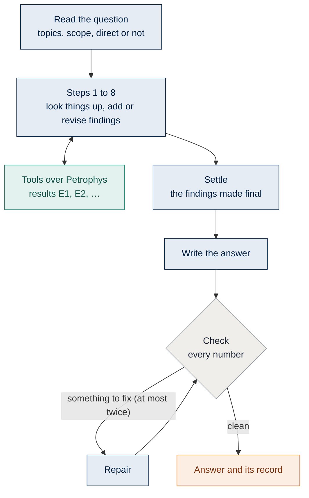
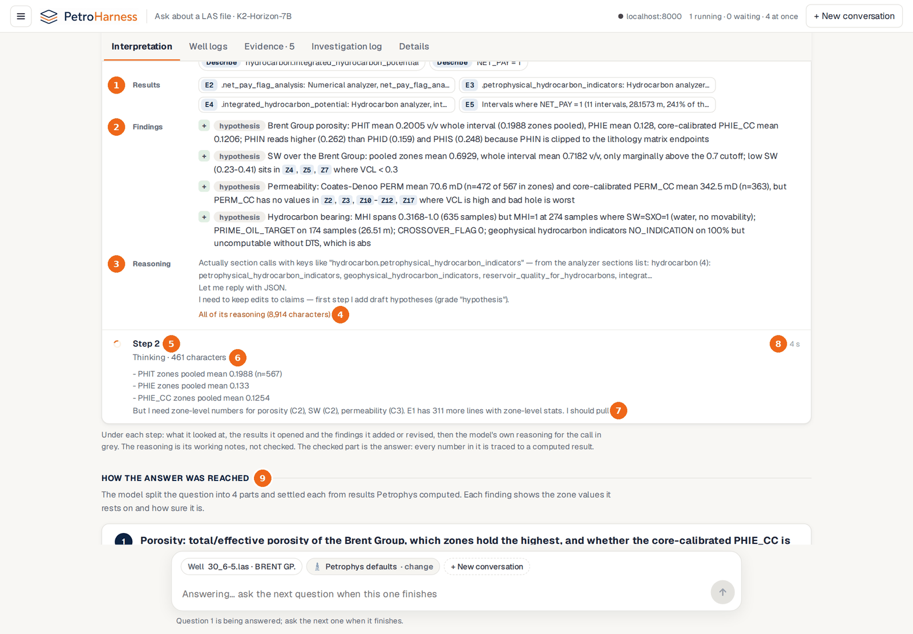
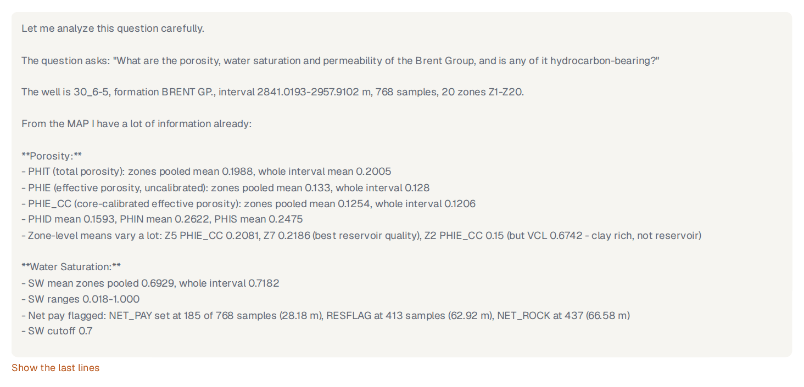

# Read the work

Every answer comes with the work that produced it: each model call, what it looked at, what it found, and what the
model was thinking. This page shows how to read it, in the web UI while a question runs and after, and in the files a
run leaves. The examples are from one question on GeoLink 30/6-5, the one the [tour](TOUR.md) asks.

## The calls of one question



A question is answered by model calls in a fixed order. Each call is one request, built from the recorded state: the
results opened so far and the findings as they stand. It is never a running chat, so what a call saw is what the record
holds.

| Call | What it produces | Its line in the work |
|---|---|---|
| Read | the topics, the stretches of the well the question is about, and whether the question is direct | Read the question |
| Step | a focus, the lookups it asks for, and edits to the findings | Step 1, Step 2, … |
| Settle | the findings made final, with every result in view | Settled the findings |
| Write | the answer | Wrote the answer |
| Repair | the answer again, after the checker found something | Fixed the numbers the checker found |
| Figures | which plots Petrophys draws under the answer | Chose the answer's figures |

A direct question (a value, a setting, a fact one or two lookups state) takes a short route: the read, one or two
look steps, the answer.

## Four kinds of text, and which are checked

| | What it is | Who makes it | Checked |
|---|---|---|---|
| **Result** (E1, E2, …) | what a lookup returned: statistics, a section of the well's record, a fit, a list of intervals | Petrophys, through the tools | computed by code; the model does not write it |
| **Finding** (C1, C2, …) | a claim about the well, with a grade and the results it cites | the model | code flags a finding whose numbers its results do not show, or that cites nothing; a flagged finding does not settle its part of the question |
| **Answer** | the text you read | the model | every number must appear in a result; what cannot be traced is sent back for repair, and said if it stays |
| **Reasoning** | the model's thinking during one call | the model | never. It is shown as the server returned it, and the next call is built from the results and findings, not from this text |

So read the reasoning to understand a step, and the results to believe it.

## While a question runs



The work is on the Interpretation page, under the well. Each call gets a block as it finishes, and the call in flight
streams:

- **Thinking · N characters**: the model is reasoning; its last lines come in as it writes them, the newest at the
  caret.
- **Writing the reply · N characters**: the reasoning is done and the reply is being written.
- The clock on the right is the call's own time.

Above the work, the run's header says where the question is: queue, interpret the well, read the question,
investigate (with the step number), settle the claims, write, check.

## One step, part by part

When the answer is in, the work folds to one line. Click it to open the work again.

 and added four findings, each still a hypothesis.")

1. **The fold line.** How long the question took, how many model calls and how many steps. A click folds or opens
   the work.
2. **The call.** *Read the question*, *Step 1*, …, in the order they ran.
3. **The focus.** What the step set out to settle, in the model's words.
4. **The counts.** What the step did at a glance: points set, lookups, results opened, findings added (green),
   revised (blue) or dropped (red), and *points settled* on a step where the model called the investigation done.
5. **Points to settle** (step 1). The parts the model split the question into. Each finding belongs to one, and the
   investigation ends when every part has a settled finding, or at the step cap.
6. **Looked at.** Each lookup the step asked for, by kind (the table below). While the run goes on this reads *Asks
   for*.
7. **Results.** The results those lookups opened, by id. Click one to read it in full on the Evidence tab.
8. **Findings.** The step's edits to the findings: **+** added, **~** revised, **−** dropped, with the finding's id,
   its grade, its text and the results it cites. A revision that only changed the grade or the citations says
   *revised*.
9. **Reasoning.** The last lines of the model's reasoning for this call that say something, in grey. *All of its
   reasoning* opens the whole of it.

The time on the right of each block is the call's.

<details>
<summary>The kinds of lookup</summary>

| Label | What the step asked for | Tools |
|---|---|---|
| **Guide** | a short domain guide from the skill library: direction, never answers | `guide` |
| **Describe** | statistics of curves by zone, a depth profile, the intervals where a condition holds, values at a depth, a section of an analyzer, the record of a Petrophys step | `stats`, `profile`, `runs`, `values_at`, `section`, `step`, `formation_summary` |
| **Compare and group** | one thing against another: a crossplot with its fit, two curves or two zone groups, overlap of two flags, statistics by lithology | `compare`, `crossplot`, `overlap`, `lithology_stats`, `zone_contrast`, `curve_order`, `vertical_sequence` |
| **Check** | data-quality checks: spikes, jumps, thresholds, the data record, a depth lag | `spike_flags`, `adjacent_jumps`, `threshold_exceedance`, `data_record`, `lag_correlation` |
| **Petrophys · calculate**, **what if**, **estimate**, **classify**, **summarize**, **calibrate**, **check** | a Petrophys function run on request: another method, a parameter changed, a pay summary, a core calibration | the seven verbs ([Tools](TOOLS.md)) |
| **Re-read** | a result already opened, read again in part: one zone, one curve | `get` |
| **Search**, **Arithmetic** | a word looked for in the opened results; a sum or ratio of numbers the results show | `find`, `calc` |

Every tool with its arguments: [Tools reference](reference/TOOLS_REFERENCE.md).
</details>

## Reading the reasoning



The reasoning is the model's working notes for one call. Read it to see:

- **why the step went where it did**: which part of the question it took up, and which result made it;
- **what it weighed**: a number it compared across results, a flag it decided to follow, a reading it set aside;
- **what misled it**, when an answer went wrong: the reasoning usually names it.

It is not evidence. A number in the reasoning counts for nothing until a result shows it and a finding cites it. The
page shows it as the model server returned it:

- The last lines shown skip the ones that only announce the reply ("Let me write the JSON").
- A very long reasoning keeps its first 4,000 and its last 8,000 characters, with the count left out between them.
- A model server that returns no reasoning field shows the calls without it. A reasoning model needs its server's
  reasoning parser, so that the thinking arrives apart from the reply ([Models](MODELS.md)).

## Findings and their grades

A finding starts as a hypothesis and is graded by the model as results come in. Code never grades a finding; it only
flags one that does not hold together, and a flagged finding does not settle its part.

| Grade | Meaning |
|---|---|
| `high` | two independent lines of evidence agree |
| `moderate` | one line of evidence, or one named weakness |
| `low` | indicated, with several weaknesses |
| `not indicated` | the evidence shows the indicator absent |
| `undetermined` | the data cannot settle it |
| `hypothesis` | not checked yet |

While the run goes on, *How the answer was reached* (under the work) shows the findings as they stand, part by part,
marked *Not settled · a working reading* until the settle step. In the finished answer each finding shows the zone
values it rests on, why it matters and what could change it.

The flags, with their messages: [Investigation state](reference/INVESTIGATION_STATE.md#8-claim-flags).

## When the checker sends the answer back

After the writer, code checks the draft: every number against the results, statements against the well's record, and
that no working notes leaked into the text. When it finds something, the draft goes back to the writer with the
findings, at most twice. The work shows it as *Fixed the numbers the checker found*, with what the checker found:

| The checker found | Meaning |
|---|---|
| Numbers no result shows | numbers in the draft that no opened result holds |
| Statements the record contradicts | a statement about the data that the well's record denies, such as a log called missing that the well has |
| Words about the process | words about the investigation itself in a text meant for the reader |
| Working notes | the model's own notes left in the answer |

An answer whose last check still found a number in no result is delivered with status `unresolved_numbers`, and the
answer block says so ([Writer and checker](reference/WRITER_AND_CHECKER.md)).

## The Investigation log

 and the checker's outcome. Then the strip of stages, each step with the results it opened and the findings it added or revised. Then the cards: the well, the question as read with its reasoning, the first look, step 1 folded, and step 2 opened to what it looked at, its results, its claim edits, a harness note and its reasoning.")

The Investigation log tab shows the same run stage by stage: the well, the question as read, the first look, each
step, the settle step, the writer and the checker. A strip at the top gives every stage with the results it opened
and the findings it added or revised; click a stage to jump to its card. Each card opens to the same parts as the
work's blocks, with the call's reasoning, and two things more: the writer's draft and each repair's rewritten text.

## The same in the files

Everything on the page is in the files a run writes ([Records](reference/RECORDS.md)).

| On the page | In the files |
|---|---|
| The read: topics, direct or not, scope | `trace.json`: `read`, `topics`, `scope` |
| A step's focus, lookups and finding edits | `trace.json`: `steps[k].focus`, `.actions`, `.edits` |
| The results opened | `trace.json`: `opened`, each an id and its call |
| The findings, with grade, citations and history | `trace.json`: `claims`, and `dropped` |
| The settle step | `trace.json`: `settle` |
| What the checker found, round by round | `trace.json`: `verify_rounds` |
| Each call's time, tokens and reasoning length | `trace.json`: `usage` |
| Every prompt as sent | `trace.json`: `calls` |
| Each call's reasoning | a conversation's `turns/NN/tape.jsonl`: `reply.reasoning`; the web UI's `run.json`: the reply events' `thinking` |

Step 2 of the tour's question, from its `trace.json` (cut):

```json
{"step": 2,
 "focus": "Zone-level means of PHIT, PHIE, PHIE_CC, SW, PERM, PERM_CC and MHI across the Brent Group zones, plus the gas-indicator section, to settle points 2-5",
 "actions": ["stats {\"curves\": [\"PHIT\", \"PHIE\", \"PHIE_CC\", \"SW\", \"PERM\", \"PERM_CC\", \"VCL\", \"MHI\"], \"zones\": [\"ALL\"]}",
             "section {\"key\": \"gas_indicator_analysis_methods\"}",
             "summarize {\"what\": \"pay\", \"search\": \"net pay cutoffs\", \"run\": \"pay_summary\", \"label\": \"BRGET_PAY\"}"],
 "edits": [{"op": "revise", "id": "C1", "grade": "moderate", "ev": ["E1", "E2", "E3", "E4"]},
           {"op": "revise", "id": "C4", "grade": "moderate", "ev": ["E3", "E4"]},
           "…"],
 "done": false, "prompt_tokens": 22314}
```

A conversation keeps a tape of every model call, the request as sent and the reply as received. Each call's reasoning,
from the tape (for the tour's question: the read, then steps 1 to 3):

```python
import json

for line in open("brent/turns/01/tape.jsonl"):
    call = json.loads(line)
    reasoning = call["reply"].get("reasoning") or ""
    print(call["n"], len(reasoning), "characters;", reasoning[-200:].replace("\n", " "))
```

```text
0 3535 characters; pth: investigate — asks for characterization (what are the values across the formation, are they hydrocarbon-bearing — an interpretation weighing statistics and flags together).  Now output JSON only.
1 8914 characters; otential. Keys are probably "hydrocarbon.petrophysical_hydrocarbon_indicators" style.  Let me reply with JSON.  I need to keep edits to claims — first step I add draft hypotheses (grade "hypothesis").
2 4514 characters; es ALL. This gives zone-level tables. 2. section gas_indicator_analysis_methods.  Maybe also 3. summarize pay (pay_summary) for net-to-gross etc. But cap at 6; do two to three.  Let me write the JSON.
3 13545 characters; , etc. That settles pay geography under point 1 and point 3.  Next step will bring NEW with profile results → then I finalize claims and mark points 2 and 5 settled, point 3 settled.  JSON output now.
…
```

A single `petroharness` question writes `answer.md` and `trace.json` and no tape; `petroharness chat` and the web UI
keep one for every question.

## When an answer looks wrong

| You see | Look at |
|---|---|
| A number you doubt | Click it: the results that show it, then *How it was computed* for its path back to the logs |
| A conclusion you doubt | The finding behind it: its grade, *what could change it*, and the results it cites, on the Evidence tab |
| Something the answer leaves out | *Read the question* (the topics and the scope) and step 1's *Points to settle* |
| A step that went somewhere odd | That step's focus, then its reasoning |
| *A number in the answer is in no computed result* | The last *Fixed the numbers…* block: what the checker still found |
| An answer about the wrong stretch of the well | The header's interval and scope; ask again with the stretch named, or by depth |

## More

- The page, tab by tab: [Web UI](UI.md).
- A number's path back to the LAS file, and the audit trail: [Audit an answer](EVIDENCE.md).
- The state behind the work: the ledger, the findings, the step loop, with one step worked through:
  [Investigation state](reference/INVESTIGATION_STATE.md).
- Writing, checking and repairing: [Writer and checker](reference/WRITER_AND_CHECKER.md).

Data: GeoLink, CC BY-SA 4.0.
