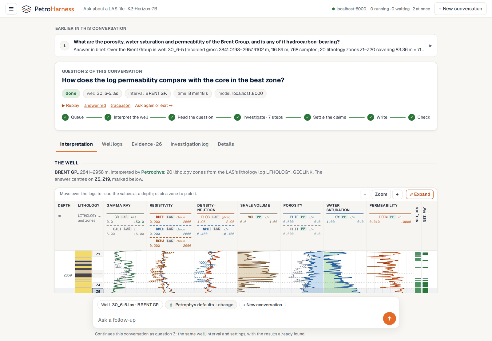
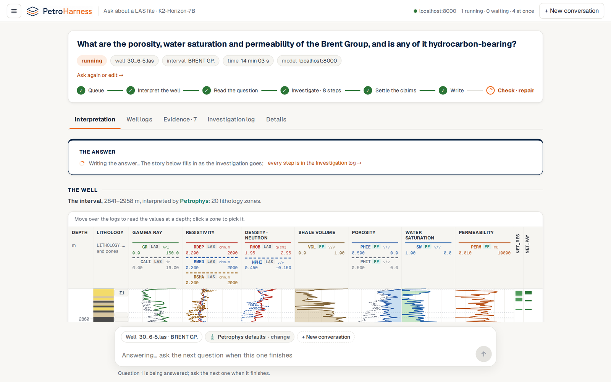
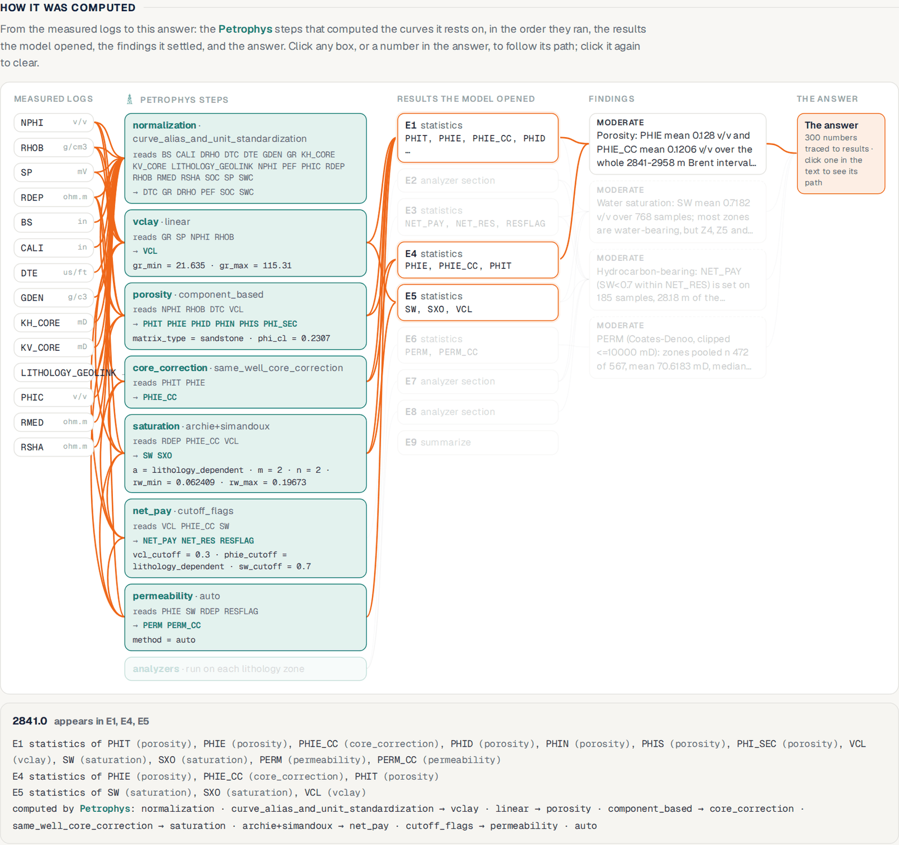

# Web UI

`petroharness ui` runs the harness in the browser. Choose a well and an interval, ask in your own words, follow the
investigation as it runs, then read the answer with its figures, the claims and results behind it, and how each
number was computed. Every run is saved, to come back to, rate and replay. The page asks the same harness as the
`petroharness` command, with the same inputs.

 chosen from its tops file. The chips above the question box hold the well, the interval, the interpretation settings and the options.")

## Start it

```bash
export PETROHARNESS_MODEL_URL=http://localhost:8000/v1    # several: comma-separated
petroharness ui                                           # http://127.0.0.1:7860
```

The server needs nothing beyond the package. It prints where it listens, the runs folder and the model endpoints, and
runs until you stop it (Ctrl+C). As for the command, a data settings file in `PETROHARNESS_DATA` is the base the
settings start from, and `PETROHARNESS_SKILLS` chooses the default skill library; unset them to ask about a new well
with the defaults.

<details>
<summary>Server options</summary>

| Option | Meaning |
|---|---|
| `--host ADDRESS` | where to listen (default `127.0.0.1`, this machine only); `localhost` listens on both `127.0.0.1` and `::1`; `0.0.0.0` on every interface, so anyone who can reach the port can ask questions and read the files the server can read (the server says so when it starts) |
| `--port N` | the port (default 7860) |
| `--allow-host NAME` | a further host name the server answers when it listens on a loopback address, for a proxy that keeps its own host name (repeatable); without it, the API answers only requests for `localhost`, `127.0.0.1` and `::1` |
| `--runs DIR` | the folder for saved runs and uploads (default `./petroharness-ui-runs`) |
| `--workers N` | questions answered at once (default 4); more wait in a queue |
| `--model NAME` | any chat model, by its served name (default: K2-Horizon-7B; [Models](MODELS.md)) |
| `--model-card CARD` | a model card: a YAML file or a packaged card's name |
| `--model-url URLS` | the model endpoints, comma-separated (default `PETROHARNESS_MODEL_URL`) |

The server does not start with a model card that names no model (the `generic` card) and no `--model`: it says to
give the served model's name and exits with status 2.
</details>

<details>
<summary>Open it from another machine</summary>

The server listens on `127.0.0.1` by default. When it runs on a remote machine, forward the port:

- **SSH:** `ssh -L 7860:localhost:7860 HOST`, then open http://localhost:7860 on your own machine.
- **Your editor's port forwarding:** in VS Code, *Ports* → *Forward a Port* → `7860`, then open http://localhost:7860.

Through a proxy that reaches the server under a host name of its own (not `localhost`), the page loads but the server
refuses its requests (403) until you name that host: `petroharness ui --allow-host NAME`.
</details>

## Asking a question

The page is laid out as a chat: the question box is docked at the bottom, and the saved runs are in a drawer (the
menu button, top left). Four chips above the box hold the setup; clicking one opens its settings in a sheet. Enter
sends the question, Shift+Enter starts a new line.

The start page gets you to a first question in a few clicks:

- **A well:** drop a LAS file anywhere on the page, upload one, give a path on the server, or click one of
  Petrophys's sample wells (listed by dataset, each with its depth range, its curves and *tops* when a tops file of
  Petrophys has rows for it). A sample with tops loads both.
- **Its interval:** the formations of the tops file are buttons (a name the file lists twice, one button per
  listing), with *Whole well*; *Give depths instead* opens the depths.
- **Questions to start with:** the harness's own example questions on the interval chosen (the same ones it offers
  when a request is outside what it does), and one on a unit inside a formation. A click puts the question in the
  box, to edit or send.

A file dropped on the page loads by its kind: a LAS file the well, a table (CSV, TSV, Excel) the tops file, or your
zones when dropped on *Your zones* in the Interval sheet, and YAML the field notes. Dropped while a conversation is
open, it starts a new one.

| Chip | What you choose |
|---|---|
| **Well** | a LAS file: a path on the server (*Load*) or *Upload a LAS…*. Its header shows: name, depth range and unit, step, samples and every curve (curves that look like a lithology log are marked) |
| **Interval** | the whole well (the default), a formation from a tops file, or depths; and, optionally, your own zones |
| **Interpretation** | what Petrophys interprets the well with: *Petrophys defaults* until you change a setting ([below](#interpretation-settings)) |
| **Options** | the lithology curve, the formation's lithology as you know it, a context profile, the skill library, the step cap, the depth of the answer, field notes |

What is wrong in the inputs (a missing file, a formation the tops file lacks, a base above the top) is said at once,
with what to change, before the question waits for a worker. A LAS file whose depth goes back, as spliced logging
runs leave it, is refused as it loads, with the line and the fix: its overlap would be logged twice and counted twice
in every result.

> WHAT: the depth in 30_6-5_splice.las goes back at line 17920, from 2899.9983 to 2880.0339 m: 2880.0339-2899.9983 m
> is logged twice (spliced runs or a repeated section). WHY: each depth is one sample; a stretch logged twice would be
> counted twice in every result. FIX: keep one run over the overlap so the depths run one way down the file, and load
> it again.

<details>
<summary>The interval, in detail</summary>

- **Whole well:** from the log's first sample to its last. Near the top of a log, often behind casing, only some
  curves may be recorded, and porosity and saturation there are not meaningful: a named interval gets a more focused
  and more reliable answer.
- **Formation (tops):** a tops file (a path, or *Upload a tops file…*), then a formation from the names the tops reader
  finds, each with the interval it would use (its top to its stated base, else to the next deeper top, else to the end
  of the log). When the file states no depth unit, choose it (default: the LAS file's).
- **The tops file is checked as it loads.** An *In this file:* box under its name lists what to fix: a row the reader
  cannot use, a name listed more than once, and formations beyond the log, with a hint when their depths would fit
  the log in the other unit. On 30/6-5, a copy of its tops file with the Ness Formation's base above its top, and one
  written in feet but labelled metres, show:

  > Ness Fm.: line 15: its base 2841 is not below its top 2865, fix the row.

  > 17 of 20 formations fall beyond the log (176.61-3556.08 m); read in ft they fit it. The file's depth unit (m) may
  > be wrong: fix it in the file.

  Such rows stay in the formation list but cannot be chosen: they read "(beyond the log)", or the row's problem.
- **A table of several wells** is read for the loaded well only. `formations_costa.csv` lists the Kharaib-2 interval
  of 17 COSTA carbonate wells, in feet; with HW-3 loaded, the reader keeps its one row, KHARAIB-2 at 7805–8020 ft.
- **A name the file lists twice** is listed once per listing, each its own choice. Taranaki tuhua-7's tops file lists
  Manganui, Taimana, Tikorangi and Otaraoa twice each (its formation labels repeat along the deviated borehole). The
  box says "Manganui is listed 2 times (line 3: 874.014–1250.7468; line 10: 2164.9944–2347.4172): choose the one you
  mean below, or fix the file.", and the list offers "Manganui (1 of 2, line 3) · 874.014 – 1250.7468 m" and
  "Manganui (2 of 2, line 10) · 2164.9944 – 2347.4172 m". The run list names the second "Manganui from 2164.99". On
  the command line, `--top` gives the top of the row meant, and the tops file stays for the other units:
  `--tops FILE --formation Manganui --top 2164.9944`. A top that is no row's top is refused:

  > WHAT: formation 'X' has no row with top D in FILE (…). FIX: give the top of one of its rows (--top D), as the file
  > writes it.
- **Depths:** a top and a base (both included), their unit (default: the LAS file's) and an optional name. An empty
  top starts at the top of the log, an empty base runs to its end.
- **Your zones (optional):** a table of your own zones (zone, top, bottom; CSV, TSV or Excel), by its path or *Upload
  a zones file…*. They frame the answer in place of the lithology zones, which stay available. The file is checked as
  it loads: the zones it lists, then zones that overlap (each sample belongs to one zone, so a question with such a
  file is refused at *Ask*) and zones beyond the log. On 30/6-5, a file with a zone Brent at 2841–2958 and a zone
  Below TD at 3600–3700:

  > zones_belowtd.csv: 2 zones (Brent, Below TD)
  >
  > In this file: Below TD (3600-3700) lies beyond the log (176.61-3556.08 m): it gets no sample, and answers say so.

  The Interval chip then adds "· your 2 zones"; *Remove zones* drops them.

Data: GeoLink, CC BY-SA 4.0. Costa Gomes, Geiger and Arnold (2022), COSTA model, Heriot-Watt University, CC BY.
Taranaki Basin Curated Well Logs Dataset (New Zealand Petroleum & Minerals), CDLA-Sharing-1.0.
</details>

<details>
<summary>The options, in detail</summary>

- **Lithology curve:** detected by default; with none, the zones are runs of the lithology Petrophys's mineral solver
  gives; with neither, shale-volume bands.
- **The formation's lithology** as you know it: it reaches the model with the question, marked as your statement.
- **Context profile:** a Petrophys context profile, for wells of a known context package.
- **Skill library:** the packaged one, none, or a library folder.
- **Step cap:** the investigation's maximum number of steps.
- **Depth of the answer:** by default the model first says whether a question is direct (a value, a setting or a fact
  that one or two lookups state), and a direct question gets a short answer in about a minute; *A full investigation
  for every question* turns that off.
- **Field notes:** a path on the server, or *Upload field notes…*. Its name, settings and notes are checked at once;
  its settings show in the settings panel as "Field notes: value", and a value you set there is used instead. The
  Interpretation chip names the notes ([Conversations](SESSIONS.md#field-notes)).
</details>

## A conversation

Once an answer is on screen, the box continues its conversation: the next question runs on the same well, interval
and settings, starting from the results already opened. The chips show the conversation's well and interval, locked,
and the note under the box says which question it will be. **New conversation** (top right, or its chip) starts
another, with the current well, interval and settings in the chips, ready to change. Opening a run from the drawer
makes the box continue that run's conversation.



<details>
<summary>Changing a setting in a conversation</summary>

In an open conversation the Interpretation chip opens the settings panel on the conversation's own well and settings.
Change any of them and choose *Use from the next question*: the chip and the note under the box say what changes
("Continues this conversation as question 5, with Cementation m default → 1.8"; *Keep the settings* drops it). The
well is interpreted again with them before the next question is answered. Its header says "Changing the settings for
this question" while it waits, and names the change ("Settings changed for this question: …") as soon as the server
has made it. The earlier questions above it are marked "before the settings change at question 5", and later
questions keep the settings ([Conversations](SESSIONS.md#changing-a-setting)).
</details>

<details>
<summary>Earlier questions on screen</summary>

Above the question shown, on every tab, each earlier question of its conversation is a box with its number, the
question and the answer's first sentence. Opening a box shows the whole answer with its figures, a link to that
question's own page and its audit trail. With more than three earlier questions, the last two show and the rest are
one click away. The question shown says its number ("Question 3 of this conversation"). Opened from the drawer, an
earlier question says when the conversation went on after it, with a link to the latest; a question asked there
still continues the conversation at its end.
</details>

## Interpretation settings

The panel lists every setting Petrophys's interpretation takes (`petrophys.workflow.DynamicWorkflowConfig`, read from
the installed library) and the harness's zone rule, in groups: Zones, Clay volume, Porosity and matrix, Formation
water, Water saturation, Permeability, Net reservoir and pay, Temperature, Mud, Lithology and Input handling. A search
box finds a setting by name or by its help. Each row shows the setting, Petrophys's own help, its control and its
default; a changed setting is marked, with *Reset to default*, and *Reset all* clears them.

; below, the Zones group, each setting with its help, its control and its default.")

The bar at the top previews the interpretation on the chosen well and interval as you change settings: the zones you
get, drawn as a strip, and in each row the value Petrophys applied on this well. A setting that cannot be used is said
there and at *Ask*. The run records the settings it ran with, and later questions of its conversation keep them.

<details>
<summary>The groups and defaults, in detail</summary>

- **Zones:** the minimum zone thickness (in the well's depth unit), the shale-volume band edges that zone a well
  with neither a lithology log nor a solved lithology, and one zone for the whole interval.
- **Clay volume:** the GR method and endpoints, SP. **Porosity and matrix:** matrix, ρma, matrix neutron, Δtma,
  fluid. **Formation water:** Rw, salinity. **Water saturation:** the model; a, m, n; the shaly-sand parameters.
  **Permeability**, **Net reservoir and pay** (the cutoffs), **Temperature**, **Mud**, **Lithology** and **Input
  handling**.
- **Defaults:** the policy's for the zone rule and the VCL, SW and PHIE cutoffs (for PHIE, the policy's clastic
  cutoff), Petrophys's for the rest, where *auto* means read from the LAS header or derived from the data.
- **Preview:** the well is interpreted once and kept, so a later preview, and the question that follows, reuse it.
  Each row's applied value is in the unit its step records (GR clean 20 API, a 0.81).
- **Refused:** a value of the wrong kind, a choice Petrophys does not accept, band edges out of order. Petrophys
  settings cannot be combined with a context profile, which fixes its own.
- **Recorded:** the run's Details tab lists the settings; the methods panel, the computation graph and the audit trail
  show the values used.

Every setting: [Interpretation settings](reference/INTERPRETATION_SETTINGS.md).
</details>

The start page says how every well is interpreted: Petrophys's default dynamic workflow (shale volume, porosity,
lithology, water saturation, permeability, net pay), with a link to the interpretation settings for changing how
before you ask.

## Following a run

The run's header shows the question, its status (queued, running, done, error; *asks you* or *outside* for a run that
ended by asking you back, [below](#when-the-harness-asks-you)), the LAS file, the interval, the time so far and the
model endpoint, with a bar of its phases: queue, interpret the well, read the question, investigate, settle the
claims, write, check. A run that asked you back stops after the question is read: its bar is Queue, Interpret the
well, Read the question, *Asked you* (or *Said what it does*). While all workers are busy, a new question shows its
place in the queue.

Under the bar, a line says in plain words what the run is doing now (waiting for a worker, Petrophys interpreting the
well, reading the question, "Investigating, step 3 of at most 8: ..." with the step's focus, settling the claims,
writing, checking the numbers) and the time left: once the question is read as direct or as an investigation, the
median time of this server's answered runs of that kind, as "About N min left: investigations here take about M min
(K runs)". With fewer than three such runs, no time is guessed.



## Reading the answer

The run opens on **Interpretation**, one column read top to bottom: the well, the work as it happens, then the answer.

1. **The well:** the interval as Petrophys interpreted it, as a log plot with the zones; the zones the answer names
   most are marked. Under the plot, **How the lithology zones were made**: how Petrophys ran (its dynamic workflow
   with its default settings, or the settings you changed), its steps in order with the one the zones come from
   marked, and a flow from the curves to the zones. A well with its own lithology log is zoned by it; a well without
   one by the lithology Petrophys's mineral solver gives (the input curves, the solver's domain and method, the
   samples it solved, and its record's decisions in its own words); a well with neither by shale-volume bands. Then a
   question about the lithology: for a solved lithology, whether it is right, with buttons that ask the question
   again with the solver's domain changed (*It is a carbonate*, *It is clastic*, *Let the logs decide*); in the
   clastic domain, Petrophys's default, a carbonate's limestone can come out as sandstone. Zones read from a
   lithology are called **lithology zones**; zones of shale-volume bands, and your own zones, are named as such. The
   **lithology zone table** and the **lithology** summary (each lithology's zones, thickness and share of the zoned
   thickness) open from the two buttons under them.
2. **The work:** one line per model call, in order (reading the question, each investigation step, settling the
   findings, writing the answer, the checker's repairs), with its time, what it came back with, and the last lines
   of the model's reasoning for that call; *All of its reasoning* opens the whole of it. These grey lines are the
   model's working notes: shown as the server returned them and never checked. The checked part is the answer. While
   the run goes on, the call in flight streams: its reasoning comes in line by line as the model writes it
   (*Thinking · 1,184 characters*), then *Writing the reply* with its length, with the call's time so far. Once the
   answer is in, the work folds to one line (*Worked 12 min · 11 model calls · 6 steps*), which opens it again.
3. **The answer:** its opening sentences, the findings by confidence, the results computed, and the checker's outcome
   (every number traced to a computed result, or not). The questions of the conversation are listed above the run, and
   the answer's **figures**, drawn by Petrophys, follow right under it. When the harness told the model something
   under the question, the answer starts with a **Before you read:** strip (*The Interpretation page, in detail*,
   below).
4. **How the answer was reached:** the parts the model split the question into, each with its findings, the zone
   values they rest on, why they matter and what could change them.
5. **What limits this answer.**
6. **The whole written answer.** Click a number to see every computed result that shows it, or a zone to find it on
   the logs. Then rate the answer (good, partly or wrong) with a note.

. Numbers and zones in the answer are links.")

| Tab | What it holds |
|---|---|
| **Well logs** | the full plot, track by track, each curve marked measured (LAS) or computed by Petrophys; read every curve at a depth, pick a zone, zoom 2x or 4x; **Open the log viewer** (below); and Petrophys's own log viewer of the interval |
| **Evidence** | by question part, each claim with its grade, what weakens it, the code's checks and the results it rests on; *All results* lists every result the model read, with a filter |
| **Investigation log** | the run as it happened: every stage, each step's focus, the results it opened, its claims, the settle step, the writer and the checker's rounds |
| **Details** | steps, model calls, tokens, time; the interval and its zones; the topics, measurements and skills used; the data settings and the Petrophys version; the inputs |

`answer.md` and `trace.json` open from the run's header.

### The log viewer

Every log plot has its own buttons in its top bar: **−**, **Zoom** and **+** zoom the plot on depth inside its frame
(scroll the plot to move; **Zoom** shows the level and goes back to the whole interval), and **⤢ Expand** opens the log viewer, which shows the logs full screen, as a log-viewing
program does:

- **Depth:** scroll or drag to move, Ctrl + scroll or the + and − keys to zoom, double-click to zoom in, *Zoom* for all
  of it. The strip on the left is the whole extent with the part on screen marked; click or drag in it to jump. Click
  a zone in the lithology column to zoom to it. Zoomed in, the curves are drawn from every sample; zoomed out, from
  every n-th (the bar says which).
- **The interval or the whole well:** the question's interval, or the well from its first sample to its last, with
  its zones.
- **Measured or computed:** every curve carries a tag, **LAS** (measured: in the LAS file) or **PP** (computed by
  Petrophys), in the track heads and in the curve list, which lists the two apart. *Measured · LAS* and *Computed ·
  Petrophys* in the bar show one kind only.
- **Curves and tracks:** the panel on the right lists the tracks on screen and every curve with a value here. Click a
  curve to add it as a new track, or to a track chosen under *Add to*; click it again, or its ✕, to take it off. A
  track switches between a linear and a log scale, and each curve's left and right edge values can be typed in.
- **Read-out:** move over the logs to read every curve on screen at a depth, with its zone and the flags set there.

The viewer changes no result: it draws the well as Petrophys interpreted it for this run.

### How it was computed

Under the figures, a graph draws what the answer rests on, left to right: the measured logs, the Petrophys steps
that computed its curves (with key parameters such as Archie's a, m, n and Rw), the results the model opened, the
findings and the answer. Click a box to light up its path, or a number in the answer to follow it back to the measured
logs. It is drawn from the conversation's evidence graph ([Audit an answer](EVIDENCE.md)).



Under the written answer: **Methods and parameters this answer rests on** (read from the well's record) and the
**Audit trail**, every number's path from the answer back to the LAS file.

<details>
<summary>The Interpretation page, in detail</summary>

- **The well** plots gamma ray, resistivity, density and neutron, shale volume, porosity, water saturation,
  permeability, the pay flags, the lithology column and the zones.
- **The work** reads each call's reply as the Investigation log does (a step's focus, its parts, its finding edits,
  the results it opened, its next actions; the settle step's edits; the writer's length). The reasoning comes from the
  model server's reasoning field; a server that returns none shows the lines without it, as do runs saved before the
  reasoning was kept.
- **A finding** gives its confidence and its reading, a chart of the zone values it rests on for each curve it names
  (with the net-pay step's cutoff, and the zones it names marked), why it matters, what could change it, and a link to
  the computed results it rests on. While the run goes on, the parts fill in with the model's working readings.
- **Before you read:** what the harness told the model under the question, worded for you: a measurement the well's
  record does not hold ("Not in this well's record: NAME (no CURVE curve)."), or holds with no value in this interval
  ("In this well's record but with no value in this interval: NAME (CURVE: why)."); a unit the tops file lacks ("Not
  a unit of the tops file: NAME. No value of another stretch is given for it; the file lists …"); and your zones with
  no sample here. On 30/6-5, Brent Group, with the zones file above: "Your zone Below TD, 3600–3700 m: no sample of
  the log, which runs 176.61-3556.08 m. Nothing is computed for it." Runs saved before these notes were recorded as
  data show the lines the model was given.
- **The written answer** is shown section by section, the long ones folded to their opening lines and tables.
- **A figure's caption** names the Petrophys function and the result or curves it drew
  ([Conversations](SESSIONS.md#figures)).
- **Well logs** shows each curve on its conventional scale (else the range of its values); move over the logs to read
  every curve at a depth, and click a zone, or a row of the zone table, to pick it.
- **Evidence** shows each result laid out as tables, or as the text the model read.
- **Investigation log** opens with a strip of every stage (each step with the results it opened and the claims it
  added or revised), then each stage as a card: the well, the question as read, the first look, each step (its
  focus, what it looked at in plain words, the results it opened, its claims, any harness note), the settle step,
  the writer and the checker's rounds.
- **Details** also lists each model call's usage and the checker's rounds.
</details>

## When the harness asks you

When a question could mean more than one stretch of the well, or names one the harness cannot use, the harness asks
you back instead of guessing; a request outside what it does gets a reply that says what it does. Such a run reads the
question and stops, with nothing computed. In place of the answer, a card headed "A question for you before I answer"
(or "Outside what I do here") holds the harness's text and one button per choice. Clicking a choice asks it as the
next question of the conversation; you can also reply in your own words in the box.

On tuhua-7, with McKee as the interval, "What is the mean gamma ray of the Manganui?" got:

> The tops file lists Manganui 2 times (line 3: 874.014-1250.75 m, line 10: 2164.99-2347.42 m). A name listed more
> than once is not one stretch, so I have not computed on it: which one do you mean, or all of them? Reply with its
> depths (for example /scope 874.014-1250.75 m), or fix the tops file so each listing has its own name, and ask again.

with the buttons "Manganui 874.014-1250.75 m", "Manganui 2164.99-2347.42 m" and "all 2 of them". Clicking the first
asks the same question on that stretch. The run header shows "on Manganui (874.014-1250.75 m) · your choice", and
the answer opens: "Mean GR of the Manganui (874.014-1250.75 m) is 87.1935 API, log-indicated, computed over all 2473
gamma-ray samples of that stretch." The stretch you chose holds for that question; the question's own reading does
not replace it.

<details>
<summary>What the harness asks about</summary>

| The question | The card | The buttons |
|---|---|---|
| names a unit the tops file lists more than once | which listing, or all of them, or fix the file | one per listing ("Manganui 874.014-1250.75 m") and "all 2 of them": the same question on that stretch |
| names a unit whose row the tops file reader cannot use | the row's problem: fix the row, or give the stretch by its depths | when the row has a top and a base: "NAME as TOP-BASE m (the row's depths, in order)" |
| names a unit the file lacks but close to units it lists | did you mean one of them | each close unit: the question with that unit's name |
| names a bare name several units share | which one | each unit with its depths: the question with that unit's name |
| is outside what it does ("Write me a short poem about the rocks in this well") | "That is outside what I do here", what it answers, and an example | three example questions on the interval, such as "What is the mean porosity of BRENT GP. 2841.02-2957.91 m?" |

- A unit the tops file lacks, with no close name, is not asked about: the answer is computed, and its *Before you
  read:* strip says the unit is not in the file.
- The status pill and the runs drawer read *asks you* or *outside* for such a run. Above a later question, its box
  opens "Asked you: …" (or "Outside what it does: …").
- A run that asked back is a question of its conversation: the next question, a choice or your own words, continues
  it.

Data: Taranaki Basin Curated Well Logs Dataset (New Zealand Petroleum & Minerals), CDLA-Sharing-1.0. GeoLink, CC
BY-SA 4.0.
</details>

## Saved runs

The **Runs** drawer lists every run, newest first, with its status and rating; filter by any word. *Ask again or
edit* starts a new conversation with a run's inputs and question in the box. Runs a stopped server left unfinished
are marked interrupted when it starts again.

**Replay.** A finished run's *Replay* (or the address `#replay=<run id>&speed=8`) plays the run again from its saved
events, `speed` times faster. Nothing is recomputed and no model is called, so it works with the model servers down.

<details>
<summary>The runs folder</summary>

| File | What it holds |
|---|---|
| `<run id>/run.json` | the inputs, every live event, the answer, what the page shows of the trace, the rating |
| `<run id>/answer.md` | the answer with its header, as the command writes it |
| `<run id>/trace.json` | the full trace, as the command writes it |
| `<run id>/figures/` | the answer's figures and `overview.png`, the interval as Petrophys displays it |
| `<run id>/session/` | in a conversation's first run only: the conversation itself (its log, answers, traces and tapes), which every follow-up goes on with ([Conversations](SESSIONS.md#the-session-folder)) |
| `uploads/` | the uploaded LAS, tops, zones and field notes files |
| `.cache/` | the interpreted wells, shared by every run |

A replay plays the READ, each step with its actions and results, the settle step, the writer and the checker, then
the answer. In the browser console, `__replay.open(id, 0)` then `__replay.seek(t)` shows the run as it stood `t`
seconds in.
</details>

## Model endpoints and the queue

The top bar names the model and shows each model endpoint as a dot, green when it answers `/v1/models` with the model
the harness asks for (hover for its address and load). Each question goes to the least busy endpoint that answers;
`--workers` questions run at once, and the top bar counts those running and waiting.

## The API

The page uses a small JSON API, which also serves scripts. On GeoLink 30/6-5, with `$LAS` and `$TOPS` set as in
[Evaluate a formation](USAGE.md):

```bash
curl -s -X POST localhost:7860/api/ask -H 'Content-Type: application/json' -d @- <<EOF
{"las": "$LAS",
 "question": "Which zone has the best reservoir quality?",
 "interval": {"mode": "tops", "tops": "$TOPS", "formation": "BRENT GP."}}
EOF
```

It returns the run id; `GET /api/job/ID` follows the run, `GET /api/run/ID` reads it when done, and
`{"follow": RUN_ID, "question": "..."}` asks a follow-up. The routes cover everything the page shows: a LAS header,
a tops file's formations, a zones file, uploads, the settings and their preview, the runs, a run's files, figures,
audit trail, conversation and lineage, and ratings. Every route, field and event: [Web UI API](reference/WEB_UI_API.md).

<details>
<summary>The inputs of a question</summary>

`interval` is `{"mode": "whole"}` (the default), `{"mode": "tops", "tops": PATH, "formation": NAME[, "unit": "m"]
[, "top": D]}` (`top`: the top of the row meant, for a name the file lists twice) or `{"mode": "depths", "top": D,
"base": D[, "unit": "ft"][, "name": LABEL]}`. The other inputs are `lithology_curve`, `formation_lithology`,
`profile`, `skills` (`default`, `none` or a folder), `max_steps`, `depth` (`investigate`: a full investigation for
every question; left out: the model decides), `interpretation` (setting name to value, as `GET /api/settings` lists
them), `field_notes` and `zones` (each a file on the server, or the path an upload returned).

A follow-up runs on the same LAS file, interval and settings, and the run it follows must have finished. A follow-up
that carries `interpretation` changes the conversation's settings from that question on: the object is the full set
to run under, so a setting in force that it leaves out goes back to its default. A question that carries `scope`, a
list of stretches (`["874.014-1250.75 m"]`), runs on them as the user's choice: it is how the page sends a choice of
a question back.

A script sends its `POST` bodies as JSON (`Content-Type: application/json`), or an upload with its `X-Filename`
header. The server refuses (403) other `POST` requests, requests from another site's page, and, on a loopback
address, requests for a host name it does not answer (`--allow-host`).
</details>
