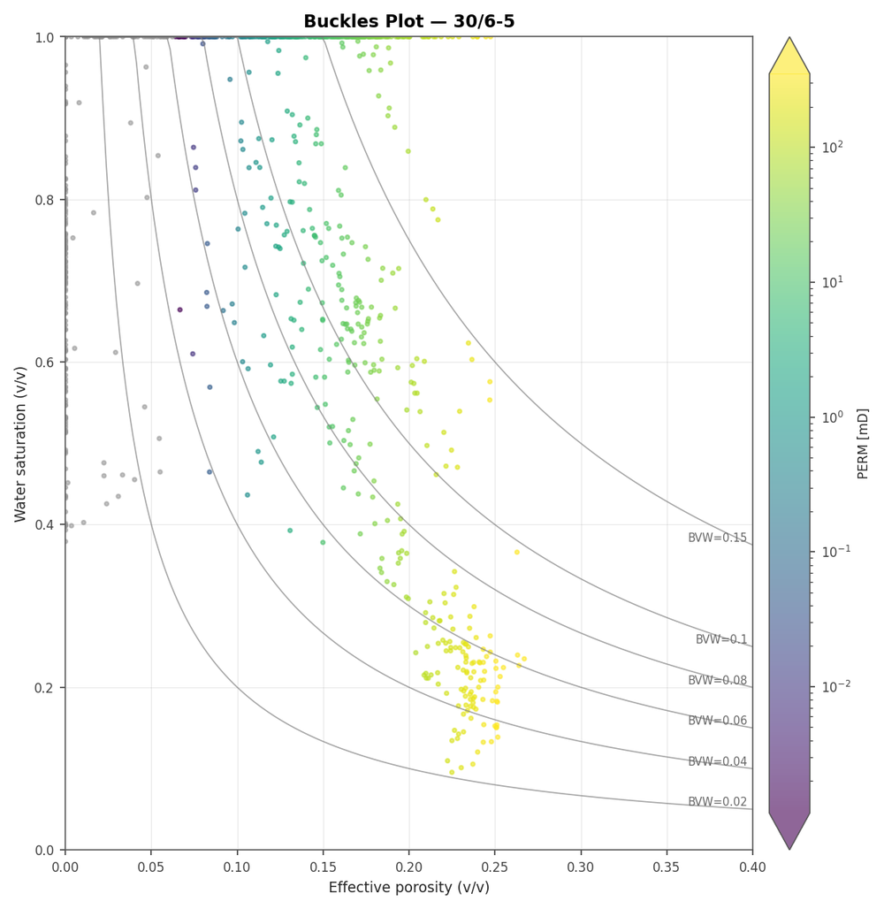
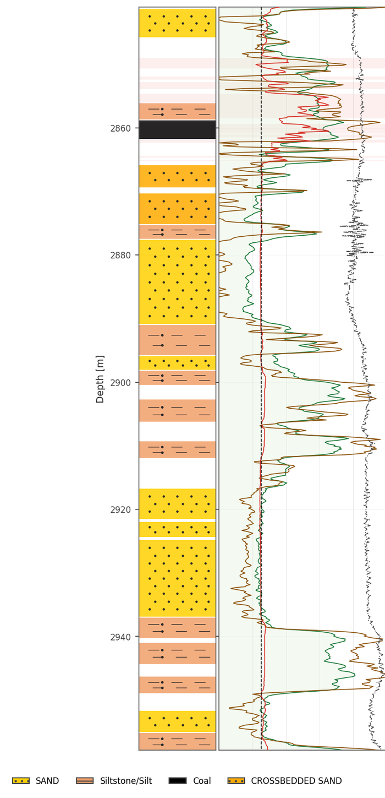

# Evaluate a formation

Give PetroHarness a raw LAS file, the interval and a question in plain language, and it runs a formation evaluation
of that interval: Petrophys interprets the log, a language model investigates the interpretation step by step with
Petrophys's tools, and code checks every number the answer states against the computed results. The answer comes
with its evidence, its figures and a record of every step.

 in GeoLink well 30/6-5, as Petrophys displays it. Left to right: the lithology log, the measured logs, and every curve Petrophys computed, with core points where the well has them. Data: GeoLink, CC BY-SA 4.0.")

## Ask

The examples use wells that ship with Petrophys, so every command here runs as written:

```bash
export PETROHARNESS_MODEL_URL=http://localhost:8000/v1        # any OpenAI-compatible endpoint (MODELS.md)
LAS=$(python -c "import petrophys; print(petrophys.sample('30/6-5'))")
TOPS=$(python -c "import petrophys; print(petrophys.sample('formations_30_6-5.csv'))")

petroharness --las $LAS --tops $TOPS --formation "BRENT GP." \
  --question "What are the porosity, water saturation and permeability of the Brent Group, and is any of it hydrocarbon-bearing?"
```

What comes back:

> **30_6-5: BRENT GP.** · 2841-2958 m, 768 samples · zones from the lithology log LITHOLOGY_GEOLINK (detected) ·
> status ok, 8 investigation steps
>
> **Porosity.** Pooled across the 567 zone samples, **PHIE_CC averages 0.125 v/v**, PHIT 0.199 v/v and uncalibrated
> PHIE 0.133 v/v. […] The crossbedded sands Z4–Z5 and sandstone Z7 carry the highest core-calibrated effective
> porosity (PHIE_CC 0.181–0.219 v/v) against low clay volume (VCL 0.027–0.156 v/v). […]
>
> **Hydrocarbon potential.** No zone is confirmed to hold hydrocarbons. The integrated analyzer flags
> **PRIME_OIL_TARGET on 23.6 m (28.4 % of the zoned thickness)** in Z1, Z4–Z5, Z6, Z7, Z8 and Z9. These flags are
> library-cutoff screens (NET_PAY = 1 requires VCL < 0.30, PHIE_CC > 0.08, SW < 0.70), not fluid identifications. […]



## Choose the interval

| You have | Pass | Example |
|---|---|---|
| A tops file | `--tops FILE --formation NAME` | GeoLink 30/6-5: `--tops formations_30_6-5.csv --formation "BRENT GP."` |
| A tops table of several wells | the same; the rows of this well are used | COSTA HW-3: `--tops formations_costa.csv --formation KHARAIB-2` (a `well` column; feet) |
| Depths | `--top T --base B` | GeoLink 25/5-1: `--top 2990 --base 3290` |
| Neither | nothing | Teapot 17-WX-21: the whole log, 0–5649.5 ft, 11,300 samples in 102 zones |

When the tops file lists units inside the interval, such as the Brent Group's Ness and Etive formations, the question
carries them with their depths, so you can ask about them by name.

Depths are read in the LAS's own unit unless the tops file states one, or `--depth-unit m|ft` does; depths in another
unit are converted, and the answer reports in the unit you gave. The COSTA and Teapot wells are logged in feet, the
GeoLink and Taranaki wells in metres.

## Zones

Every answer reports zone by zone. When the LAS carries a lithology log, as every GeoLink well does, the zones are
its runs. Without one, the zones are runs of the lithology Petrophys's mineral solver gives, and the answer's header
says so. A well with neither is zoned by bands of shale volume: clean (VCL below 0.3), shaly (0.3 to 0.6) and
shale-prone (above 0.6).

 , CDLA-Sharing-1.0.")

A lithology log is found by its mnemonic or description (lithology or facies, integer codes). Name it with
`--lithology-curve MNEMONIC` when detection misses it, and pass what you know of the rock with
`--formation-lithology "fine sandstone with siltstone"`.

### Your own zones

Give your own zones as a table of names with top and bottom depths, in CSV, TSV or Excel, in the same layout as a
tops file (a `well` column for a table of several wells, a depth-unit column if the depths are not the LAS's unit):

```text
zone,top,bottom
Ness,2841,2865
Etive,2865,2958
```

```bash
petroharness ask --las 30_6-5.las --tops formations_30_6-5.csv --formation "BRENT GP." \
  --zones zones.csv --question "Compare the porosity of the Ness and the Etive"
```

Your zones then frame the answer (Z1, Z2 under your names, with no minimum thickness). The lithology zones are kept as
L1, L2, ...: a tool reports by them when its call gives `"by": "lithology"`, and a tool's zones can name one of them by
its L id or its lithology. A zones file with overlapping zones, or with tops only, is refused with what to fix
(`--zones-sheet` names the sheet of a workbook).

### The whole well

A question is not limited to its interval. A tool's zones can name any unit of the tops file, one of your zones, or a
depth range anywhere in the well (`"2800-3000"`, `"9100-9400 ft"`), and the tool computes on that stretch. For each
question the model also says which stretches it is about (its scope: "the Dunlin", "2800-3000 m", "the whole well");
every lookup then computes on them unless the call names other zones. The answer's header names the scope. Intervals
where a condition holds (`runs`) are listed in full, top to base, uncut by zones, with the thickness each zone holds.

A benchmark's data settings set `reach: focus` (see the configuration reference): there, every question stays on its
interval, as the benchmark's answers are framed.

## The output

| File | What it holds |
|---|---|
| `answer.md` | the question, the interval, how it was zoned, the status, then the answer |
| `trace.json` | every model call, every step's actions and results, the claims and the checks |
| `.cache/` | the interpreted well, reused by later questions on the same LAS |

They go to `--out DIR` (default `./petroharness-out/<LAS name>/`). The exit status is 0 when answered, 1 when the run
failed and 2 when an input is wrong. Status `unresolved_numbers` means the answer kept a number the checker could not
find in any result: read that number with care.

## Keep asking

`petroharness` answers one question. To keep the interval open and ask follow-ups that build on what was found,
use `petroharness chat` with the same options ([Conversations](SESSIONS.md)), or the browser ([Web UI](UI.md)).

## More

<details>
<summary>Ask for another method or a what-if</summary>

The model has Petrophys compute what you ask, with every other input taken from the record, and names each new
curve beside the record's (`SW_SIMANDOUX`):

```bash
petroharness --las $LAS --tops $TOPS --formation "BRENT GP." \
  --question "Compute water saturation with Simandoux and compare it with the record's."
```

When Petrophys needs an input the well lacks, the answer says what to provide. The tools: [Tools](TOOLS.md).
</details>

<a id="turning-formation-information-into-a-tops-file"></a>
<details>
<summary>Turning formation information into a tops file</summary>

One row per top; only a name and a top are required. Tops from an email or a report become:

```csv
formation,top,bottom,depth_unit
Ness Fm.,2841,2865,m
Etive Fm.,2865,2958,m
```

Header names are read flexibly (`formation`, `name`, `zone`; `top`, `md`, `depth`; `bottom`, `base`; a unit in a
column or in the header, `Top (ft)`). Comma, tab or semicolon separated, or an Excel sheet. A table of several wells
needs a `well` column; the rows matching this LAS are used. Tops in TVD or subsea must be converted to measured depth
first.

A name the table lists twice is refused rather than guessed. Taranaki tuhua-7 is deviated and crosses some
formations twice:

```text
WHAT: formation 'Manganui' is listed 2 times in formations_tuhua-7.csv (line 3: top 874.014, base 1250.75; line 10:
top 2164.99, base 2347.42). WHY: a repeated name (e.g. a repeated section) does not say which interval is meant.
FIX: choose the one you mean by its top: --formation NAME --tops FILE --top D, or give its depths alone: --formation
NAME --top D --base D.
```
</details>

<details>
<summary>Curve names</summary>

Petrophys standardizes the usual mnemonics (RILD, RESD, ILD → RDEP; CNLS, NEUT → NPHI; DENS → RHOB). A curve it does
not recognise is kept under its own name and used by no calculation; map it in a settings file:

```yaml
data:
  interpret:
    curve_aliases: {RESM: RMED}
```
</details>

<details>
<summary>Skill library</summary>

The model can read short domain guides during the investigation. They give direction, never answers. `--skills none`
runs without them; `--skills PATH` plugs your own library ([Skills](reference/SKILLS.md)).
</details>

<details>
<summary>Field notes</summary>

`--field-notes FILE` gives a team's standing settings and notes for a field: the settings are in force and the notes
go with the question ([Conversations](SESSIONS.md)).
</details>

<a id="a-data-settings-file-optional"></a>
<details>
<summary>A data settings file (optional)</summary>

`--settings FILE` (or `PETROHARNESS_DATA`) starts from a data settings file with the keys of
`configs/data.example.yaml` under `data:`: Petrophys options (`interpret`, such as `{gr_min: 30, gr_max: 120}` or a
curve mapping), a lithology code workbook, a shared cache folder. The command's options win over it. Unset
`PETROHARNESS_DATA` before asking about a new well, or its settings apply.
</details>

<details>
<summary>From Python</summary>

```python
import petrophys
from petroharness.ask import ask

r = ask(petrophys.sample("30/6-5"), "Which zone has the best reservoir quality?",
        tops=petrophys.sample("formations_30_6-5.csv"), formation="BRENT GP.", out="out/brent")
print(r.status, r.answer)
```

The keyword arguments mirror the options; `interpretation={...}` changes Petrophys's settings
([Python API](reference/PYTHON_API.md)).
</details>

Every option: [Command line](reference/CLI.md). Complex questions answered on these wells: [Examples](EXAMPLES.md).

The example wells ship with Petrophys. Data: GeoLink, CC BY-SA 4.0; Taranaki Basin Curated Well Logs Dataset (New Zealand Petroleum & Minerals), CDLA-Sharing-1.0; Costa Gomes, Geiger and Arnold (2022), COSTA model, Heriot-Watt University, CC BY; Teapot Dome (NPR-3), RMOTC, U.S. Department of Energy.
