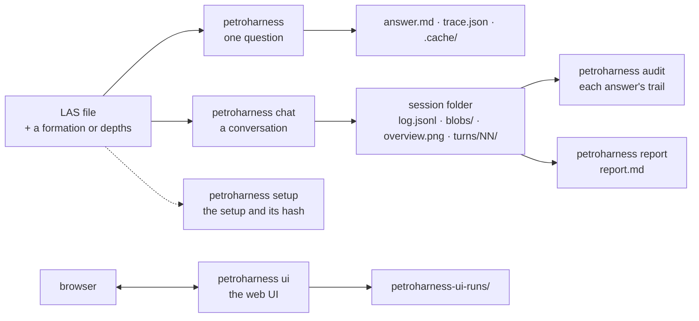
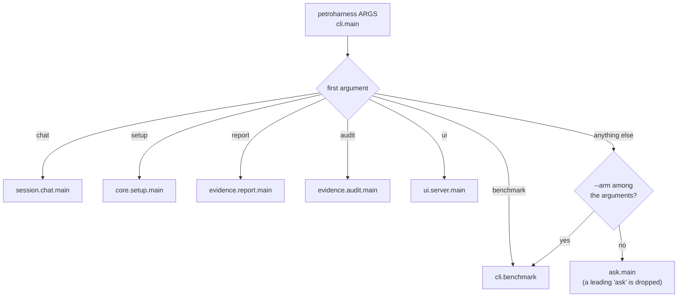
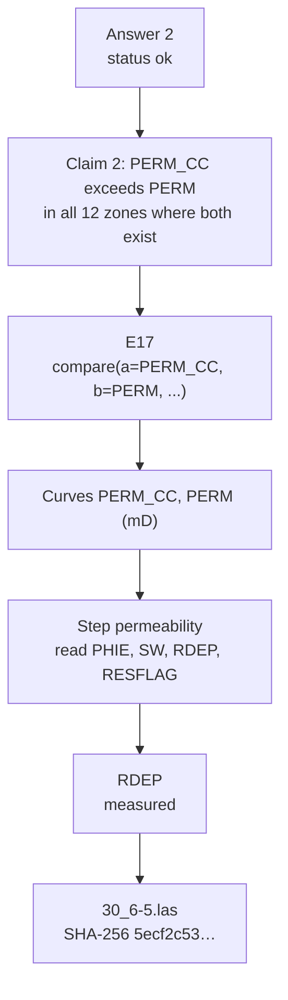

# Command-line reference

Every command of the `petroharness` executable: its flags with their types and defaults, what it prints and writes,
and the messages it stops with. The guides say when to use what: [USAGE.md](../USAGE.md) for one question,
[SESSIONS.md](../SESSIONS.md) for a conversation. The main example is the Brent Group of GeoLink well 30/6-5; the cases
it does not have (depths in feet, a tops table of several wells, a repeated formation name, the whole log) run on the
sample wells that have them. Every well here ships with Petrophys.

## 1. At a glance



| Command | What it does | Writes | Exit status |
|---|---|---|---|
| `petroharness [options]` (or `petroharness ask [options]`) | Answers one question about one interval of one LAS file | `answer.md`, `trace.json`, `.cache/` in `./petroharness-out/<LAS name>/` | 0 answered, 1 run failed, 2 wrong inputs |
| `petroharness chat` | A conversation: any number of questions on one interval | A session folder, by default `./petroharness-sessions/<LAS name>-<YYYYmmdd-HHMMSS>/` | 0 every question answered, 1 a question or the interpretation failed, 2 wrong inputs |
| `petroharness audit SESSION` | Each answer's audit trail, from the session folder alone | Standard output, or `--out FILE` | 0, or 2 |
| `petroharness report SESSION` | A conversation as one Markdown document | `SESSION/report.md`, or `--out FILE` | 0, or 2 |
| `petroharness setup` | The setup record and its hash | Standard output | 0, or 2 |
| `petroharness --launch-ui` | The web UI server, opened in your browser (`petroharness ui --open`) | `./petroharness-ui-runs/` | as `petroharness ui` |
| `petroharness ui` | The web UI server, `http://127.0.0.1:7860` by default | `./petroharness-ui-runs/` | 0 when stopped, 2 on a bad model card or port |
| `petroharness benchmark` | Validation mode: a question file run in parallel | `runs/` under the repository root | 0 when it completes |

- The model answers through any OpenAI-compatible endpoint: `PETROHARNESS_MODEL_URL=http://HOST:PORT/v1`, or
  `--model-url`. K2-Horizon-7B's model card is the default; `--model NAME` runs any chat model.
- Answers go to standard output; what was run goes to standard error.
- Every command has `-h`/`--help`. A flag error stops with argparse's usage message and exit status 2.

## 2. How it works

The console script `petroharness` is `petroharness.cli:main`. Its first argument picks the command; anything else
asks one question.



<details>
<summary>The dispatch, step by step</summary>

1. The console script `petroharness` is `petroharness.cli:main` (`[project.scripts]` in
   [pyproject.toml](../../pyproject.toml)).
2. Importing `petroharness.cli` imports the question graph (`petroharness.agent.graph`), which calls
   `no_hosted_tracing()` and stops the process when LangSmith or LangChain tracing is switched on
   ([CONFIGURATION.md](CONFIGURATION.md), section 10). It also reads the harness commit once (`cli.COMMIT`, from
   `core.setup.harness_commit`): the short commit of the checkout whose tracked source files the package runs from,
   with `+dirty` when `src/` has uncommitted changes; empty for an installed package.
3. `cli.main` looks at the first argument. `benchmark`, `chat`, `setup`, `report`, `audit` and `ui`, checked in that
   order, select a subcommand, and the remaining arguments go to it.
4. Otherwise, an argument list that holds `--arm` or `--arm=...` anywhere runs benchmark mode with every argument.
5. Otherwise the question command runs (`petroharness.ask.main`). A leading `ask` is dropped first, so
   `petroharness ask --las ...` equals `petroharness --las ...`.
6. Each command parses its own flags with `argparse`, so each has `-h`/`--help`, and a flag error stops with the
   argparse usage message and exit status 2.

</details>

<details>
<summary>Entry points and source files</summary>

| Command | Entry point | Source |
|---|---|---|
| `petroharness`, `petroharness ask` | `petroharness.ask.main` | [ask.py](../../src/petroharness/ask.py) |
| `petroharness chat` | `petroharness.session.chat.main` | [chat.py](../../src/petroharness/session/chat.py) |
| `petroharness audit` | `petroharness.evidence.audit.main` | [audit.py](../../src/petroharness/evidence/audit.py) |
| `petroharness report` | `petroharness.evidence.report.main` | [report.py](../../src/petroharness/evidence/report.py) |
| `petroharness setup` | `petroharness.core.setup.main` | [setup.py](../../src/petroharness/core/setup.py) |
| `petroharness ui`, `petroharness --launch-ui` | `petroharness.ui.server.main` (`--launch-ui`: with `--open`) | [server.py](../../src/petroharness/ui/server.py) |
| `petroharness benchmark` | `petroharness.cli.benchmark` | [cli.py](../../src/petroharness/cli.py) |

</details>

## 3. petroharness (one question)

The default command answers one question about one interval of one LAS file and stops.

```bash
export PETROHARNESS_MODEL_URL=http://localhost:8000/v1
LAS=$(python -c "import petrophys; print(petrophys.sample('30/6-5'))")
TOPS=$(python -c "import petrophys; print(petrophys.sample('formations_30_6-5.csv'))")

petroharness --las $LAS --tops $TOPS --formation "BRENT GP." \
    --question "What are the porosity, water saturation and permeability of the Brent Group, and is any of it hydrocarbon-bearing?"
```

| Give | With |
|---|---|
| The well and the question | `--las PATH` and `--question TEXT` (or `--question-file PATH`) |
| The interval | `--tops FILE --formation NAME`, or `--top D --base D`, or nothing for the whole log |
| The model | `PETROHARNESS_MODEL_URL` or `--model-url`; `--model NAME` for any chat model |
| Where the files go | `--out DIR`, default `./petroharness-out/<LAS file stem>` |

The answer is printed, and `answer.md` opens with a header naming what was asked and how it was answered. This one
is from the same question asked in a conversation, whose `turns/NN/answer.md` opens with the same header:

```text
# 30_6-5: BRENT GP.

- **Question:** What are the porosity, water saturation and permeability of the Brent Group, and is any of it hydrocarbon-bearing?
- **Interval:** 2841-2958 m (768 samples; tops file formations_30_6-5.csv, base: stated base)
- **Lithology:** zones from the lithology log LITHOLOGY_GEOLINK (detected)
- **Model:** K2-Horizon-7B
- **Skill library:** researched (version 18c03ad5d3f8)
- **Status:** ok, 8 investigation steps

---
```

The same command reads the interval on each sample well's own terms. The first lines of the run record, for the
cases 30/6-5 does not have:

| Case | Well | Interval options | The run record says |
|---|---|---|---|
| A tops file in feet, no lithology log | KGS 1046123714 | `--tops 1046123714_formation_tops.csv --formation "Lansing-Kansas City"` | `Lansing-Kansas City: 3991-4080 ft (178 samples; tops file 1046123714_formation_tops.csv, base: next top LKC G)`; lithology zones from Petrophys's mineral solver, 4 zones |
| Depths in metres, on a log in feet | KGS 1046123714 | `--top 1216.5 --base 1243.6 --depth-unit m` | `depth interval 1216.5-1243.6 m: 1216.5-1243.6 m (178 samples; depths given)`; the answer reports in m |
| A tops table of several wells (a `well` column) | COSTA HW-3 | `--tops formations_costa.csv --formation KHARAIB-2` | `KHARAIB-2: 7805-8020 ft (431 samples; tops file formations_costa.csv, base: stated base)` |
| A cored section by depth | GeoLink 25/5-1 | `--top 2990 --base 3290` | `depth interval 2990-3290 m: 2990-3290 m (1969 samples; depths given)`; zones from the lithology log LITHOLOGY_GEOLINK, 20 zones |
| The whole log, in feet | Teapot 17-WX-21 | none | `whole well: 0-5649.5 ft (11300 samples; the whole log (no formation or depths given))`; lithology zones from Petrophys's mineral solver, 102 zones |
| The Brent Group (the main example) | GeoLink 30/6-5 | `--tops formations_30_6-5.csv --formation "BRENT GP."` | `BRENT GP.: 2841-2958 m (768 samples; tops file formations_30_6-5.csv, base: stated base)`; zones from the lithology log LITHOLOGY_GEOLINK, 20 zones |

Each path is `petrophys.sample(NAME)`, NAME being the file named here or the well (`1046123714`, `HW-3`, `25/5-1`,
`teapot_17-wx-21`, `30/6-5`). Data: GeoLink, CC BY-SA 4.0. Kansas Geological Survey (kgs.ku.edu). Costa Gomes,
Geiger and Arnold (2022), COSTA model, Heriot-Watt University, CC BY. Teapot Dome (NPR-3), RMOTC, U.S. Department of
Energy.

<details>
<summary>Options of petroharness</summary>

| Flag | Type | Default | Meaning | Defined in |
|---|---|---|---|---|
| `--las PATH` | path | required | The well's LAS file. | `ask.parser` |
| `--question TEXT` | text | one of `--question` and `--question-file` is required | The question. Leading and trailing spaces are removed; an empty question is an error. | `ask.parser` |
| `--question-file PATH` | path | none | A text file whose whole content is the question. Excludes `--question`. | `ask.parser`, `ask.options` |
| `--formation NAME` | text | none | The formation: looked up in `--tops`, or a label for `--top`/`--base`. Alone, it is looked up in the settings file's `data.tops_csv`. | `ask.interval_options` |
| `--tops PATH` | path | none | A tops table (CSV, TSV or Excel) whose columns are found by meaning: [USAGE.md](../USAGE.md#turning-formation-information-into-a-tops-file). Needs `--formation`; excludes `--base`; with `--top D` it takes the row of that top for a name the file lists twice. Every unit of the table is a stretch a question can name: the map lists them (`Units of the tops file: ...`). With `reach: focus` in the settings, the table's units inside the interval (a group's formations) go with the question instead: `(The tops file lists these units inside this interval: Ness Fm. 2841-2865 m; Etive Fm. 2865-2958 m.)`. | `ask.interval_options`, `well.tops.read_tops`, `interval._units`, `interval.task_for` |
| `--zones PATH` | path | none | Your zones: a table (CSV, TSV or Excel) of zone, top and bottom, with optional `depth_unit` and `well` columns, read by Petrophys as it reads formation tops. They frame the answer in place of the lithology zones: Z1, Z2, ... under your names, with no minimum thickness; the lithology zones are kept as L1, L2, .... A table with tops only, overlapping zones, or rows for other wells only is refused with what to fix. | `ask.interval_options`, `well.user_zones.read_zones`, `well.view.FormationView` |
| `--zones-sheet NAME` | text | the first sheet | The Excel sheet that holds the zones. | `ask.interval_options`, `well.user_zones.read_zones` |
| `--top D` | float | the log's first depth, when only `--base` is given | The interval's top depth (included). With `--tops`, the top of the row meant, for a formation the file lists twice, as the file writes it. | `ask.interval_options`, `interval._interval`, `TopsTable.interval` |
| `--base D` | float | the log's last depth, when only `--top` is given | The interval's base depth (included). Must be below `--top`. | `ask.interval_options`, `interval._interval` |
| `--depth-unit UNIT` | `m` or `ft` | the tops file's unit, else the LAS's own | The unit of the depths given and of the answer's depths; it wins over a settings file's `data.depth_unit`, which otherwise sets the answer's unit. `metre`, `metres`, `meter`, `meters`, `feet`, `foot` and `f` are read too, in any case. | `ask.interval_options`, `well.tops.depth_unit_name`, `interval.prepare` |
| `--lithology-curve MNEMONIC` | text | detected | The lithology log's mnemonic, as Petrophys names the curve. Left out: a LAS curve whose mnemonic or description names a lithology or facies log and holds integer codes; with none, the zones are runs of the lithology Petrophys's mineral solver wrote; with neither, shale-volume bands. | `ask.interval_options`, `well.formation.find_lithology_curve`, `well.formation.solver_lithology` |
| `--formation-lithology TEXT` | text | none | The formation's lithology as you know it. It is added to the question as `(The operator states this formation's lithology: TEXT.)`. | `ask.interval_options`, `interval.task_for` |
| `--field-notes PATH` | path | none | A field notes file (YAML: `name`, `settings`, `notes`): its settings are in force, its notes go with the question. | `ask.interval_options`, `well.notes.load` |
| `--profile NAME` | text | none (Petrophys's default workflow) | A Petrophys context profile: the LAS is interpreted with `petrophys.interpret` options `{context_profile: NAME}`. | `ask.interval_options`, `interval._settings` |
| `--out DIR` | path | `./petroharness-out/<LAS file stem>` | The output folder. A second question with the same folder replaces its `answer.md` and `trace.json`. | `ask.parser`, `ask.options` |
| `--model NAME` | text | the default model card (K2-Horizon-7B) | Any chat model by its served name (as the server lists it at `/v1/models`); uses the generic card unless `--model-card` is given. | `ask.run_options` |
| `--model-card CARD` | YAML path or packaged card name | the K2-Horizon-7B card | A model card ([MODELS.md](../MODELS.md#model-cards)); the packaged names are `generic` and the default card's, `k2_horizon_7b`. | `ask.run_options`, `models.card_file` |
| `--model-url URLS` | comma-separated URLs | `PETROHARNESS_MODEL_URL` | The OpenAI-compatible endpoints (`http://HOST:PORT/v1`). With none, the command stops before any model call. | `ask.run_options`, `ask._model_key` |
| `--settings PATH` | path | `PETROHARNESS_DATA` if set, else none | A data settings YAML whose `data:` section is the base the settings start from ([CONFIGURATION.md](CONFIGURATION.md)). | `ask.run_options`, `interval._settings` |
| `--skills PATH` or `none` | folder or `none` | `PETROHARNESS_SKILLS`, else the packaged library `skills/researched` | The skill library; `none` runs with no guides. A relative path that exists is taken from the current folder, else from `src/petroharness/resources`. | `ask.run_options`, `agent.direction.plugged` |
| `--max-steps N` | integer | 8 (`MAX_STEPS`, `agent/state.py`) | The investigation's step cap. | `ask.run_options` |
| `--investigate` | switch | off | Every question gets the full investigation. Off: the model first says whether the question is direct (one or two lookups state it) and a direct question takes the short route ([GRAPH.md](../GRAPH.md#the-direct-route)). | `ask.run_options` |
| `-h`, `--help` | switch | off | Prints the options and the other commands, then exits 0. | `ask.parser` |

More ways in: a depth interval on the cored section of GeoLink 25/5-1, with the question in a file; and another
model, with no skill guides and the full investigation for every question.

```bash
CORE=$(python -c "import petrophys; print(petrophys.sample('25/5-1'))")
petroharness --las $CORE --top 2990 --base 3290 --depth-unit m --question-file question.txt --out out/q1
petroharness --las $LAS --tops $TOPS --formation "Etive Fm." --question "Which zones look like the best reservoir?" \
    --model Qwen/Qwen3-32B --skills none --investigate
```

</details>

<details>
<summary>How the interval is chosen</summary>

- The interval comes from exactly one source. `--tops` with `--base` is an error; `--tops` with `--top D` picks the
  row whose top is D for a name the file lists twice, and a D that is no row's top is an error that lists the rows;
  `--tops` without `--formation` is an error that lists the file's names; `--formation` alone needs `data.tops_csv` in the settings
  file; nothing at all means the whole log, named `whole well` (Teapot 17-WX-21: `whole well: 0-5649.5 ft`).
- A depth interval without `--formation` is named `depth interval <top>-<base> <unit>`. On 25/5-1, `--top 2990
  --base 3290 --depth-unit m` is reported as `25_5-1.las, depth interval 2990-3290 m: 2990-3290 m (1969 samples;
  depths given)`.
- Depths given in another unit than the log's are converted: on KGS 1046123714, logged in feet, `--top 1216.5 --base
  1243.6 --depth-unit m` holds 178 samples, as the Lansing-Kansas City tops (3991-4080 ft) do, and the answer reports
  in metres.
- A tops table with a `well` column is read for this well only, matched by the names the LAS goes by (its file name
  and its `WELL`, `UWI`, `API` or `APIN` header): `formations_costa.csv` lists 17 COSTA wells, and on HW-3 its
  KHARAIB-2 row gives 7805-8020 ft.
- With `zone_layout: formation` in the settings, `--formation-lithology` is shown on the zone instead of being added
  to the question.
- The command has no flag for single interpretation settings (`m`, `rw`, cutoffs): give them in a field notes file,
  or under `data.interpret` in a settings file ([CONFIGURATION.md](CONFIGURATION.md#5-interpretation-settings)).

</details>

<details>
<summary>Output of petroharness: what it prints and writes</summary>

The answer goes to standard output, a short record of the run to standard error, and two files to the output folder.

| Output | Kind | Default location | Content | Defined in |
|---|---|---|---|---|
| The answer | stdout | terminal | The answer text, only when the status does not start with `error` | `ask.main` |
| The run record | stderr | terminal | Four lines: the LAS and interval; the lithology and zone count; the model, status, steps, skill library and settings source; the files written. A fifth line `error: ...` on a failed run | `ask.main` |
| `answer.md` | file | `<out>/answer.md` | A header (question, interval, lithology, model, skill library, status and route, field notes and settings lines when present), `---`, then the answer, or `(no answer: <error>)` | `ask._answer_md` |
| `trace.json` | file | `<out>/trace.json` | The full trace ([ARCHITECTURE.md](../ARCHITECTURE.md#the-trace)) plus `answer` and the `ask` block: `las`, `question`, `question_sent`, `interval`, `lithology`, `zones`, `model`, `settings`, `skills`, `skills_given`, `interpret`, `interpreter`, `petrophys`, and `field_notes` when given | `ask.ask`, `ask.ask_record` |
| `.cache/` | folder | `<out>/.cache/` | The interpreted well, reused by later questions on the same LAS content and settings (unless the settings file sets `data.cache_dir`) | `ask.ask`, `well.prepare._cache_path` |

The run record of the Brent question when the endpoint does not answer (exit status 1; the folder is shortened):

```text
petroharness: 30_6-5.las, BRENT GP.: 2841-2958 m (768 samples; tops file formations_30_6-5.csv, base: stated base)
  lithology: zones from the lithology log LITHOLOGY_GEOLINK (detected); 20 zones
  model: K2-Horizon-7B; status: error: APIConnectionError; 0 steps; skill library: researched (version 18c03ad5d3f8); settings: built from the LAS
  wrote …/ask_err/answer.md and trace.json
  error: APIConnectionError: Connection error.
```

Its `answer.md` then ends `(no answer: APIConnectionError: Connection error.)`.

- The status is `ok`, `unresolved_numbers` (the checker still found a number no result shows after the repairs),
  `error: <exception type>`, or `error: empty answer (the writer's last draft was empty)`. `unresolved_numbers` exits
  0 and prints the answer; an empty answer exits 1, its stderr record ends `error: the writer's last draft was empty`
  and its `answer.md` reads `(no answer: the writer's last draft was empty)` (`agent.graph.answer_status`).
- The route in the header and on stderr is one of `a direct answer, N look steps`, `an investigation after a first
  look, N steps` or `N investigation steps` (`agent.graph.route_text`).
- The settings source on stderr is the settings file's path, or `built from the LAS`.
- When Petrophys cannot interpret the LAS, the command stops before the model runs: the message goes to stderr, the
  exit status is 1, and no `answer.md` or `trace.json` is written.

</details>

## 4. petroharness chat

`petroharness chat` keeps one interval open and answers questions about it in order, each with the earlier ones in
view. Everything is kept in a session folder that `audit`, `report` and `--resume` read.

```bash
petroharness chat --las $LAS --tops $TOPS --formation "BRENT GP." --session brent \
    --question "What are the porosity, water saturation and permeability of the Brent Group, and is any of it hydrocarbon-bearing?" \
    --question "Which zone has the best reservoir quality, and how does the log permeability compare with the core?"
petroharness chat --resume brent --question "Compute water saturation with Simandoux and compare it with the record's."
```

What the first command printed (folders shortened, answers cut at […]):

```text
conversation in …/brent
30_6-5.las: 2841-2958 m (768 samples; tops file formations_30_6-5.csv, base: stated base)
the interval's log display (Petrophys): …/brent/overview.png

--- question 1 (ok; 8 investigation steps, 903.5 s; …/brent/turns/01) ---
# Brent Group, Well 30_6-5 — Porosity, Saturation, Permeability and Hydrocarbon Potential
[…]
[Figure 3. Buckles plot: Sw against porosity, with hyperbolas of constant bulk-volume water (porosity x Sw) (the interval's PHIE, SW); 768 samples. Drawn by Petrophys (pp.buckles_plot) from the interval's curves. -> …/brent/turns/01/figures/figure_3_buckles.png]

--- question 2 (ok; 8 investigation steps, 832.4 s; …/brent/turns/02) ---
[…]
```

And the session folder it kept:

```text
brent/
  log.jsonl
  blobs/
  overview.png
  turns/01/answer.md
  turns/01/trace.json
  turns/01/tape.jsonl
  turns/01/figures/figure_1_log_viewer.png  figure_2_log_viewer.png  figure_3_buckles.png
  turns/02/...                              (the same files; figure_1_crossplot.png, ...)
  .cache/
```

Lines that start with `/` are commands: `/set name=value` changes an interpretation setting from the next question
on, `/settings` shows the settings in force, and `/scope`, `/frame` and `/zones` change the stretches the next
questions are about, the zones they report by and your zones ([Interactive commands](#interactive-commands)).

<details>
<summary>Options of petroharness chat</summary>

| Flag | Type | Default | Meaning | Defined in |
|---|---|---|---|---|
| `--las PATH` | path | none | The well's LAS file: starts a new conversation. Exactly one of `--las` and `--resume` is required. | `session.chat.parser` |
| `--resume DIR` | path | none | The folder of a conversation to go on with. | `session.chat.parser` |
| `--session DIR` | path | `./petroharness-sessions/<LAS stem>-<YYYYmmdd-HHMMSS>` | The folder a new conversation is kept in. A folder that already holds `log.jsonl` is refused. | `session.chat.parser`, `Conversation._new` |
| `--question TEXT` | text, repeatable | none | A question, asked in order before any read from the terminal. A text starting with `/` is a chat command. | `session.chat.parser` |
| `--questions-file PATH` | path | none | A text file of questions, one per non-blank line, asked after the `--question` ones. | `session.chat.parser` |
| `--no-figures` | switch | off (figures on) | Draws no figures for the answers and no `overview.png`. | `session.chat.parser` |
| `--formation`, `--tops`, `--zones`, `--zones-sheet`, `--top`, `--base`, `--depth-unit`, `--lithology-curve`, `--formation-lithology`, `--field-notes`, `--profile` | as in section 3 | as in section 3 | The interval, your zones, lithology, field notes and profile of a new conversation (`/zones` changes the zones later). | `ask.interval_options` |
| `--model`, `--model-card`, `--model-url`, `--settings`, `--skills`, `--max-steps`, `--investigate` | as in section 3 | as in section 3 | The model, settings, skills, step cap and route. | `ask.run_options` |

- On `--resume`, only `--model-url`, `--investigate`, `--question` and `--questions-file` are read. Every other input
  (interval, zones, model, card, step cap, figures, skills, settings file, field notes) comes from the log's
  `session_start` event, with the later `settings` and `zones` events replayed in their places and a `/scope` or
  `/frame` no question has used yet kept for the next one; the endpoint is not stored, so give it again (or set
  `PETROHARNESS_MODEL_URL`).
- Without `--investigate`, a resumed conversation keeps the route it was started with.
- A resumed conversation reads its settings file again (or `PETROHARNESS_DATA` when it was started without one).
  A result that then opens differently is listed in the `session_resume` event.
- `--question-file` and `--out` do not exist here; the folder is `--session`.

</details>

<a id="interactive-commands"></a>
<details>
<summary>Interactive commands</summary>

Lines that start with `/` are commands, whether typed, given with `--question` or read from `--questions-file`.
Their output goes to standard error.

| Command | Arguments | Meaning | Defined in |
|---|---|---|---|
| `/set` | `name=value [name=value ...]` | Adopts interpretation settings from the next question on; the well is interpreted again. `name=default` takes a setting back to its default. Prints `from question N: <changes> (the well was interpreted again)`, or `no change: those are the settings in force`. | `session.chat.command`, `Conversation.adopt` |
| `/settings` | none | Prints `settings in force: name=value, ...` (or `Petrophys defaults`), each from field notes marked `(field notes)`, then `changed before question N: ...` for each change made. | `session.chat.command` |
| `/set` without `name=value` pairs | none | Prints `usage: /set name=value [name=value ...]   (name=default takes a setting back to its default)`. | `session.chat.command` |
| `/scope` | `ITEMS` (comma-separated), or none | Sets the stretches the questions from the next one on are about (units of the tops file, your zones, depth ranges `TOP-BASE`, the whole well) until changed; alone, the interval again. Prints `from question N: scope <items>`, or `from question N: scope the interval`. A scope that names nothing in the well prints `not changed: <why>`. | `session.chat.command`, `Conversation.set_scope` |
| `/frame` | `lithology` or `zones` | `lithology`: the next questions report by the lithology zones; `zones` (or none): by the zones in force. Prints `from question N: by the lithology zones`, or `from question N: by the zones in force`. | `session.chat.command`, `Conversation.set_frame` |
| `/zones` | `FILE` or `none` | Your zones from the next question on (the well is not interpreted again); `none` takes them away. Prints `from question N: your zones from <file>`, or `from question N: the lithology zones (your zones taken away)`. A file that cannot be used prints `not changed: <why>`. | `session.chat.command`, `Conversation.adopt_zones` |
| any other `/word` | any | Prints `unknown command /word: /set name=value, /settings, /scope ITEMS, /frame lithology\|zones, /zones FILE\|none`. | `session.chat.command` |
| an empty line, or end of input (Ctrl-D) | none | Ends the conversation. | `session.chat.main` |

How `/set` reads a value (`session.chat._value`):

| Written | Read as |
|---|---|
| `default` or `none` (any case) | back to the default (`None`) |
| `true`, `on`, `yes` | `True` |
| `false`, `off`, `no` | `False` |
| a value with a comma, such as `0.25,0.55` | a list of numbers; text when a part is not a number |
| digits with an optional leading `-` | an integer |
| anything else | a number when it parses as one, else the text |

Commands given up front on a new conversation on the Brent Group, as printed (the folder is shortened):

```text
$ petroharness chat --las $LAS --tops $TOPS --formation "BRENT GP." --session chat_cmds \
    --question "/settings" --question "/set m=1.8 zone_layout=formation" --question "/settings" \
    --question "/set m=default" --question "/set bogus=1" --question "/set nothing" --question "/foo"
conversation in …/chat_cmds
30_6-5.las: 2841-2958 m (768 samples; tops file formations_30_6-5.csv, base: stated base)
the interval's log display (Petrophys): …/chat_cmds/overview.png
settings in force: Petrophys defaults
from question 1: m the default -> 1.8; zone_layout the default (lithology_runs) -> formation (the well was interpreted again)
settings in force: m=1.8, zone_layout=formation
changed before question 1: m the default -> 1.8; zone_layout the default (lithology_runs) -> formation
from question 1: m 1.8 -> the default (the well was interpreted again)
not changed: WHAT: interpretation settings that cannot be used: bogus: not a setting this panel knows. FIX: correct or reset them.
usage: /set name=value [name=value ...]   (name=default takes a setting back to its default)
unknown command /foo: /set name=value, /settings, /scope ITEMS, /frame lithology|zones, /zones FILE|none
```

- The setting names are the interpretation settings ([CONFIGURATION.md](CONFIGURATION.md#5-interpretation-settings)).
  A value is checked before the well is interpreted again, and a refused change leaves the settings as they were.
- In a conversation started with `--profile`, a Petrophys setting is refused; only the zone rule
  (`zone_min_thickness_m`, `zone_vcl_bands`, `zone_layout`) can change.
- A change is a `settings` event in `log.jsonl`, replayed in its place on `--resume` ([SESSIONS.md](../SESSIONS.md#changing-a-setting)).

</details>

<details>
<summary>Output of petroharness chat: what it prints and keeps</summary>

Answers go to standard output; what was run goes to standard error; everything is kept in the session folder.

| Output | Kind | Location | Content | Defined in |
|---|---|---|---|---|
| Start lines | stderr | terminal | `conversation in DIR`, `<LAS name>: <interval>`, and `the interval's log display (Petrophys): PATH` when figures are on; on resume `resumed DIR: N questions so far` | `session.chat.main` |
| Question header | stderr | terminal | `--- question N (<status>; <route>, <seconds> s; <turn folder>) ---` | `session.chat._say` |
| Answer | stdout | terminal | The answer, or `(no answer: <error>)`, then one line `[<caption> -> <figure path>]` per figure | `session.chat._say` |
| Prompt | terminal | terminal | `question> ` before each typed question, only when standard input is a terminal | `session.chat.main` |
| `log.jsonl` | file | session folder | One event per line: `session_start`, `setup`, `display`, `question`, `result`, `record`, `figure`, `turn_end`, `settings`, `zones`, `scope`, `frame`, `session_resume` | `session.log.SessionLog` |
| `blobs/` | folder | session folder | The texts the events name (results as shown, answers, record snapshots), each once, named by SHA-256 | `SessionLog.blob` |
| `overview.png` | file | session folder | The interval's log display drawn by Petrophys when the conversation starts (figures on) | `Conversation.overview` |
| `turns/NN/` | folder | session folder | `answer.md` (header, answer, figures, methods and parameters), `trace.json`, `tape.jsonl` (every model request and reply), `figures/` | `session.graph.commit` |
| `.cache/` | folder | session folder | The interpreted well | `Conversation._prepared` |

- Questions are taken from `--question`, then `--questions-file`. When any were given and standard input is not a
  terminal, the command ends after them; otherwise it goes on reading questions from standard input.
- The exit status is 1 when any question's status starts with `error`, else 0.
- Each event and file is described in [SESSIONS.md](../SESSIONS.md#the-session-folder) and
  [EVIDENCE.md](../EVIDENCE.md).

</details>

## 5. petroharness audit

`petroharness audit` writes each answer's audit trail from a session folder alone: no well, no Petrophys run and no
model. The trail runs from what the answer states back to the LAS file. Question 2 of the Brent conversation, one
claim followed down:



```bash
petroharness audit brent --question 2
```

```text
# Audit trail: question 2

**Question:** Which zone has the best reservoir quality, and how does the log permeability compare with the core?

**Answer:** status ok; text SHA-256 `8579e354dcdbb2060f80a6f2eedd9e87c9d671807cbd9afa3140d918d785b32c`

> Z19 (Sand, 2951.66–2955.01 m) has the strongest permeability — […]

## Claims and the results they cite

1. Z19 carries the highest rock-quality scores: […] (moderate): E11, E15
2. PERM_CC exceeds PERM in all 12 zones where both curves exist: pooled over 343 of 394 comparison samples mean PERM_CC 361.4933 mD vs PERM 95.3774 mD, […] (moderate): E17, E18
[…]

## Numbers the answer states and the results that show them

| Number | Shown by |
|---|---|
| 1627.6 | E1, E9, E10, E11, E17 |
[…]
## Results
## Curves
## Steps Petrophys ran
## Figures
## Source
```

<details>
<summary>Options of petroharness audit</summary>

| Flag | Type | Default | Meaning | Defined in |
|---|---|---|---|---|
| `SESSION` | path, positional | required | A conversation's folder (it must hold `log.jsonl`). | `evidence.audit.main` |
| `--question N` | integer | every answered question | One question's trail. | `evidence.audit.main` |
| `--json` | switch | off | JSON instead of Markdown: the whole evidence graph (`{"nodes", "links"}`), or with `--question` that question's trail. | `evidence.audit.main`, `EvidenceGraph.to_json`, `EvidenceGraph.trail` |
| `--out FILE` | path | standard output | Writes the text to this file and prints nothing. | `evidence.audit.main` |

</details>

<details>
<summary>The sections of an audit trail</summary>

- The Markdown sections are, in order: the header, `Settings changed in this conversation` (only after a `/set`),
  `Claims and the results they cite`, `Numbers the answer states and the results that show them`, `Results`,
  `Curves`, `Steps Petrophys ran`, `Figures` (when the answer has any) and `Source` (the LAS path and SHA-256, the
  Petrophys build, the harness commit, the model and the setup hash).
- A short answer has no settled claims, so its trail says `No settled claim.` and lists the numbers it states. An
  answer none of whose numbers was matched to a single result says `No number of the answer was matched to a single
  result.`, and one with no computed curve behind it says `No computed curve is behind this answer.`
- What the graph holds and its limits: [EVIDENCE.md](../EVIDENCE.md).

</details>

## 6. petroharness report

`petroharness report` writes a whole conversation as one Markdown document, from the session folder alone: the
interval, each question with its answer, figures, methods and parameters, then every answer's audit trail.

```bash
petroharness report brent          # prints the path it wrote, here brent/report.md
```

The start of the report (the LAS path is shortened, the rest cut at […]):

```text
# Conversation report: 30_6-5.las

- **Interval:** BRENT GP. (2841.0-2958.0 m; 768 samples)
- **LAS file:** `…/petrophys/datasets/geolink/30_6-5.las`, SHA-256 `5ecf2c53826981f978c2efb47fe016abf94dac62e83dbdb54eee115596f801b9`
- **Model:** K2-Horizon-7B
- **Petrophys:** 3.0.0@files-c5de047fe601
- **PetroHarness:** 1.1.0 commit <commit>, setup `d70dbbf039dd`
- **Questions:** 2 answered of 2 asked


[…]
## Question 1: What are the porosity, water saturation and permeability of the Brent Group, and is any of it hydrocarbon-bearing?
[…]
## Question 2: Which zone has the best reservoir quality, and how does the log permeability compare with the core?
[…]
# Audit trails
## Audit trail: question 1
[…]
## Audit trail: question 2
```

<details>
<summary>Options of petroharness report</summary>

| Flag | Type | Default | Meaning | Defined in |
|---|---|---|---|---|
| `SESSION` | path, positional | required | A conversation's folder (it must hold `log.jsonl`). | `evidence.report.main` |
| `--out FILE` | path | `SESSION/report.md` | The file to write. In the session folder, the picture links resolve. | `evidence.report.main` |

</details>

<details>
<summary>How the report is put together</summary>

- Each question's section holds its status and its `turns/NN/answer.md` without the header; the answer's own headings
  move down two levels (at most `######`) and its figure links are rewritten to `turns/NN/figures/...`.
- The `# Audit trails` part holds `petroharness audit`'s trail of every answered question, its headings one level
  down.
- A question with no `answer.md` shows `(no answer file)`; one without a `turn_end` event shows `Status: not answered`.

</details>

## 7. petroharness setup

`petroharness setup` prints the setup a question would be answered under, with one hash over it
([EVIDENCE.md](../EVIDENCE.md#the-setup-record)). Two runs with the same hash were made of the same parts.

```bash
petroharness setup --model Qwen/Qwen3-32B
petroharness setup --las $LAS --tops $TOPS --formation "BRENT GP." --model Qwen/Qwen3-32B --json
```

The first command prints:

```text
setup ae3aa9e6820f
  harness: 1.1.0
  commit: <commit>
  petrophys: 3.0.0@files-c5de047fe601
  components:
    C1: 6f8f4c39893a
    ...
    C10: 20c9aaaad36a
  functions: 1e177d0c7ca2
  skills:
    library: researched
    version: 18c03ad5d3f8
  model: Qwen/Qwen3-32B
  card: e9963e09349e
  data: 1c824f0cf710
  policy: 7631a4a859eb
  writer: open
  fmt: profile
  max_steps: 8
  mode: interactive
  depth: True
```

The second prints the same record as JSON with `"hash": "e9f1a380e722"` and `"data": "61dcbf7ecfe4"`: the data
settings built from the Brent interval, the ones a question about it is answered under.

<details>
<summary>Options of petroharness setup</summary>

| Flag | Type | Default | Meaning | Defined in |
|---|---|---|---|---|
| `--las PATH` | path | none | A well's LAS file: the data settings are built from it and the interval options as a question builds them (`interval.prepare`, `agent.graph.task_config`), so the hash is the one a question about that interval answers under. Without it, the data part covers the settings file alone. | `core.setup.main`, `core.setup.for_well` |
| `--formation`, `--tops`, `--top`, `--base`, `--depth-unit`, `--lithology-curve`, `--formation-lithology`, `--field-notes`, `--profile` | as in section 3 | as in section 3 | The question's interval, lithology, field notes and profile. They need `--las`. | `ask.interval_options`, `core.setup.for_well` |
| `--zones`, `--zones-sheet` | as in section 3 | none | Accepted, as the interval options are shared, but not read: `core.setup.for_well` does not pass them on, so the printed hash leaves your zones out and differs from the one a question with `--zones` records. | `ask.interval_options`, `core.setup.for_well` |
| `--model NAME` | text | the default model card | The served model's name (the generic card unless `--model-card` is given). | `ask.run_options`, `core.setup.config_for` |
| `--model-card CARD` | YAML path or packaged card name | the K2-Horizon-7B card | The model card whose request settings are hashed. | `ask.run_options`, `core.setup.config_for` |
| `--settings PATH` | path | `PETROHARNESS_DATA` if set, else none | A data settings YAML: its `data:` section is hashed, or with `--las` is the base the settings start from. | `ask.run_options`, `core.setup.config_for`, `interval._settings` |
| `--skills PATH` or `none` | folder or `none` | `PETROHARNESS_SKILLS`, else the packaged library | The skill library recorded. | `ask.run_options` |
| `--max-steps N` | integer | 8 | The step cap recorded. | `ask.run_options`, `core.setup.of` |
| `--investigate` | switch | off | Records `depth: False` (every question investigated). | `ask.run_options`, `core.setup.of` |
| `--json` | switch | off | Prints `{"hash": ..., <record>}` as JSON instead of text. | `core.setup.main` |

</details>

<details>
<summary>What the setup hash covers, and its errors</summary>

- The record's fields: [EVIDENCE.md](../EVIDENCE.md#what-a-setup-holds). An empty value prints as `(none)`; `commit`
  is empty for an installed package and ends `+dirty` when `src/` has uncommitted changes.
- Without `--las`, the settings file is hashed as it is. A question also hashes the settings built from its LAS (the
  policy cutoffs passed to Petrophys, the depth unit), so its `data` part, and its hash, differ from the printed ones.
  With `--las` and the question's own options (other than `--zones`), the printed hash is the one its trace records
  (`setup`), and in a conversation the log's `setup` event. The LAS header, the log's depth range and the tops file are read for this;
  Petrophys does not interpret the well.
- `--model-url` does not exist here: where the model is reached is not part of a setup.
- Errors (a missing card, a bad settings file, no LAS file at `--las`, an interval option without `--las`) print on
  standard error with the prefix `petroharness setup:` and exit 2. An interval option without `--las` says
  `WHAT: --<option> describes a well's interval, and no well was given. FIX: add --las WELL.las, or leave the
  interval options out.`

</details>

## 8. petroharness ui

`petroharness ui` serves the web UI, a standard-library HTTP server over the same `ask` path ([UI.md](../UI.md)).
`petroharness --launch-ui` is the same with `--open`: it takes the same options, anywhere on the line (`--launch_ui`
is read as well).

```bash
petroharness ui --port 8080 --workers 2 --model Qwen/Qwen3-32B --model-url http://localhost:8000/v1
```

```text
PetroHarness UI on http://127.0.0.1:8080
  runs: …/petroharness-ui-runs; workers: 2; model: Qwen/Qwen3-32B (Qwen/Qwen3-32B); endpoints: http://localhost:8000/v1
```

The second line names the model as people read it (`--model`, else the card's label), then the served name in
brackets.

<details>
<summary>Options of petroharness ui</summary>

| Flag | Type | Default | Meaning | Defined in |
|---|---|---|---|---|
| `--host ADDRESS` | text | `127.0.0.1` | The address to listen on. `localhost` opens one server on `127.0.0.1` and, where the machine has IPv6, a second on `::1`. An address containing `:` is served over IPv6 (`_Server6`). `0.0.0.0` listens on every interface. | `ui.server.parser`, `ui.server.make_servers` |
| `--port N` | integer | `7860` | The port. For `localhost`, the `::1` server takes the port the first server bound. | `ui.server.parser` |
| `--allow-host NAME` | text, repeatable | none | A further host name a server on a loopback address (`--host` `localhost`, `127.0.0.1` or `::1`) answers, for a proxy that keeps its own host name. Names are compared in lower case. Without it, such a server answers API requests only for the host names `localhost`, `127.0.0.1` and `::1`. | `ui.server.parser`, `ui.server.make_servers`, `Handler._refused` |
| `--runs DIR` | path | `petroharness-ui-runs` (relative to the current folder) | The folder for saved runs, uploads and the shared cache. It is created when missing and resolved to an absolute path. | `ui.server.parser`, `ui.store.Store` |
| `--workers N` | integer | `4` | Questions answered at once; values below 1 become 1. | `ui.server.parser`, `ui.server.App` |
| `--model NAME` | text | none (the default model card) | Any chat model by its served name; selects the generic card unless `--model-card` is given. | `ui.server.parser`, `models.card_file` |
| `--model-card CARD` | YAML path or packaged card name | none (the default card, K2-Horizon-7B) | A model card ([MODELS.md](../MODELS.md)). | `ui.server.parser`, `models.card_file` |
| `--model-url URLS` | comma-separated URLs | from the environment (below) | The OpenAI-compatible endpoints, each ending in `/v1`. Empty entries are dropped; a trailing `/` is removed. | `ui.server.parser`, `ui.server.Endpoints` |
| `--open` | flag | off | Opens `http://localhost:PORT` (the server's own address for any other `--host`) in your browser once the server listens: on macOS and Windows, on Linux with a display, or where the environment names a `BROWSER` (an editor's remote terminal sets one). Elsewhere it prints the address to open and the SSH port forward. | `ui.server.parser`, `ui.server.open_browser`, `ui.server.page_url` |

</details>

<details>
<summary>What the server prints, refuses and checks</summary>

- Both start lines go to standard error. With no endpoint, the second line ends `endpoints: none (set
  PETROHARNESS_MODEL_URL or --model-url)`; the server starts, and each question then fails with a message saying so.
- With a `--host` other than `localhost`, `127.0.0.1` or `::1`, a line between the two says `listening on <host>:
  anyone who can reach this port can ask questions and read the files this server can read; listen on 127.0.0.1 and
  forward the port where you can`.
- A model card that names no model (the generic card) needs `--model`: without it the server does not start, and
  prints `petroharness ui: WHAT: the model card generic.yaml names no model. FIX: give the served model's name
  (--model NAME, as the server lists it at /v1/models).` with exit status 2 (`ui.server.served_model`).
- The API refuses, with status 403, a request from another site's page (an `Origin` other than the server's own), a
  `POST` that is neither JSON nor an upload with its `X-Filename` header, and, on a loopback address, a request for a
  host name it does not answer ([WEB_UI_API.md](WEB_UI_API.md#14-security-notes)).
- Endpoint health is `GET <url>/models` with a 4-second timeout, kept for 15 seconds (`Endpoints`).
- Exit status 2 also when the model card is missing or wrong (`petroharness ui: <message>`), or when the address
  cannot be bound (`petroharness ui: cannot listen on HOST:PORT (...). FIX: choose another --port.`).
- Only requests for `/` and `/index.html` are logged to standard error (`Handler.log_message`); the polling is not.
- The server runs until Ctrl+C and then exits 0. The page and its options: [UI.md](../UI.md); every HTTP route:
  [WEB_UI_API.md](WEB_UI_API.md).

</details>

## 9. petroharness benchmark

Benchmark mode runs a question file with reference answers, in parallel, for validating the harness; it is not needed
to evaluate your own wells ([DEVELOPMENT.md](../DEVELOPMENT.md#benchmark-mode)).

```bash
export PETROHARNESS_DATA=/path/to/data.yaml        # needs data.las_dir and eval.questions
export PETROHARNESS_MODEL_URL=http://host-a:8000/v1,http://host-b:8000/v1
petroharness benchmark --arm run1 --cats porosity,saturation --ids ids.json --gt-dir /path/to/references --workers 40
```

It needs a data config with `data.las_dir` and `eval.questions`, a list of the questions to run (`--ids`) and the
reference files (`--gt-dir`, copied out for scoring and never read by a run). It writes under `runs/` in the
repository root and prints a JSON summary.

<details>
<summary>Options of petroharness benchmark</summary>

| Flag | Type | Default | Meaning | Defined in |
|---|---|---|---|---|
| `--arm NAME` | text | required | A name for the run; it starts every output folder's name. | `cli.benchmark` |
| `--ids FILE` | path | required | A JSON file `{"qa_ids": [...]}`: the questions to run. | `cli.benchmark` |
| `--gt-dir DIR` | path | required | A folder of reference files, one per group, `single_formation_<group>_qa_pairs.json`; the rows of the run's questions are copied out for scoring. No question's run reads it. | `cli.benchmark`, `cli.save` |
| `--cats A,B` | comma-separated text | `hydrocarbon` | The question groups (the question file's `category`) to run. | `cli.benchmark` |
| `--models KEYS` | comma-separated registry keys | the default model card's key (K2-Horizon-7B) | Model registry keys (`petroharness.models.MODELS`); each runs the whole set. | `cli.benchmark` |
| `--model NAME` | text | none | Any chat model by its served name (the generic card); replaces `--models`. | `cli.benchmark` |
| `--model-card CARD` | YAML path or packaged card name | none | A model card; replaces `--models`. | `cli.benchmark` |
| `--rep N` | integer | 1 | The run number; above 1 it is added to the folder names (`r<N>`) and shifts which endpoint each question uses. | `cli.benchmark`, `agent.graph.task_config` |
| `--workers N` | integer | 12 | Questions run at once (threads). | `cli.benchmark` |
| `--max-steps N` | integer | 8 | The step cap. | `cli.benchmark` |
| `--writer MODE` | `open` or `''` | `open` | The writer's repair rounds: `open` allows two, `''` one. | `cli.benchmark` |
| `--format FORMAT` | `profile` or `default` | `profile` | The answer format: the report style's (`profile`) or the writer's own (`default`). | `cli.benchmark` |
| `--investigate` | switch | off | Every question gets the full investigation. | `cli.benchmark` |

</details>

<details>
<summary>The question file and what benchmark writes</summary>

The question file (`eval.questions`) is a JSON list, one row per question. A `formation` is a name in the tops table,
or an interval of its own:

```json
[{"qa_id": "q0001", "question": "...", "las_path": "30_6-5.las", "formation": "BRENT GP.", "category": "porosity"},
 {"qa_id": "q0002", "question": "...", "las_path": "25_5-1.las", "category": "porosity",
  "formation": {"name": "cored section", "top": 2990.0, "base": 3290.0, "depth_unit": "m", "lithology": "sandstone"}}]
```

What it writes, with `<prefix>` = `<arm>_<model>` plus `r<rep>` when `--rep` is above 1:

```text
runs/<prefix>_<group>/traces/<task_id>.json                              one trace per question, with its answer
runs/<prefix>_<group>/responses/single_formation_<group>_qa_pairs.json    {metadata, qa_pairs: [{qa_id, question, answer}]}
runs/gt_subsets/<prefix>/single_formation_<group>_qa_pairs.json           the reference rows of the run's questions
runs/summaries/run_<arm>_r<rep>.json                                     the summary, also printed as JSON
```

</details>

<details>
<summary>How a benchmark run works</summary>

- The data config is required ([CONFIGURATION.md](CONFIGURATION.md#3-finding-the-data-config)); each LAS is read from
  `data.las_dir` by the file name in `las_path`. A `formation` given as a name takes its interval from `data.tops_csv`.
- `<model>` is the registry key given with `--models`, or the `--model` name (or the card file's stem) with each run
  of characters outside `A-Z a-z 0-9 . _ -` replaced by one `-`.
- In a fresh process the registry holds only the default card's key, so `--models` takes that key; any other model
  is run with `--model` or `--model-card`.
- The endpoints are `PETROHARNESS_MODEL_URL`, else `http://localhost:8000/v1`. Each question
  uses one of them, chosen by its task id and `--rep`.
- A run resumes: a trace already written at the same commit, with an answer and a status not starting with `error`,
  is reused instead of run again.
- The run sees only an opaque task id (`t` and 10 hex digits of the `qa_id`'s SHA-256), the question, the well and the
  interval; the group only names the output folders.
- The summary, per model: `prefix`, `commit`, `writer`, `format`, `route` (`direct` or `investigate`), `n`, `ok`,
  `unresolved`, `errors`, `steps_mean`, `opened_mean`.
- Output folders are under the repository root (`config.REPO_ROOT`, two levels above `src/petroharness/config.py`), so
  benchmark mode is meant for a source checkout.

</details>

## 10. Limits and errors

A wrong input stops before the model runs, with a message that says what is wrong, why, and how to fix it, and exit
status 2. A run that fails once started exits 1. Three inputs the harness refuses, each on the sample well that has
the case:

```text
$ petroharness --las $TUHUA --tops formations_tuhua-7.csv --formation Manganui --question "..."
petroharness: WHAT: formation 'Manganui' is listed 2 times in formations_tuhua-7.csv (line 3: top 874.014, base 1250.75; line 10: top 2164.99, base 2347.42). WHY: a repeated name (e.g. a repeated section) does not say which interval is meant. FIX: choose the one you mean by its top: --formation NAME --tops FILE --top D, or give its depths alone: --formation NAME --top D --base D.

$ petroharness --las $KGS --tops 1046123714_formation_tops.csv --formation "Lansing-Kansas City" --depth-unit m --question "..."
petroharness: WHAT: the tops file 1046123714_formation_tops.csv states its depths in ft and the depth unit given is m. WHY: one of them is wrong. FIX: drop --depth-unit (the file's unit is used) or correct the file.

$ petroharness --las $BRENT --tops formations_costa.csv --formation KHARAIB-2 --question "..."
petroharness: WHAT: the tops file formations_costa.csv has no rows for this well (it goes by '30_6-5', '30/6-5', '30/6-5'; the file's well column lists HW-3, HW-4, HW-5, HW-6, HW-7, HW-8, HW-9, HW-10, HW-24, HW-25, HW-26, HW-27, HW-28, HW-29, HW-30, HW-31, HW-32). WHY: a table with a well column is read for this well only. FIX: put this well's name (the LAS file's name or its WELL header) in that column, or drop the column from a table that holds only this well.
```

Each exits 2. Taranaki tuhua-7 has no lithology log and its tops file lists some formations twice; KGS 1046123714 is
logged in feet; `formations_costa.csv` holds the COSTA wells only. Data: Taranaki Basin Curated Well Logs Dataset
(New Zealand Petroleum & Minerals), CDLA-Sharing-1.0. Kansas Geological Survey (kgs.ku.edu). GeoLink, CC BY-SA 4.0.
Costa Gomes, Geiger and Arnold (2022), COSTA model, Heriot-Watt University, CC BY.

<details>
<summary>Every error, its message and its exit status</summary>

| Situation | What happens | Where |
|---|---|---|
| Hosted tracing on (`LANGSMITH_TRACING`, `LANGSMITH_TRACING_V2`, `LANGCHAIN_TRACING` or `LANGCHAIN_TRACING_V2` set to `true` or `1`) | Every command stops at import with a `RuntimeError` traceback naming the variable; exit 1 | `agent.graph.no_hosted_tracing` |
| A flag is missing, unknown or of the wrong type | argparse prints the usage and the problem; exit 2 | each command's `parser` |
| No LAS file at the path | `WHAT: no LAS file at <path>. FIX: give the path of the well's LAS file.`; exit 2 | `ask.ask`, `Conversation.start` |
| The question is empty | `WHAT: the question is empty. FIX: give the question to answer.`; exit 2 | `ask.ask` |
| No model endpoint | `WHAT: no model endpoint. WHY: ... FIX: set PETROHARNESS_MODEL_URL=http://HOST:PORT/v1 (several, comma-separated) or pass --model-url.`; exit 2 | `ask._model_key` |
| Unknown model card | `WHAT: no model card '<card>'. FIX: ... the name of a packaged card: <names>.`; exit 2 | `models.card_file` |
| A card with no `model` section, or a misspelt card field | `ValueError` naming the card or the field; exit 2 | `models.card_settings` |
| A card that names no model and no `--model` | `WHAT: the model card <file> names no model. FIX: give the served model's name (--model NAME ...)`; exit 2 (`ui`: at start, before it listens) | `models.register`, `ui.server.served_model` |
| No tops file at `--tops` | `WHAT: no tops file at <path>. FIX: give the path of a CSV with one row per top ...`; exit 2 | `well.tops.read_tops` |
| A tops file and `--base` together | `WHAT: both a tops file and depths (--top/--base) are given. ...`; exit 2 | `interval._interval` |
| A tops file without `--formation` | The message lists the file's names; exit 2 | `interval._interval` |
| A formation the tops file lacks, lists twice with no `--top`, or has no row with the `--top` given | `FormationNotFound` with the names it has (and close matches), or the lines of each occurrence; exit 2 | `well.tops.TopsTable.interval` |
| A tops file that cannot be read as a table (a row with more fields than the header or the first row, an empty file) | `WHAT: the tops file <name> cannot be read as a table (<what pandas reports>). FIX: give every row the same columns, ...`; exit 2. The settings' `data.tops_csv` gives the same message about `the settings' tops table` | `well.tops._read_frame`, `well.formation._tops_table` |
| A tops file with rows for other wells only | `FormationNotFound` naming the well's names and the file's; exit 2 | `well.tops.read_tops` |
| A tops file's unit and `--depth-unit` differ | `WHAT: the tops file <name> states its depths in <unit> and the depth unit given is <unit>. ...`; exit 2 | `well.tops.read_tops` |
| `--depth-unit` is not a metre or foot spelling | `WHAT: depth unit '<text>' is not m or ft. FIX: give m or ft.`; exit 2 | `interval._interval` |
| `--base` not below `--top` | `WHAT: the base (<b>) is not below the top (<t>). ...`; exit 2 | `interval._interval` |
| `--formation` alone with no `data.tops_csv` | `WHAT: formation '<name>' is named without its depths. ...`; exit 2 | `interval._interval` |
| The interval holds no samples | `WHAT: the interval '<name>' has no samples in <file> (the log runs <first>-<last> <unit>). ...`; exit 2 | `ask.check` |
| `--lithology-curve` names a curve with no data | The message lists the well's curves; exit 2. The value `none` is read as a mnemonic, not as a keyword | `ask.check` |
| A LAS with two lithology logs and none named | `WHAT: this LAS has several lithology logs (...). WHY: the zones come from one. FIX: name it in data.lithology_curve.`; exit 2 | `well.formation.find_lithology_curve` |
| `--settings` (or `PETROHARNESS_DATA`) names no file | `WHAT: no data settings file at <path>. ...`; exit 2 | `interval._settings` |
| A misspelt key under `data:` in the settings file | A pydantic validation error naming the key; exit 2 | `config.DataPaths` |
| `data.interpret` names a setting Petrophys does not have | `WHAT: data.interpret names settings Petrophys does not have: <names>. ... FIX: correct or remove them ...`; exit 2 | `well.prepare._interpret_with_petrophys` |
| `--profile` with `data.interpreter`, or Petrophys settings with a profile or interpreter | `ValueError` saying to keep one; exit 2 | `interval._settings`, `interval._interpretation` |
| A field notes file that is missing, is not YAML, has unknown entries or bad settings, or has more than 20 notes or a note over 300 characters | `ValueError`/`FileNotFoundError` saying which entry and the fix; exit 2 | `well.notes.load` |
| A bad skill library (`--skills`, `PETROHARNESS_SKILLS`) | `WHAT: no skill library at <path> ...`, or the list of its problems; exit 2, before Petrophys interprets the well (the question command, `chat` and `chat --resume`) | `ask.check`, `agent.direction.load` |
| Petrophys cannot interpret the LAS | `RuntimeError` message; exit 1 | `well.prepare` |
| The model call fails during a question | Status `error: <type>`; the trace keeps the error and its traceback; exit 1 (`chat`: the conversation goes on) | `agent.graph.turn` |
| The writer's last draft is empty | Status `error: empty answer (the writer's last draft was empty)`; the trace's `error` says so; exit 1 (`chat`: the conversation goes on) | `agent.graph.answer_status`, `agent.graph.finalize` |
| `chat` with both or neither of `--las` and `--resume` | `petroharness chat: give --las (a new conversation) or --resume (an earlier one), not both`; exit 2 | `session.chat.main` |
| `chat --session` on a folder that holds a conversation | `WHAT: a conversation already lives in <folder>. FIX: resume it ...`; exit 2 | `Conversation._new` |
| `chat --resume` on a folder with no conversation | `WHAT: no conversation in <folder>. ...`; exit 2 | `Conversation.resume` |
| `chat --questions-file` names no file, or one that cannot be read | `petroharness chat: WHAT: the questions file <path> cannot be read (<reason>). FIX: give a text file with one question per line.`; exit 2, before a session folder is made | `session.chat.main` |
| `audit` or `report` on a folder without `log.jsonl` | `WHAT: <folder> holds no session log (log.jsonl). FIX: give a session folder.`; exit 2 | `evidence.audit.main`, `evidence.report.main` |
| `audit --question N` with no such answer | `WHAT: question N has no answer in this conversation. FIX: one of [1, 2].` (the conversation's questions; this one is from the Brent conversation); exit 2 | `EvidenceGraph.trail` |
| `ui` cannot listen | `cannot listen on <host>:<port> (<error>). FIX: choose another --port.`; exit 2 | `ui.server.main` |
| `benchmark` without a data config, or without `eval.questions` | The data config error, or an exception from reading the question file; exit 1 | `config.user_settings`, `tasks.load_tasks` |

A tops file given without a formation, on 30/6-5 (its twenty names cut at […]):

```text
petroharness: WHAT: a tops file is given without a formation. FIX: add --formation with one of its names: NORDLAND GP., Utsira Fm., HORDALAND GP., […], BRENT GP., Ness Fm., Etive Fm., DUNLIN GP., […], Statfjord Fm..
```

</details>

## 11. Related pages

- [PYTHON_API.md](PYTHON_API.md): the same commands as Python functions and classes.
- [CONFIGURATION.md](CONFIGURATION.md): the data config, interpretation settings, environment variables and precedence.
- [USAGE.md](../USAGE.md): evaluating a formation in your own wells, tops files, depth units, output.
- [SESSIONS.md](../SESSIONS.md): conversations, figures, settings changes, field notes.
- [EVIDENCE.md](../EVIDENCE.md): the evidence graph behind `audit` and `report`, and the setup record printed by
  `setup`.
- [UI.md](../UI.md): the web UI; [WEB_UI_API.md](WEB_UI_API.md): its server and HTTP routes.
- [MODELS.md](../MODELS.md): serving a model, model cards and their fields.
- [DEVELOPMENT.md](../DEVELOPMENT.md#benchmark-mode): benchmark mode and testing.
