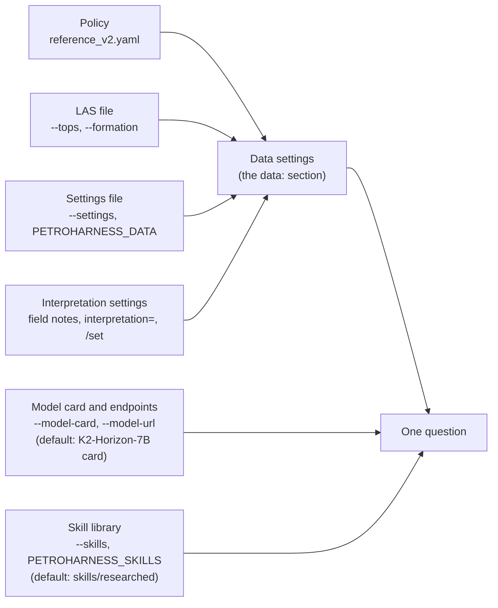
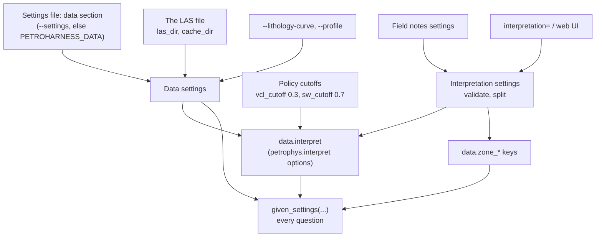
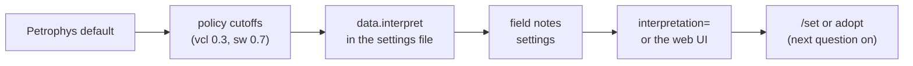

# Configuration reference

Everything that configures PetroHarness: the data config and every key it accepts, the interpretation settings,
field notes, model cards and endpoints, the skill library, every environment variable the package reads, and which
source wins when several set the same thing. For developers and operators who set PetroHarness up for their data;
[USAGE.md](../USAGE.md) and [DEVELOPMENT.md](../DEVELOPMENT.md#configuration) are the guides.

## 1. At a glance

A question needs no configuration file: the data settings are built from the LAS. Each part of a run has one place
it is set, and a default.



| What | Where it is set | Default | Read by | Defined in |
|---|---|---|---|---|
| Data config (`data:` and `eval:`) | `--settings FILE`, `PETROHARNESS_DATA`, or `configs/data.local.yaml` | none for a question (built from the LAS); required for benchmark mode | every question | [config.py](../../src/petroharness/config.py) `DataPaths`, `EvalPaths` |
| Interpretation settings (`m`, `rw`, cutoffs, zone rule, ...) | field notes, `interpretation=`, `/set`, `Conversation.adopt`, the web UI | the policy's for the zone rule and net-pay cutoffs, Petrophys's for the rest | Petrophys and the zoning | [well/settings.py](../../src/petroharness/well/settings.py) |
| Field notes | `--field-notes FILE`, `field_notes=` | none | a question or a conversation | [well/notes.py](../../src/petroharness/well/notes.py) |
| Model card | `--model-card`, `--model` | the K2-Horizon-7B card | every model call | [models.py](../../src/petroharness/models.py), `config.ModelConfig` |
| Model endpoints | `--model-url`, `PETROHARNESS_MODEL_URL` | none (benchmark mode: `http://localhost:8000/v1`) | every model call | `models.env_urls`, `agent.graph.task_config` |
| Skill library | `--skills`, `PETROHARNESS_SKILLS` | `skills/researched` (packaged) | the investigation | `config.skills_setting`, `agent.direction.plugged` |
| Interpretation policy | `resources/policy/reference_v2.yaml` (`ResourcePaths.policy_file`) | cutoffs VCL 0.30 and SW 0.70, zone minimum 2.0 m, VCL bands 0.3 and 0.6, depth unit m | interpretation and zoning | `well.prepare.load_policy` |
| Step cap | `--max-steps`, `max_steps=` | 8 (`agent/state.py MAX_STEPS`) | the investigation | `agent.state` |

## 2. How it works

For a question (`petroharness`, `petroharness chat`, the web UI, `ask()`, `Conversation.start`), `interval._settings` and
`interval.prepare` build the data settings per LAS file: a settings file's `data:` section as the base, the LAS's folder,
the run's cache, the policy's net-pay cutoffs under any Petrophys options, then the user's interpretation settings.



Example: a question on GeoLink 30/6-5, Brent Group, with a small settings file.

```yaml
# brent.yaml
data:
  interpret: {gr_min: 30, gr_max: 120}
  zone_min_thickness_m: 1.0
```

```bash
petroharness --las $LAS --tops $TOPS --formation "BRENT GP." --settings brent.yaml \
  --question "Which zone has the best reservoir quality?"
```

The data settings built for it (real output of `interval.prepare`; the two folders shortened):

```json
{"interpret": {"gr_min": 30, "gr_max": 120, "vcl_cutoff": 0.3, "sw_cutoff": 0.7},
 "zone_min_thickness_m": 1.0,
 "las_dir": ".../petrophys/datasets/geolink", "cache_dir": "<the run's cache folder>", "depth_unit": "las"}
```

The policy's cutoffs joined the file's options, the LAS's folder and the run's cache were filled in, and the answer's
unit is the LAS's own. Petrophys applied `gr_min` 30.0 and `gr_max` 120.0 (its vclay step), and the 1.0 m minimum
gave 31 zones.

<details>
<summary>The seven steps, in code</summary>

1. The base is a settings file: `--settings` (`settings=`), else the file `PETROHARNESS_DATA` names, else none. Only
   its `data:` section is read.
2. `las_dir` defaults to the LAS file's folder and `cache_dir` to the run's cache folder: `<out>/.cache` for the
   question command, `<session>/.cache` for a conversation, a temporary folder for `ask()` without `out`.
3. `--lithology-curve` replaces `lithology_curve`.
4. `--profile NAME` sets `interpret: {context_profile: NAME}`. Otherwise, unless `interpreter` is set, `interpret`
   keeps the file's options and adds the policy's net-pay cutoffs where they are not set: `vcl_cutoff: 0.3` and
   `sw_cutoff: 0.7` (`interval.POLICY_CUTOFFS`, from the policy's `cutoffs.vcl_max` and `cutoffs.sw_max`). Options with a
   `context_profile` get no cutoffs.
5. The interpretation settings in force (the field notes' settings, overlaid by `interpretation=`) are checked by
   `well.settings.validate` and split by `well.settings.split`: Petrophys's go over `interpret`, the zone rule
   (`zone_min_thickness_m`, `zone_vcl_bands`, `zone_layout`) onto the data section.
6. The interval is resolved, and `depth_unit` is set: from `--depth-unit` when it is given (over the file's value),
   else only when the file does not set it; `las` when the answer's unit is the LAS's own, else `m` or `ft`.
7. Every question then runs inside `config.given_settings({"data": ..., "eval": {}, "skills": ...})`, which stands in
   for the data config file and, when `skills` is given, for `PETROHARNESS_SKILLS`.

For benchmark mode and for `HarnessConfig()` in Python, `config.user_settings` reads the data config file found by
`config.data_file()` (`PETROHARNESS_DATA`, else `configs/data.local.yaml` in the repository), and `HarnessConfig.load`
overlays the model card on the defaults.

</details>

## 3. Finding the data config

A question reads `--settings`, else `PETROHARNESS_DATA`, else nothing. Benchmark mode and `HarnessConfig()` read
`PETROHARNESS_DATA`, else `configs/data.local.yaml`, and stop without one.

```bash
cp configs/data.example.yaml configs/data.local.yaml          # untracked; fill it in
export PETROHARNESS_DATA=/path/to/data.yaml                   # or point at another file
petroharness --las $LAS --tops $TOPS --formation "BRENT GP." --question "..." --settings brent.yaml   # from this file
```

<details>
<summary>Where each entry point looks</summary>

| Entry point | File read | With no file | Defined in |
|---|---|---|---|
| `petroharness`, `petroharness chat`, `petroharness ui`, `ask()`, `Conversation.start` | `--settings` (`settings=`), else `PETROHARNESS_DATA`; the `data:` section only | built from the LAS alone | `interval._settings` |
| `petroharness setup` | `--settings`, else `PETROHARNESS_DATA`; the `data:` section is hashed, and with `--las` the settings are built from the LAS as for a question | `{data: {las_dir: "."}}`; with `--las`, built from the LAS alone | `core.setup.config_for`, `core.setup.for_well` |
| `petroharness benchmark`, `HarnessConfig()`, `cli.answer` | `PETROHARNESS_DATA`, else `<repository root>/configs/data.local.yaml`; sections `data:` and `eval:` | `ValueError: WHAT: no data settings at <path> ...` | `config.data_file`, `config.user_settings` |
| Code inside `config.given_settings(settings)` | none: the given dict | not applicable | `config.given_settings` |

Notes:

- `<repository root>` is `config.REPO_ROOT`, two folders above `src/petroharness/config.py`: the checkout in a source
  install.
- A file read through `config.user_settings` may hold only `data` and `eval` sections; any other is an error. The
  question path reads `data:` and ignores the other sections.
- When `PETROHARNESS_DATA` is set in your shell for other work, every `petroharness` question starts from that file;
  the summary the command prints on stderr ends with `settings: <path>`.
- `user_settings` caches each file by its path and modification time, so an edited file is read again.

</details>

## 4. The data section

The `data:` section is `DataPaths` (`src/petroharness/config.py`); a misspelt key is an error (`extra="forbid"`). A
question needs none of it; the keys most often set are `interpret` (Petrophys's options), `lithology_curve`,
`depth_unit` and the zone rule.

Example: a tops table of many wells, with a well column, on COSTA HW-3 (logs and tops in feet). Data: Costa Gomes,
Geiger and Arnold (2022), COSTA model, Heriot-Watt University, CC BY.

```yaml
# costa.yaml: formations_costa.csv has the columns well, formation_name, top_depth, bottom_depth, ...
data:
  tops_csv: formations_costa.csv
  tops_columns: {well: well, name: formation_name, top: top_depth}
  tops_depth_unit: ft
```

```bash
petroharness --las HW-3.las --formation KHARAIB-2 --settings costa.yaml --question "..."
```

The rows of HW-3 are picked by the well column, and the interval is `7805-8020 ft (431 samples; the settings' tops
table formations_costa.csv)`. HW-3 lists one top, so the interval runs from 7805 ft to the end of the log. On a well
the table does not list (30/6-5), the same settings stop with `FormationNotFound: no tops for well '30_6-5' in
.../formations_costa.csv` (real runs). Given with `--tops` instead, the file's own base is read: `7805-8020 ft (431
samples; tops file formations_costa.csv, base: stated base)`.

<details>
<summary>data keys</summary>

| Key | Type | Default | Meaning | Defined in |
|---|---|---|---|---|
| `las_dir` | path | required (a question: the LAS file's folder) | One LAS file per well, named `<well>.las`. Benchmark mode reads each question's LAS from here by file name. | `DataPaths.las_dir` |
| `tops_csv` | path or null | null | The tops table for an interval given by a formation name only (a benchmark row, or `--formation` without `--tops`). The named top runs down to the next deeper top of any rank. | `DataPaths.tops_csv`, `well.formation.resolve_interval` |
| `tops_columns` | mapping | `{well: uwi, name: form, top: top}` | The `tops_csv` column names for the well, the top name and the top depth. | `DataPaths.tops_columns` |
| `top_name_pattern` | regex or null | null (every top counts) | Which top names count, matched on the upper-cased name. | `DataPaths.top_name_pattern` |
| `tops_depth_unit` | `m`, `ft` or null | null (the LAS's own unit) | The unit of `tops_csv`, which records none. | `DataPaths.tops_depth_unit` |
| `interpret` | mapping or null | null; a question sets it (step 4 of section 2) | Options for `petrophys.interpret`, which then interprets each LAS: `{}` for the library's defaults, `{context_profile: NAME}`, workflow settings such as `{gr_min: 30, gr_max: 120}` or `{sw_model: indonesia}`, or `curve_aliases` (a mapping, or a CSV path with `curve,standard` columns). | `DataPaths.interpret`, `well.prepare._interpret_with_petrophys` |
| `interpreter` | text or null | null | A Petrophys batch interpreter that interprets the data instead: `module:function` or `/path/adapter.py:function`, with the contract of Petrophys's `process_las_directory_with_workflow` (`(input_dir, output_dir, well_names=...)`, one `BatchLasResult` per well). Excludes `interpret`. | `DataPaths.interpreter`, `well.prepare._interpret_with_interpreter` |
| `engines_dir` | path or null | null | The folder of pinned interpretation engines, one folder per engine name, used when the policy names an engine and neither `interpret` nor `interpreter` is set. | `DataPaths.engines_dir`, `well.prepare.engine_dir` |
| `depth_unit` | `m`, `ft`, `las` or null | null (the policy's `m`); a question sets it | The unit depths, thicknesses and zone limits are shown in; `las` is each file's own unit. | `DataPaths.depth_unit`, `well.view` |
| `lithology_curve` | text, list of text, or null | null (detected) | The lithology log's mnemonic, or several (the first a well has with data is used). Null: the LAS curve whose mnemonic or description names a lithology or facies log and holds integer codes; with none, the lithology Petrophys's mineral solver wrote (its domain is the `lithology_domain` setting); with neither, shale-volume bands. | `DataPaths.lithology_curve`, `well.formation.find_lithology_curve` |
| `lithology_nomenclature` | path or null | null (the library's table) | A workbook mapping lithology codes to labels; the library's table fills any code it lacks. | `DataPaths.lithology_nomenclature` |
| `lithology_columns` | mapping | `{code: code, label: lithology}` | The workbook's code column and label column (`LithologyColumns`, also strict). | `config.LithologyColumns` |
| `zone_layout` | `lithology_runs` or `formation` | `lithology_runs` | Runs of one lithology (thin runs dropped), or the whole interval as one zone labelled by the majority lithology. | `DataPaths.zone_layout`, `well.view` |
| `zone_min_thickness_m` | number or null | null (the policy's 2.0) | A run no thicker than this (metres) is not a zone. | `DataPaths.zone_min_thickness_m`, `well.formation.segment_zones` |
| `zone_vcl_bands` | two numbers or null | null (the policy's `[0.3, 0.6]`) | The VCL edges of the clean, shaly and shale-prone bands that zone a well with neither a lithology log nor a solved lithology. | `DataPaths.zone_vcl_bands` |
| `reach` | `well` or `focus` | `well` | What a question can reach. `well`: any stretch of the well (a unit of the tops file, the user's zones, a depth range) through a tool's zones, a verb's run under `where`, and the question's scope; intervals listed uncut by zones. `focus`: the interval only, as a benchmark frames its answers (every welllogbench config sets it). | `DataPaths.reach`, `agent.selection` |
| `units` | list | `[]`; a question sets it | The tops file's units over the whole well (name, top, base), selectable by name under `reach: well`. Set by `interval.prepare` from the tops file. | `DataPaths.units`, `interval._units` |
| `zones` | list | `[]`; `--zones` sets it | The user's zones (name, top, base), which frame the question in place of the lithology zones; read from a zones file by `well.user_zones.read_zones`. | `DataPaths.zones`, `well.view._user_zones` |
| `zones_source` | text or null | null | The zones file's name, as the map names it. | `DataPaths.zones_source` |
| `basis` | `all` or `zones` | `all` | The tools' statistics: each zone, the zones pooled and the whole interval (`all`), or the zones only (`zones`; the record keeps all three). | `DataPaths.basis` |
| `analyzer_class_tables` | text or null | null (the policy's `analyzers.class_tables`, `current`: the library's own tables) | The class-table set the Petrophys analyzers classify with: a set a Petrophys context package ships, for data that package's context interprets. | `DataPaths.analyzer_class_tables`, `well.view.FormationView.build` |
| `conventions` | list of text | `[]` | The data's reporting conventions, one sentence each, shown in every step prompt and to the writer. Empty: no prompt changes. | `DataPaths.conventions` |
| `cache_dir` | path | `<repository root>/.cache/wells`; a question uses its own `.cache` | Where interpreted wells are cached. | `DataPaths.cache_dir`, `well.prepare._cache_path` |

Notes:

- How each LAS is interpreted: with `interpret`, `petrophys.interpret` with those options; with `interpreter`, that
  function; with neither, the engine the policy names, from `engines_dir` (an error when `engines_dir` is not set),
  run in a subprocess, or, when the policy names none, `petrophys.interpret` with the library's settings and the
  policy's cutoffs. A question always sets `interpret` unless the file sets `interpreter`.
- The cache key is the LAS content, the policy's interpretation keys (`name`, `engine`, `cutoffs`,
  `value_range_qc`), the interpretation code's version
  (`prepare.INTERPRETATION_VERSION`), the Petrophys build, and the `interpret` options or
  `interpreter` (with the content of files they name). Delete the folder to interpret again.
- `basis: zones` and `conventions` are a dataset's reporting settings, used for a benchmark's data
  ([ARCHITECTURE.md](../ARCHITECTURE.md#reporting-settings)).

</details>

<details>
<summary>An annotated data config with every key</summary>

```yaml
data:
  las_dir: /data/las                    # one LAS per well, <well>.las (a question: the LAS file's folder)
  tops_csv: /data/formation_tops.csv    # the tops table for intervals named only by formation
  tops_columns: {well: uwi, name: form, top: top}   # its columns: well, top name, top depth
  top_name_pattern: null                # a regex on upper-cased top names; null keeps every top
  tops_depth_unit: null                 # m or ft; null: the LAS file's own unit
  interpret:                            # petrophys.interpret options ({} for the library's defaults)
    gr_min: 30                          # gamma-ray clean endpoint, API
    gr_max: 120                         # gamma-ray shale endpoint, API
    curve_aliases: {RESM: RMED}         # your mnemonic: the standard one
  # interpreter: /path/adapter.py:interpret_all    # instead of interpret, never with it
  engines_dir: null                     # pinned engines, when the policy names one and nothing above is set
  depth_unit: m                         # m, ft or las; null: the policy's (m)
  lithology_curve: null                 # a mnemonic, a list of them, or null (detected)
  lithology_nomenclature: null          # a workbook of lithology codes and labels
  lithology_columns: {code: code, label: lithology}
  zone_layout: lithology_runs           # or formation: the interval is one zone
  zone_min_thickness_m: null            # null: the policy's 2.0 m
  zone_vcl_bands: null                  # null: the policy's [0.3, 0.6]
  basis: all                            # or zones
  analyzer_class_tables: null           # a context package's class-table set; null: the policy's (current)
  conventions: []                       # reporting conventions, one sentence each
  cache_dir: /data/cache/wells          # default <repository root>/.cache/wells
```

</details>

## 5. Interpretation settings

The interpretation settings are Petrophys's workflow settings, read from the installed library
(`petrophys.workflow.DynamicWorkflowConfig`), and the harness's zone rule: 65 in 11 groups, which
`well.settings.schema()` lists. Give them by name with `interpretation=` (`ask()`, `Conversation.start`), a field
notes file's `settings:`, `/set` or `Conversation.adopt`, or the web UI's settings panel. Each in detail, with how it
is checked and merged: [INTERPRETATION_SETTINGS.md](INTERPRETATION_SETTINGS.md).

```python
from petroharness.well import settings as T
[g["title"] for g in T.schema()["groups"]]
# ['Zones', 'Clay volume', 'Porosity and matrix', 'Formation water', 'Water saturation', 'Permeability',
#  'Net reservoir and pay', 'Temperature', 'Mud', 'Lithology', 'Input handling']
```

<details>
<summary>The settings</summary>

Every setting as `settings.schema()` gives it with the pinned Petrophys build (`3.0.0`); the Meaning column is
Petrophys's own first sentence. "From the data" means unset: Petrophys reads the value from the LAS header or derives
it from the data.

| Setting | Kind | Default | Meaning | Group |
|---|---|---|---|---|
| `zone_min_thickness_m` | number, m | `2.0` (policy) | A run of one lithology (or one shale-volume band) no thicker than this is not a zone; its samples stay in the whole-interval statistics as samples outside the zones. | Zones |
| `zone_vcl_bands` | bands, v/v | `[0.3, 0.6]` (policy) | For a well with neither a lithology log nor a solved lithology: the VCL edges of the clean, shaly and shale-prone bands that zone it. | Zones |
| `zone_layout` | `lithology_runs`, `formation` | `lithology_runs` | Split the interval into runs of one lithology, or keep it as one zone. | Zones |
| `gr_method` | `linear`, `larionov_tertiary`, `larionov_older`, `steiber`, `clavier` | `linear` | Transform: "linear", "larionov_tertiary", "larionov_older", "stieber" (stored as "steiber") or "clavier". | Clay volume |
| `gr_min` | number, API | from the data | Clean-rock gamma-ray endpoint, API, used as given. | Clay volume |
| `gr_max` | number, API | from the data | Shale gamma-ray endpoint, API, used as given. | Clay volume |
| `sp_min` | number, mV | from the data | Shale SP baseline, mV: the line of least SP deflection. | Clay volume |
| `sp_max` | number, mV | from the data | Clean-sand SP line (static SP), mV: the line of greatest deflection. | Clay volume |
| `rho_cl` | number, g/cm³ | from the data | Clay density, g/cm3, used by the carbonate mineral solve and the neutron-density hydrocarbon correction. | Clay volume |
| `matrix_type` | `auto` or a mineral name (23 values, such as `sandstone`, `limestone`, `dolomite`) | from the data | "auto" (resolved from lithology evidence) or a mineral name such as "sandstone", "limestone" or "dolomite"; see petrophys.model.constants.MatrixProperties.names. | Porosity and matrix |
| `rho_ma` | number, g/cm³ | from the data | Matrix density, g/cm3. | Porosity and matrix |
| `nphi_ma` | number, v/v | from the data | Matrix neutron porosity, v/v. | Porosity and matrix |
| `dt_ma` | number, µs/ft | from the data | Matrix sonic slowness, us/ft. | Porosity and matrix |
| `rho_fl` | number, g/cm³ | from the data | Pore-fluid density, g/cm3, used by the porosity, hydrocarbon-correction and mineral steps alike. | Porosity and matrix |
| `dt_fl` | number, µs/ft | `189.0` | Pore-fluid sonic slowness, us/ft. | Porosity and matrix |
| `phi_cl` | number, v/v | from the data | Clay (shale) porosity, v/v. | Porosity and matrix |
| `apply_hc_correction` | switch | `false` | Apply the neutron-density hydrocarbon correction (opt-in). | Porosity and matrix |
| `hc_type` | `oil`, `gas` | `oil` | Hydrocarbon type, "oil" or "gas": the fluid of the neutron-density hydrocarbon correction and, under "current", the PHIT rule in neutron-density crossover (PHID > PHIN + 0.05): the root-mean-square of PHID and PHIN (Gaymard and Poupon, 1968) for gas, density porosity for oil. | Porosity and matrix |
| `rho_hc` | number, g/cm³ | from the data | Hydrocarbon density in the flushed zone, g/cm3, for the hydrocarbon correction and the core matrix-density check of auto lithology. | Porosity and matrix |
| `hc_hydrogen_index` | number | from the data | Hydrogen index of the hydrocarbon for the neutron hydrocarbon correction. | Porosity and matrix |
| `rw` | number, ohm.m | from the data | Formation water resistivity Rw, ohm.m, at rw_meas_temp_f. | Formation water |
| `salinity_ppm` | number, ppm | from the data | Formation water salinity, ppm NaCl equivalent: another way to give the formation water. | Formation water |
| `rw_meas_temp_f` | number, °F | from the data | Temperature of rw, degF. | Formation water |
| `allow_default_rw` | switch | `true` | Use a 0.05 ohm.m default Rw when no Rw source is found (the warnings say so). | Formation water |
| `sw_model` | `auto`, `archie`, `north_sea`, `nigeria_schlumberger`, `simandoux`, `modified_simandoux`, `indonesia`, `dual_water`, `waxman_smits` | `auto` | "auto" (routed per sample by clay content) or one of "archie", "simandoux" (Sw in the clay term, Bardon-Pied), "modified_simandoux" (sand term over 1 - Vcl), "indonesia", "dual_water", "waxman_smits", "north_sea", "nigeria_schlumberger". | Water saturation |
| `a` | number | from the data | Tortuosity factor a. | Water saturation |
| `m` | number | from the data | Cementation exponent m; one value, or one per lithology as for a. | Water saturation |
| `n` | number | from the data | Saturation exponent n; one value, or one per lithology as for a. | Water saturation |
| `m_star` | number | `2.0` | Waxman-Smits cementation exponent m*. | Water saturation |
| `cec` | number, meq/100 g | from the data | Cation exchange capacity, meq/100 g (0 to 150; pure smectite is 80-150). | Water saturation |
| `b_coeff` | number | from the data | Equivalent counter-ion conductance B, (S/m)/(meq/cm3): at 25 degC 4.6 * (1 - 0.6 * exp(-0.77 / Rw)) (Waxman and Smits, 1968), and higher at reservoir temperature. | Water saturation |
| `rwb` | number, ohm.m | from the data | Bound-water resistivity, ohm.m, from lab data or the LAS header. | Water saturation |
| `rtsh` | number, ohm.m | from the data | Shale resistivity, ohm.m. | Water saturation |
| `vsh_exp` | number | `1.6` | Shale exponent of the North Sea model. | Water saturation |
| `shale_exp` | number | `1.6` | Shale exponent of the Nigeria-Schlumberger model. | Water saturation |
| `sw_routing_vcl_cutoff` | number, v/v | from the data | Clay volume, v/v, from which sw_model="auto" uses a shaly-sand equation rather than Archie. | Water saturation |
| `perm_method` | `auto`, `timur`, `coates`, `wyllie_rose`, `lith_vcl` | `auto` | Permeability method. | Permeability |
| `perm_fallback_method` | `timur`, `coates`, `wyllie_rose`, `lith_vcl` | `coates` | Empirical equation of PERM under perm_method="auto": "coates" (default), "timur", "wyllie_rose" or "lith_vcl". | Permeability |
| `swirr` | number, v/v | from the data | Irreducible water saturation, v/v, for the permeability equations. | Permeability |
| `swirr_flag_phi_cl` | `workflow`, `all_shale_phit` | `workflow` | Clay porosity behind the PHIE that picks the SWIRR_APP samples, i.e. the reservoir flag built before permeability when the well has no RESFLAG or NET_RES curve. | Permeability |
| `use_peer_core` | switch | `false` | Calibrate permeability with core data from peer_wells, under the conditions given there; without peer_wells it has no effect. | Permeability |
| `vcl_cutoff` | number, v/v | `0.3` (policy) | Maximum clay volume for net rock, v/v. | Net reservoir and pay |
| `phie_cutoff` | number, v/v | `0.08` (policy) | Minimum effective porosity for net reservoir, v/v. | Net reservoir and pay |
| `sw_cutoff` | number, v/v | `0.7` (policy) | Maximum water saturation for net pay, v/v. | Net reservoir and pay |
| `reuse_input_resflag` | switch | `false` | Reuse a RESFLAG or NET_RES curve already on the well as the reservoir flag that picks the SWIRR_APP samples before permeability. | Net reservoir and pay |
| `bht_f` | number, °F | from the data | Bottom-hole temperature, degF. | Temperature |
| `surface_temp_f` | number, °F | `68.0` | Surface (mean annual) temperature, degF, at depth 0 of the linear temperature profile (offshore, the sea surface rather than the seabed). | Temperature |
| `td_ft` | number, ft | from the data | Total depth for the BHT, in feet. | Temperature |
| `gradient_f_per_100ft` | number | from the data | Geothermal gradient, degF/100 ft (1 degC/100 m is 0.549 degF/100 ft), from surface_temp_f at depth 0. | Temperature |
| `mud_type` | `WBM`, `OBM` | `WBM` | "WBM" (water-based) or "OBM" (oil-based) mud. | Mud |
| `mud_water` | `fresh`, `salt` | `fresh` | "fresh" or "salt" mud, which sets the Rm-to-Rmf factor. | Mud |
| `mud_has_clay_or_kcl` | switch | `false` | The mud contains clay or KCl, so the SP log is not used: Rw is not estimated from the SP, and no VCL_SP is computed. | Mud |
| `rmf_at_meas_temp` | number, ohm.m | from the data | Mud-filtrate resistivity Rmf at rmf_meas_temp_f, ohm.m. | Mud |
| `rmf_meas_temp_f` | number, °F | from the data | Temperature at which rmf_at_meas_temp was measured, degF. | Mud |
| `rmf_salinity_ppm` | number, ppm | from the data | Mud-filtrate salinity, ppm NaCl equivalent (alternative to Rmf). | Mud |
| `rmf_chlorides_mg_l` | number, mg/l | from the data | Mud-filtrate chlorides (Cl-), mg/l, as on the mud report and the LAS header CLFL. | Mud |
| `rm` | number, ohm.m | from the data | Mud resistivity Rm at rm_meas_temp_f, ohm.m (Rmf is derived from it). | Mud |
| `rm_meas_temp_f` | number, °F | from the data | Temperature at which rm was measured, degF. | Mud |
| `lithology_domain` | `auto`, `clastic`, `carbonate`, `evaporite` | from the data | Broad interpretation domain: "clastic" (the default when unset), "carbonate", "evaporite" or "auto". | Lithology |
| `lithology_source` | `auto`, `external`, `vendor`, `computed`, `config` | `auto` | Lithology source. | Lithology |
| `carbonate_calibration` | `generic`, `costa` | from the data | Calibration of the carbonate-domain mineral solve, which takes calcite and dolomite from bulk density and closure. | Lithology |
| `mineral_solver_version` | integer | `1` | Mineral solver for the clastic mineral step. | Lithology |
| `standardize_input` | switch | from the data | Standardize curve aliases and units before interpretation: vendor mnemonics get canonical aliases, units such as kg/m3 or percent porosity are converted and implausible values are screened, with a warning. | Input handling |
| `rename_input_curves` | switch | `false` | Rename vendor mnemonics to canonical names instead of adding aliases. | Input handling |
| `calculation_profile` | `current`, `geolink` | `current` | Interpretation configuration. | Input handling |

Notes:

- The list is read from the installed library, so a setting Petrophys adds appears without a change here, under the
  group `More from Petrophys`.
- Settings that take a table, a well list or a file are not interpretation settings: `raise_on_error`, `peer_wells`,
  `formation_tops`, `zones`, `lithology`, `lithology_csv`, `lithology_intervals`, `lithology_codes`,
  `lithology_curve`, `skip_steps`, `nd_clay`, `curve_aliases` (`well.settings.HIDDEN`). Those that are
  `petrophys.interpret` options can go under `data.interpret`.
- Each value is checked by `well.settings.validate`: a number, a whole number, `true`/`false`, one of the choices, or
  two band edges, then by Petrophys's own validation.
- A user's `vcl_cutoff`, `sw_cutoff` or `phie_cutoff` also replaces the policy's cutoff in what the model is told
  about the record (`well.view.user_cutoffs`).

</details>

## 6. Field notes file

A field notes file is a YAML mapping of a team's standing choices for a field
([SESSIONS.md](../SESSIONS.md#field-notes)): settings in force from the start, and notes added to every question.

```yaml
name: Brent Group study
settings:
  m: 1.8
  rw: 0.04
  sw_cutoff: 0.6
notes:
  - Report water saturation from the Indonesia model.
  - Name the Ness and Etive formations where a zone falls in one.
```

<details>
<summary>Keys</summary>

| Key | Type | Default | Meaning | Defined in |
|---|---|---|---|---|
| `name` | text | the file's stem | How answers and logs name the notes. | `well.notes.load` |
| `settings` | mapping | `{}` | Interpretation settings in force from the start (section 5 names), each marked as coming from the field notes. | `well.notes.load` |
| `notes` | list of text, or one text | `[]` | Standing choices in words, added to every question as `(The user's field notes for this field, <name>: ...)`. At most 20 notes (`MAX_NOTES`) of at most 300 characters (`MAX_NOTE_CHARS`); runs of spaces are collapsed. | `well.notes.load`, `well.notes.statement` |

Notes:

- Any other key, a settings value that fails validation, or notes that are not a list of sentences are refused with
  `WHAT ... FIX ...`, entry by entry.
- A conversation keeps what the file held, with its SHA-256, in its log; a resumed conversation does not read the file
  again. A benchmark run never reads field notes.

</details>

## 7. The eval section

`EvalPaths` is the `eval:` section: reference material that only benchmark mode, the tests and evaluation scripts
read; a task never sees it (`HarnessConfig.for_tasks` drops it).

<details>
<summary>eval keys</summary>

| Key | Type | Default | Meaning | Defined in |
|---|---|---|---|---|
| `questions` | path or null | null | The question file, a JSON list of rows (`qa_id`, `question`, `las_path`, `formation`, `category`; [CLI.md](CLI.md#9-petroharness-benchmark)). Required by benchmark mode. | `EvalPaths.questions`, `tasks.load_tasks` |
| `reference_context_dir` | path or null | null | The reference contexts, by category, well and formation; read by tests. | `EvalPaths.reference_context_dir` |
| `gt_dir` | path or null | null | The reference question-answer files; read by tests. | `EvalPaths.gt_dir` |

Example:

```yaml
eval:
  questions: /data/benchmark/questions.json
  reference_context_dir: null
  gt_dir: /data/benchmark/references
```

</details>

## 8. Models and endpoints

A model card is a YAML file with one section, `model`, checked against `config.ModelConfig`; the card comes from
`--model-card`, else the generic card when `--model` names the served model, else the K2-Horizon-7B card. The
endpoints come from `--model-url`, else `PETROHARNESS_MODEL_URL` (comma-separated). [MODELS.md](../MODELS.md)
explains serving and each field.

```yaml
model:
  model: Qwen/Qwen3-32B
  label: Qwen3-32B
  reasoning: true
  chat_template_kwargs: {enable_thinking: true}
  retry_template_kwargs: {enable_thinking: false}
  max_tokens_spec: 32768
  max_tokens_writer: 32768
  timeout_s: 3600
```

<details>
<summary>Model card fields</summary>

| Field | Type | Default | Meaning | Defined in |
|---|---|---|---|---|
| `model` | text | `""` (names none: `--model` is then required) | The served model's name. | `ModelConfig.model`, `models.register` |
| `label` | text or null | null (`model`) | The name people read. `--model` also replaces the label. | `ModelConfig.label`, `models.label` |
| `base_url` | text | `http://localhost:8000/v1` | The endpoint when a card is loaded on its own; a question's endpoint comes from the endpoint list instead. | `ModelConfig.base_url` |
| `api_key_env` | text | `PETROHARNESS_API_KEY` | The environment variable holding the API key. | `ModelConfig.api_key_env` |
| `temperature`, `top_p` | number, number or null | 0.0, null | Sampling. | `ModelConfig` |
| `max_tokens_spec`, `max_tokens_writer` | integer | 3000, 6000 | Output caps of a step (and settle), and of the writer (and a repair). | `ModelConfig` |
| `timeout_s`, `max_retries` | number, integer | 600.0, 3 | Per-request timeout and client retries. | `ModelConfig` |
| `reasoning`, `enable_thinking` | switch | false, false | A thinking model; the template variable sent when `chat_template_kwargs` is null. | `ModelConfig` |
| `chat_template_kwargs`, `retry_template_kwargs`, `light_template_kwargs` | mapping or null | null | Template variables of each call, of the retry after an empty reply, and of a light call. | `ModelConfig` |
| `reasoning_end` | text or null | null | The marker after which a light call's reply starts. | `ModelConfig` |
| `send_template_kwargs`, `send_temperature` | switch | true, true | Whether these request fields are sent. | `ModelConfig` |
| `max_tokens_param` | `max_tokens`, `max_completion_tokens` | `max_tokens` | The output cap's name. | `ModelConfig` |
| `structured_output` | `json_schema`, `json_object`, `none` | `json_schema` | How JSON replies are requested. | `ModelConfig` |
| `replay_reasoning_field` | switch or null | null (as `reasoning`) | Replayed assistant turns carry an empty `reasoning` field. | `ModelConfig` |

Notes:

- The card: `--model-card` (a YAML file, or a packaged card's name with or without `.yaml`), else the generic card
  when `--model` is given, else the K2-Horizon-7B card (`models.card_file`). The packaged cards are in
  `src/petroharness/resources/models/`: `generic` (no sampling or template fields sent, caps 16384, timeout 1800 s,
  2 retries) and the default card.
- Each card, model name and endpoint list gets a registry key in `models.MODELS`: `(card file, endpoints[, model])`
  (`models.register`).
- A question's endpoint is `endpoints[(int(sha256(task_id)[:8], 16) + rep) % len(endpoints)]`
  (`agent.graph.task_config`); the web UI instead sends each question to the least busy endpoint.
- The API key is the variable the card names, else `EMPTY` (`HarnessConfig.api_key`); a local server accepts any key.

</details>

## 9. Skill library

One setting picks the skill library the model reads guides from
([DEVELOPMENT.md](../DEVELOPMENT.md#the-skill-library)): `--skills` (`skills=`), else `PETROHARNESS_SKILLS`, else
the packaged `skills/researched`; `none` runs without guides.

```bash
export PETROHARNESS_SKILLS=/path/to/my_library     # library.yaml, refs.yaml, <guide>/SKILL.md, <guide>/sources.yaml
petroharness --las $LAS --tops $TOPS --formation "BRENT GP." --question "..." --skills none
```

<details>
<summary>The skills setting</summary>

| Source | Type | Default | Meaning | Defined in |
|---|---|---|---|---|
| `--skills` / `skills=` | folder or `none` | not set | Wins over the others; a relative path that exists from the current folder is made absolute. | `interval.prepare`, `config.given_settings` |
| `PETROHARNESS_SKILLS` | folder or `none` | not set | Used when no `--skills` was given. | `config.skills_setting` |
| `HarnessConfig.skills` | folder or `none` | `skills/researched` | The configuration's library: a model card's top-level `skills:` key, which `HarnessConfig.load` overlays (the data settings file has no `skills` key). | `config.HarnessConfig` |

Notes:

- A relative folder is read from `src/petroharness/resources`; `none` (any case) means no library, no index and no
  guide action.
- A library is checked as it loads (`agent.direction.load`); a bad one raises `LibraryError` with each problem, before
  the first model call ([skills README](../../src/petroharness/resources/skills/README.md)).
- The trace records `skills`: `{"library", "version"}`.

</details>

## 10. Environment variables

Three variables cover everyday use: `PETROHARNESS_MODEL_URL` (the endpoints), `PETROHARNESS_DATA` (a base settings
file) and `PETROHARNESS_SKILLS` (the skill library). Hosted tracing variables set to `true` stop the harness.

```bash
export PETROHARNESS_MODEL_URL=http://localhost:8000/v1,http://localhost:8001/v1
export PETROHARNESS_API_KEY=any-key-for-a-local-server
unset PETROHARNESS_DATA                       # a new well with the defaults
export LANGSMITH_TRACING=false                # allowed; true or 1 stops the harness
```

<details>
<summary>Variables read by the package</summary>

These are every environment variable read in `src/petroharness`.

| Variable | Type | Default | Meaning | Defined in |
|---|---|---|---|---|
| `PETROHARNESS_DATA` | path | not set | The data config. For a question and for `petroharness setup`, the base settings file when `--settings` is not given; for benchmark mode and `HarnessConfig()`, the data config (else `configs/data.local.yaml`). The web UI shows it in `/api/config` (`settings_env`). | `config.data_file`, `interval._settings`, `core.setup.config_for`, `ui.server.App.config` |
| `PETROHARNESS_MODEL_URL` | comma-separated URLs | not set | The model endpoints, when `--model-url` is not given. | `models.env_urls` |
| `PETROHARNESS_API_KEY` | text | not set (`EMPTY` is sent) | The API key, unless the card's `api_key_env` names another variable. | `config.HarnessConfig.api_key` |
| the card's `api_key_env` (for example `OPENAI_API_KEY`) | text | not set | The API key for that card. | `config.HarnessConfig.api_key` |
| `PETROHARNESS_SKILLS` | folder or `none` | not set | The skill library, when `--skills` is not given. The web UI shows it in `/api/config` (`skills_env`). | `config.skills_setting`, `ui.server.App.config` |
| `PETROHARNESS_COMPONENTS` | folder | not set (`src/petroharness/agent/components`) | Another copy of the component texts, read at import, to compare two versions. | `agent.components.HERE` |
| `PETROHARNESS_SET` | `name=value,...` | not set | Switches under test (`tight_numbers`, `cell_thickness`: [EXTENDING.md](EXTENDING.md#12-make-a-behaviour-change-a-switch)); another name raises `ValueError`. | `options.get` |
| `LANGSMITH_TRACING`, `LANGSMITH_TRACING_V2`, `LANGCHAIN_TRACING`, `LANGCHAIN_TRACING_V2` | `true`/`1` or other | not set | When any is `true` or `1` (any case), the harness refuses to run: hosted tracing would send every prompt, with the well data, to its service. | `agent.graph.no_hosted_tracing` |

Notes:

- The tests also read `WELLLOGBENCH`, `PETROHARNESS_SAMPLE_LAS` and `PETROHARNESS_RUNS`
  ([DEVELOPMENT.md](../DEVELOPMENT.md#testing)); the package does not.
- `PETROHARNESS_MODEL_URL` is also read once when `petroharness.models` is imported, for the default card's registry
  entry (`models.MODELS`).

</details>

## 11. Configuration in Python

`HarnessConfig` is the one configuration object: `data`, `eval`, `model`, `resources` and `skills`, strict at every
level. Inside `given_settings(...)` it reads the given dict instead of a data config file (real output):

```python
import petrophys
from pathlib import Path
from petroharness.config import HarnessConfig, given_settings

geolink = str(Path(petrophys.sample("30/6-5")).parent)
with given_settings({"data": {"las_dir": geolink, "basis": "zones"}, "eval": {}}):
    cfg = HarnessConfig()
print(cfg.data.basis, cfg.data.zone_layout, cfg.skills)      # zones lithology_runs skills/researched
```

<details>
<summary>HarnessConfig and its helpers</summary>

| Name | Type | Default | Meaning | Defined in |
|---|---|---|---|---|
| `HarnessConfig.data` | DataPaths | the `data:` section in force | Section 4. | `config.HarnessConfig` |
| `HarnessConfig.eval` | EvalPaths or None | the `eval:` section in force | Section 7; None in a task's configuration. | `config.HarnessConfig` |
| `HarnessConfig.model` | ModelConfig | `ModelConfig()` | Section 8. | `config.HarnessConfig` |
| `HarnessConfig.resources` | ResourcePaths | `policy_file` = `resources/policy/reference_v2.yaml`, `rules_dir` = `resources/rules` | The policy and the registries. | `config.ResourcePaths` |
| `HarnessConfig.skills` | text | `skills/researched` | Section 9. | `config.HarnessConfig` |
| `HarnessConfig.load(*paths)` | classmethod -> HarnessConfig | none | The defaults with the data settings in force, overlaid by each YAML file in order (later files win, key by key). | `HarnessConfig.load` |
| `for_tasks()` | HarnessConfig | none | A copy without the `eval` section. | `HarnessConfig.for_tasks` |
| `api_key()` | text | none | The key from `model.api_key_env`, else `EMPTY`. | `HarnessConfig.api_key` |
| `given_settings(settings)` | context manager | none | Uses `{"data": ..., "eval": ..., "skills"?: ...}` instead of the data config file inside the block (per context); its `skills`, when present, wins over `PETROHARNESS_SKILLS`. | `config.given_settings` |
| `user_settings(section)` | dict | none | One section (`data` or `eval`) of the settings in force. | `config.user_settings` |
| `data_file()` | Path | none | `PETROHARNESS_DATA`, else `configs/data.local.yaml`. | `config.data_file` |
| `skills_setting(cfg=None)` | text | none | The library in force (section 9). | `config.skills_setting` |
| `models.env_urls()` | list | none | The endpoints from the environment. | `models.env_urls` |
| `models.card_file(card=None, model=None)` | text | none | The card's file (a packaged card relative to `resources`). | `models.card_file` |
| `models.card_settings(file)` | dict | none | The card's `model` section, checked. | `models.card_settings` |
| `models.label(file, model=None)` | text | none | `model`, else the card's `label`, else its `model`. | `models.label` |
| `models.register(urls, card=None, model=None)` | text | none | The registry key for a card, model and endpoints. | `models.register` |

Notes:

- Constants: `REPO_ROOT`, `RESOURCES` (`src/petroharness/resources`), `DATA_FILE_ENV` (`PETROHARNESS_DATA`),
  `LOCAL_DATA_FILE` (`<REPO_ROOT>/configs/data.local.yaml`), `SKILLS_ENV` (`PETROHARNESS_SKILLS`), `DEFAULT_SKILLS`
  (`skills/researched`); `models.URL_ENVS` (`PETROHARNESS_MODEL_URL`), `models.GENERIC_CARD`
  (`models/generic.yaml`).
- A question's configuration is built by `agent.graph.task_config`: the card loaded with `HarnessConfig.load`, the
  model name from `--model`, the endpoint from the list, and `for_tasks()`.

</details>

## 12. Precedence

For an interpretation setting, each source overrides the one before it:



A Petrophys setting cannot be combined with `--profile` or a data `interpreter`: that is an error, not an override.

The unit answers are shown in comes from `--depth-unit`, else the settings file's `data.depth_unit`, else the tops
file's unit, else the LAS's own; a tops file whose stated unit `--depth-unit` contradicts is refused. On KGS
1046123714, whose logs and tops are in feet (real runs; Data: Kansas Geological Survey (kgs.ku.edu)):

| Given | The interval |
|---|---|
| `--tops 1046123714_formation_tops.csv --formation "Lansing-Kansas City"` | `3991-4080 ft (178 samples; tops file 1046123714_formation_tops.csv, base: next top LKC G)` |
| `--top 1216.5 --base 1243.6 --depth-unit m` | `1216.5-1243.6 m (178 samples; depths given)`: 178 samples again, answered in metres |
| the feet tops file with `--depth-unit m` | `ValueError: WHAT: the tops file 1046123714_formation_tops.csv states its depths in ft and the depth unit given is m. WHY: one of them is wrong. FIX: drop --depth-unit (the file's unit is used) or correct the file.` |

<details>
<summary>Who wins</summary>

When several sources set the same thing, the first listed wins.

| Setting | Order, first wins | Defined in |
|---|---|---|
| Data settings file (a question) | `--settings` (`settings=`), `PETROHARNESS_DATA`, none | `interval._settings` |
| Data settings file (benchmark, `HarnessConfig()`) | `given_settings(...)`, `PETROHARNESS_DATA`, `configs/data.local.yaml` | `config.user_settings` |
| `lithology_curve` | `--lithology-curve`, the file's `data.lithology_curve`, detection | `interval._settings` |
| `las_dir`, `cache_dir` (a question) | the file's value, then the one built for the run (LAS folder, the run's `.cache`) | `interval._settings` |
| `depth_unit` (a question) | `--depth-unit` (`depth_unit=`), the file's `data.depth_unit`, the tops file's unit, the LAS's own | `interval.prepare`, `interval._interval` |
| How the LAS is interpreted | `--profile` (context profile), the file's `interpreter`, `interpret` | `interval._settings`, `well.prepare.prepare_well` |
| A Petrophys setting (`m`, `rw`, `gr_min`, ...) | `/set` or `adopt` (from the next question), `interpretation=` or the web UI at the start, the field notes' `settings`, the file's `data.interpret`, Petrophys's default | `well.settings`, `interval._interpretation`, `Conversation.adopt` |
| A net-pay cutoff (`vcl_cutoff`, `sw_cutoff`) | as a Petrophys setting, then the policy's `0.3` and `0.7` | `interval.POLICY_CUTOFFS` |
| The zone rule (`zone_min_thickness_m`, `zone_vcl_bands`, `zone_layout`) | `/set` or `adopt`, `interpretation=`, the field notes, the file's `data.zone_*` keys, the policy (`2.0`, `[0.3, 0.6]`, `lithology_runs`) | `interval._interpretation`, `well.view` |
| Skill library | `--skills` (`skills=`), `PETROHARNESS_SKILLS`, `HarnessConfig.skills`, `skills/researched` | `config.skills_setting` |
| Model card | `--model-card`, the generic card when `--model` is given, the K2-Horizon-7B card | `models.card_file` |
| Model name | `--model`, the card's `model` | `agent.graph.task_config` |
| Endpoints | `--model-url`, `PETROHARNESS_MODEL_URL`; benchmark mode then `http://localhost:8000/v1` | `ask._model_key`, `models.env_urls` |
| API key | the variable the card's `api_key_env` names, `EMPTY` | `HarnessConfig.api_key` |
| Step cap | `--max-steps` (`max_steps=`), 8 | `agent.state.MAX_STEPS` |
| Route | `--investigate` (`direct=False`), the direct route | `agent.graph.turn` |
| Resumed conversation | the log's `session_start` inputs, except `--model-url` and `--investigate` given again | `Conversation.resume` |

Notes:

- `--depth-unit` wins over the settings file's `data.depth_unit` for the unit answers are shown in, and states the
  unit of `--top` and `--base`. Without it, the file's `data.depth_unit` sets the answers' unit, and `--top` and
  `--base` are read in the LAS's own unit.

</details>

## 13. Limits and errors

<details>
<summary>Every configuration error, with where it is raised</summary>

| Situation | What happens | Where |
|---|---|---|
| No data config for benchmark mode or `HarnessConfig()` | `ValueError: WHAT: no data settings at <path>. ... FIX: copy configs/data.example.yaml to configs/data.local.yaml and fill it in, or set PETROHARNESS_DATA.` | `config.user_settings` |
| A data config with a section other than `data` and `eval` | `ValueError: WHAT: <path> has sections [...]. FIX: give 'data' (and optionally 'eval') only.` | `config._read_settings` |
| `--settings` or `PETROHARNESS_DATA` names no file (a question) | `FileNotFoundError: WHAT: no data settings file at <path>. ...` | `interval._settings` |
| A misspelt key in `data`, `eval`, `lithology_columns` or a model card | A pydantic validation error naming the key | `config._Strict` |
| `interpret` and `interpreter` both set | `ValueError: WHAT: both data.interpreter and data.interpret are set. ...` | `well.prepare.prepare_well` |
| `interpret` names a setting Petrophys does not have | `ValueError: WHAT: data.interpret names settings Petrophys does not have: <names>. ... FIX: correct or remove them (the settings are the fields of petrophys.DynamicWorkflowConfig).` | `well.prepare._interpret_with_petrophys` |
| `tops_csv` cannot be read as a table (a row with more fields than the header, an empty file) | `ValueError: WHAT: the settings' tops table <name> cannot be read as a table (<what pandas reports>). FIX: ...` | `well.formation._tops_table` |
| `--profile` with `data.interpreter` | `ValueError: WHAT: --profile <name> and the settings' data.interpreter are both set. FIX: keep one.` | `interval._settings` |
| Petrophys settings with a profile or interpreter | `ValueError` saying the profile or interpreter fixes its own settings | `interval._interpretation`, `Conversation.adopt` |
| An interpretation setting with a wrong name or value | `ValueError: WHAT: interpretation settings that cannot be used: <name>: <problem>. ...` | `well.settings.validate` |
| The policy names an engine, nothing else interprets, and `engines_dir` is not set | `ValueError: WHAT: the policy names engine ... but no engines directory is configured. FIX: set data.engines_dir.` | `well.prepare.engine_dir` |
| `data.interpreter` is not a function | `ValueError` naming the spec | `well.prepare._interpret_with_interpreter` |
| `data.lithology_curve` holds an empty or non-text entry | `ValueError` | `well.formation.lithology_candidates` |
| Two lithology logs and none named | `ValueError` naming both | `well.formation.find_lithology_curve` |
| A bad skill library | `LibraryError` with each problem | `agent.direction.load` |
| A field notes file with an unknown key, bad settings or too many or too long notes | `ValueError` per entry, with the fix | `well.notes.load` |
| `PETROHARNESS_SET` naming no switch | `ValueError: PETROHARNESS_SET: no option '<name>'; options: cell_thickness, tight_numbers` | `options.parse` |
| Hosted tracing switched on | `RuntimeError` at import; the process stops | `agent.graph.no_hosted_tracing` |
| No endpoint for a question | `ValueError: WHAT: no model endpoint. ...` | `ask._model_key` |

</details>

## 14. Related pages

- [CLI.md](CLI.md): the flags that set these values on the command line.
- [PYTHON_API.md](PYTHON_API.md): the functions that take them as arguments.
- [USAGE.md](../USAGE.md#a-data-settings-file-optional): a data settings file for one question.
- [DEVELOPMENT.md](../DEVELOPMENT.md#configuration): the data config, skill library and benchmark mode.
- [MODELS.md](../MODELS.md): serving a model, model cards and every field.
- [SESSIONS.md](../SESSIONS.md#changing-a-setting): changing a setting mid-conversation, field notes.
- [UI.md](../UI.md#interpretation-settings): the settings panel of the web UI.
- [EVIDENCE.md](../EVIDENCE.md#what-a-setup-holds): which of these settings the setup hash covers.
- [INTERPRETATION_SETTINGS.md](INTERPRETATION_SETTINGS.md): each interpretation setting in detail.
- [WELL_PREPARATION.md](WELL_PREPARATION.md): how the data settings are used to prepare a well.
- [TESTING.md](TESTING.md): the environment variables the tests read.
