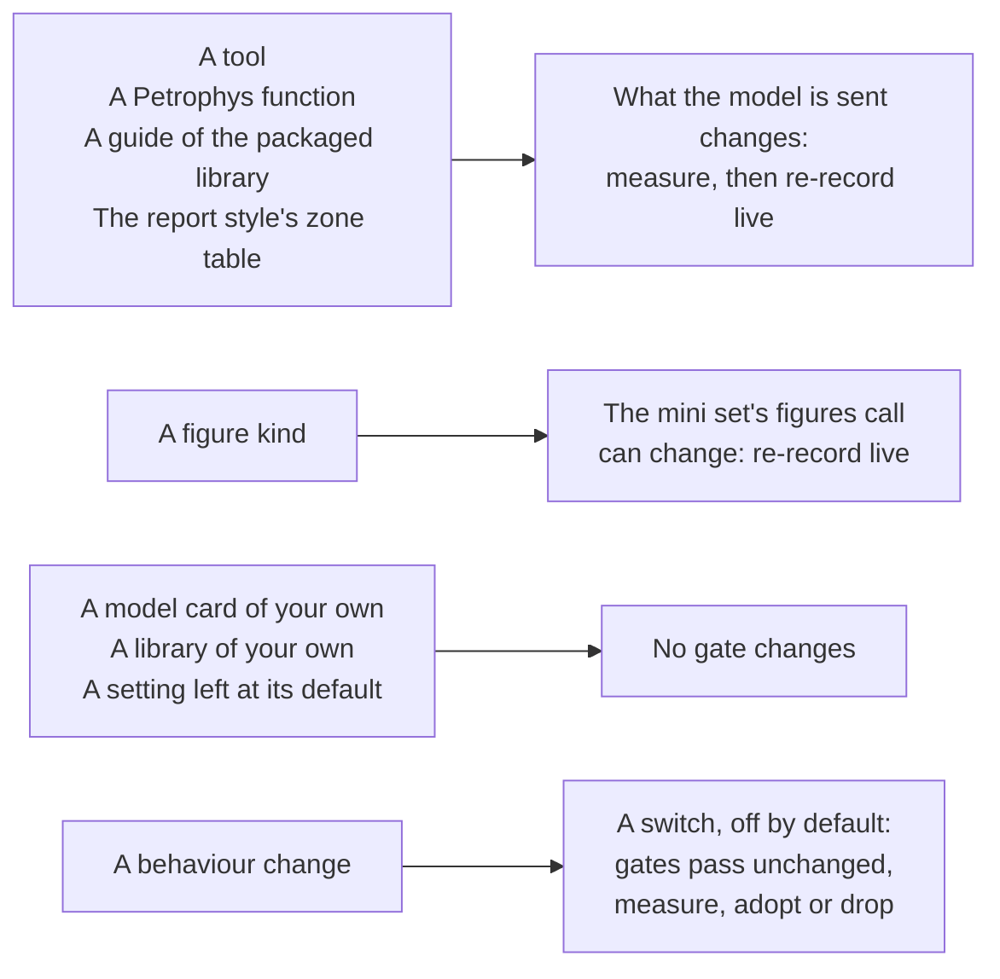
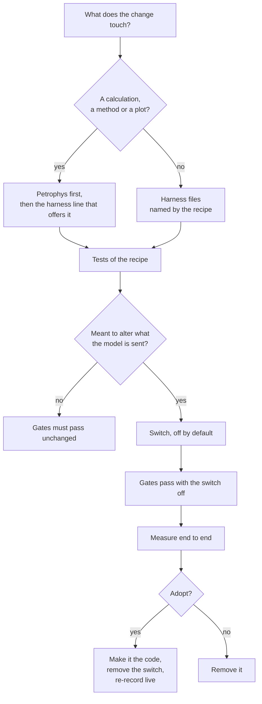

# Extending PetroHarness

Recipes for extending the harness: a tool, a Petrophys function the model can reach, a skill guide or library, a report
style, a model card, a figure kind, an interpretation setting, and a behaviour change under a switch. Each recipe
names the files to touch, the tests to run and the regression gates it reaches. Read the rules in
[AGENTS.md](../../AGENTS.md) and the design rules in [DESIGN.md](../DESIGN.md) first; where a contribution belongs is in
[CONTRIBUTING.md](../../CONTRIBUTING.md).

## 1. At a glance

What each extension does to what the model is sent, and so to the gates:



| Extension | Where it goes | Tests to run | Changes what the model is sent |
|---|---|---|---|
| [A tool](#3-add-a-tool) | `src/petroharness/agent/toolset.py` (+ its function, + C4 description) | `tests/agent/test_tool_registration.py`, `tests/test_petrophys_integration.py`, `tests/test_lint.py`, `tests/test_generality.py` | Yes, on every question (the brief lists every tool) |
| [A Petrophys function](#4-add-a-petrophys-function-the-model-can-reach) | Petrophys itself, with its parameter declarations; `PACKAGES` in `src/petroharness/agent/library_api.py` for a new package | `tests/agent/test_library_api.py` | Yes: each verb's description counts and groups its functions |
| [A skill guide or library](#5-add-or-replace-a-skill-guide-or-a-library) | `src/petroharness/resources/skills/<library>/` or a folder of your own | `tests/agent/test_skills.py`, `tests/agent/test_b4_direction.py`, `tests/agent/test_recipes.py`, `tests/test_generality.py`, `tests/test_lint.py` | Yes for the plugged library (the index, and a guide when it is read) |
| [A report style](#6-add-a-report-style) | `src/petroharness/resources/profiles/`, named by `reporting.profile` in the policy | `tests/test_generality.py`, `tests/test_lint.py` | Only through `format.zone_table` |
| [A model card](#7-add-a-model-card) | `src/petroharness/resources/models/<name>.yaml`, or any YAML file | `tests/agent/test_ask.py` | Only for runs that use the card |
| [A figure kind](#8-add-a-figure-kind) | `DISPLAYS` in `src/petroharness/figures.py` (+ the plot in Petrophys) | `tests/figures/test_figures.py`, `tests/ui/test_ui_runs.py` | The figures call of a conversation, when the display is offered |
| [An interpretation setting](#9-add-an-interpretation-setting-mapping) | `src/petroharness/well/settings.py` (+ `config.DataPaths` for a zone-rule setting) | `tests/test_interpretation_settings.py` | Only when a run sets it |
| [A behaviour change](#10-make-a-behaviour-change-a-switch) | `Options` in `src/petroharness/agent/options.py`, read where the behaviour lives | `tests/agent/test_options.py`, every gate with the switch off | Only with the switch on |

## 2. How it works



1. **Place it.** Calculations, methods and plots go into Petrophys; the harness coordinates, records and checks
   (AGENTS.md rules 3 and 4; CONTRIBUTING.md, "Where a contribution goes").
2. **Write it** in the files the recipe names. No dataset names or depth literals in code, rules or prompts
   (`tests/test_lint.py`); every fixed model-facing text inside a component (`src/petroharness/agent/components/`).
3. **Test it** with the recipe's tests, then the fast suite and the public mini set
   ([TESTING.md](TESTING.md#3-running-the-suite)).
4. **Not meant to alter what the model is sent:** run every gate you can; a difference is the bug.
5. **Meant to:** put it behind a switch (`agent/options.py`, off by default), show the gates pass with it off, measure
   it end to end against a control run (AGENTS.md rule 8), and adopt or drop it.
6. **On adoption** the switch and its branch go, and the gates are re-recorded live in the same change; a change to
   what is done with the replies only is re-recorded by replay ([section 11](#11-keep-the-gates-green)).

## 3. Add a tool

A tool of the harness itself (a lookup of the record, a computed table, an object of a verb) is one `Tool` in
`src/petroharness/agent/toolset.py`; every list of tools is read from it.

```python
# src/petroharness/agent/toolset.py, in TOOLSET.add(...), under its group
Tool("adjacent_jumps", K.adjacent_jumps, CHECK, _text("adjacent_jumps"),
     {"curve": CURVE, "threshold": {"type": "number"}, "zones": ZONES},
     ("curve", "threshold"), main="curve", lead="curve", table=True),
```

1. **The function.** A lookup of the record: `src/petroharness/agent/tools.py`. A computed table: a function
   `(view, **args) -> dict` in `CATALOG` (`src/petroharness/record/catalog.py`) and a wrapper in
   `src/petroharness/agent/compute.py` that calls `_run(f, "<name>", zones, **args)`. An object of a verb over
   Petrophys: the verb's module (`agent/library*.py`). Petrophysics is computed only by Petrophys (AGENTS.md rule 4).
2. **The description.** `"<name>": "<text>"` in `src/petroharness/agent/components/C4_tools/tool_descriptions.json`,
   which holds every tool's description; `agent.toolset._text(name)` reads it.
3. **The definition.** A `Tool(...)` in `TOOLSET.add(...)` under its group (`agent.toolset.TOOLSET`); the order of
   definition is the order in the brief.
4. **Argument reading** (optional). A number argument a model may send as text: add it to `_NUMERIC` in
   `src/petroharness/agent/schemas.py`. A list-of-names argument: `_LISTS` (`curves`, `zones`, `statistics`,
   `inputs`). Both are read by `agent.schemas.arguments`.
5. **A generic data operation** (when it does not reach Petrophys). A `CATALOG` computation that is a generic data
   operation, not petrophysics, is listed in `GENERIC` of `tests/test_petrophys_integration.py` with its reason.
6. **Tests.** `tests/agent/test_tool_registration.py` checks the definition automatically. Add a test of the tool's
   output: offline on stub or synthetic data where possible, or with `@pytest.mark.data` beside
   `tests/agent/test_b2_compute.py` and `tests/agent/test_tool_lines.py`.
7. **Gates.** The brief changes on every question: the mini set, the golden tapes, the prompt fixture and the request
   gate all differ. Measure, then re-record live ([section 11](#11-keep-the-gates-green); AGENTS.md rule 7).

The tool above, called on the Brent Group of GeoLink 30/6-5 as `{"adjacent_jumps": {"curve": "DTC", "threshold": 10}}`:

```text
Adjacent-sample changes of DTC larger than 10 us/ft: each zone, the zones pooled, the whole interval
  Z1 | lithology: SAND | depth (m): 2841.3–2845.7 | changes beyond threshold: 0 | largest |change|: 4.14
  […]
  Z19 | lithology: SAND | depth (m): 2951.7–2955.0 | changes beyond threshold: 1 | largest |change|: 10.74
  Z20 | lithology: SILT | depth (m): 2955.2–2957.9 | changes beyond threshold: 0 | largest |change|: 4.037
- threshold 10 us/ft (your threshold)
- zones pooled: largest adjacent change 10.74 us/ft at 2952.3–2952.4 m; 1 changes exceed 10 us/ft: 2952.3–2952.4 m (10.74)
- whole interval (201 samples outside any zone): largest adjacent change -13.75 us/ft at 2862.2–2862.4 m; 3 changes exceed 10 us/ft: 2862.2–2862.4 m (-13.75); 2862.4–2862.5 m (-11.67); 2952.3–2952.4 m (10.74)
```

<details>
<summary>The <code>Tool</code> definition</summary>

| Name | Type | Default | Meaning | Defined in |
|---|---|---|---|---|
| `name` | string | required | As the model writes it: `{"<name>": {...}}`. Letters, digits and `_`, unique. | `tools.spec.Tool`, `Toolset.add` |
| `run` | callable | required | `run(formation, **arguments) -> Result`. | `tools.spec.Tool` |
| `group` | string | required | The brief's heading it is listed under: `DESCRIBE`, `COMPARE`, `CHECK`, `CALCULATE`, `CLASSIFY`, `SUMMARIZE` or `CALIBRATE` (the constants of `toolset.py`). | `agent.toolset`, `Toolset.add` |
| `description` | string or callable | required | The text the model reads; a callable is built when asked. | `tools.spec.Tool.text` |
| `arguments` | dict or callable | `{}` | Argument name to JSON schema, in the order the brief lists them. | `tools.spec.Tool.properties` |
| `required` | tuple | `()` | The arguments a call must give; each must be in `arguments`. | `Toolset.add` |
| `main` | string | `"curves"` | The argument a bare value fills: `{"runs": "NET_PAY"}` is `{"runs": {"condition": "NET_PAY"}}`; must be in `arguments` when the tool defines any. | `Toolset.main`, `Toolset.add` |
| `lead` | string | `""` | The argument a one-line listing leads with (`runs NET_PAY (limit 5)`); must be in `arguments`. | `Toolset.lead`, `ledger.Item.call_text` |
| `table` | boolean | `False` | Its result is a computed table (header, rows, facts) and is read in that order. | `ledger`, `direction` |
| `verb` | boolean | `False` | A verb over Petrophys: it also takes `search`, `run`, `args` and `label` (built by `toolset._verb`). | `agent.toolset._verb` |

- `Toolset.add` checks every definition when the harness is imported and raises a WHAT / FIX `ValueError` for a name
  that is not an identifier, a name defined twice, a group the brief does not list, nothing to run, an empty
  description, a required argument it does not define, a `main` it does not define (when it defines any argument),
  or a `lead` it does not define.
- The shared argument schemas are `ZONES`, `WHERE`, `STATS`, `CURVE` and `CURVES` in `toolset.py`.

</details>

<details>
<summary>Tests and notes for a tool</summary>

```bash
.venv/bin/python -m pytest -o addopts= -q tests/agent/test_tool_registration.py tests/test_petrophys_integration.py \
    tests/test_generality.py
PETROHARNESS_DATA=/path/to/data.yaml .venv/bin/python -m pytest -o addopts= -q tests/test_lint.py
.venv/bin/python -m pytest -o addopts= -q tests/gate        # expected to fail: the brief changed
```

- `test_every_definition_is_whole` fails when the schema shows an argument the function does not take
  (`Tool.parameters()`), so the model is never shown an argument that would be ignored.
- The description is model-facing text: no benchmark words, no conclusion forms, no preference phrases
  (`tests/test_generality.py`), no depth literals or dataset names (`tests/test_lint.py`).
- `toolset.py`, `tools/spec.py`, `agent/schemas.py` and `agent/engine.py` are C4 frames, and `agent/tools.py` and
  `agent/compute.py` C7 frames, so editing them changes those components' versions
  ([TESTING.md](TESTING.md#9-component-versions-and-the-golden-tests)).
- `Tool` has no switch field: the brief lists every defined tool. Measuring a tool before adoption needs a code path
  that reads a switch ([section 10](#10-make-a-behaviour-change-a-switch)).

</details>

<details>
<summary>How the tool appears in the tool list</summary>

The definitions feed the brief, the native schemas, the reply parser, the ledger and the web UI.

| Name | Type | Meaning | Defined in |
|---|---|---|---|
| The brief's tool text | text | C4's `library` line, then each group heading (`  <GROUP>`), each tool as `  {"<name>": {"<arg>": ..., ...}}   <description>`, then the zone selector line. | `agent.loop.tools_text`, `loop.VERBS` |
| Native schemas | list | `{"type": "function", "function": {"name", "description", "parameters": {"type": "object", "properties", "required"}}}` per tool. | `tools.spec.Tool.schema`, `agent.schemas.named` |
| Reply parser | set | `loop.TOOLS`: the action names a step reply may use. | `agent.loop.TOOLS` |
| Ledger listing | text | `<name> <lead value> (<other args>)`, for example `stats PHIE, SW (zones Z1)`. | `agent.ledger.Item.call_text` |
| Web UI | JSON | `verbs` (tool to group) and `petrophys_verbs` in `GET /api/config`. | `ui.server.verbs` |

The brief's lines for the tool above (`loop.tools_text()`):

```text
  CHECK: data quality
  […]
  {"adjacent_jumps": {"curve": ..., "threshold": ..., "zones": ...}}   Changes between adjacent samples larger than a threshold in the curve's units (e.g. sonic cycle skips), in each zone, the zones pooled and the whole interval: the largest change, how many exceed it, and where.
  […]
  zones (any lookup that takes them): zone ids ["Z2", "Z3"], a lithology ["SILT"] for its zones, or ["ALL"]; left out, every zone
```

</details>

## 4. Add a Petrophys function the model can reach

The verbs over Petrophys reach every public function of its interpretation, evaluation and preprocessing packages
through a registry generated from the installed library (`agent.library_api.registry`, cached per process). A function
added to an already mapped package needs no harness change at all.

1. **The function in Petrophys.** A public function in a module under a package `PACKAGES` maps, with a NumPy-style
   docstring (a first sentence, `Parameters`, `Returns`): the registry reads the summary and the parameter lines the
   model sees from it.
2. **A new package** (only then). A `PACKAGES` line in `src/petroharness/agent/library_api.py`,
   `("<module prefix after petrophys.>", "<verb>")`, placed before any shorter prefix that would match first.
3. **Its declaration, in Petrophys.** Each parameter's kind (`petrophys/_function_declarations.py`, read through
   `petrophys.function_schema`); Petrophys's `scripts/check_function_schema.py` fails its CI when one is missing. The
   harness binds and describes the function from it.
4. **Install** the Petrophys build that has it. The harness pins one commit (`7aa9968`): README "Install" and
   `.github/workflows/tests.yml` install it beside `requirements.lock`, which holds the other dependencies.
5. **Tests.** `tests/agent/test_library_api.py`: the registry, search and run, the binder; its run tests need the
   sample wells.
6. **Gates.** The verb's description ends with a line counting and grouping its functions
   (`library_api.menu_line`), so the brief changes; the setup record's `functions` hash changes too
   (`core.setup.functions_hash`). Re-record live after measuring ([section 11](#11-keep-the-gates-green)).

What the model reaches, on the Brent Group of GeoLink 30/6-5: `{"calibrate": {"search": "saturation height"}}` returns

```text
calibrate: Petrophys functions matching 'saturation height' (30 found; 52 serve calibrate); run one with {"calibrate": {"run": "<name>", "args": {...}}}
  fit_saturation_height: Fit an empirical saturation-height function to Sw versus height above the FWL. Needs height (curve); sw (curve, v/v; SW here: SW v/v). Optional: model (one of power/cuddy/skelt_harrison; default 'skelt_harrison'); phi (curve, v/v; Effective Porosity here: PHIE v/v); fit_offset (true or false; default False); min_height (number; default 0.0); height_unit (text; default '')
  fit_saturation_height_from_well: Fit a saturation-height function to a well's log Sw above a known FWL. It reads the well's curves itself. Needs fwl (number). Optional: tvd_curve (curve name); vertical (true or false; default False); model (one of power/cuddy/skelt_harrison; default 'skelt_harrison'); sw_curve (curve names; SW here: SW v/v; default ('SW',)); phi_curve (curve names; Effective Porosity here: PHIE v/v; default ('PHIE', 'PHIT')); mask (condition); fit_offset (true or false; default False)
  […]
```

and `{"calibrate": {"run": "fit_saturation_height_from_well", "args": {"fwl": <depth>, "vertical": true}}}` runs one,
with Petrophys's defaults for the inputs it does not name.

<details>
<summary>How the registry is built</summary>

| Name | Type | Default | Meaning | Defined in |
|---|---|---|---|---|
| Packages walked | prefixes | | `petrophys.interpretation`, `petrophys.evaluation`, `petrophys.preprocessing`. | `library_api.registry` |
| `PACKAGES` | tuple of (prefix, verb) | 31 entries | The module (after `petrophys.`) to the verb it serves; the first prefix that matches wins, so specific prefixes come before `interpretation` (which maps to `calculate`). A module no prefix matches is left out. | `library_api.PACKAGES`, `_verb` |
| `SKIP` | tuple | `._`, `borehole_imaging`, `.classification` | Module names containing these are left out (private modules, image logs, label tables). | `library_api.SKIP` |
| Functions kept | rule | | Public (`_` prefix left out), defined in that module (not imported into it), with a readable signature; a module that fails to import offers nothing. | `library_api.registry` |
| `Fn` | dataclass | | `name`, `path`, `verb`, `summary` (the docstring's first sentence, 160 characters), `params` (annotation, default, the docstring's Parameters line, 200 characters), `returns` (the Returns section, 300 characters). | `library_api.Fn`, `_param_docs` |
| `Fn.kinds`, `Fn.samplewise` | dict, bool | | Each parameter's declaration and whether the function takes one sample (Petrophys's `function_schema.declaration`). The binder reads a named input as its kind; the search shows each input's kind with what this well has for it. | `library_api.registry`, `bind`, `_facts` |
| `MAX_FOUND` | integer | 8 | Functions a `search` lists. | `library_api.MAX_FOUND` |
| Counts | per verb | | With the pinned Petrophys (7aa9968): calculate 83, estimate 62, calibrate 52, classify 40, summarize 41, check 25, what_if 5 (308 in all). | `library_api.functions` |

</details>

<details>
<summary>Tests and notes for a Petrophys function</summary>

```bash
.venv/bin/python -c "from petroharness.agent import library_api as L; print(L.menu_line('estimate'))"
.venv/bin/python -m pytest -o addopts= -q tests/agent/test_library_api.py
petroharness setup     # the 'functions' hash changes with the registry
```

```text
    search / run: any of Petrophys's 60 estimate functions (nd, rcl, archie parameters, pickett analysis, rmf, rw, rwa, salinity rw, sp rw, sp window, temp correction, apparent matrix, matrix inference, matrix properties, temp corrections, temp gradient, temp profile): {"search": "<words>"} lists them with what each input takes and what this well has for it; {"run": "<name>", "args": {...}} calls one with the inputs you name (the rest keep Petrophys's defaults)
```

- The binder: the model names each input, read as Petrophys declares the parameter (a curve name gives the curve's
  values, a condition such as `VCL > 0.6` a mask); a function that reads a whole well gets a copy of the prepared well
  with the interval's limits; every input the call does not name keeps Petrophys's default. A required input left out
  is asked for, with what this well has for it: on 30/6-5 Brent, `{"run": "calibrate_porosity"}` returns
  `calibrate_porosity needs core (object). Send the whole call again, every input in one args: {"run":
  "calibrate_porosity", "args": {"core": ...}}`.
  A log the well lacks is said the same way: on GeoLink 16/7-1, which has no neutron log, `{"run": "nd_shale_point"}`
  returns `nd_shale_point needs nphi (curve, v/v; no Neutron Porosity curve here); rhob (curve, g/cm3; Bulk Density
  here: RHOB g/cm3); shale (condition). ...`.
- The mini set replays only on the Petrophys build it was recorded with: on another version, or another build of the
  same version, it skips and says why (`record_mini.other_build`, from `well.prepare.library_identity`). A new build
  therefore needs a new recording before the mini set checks anything again.
- A curated shortcut of a verb (an object such as `check`'s `bad_hole`) is harness code: it lives in the verb's
  module (`OBJECTS` in `agent/library_check.py`, `library_classify.py`, `library_summarize.py`,
  `library_calibrate.py`, or `PROPERTIES` and `ESTIMATES` in `agent/library.py`) and is a tool change (section 3).

</details>

## 5. Add or replace a skill guide or a library

A skill library is a folder of guides plugged in by `--skills`, `PETROHARNESS_SKILLS` or a model card's `skills:`;
`agent.direction.load` checks it against the format in the
[skills README](../../src/petroharness/resources/skills/README.md). A new library needs no code change.

```text
my_library/
  library.yaml        name, description, common (the guides listed for every question)
  refs.yaml           the literature the provenance cites, by key
  porosity/
    SKILL.md          frontmatter, then Consider, Compare, Decide, Know, Easily misread, Do not state
    sources.yaml      one provenance row per Decide, Know, Easily misread and Do not state line
```

1. **Edit or add a guide.** The guide's `SKILL.md` and the matching `sources.yaml` row; a new reference in
   `refs.yaml`. A changed `when` line changes the index every step prompt shows.
2. **A new library.** A new folder in the same layout. Plug it with `PETROHARNESS_SKILLS=/path/to/library`, `skills:`
   in a model card, `--skills`, or the UI's `skills` input (`config.skills_setting`).
3. **Recipes of the packaged library** (packaged library only). Each Consider and Decide line of an area guide has its
   entry in `tests/agent/fixtures/guide_recipes.yaml` (`calls`, or `none` with the reason), checked by
   `tests/agent/test_recipes.py`.
4. **Tests.** `tests/agent/test_skills.py` over the plugged library (set `PETROHARNESS_SKILLS` for a new one),
   `tests/agent/test_b4_direction.py`, `tests/agent/test_recipes.py`, `tests/test_generality.py` (G3, G5 over every
   packaged library), `tests/test_lint.py`.
5. **Gates.** Changing the packaged library changes the prompt fixture (the DIRECTION index and the step-2 prompt with
   two guides, `tests/agent/test_skill_library.py`), and the tapes where the index or a read guide changed. A new
   library that is not the default changes no gate.

<details>
<summary>The library format</summary>

| Name | Type | Default | Meaning | Defined in |
|---|---|---|---|---|
| `library.yaml` | YAML | required | `name`, `description`, `common` (the guides listed for every question; each must exist). | `direction.load` |
| `refs.yaml` | YAML | read as empty when missing | The literature the provenance cites, by key; every reference a row cites must be a key here. | `direction.load` |
| `<guide>/SKILL.md` | Markdown | required | Frontmatter `name` (the folder's name), `when`, `areas` (topic areas of `resources/topics.yaml`; `[]` for a common guide) and optionally `option` (a switch); then the parts `Consider`, `Compare`, `Decide`, `Know`, `Easily misread`, `Do not state`, one bullet per line. Any other frontmatter key is rejected. | `direction.read_skill` |
| `<guide>/sources.yaml` | YAML | required | One row per Decide, Know, Easily misread and Do not state line (`decide`, `know`, `misread`, `ceiling`): `class` (`a` literature with `refs`, `g` guideline, `b` workflow fact with `fact`), `verified`, `note`. | `direction.load`, `tests/agent/test_skills.py` |
| Compare lines | tool calls | 1 to 12 per area guide | Each a lookup that parses (`stats PHIT, PHIE`, `section porosity.<key>`, ...) with a note in parentheses; at most five are recipes with placeholders (`runs CONDITION`). | `direction.parse_source`, `tests/agent/test_b4_direction.py` |
| Sizes | characters | index 4000, guide 9000 | The DIRECTION index and each rendered guide. | `INDEX_MAX`, `GUIDE_MAX` in `tests/agent/test_b4_direction.py` |
| Setting | `skills` or `PETROHARNESS_SKILLS` | `skills/researched` | A library folder (absolute, or relative to `src/petroharness/resources`) or `none`; the variable overrides a model card's top-level `skills:` (`HarnessConfig.skills`; a data settings file has no `skills` key), and `--skills` (or the UI's `skills` input) overrides both for a run. | `config.skills_setting`, `direction.plugged` |
| Trace stamp | object | | `skills: {"library": <name or "none">, "version": <12 hex digits of its files>}`. | `direction.stamp` |

A guide, in outline:

```markdown
---
name: porosity
when: Questions on how porous a zone or interval is, ...
areas: [porosity]
---

# porosity

## Consider
- ...
## Compare
- stats PHIT, PHIE   (n of N and the statistics per zone, pooled and over the interval)
## Decide
- ...
## Know
- ...
## Easily misread
- ...
## Do not state
- ...
```

</details>

<details>
<summary>Tests and notes for a skill library</summary>

```bash
PETROHARNESS_SKILLS=/path/to/my_library .venv/bin/python -m pytest -o addopts= -q tests/agent/test_skills.py
.venv/bin/python -m pytest -o addopts= -q tests/agent/test_recipes.py tests/test_generality.py
PETROHARNESS_DATA=/path/to/data.yaml .venv/bin/python -m pytest -o addopts= -q tests/agent/test_b4_direction.py \
    tests/test_lint.py
```

- A bad library stops the run before its first question, every problem listed as WHAT / WHY / FIX
  (`direction.LibraryError`).
- The topic areas are the harness's (`resources/topics.yaml`, a C6 frame); a library only declares which areas its
  guides serve.
- A line measured before adoption may carry a switch tag (`[name] text`, `[!name] text` for the line it replaces) and
  a guide `option: name` in its frontmatter ([section 10](#10-make-a-behaviour-change-a-switch)).
  `tests/agent/test_skills.py::test_skills_are_generic` fails while any tag is present, so the tags go when the
  measurement decides.
- A reporting convention belongs in the report style or the data config, never in a guide (rule G6).

</details>

## 6. Add a report style

The report style is a YAML file under `src/petroharness/resources/profiles/`, named by the policy; the writer reads
its `format` block (`profile.profile`, `agent.writer.reader_format`). It sets layout only, never a basis or a
conclusion (rule G6); a dataset's own reporting conventions live in its data config (`data.basis`,
`data.conventions`; [ARCHITECTURE.md](../ARCHITECTURE.md#reporting-settings)).

```yaml
# src/petroharness/resources/profiles/report_style.yaml
format:
  zone_table: by_interval      # one row per interval, first column "Depth Interval (<unit>)"
```

1. **The style.** Edit `profiles/report_style.yaml`, or add a file under `profiles/` and point `reporting.profile` at
   it. Only `format` is allowed at the top level (`tests/test_generality.py`).
2. **The policy.** `reporting.profile` in `resources/policy/reference_v2.yaml` for a new file name.
3. **Tests.** `test_the_one_guideline_reaches_the_settle_step` asserts that the style holds only `format` and that the
   policy names `profiles/report_style.yaml`: update it with a new file name. `test_no_preference_phrases` reads
   `report_style.yaml` for G6 phrases. `tests/test_lint.py` guards `resources/profiles/`.
4. **Gates.** `resources/profiles/*.yaml` is a C9 frame (`agent/components/C9_answer/component.yaml`): any edit
   changes C9's version stamp. A change of `zone_table` changes the writer's prompt, so the tapes differ.

<details>
<summary>The report style file</summary>

| Name | Type | Default | Meaning | Defined in |
|---|---|---|---|---|
| `reporting.profile` | path | `profiles/report_style.yaml` | In the policy: the style, relative to `src/petroharness/resources` or absolute. A missing file raises `WHAT: report style <path> not found. ...`. | `resources/policy/reference_v2.yaml`, `profile.profile` |
| Policy file | path | `resources/policy/reference_v2.yaml` | `ResourcePaths.policy_file`. | `config.ResourcePaths` |
| `format.zone_table` | string | `by_curve` | `by_interval`: one row per interval, first column `Depth Interval (<unit>)`; anything else: by curve. The writer inserts the table for the `list` and `report` shapes. | `agent.writer.prompt`, `writer.zone_table` |
| Other `format` keys | YAML | | The packaged style also holds `shapes`, `words`, `zone_names` and `rules`; no code reads them. | `resources/profiles/report_style.yaml` |
| `--format default` | run option | `profile` | Benchmark mode and the replay tools can ignore the style; the trace records `writer_format: profile` or `default`. | `agent.writer.reader_format`, `agent.graph` |

```bash
.venv/bin/python -m pytest -o addopts= -q tests/test_generality.py -k "guideline or preference"
```

</details>

## 7. Add a model card

A model card is a YAML file with one section, `model`, checked against `config.ModelConfig`; the fields are listed in
[MODELS.md](../MODELS.md#fields). What differs between models is the card's request settings only, never a code path
(AGENTS.md rule 5).

```yaml
# src/petroharness/resources/models/my_model.yaml
model:
  model: my-served-model
  label: My Model
  send_template_kwargs: false
  send_temperature: false
  max_tokens_spec: 16384
  max_tokens_writer: 16384
  timeout_s: 1800
  max_retries: 2
```

```bash
LAS=$(python -c "import petrophys; print(petrophys.sample('30/6-5'))")
TOPS=$(python -c "import petrophys; print(petrophys.sample('formations_30_6-5.csv'))")
petroharness --model-card my_model --las $LAS --tops $TOPS --formation "BRENT GP." --question "..."
petroharness ui --model-card /path/to/my_model.yaml
```

1. **The card.** A file under `resources/models/` (shipped with the package: `resources/**/*` is package data in
   `pyproject.toml`) or anywhere.
2. **Tests.** Follow `test_a_model_card_of_your_own` in `tests/agent/test_ask.py`.
   `test_any_chat_model_by_its_served_name` matches the error's list of packaged card names, which is sorted: a new
   packaged name that sorts between the two existing ones breaks the match, so update the pattern with the card.
   `tests/test_lint.py` guards `resources/models/`.
3. **Gates.** A new card changes no gate. Editing the default card (`models.DEFAULT_CARD`) changes the requests (token
   caps, temperature, template variables): the tapes differ.

<details>
<summary>The card</summary>

| Name | Type | Default | Meaning | Defined in |
|---|---|---|---|---|
| Packaged cards | folder | `src/petroharness/resources/models/` | `--model-card <name>` resolves `<name>.yaml` there; `generic.yaml` serves any model named by `--model`. | `models.CARDS`, `models.card_file` |
| Default card | file | `DEFAULT_CARD` | K2-Horizon-7B, used when neither `--model` nor `--model-card` is given. | `models.DEFAULT_CARD` |
| A card of your own | path | | Any YAML file path given to `--model-card` (checked first, before the packaged names). | `models.card_file` |
| `model` | string | required | The served model's name (`--model` overrides it). | `config.ModelConfig` |
| `label` | string | `model` | The name people read (UI, `answer.md`). | `models.label` |
| Strictness | | | A misspelt field is a `ValueError` naming it; a card with no `model` section is an error. | `models.card_settings` |
| Setup record | hash | | `card`: a hash of the request settings; `model`: the served name ([SETUP.md](../SETUP.md)). | `core.setup` |

```bash
.venv/bin/python -m pytest -o addopts= -q tests/agent/test_ask.py -k card
petroharness setup --model-card my_model
```

A card that names no model needs `--model`; otherwise a question fails with
`WHAT: the model card <file> names no model. FIX: give the served model's name ...`.

</details>

## 8. Add a figure kind

The figures of an answer are Petrophys plots: the plots of the cited results, and the standard displays of the
interval listed in `DISPLAYS` (`src/petroharness/figures.py`). The harness draws nothing itself: a display is one
line naming a Petrophys function and the curves it reads beyond those its signature names.

```python
# src/petroharness/figures.py
DISPLAYS = {
    ...
    "create_pickett_plot": (),
    "create_triple_combo": (("GR",), ("RDEP", "RT", "RMED"), ("RHOB",), ("NPHI", "PHIN")),
}
```

, with rw 0.07195 (the median of RW over the interval), m 2 and n 2 (the record's saturation step) and a 1 (Petrophys's default), as the binding chose them. Data: GeoLink, CC BY-SA 4.0.")

1. **The plot.** Add it to `petrophys.visualization` (exported, or in one of the three submodules). Its docstring's
   first sentence becomes the candidate's title (`figures.summary`).
2. **The line.** A `DISPLAYS` entry, `"<function>": (<curve groups>)`. The kind must be lower-case letters with `_`
   (else the UI cannot serve the file).
3. **Tests.** `test_the_harness_draws_nothing_itself_and_every_plot_is_a_petrophys_function` checks that every
   `DISPLAYS` function resolves, has a summary and a kind of letters; add a case to `tests/figures/test_figures.py`
   that binds it on a well that has its curves.
4. **Gates.** The candidates are listed in the figures call's prompt (`figures.pick`), so the mini set's taped figures
   call can differ (`tests/gate/test_mini.py`): re-record it live after checking. Benchmark runs draw no figures, so
   the golden tapes are unaffected.

<details>
<summary>Displays and their binding</summary>

| Name | Type | Default | Meaning | Defined in |
|---|---|---|---|---|
| `DISPLAYS` | dict | 9 displays | Petrophys function name to the curve groups it reads beyond those its signature names: one curve of each group must hold values in the interval (`("NPHI", "PHIN")` means NPHI or PHIN). `()` when the signature names all. | `figures.DISPLAYS` |
| Function lookup | rule | | `petrophys.visualization.<name>`, else the submodules `zone_flags`, `crossplot_viewer`, `log_plot`. | `figures._function` |
| `kind_of` | rule | | The kind is the function name without `create_`/`plot_` and `_plot`/`_crossplot`: `create_pickett_plot` gives `pickett`. | `figures.kind_of` |
| Binding | rule | | `*_curve` parameters take their default curve or the role's curve; number parameters the median of the role's curve, else the record's parameter, else Petrophys's default; array parameters the role's curve; `_LEFT` parameters (`well`, `result`, `depth_range`, `figsize`, `title`, `cmap`, `color_curve`, `kwargs`) are not bound. A required parameter that cannot be bound drops the display. | `figures.bind`, `figures._LEFT` |
| Offered when | rule | | Every curve it reads holds values and is among the curves the answer rests on (`behind`). | `figures.displays` |
| Limits | integers | 3, 10, 16 | `MAX_FIGURES` per answer, `MAX_RESULT_PLOTS` from the cited results, `MAX_CANDIDATES` shown to the model. | `figures` constants |
| File name | pattern | | `figure_<n>_<kind>.png`; the web UI serves only `figure_\d+_[a-z]+(_[a-z]+)*\.png` (and the interval's `overview.png`). | `figures.attach`, `ui.store.Store.figure` |
| Result plots | dicts | | `FUNCTIONS` and `DRAW` for `log_viewer`, `histogram`, `crossplot`; `forms(f, item)` maps a result's tool (`stats`, `profile`, `crossplot`, `compare`) to its plots. | `figures.FUNCTIONS`, `figures.forms` |

All nine displays bind on the Brent Group of 30/6-5 (`figures.bind`). GeoLink 16/7-1 has no neutron log, so the four displays that read NPHI return `None` there and are never offered:

| Display | Kind | Curves on 30/6-5 Brent | On 16/7-1 (whole log, no NPHI) |
|---|---|---|---|
| `create_nd_crossplot` | `nd` | NPHI, RHOB | not offered |
| `create_mn_plot` | `mn` | NPHI, RHOB, DTC | not offered |
| `create_mid_plot` | `mid` | NPHI, RHOB, DTC | not offered |
| `create_pickett_plot` | `pickett` | PHIE, RDEP | PHIE, RDEP |
| `create_hingle_plot` | `hingle` | PHIE, RDEP | PHIE, RDEP |
| `create_buckles_plot` | `buckles` | PHIE, SW | PHIE, SW |
| `create_flow_unit_plot` | `flow_unit` | PHIE, PERM | PHIE, PERM |
| `create_triple_combo` | `triple_combo` | GR, RDEP, RHOB, NPHI | not offered |
| `create_net_pay_summary_plot` | `net_pay_summary` | NET_RES | NET_RES |

</details>

<details>
<summary>Tests and notes for a figure kind</summary>

```bash
.venv/bin/python -m pytest -o addopts= -q tests/figures/test_figures.py
.venv/bin/python -m pytest -o addopts= -q tests/gate
```

- `test_the_harness_draws_nothing_itself...` fails if `figures.py` calls `subplots(`, `.hist(`, `.scatter(`,
  `.plot(`, `savefig(`, `add_subplot(` or `Figure(`: drawing code belongs in Petrophys.
- Petrophys draws one figure at a time (a lock) and each figure is closed once saved.

</details>

## 9. Add an interpretation setting mapping

The settings panel, `POST /api/preview`, `ask(..., interpretation=...)` and a conversation's settings changes all
read `src/petroharness/well/settings.py`, so a mapping there reaches all four.

```python
# src/petroharness/well/settings.py
GROUPS = [
    ...
    ("pay", "Net reservoir and pay", "The cutoffs that flag net reservoir and net pay.",
     ["vcl_cutoff", "phie_cutoff", "sw_cutoff", "reuse_input_resflag"]),
    ...
]
LABELS = {..., "vcl_cutoff": "VCL cutoff", ...}
```

1. **A new Petrophys setting** (automatic). It appears under `More from Petrophys` with Petrophys's help, kind,
   choices and default. To place it, add its name to a `GROUPS` list; give it a label in `LABELS`; add it to `COMMON`
   to show it first.
2. **A setting to keep out.** Add its name to `HIDDEN`.
3. **A harness setting (zone rule).** An entry in `ZONE_FIELDS`; its default in `_zone_default` (a dict keyed by every
   zone field: a new key needs its entry, or `schema()` raises `KeyError`); a field of the same name in
   `config.DataPaths` (strict: an unknown key is an error); and the zone code that reads it.
4. **Tests.** `tests/test_interpretation_settings.py`: every Petrophys setting offered once or hidden, labels and help,
   Petrophys's own choices, the policy's defaults, validation, `split`, and that a run's settings reach
   `petrophys.interpret` and the zone rule.
5. **Gates.** A setting left at its default changes nothing a question sends; the gates pass. Changing a default (the
   policy's, or a harness default) changes the interpretation and so the prompts (`well.settings.schema`).

<details>
<summary>The settings schema</summary>

| Name | Type | Default | Meaning | Defined in |
|---|---|---|---|---|
| `GROUPS` | list | 11 groups | `(key, title, about, [Petrophys setting names])`; the `zones` group holds the harness's zone rule. A Petrophys setting no group names and not hidden appears under `More from Petrophys`. | `well.settings.GROUPS` |
| `HIDDEN` | set | 12 names | Settings left out: those that take a table, a list of wells or a file, and the library's internal flags. | `well.settings.HIDDEN` |
| `COMMON` | set | | Settings shown first in their group. | `well.settings.COMMON` |
| `LABELS` | dict | key with spaces | The label shown. | `well.settings.LABELS` |
| `UNITS` | tuple | | (token in Petrophys's help, unit shown). | `well.settings.UNITS` |
| `ZONE_FIELDS` | list | `zone_min_thickness_m`, `zone_vcl_bands`, `zone_layout` | The harness's own settings, with `key`, `label`, `kind`, `unit`, `help`, `more`, and `choices`/`choice_labels` where needed. | `well.settings.ZONE_FIELDS` |
| Defaults | rule | | Zone settings: the policy's `zones` (`_zone_default`); `vcl_cutoff`, `sw_cutoff`, `phie_cutoff`: the policy's `cutoffs` (`vcl_max`, `sw_max`, `phie_min_clastic`); the rest: Petrophys's dataclass default. | `well.settings.schema` |
| `split` | function | | Petrophys settings go to `data.interpret` (the options of `petrophys.interpret`); zone settings to `data.zone_*`. | `well.settings.split`, `ask._interpretation` |
| `used` | function | | The value Petrophys used for each setting, read from the step record (the applied `<name>_used` where recorded; the cutoffs from `net_pay`), with the unit the step records beside it. | `well.settings.used` |
| `validate` | function | | Per-setting errors: unknown name, wrong kind, a choice not listed, bands not two edges `0 < a < b < 1`, a thickness not above 0, and whatever Petrophys's own validation refuses. | `well.settings.validate` |

</details>

<details>
<summary>Tests and notes for a setting</summary>

```bash
.venv/bin/python -m pytest -o addopts= -q tests/test_interpretation_settings.py
.venv/bin/python -c "from petroharness.well import settings; print([g['key'] for g in settings.schema()['groups']])"
curl -s localhost:7860/api/settings | python -c 'import json,sys; print([g["key"] for g in json.load(sys.stdin)["groups"]])'
```

With the pinned Petrophys every offered setting has a group, so the groups are the eleven of `GROUPS`:

```text
['zones', 'clay', 'porosity', 'water', 'saturation', 'permeability', 'pay', 'temperature', 'mud', 'lithology', 'input']
```

- Petrophys settings cannot be combined with a context profile or a data interpreter; the zone rule can.
- The web UI renders whatever `GET /api/settings` returns ([WEB_UI_API.md](WEB_UI_API.md#get-apisettings)).

</details>

## 10. Make a behaviour change a switch

A switch exists only while a comparison needs it: it defaults off, and once measured it becomes the code or goes
(`src/petroharness/agent/options.py`). No switch is defined in this release.

```python
# src/petroharness/agent/options.py
@dataclass(frozen=True)
class Options:
    my_change: bool = False          # the switch under test

# where the behaviour lives
from petroharness.agent import options
if options.get().my_change:
    ...                              # the new behaviour
else:
    ...                              # the current behaviour, unchanged

# a test
with options.use(my_change=True):
    ...
```

1. **The field.** Add the switch to `Options` in `agent/options.py`, default off (`False`).
2. **The branch.** Read `options.get().<name>` where the behaviour lives, keeping the current path byte for byte when
   off; or tag guide lines and guides. Model-facing text goes into a component entry, not into code.
3. **Tests.** `tests/agent/test_options.py::test_no_switch_is_under_test_and_an_empty_setting_parses` asserts that no
   switch exists: update it for the switch under test. Add a test of the new behaviour under
   `options.use(<name>=True)`.
4. **Gates with the switch off.** The mini set, the golden tapes, the prompt fixture and the request gate must pass
   unchanged (only version stamps may differ; [TESTING.md](TESTING.md#7-regression-gates)).
5. **Measure.** Run the questions with `PETROHARNESS_SET=<name>=true` against a control run at the same time, two runs
   of each; read the answers before any automatic scoring; record what was measured (AGENTS.md rule 8).
6. **Adopt or drop.** Adopt: make the new path the code, delete the field, the branch and any guide tags, update
   `test_options.py`, re-record the gates live. Drop: delete the field and its branch.

```bash
PETROHARNESS_SET=my_change=true petroharness benchmark --arm test --rep 1 --cats porosity
PETROHARNESS_SET= petroharness benchmark --arm control --rep 1 --cats porosity
```

<details>
<summary>The switch mechanism</summary>

| Name | Type | Default | Meaning | Defined in |
|---|---|---|---|---|
| `Options` | frozen dataclass | no fields | One field per switch: `bool = False`, or `str = ""` for a list of names joined by `+`. | `options.Options` |
| `PETROHARNESS_SET` | environment | unset | `name=true,other=a+b` for one run. Booleans take `true`, `false`, `1`, `0`, `on`, `off`; strings `[a-z_]+` joined by `+`. An unknown name raises `PETROHARNESS_SET: no option '<name>'; options: ...`. | `options.ENV`, `options.parse` |
| `options.get()` | function | | The options in force (an override from `use`, else the environment). | `options.get` |
| `options.use(**kw)` | context manager | | Tests: switches set inside the block; an unknown name raises `TypeError`. | `options.use` |
| `options.as_dict()` | function | | The options as a dict; recorded in every trace as `trace["options"]`. | `options.as_dict`, `agent.graph.close` |
| Guide line tags | text | | `[name] text` shows a guide line only while the switch is on; `[!name] text` only while it is off. | `direction.gated` |
| Guide gate | frontmatter | | `option: name`: the guide is listed in the index only while the switch is on. | `direction.Library.listed` |
| Unknown switch in a guide | error | | `switch_on` raises `KeyError: no switch '<name>' (switches: ...)`; a library whose tag names no switch does not load. | `direction.switch_on` |
| Golden comparison | rule | | A switch the recording does not know must be off; a switch removed from the code passes only when recorded at the value fixed in code (`fixed`). | `tape.compare_run` |

- `PETROHARNESS_COMPONENTS=<folder>` compares two copies of the component texts the same way without a code switch.
- While a guide carries a switch tag, `tests/agent/test_skills.py::test_skills_are_generic` fails by design.

</details>

## 11. Keep the gates green

What each kind of change does to the four gates ([TESTING.md](TESTING.md#7-regression-gates)), and how to re-record:

| Change | Effect | What to do | Defined in |
|---|---|---|---|
| Pure refactor, comment, docstring | No request change | All gates pass. Component version stamps change when the file is a frame: the golden test warns; re-record by replay to clear it. | `tape.compare_run`, `components.version` |
| What is done with replies (parsing, the ledger's bookkeeping, the checker, the answer file), no request change | Results change | The golden results and the mini set's expectations differ while every request is equal: re-record by replay (`record_golden.py replay`, `record_mini.py --replay`). | `record_golden.one`, `record_mini.replay` |
| A model-facing text, a tool, a Petrophys build, a guide of the packaged library, the default card | Requests change | `TapeMismatch` in the mini set and the golden tapes; the prompt fixture differs; the request gate counts differences. A behaviour change: switch, measure, then re-record live and re-render the fixture. | AGENTS.md rule 7 |
| Conversation-only parts (figures, later questions, the session log) | Conversation | The mini set reaches them; the golden tapes (first questions, no figures) do not. | `tests/gate/test_mini.py` |
| A new card, a new library not plugged by default, a setting left at its default | None | No gate changes. | |

- Never re-record to make a failing gate pass without knowing why it failed: if the change was not meant to alter what
  the model is sent, the difference the gate names is the bug (`tests/gate/README.md`).
- Re-record the tapes, the mini set and the fixture in the same change as the behaviour they record.

<details>
<summary>Replay or live</summary>

Choose how to re-record by what the change does to the requests.

| Name | When | Meaning | Defined in |
|---|---|---|---|
| Replay | every request is unchanged | No model server. The recorder stops, and writes nothing (mini set) or exits at the question (golden), at the first request the tape does not hold: that is the sign a live recording is needed. | `record_mini.replay`, `record_golden.one` |
| Live | after a measured, adopted behaviour change | Needs the default model at `PETROHARNESS_MODEL_URL` (and `WELLLOGBENCH` for the golden tapes). Record from a clean checkout of the commit the tapes are for; the commit is written into `selection.json`. | `record_mini.record`, `record_golden.main` |
| Prompt fixture | after an intended prompt change | Re-render: check every changed line is intended, then render with `prompt_fixture.py` and keep the label the test expects. | `tests/agent/prompt_fixture.py` |
| Request gate base | after adoption | The adopted change's measured runs become the reference runs, and the gate's base is recorded again from them ([DEVELOPMENT.md](../DEVELOPMENT.md#the-reference-runs)). | `tests/gate/request_gate.py` |

A live recording of the mini set (`record_mini.record`) writes into a new folder and replaces the set's folder only
when every question was answered; a failed question leaves the earlier recording as it was.

</details>

<details>
<summary>Commands: re-record and check the gates</summary>

```bash
# 1. replay-only change: keep the tapes, rewrite what the code gives from them
WELLLOGBENCH=/path/to/configs PYTHONPATH=src:tests/agent .venv/bin/python tests/agent/record_golden.py replay
.venv/bin/python tests/gate/record_mini.py --replay
# 2. measured request change, adopted: record from the model again
WELLLOGBENCH=/path/to/configs PETROHARNESS_MODEL_URL=http://localhost:8000/v1 PYTHONPATH=src:tests/agent \
    .venv/bin/python tests/agent/record_golden.py live --workers 12 <dataset> ...
PETROHARNESS_MODEL_URL=http://localhost:8000/v1 .venv/bin/python tests/gate/record_mini.py
PYTHONPATH=src PETROHARNESS_DATA=/path/to/configs/<dataset>.yaml \
    .venv/bin/python tests/agent/prompt_fixture.py IDS_DIR tests/agent/fixtures/prompts.json.gz LABEL
```

`record_mini.py` takes set names (`brent`, the one set: GeoLink 30/6-5, Brent Group); with none it records or
replays every set. Then check:

```bash
.venv/bin/python -m pytest -o addopts= -q tests/gate
WELLLOGBENCH=/path/to/configs .venv/bin/python -m pytest -o addopts= -q -m data -n 12 tests/agent/test_golden_tapes.py
PETROHARNESS_DATA=/path/to/configs/<dataset>.yaml .venv/bin/python -m pytest -o addopts= -q -m data \
    tests/agent/test_skill_library.py
```

</details>

## 12. Limits and errors

A definition error stops the import, a broken library stops the run before its first question, and most other
mistakes fail a named test.

<details>
<summary>Every error and failing test, by situation</summary>

| Situation | What happens | Where |
|---|---|---|
| A tool defined twice, in an unknown group, or with a `required`/`lead` it does not define | `ValueError` with WHAT / FIX when the harness is imported | `tools.spec.Toolset.add` |
| A tool's schema shows an argument its function does not take | `test_every_definition_is_whole` fails | `tests/agent/test_tool_registration.py` |
| A catalog computation or a toolset tool reaches no Petrophys function and is not in `GENERIC` or `RECORD_READERS` | `test_every_tool_reaches_petrophys_or_is_a_listed_data_operation` fails with the fix | `tests/test_petrophys_integration.py` |
| A Petrophys module no `PACKAGES` prefix matches | Its functions are not in the registry | `library_api._verb` |
| A Petrophys module that fails to import | Silently offers nothing | `library_api.registry` |
| A guide with an unknown frontmatter key, an area not in `topics.yaml`, a line without provenance, or a tag naming no switch | The library does not load; the run stops before its first question | `direction.read_skill`, `direction.load` |
| A guide over 9000 characters or an index over 4000 | `tests/agent/test_b4_direction.py` fails | `INDEX_MAX`, `GUIDE_MAX` |
| A report style the policy names is missing | `FileNotFoundError` `WHAT: report style <path> not found. ...` | `profile.profile` |
| A report style with a top-level key other than `format` | `test_the_one_guideline_reaches_the_settle_step` fails | `tests/test_generality.py` |
| A misspelt model card field | `ValueError` naming the field; the command or UI exits 2 | `models.card_settings` |
| An unknown packaged card name | `WHAT: no model card '<name>'. FIX: ... the name of a packaged card: <names>.` | `models.card_file` |
| A display function Petrophys does not export | `LookupError: petrophys.visualization has no <name>` in the test; such a display is never offered | `figures._function` |
| A display kind with characters other than lower-case letters and `_` | The UI cannot serve the figure (404) | `ui.store.Store.figure` |
| A new zone-rule field without its `_zone_default` entry | `schema()` raises `KeyError` | `well.settings._zone_default` |
| A zone-rule field without a `DataPaths` field | The data settings are refused as an unknown key | `config.DataPaths` |
| `PETROHARNESS_SET` naming no switch | `ValueError: PETROHARNESS_SET: no option '<name>'; options: none` | `options.parse` |
| A recording with a switch the replay turns on | The golden comparison fails: `trace.options: new switches on: [...]` | `tape.compare_run` |

</details>

## 13. Related pages

- [AGENTS.md](../../AGENTS.md): the rules for changing the code, each with its reason.
- [DESIGN.md](../DESIGN.md): the design rules and the generality contract G1 to G8.
- [CONTRIBUTING.md](../../CONTRIBUTING.md): where a contribution goes and how to show it is safe.
- [TESTING.md](TESTING.md): the suite, the gates, their recorders and the component version stamps.
- [TOOLS.md](../TOOLS.md): the tools by request and the verbs over Petrophys.
- [Skills README](../../src/petroharness/resources/skills/README.md): the skill library format in full.
- [Components README](../../src/petroharness/agent/components/README.md): the component texts, versions and attribution.
- [MODELS.md](../MODELS.md): model cards and their fields.
- [SESSIONS.md](../SESSIONS.md): figures, settings changes and field notes in a conversation.
- [WEB_UI_API.md](WEB_UI_API.md): the settings and figure routes of the web UI.
- [DEVELOPMENT.md](../DEVELOPMENT.md): configuration, benchmark mode and the reference runs.
