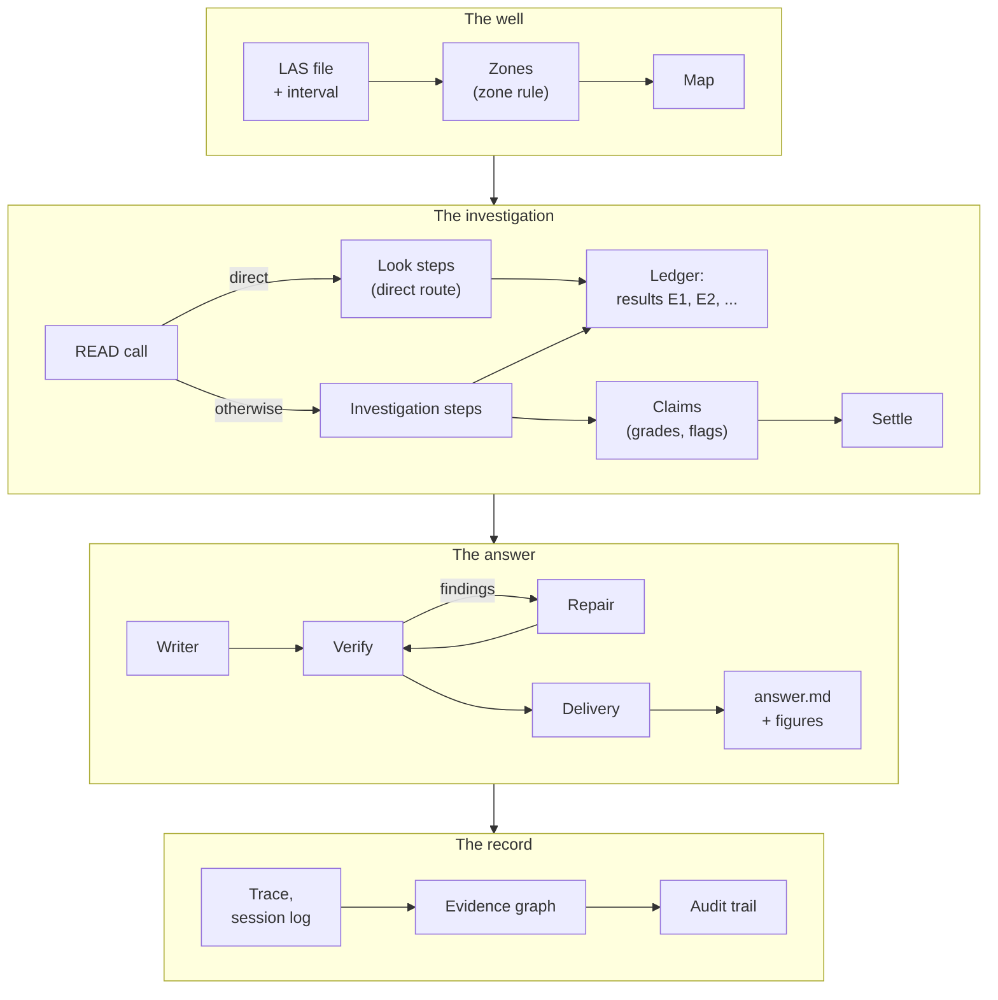

# Glossary

The terms the PetroHarness documentation uses, in alphabetical order, each with a short definition and the page that
describes it in full. Read this page when a word in another page is unfamiliar.

## 1. At a glance

Where the main terms sit on the way from a LAS file to an audited answer:

| Group | Terms |
|---|---|
| The well | interval, zone, zone rule, map, zone table, curve card, status, interpretation settings, field notes |
| The investigation | READ call, direct route, look step, investigation step, ledger, result, point, claim, grade, flag, settle |
| The answer | writer, verify, repair, delivery, answer header, figures, report style |
| The record | trace, session, session log, setup record, evidence graph, audit trail, number links, generation |
| The model's inputs | model card, prompt component, frame, skill library, guide, topic area, tool, verb, registry, binder |
| The tests | tape, golden tapes, public mini set, request gate, prompt fixture, ledger replay, switch |

## 2. A to E

| Term | Meaning | Described in |
|---|---|---|
| Analyzer | A Petrophys classifier run on each zone (for example reservoir quality or invasion); its classes are kept as located depth runs. | [Well preparation](WELL_PREPARATION.md) |
| Answer header | The lines at the top of `answer.md`: the question, the interval, the zoning source, the model, the skill library, the status and route, and any field notes or settings changes. | [Writer and checker](WRITER_AND_CHECKER.md) |
| Audit trail | For one answer: its claims with the results they cite, its numbers with the results that show them, the curves those read, the Petrophys steps and parameters behind them and the LAS file's hash. Written by `petroharness audit`. | [Records](RECORDS.md), [EVIDENCE](../EVIDENCE.md) |
| Basis | What a statistic is computed over: a zone, the zones pooled, or the whole interval. Every result line names its basis. | [Tools](TOOLS_REFERENCE.md) |
| Benchmark mode | `petroharness benchmark`: runs a question file with reference answers in parallel, for validation. | [Command line](CLI.md) |
| Binder | The code that reads the inputs the model names for a Petrophys function, as Petrophys declares each (a curve, a condition, a number, a choice), and adds the question's scope (the prepared well, the interval's limits); a required input left out is asked for. | [Petrophys integration](PETROPHYS_INTEGRATION.md) |
| Claim | A statement the investigation makes about the question, with a grade and the result ids it cites. Claims are edited step by step and made final by settle. | [Investigation state](INVESTIGATION_STATE.md) |
| Conversation | One interval of one well kept open for several questions; each later question starts from what the earlier ones found. | [SESSIONS](../SESSIONS.md), [Python API](PYTHON_API.md) |
| Curve card | The text that tells the model, for each curve the question names, its meaning, its status, the record's cautions and what its zoned values show about how they were made. | [Well preparation](WELL_PREPARATION.md) |
| Delivery | The last step before an answer is returned: evidence ids are taken out of the text, and the draft as written stays in the trace. | [Writer and checker](WRITER_AND_CHECKER.md) |
| Direct route | The short path for a direct question (a value, a setting, a count, a fact one or two lookups state): up to two look steps and a short answer. | [GRAPH](../GRAPH.md), [Investigation state](INVESTIGATION_STATE.md) |
| Evidence graph | The graph rebuilt from a session folder alone: LAS file, curves, Petrophys steps, results, claims, answers, figures and their links. | [Records](RECORDS.md), [EVIDENCE](../EVIDENCE.md) |

## 3. F to M

| Term | Meaning | Described in |
|---|---|---|
| Field notes | A small YAML file of a team's standing choices for a field: settings in force from the start and notes sent with every question. | [Interpretation settings](INTERPRETATION_SETTINGS.md) |
| Figures | Plots chosen by one model call after the answer, from the plots Petrophys can draw from the answer's results and the interval, and drawn by Petrophys. | [Petrophys integration](PETROPHYS_INTEGRATION.md) |
| Flag | A fact code raises about a claim (for example a number no cited result shows) and shows to the model; code never changes the claim itself. | [Investigation state](INVESTIGATION_STATE.md) |
| Frame | A source file whose text is part of a prompt component's version, so a change to it changes the version recorded in traces. | [Prompt components](PROMPT_COMPONENTS.md) |
| Generation | The state of the well under one set of interpretation settings. A setting changed in a conversation starts another generation; results opened before it are marked as resting on the earlier settings. | [Investigation state](INVESTIGATION_STATE.md), [Records](RECORDS.md) |
| Golden tapes | Recorded model calls of a fixed set of questions, replayed to prove a change leaves requests and answers unchanged. Not in the public repository. | [Testing](TESTING.md) |
| Grade | How strongly a claim is supported: hypothesis, low, moderate, high, not indicated or undetermined. The model sets it; code flags grades the cited evidence does not support. | [Investigation state](INVESTIGATION_STATE.md) |
| Guide | One text of the skill library: lookups and criteria for one topic area, each line with its source. Guides never state a conclusion. | [Skills](SKILLS.md) |
| Interpretation settings | The options Petrophys's interpretation takes (clay volume, porosity, water saturation, permeability, cutoffs and more), plus the harness's zone rule. | [Interpretation settings](INTERPRETATION_SETTINGS.md) |
| Interval | The part of the well a question is about: a formation from a tops file (the Brent Group of GeoLink 30/6-5, 2841–2958 m), a depth window (2990–3290 m in GeoLink 25/5-1), or the whole well (0–5649.5 ft in Teapot 17-WX-21). | [Well preparation](WELL_PREPARATION.md) |
| Investigation step | One model call in an investigation: it reads the new results whole and earlier ones as digests, edits the claims and asks for more results. At most eight per question. | [Investigation state](INVESTIGATION_STATE.md) |
| Ledger | The store of every result the investigation opened, each kept whole with an id, outside the model. | [Investigation state](INVESTIGATION_STATE.md) |
| Ledger replay | A test that opens a saved run's calls again in order and checks the same results and ids come back. | [Testing](TESTING.md) |
| Look step | A step of the direct route: a few lookups, no claims. | [Investigation state](INVESTIGATION_STATE.md) |
| Map | The overview of the interval the model reads first: the interval and its zones, the input curves, each Petrophys workflow step with its method and parameters, the analyzers' sections and the notes on the interval. | [Well preparation](WELL_PREPARATION.md) |
| Model card | A small YAML file with one model's request settings (reasoning, sampling, template variables, output cap, structured output). | [MODELS](../MODELS.md), [Configuration](CONFIGURATION.md) |

## 4. N to R

| Term | Meaning | Described in |
|---|---|---|
| Number links | The link from each number in an answer to the results that show it; in the web UI, clicking a number shows them. | [Records](RECORDS.md) |
| Point | One part of what the question asks. The writer gives each point its own part of the answer. | [Investigation state](INVESTIGATION_STATE.md) |
| Prompt component | One of ten named text components (C1 to C10) every request is built from; the trace attributes every span of every request to one. | [Prompt components](PROMPT_COMPONENTS.md) |
| Prompt fixture | A saved rendering of model-facing texts, compared byte for byte by a test. Not in the public repository. | [Testing](TESTING.md) |
| Public mini set | A recorded conversation on a well that ships with Petrophys, in the repository, that replays request for request with no model server and no private data: the set `brent`, three questions on the Brent Group of GeoLink 30/6-5. | [Testing](TESTING.md) |
| READ call | The first model call of a question: it picks the topic areas, lists the measurements the question names and says whether the question is direct. | [GRAPH](../GRAPH.md), [Investigation state](INVESTIGATION_STATE.md) |
| Registry | The list of public Petrophys functions the verbs can search and run, generated from the installed library. | [Petrophys integration](PETROPHYS_INTEGRATION.md) |
| Repair | A writer call that fixes the findings verify sent back; there is a fixed limit on rounds. | [Writer and checker](WRITER_AND_CHECKER.md) |
| Report style | The packaged format settings for answers; the code reads one of them, the style of the zone table. | [Writer and checker](WRITER_AND_CHECKER.md) |
| Request gate | A tool that rebuilds every request of saved runs and compares their hashes, to prove a change leaves what the model is sent unchanged. | [Testing](TESTING.md) |
| Result | One item in the ledger, with an id such as `E1`: a lookup's or computation's output, kept whole. | [Investigation state](INVESTIGATION_STATE.md) |

## 5. S to Z

| Term | Meaning | Described in |
|---|---|---|
| Session | The folder a conversation writes: its log, the texts it names (kept by hash), figures and answers. | [Records](RECORDS.md) |
| Session log | The append-only log of a conversation's events; resuming rebuilds the conversation from it. | [Records](RECORDS.md) |
| Settle | The model call that makes the claims final after the last investigation step. | [Investigation state](INVESTIGATION_STATE.md) |
| Setup record | What answers a question (code, model card, skills, Petrophys build, data settings) under one hash; printed by `petroharness setup`, recorded in every question's trace and logged by every conversation. | [Records](RECORDS.md), [EVIDENCE](../EVIDENCE.md#the-setup-record) |
| Skill library | The set of guides the model can ask for, one per topic area plus common guides; replaceable with your own. | [Skills](SKILLS.md) |
| Status | What a curve's values are (a measurement, a model output or flag of a Petrophys step, a copy) and the record's cautions about them (a parameter, uncalibrated, a quicklook, a fallback input, not computed). Every result line carries it. | [Well preparation](WELL_PREPARATION.md) |
| Switch | A behaviour change kept behind an option in `options.py` until it is measured and made the default or removed. | [Extending](EXTENDING.md) |
| Tape | A recording of every model request and reply of a question or conversation, replayed with no server. | [Records](RECORDS.md), [Testing](TESTING.md) |
| Tool | An operation the model can call on the computed record (a lookup, a comparison, a computation, a Petrophys verb, or a ledger operation). | [Tools](TOOLS_REFERENCE.md) |
| Topic area | One of the areas a question can touch (for example porosity or water saturation); the READ call picks them and they choose the guides. | [Skills](SKILLS.md) |
| Trace | `trace.json`: every model call of a question, the results opened, the claims, the draft, the timing and the token use. | [Records](RECORDS.md) |
| Verb | A group of tools by kind of request: describe, compare and group, check, calculate, classify, summarize, calibrate. A verb over Petrophys (calculate, estimate, what_if, check, classify, summarize, calibrate) also searches and runs the registry's functions. | [Tools](TOOLS_REFERENCE.md), [TOOLS](../TOOLS.md) |
| Verify | The checker that reads the writer's draft against the results opened and the rest of what the writer was shown, and sends findings back for repair. | [Writer and checker](WRITER_AND_CHECKER.md) |
| Writer | The model call that writes the answer from the question's points and every result the investigation opened. | [Writer and checker](WRITER_AND_CHECKER.md) |
| Zone | A depth run of one lithology (the lithology log's; without one, the lithology Petrophys's mineral solver gives; with neither, a run of one shale-volume band), at least the minimum thickness; the unit every answer reports on. The Brent Group of 30/6-5 has 20 zones from its lithology log; the McKee Formation of Taranaki tuhua-7, which has none, has 11 from the solved lithology. | [Well preparation](WELL_PREPARATION.md) |
| Zone rule | The settings that decide the zones: minimum zone thickness, the shale-volume bands, or one zone for the whole interval. | [Interpretation settings](INTERPRETATION_SETTINGS.md) |
| Zone table | The table of zoned values the code composes for the model and, for a list or report answer, inserts into the answer; the report style sets its layout. | [Writer and checker](WRITER_AND_CHECKER.md) |

## 6. Related pages

- [Documentation map](../README.md): every page, with reading paths by goal.
- [ARCHITECTURE](../ARCHITECTURE.md): how the parts fit together.
- [Investigation state](INVESTIGATION_STATE.md): the terms of the investigation in depth.
