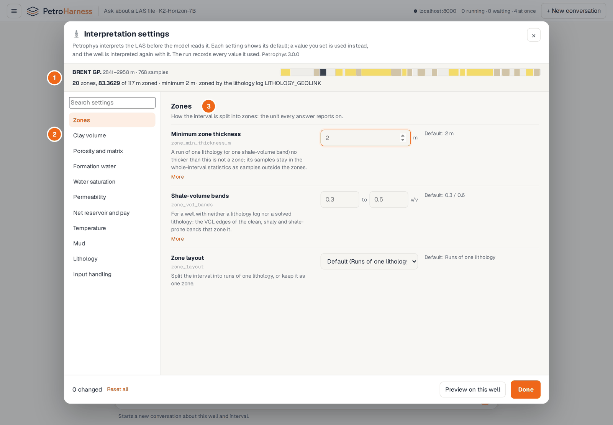
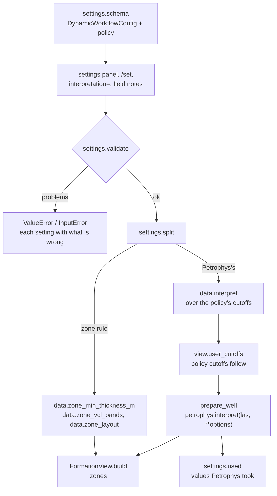

# Interpretation settings

Every setting that changes how Petrophys interprets a well, and the three of the harness's zone rule: what each one
means, its default, how it is checked and how it reaches the interpretation. For petrophysicists who configure an
interpretation and developers who debug one; [WELL_PREPARATION.md](WELL_PREPARATION.md) covers the preparation they
feed.

## 1. At a glance



- **65 settings:** 62 of Petrophys in 10 groups, read from the installed library, and 3 of the harness's zone rule.
- **Unset is the default:** the policy's for the zone rule and the net-pay cutoffs (`vcl_cutoff` 0.3, `sw_cutoff` 0.7,
  `phie_cutoff` 0.08), Petrophys's for the rest, often decided from the well itself ("from the data" below).
- **A Petrophys setting interprets the well again** (another cache entry); a zone setting re-zones the interpreted
  well. The record keeps the value Petrophys applied for each setting.
- **Checked before anything runs:** `settings.validate`, then Petrophys's own `DynamicWorkflowConfig`. Petrophys
  settings are refused with a context profile (`--profile`) or a data interpreter.

Set them by name, the same way everywhere:

```python
import petrophys
from petroharness.ask import ask

r = ask(petrophys.sample("30/6-5"), "Which zone has the best reservoir quality?",
        tops=petrophys.sample("formations_30_6-5.csv"), formation="BRENT GP.",
        interpretation={"sw_model": "indonesia", "m": 2.2})
```

What a setting does on GeoLink 30/6-5, Brent Group (2841-2958 m), read back from Petrophys's step record
(`settings.used`) and the zoning (real runs). Data: GeoLink, CC BY-SA 4.0. A carbonate interval beside it:
[section 4](#4-setting-reference).

| Given | Petrophys applied (step) | Zones |
|---|---|---|
| nothing | `sw_model` archie+simandoux, `m` 2.0, `n` 2.0 (saturation); `gr_min` 20.0, `gr_max` 115.313 (vclay); `matrix_type` sandstone, `phi_cl` 0.2307 (porosity); `vcl_cutoff` 0.3, `sw_cutoff` 0.7, `phie_cutoff` lithology_dependent (net_pay) | 20, covering 83.4 of 117.0 m |
| `sw_model: indonesia`, `m: 2.2` | `sw_model` indonesia, `m` 2.2 (saturation) | 20 |
| `gr_min: 30`, `gr_max: 120` | `gr_min` 30.0, `gr_max` 120.0 (vclay) | 20 |
| `sw_cutoff: 0.6`, `phie_cutoff: 0.1` | `sw_cutoff` 0.6, `phie_cutoff` 0.1 (net_pay); the view's policy cutoffs follow | 20 |
| `zone_min_thickness_m: 1.0` | (the zone rule: no reinterpretation) | 31, covering 98.9 m |
| `zone_layout: formation` | (the zone rule) | 1, the whole interval |

<details>
<summary>The summary, with where each part is defined</summary>

| Item | Value | Where |
|---|---|---|
| Settings | 65: 62 of Petrophys in 10 groups, and 3 of the harness's zone rule | `well.settings.schema` |
| Petrophys's source | `petrophys.workflow.DynamicWorkflowConfig`: its fields, the comments in its source, its own validation | `well.settings` |
| Defaults | Petrophys's field defaults; the policy's for `vcl_cutoff` (0.3), `sw_cutoff` (0.7), `phie_cutoff` (0.08, the clastic cutoff) and the zone rule (2.0 m, `[0.3, 0.6]`, `lithology_runs`); none shown where Petrophys decides from the well | `well.settings.schema`, `resources/policy/reference_v2.yaml` |
| Ways to set | `ask(..., interpretation=)`, `Conversation.start(..., interpretation=)`, the web UI's settings panel, `/set` in `petroharness chat`, `Conversation.adopt`, a field notes file; a settings file's `data.interpret` and `data.zone_*` | section 8 |
| Checks | `settings.validate` (kind, choice, range), then Petrophys's `DynamicWorkflowConfig` | `well.settings.validate` |
| Effect | a Petrophys setting re-interprets the well (another cache entry); a zone setting re-zones the same interpreted well | `prepare._cache_path`, `FormationView.build` |
| Refused with | a context profile (`--profile`) or a data interpreter, for Petrophys settings | `interval._interpretation` |
| Field notes | `name`, `settings`, `notes`; at most 20 notes of 300 characters | `well.notes` |

</details>

## 2. How it works

A setting is checked, split between Petrophys and the zone rule, and applied: Petrophys's options go to
`petrophys.interpret`, the zone rule to the zoning of the interpreted well.



<details>
<summary>The eight steps, in code</summary>

1. **The sheet.** `settings.schema()` builds the list of settings once per process: Petrophys's fields with their
   help, choices, defaults and units, grouped by `settings.GROUPS`, and the harness's zone rule (`ZONE_FIELDS`).
2. **The values.** A user gives settings by name: in Python, in the web UI, with `/set`, or in a field notes file.
   Field notes' settings sit under any given at the start (`ask.ask`, `Conversation.start`).
3. **The check.** `settings.validate` checks each value's kind and range and passes Petrophys's settings through
   `DynamicWorkflowConfig`; any problem stops the run before Petrophys interprets.
4. **The split.** `settings.split` separates Petrophys's options from the zone rule. `interval._interpretation` puts
   Petrophys's over `data.interpret` (over the policy's cutoffs) and the zone rule into `data.zone_*`.
5. **The policy.** `view.user_cutoffs` makes the policy's cutoffs follow `vcl_cutoff`, `sw_cutoff` and
   `phie_cutoff`, so the cutoff check and the record quote the cutoffs Petrophys used.
6. **The interpretation.** `prepare.prepare_well` calls `petrophys.interpret(las, **data.interpret)`; the options
   are part of the cache key, so a changed setting interprets the well again.
7. **The zones.** `FormationView.build` applies `zone_min_thickness_m`, `zone_vcl_bands` and `zone_layout`.
8. **The read-back.** `settings.used(prep)` reads from the step record the value Petrophys applied for each setting on
   this well, with the unit the step records beside it; the web UI's preview shows it.

</details>

## 3. The settings sheet

`settings.schema()` gives the settings grouped for the page, each described by Petrophys's own field and
documentation; `GET /api/settings` serves it. Each setting carries its `key`, `label`, `kind`, `unit`, `choices`,
`default`, `help` (Petrophys's first sentence) and `more` (the whole documentation).

<details>
<summary><code>settings.schema()</code></summary>

| Name | Type | Default | Meaning | Defined in |
|---|---|---|---|---|
| `groups` | list | | `{key, title, about, fields}` in `GROUPS` order, then `more` ("More from Petrophys") when a field is in no group | `settings.schema` |
| `petrophys` | text | | the installed Petrophys's identity (`prepare.library_identity`) | `settings._library` |
| `key` | text | | the setting's name, as `interpretation=` and `/set` take it | `settings.schema` |
| `label` | text | `LABELS`, else the name with spaces | the panel's label | `settings.LABELS` |
| `kind` | text | | `switch` (bool), `choice` (text with choices), `integer`, `number`, `bands`, `text` | `settings.schema` |
| `unit` | text | `""` | for a number: the first of `UNITS` its documentation's first sentence names, else the first named in the rest; `""` for a switch or a choice | `settings._unit` |
| `choices` | list | `[]` | the values Petrophys accepts, read from its validation message (`use one of: ...`) | `settings._choices` |
| `default` | value | | the field's default; the policy's for `vcl_cutoff` (`vcl_max`), `sw_cutoff` (`sw_max`), `phie_cutoff` (`phie_min_clastic`) and the zone rule; `None` where Petrophys decides from the well | `settings.schema` |
| `help` | text | | the documentation's first sentence | `settings._first` |
| `more` | text | | the whole documentation | `settings._plain` |
| `common` | yes/no | | shown first in its group (`COMMON`) | `settings.COMMON` |
| `petrophys` | yes/no | | a Petrophys setting (`false` for the zone rule) | `settings.schema` |
| `heading` | text | | the group heading in Petrophys's source (`# -- Heading --`) | `settings._doc_fields` |
| `choice_labels` | table | | `zone_layout` only: the panel's words for each choice (`Runs of one lithology`, `The whole interval as one zone`) | `settings.ZONE_FIELDS` |
| `length` | yes/no | | `zone_min_thickness_m` only, `true`; nothing reads it | `settings.ZONE_FIELDS` |

Example: two fields as the sheet gives them (real output).

```json
{"key": "gr_min", "label": "GR clean (gr_min)", "kind": "number", "unit": "API", "choices": [], "default": null,
 "help": "Clean-rock gamma-ray endpoint, API, used as given.",
 "more": "Clean-rock gamma-ray endpoint, API, used as given. None picks P5 of the log, lowered to 20 API when higher (a guard against a nearly flat GR, reported in the trace as gr_min_used, with a warning when the pick is above 30 API).",
 "common": true, "petrophys": true, "heading": "Gamma-ray clay volume"}
{"key": "zone_vcl_bands", "label": "Shale-volume bands", "kind": "bands", "unit": "v/v", "choices": [],
 "default": [0.3, 0.6],
 "help": "For a well with neither a lithology log nor a solved lithology: the VCL edges of the clean, shaly and shale-prone bands that zone it.",
 "more": "Below the first edge a sample is clean, between the edges shaly, above the second shale-prone.",
 "common": true, "petrophys": false, "heading": "Zones"}
```

Notes:

- The sheet is read from the installed Petrophys, so a setting added to the library appears with no change here,
  under "More from Petrophys" until a group names it. With the pinned Petrophys (`3.0.0`) every field is grouped or
  hidden.
- `schema()` is cached (`functools.lru_cache`); a running process does not see a Petrophys upgrade.

</details>

<details>
<summary>Module constants</summary>

The tables in `well/settings.py` that shape the sheet.

| Name | Type | Default | Meaning | Defined in |
|---|---|---|---|---|
| `GROUPS` | list | 11 groups | `(key, title, about, Petrophys fields)`: `zones`, `clay`, `porosity`, `water`, `saturation`, `permeability`, `pay`, `temperature`, `mud`, `lithology`, `input` | `settings.GROUPS` |
| `HIDDEN` | set | | `raise_on_error`, `peer_wells`, `formation_tops`, `zones`, `lithology`, `lithology_csv`, `lithology_intervals`, `lithology_codes`, `lithology_curve`, `skip_steps`, `nd_clay`, `curve_aliases`: fields that take a table, a list of wells or a file, and internal flags. Besides these, every setting whose type takes a table, a list or a pair (`mineral_endpoints`, `bad_hole`, `perm_coefficients`, ...) is not a field; a settings file gives it under `data.interpret` | `settings.HIDDEN`, `settings._takes_a_table` |
| `COMMON` | set | | `zone_min_thickness_m`, `zone_vcl_bands`, `zone_layout`, `gr_method`, `gr_min`, `gr_max`, `matrix_type`, `rho_ma`, `rw`, `salinity_ppm`, `sw_model`, `a`, `m`, `n`, `perm_method`, `vcl_cutoff`, `phie_cutoff`, `sw_cutoff`, `bht`, `mud_type`, `lithology_domain` | `settings.COMMON` |
| `LABELS` | table | | setting -> the panel's label | `settings.LABELS` |
| `UNITS` | list | | `(token, shown)`: `degF/100ft` °F/100 ft, `degF` °F, `ohm.m`, `g/cm3` g/cm³, `us/ft` µs/ft, `ppm`, `mg/l`, `v/v`, `in feet` ft, `API`, `mV`, `meq/100g` and `meq/100 g` meq/100 g | `settings.UNITS` |
| `ZONE_FIELDS` | list | | the harness's three zone settings | `settings.ZONE_FIELDS` |

Example: reading the sheet in Python.

```python
from petroharness.well import settings as T

for group in T.schema()["groups"]:
    print(group["title"], [f["key"] for f in group["fields"]])
```

</details>

## 4. Setting reference

Each group below is the sheet as `settings.schema()` gives it with the pinned Petrophys. "From the data" means the
sheet gives no default: Petrophys reads the value from the LAS header or derives it from the well, and the web UI's
preview shows the value it took. The Meaning column is the sheet's help, Petrophys's own first sentence. The examples
read back what Petrophys applied on GeoLink 30/6-5, Brent Group, at the defaults (`settings.used`, real output).

The defaults depend on the well. A clastic interval with a lithology log, and a carbonate interval without one, at the
defaults and with `lithology_domain: carbonate` and `matrix_type: limestone` set (real runs: `settings.used` and
Petrophys's step records):

| Petrophys used | 30/6-5, Brent Group | HW-3, KHARAIB-2: defaults | HW-3, KHARAIB-2: carbonate set |
|---|---|---|---|
| Zones from | the lithology log `LITHOLOGY_GEOLINK`: 20 zones | Petrophys's mineral solver, clastic domain: 8 zones, 7 sandstone and 1 dolomite | Petrophys's mineral solver, carbonate domain: 9 zones, 8 limestone and 1 dolomite |
| `lithology_domain`, `matrix_type` | clastic, sandstone | clastic, sandstone | carbonate, limestone |
| `rho_ma` | per lithology-log group (sandstone 2.65, limestone 2.71, coal 1.35) | 2.65 | 2.71 |
| Lithology step | `canonical_multi_mineral_solver` | `canonical_multi_mineral_solver` | `generic_calcite_dolomite_density_closure` |
| `phie_cutoff` | `lithology_dependent`: 0.08 for 20,393 clastic samples, 0.045 for 1,783 carbonate ones (whole well) | 0.08 (431 clastic samples) | 0.045 (431 carbonate samples) |
| `sw_model` (`auto`) | archie+simandoux | archie (431 samples) | archie (431 samples) |
| `a`, `m`, `n` | lithology_dependent, 2.0, 2.0 | 1.0, 2.03, 2.0 | 1.0, 2.03, 2.0 |
| NET_PAY in the interval | 185 samples (28.18 m) | 380 samples (190 ft) | 388 samples (194 ft) |

Data: GeoLink, CC BY-SA 4.0 (30/6-5); Costa Gomes, Geiger and Arnold (2022), COSTA model, Heriot-Watt University,
CC BY (HW-3).

<details>
<summary>Zones (<code>zones</code>)</summary>

How the interval is split into zones: the unit every answer reports on. These three are the harness's own (section
5). Shown first: all three.

<!-- generated: settings_zones (tests/docs_tables.py) -->
| Name | Type | Default | Meaning | Choices | Unit | Label |
|---|---|---|---|---|---|---|
| `zone_min_thickness_m` | number | `2.0` | A run of one lithology (or one shale-volume band) no thicker than this is not a zone; its samples stay in the whole-interval statistics as samples outside the zones. | - | m | Minimum zone thickness |
| `zone_vcl_bands` | bands | `[0.3, 0.6]` | For a well with neither a lithology log nor a solved lithology: the VCL edges of the clean, shaly and shale-prone bands that zone it. | - | v/v | Shale-volume bands |
| `zone_layout` | choice | `lithology_runs` | Split the interval into runs of one lithology, or keep it as one zone. | `lithology_runs`, `formation` | - | Zone layout |
<!-- end generated: settings_zones -->

Example: a finer zone rule for a thin-bedded interval.

```python
interpretation = {"zone_min_thickness_m": 1.0}
```

Notes:

- On 30/6-5, Brent Group (a lithology log), the default rule gives 20 zones covering 83.4 m of the 117.0 m interval;
  a 1.0 m minimum gives 31 (98.9 m), a 3.0 m minimum 11 (61.0 m), and `zone_layout: formation` one zone (real runs).
- The bands zone only a well with neither a lithology log nor a solved lithology. Taranaki `tuhua-7` has a solved
  lithology, so the bands leave its zones as they are: its McKee Formation has 11 zones at the default edges and at
  `[0.25, 0.5]` (real runs). Called directly on that formation's VCL (`formation.vcl_band_labels`, then
  `formation.segment_zones`), the bands give 6 zones at the default edges and 8 at `[0.25, 0.5]`. Data: Taranaki Basin
  Curated Well Logs Dataset (New Zealand Petroleum & Minerals), CDLA-Sharing-1.0.
- A run exactly as thick as the minimum is dropped too: a zone needs base minus top strictly above it
  (`formation.segment_zones`).

</details>

<details>
<summary>Clay volume (<code>clay</code>)</summary>

How shale volume (VCL) is computed from the gamma ray, SP and density-neutron. Shown first: `gr_method`, `gr_min`,
`gr_max`.

<!-- generated: settings_clay (tests/docs_tables.py) -->
| Name | Type | Default | Meaning | Choices | Unit | Label |
|---|---|---|---|---|---|---|
| `gr_method` | choice | `linear` | Transform: "linear", "larionov_tertiary", "larionov_older", "stieber" (stored as "steiber") or "clavier". | `linear`, `larionov_tertiary`, `larionov_older`, `steiber`, `clavier` | - | GR to shale volume |
| `gr_min` | number | from the data | Clean-rock gamma-ray endpoint, API, used as given. | - | API | GR clean (gr_min) |
| `gr_max` | number | from the data | Shale gamma-ray endpoint, API, used as given. | - | API | GR shale (gr_max) |
| `sp_min` | number | from the data | Shale SP baseline, mV: the line of least SP deflection. | - | mV | SP shale (sp_min) |
| `sp_max` | number | from the data | Clean-sand SP line (static SP), mV: the line of greatest deflection. | - | mV | SP clean (sp_max) |
| `rho_cl` | number | from the data | Clay density, g/cm3, used by the carbonate mineral solve and the neutron-density hydrocarbon correction. | - | g/cm³ | Clay density |
<!-- end generated: settings_clay -->

Example: the values Petrophys took on 30/6-5, Brent Group.

```json
{"gr_method": {"value": "linear", "step": "vclay"}, "gr_min": {"value": 20.0, "step": "vclay"},
 "gr_max": {"value": 115.313, "step": "vclay"}, "sp_min": {"value": 111.60919399999966, "step": "vclay"},
 "sp_max": {"value": 43.167896, "step": "vclay"}}
```

Notes:

- Unset, `gr_min` is P5 of the log (lowered to 20 API when higher) and `gr_max` P95 (raised to 100 API when lower),
  as Petrophys's help says. On 30/6-5 the vclay record shows `gr_min` 21.635344 and `gr_min_used` 20.0: VCL used
  20 API, and `settings.used` and the preview report 20, the value applied.
- Unset, `sp_min` (the shale baseline) is P95 of the SP log and `sp_max` (the clean-sand line) P5; on 30/6-5 the
  vclay record shows both picked automatically (`sp_min_source` and `sp_max_source` `auto`), and the SP not in the
  VCL (`sp_in_vcl` false). Petrophys's help: VCL_SP joins the minimum-of-indicators VCL only when both are set.
- The shale-volume bands, and so the zones of a well with neither a lithology log nor a solved lithology, follow VCL:
  setting `gr_min` and `gr_max` moves them. The mineral solver reads VCL too: it is among the lithology step's
  inputs.

</details>

<details>
<summary>Porosity and matrix (<code>porosity</code>)</summary>

The matrix and fluid properties the porosity equations use. Shown first: `matrix_type`, `rho_ma`.

<!-- generated: settings_porosity (tests/docs_tables.py) -->
| Name | Type | Default | Meaning | Choices | Unit | Label |
|---|---|---|---|---|---|---|
| `matrix_type` | choice | from the data | "auto" (resolved from lithology evidence) or a mineral name such as "sandstone", "limestone" or "dolomite"; see petrophys.model.constants.MatrixProperties.names. | `auto`, `anhydrite`, `calcite`, `calcium_carbonate`, `carnallite`, `coal`, `dolo`, `dolomite`, `gypsum`, `halite`, `kainite`, `lime`, `limestone`, `ls`, `polyhalite`, `quartz`, `salt`, `sand`, `sandstone`, `shale`, `silica`, `sio2`, `ss`, `sylvite` | - | Matrix |
| `rho_ma` | number | from the data | Matrix density, g/cm3. | - | g/cm³ | Matrix density (ρma) |
| `nphi_ma` | number | from the data | Matrix neutron porosity, v/v. | - | v/v | Matrix neutron porosity |
| `dt_ma` | number | from the data | Matrix sonic slowness, us/ft. | - | µs/ft | Matrix sonic (Δtma) |
| `rho_fl` | number | from the data | Pore-fluid density, g/cm3, used by the porosity, hydrocarbon-correction and mineral steps alike. | - | g/cm³ | Fluid density (ρfl) |
| `dt_fl` | number | `189.0` | Pore-fluid sonic slowness, us/ft. | - | µs/ft | Fluid sonic (Δtfl) |
| `phi_cl` | number | from the data | Clay (shale) porosity, v/v. | - | v/v | Clay porosity |
| `apply_hc_correction` | switch | `false` | Apply the neutron-density hydrocarbon correction (opt-in). | - | - | Hydrocarbon correction |
| `hc_type` | choice | `oil` | Hydrocarbon type, "oil" or "gas": the fluid of the neutron-density hydrocarbon correction and, under "current", the PHIT rule in neutron-density crossover (PHID > PHIN + 0.05): the root-mean-square of PHID and PHIN (Gaymard and Poupon, 1968) for gas, density porosity for oil. | `oil`, `gas` | - | Hydrocarbon type |
| `rho_hc` | number | from the data | Hydrocarbon density in the flushed zone, g/cm3, for the hydrocarbon correction and the core matrix-density check of auto lithology. | - | g/cm³ | Hydrocarbon density (ρhc) |
| `hc_hydrogen_index` | number | from the data | Hydrogen index of the hydrocarbon for the neutron hydrocarbon correction. | - | - | Hydrocarbon hydrogen index |
<!-- end generated: settings_porosity -->

Example: the values Petrophys took on 30/6-5, Brent Group (values only).

```json
{"matrix_type": "sandstone", "rho_fl": 1.0, "dt_fl": 189.0, "phi_cl": 0.2307010080670183}
```

Notes:

- Unset, `rho_ma` is the value for `matrix_type`, or per depth that of each lithology-log group; set, it holds at
  every depth (Petrophys's help). On 30/6-5 the porosity step takes the matrix per depth from the lithology log
  (`matrix_source` `vendor_lithology_log[LITHOLOGY_GEOLINK]`: sandstone 2.65 g/cm³, limestone 2.71, coal 1.35), so
  `rho_ma`, `nphi_ma` and `dt_ma` have no single value to read back.
- Without a lithology log, one matrix holds at every depth: on COSTA HW-3, KHARAIB-2, `rho_ma` 2.65 at the defaults
  (sandstone) and 2.71 with `matrix_type: limestone` (Data: Costa Gomes, Geiger and Arnold (2022), COSTA model,
  Heriot-Watt University, CC BY).
- Unset, `phi_cl` is derived from the well's shale samples where they support it, with 0.15 as the last resort.

</details>

<details>
<summary>Formation water (<code>water</code>)</summary>

Rw: given, from salinity, or estimated from the data. Shown first: `rw`, `salinity_ppm`.

<!-- generated: settings_water (tests/docs_tables.py) -->
| Name | Type | Default | Meaning | Choices | Unit | Label |
|---|---|---|---|---|---|---|
| `rw` | number | from the data | Formation water resistivity Rw, ohm.m, at rw_meas_temp. | - | ohm.m | Rw |
| `salinity_ppm` | number | from the data | Formation water salinity, ppm NaCl equivalent: another way to give the formation water. | - | ppm | Water salinity |
| `rw_meas_temp` | quantity | from the data | Temperature of rw, e.g. "230 degF" or "110 degC". | - | °F | Rw temperature |
| `allow_default_rw` | switch | `true` | Use a 0.05 ohm.m default Rw when no Rw source is found (the warnings say so). | - | - | Default Rw if none found |
<!-- end generated: settings_water -->

Example: Rw given with its temperature.

```python
interpretation = {"rw": 0.05, "rw_meas_temp": "150 degF"}
```

Notes:

- Without `rw_meas_temp`, Rw is taken at the median formation temperature (no temperature correction).
- A temperature, gradient or depth is given with its unit (`"65 degC"`, `"30 degC/km"`, `"2650 m"`); a bare number
  is read in the unit the panel shows (°F, °F/100 ft; a depth in the well's own unit), with Petrophys's warning.
- `salinity_ppm` makes Rw follow the temperature profile ahead of a header RW; a set `rw` wins over it.
- With `allow_default_rw: false`, saturation is not computed without an Rw source.
- On 30/6-5 no water setting is recorded under its own name: the rw step took the LAS header's RW
  (`las_metadata_temperature_profile_corrected`; "Rw corrected from LAS metadata: 0.0700 ohm.m @ 230F along the
  temperature profile").

</details>

<details>
<summary>Water saturation (<code>saturation</code>)</summary>

The saturation model and its parameters. Shown first: `sw_model`, `a`, `m`, `n`.

<!-- generated: settings_saturation (tests/docs_tables.py) -->
| Name | Type | Default | Meaning | Choices | Unit | Label |
|---|---|---|---|---|---|---|
| `sw_model` | choice | `auto` | "auto" (routed per sample by clay content) or one of "archie", "simandoux" (Sw in the clay term, Bardon-Pied), "modified_simandoux" (sand term over 1 - Vcl), "indonesia", "dual_water", "waxman_smits", "north_sea", "nigeria_schlumberger". | `auto`, `archie`, `north_sea`, `nigeria_schlumberger`, `simandoux`, `modified_simandoux`, `indonesia`, `dual_water`, `waxman_smits` | - | Saturation model |
| `a` | number | from the data | Tortuosity factor a. | - | - | Tortuosity a |
| `m` | number | from the data | Cementation exponent m; one value, or one per lithology as for a. | - | - | Cementation m |
| `n` | number | from the data | Saturation exponent n; one value, or one per lithology as for a. | - | - | Saturation exponent n |
| `m_star` | number | `2.0` | Waxman-Smits cementation exponent m*. | - | - | Shaly-sand m* |
| `cec` | number | from the data | Cation exchange capacity, meq/100 g (0 to 150; pure smectite is 80-150). | - | meq/100 g | CEC |
| `b_coeff` | number | from the data | Equivalent counter-ion conductance B, (S/m)/(meq/cm3): at 25 degC 4.6 * (1 - 0.6 * exp(-0.77 / Rw)) (Waxman and Smits, 1968), and higher at reservoir temperature. | - | - | B coefficient |
| `rwb` | number | from the data | Bound-water resistivity, ohm.m, from lab data or the LAS header. | - | ohm.m | Bound-water Rwb |
| `rtsh` | number | from the data | Shale resistivity Rsh, ohm.m, of the shaly-sand equations (Simandoux, modified Simandoux, Indonesia, North Sea, Nigeria). | - | ohm.m | Shale Rt |
| `vsh_exp` | number | `1.6` | Shale exponent of the North Sea model. | - | - | Shale-volume exponent |
| `shale_exp` | number | `1.6` | Shale exponent of the Nigeria-Schlumberger model. | - | - | Shale exponent |
| `sw_routing_vcl_cutoff` | number | from the data | Clay volume, v/v, from which sw_model="auto" uses a shaly-sand equation rather than Archie. | - | v/v | Shaly-sand model above VCL |
<!-- end generated: settings_saturation -->

Example: the values Petrophys took on 30/6-5, Brent Group (values only), and a change.

```json
{"sw_model": "archie+simandoux", "a": "lithology_dependent", "m": 2.0, "n": 2.0, "m_star": 2.0,
 "rtsh": 2.9059999999999997, "vsh_exp": 1.6, "shale_exp": 1.6}
```

```python
interpretation = {"sw_model": "indonesia", "m": 2.2, "rw": 0.05}
```

Notes:

- `sw_model: auto` routes each sample by clay volume: `archie+simandoux` above is the record of such a run, not a
  value the setting accepts. `a` reads `lithology_dependent` where Petrophys took one value per lithology.
- Petrophys takes `a`, `m` and `n` as one value or one per lithology (`{"sandstone": 0.81, "carbonate": 1.0}`); the
  sheet takes one number (a table is refused with `give a number`), so a per-lithology table goes in a settings
  file's `data.interpret`.
- Unset, `sw_routing_vcl_cutoff` uses `vcl_cutoff`, or 0.3 when that is unset.
- Waxman-Smits runs only with `cec` and `b_coeff`, from lab data or the LAS header; neither is estimated.
- Dual Water runs only with `rwb`, which is not estimated; the saturation record says what took its place. On 30/6-5:
  "Dual Water needs a supplied Rwb, which is not estimated: 1468 shaly carbonate samples used the Simandoux equation
  (set rwb to use Dual Water)"; on GeoLink 16/7-1 (whole well), 839 samples used the Indonesia equation.
- What `auto` chose on the sample wells: archie+simandoux on 30/6-5, Brent Group; archie on all 431 samples of COSTA
  HW-3, KHARAIB-2; simandoux+archie on KGS 1046123714, Lansing-Kansas City; indonesia+archie on 16/7-1 and on Teapot
  17-WX-21 (whole wells). Data: GeoLink, CC BY-SA 4.0; Costa Gomes, Geiger and Arnold (2022), COSTA model,
  Heriot-Watt University, CC BY; Kansas Geological Survey (kgs.ku.edu); Teapot Dome (NPR-3), RMOTC, U.S. Department
  of Energy.

</details>

<details>
<summary>Permeability (<code>permeability</code>)</summary>

The permeability transform and the irreducible water saturation. Shown first: `perm_method`.

<!-- generated: settings_permeability (tests/docs_tables.py) -->
| Name | Type | Default | Meaning | Choices | Unit | Label |
|---|---|---|---|---|---|---|
| `perm_method` | choice | `auto` | Permeability method. | `auto`, `timur`, `coates`, `wyllie_rose`, `lith_vcl` | - | Permeability transform |
| `perm_fallback_method` | choice | `coates` | Empirical equation of PERM under perm_method="auto": "coates" (default), "timur", "wyllie_rose" or "lith_vcl". | `timur`, `coates`, `wyllie_rose`, `lith_vcl` | - | Fallback transform |
| `swirr` | number | from the data | Irreducible water saturation, v/v, for the permeability equations. | - | v/v | Irreducible Sw |
| `swirr_flag_phi_cl` | choice | `workflow` | Clay porosity behind the PHIE that picks the SWIRR_APP samples, i.e. the reservoir flag built before permeability when the well has no RESFLAG or NET_RES curve. | `workflow`, `all_shale_phit` | - | Swirr reservoir flag |
| `use_peer_core` | switch | `false` | Calibrate permeability with core data from peer_wells, under the conditions given there; without peer_wells it has no effect. | - | - | Use core from peer wells |
<!-- end generated: settings_permeability -->

Example: a change, and what Petrophys read back on 30/6-5, Brent Group.

```python
interpretation = {"perm_method": "timur", "swirr": 0.25}
```

```json
{"swirr": {"value": 0.25, "step": "permeability"}}
```

Notes:

- At the defaults, 30/6-5 records no `swirr` under its own name: the permeability step estimates it
  (`swirr_source` `buckles_bvw_irr`) and, with `perm_method: auto`, fits a core model from the well's own core
  (`strategy` `same_well_core+coates`). `perm_method` is recorded as the step's `method`, so it is not read back.
- `use_peer_core` reads core data from `peer_wells`, which the sheet hides; the panel cannot set the wells.

</details>

<details>
<summary>Net reservoir and pay (<code>pay</code>)</summary>

The cutoffs that flag net reservoir and net pay. Shown first: `vcl_cutoff`, `phie_cutoff`, `sw_cutoff`.

<!-- generated: settings_pay (tests/docs_tables.py) -->
| Name | Type | Default | Meaning | Choices | Unit | Label |
|---|---|---|---|---|---|---|
| `vcl_cutoff` | number | `0.3` | Maximum clay volume for net rock, v/v. | - | v/v | VCL cutoff |
| `phie_cutoff` | number | `0.08` | Minimum effective porosity for net reservoir, v/v. | - | v/v | PHIE cutoff |
| `sw_cutoff` | number | `0.7` | Maximum water saturation for net pay, v/v. | - | v/v | SW cutoff |
| `reuse_input_resflag` | switch | `false` | Reuse a RESFLAG or NET_RES curve already on the well as the reservoir flag that picks the SWIRR_APP samples before permeability. | - | - | Reuse the LAS reservoir flag |
<!-- end generated: settings_pay -->

Example: the cutoffs Petrophys used on 30/6-5, Brent Group, at the defaults, and with a change.

```json
{"vcl_cutoff": {"value": 0.3, "step": "net_pay"}, "phie_cutoff": {"value": "lithology_dependent", "step": "net_pay"},
 "sw_cutoff": {"value": 0.7, "step": "net_pay"}}
```

```python
interpretation = {"sw_cutoff": 0.6, "phie_cutoff": 0.1}   # read back: sw_cutoff 0.6, phie_cutoff 0.1 (net_pay)
```

Notes:

- `vcl_cutoff` and `sw_cutoff` default to the policy's 0.30 and 0.70, which `petroharness` passes to Petrophys
  (`interval.POLICY_CUTOFFS`). Unset, `phie_cutoff` is Petrophys's lithology-family standard: 0.08 clastic, 0.045
  carbonate, the policy's values too.
- With a lithology log, Petrophys applies that standard per depth: on 30/6-5 the net-pay step records `phie_cutoff` as
  `lithology_dependent`, with 0.08 for 20,393 clastic samples and 0.045 for 1,783 carbonate ones of the whole well
  (`cutoffs_by_family`). Without one, the domain decides for the whole interval: COSTA HW-3, KHARAIB-2 takes 0.08 at
  the defaults (clastic) and 0.045 with `lithology_domain: carbonate` (the table at the top of section 4).
- The sheet shows the policy's clastic cutoff (`phie_min_clastic`, 0.08) as the default of `phie_cutoff`; a
  carbonate domain with `phie_cutoff` unset takes 0.045.
- Every cutoff you set also becomes the policy's for the view (section 6).

</details>

<details>
<summary>Temperature (<code>temperature</code>)</summary>

The temperature profile Rw and Rmf are corrected along. Shown first: `bht`.

<!-- generated: settings_temperature (tests/docs_tables.py) -->
| Name | Type | Default | Meaning | Choices | Unit | Label |
|---|---|---|---|---|---|---|
| `bht` | quantity | from the data | Bottom-hole temperature, e.g. "230 degF" or "110 degC". | - | °F | Bottom-hole temperature |
| `surface_temp` | quantity | `68.0` | Surface (mean annual) temperature at depth 0 of the linear temperature profile (offshore, the sea surface rather than the seabed); default 68 degF. | - | °F | Surface temperature |
| `td` | quantity | from the data | Total depth of the BHT, e.g. "2650 m" or "8700 ft"; a bare number is in the well's depth unit. | - | - | Total depth for BHT |
| `temperature_gradient` | quantity | from the data | Geothermal gradient from surface_temp at depth 0, e.g. "30 degC/km", "3 degC/100m" or "1.65 degF/100ft"; a bare number is read as degF/100 ft, with a warning. | - | °F/100 ft | Geothermal gradient |
<!-- end generated: settings_temperature -->

Example: the values Petrophys took on 30/6-5, Brent Group.

```json
{"surface_temp": {"value": 68.0, "step": "temperature", "unit": "°F"}, "bht": {"value": 258.8, "step": "temperature", "unit": "°F"},
 "td": {"value": 3556.08032, "step": "temperature", "unit": "m"},
 "temperature_gradient": {"value": 1.6353916325489521, "step": "temperature", "unit": "°F/100 ft"}}
```

Notes:

- Unset, `bht` is the LAS header BHT (on 30/6-5 the header gives `BHT` 126 and the step records `bht_f` 258.8, in
  degF) and `td` the header TD, else the deepest sample.
- Petrophys records a setting given with a unit under the name it computes it in (`bht_f` for `bht`, in degF;
  `gradient_f_per_100ft` for `temperature_gradient`), read from its settings class (`settings.computed_names`), and
  the total depth as `td` with `td_unit` beside it. `settings.used` reads them back under the setting's name, with
  that unit, and the preview shows the value in it.
- A set `bht` makes the temperature profile follow it rather than an input TEMP log (kept as TEMP_LOG).

</details>

<details>
<summary>Mud (<code>mud</code>)</summary>

Mud type and filtrate properties (Rmf, Rm). Shown first: `mud_type`.

<!-- generated: settings_mud (tests/docs_tables.py) -->
| Name | Type | Default | Meaning | Choices | Unit | Label |
|---|---|---|---|---|---|---|
| `mud_type` | choice | `WBM` | "WBM" (water-based) or "OBM" (oil-based) mud. | `WBM`, `OBM` | - | Mud type |
| `mud_water` | choice | `fresh` | "fresh" or "salt" mud, which sets the Rm-to-Rmf factor. | `fresh`, `salt` | - | Mud water |
| `mud_has_clay_or_kcl` | switch | `false` | The mud contains clay or KCl, so the SP log is not used: Rw is not estimated from the SP, and no VCL_SP is computed. | - | - | Mud has clay or KCl |
| `rmf_at_meas_temp` | number | from the data | Mud-filtrate resistivity Rmf at rmf_meas_temp, ohm.m. | - | ohm.m | Rmf |
| `rmf_meas_temp` | quantity | from the data | Temperature at which rmf_at_meas_temp was measured, e.g. "75 degF" or "24 degC". | - | °F | Rmf temperature |
| `rmf_salinity_ppm` | number | from the data | Mud-filtrate salinity, ppm NaCl equivalent (alternative to Rmf). | - | ppm | Filtrate salinity |
| `rmf_chlorides_mg_l` | number | from the data | Mud-filtrate chlorides (Cl-), mg/l, as on the mud report and the LAS header CLFL. | - | mg/l | Filtrate chlorides |
| `rm` | number | from the data | Mud resistivity Rm at rm_meas_temp, ohm.m (Rmf is derived from it). | - | ohm.m | Rm |
| `rm_meas_temp` | quantity | from the data | Temperature at which rm was measured, e.g. "75 degF" or "24 degC". | - | °F | Rm temperature |
<!-- end generated: settings_mud -->

Example: an oil-based mud.

```python
interpretation = {"mud_type": "OBM"}
```

Notes:

- `rmf_chlorides_mg_l` is in mg/l. Its documentation names ppm too; the sheet shows mg/l, the unit its first
  sentence names first (`settings._unit`).

</details>

<details>
<summary>Lithology (<code>lithology</code>)</summary>

The interpretation domain and the mineral solve. Shown first: `lithology_domain`.

<!-- generated: settings_lithology (tests/docs_tables.py) -->
| Name | Type | Default | Meaning | Choices | Unit | Label |
|---|---|---|---|---|---|---|
| `lithology_domain` | choice | from the data | Broad interpretation domain: "clastic" (the default when unset), "carbonate", "evaporite" or "auto". | `auto`, `clastic`, `carbonate`, `evaporite` | - | Interpretation domain |
| `lithology_source` | choice | `auto` | Lithology source. | `auto`, `external`, `vendor`, `computed`, `config` | - | Lithology source |
| `carbonate_calibration` | choice | from the data | Calibration of the carbonate-domain mineral solve, which takes calcite and dolomite from bulk density and closure. | `generic`, `costa` | - | Carbonate calibration |
<!-- end generated: settings_lithology -->

Example: the values Petrophys took on 30/6-5, Brent Group, and a carbonate domain on COSTA HW-3, KHARAIB-2.

```json
{"lithology_domain": {"value": "clastic", "step": "vclay"}}
```

```python
interpretation = {"lithology_domain": "carbonate", "matrix_type": "limestone"}
# read back on HW-3: lithology_domain carbonate (vclay), matrix_type limestone, rho_ma 2.71 (porosity),
# carbonate_calibration generic (lithology)
```

Notes:

- With `lithology_domain: carbonate` and `phie_cutoff` unset, Petrophys takes its carbonate porosity cutoff, 0.045:
  on HW-3, KHARAIB-2 (no lithology log) the net-pay step records `phie_cutoff` 0.045 for all 431 samples and 388
  NET_PAY samples (194 ft), against 0.08 and 380 samples (190 ft) at the defaults. The lithology step becomes
  `generic_calcite_dolomite_density_closure`, and its record says "PHIE was computed in the porosity step with rho_ma
  2.71 g/cm3, so the calcite-dolomite split is not independent of that matrix choice". The cutoff check compares a
  single recorded cutoff with the policy's for the domain (section 6). Data: Costa Gomes, Geiger and Arnold (2022),
  COSTA model, Heriot-Watt University, CC BY.
- `costa`, the second `carbonate_calibration` choice, is the calibration of a Petrophys context package.

</details>

<details>
<summary>Input handling (<code>input</code>)</summary>

How the LAS curves are read and checked. No setting is shown first.

<!-- generated: settings_input (tests/docs_tables.py) -->
| Name | Type | Default | Meaning | Choices | Unit | Label |
|---|---|---|---|---|---|---|
| `standardize_input` | switch | from the data | Standardize curve aliases and units before interpretation: vendor mnemonics get canonical aliases, units such as kg/m3 or percent porosity are converted and implausible values are screened, with a warning. | - | - | Standardize curves and units |
| `rename_input_curves` | switch | `false` | Rename vendor mnemonics to canonical names instead of adding aliases. | - | - | Rename vendor mnemonics |
| `calculation_profile` | choice | `current` | Interpretation configuration. | `current`, `geolink` | - | Calculation profile |
<!-- end generated: settings_input -->

Example: renaming vendor mnemonics instead of aliasing them.

```python
interpretation = {"rename_input_curves": True}
```

Notes:

- Unset, `standardize_input` is on under the `current` calculation profile (Petrophys's help).
- `geolink`, the second `calculation_profile` choice, is a Petrophys context package's configuration; for wells of
  such a package, a context profile (`--profile`) is the way in, and it refuses Petrophys settings. The analyzers
  classify with the library's `current` class tables (policy `analyzers.class_tables`); a settings file's
  `data.analyzer_class_tables` names a context package's own set instead
  ([WELL_PREPARATION.md](WELL_PREPARATION.md#13-analyzer-sections-and-derived-curves)).
- A curve-name mapping is not on the sheet (`curve_aliases` is hidden): give it in a settings file's
  `data.interpret` ([WELL_PREPARATION.md](WELL_PREPARATION.md#5-reading-the-las)).

</details>

## 5. The zone rule

The harness's own settings: they change how the interpreted well is zoned, never how Petrophys interprets it, so
changing one re-zones without interpreting the well again. On 30/6-5, Brent Group: 20 zones at the default 2.0 m
minimum, 31 at 1.0 m.

<details>
<summary>Zone settings</summary>

| Name | Type | Default | Meaning | Defined in |
|---|---|---|---|---|
| `zone_min_thickness_m` | number, metres | policy `zones.min_thickness_m`, 2.0 | becomes `data.zone_min_thickness_m`; a run is a zone when base minus top exceeds it, converted to the reporting unit | `settings.ZONE_FIELDS`, `FormationView.build` |
| `zone_vcl_bands` | two numbers, v/v | policy `zones.fallback_vcl_bands`, `[0.3, 0.6]` | becomes `data.zone_vcl_bands`; the band edges, used only when the well has neither a lithology log nor a solved lithology | `settings.ZONE_FIELDS`, `formation.vcl_band_labels` |
| `zone_layout` | `lithology_runs` or `formation` | `lithology_runs` | becomes `data.zone_layout`; runs of one label, or the interval as one zone (`formation.formation_zone`) | `settings.ZONE_FIELDS`, `config.DataPaths` |

Example: the same rule in a settings file.

```yaml
data:
  zone_min_thickness_m: 1.0
  zone_vcl_bands: [0.25, 0.5]
  zone_layout: lithology_runs
```

Notes:

- The minimum is in metres whatever the reporting unit: on a feet log, 2.0 m is about 6.56 ft.
- The zone rule is not part of the cache key, so changing it re-zones without interpreting the well again.
- With `zone_layout: formation` the operator's lithology (`--formation-lithology`) labels the one zone where the log
  has none, instead of being appended to the question.
- A context profile accepts the zone rule; only Petrophys settings are refused with it.

</details>

## 6. Cutoffs and the policy

A cutoff you set (`vcl_cutoff`, `sw_cutoff`, `phie_cutoff`) also replaces the policy's for that view, so the cutoff
check and the record quote what Petrophys used.

<details>
<summary><code>view.user_cutoffs</code></summary>

| Name | Type | Default | Meaning | Defined in |
|---|---|---|---|---|
| `vcl_cutoff` | setting | policy `vcl_max` 0.30 | replaces `cutoffs.vcl_max` | `view.user_cutoffs` |
| `sw_cutoff` | setting | policy `sw_max` 0.70 | replaces `cutoffs.sw_max` | `view.user_cutoffs` |
| `phie_cutoff` | setting | policy `phie_min_clastic` 0.08, `phie_min_carbonate` 0.045 | replaces both porosity cutoffs | `view.user_cutoffs` |
| `POLICY_CUTOFFS` | table | `{vcl_cutoff: vcl_max, sw_cutoff: sw_max}` | the policy's cutoffs `petroharness` passes to `petrophys.interpret`, under the user's | `interval.POLICY_CUTOFFS` |
| check | rule | tolerance `1e-12` | net pay's recorded `vcl_cutoff`, `sw_cutoff` and `phie_cutoff` must equal the view's policy; a cutoff recorded as text (per depth by lithology, `lithology_dependent`) is not compared | `prepare._check_engine_cutoffs` |

Example: the view's policy cutoffs with `phie_cutoff: 0.1` (real output).

```json
{"vcl_max": 0.3, "phie_min_clastic": 0.1, "phie_min_carbonate": 0.1, "sw_max": 0.7}
```

Notes:

- The check takes the domain from the net-pay parameters (`prepare.lithology_domain`: `lithology_domain`, else
  `lithology` as Petrophys records it, else clastic) and compares the porosity cutoff with the policy's for that
  domain: `phie_min_carbonate` for a carbonate domain, `phie_min_clastic` otherwise.
- A pinned engine (no `interpret` options) that records no single porosity cutoff is checked on its curves instead:
  no NET_RES sample at or below the policy's lowest PHIE cutoff, no net-rock sample above its highest left out of
  NET_RES (`prepare._check_porosity_cutoff_on_curves`).
- A context profile fixes its own cutoffs; the check then compares them with the packaged policy's.

</details>

## 7. Settings functions

`well/settings.py` holds what code and the pages use to check (`validate`), apply (`split`), read back (`used`),
change (`merged`, `diff`) and describe (`describe`, `values`) settings.

<details>
<summary>Functions of <code>well/settings.py</code></summary>

| Name | Type | Default | Meaning | Defined in |
|---|---|---|---|---|
| `validate(settings)` | -> table | | `{setting: what is wrong}`; empty when all can be used (section 9) | `settings.validate` |
| `split(settings)` | -> two tables | | `(Petrophys's options, the zone rule)`; band edges as floats | `settings.split` |
| `used(prep)` | -> table | | `{setting: {value, step}}`, with `unit` where the step records one beside the setting (`td_unit` beside `td`) or the setting is recorded under its computed name (`bht_f`: `bht` in °F): each setting's value in the first step that records a parameter of that name, the applied `<name>_used` where the step records one; the cutoffs from `net_pay`; numbers, text and yes/no only | `settings.used` |
| `merged(in_force, changes)` | -> table | | `changes` over `in_force`; a value of `None` removes the setting (back to its default) | `settings.merged` |
| `diff(before, after)` | -> list | | `[{key, from, to}]` for each setting whose value differs (`None`: the default) | `settings.diff` |
| `describe(changes)` | -> text | | a change in words, as the log, the prompts and the answer header name it | `settings.describe` |
| `values(settings)` | -> text | | settings as values in words | `settings.values` |
| `_shown(key, value)` | -> text | | `None` is `the default` (with the sheet's default in brackets when it has one), yes/no is `on`/`off`, a list is joined with ` / `, a float is `%g` | `settings._shown` |

Example: the functions on real inputs (real output).

```python
>>> T.split({"m": 1.8, "zone_min_thickness_m": 1.0, "zone_vcl_bands": [0.25, 0.5], "zone_layout": "formation"})
({'m': 1.8}, {'zone_min_thickness_m': 1.0, 'zone_vcl_bands': [0.25, 0.5], 'zone_layout': 'formation'})
>>> after = T.merged({"m": 1.8, "rw": 0.04}, {"m": None, "sw_cutoff": 0.6, "rw": 0.04})
>>> after
{'rw': 0.04, 'sw_cutoff': 0.6}
>>> T.diff({"m": 1.8, "rw": 0.04}, after)
[{'key': 'm', 'from': 1.8, 'to': None}, {'key': 'sw_cutoff', 'from': None, 'to': 0.6}]
>>> T.describe(_)
'm 1.8 -> the default; sw_cutoff the default (0.7) -> 0.6'
>>> T.values({"m": 1.8, "sw_cutoff": 0.6, "zone_vcl_bands": [0.25, 0.5], "apply_hc_correction": True})
'm 1.8; sw_cutoff 0.6; zone_vcl_bands 0.25 / 0.5; apply_hc_correction on'
```

Notes:

- Where Petrophys records both a computed and an applied value, `used` reports the applied one (`gr_min_used` over
  `gr_min`, section 4).
- `used` can report a value the setting does not accept, such as `sw_model` `archie+simandoux` after `auto`, or
  `phie_cutoff` `lithology_dependent`.

</details>

## 8. Passing settings

Every way in ends in the same `interpretation` table, `{setting: value}`, which `interval._interpretation` applies. The
same change, four ways, on 30/6-5 Brent:

```python
ask(petrophys.sample("30/6-5"), "Which zone has the best reservoir quality?", formation="BRENT GP.",
    tops=petrophys.sample("formations_30_6-5.csv"),
    interpretation={"rw": 0.05, "sw_model": "indonesia", "m": 2.2, "zone_min_thickness_m": 1.0})
```

```yaml
# settings.yaml, given with --settings
data:
  interpret: {rw: 0.05, sw_model: indonesia, m: 2.2}
  zone_min_thickness_m: 1.0
```

```text
question> /set rw=0.05 sw_model=indonesia m=2.2 zone_min_thickness_m=1
```

```json
{"las": "/data/30_6-5.las", "question": "Which zone has the best reservoir quality?",
 "interval": {"mode": "tops", "tops": "/data/formations_30_6-5.csv", "formation": "BRENT GP."},
 "interpretation": {"rw": 0.05, "sw_model": "indonesia", "m": 2.2, "zone_min_thickness_m": 1.0}}
```

Precedence, highest first: a later change (`/set`, `adopt`, the UI's "Use from the next question"); the settings
given at the start; the field notes' settings; a settings file's `data.interpret`; the policy's cutoffs; Petrophys's
defaults.

<details>
<summary>Ways in</summary>

| Name | Type | Default | Meaning | Defined in |
|---|---|---|---|---|
| `ask(..., interpretation=)` | Python | `None` | one question under these settings | `ask.ask` |
| `Conversation.start(..., interpretation=)` | Python | `None` | a conversation's settings from the start; kept in the log's inputs | `session.conversation.Conversation.start` |
| `field_notes=` / `--field-notes` | file | none | the file's settings, under any given at the start | `well.notes.load` |
| web UI settings panel | JSON | Petrophys defaults | `interpretation` of `POST /api/ask` and `POST /api/preview` | `ui.adapter.arguments` |
| `/set name=value` | chat command | | `Conversation.adopt`, from the next question on | `session.chat.command` |
| `Conversation.adopt(changes)` | Python | | as `/set`; `None` takes a setting back to its default | `Conversation.adopt` |
| settings file `data.interpret`, `data.zone_*` | YAML | none | Petrophys options and the zone rule of every question run with the file; not checked by the sheet | `interval._settings` |

Notes:

- `--profile` replaces `data.interpret` with `{context_profile: NAME}`; Petrophys settings are then refused, the zone
  rule is not.
- `/set` reads `default` or `none` as `None`, `true`/`on`/`yes` and `false`/`off`/`no` as yes/no, `a,b` as a list of
  numbers, then an integer, a number, else the text (`session.chat._value`).
- `/settings` lists the settings in force with `(field notes)` beside those from the file, and the changes made; it
  does not list options a settings file puts in `data.interpret`.

</details>

<details>
<summary>Web UI endpoints</summary>

The settings panel's calls ([UI.md](../UI.md)).

| Name | Type | Default | Meaning | Defined in |
|---|---|---|---|---|
| `GET /api/settings` | endpoint | | `settings.schema()` | `ui.server` |
| `POST /api/preview` | endpoint | | the inputs of a question (without the question) and `interpretation` -> `interval`, `lithology`, `unit`, `zones`, `zoned`, `interval_thickness`, `min_thickness`, `used` | `ui.adapter.preview` |
| `POST /api/ask` | endpoint | | a question with `interpretation` (and `field_notes`) | `ui.adapter.arguments` |
| follow-up `interpretation` | field | | the settings to run under from this question on; the job adopts the difference with the settings in force, missing ones back to the default | `ui.server.App.submit`, `ui.adapter` |
| `GET /api/notes`, `POST /api/upload?kind=notes` | endpoints | | a field notes file checked: `{path, name, settings, notes}` | `ui.adapter.notes_info` |

Example: the preview of 30/6-5, Brent Group, at the defaults (real output; `zones` and `used` abridged).

```json
{"interval": {"name": "BRENT GP.", "top": 2841.0, "base": 2958.0, "unit": "m", "samples": 768,
              "from": "tops file formations_30_6-5.csv, base: stated base"},
 "lithology": {"source": "lithology log", "curve": "LITHOLOGY_GEOLINK", "how": "detected"},
 "unit": "m",
 "zones": [{"zone": "Z1", "lithology": "SAND", "top": 2841.3242, "base": 2845.7439}, "... 20 zones"],
 "zoned": 83.3629, "interval_thickness": 117.0, "min_thickness": 2.0,
 "used": {"vcl_cutoff": {"value": 0.3, "step": "net_pay"}, "...": "..."}}
```

Notes:

- The preview interprets the well into the runs' shared cache, so the question that follows reuses it.
- The preview puts a field notes file's settings under the panel's, as a question does.

</details>

## 9. Validation

`settings.validate` checks the settings a user gives before anything is interpreted, and names each setting with
what is wrong; Petrophys's own validation follows for its settings. Real messages:

```text
{"m": "abc"}                      -> m: give a number
{"m": true}                       -> m: give a number
{"apply_hc_correction": "yes"}    -> apply_hc_correction: give true or false
{"sw_model": "foo"}               -> sw_model: choose one of: auto, archie, north_sea, nigeria_schlumberger, simandoux, modified_simandoux, indonesia, dual_water, waxman_smits
{"zone_vcl_bands": [0.6, 0.3]}    -> zone_vcl_bands: give two edges between 0 and 1, the first below the second
{"zone_min_thickness_m": 0}       -> zone_min_thickness_m: give a thickness above 0
{"rw": -1}                        -> rw: rw must be greater than 0; got -1.0
{"gr_min": 120, "gr_max": 30}     -> gr_min: gr_min (120) must be less than gr_max (30)
{"bogus": 1}                      -> bogus: not a setting this panel knows
```

<details>
<summary><code>settings.validate</code></summary>

| Check | Applies to | Message | Defined in |
|---|---|---|---|
| known name | every setting | `not a setting this panel knows` | `settings.validate` |
| number | `number`, `integer` | `give a number` (yes/no is not a number) | `settings.validate` |
| whole number | `integer` | `give a whole number` | `settings.validate` |
| switch | `switch` | `give true or false` | `settings.validate` |
| choice | `choice` | `choose one of: <choices>` | `settings.validate` |
| bands | `zone_vcl_bands` | `give two edges between 0 and 1, the first below the second` | `settings.validate` |
| thickness | `zone_min_thickness_m` | `give a thickness above 0` | `settings.validate` |
| Petrophys | Petrophys settings together | Petrophys's line for the setting, else the whole message under `_petrophys` | `DynamicWorkflowConfig` |

Notes:

- `ask` and `Conversation.start` raise `ValueError: WHAT: interpretation settings that cannot be used: rw: rw must be
  greater than 0; got -1.0. FIX: correct or remove them.`; `petroharness` exits with status 2.
- What Petrophys's configuration accepts is its own: the pinned build accepts `vcl_cutoff: 1.5`, for example, and the
  sheet has no range of its own for a cutoff.
- The web UI answers `POST /api/ask` and `POST /api/preview` with status 400 and `{"error": ...}` for a refused
  setting; a preview whose interpretation fails (a Petrophys error, the cutoff check) is a 500 naming the error.
- A value the sheet accepts can still stop the interpretation: Petrophys can fail on the well when it runs, or the
  cutoff check fails (section 6). Both are `RuntimeError`s, exit status 1.

</details>

## 10. Changing settings in a conversation

`Conversation.adopt` (or `/set` in `petroharness chat`) changes settings from the next question on: the well is
interpreted again, the earlier results stay readable and say they rest on the earlier settings, and the change is
logged. [SESSIONS.md](../SESSIONS.md) ("Changing a setting") describes it for users. A real change, made after the
two questions of a 30/6-5 Brent conversation:

```text
chat:    from question 3: m the default -> 1.8 (the well was interpreted again)
header:  - **Settings changed for this question:** m the default -> 1.8
prompt:  Settings changed before question 3 (by the user): m the default -> 1.8. The well was interpreted again with
         them. Results E1 to E18 and the answers before rest on the earlier settings; read again, a result says so.
```

<details>
<summary><code>Conversation.adopt</code></summary>

| Name | Type | Default | Meaning | Defined in |
|---|---|---|---|---|
| `changes` | table | | setting -> new value; `None` takes it back to its default | `Conversation.adopt` |
| `by` | text | `user` | who asked, in the log and the prompts | `Conversation.adopt` |
| returns | list | | `[{key, from, to}]`; `[]` when the settings asked for are those in force (nothing logged) | `Conversation.adopt` |
| check | rule | | `settings.validate` on the merged settings; Petrophys settings refused when the conversation has a profile; refused for a conversation on prepared tasks | `Conversation.adopt` |
| `_apply(after, n, made)` | method | | stores the settings in `inputs["interpretation"]`, prepares and checks the interval again (`interval.prepare`, `ask.check`), and moves the live session to the re-interpreted well (`Session.rewell`) | `Conversation._apply` |
| log | event | | `settings`: the question it takes effect at, `changes`, `by`, `interpretation` (in force after), `interval`, `zones` | `Conversation.adopt` |

Example: the change above in Python (real output).

```python
c.adopt({"m": 1.8})          # -> [{'key': 'm', 'from': None, 'to': 1.8}]
c.adopt({"m": None})         # -> [{'key': 'm', 'from': 1.8, 'to': None}]   back to the default
c.adopt({})                  # -> []
```

Notes:

- `None` takes a setting back to Petrophys's or the policy's default, not to the field notes' value.
- A later question's answer header lists earlier changes as `Settings changed before question N: ...`
  (`ask._settings_lines`); for the change above: `- **Settings changed before question 3:** m the default -> 1.8`.

</details>

<details>
<summary>Generations</summary>

What a change does to the well, the results and the record.

| Name | Type | Default | Meaning | Defined in |
|---|---|---|---|---|
| next generation | rule | | the well interpreted again under the settings in force; every later question reads it | `agent.state.Session.rewell` |
| ledger | rule | | ids go on; every result opened before is marked and the same call asked again is computed anew | `agent.ledger.Ledger.rewell` |
| re-read result | text | | `[E3] (opened before the settings change before question 2 (m the default -> 1.8): these values rest on the earlier settings; <call>) <text>` | `agent.ledger.Ledger.show` |
| trace | block | | `settings`: `turn`, `in_force`, `sources`, `changes`, `changed` | `session.graph` |
| evidence graph | ids | | after k changes, curves and steps are `curve:<NAME>@gen<k+1>`, `step:<name>@gen<k+1>` (the first generation keeps plain ids) | `evidence.graph` |
| resume | rule | | each settings event is replayed before the question it took effect at, so results reopen on the well as it was then | `Conversation._rebuild` |

Example: the change above in the session log (real; `seq`, `time` and the 20 `zones` left out), and the first result
of question 1 read again after it (abridged).

```json
{"type": "settings", "turn": 3, "changes": [{"key": "m", "from": null, "to": 1.8}], "by": "user",
 "interpretation": {"m": 1.8},
 "interval": {"name": "BRENT GP.", "top": 2841.0, "base": 2958.0, "unit": "m", "samples": 768,
              "from": "tops file formations_30_6-5.csv, base: stated base"}, "zones": ["..."]}
```

```text
[E1] (opened before the settings change before question 3 (m the default -> 1.8): these values rest on the earlier
settings; stats PHIT, PHIE, PHIE_CC, PHID, PHIN, PHIS, PHI_SEC, VCL, SW, PERM, PERM_CC) Each zone, every curve (its
mean; a flag: the share set; class codes: each class's share):
  Z1: PHIT mean 0.1912; PHIE mean 0.1382; PHIE_CC mean 0.1264; PHID mean 0.1586; PHIN mean 0.24; ...
```

</details>

## 11. Field notes

A field notes file holds a team's standing choices for a field: settings in force from the start, and notes that go
with every question. The settings are checked as the panel checks them; the notes reach the model as the user's
statement, and code never acts on their words.

```yaml
name: Brent Group study
settings:
  m: 1.8
  rw: 0.04
  sw_cutoff: 0.6
  zone_min_thickness_m: 1.0
notes:
  - Report water saturation from the Indonesia model.
  - Name the Ness and Etive formations where a zone falls in one
```

<details>
<summary>The file</summary>

| Name | Type | Default | Meaning | Defined in |
|---|---|---|---|---|
| `name` | text | the file's stem | how answers name the notes | `notes.load` |
| `settings` | table | `{}` | interpretation settings, checked as the panel checks them (`settings.validate`) | `notes.load` |
| `notes` | list of text, or one text | `[]` | standing choices in words; spaces collapsed | `notes.load` |
| `KEYS` | constant | `("name", "settings", "notes")` | the only keys allowed | `notes.KEYS` |
| `MAX_NOTES` | constant | `20` | notes at most | `notes.MAX_NOTES` |
| `MAX_NOTE_CHARS` | constant | `300` | characters per note at most | `notes.MAX_NOTE_CHARS` |

`notes.load` returns for the file above (real output, path left out):

```json
{"sha256": "ccfbff7e41bd83c347b52321bd5f0016f93c997bb4e3d3d50153f262d26397ee", "name": "Brent Group study",
 "settings": {"m": 1.8, "rw": 0.04, "sw_cutoff": 0.6, "zone_min_thickness_m": 1.0},
 "notes": ["Report water saturation from the Indonesia model.",
           "Name the Ness and Etive formations where a zone falls in one"]}
```

Notes:

- The file must be UTF-8 YAML holding a table; the notes must be non-empty texts.
- Standing values belong under `settings`; the notes are words the model reads, not settings.

</details>

<details>
<summary>How field notes are applied</summary>

| Name | Type | Default | Meaning | Defined in |
|---|---|---|---|---|
| settings | rule | | `{**notes.settings, **interpretation}`: the notes' settings, under those given at the start | `ask.ask`, `Conversation.start`, `ui.adapter.preview` |
| statement | text | `""` without notes | `(The user's field notes for this field, <name>: <notes>)`, each note ending with a full stop, appended to every question | `notes.statement`, `interval.task_for` |
| sources | table | | `{setting: "field notes" \| "user"}`: the notes' when the value is theirs and nobody changed it | `notes.sources`, `Conversation.sources` |
| answer header | line | | `- **Field notes:** <name> (<settings>); <n> notes with the question` | `ask._settings_lines` |
| trace and log | record | | the trace's `ask.field_notes` (`name`, `sha256`, `settings`, `notes`); a conversation's log keeps them in its inputs, so a resume does not read the file again | `ask.ask_record`, `Conversation.start` |
| profile | rule | | notes with Petrophys settings are refused with a context profile (web UI); with `ask`, `_interpretation` refuses them | `ui.adapter.arguments`, `interval._interpretation` |
| benchmark | rule | | a benchmark run never reads field notes | `well.notes` |

Example: a conversation on 30/6-5, Brent Group, started with the file above and `interpretation={"rw": 0.05}`, then
`/set sw_cutoff=0.5` (real output).

```text
statement: (The user's field notes for this field, Brent Group study: Report water saturation from the Indonesia model. Name the Ness and Etive formations where a zone falls in one.)
header:    - **Field notes:** Brent Group study (m 1.8; rw 0.04; sw_cutoff 0.6; zone_min_thickness_m 1); 2 notes with the question
at start:  {"m": "field notes", "rw": "user", "sw_cutoff": "field notes", "zone_min_thickness_m": "field notes"}
/set:      from question 1: sw_cutoff 0.6 -> 0.5 (the well was interpreted again)
sources:   {"m": "field notes", "rw": "user", "sw_cutoff": "user", "zone_min_thickness_m": "field notes"}
/settings: settings in force: m=1.8 (field notes), rw=0.05, sw_cutoff=0.5, zone_min_thickness_m=1.0 (field notes)
           changed before question 1: sw_cutoff 0.6 -> 0.5
```

Notes:

- The notes reach the model as the user's statement, as `--formation-lithology` does; code never acts on their words.
- The header names the settings the file held, not the settings in force after a later change.

</details>

## 12. Limits and errors

<details>
<summary>Every refusal and error, with where it is raised</summary>

| Situation | What happens | Where |
|---|---|---|
| Unknown setting name | `ValueError` (`not a setting this panel knows`); UI 400 | `settings.validate` |
| Value of the wrong kind, a choice not listed, bad bands, thickness at or below 0 | `ValueError` naming each setting; UI 400 | `settings.validate` |
| Value Petrophys's configuration refuses | `ValueError` with Petrophys's line | `settings.validate` |
| Petrophys settings with `--profile` or `data.interpreter` | `ValueError`: drop one | `interval._interpretation`, `Conversation.adopt`, `ui.adapter.arguments` |
| Unknown option in a settings file's `data.interpret` | `ValueError: WHAT: data.interpret names settings Petrophys does not have: <names>. ...`; exit status 2 | `prepare._interpret_with_petrophys`, `prepare.unknown_interpret_options` |
| Invalid value in a settings file's `data.interpret` | Petrophys's `ValueError`; exit status 2 | `petrophys.interpret` |
| `adopt` on a conversation of prepared tasks | `ValueError` | `Conversation.adopt` |
| `/set` without `name=value` | prints the usage line; nothing changes | `session.chat.command` |
| `/set` of the settings in force | `no change: those are the settings in force` | `session.chat.command` |
| `/set` of a value that cannot be used | `not changed: WHAT: interpretation settings that cannot be used: ...`; nothing changes | `session.chat.command` |
| Field notes file missing | `FileNotFoundError` | `notes.load` |
| Field notes not YAML, not a table, or with other keys | `ValueError` naming the problem and the fix | `notes.load` |
| Field notes settings invalid | `ValueError: settings in <file> that cannot be used: ...` | `notes.load` |
| More than 20 notes, or a note over 300 characters | `ValueError: ... at most 20 notes of 300 characters each` | `notes.load` |

</details>

## 13. Related pages

- [WELL_PREPARATION.md](WELL_PREPARATION.md): what the settings feed: the interpretation, the cache, the zones.
- [USAGE.md](../USAGE.md): the commands and `ask(..., interpretation=)`.
- [SESSIONS.md](../SESSIONS.md): conversations, changing a setting, field notes.
- [UI.md](../UI.md): the settings panel, the preview and the API.
- [EVIDENCE.md](../EVIDENCE.md): how each answer's trail shows the parameters it was made with.
- [DEVELOPMENT.md](../DEVELOPMENT.md): the data config.
- [CONFIGURATION.md](CONFIGURATION.md): the data config's keys, `data.interpret` and `data.zone_*` among them.
- [WEB_UI_API.md](WEB_UI_API.md): the settings and preview endpoints in full.
- [CLI.md](CLI.md): `--settings`, `--field-notes` and `petroharness chat`.
