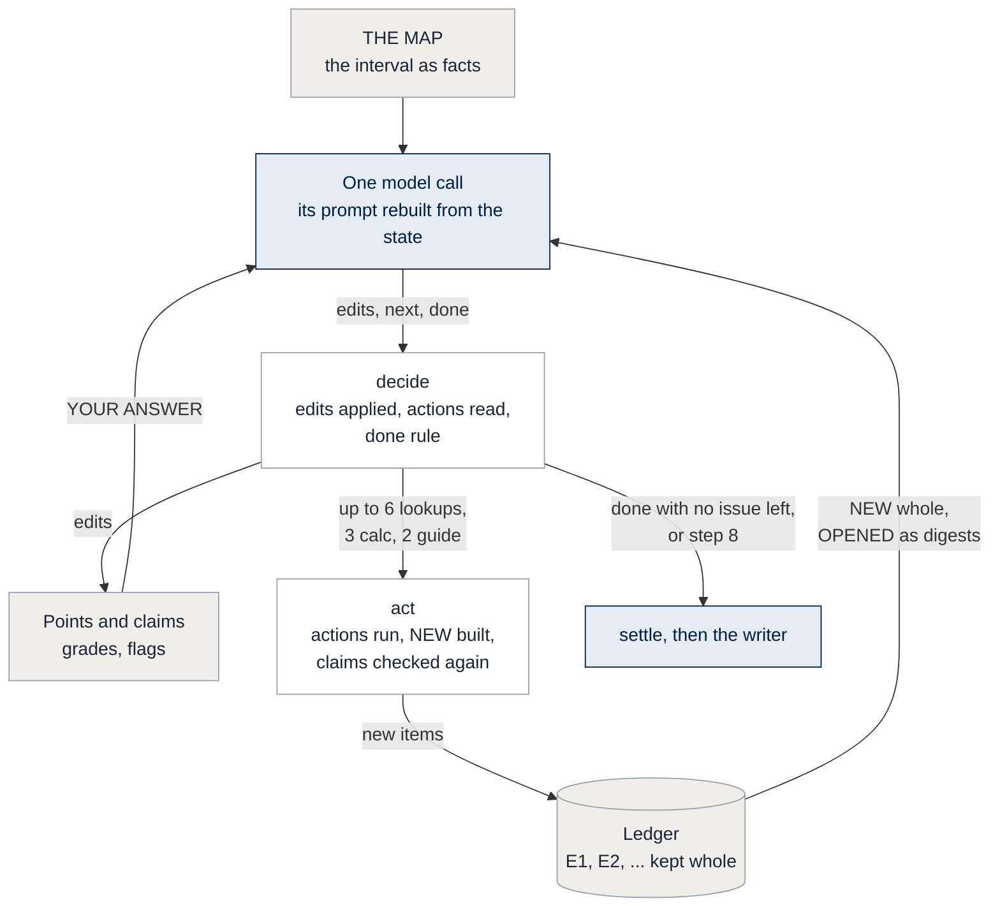
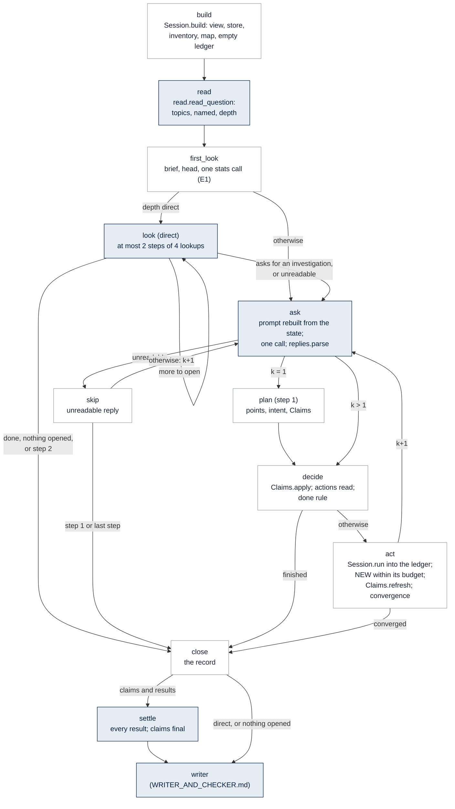

# Investigation state

An investigation keeps everything it knows outside the model: the session, the ledger of opened results, the points
and the claims. Every model call of a question is one prompt rebuilt from that state, and code, not the model, decides
when the investigation is done. This page is for developers who debug a trace, change a budget or a check, or add a
stage; the graph's nodes and routes are in [GRAPH.md](../GRAPH.md), and the examples come from a real conversation on
the Brent Group of GeoLink well 30/6-5 (2841-2958 m).

## 1. At a glance



| Part | What it is | Key limits | Where |
|---|---|---|---|
| Session | the state of one question or conversation: interval, map, ledger, claims, topics, guides read | one per question | `state.Session` ([state.py](../../src/petroharness/agent/state.py)) |
| Ledger | every opened result, kept whole, with an id `E1`, `E2`, ... | digest 700 (section 1,600); `get` 9,000; `find` 6,000 characters | `ledger.Ledger` ([ledger.py](../../src/petroharness/agent/ledger.py)) |
| Points | what the answer must settle, written by the model at step 1 | 6, of 240 characters | `Session.points`, `graph.plan` |
| Claims | findings that cite ledger ids, each with a grade | grades `hypothesis`, `low`, `moderate`, `high`, `not indicated`, `undetermined` | `claims.Claims`, `claims.Claim` ([claims.py](../../src/petroharness/agent/claims.py)) |
| Flags | facts code shows under a claim, K1 to K11 | never change a claim's text, grade or verdict | `Claims.check`, `C2_guardrails/flags.json` |
| Step loop | READ, first look, look or investigation steps, settle | 8 steps; 6 lookups, 2 guides, 3 calcs a step; 2 look steps of 4 | [graph.py](../../src/petroharness/agent/graph.py) |
| Prompt budgets | NEW, OPENED, ALL RESULTS, the writer's RESULTS | 12,000; 6,000; 24,000; 60,000 characters | `state.NEW_CHARS`, `state.OPENED_CHARS`, `writer.OPEN_CHARS`, `writer.RESULTS_CHARS` |
| Done rule | code, not the model, ends the investigation | every point settled, no hypothesis, no flag; or the cap; or 2 rephrasing steps | `Claims.done_issues`, `graph.decide`, `graph.act` |

On 30/6-5 Brent, the conversation's first question took the READ call, 8 steps and settle: 10 results (`E1` to
`E10`), 5 points, 9 claims (`C1` dropped), status `ok`. [Section 13](#13-worked-example-one-investigation-step) follows
one of its steps.

## 2. How it works



1. **Build.** `graph.build` calls `Session.build`: view, workflow store, inventory (`inventory.from_view`), map
   (`map.render`), an empty `Ledger`, and the skill library `direction.plugged(cfg)`.
2. **Read.** `read.read_question`: one to four topic areas, what the question names and, unless the run asked for
   `--investigate`, whether it is `direct`. `Session.choose` keeps the topics, their families and the scoped map.
3. **First look.** `graph.first_look` builds the brief (`prompts.brief`) and the prompt head, and opens one `stats` call
   over the topics' key curves, the named curves and the reservoir curves (`E1` on a first question).
4. **Look steps (direct questions only).** `graph.look`: at most 2 steps of 4 lookups, then the writer's short answer,
   or the investigation when the model asks for it or its reply cannot be read.
5. **Ask.** `graph.ask` rebuilds step k's prompt and makes one call; `replies.parse` reads the reply, salvages its
   complete edits and actions, or asks the model to fix its own JSON.
6. **Plan (step 1).** `graph.plan` takes the points, the intent and what the question asks, and creates the `Claims`.
7. **Decide.** `graph.decide` applies the edits (`Claims.apply`), reads the actions (`replies.coerce_action`), adds what a
   newly read guide opens, and applies the done rule (`Claims.done_issues`).
8. **Act.** `graph.act` runs the actions (`Session.run`), builds NEW within `NEW_CHARS` and withholds what does not
   fit, re-checks every claim (`Claims.refresh`) and tests convergence.
9. **Close and settle.** `graph.close` writes the record; `settle.settle` shows every result and makes the claims final;
   the writer follows ([WRITER_AND_CHECKER.md](WRITER_AND_CHECKER.md)).

## 3. The session

`state.Session` is the state of one question, a dataclass every node reads and changes in place. Its `run` method is
the one door for actions: each kind returns the text NEW shows and the item it shows whole, or `None`. On the Brent
ledger (`E1` to `E10` opened):

```text
("tool", "stats", {"curves": ["RDEP"], "zones": ["Z7"]}) -> ("[E11] RDEP [ohm.m] = Resistivity - Deep ...", <Item E11>)
("get", "E1", "")            -> ("[E1] (opened before: stats PHIT, PHIE, ...) ...", <Item E1>)
("get", "E1", "Z7")          -> ("[E1] stats PHIT, PHIE, ... (find: Z7)\n...", None)
("find", "Z7")               -> ("Z7 is in E1, E2, ..., E11\n\n...", None)
("calc", "0.2186 - 0.1254")  -> ("[E12] calc 0.2186 - 0.1254 = 0.0932\n  inputs: ...", <Item E12>)
("guide", "porosity")        -> ("GUIDE porosity (when: Questions on how porous ...)\nConsider:\n  - ...", None)
```

<details>
<summary><code>Session</code></summary>

| Name | Type | Default | Meaning |
|---|---|---|---|
| `task` | task object | required | the question, well, formation and interval |
| `f` | `engine.Formation` | required | `inv` (the inventory), `view` (the interval view), `store` (the analyzer sections) |
| `map` | `str` | required | the map text (`map.render`), rebuilt with scoped notes by `choose` |
| `ledger` | `Ledger` | required | every opened result |
| `claims` | `Claims` or `None` | `None` | created at step 1 (`graph.plan`) or at the first look step (`graph.look`) |
| `points` | `list[str]` | `[]` | the questions the answer must settle |
| `intent` | `str` | `"characterize"` | `value`, `locate`, `characterize`, `compare`, `explain` or `qc_check` |
| `guides` | `list[str]` | `[]` | the guides read, in the order read |
| `topics` | `list[str]` | `[]` | the topic areas the READ call chose; empty: none |
| `families` | `list[str]` | `[]` | the analyzer families those topics read (`direction.families`); empty: no scoping |
| `reading` | `dict` | `{}` | the READ reply as read: `topics`, `named` (and `depth`) |
| `card` | `str` | `""` | the provenance card the writer was shown (its numbers count as shown) |
| `library` | `direction.Library` or `None` | `direction.plugged()` | the skill library; `None` means no guides |
| `turn` | `int` | `1` | the question's number in a conversation |
| `turn_start` | `int` | `0` | where this question's items start in the ledger |
| `earlier` | `str` | `""` | the earlier questions as the prompts show them |
| `reply` | `str` | `"full"` | a later question's answer length: `brief` or `full` |
| `reads_depth` | `bool` | `False` | the READ call is asked for `depth` (set from the run's `depth`) |
| `depth` | `str` | `"investigate"` | `direct` or `investigate`, as the READ reply said |
| `fetched` | `list[str]` | `[]` | the ids a direct question's look steps were shown (its writer reads them) |
| `got` | `dict[str, list[str]]` | `{}` | the lines a get or find showed beyond each result's text (a list's kept lines, a class line asked by zone); the writer and settle read them under the result (`writer.result_text`) |

Defined in `state.Session`.

| Method | Does |
|---|---|
| `build(task, cfg)` | builds the view, store, inventory, map and ledger; plugs the library |
| `choose(topics)` | keeps the topics and families; re-renders the map with scoped notes |
| `run(act)` | runs one action; returns the text for NEW and the item shown whole (or `None`) |
| `opened(exclude)` | OPENED: the listing and digests, newest first, within `OPENED_CHARS` |
| `guides_text(fresh)` | GUIDES: the guides read, the fresh ones whole, the others short |
| `next_turn(task, earlier)` | a later question: the ledger and its ids stay, the question's own state restarts |
| `rewell(task, cfg, change)` | a settings change: the well interpreted again, the ledger marks older items |

Each is `state.Session.<method>`.

- The domain state lives outside LangGraph's state on purpose: the run context `graph.Run` holds the session and the
  trace, and nodes change them in place ([GRAPH.md](../GRAPH.md), "Run context and state").
- A tool call that raises anything other than `ToolError` is said back as `<tool> not run: the arguments could not be
  used (...)`, so one malformed call never loses the question.

</details>

## 4. The ledger

Every result the investigation opens becomes an item with the next id and stays whole in the ledger, outside the
model. The same call (after its arguments are normalized) returns the item it opened before, without running. Ids are
never reused; in a conversation they continue across questions, so a later question can cite an earlier question's
items. The ledger of the first Brent question, as `Ledger.listing()` writes it:

```text
  E1 stats PHIT, PHIE, PHIE_CC, PHID, PHIN, PHIS, PHI_SEC, VCL, SW, PERM, PERM_CC
  E2 section net_pay_flag_analysis
  E3 section hydrocarbon.integrated_hydrocarbon_potential
  E4 section gas_indicator_analysis_methods
  E5 section hydrocarbon.petrophysical_hydrocarbon_indicators
  E6 section hydrocarbon.reservoir_quality_for_hydrocarbons
  E7 unit_roles
  E8 stats PHIE_CC, SW, PERM_CC, RQI (where NET_PAY)
  E9 stats PHIE_CC, SW, PERM, PERM_CC, VCL
  E10 stats PHIE_CC, SW, PERM_CC, PERM, VCL (zones Z1, Z4, Z5, Z7, Z9, Z13, Z19)
```

<details>
<summary><code>Item</code></summary>

One opened result: the call that opened it and every line of its output, with the numbers written into each line.

| Name | Type | Default | Meaning |
|---|---|---|---|
| `id` | `str` | assigned | `E` followed by the item's position, 1-based (`E1`, `E2`, ...) |
| `tool` | `str` | required | the tool name, or `calc` |
| `args` | `dict` | required | the arguments as fitted by `schemas.fit` |
| `key` | `str` | required | the normalized call (`ledger.normalize`); the same key returns the same item |
| `rows` | `list[tuple[str, list]]` | required | every `(line, numbers)` of the result, including lines cut from the text shown |
| `text` | `str` | required | the text shown, within the tool size limit; a cut text ends with the `get` that fetches the rest |
| `numbers` | `list` | `[]` | every number the result wrote |
| `lines` | property |  | the lines of `rows` |
| `call_text()` | method |  | the call in one line of at most 90 characters (`stats PHIE, SW (zones Z1, Z2)`) |

Defined in `ledger.Item`.

A `calc` item on the Brent ledger (`0.2265` is Z7's mean SW in `E1`; `100` is a constant, also shown in `E2`):

```python
{'id': 'E13', 'tool': 'calc', 'args': {'expression': '100 - 0.2265 * 100'}, 'key': 'calc{"expression": "100-0.2265*100"}',
 'rows': [('calc 100 - 0.2265 * 100 = 77.35', [77.35]), ('  read as: 100 - (0.2265 * 100)', []), ...],
 'text': 'calc 100 - 0.2265 * 100 = 77.35\n  read as: ...', 'numbers': [77.35]}
```

`rows` keep the numbers as computed; `text` writes them with `map.num`. The number checks read both
(`ledger.shown_values`).

</details>

<details>
<summary><code>Ledger</code></summary>

| Name | Type | Default | Meaning |
|---|---|---|---|
| `f` | `Formation` | required | the interval the tools run on |
| `items` | `list[Item]` | `[]` | the items in the order opened |
| `errors` | `list[tuple]` | `[]` | `(tool, arguments, message)` of each rejected call |
| `_keys` | `dict` | `{}` | normalized call to item: an identical call returns its item |
| `turn_start` | `int` | `0` | where the current question's items start (a conversation) |
| `superseded` | `dict` | `{}` | item id to `(curve, the item that computed it again)` |
| `before` | `dict` | `{}` | item id to the settings change, in words, that came after it |

Defined in `ledger.Ledger`.

How `normalize` makes one key for equivalent calls:

```python
>>> normalize("stats", {"curves": ["phie_cc", "sw", "PHIE_CC"], "where": "sw<0.6"})
'stats{"curves": ["PHIE_CC", "SW"], "where": "SW < 0.6"}'
```

- How a result enters the ledger (`Ledger.open`): the tool name must be one of `toolset.TOOLS`, otherwise
  `ToolError("no tool ...; tools: ...")`; the arguments are read and fitted (`schemas.arguments`, `schemas.fit`), and
  the key is `normalize(name, known_args(name, args))`.
- A key already in `_keys` returns its item with `new = False`. Otherwise
  `schemas.call` runs the tool, the result's placeholder `get this result with find` (`engine.CUT_GET`) becomes
  `get E<n> with find`, and the item is appended with the next id.
- A rejected call raises `ToolError`; its message is recorded in `errors` and said back in NEW as `<tool> not run:
  <message>`.
- `normalize` fills in the tool function's defaults, drops `None`, upper-cases and de-duplicates `curves` and
  `zones` (`statistics` keep their case), upper-cases `a`, `b`, `curve`, `x` and `y`, and spaces a `condition` or
  `where` around its operators with a lone `=` written `==`.
- `calc` items have their own key: `calc` plus the expression without spaces.

</details>

## 5. Reading the ledger

Results are read back in five ways: two code uses to build the prompt, three the model asks for.

| Operation | The model writes | Gives | Cap |
|---|---|---|---|
| `show` | (code, for NEW) | the item whole | the tool's text, 9,000 characters |
| `digest` | (code, for OPENED and ALL RESULTS) | the lines that say what the item adds up to | 700 characters, 1,600 for a section |
| `get` | `{"get": "E1", "find": "SW, Z7"}` | the lines of one item that match, or the item whole | 9,000 characters |
| `find` | `{"find": "Z19"}` | `get` over every item | 6,000 characters |
| `calc` | `{"calc": "0.2186 - 0.1254"}` | arithmetic on shown numbers, as an item of its own | inputs must be shown by an item, the map or the question |

`E1`, the Brent first look, is 8,113 characters; its digest in OPENED keeps each curve's label and pooled line while
they fit:

```text
[E1] Each zone, every curve (its mean; a flag: the share set; class codes: each class's share):
PHIT [v/v] = total porosity, v/v (model output of the porosity step)
  zones pooled, PHIT: n 567 of 567, mean 0.1988
...
  (311 more lines: get E1 with find: a zone (Z1-Z20), a curve, class, parameter or depth)
```

A `get` brings back exact lines: SW in Z7, the Brent Group's clean sand.

```text
[E1] stats PHIT, PHIE, PHIE_CC, PHID, PHIN, PHIS, PHI_SEC, VCL, SW, PERM, PERM_CC (find: SW, Z7)
Each zone, every curve (its mean; a flag: the share set; class codes: each class's share):
  Z7: PHIT mean 0.2318; ... SW mean 0.2265; PERM mean 190.2694; PERM_CC mean 415.9992
SW [v/v] = water saturation in the uninvaded zone, v/v (model output of the saturation step)
  Z7 SAND 2877.5955-2890.8542 m, SW: n 88 of 88, mean 0.2265, median 0.2141, ...
  ...
```

<details>
<summary><code>Ledger.show</code></summary>

A result whole, as NEW and `get` without a find show it.

- `item` (`Item`, required): the item
- `new` (`bool`, default `True`): `False` adds `(opened before: <call>)` after the id

Defined in `ledger.Ledger.show`.

```text
[E1] (opened before: stats PHIT, PHIE, PHIE_CC, PHID, PHIN, PHIS, PHI_SEC, VCL, SW, PERM, PERM_CC) Each zone, every curve ...
```

An item opened before a settings change, or whose curve a later question computed again, says so after its id:
`(opened before <change>: these values rest on the earlier settings; <call>)`, `(opened before <curve> was computed
again in [E9]: these are the earlier values; <call>)` ([section 6](#6-later-questions-and-settings-changes)).

</details>

<details>
<summary><code>Ledger.digest</code></summary>

An item in at most `DIGEST_CHARS` (700) characters, or `SECTION_DIGEST_CHARS` (1,600) for an analyzer section: what
OPENED and ALL RESULTS show of an older result.

| Name | Type | Default | Meaning | Defined in |
|---|---|---|---|---|
| `DIGEST_CHARS` | `int` | `700` | an item at or below this size is its own digest | `ledger.DIGEST_CHARS` |
| `SECTION_DIGEST_CHARS` | `int` | `1600` | the same for a `section` item, so its classes and runs survive | `ledger.SECTION_DIGEST_CHARS` |
| `_P0` | regex | | a curve's label line (`NAME [unit] =`, `NAME against`, `NAME =`) | `ledger._P0` |
| `_P1` | regex | | what the item adds up to (`classes (`, `whole interval`, `zones pooled`, `by zone mean:`, `highest zone by`, ...) | `ledger._P1` |
| `_P2` | regex | | how it was made (`Samples where`, `method:`, `basis:`, `equation:`, `inputs:`, `curves:`) | `ledger._P2` |

On Brent, the digest of the section `E3` (6,300 characters) keeps its method, class lines and pooled class view.

- The digest keeps lines verbatim and in order, chosen by priority while they fit in the size limit less 130
  characters: the first line; for a section, its thresholds lines, its pooled class views and each class line; each
  curve's label with its pooled line; the `_P1` lines; the `_P2` lines; for a computed table, every row in order.
- A line longer than 200 characters is cut at its last comma before 200 and ends with ` ...`.
- The digest is returned only when it is shorter than the whole text; otherwise the whole text is the digest.
- An item opened before a settings change carries `(before <change>)` after its id.

</details>

<details>
<summary><code>Ledger.get</code></summary>

The lines of one item that match a find, or the whole item with no find: the model's `{"get": "E5", "find": "Z3"}`.

| Name | Type | Default | Meaning | Defined in |
|---|---|---|---|---|
| `eid` | `str` | required | the item id; brackets and case are ignored | `ledger.Ledger.get` |
| `find` | `str` | required | terms separated by `,` `;` or `|`; empty returns the whole item | `ledger.Ledger.get` |
| `GET_CHARS` | `int` | `6000` | the floor of the cap; the cap is `max(GET_CHARS, engine.max_chars())`, so 9,000 | `ledger.GET_CHARS` |
| `MISS_NAMES` | `int` | `15` | names listed when nothing matches | `ledger.MISS_NAMES` |

- Matching is `ledger.get_lines`, with `parts=True` for the model's calls. Zone terms (`Z3`, `z03`, `Z3-Z5`,
  `Z3 to Z5`) are alternatives; word terms are alternatives; a line must match a zone term and a word term when both
  kinds are given.
- An item is read in blocks: a line that is not indented and the indented lines after it. A word that names a
  block's head selects the whole block, and the head is always shown above the lines it selects.
- A word matches a name as a whole word. With `parts`, a word that names nothing in the item whole also matches whole
  parts of names between underscores (`MOVEABLE` finds `HIGH_MOVEABLE_HC`); a word that does name something whole
  (`LOW_SW`) stays that name and does not find `VERY_LOW_SW`.
- A section's class line asked by zone keeps only its runs in those zones (`ledger._class_runs`). It says `none in Z3`
  only when the run list is whole and every run's zone is known. A cut list, or runs whose zone cannot be read, says
  the runs are `not listed here`, with the condition that lists every run, so a cut list is never read as an absence.
  On Brent, `get E3` with find `Z19`:

  ```text
  WATER_BEARING: ... runs: Z19 (SAND) 2951.66162-2955.01440 (3.5051 m) (the list is cut: more may be in Z19; every run: runs hydrocarbon.integrated_hydrocarbon_potential:WATER_BEARING)
  NON_RESERVOIR: ... runs: not listed here for Z19 (the list is cut; every run: runs hydrocarbon.integrated_hydrocarbon_potential:NON_RESERVOIR)
  ```

- A miss says how the find was read and the names the item holds:

  ```text
  [E4] nothing in E4 matches PERM (read as words 'PERM'; terms are separated by , ; or |, ...); its names: DRHO, ND, PHIT_GAS_CORR, WEAK_GAS_EFFECT, ...
  ```

- An unknown id returns `E99: no such item; opened: E1, E2, E3, E4, E5, E6, E7, E8, E9, E10`.
- Output over the cap is cut at a line end with `... (<n> more characters: narrow find with a zone or a word)`.

</details>

<details>
<summary><code>Ledger.find</code></summary>

`get` over every item: the model's `{"find": "Z3"}`.

- `find` (`str`, required): as for `get` (`ledger.Ledger.find`)
- `FIND_CHARS` (`int`, default `6000`): items are shown while the total stays within this (`ledger.FIND_CHARS`)

On the Brent ledger, `find` `Z19` names every item that holds the zone, shows those that fit, and names the rest:

```text
Z19 is in E1, E2, E3, E4, E5, E6, E7, E8, E9, E10

[E1] stats PHIT, PHIE, ... (find: Z19)
...
[E7] unit_roles (find: Z19)
...
(not shown here: E4, E5, E6, E8, E9, E10; get one of them)
```

No match returns `no opened item matches <find> (read as ...)`.

</details>

<details>
<summary><code>Ledger.calc</code></summary>

Arithmetic on shown numbers, kept as an item of its own so a computed number can be cited: the model's
`{"calc": "0.2186 - 0.1254"}`.

- `expression` (`str`, required): `+ - * / **` and brackets on numbers, with `sqrt`, `ln`, `log10`, `exp`, `abs`, `min`, `max`, `sum`, `mean` (`ledger.Ledger.calc`, `ledger.evaluate`)
- `shown` (`str`, default `""`): other text whose numbers count as shown: `Session.run` passes the map and the question (`ledger.Ledger.calc`)
- `_FUNCS` (`dict`, default the nine functions): the functions `evaluate` accepts (`ledger._FUNCS`)

On Brent (Z7's mean PHIE_CC against the pooled mean; then Z7's hydrocarbon saturation in percent):

```text
[E12] calc 0.2186 - 0.1254 = 0.0932
  inputs: 0.2186 (E1), 0.1254 (E1)

[E13] calc 100 - 0.2265 * 100 = 77.35
  read as: 100 - (0.2265 * 100)
  inputs: 100 (E2), 0.2265 (E1), 100 (E2)
```

- Each input number must be shown by an opened item at the precision written (`ledger._claimed`, `ledger.matches`:
  the half-unit of the last stated digit), or by the map or the question, or be a whole number of at most 100 (a
  count or a percent, listed as `constant`). At least one input must be shown.
- `%` is dropped (`12.5%` is `12.5`), and `×`, `÷`, `^` and `−` are read as `*`, `/`, `**` and `-`.
- `read as:` appears when `+` or `-` meets `*`, `/` or `**` without brackets that show the order (`ledger.grouping`).
- The value is written by `map.num`: integers whole, values of at least 1 to at most 4 decimals, smaller values to 4
  significant figures, never in exponent form.
- A repeated expression returns its item. The errors are in [section 14](#14-limits-and-errors).

</details>

<details>
<summary>Other ledger members</summary>

| Name | Meaning | Defined in |
|---|---|---|
| `has(tool, args)` | whether an identical call is already opened (used before a guide opens its sections) | `ledger.Ledger.has` |
| `by_id(eid)` | the item for an id, or `None` | `ledger.Ledger.by_id` |
| `zone_of(depth)` | the zone holding a depth (`engine.zone_at`), or `between zones` | `ledger.Ledger.zone_of` |
| `listing()` | one line per item: `  E1 stats PHIE, SW` ([section 4](#4-the-ledger) shows the Brent listing) | `ledger.Ledger.listing` |
| `shown_values(item)` | every number an item shows: its written numbers and those in its text (names with digits and `Zn` excluded) | `ledger.shown_values` |
| `zones_in(text)` | the zones a text names, ranges expanded (`Z2-Z4`) | `ledger.zones_in` |

</details>

## 6. Later questions and settings changes

Two marks keep an old result from being read as current (30/6-5 Brent). A later question computed a curve again
under its name (SW_SIMANDOUX, with `rcl 3.5`, in `E3`):

```text
[E2] (opened before SW_SIMANDOUX was computed again in [E3]: these are the earlier values; stats SW_SIMANDOUX) SW_SIMANDOUX [v/v] = ...
```

The settings changed (`m` 1.8, the well interpreted again): earlier items say so, and the same call is computed anew
under a new id:

```text
[E1] (opened before the settings change before question 2 (m the default -> 1.8): these values rest on the earlier settings; stats PHIT, ...) ...
  Z1: ... SW mean 0.7765; ...
[E16] Each zone, every curve ...
  Z1: ... SW mean 0.6757; ...
```

<details>
<summary><code>Ledger.turn_start</code> and <code>Ledger.superseded</code></summary>

| Name | Meaning | Defined in |
|---|---|---|
| `Session.next_turn(task, earlier)` | `turn` + 1; `turn_start` and `ledger.turn_start` = the item count; claims, points, intent, reply, depth, fetched, guides, topics, families, reading and card start again | `state.Session.next_turn` |
| `Ledger._supersede(curves, by)` | after a call of a later question recomputes curves under the same names, each earlier item that names one is marked, and its key is removed so the same call is computed anew | `ledger.Ledger._supersede` |

- A recomputed curve is detected by a changed object in `view.calculated` across the call; only items before
  `turn_start` are marked.
- The second Brent question of the conversation started at `ledger_start` 10: its first look is `E11`, and its claims
  cite results of the first question (`E1`, `E9`, `E10`) as well as its own.

</details>

<details>
<summary><code>Ledger.rewell</code> and <code>Ledger.before</code></summary>

| Name | Type | Meaning | Defined in |
|---|---|---|---|
| `Session.rewell(task, cfg, change)` | method | rebuilds the view, store, inventory and map from the newly prepared well, then calls `Ledger.rewell` | `state.Session.rewell` |
| `Ledger.rewell(f, change)` | method | `f` replaced; every existing id gets `before[id] = change` (first change kept); `_keys` cleared | `ledger.Ledger.rewell` |
| `change` | `str` | the change in words: `the settings change before question <n> (<description>)` | `session.conversation.Conversation` |

- Ids continue after the change; the same call asked again is computed on the new well because `_keys` is empty.
- The marks appear in `show`, in the digest (`[E1] (before the settings change before question 2 (m the default ->
  1.8)) ...`) and in a `get` header (`[E1] stats ... (find: SW, Z7) (opened before the settings change before question
  2 (m the default -> 1.8): these values rest on the earlier settings)`).

</details>

## 7. Points and claims

At step 1 the model writes what the question asks (point 1) and the further points; code changes none beyond the
numbering, the length cap and a point equal to point 1. Each finding is a claim under one point, citing ledger ids,
with a grade the model sets. Step 1 of the first Brent question (abridged):

```json
{"asks": "What are the porosity, water saturation and permeability of the Brent Group in well 30_6-5 across its 20 zones, and is any of it hydrocarbon-bearing?",
 "points": ["Zone and pooled porosity (PHIT/PHIE/PHIE_CC) with lithology and VCL control",
            "Zone and pooled SW and where it sits against the 0.7 net-pay cutoff", ...],
 "intent": "characterize", ...}
```

Later steps show them back as YOUR ANSWER (`Claims.render`): each point `[settled]` or `[open]`, each flag under its
claim ([section 13](#13-worked-example-one-investigation-step)).

<details>
<summary>Points</summary>

| Name | Type | Default | Meaning | Defined in |
|---|---|---|---|---|
| `asks` | `str` | step 1 reply | what the question asks; becomes point 1 | `graph.plan` |
| `points` | `list[str]` | step 1 reply | the further points; a point equal to `asks` (any case) is dropped | `graph.plan` |
| cap | `int` | 6 points, 240 characters each | `listed[:6]`, `[:240]`; leading numbering such as `1.` is removed | `graph.plan` |
| fallback | `str` | the question, first 240 characters | used when the reply gives no points | `graph.plan` |
| points request | call | once | when the reply gives no `points` and its edits number a point from 2 to 6, one extra call (`step_1_points`) asks for that many (C5 `points_ask`) | `graph.plan` |
| `intent` | `str` | `characterize` | one of `value`, `locate`, `characterize`, `compare`, `explain`, `qc_check`; anything else is `characterize` | `graph.plan` |
| direct question | | the question as point 1 | a look step sets `points = [question[:240]]` and `intent = "value"` | `graph.look` |

The second Brent question's step 1 reply gave no points and numbered its edits up to point 3, so one points request
followed, and its reply gave 3 points (`"points_asked": true` in the step record):

```text
Your reply has no points. Reply with only the points your edits refer to, as JSON: {"points": ["..."], "intent": "..."} - 3 questions the answer must settle, numbered as your edits number them.
```

</details>

<details>
<summary><code>Claim</code></summary>

One finding under one point, with its citations, grade and the code's flags.

| Name | Type | Default | Meaning |
|---|---|---|---|
| `id` | `str` | assigned | `C1`, `C2`, ... in order of adding; never reused |
| `point` | `int` | required | the point it answers (1-based) |
| `text` | `str` | required | the finding |
| `means` | `str` | `""` | what the finding implies for the point |
| `ev` | `list[str]` | `[]` | cited item ids, and `MAP` for the map |
| `grade` | `str` | `"hypothesis"` | one of `GRADES` |
| `weak` | `str` | `""` | what weakens the finding in the data |
| `flags` | `list[str]` | `[]` | the check messages ([section 8](#8-claim-flags)) |
| `history` | `list[dict]` | `[]` | every `add`, `revise`, `drop` and code `cite`, with the state after it |
| `text_at` | `int` | `0` | the results open when its text was written (an `add`, or a `revise` with a new text); settle lists a graded claim whose point's claims cite a later one |
| `settles` | property |  | `grade != "hypothesis"` and no flags |

Defined in `claims.Claim`.

A claim of the second Brent question as `trace["claims"]` records it (long texts cut here with `...`):

```json
{"id": "C2", "point": 2, "text": "PERM_CC exceeds PERM in all 12 zones where both curves exist: ...", "means": "...",
 "ev": ["E17", "E18"], "grade": "moderate", "weak": "...", "flags": ["K3 220.8854 is in E1, E9, E10 (...)"],
 "history": [{"op": "add", "text": "Z5 and Z7 pair the second-highest reservoir quality ...", "ev": [], "grade": "hypothesis", "flags": []},
             {"op": "revise", ...}, {"op": "cite", "by": "code", "ev": ["E17"]}, ...]}
```

</details>

<details>
<summary><code>Claims</code></summary>

The claims of one question, checked against its ledger, the map and the question.

| Name | Type | Default | Meaning |
|---|---|---|---|
| `points` | `list[str]` | required | the points |
| `ledger` | `Ledger` | required | the evidence |
| `shown` | `str` | required | text whose numbers count as shown: the map |
| `question` | `str` | required | its numbers count as shown |
| `view` | interval view | `None` | enables the record checks (K5, K7, K8, and K11 through `checks`) |
| `wells` | `tuple` | `()` | the well's name, removed before numbers are read |
| `checks` | `dict` | `view.reg.checks` | the verifier vocabulary, [rules/checks.yaml](../../src/petroharness/resources/rules/checks.yaml) |
| `claims` | `dict[str, Claim]` | `{}` | the live claims by id |
| `dropped` | `list[Claim]` | `[]` | dropped claims, with their history |
| `families` | `tuple` | `()` | the families of the model's topics (K8's scope); set by `plan` and `look` |

Defined in `claims.Claims`.

| Method | Does |
|---|---|
| `apply(edits)` | applies edits in order; returns one message per edit that could not be applied |
| `check(claim)` | the flags of one claim ([section 8](#8-claim-flags)) |
| `refresh()` | re-checks every claim: a newly opened item can clear or change a flag |
| `settled(k)` | whether point k has a claim that settles |
| `done_issues()` | what keeps the investigation from being done ([section 9](#9-the-step-loop)) |
| `render()` | YOUR ANSWER: each point with `[settled]` or `[open]` and its claims |

Each is `claims.Claims.<method>`.

How `apply` reads edits:
- `add` needs `text` and a `point` from 1 to the number of points. A claim that cites results needs a readable grade;
  otherwise it is refused with `add: a claim that cites results needs its grade, one of ...`. A claim with no
  citations and no grade is a `hypothesis`. Code never grades a claim.
- `revise` and `drop` address a claim by `id`. Without an id they address it by `point` only when that point has
  exactly one claim; otherwise `<op> without an id: point 2 has claims C2, C3 (give the claim's id)`.
- `revise` changes only the fields given. An unreadable grade is refused with a message while the other fields
  apply; a `point` out of range is ignored.
- `drop` records `why` in the history and moves the claim to `dropped`.
- Anything that is no edit returns `not an edit: <first 120 characters> (use op add, revise or drop)`.

On Brent, a `revise` of the dropped `C1` came back as `revise C1: no such claim (claims: C2, C3, C4, C5, C6, C7, C8)`.

</details>

<details>
<summary>Grades</summary>

The grade scale, and how the many ways models write a grade are read (`claims.norm_grade`).

| Name | Default | Meaning | Defined in |
|---|---|---|---|
| `high` |  | two independent lines of evidence agree; read from `high`, `corroborat`, `strong`, `confirmed` | `claims.GRADES`, `claims._GRADE_WORDS` |
| `moderate` |  | one line of evidence, or one named weakness; read from `moderate`, `medium`, `fair`, `supported` | `claims.GRADES` |
| `low` |  | indicated with several weaknesses; read from `low`, `weak`, `marginal`, `log-indicated`, `indicated`, `candidate`, `tentative`, `minor` | `claims.GRADES` |
| `not indicated` |  | the evidence shows the indicator absent; read from `not indicated`, `no indication`, `absent`, `none`, `negative`, `refuted` | `claims.GRADES` |
| `undetermined` |  | the data cannot settle it; read from `undetermin`, `cannot determine`, `not determinable`, `unknown`, `insufficient` | `claims.GRADES` |
| `hypothesis` | default | not checked yet; read from `hypothes`, `unchecked`, `to check`, `untested`, `suspect` | `claims.GRADES` |

```python
>>> [norm_grade(g) for g in ("High", "medium", "not high", "weak", "absent", "tentative", "unknown", "xyz")]
['high', 'moderate', None, 'low', 'not indicated', 'low', 'undetermined', None]
```

- The patterns are tried in this order: `hypothesis`, `not indicated`, `undetermined`, `high`, `moderate`, `low`; the
  first match wins.
- A negated grade (`not high`, `not moderate`, `not strong`, ...) is refused rather than read.
- The grades' meanings above are the brief's (C1 `brief.md`), which the model reads.

</details>

<details>
<summary>How claims cite results</summary>

Citations are item ids and `MAP`, read from any form a model writes (`claims.parse_ev`, `claims.clean_text`).

| Name | Type | Meaning | Defined in |
|---|---|---|---|
| `ev` aliases | keys | `ev`, `evidence`, `evidence_ids`, `items`, `cites`, `cite` | `claims.coerce_edit` |
| forms | `list` or `str` | `["E1", "E2"]`, `"E1, E2"`, `"[E3]"`, ranges `E3-E5` (fewer than 50 ids), any case | `claims.parse_ev` |
| `MAP` | id | anything left that is not an id (the map, the card, the index) becomes `MAP` | `claims.parse_ev` |
| trailing ids | text | `... (E1, E4-E6, MAP)` at the end of a claim's text becomes citations and leaves the text; ranges give at most 20 ids | `claims.clean_text` |
| echo | text | an echoed `C1 [moderate]` at the start of a text is removed | `claims.clean_text` |

```python
>>> parse_ev("E1, E3-E5, the map")
['E3', 'E4', 'E5', 'E1', 'MAP']
```

Code may add citations, never remove them: when a graded claim states a number its cited items do not show, and other
items do, those items are cited by code if the number has at least four significant digits and one to three items
hold it, or three digits, one to three items, and an item line that names a zone, curve or class the claim's sentence
names. The history records `{"op": "cite", "by": "code", "ev": [...]}`.

</details>

## 8. Claim flags

A flag is a fact code shows under a claim, prefixed `!` in YOUR ANSWER. A flagged claim does not settle its point, and
no flag ever changes a claim's text, grade or verdict ([DESIGN.md](../DESIGN.md), G8). Flags the Brent conversation
raised:

```text
! K3 382 in no opened item (cite the item a number comes from and write it as shown; ...)
! K5 says 'missing DTS and flushed-zone resistivity', but this interval has RSHA (shallow resistivity)
! K7 says core-calibrated porosity/permeability is unavailable, but PHIE_CC/PERM_CC are here
! K8 this claim is about data-quality issues, and no opened item shows BAD_HOLE, which this interval has: open runs BAD_HOLE ...
! K10 graded, but the text still reads as a hypothesis: ...
```

K1, K2, K4 and K9 check citations, grade and `means` (the table below gives their messages).

<details>
<summary>The flags</summary>

| Flag | Applies to | Message (C2 `flags.json`) | Raised when | Defined in |
|---|---|---|---|---|
| K1 | every claim | `K1 {missing} not opened (cite opened items, or MAP for the description)` | a cited id is not an opened item | `Claims.check` |
| K2 | graded | `K2 a graded claim must cite the items that show it` | no citation is `MAP` or an opened item | `Claims.check` |
| K3 | graded | `K3 {numbers} (cite the item a number comes from ...)`, with `{number} is in {items}` or `{numbers} in no opened item` | a number in the text, `means` or `weak` that the cited items, the map and the question do not show (after code citations) | `Claims.check`, `Claims._unsupported`, `checks.number_provenance` |
| K4 | `high` | `K4 high confidence needs two lines of evidence: cite at least two items, or grade it lower` | fewer than two distinct valid citations (`MAP` counts as one) | `Claims.check` |
| K5 (data) | graded, with a view | `K5 says '{said}', but this interval has {curves} ({name})` | the claim says data is missing (`checks.yaml` `data_denials`) that the interval has | `Claims.content_flags` |
| K5 (route) | graded, with a view | `K5 {said}: say the route this interval uses` | a well-wide route record read as this interval's route (`routes.contradictions`) | `Claims.content_flags` |
| K7 (unavailable) | graded, with a view | `K7 says core-calibrated porosity/permeability is unavailable, but PHIE_CC/PERM_CC are here` | a denial of core calibration while `PHIE_CC` or `PERM_CC` has data | `Claims.content_flags` |
| K7 (absent) | graded, with a view | `K7 uses PHIE_CC/PERM_CC, but no core-calibrated curves are here` | `PHIE_CC` or `PERM_CC` named where neither has data | `Claims.content_flags` |
| K8 | graded, with a view | `K8 this claim is about {name}, and no opened item shows {shown}, which this interval has: open {how} before claiming it` | the claim's text speaks of a property (`checks.yaml` `indicators`) whose flags or classes have data here, and no opened item shows any of them | `Claims._before_claim` |
| K9 | not `hypothesis` or `undetermined` | `K9 say what this means for the point (means): the interpretation, not a restatement` | `means` has fewer than three words of three or more letters | `Claims.check` |
| K10 | graded | `K10 graded, but the text still reads as a hypothesis: ...` | the text opens like `H2:`, `Hypothesis:` or `Expected:` | `Claims.check` |
| K11 | `high`, `moderate`, `not indicated` | `K11 rests on {items}, a screen that could not run here ...` | a denial citing a section whose no-indication classes cover at least 99% while its record says inputs were unavailable, with no caveat | `Claims._screen_not_run` |

</details>

<details>
<summary>Notes on the flags</summary>

- There is no K6. K5 and K7 each have two messages.
- The number rule (`checks.number_provenance`, `checks.yaml` `numbers`): integers below 20 written without a decimal
  or percent are not checked; a difference, sum, ratio or percentage difference of two supported numbers in the same
  sentence is supported; numbers the question states are supported (a percentage there also as a fraction); a
  percentage may be a shown fraction times 100 or the complement of a shown share; typographic minus signs read as
  `-`; the well's name is removed first.
- Two more allowances apply to claims only (`Claims._unsupported`): a percentage that is `100 * a / b` of two numbers
  in its sentence, and an approximation (`~`, `≈`, `about`, `approx...`, `around`, `roughly`) within 5% of a cited value.
- K8 is scoped to the analyzer families of the model's topics: classes outside them are not required, and flags count
  only with such a class, except `BAD_HOLE` (`claims.ANY_QUESTION_FLAGS`), which any question may lean on.
- K3, K5 and K7 read the claim's text, `means` and `weak` together. K8, and K11's denial, read only the claim's text;
  K11's caveat may be anywhere in the claim.
- The vocabulary the checks use is data in [rules/checks.yaml](../../src/petroharness/resources/rules/checks.yaml).

</details>

## 9. The step loop

Each step is one call: `ask` rebuilds the prompt, `decide` applies the edits and reads the actions, `act` runs them
and re-checks the claims. Code ends the investigation; the model's `done` is a request:

- **Done** when every point has a settled claim (graded, cited, unflagged) and no claim is a hypothesis or flagged;
  otherwise `done` is refused once and the step's actions dropped.
- **Converged** after 2 steps in a row that start settled, end with no issue, open nothing and neither add nor drop
  a claim.
- **Capped** at step 8, which asks for no actions.

With the claims after step 3 of the first Brent question, a `done` gets this refusal (`Claims.done_issues()`):

```text
NOT DONE (you set done): point 1 has no settled claim (graded, cited, unflagged); point 3 has no settled claim (...); point 4 has no settled claim (...); hypotheses left: C1 (support, grade or drop each); flagged claims: C2, C3, C4 (fix or drop each). Settle each, then set done.
```

That question ran to the cap with `flagged claims: C2, C3` left; settle left `C3`.

<details>
<summary>Graph state</summary>

The control data that routes between nodes, in LangGraph's `graph.State`; the full table is in [GRAPH.md](../GRAPH.md).

| Name | Type | Default | Meaning |
|---|---|---|---|
| `k`, `max_steps` | `int` | `1`, `8` | the step being taken; the cap |
| `new` | `str` | `""` | NEW: what the last actions returned |
| `shown_new` | `list` | `[]` | ids NEW shows whole; left out of the next OPENED's digests |
| `withheld` | `list` | `[]` | ids opened but not shown for NEW's budget; first in the next NEW |
| `guides_new` | `list` | `[]` | guides the last step read: whole in the next GUIDES block |
| `refused` | `bool` | `False` | done was refused once by the done rule |
| `polish` | `int` | `0` | steps in a row that only rephrased a settled answer |
| `acts`, `notes`, `msgs`, `raw_edits`, `settled_before` |  |  | `decide`'s hand-off to `act` |
| `finished` | `bool` |  | the investigation ended at `look`, `decide` or `act` |


What `first_look` returns to start step 1:

```python
{"k": 1, "new": "", "shown_new": [], "withheld": [], "guides_new": [], "refused": False, "polish": 0}
```

</details>

<details>
<summary>The done rule</summary>

| Name | Type | Default | Meaning | Defined in |
|---|---|---|---|---|
| settled point | rule | | a point with at least one claim that is graded (not `hypothesis`), and unflagged | `Claims.settled` |
| done issues | `list[str]` | | `point k has no settled claim (graded, cited, unflagged)`; `hypotheses left: C1, C3 (support, grade or drop each)`; `flagged claims: C4 (fix or drop each)` | `Claims.done_issues` |
| done waits | rule | | `done` while results are withheld (and not the last step): no actions run, the withheld results come first in NEW, and C8 `done_waits` says why | `graph.decide` |
| finish | rule | | on `done`, no actions, or the last step: finished when there are no done issues, done was already refused once, or it is the last step | `graph.decide` |
| refusal | rule | once | otherwise NEW starts with C2 `not_done` (`NOT DONE (you set done): ...`, or `NOT DONE (no actions): ...`); with `done` set, the step's actions are dropped | `graph.decide` |
| convergence | rule | `POLISH_STEPS` = 2 | a step that starts settled, ends with no done issues, opens nothing new and has no `add` or `drop` edit counts; two in a row finish with `stopped: converged` | `graph.act`, `state.POLISH_STEPS` |
| step cap | rule | `MAX_STEPS` = 8 | step 8 asks for no actions (C5 `step_last`) and `decide` always finishes it, so `act` never runs at the cap | `graph.decide`, `graph.after_act` |

- `decide` checks `settled_before` (no done issues before this step's edits) to feed the convergence count.
- A direct question's look steps have no done rule: they end on `{"done": true}`, on a step that asks for no lookup,
  or after `DIRECT_STEPS` (2) steps. In the public mini set on 30/6-5 Brent (`tests/gate/mini/brent`), the third
  question, "What water resistivity did the saturation use?", was read as direct (`"depth": "direct"`): one look step
  opened `E21`, and the writer's short answer rests on it.

</details>

<details>
<summary>Actions per step</summary>

How `decide` turns a reply's `next` list into the actions `act` runs.

| Name | Type | Default | Meaning | Defined in |
|---|---|---|---|---|
| `ACTIONS` | `int` | `6` | lookups (tool calls, `get`, `find`) run per step; the brief states the same number | `state.ACTIONS` |
| `MAX_GUIDES` | `int` | `2` | guide reads per step, outside the 6 | `state.MAX_GUIDES` |
| `MAX_CALCS` | `int` | `3` | `calc` actions per step, outside the 6 | `state.MAX_CALCS` |
| `MAX_GUIDE_STATS` | `int` | `2` | `stats` calls a newly read guide opens | `settle.MAX_GUIDE_STATS` |
| order | rule | | guides, then calculations, then what guides open, then the first 6 lookups | `graph.decide` |
| left out | message | | lookups beyond 6: C8 `actions_left_out` (`Only the first 6 actions ran (2 left out): one focus, at most 6 actions a step.`); guides or calculations beyond their caps: C8 `extra_left_out` | `graph.decide` |
| unread | message | | an action no tool reads: C8 `not_run` with the first three, `Not run (not an action this harness reads): ...` | `graph.decide` |

The notes NEW opens with, as the second Brent question's step 7 prompt shows them (the model had written
`{"get": "K7"}`, a flag's name, as an action, and dropped a claim id that did not exist):

```text
Not run (not an action this harness reads): {"get": "K7"}. Actions are the tools listed (as {"tool name": {arguments}}), get, find, guide and calc.

Edits not applied:
- drop C3DUP: no such claim (claims: C1, C2, C3, C4, C5)
```

- A guide read for the first time opens, with no action slot, the workflow sections its Compare list names for the
  families of the READ call's first topic, and, when the guide serves that topic, up to two `stats` of the workflow's
  own curves it names ([SKILLS.md](SKILLS.md)). With no topics nothing is opened with a guide. On Brent's second
  question, the step 1 guides opened four `permeability.*` sections and `stats FZI, RQI, PHIE, PERM, KH`.
- In a look step, every action counts toward the 4 lookups, guides and calculations included.

</details>

<details>
<summary>NEW and withheld results</summary>

How `act` builds NEW within its budget from results only.

| Name | Type | Default | Meaning | Defined in |
|---|---|---|---|---|
| `NEW_CHARS` | `int` | `12000` | NEW's results at most, read at each step | `state.NEW_CHARS` |
| order | rule | | `decide`'s notes; `Edits not applied:` with one `- message` per edit; the results withheld last step; this step's results | `graph.act` |
| budget | rule | | a result with an item is shown whole while the running total stays within 12,000; one that does not fit is withheld; notes, `get` with a find, `find` output and errors are always shown | `graph.act.place` |
| repeat | rule | | an item already shown in this NEW is replaced by C8 `shown_above` (`[E2] shown above in this NEW`) | `graph.act.place` |
| withheld list | message | | C8 `withheld` (`Opened, not shown this step (size limit); each comes first in the next step's NEW:`) or, before the last step, C8 `withheld_last` (`...; the final step shows them with every result:`), then `[id] call` per item | `graph.act` |
| guides | rule | | a guide read goes to GUIDES (outside NEW and its budget), whole at the next step | `graph.act` |
| empty | message | | C8 `nothing_new` (`(nothing new)`) | `graph.act` |

- The notes' length counts toward the budget; the `Edits not applied` block does not.
- Because `get` lines are always shown, NEW can pass 12,000 characters: the five `get` calls of step 2 of the first
  Brent question made a NEW of 43,377 characters.
- A look step uses the same budget but shows a result that does not fit as `[E5] <call> (opened; the answer's writer
  reads it whole)`.

</details>

## 10. Budgets and limits

The budgets are module constants. The graph reads the step budgets through the `loop` module at call time
(`L.ACTIONS`, `L.MAX_GUIDES`, `L.MAX_CALCS`, `L.DIRECT_ACTIONS`, `L.DIRECT_STEPS`, `L.POLISH_STEPS`, `L.NEW_CHARS`),
so a test that sets one of them changes the run.

<details>
<summary>Character and count limits</summary>

| Name | Type | Default | Meaning | Defined in |
|---|---|---|---|---|
| `MAX_STEPS` | `int` | `8` | investigation steps; `--max-steps` and `answer(max_steps=)` override | `state.MAX_STEPS` |
| `DIRECT_STEPS` | `int` | `2` | look steps of a direct question | `state.DIRECT_STEPS` |
| `DIRECT_ACTIONS` | `int` | `4` | lookups in one look step | `state.DIRECT_ACTIONS` |
| `ACTIONS`, `MAX_GUIDES`, `MAX_CALCS` | `int` | `6`, `2`, `3` | per step ([section 9](#9-the-step-loop)) | `loop` |
| `POLISH_STEPS` | `int` | `2` | rephrasing steps that end the investigation | `state.POLISH_STEPS` |
| `NEW_CHARS` | `int` | `12000` | NEW's results | `state.NEW_CHARS` |
| `OPENED_CHARS` | `int` | `6000` | OPENED's digests (the listing of every item is not counted) | `state.OPENED_CHARS` |
| `WIDE_CHARS` | `int` | `9000` | a tool result's shown text (`engine.max_chars()`); cut rows stay in the item | `engine.WIDE_CHARS` |
| `DIGEST_CHARS`, `SECTION_DIGEST_CHARS` | `int` | `700`, `1600` | an older result's digest | `ledger` |
| `GET_CHARS`, `FIND_CHARS` | `int` | `6000`, `6000` | `get` (cap 9,000 through `max_chars()`) and `find` | `ledger` |
| `OPEN_CHARS` | `int` | `24000` | ALL RESULTS in the settle step: items whole while this lasts, digests after | `writer.OPEN_CHARS` |
| `RESULTS_CHARS` | `int` | `60000` | the writer's RESULTS, cut with `... (cut)` | `writer.RESULTS_CHARS` |
| `BOOK_ITEMS` | `int` | `12` | uncited results the settle step lists by name; the rest counted | `settle.BOOK_ITEMS` |
| `CORE_CURVES` | `tuple` | `VCL`, `PHIE`, `SW`, `PERM` | the reservoir curves every first look adds | `prompts.CORE_CURVES` |
| `MINERAL_VOLUMES` | `tuple` | `VCL`, `VQUAR`, `VCALC`, `VDOLO`, `VANHY`, `VSAND`, `VSILT`, `VSHALE`, `VCOAL` | added to the first look when `lithology_mineralogy` (`MINERAL_TOPIC`) is a topic | `prompts.MINERAL_VOLUMES` |
| `CORE_LOOK_CAP` | `int` | `14` | the first look's curves: the curves other than the reservoir and mineral curves are cut to `max(14 - <their count>, 8)` | `prompts.CORE_LOOK_CAP` |
| first look | rule | 8 + named, 12 | at most 8 topic overview curves, then the named curves, 12 in all, before the core curves and twins are added | `graph.first_look` |
| READ reply | schema | 1 to 4 topics; 12 names | `topics` from the topic areas; `named` strings | `read.read_schema` |
| `NAME_CHARS` | `int` | `80` | a name as the absent note shows it | `vocabulary.NAME_CHARS` |
| `EARLIER_CHARS` | `int` | `6000` | EARLIER IN THIS SESSION; `OPENING_CHARS` 600, `QUESTION_CHARS` 300, `CLAIM_CHARS` 240 | `session/earlier.py` |
| `RECURSION_LIMIT` | `int` | `200` | LangGraph supersteps of one question | `graph.RECURSION_LIMIT` |

</details>

<details>
<summary>Token caps and retries</summary>

The output caps come from the model card ([MODELS.md](../MODELS.md)).

| Name | Type | Default | Meaning | Defined in |
|---|---|---|---|---|
| `max_tokens_spec` | `int` | `3000` in `ModelConfig`; `16384` in `generic.yaml`; `32768` in the default model card | READ, look and investigation steps, the points request, settle, figures | `config.ModelConfig` |
| `max_tokens_writer` | `int` | `6000`; `16384`; `32768` | the writer and each repair | `config.ModelConfig` |
| fix call | `int` | `min(max_tokens_spec, len(reply) // 2 + 3000)` | the call that fixes a reply's JSON syntax; sent with the card's retry settings | `replies.parse` |
| empty reply | rule | one retry | a step, look or writer call that returns nothing is sent again with `retry=True` (`step_k_retry`, `writer_retry`) | `graph.ask`, `graph.look`, `graph._write` |
| READ retry | rule | one | an unreadable READ reply is sent again as `read_retry` (same settings) | `read.read_question` |

The output caps in the packaged `generic.yaml` card:

```yaml
model:
  max_tokens_spec: 16384             # a step's output cap (the investigation's JSON replies)
  max_tokens_writer: 16384           # the writer's and a repair's output cap
```

</details>

<details>
<summary>Trace truncations</summary>

What the trace keeps of long texts.

| Name | Type | Default | Meaning | Defined in |
|---|---|---|---|---|
| `read.reply` | `str` | 3000 characters | the READ reply | `read.read_question` |
| step `reply` | `str` | 6000 characters | each step's reply, also the settle reply | `graph.ask`, `graph.look`, `settle.settle` |
| `repaired.broken` | `str` | 20000 characters | an unreadable reply, with `error` (200) and `by` (`salvage`, `fix` or `salvage, incomplete`) | `replies.parse` |
| `focus` | `str` | 300 characters | the step's focus | `graph.decide` |
| `unread` | `list[str]` | 200 characters each | actions no tool reads | `graph.decide`, `graph.look` |
| `errors` | `list[str]` | 200 characters each | the ledger's rejected calls | `graph.close` |

Step 5 of the first Brent question, whose reply was read by salvage (values cut here with `...`):

```json
{"step": 5, "repaired": {"error": "the reply is not one readable JSON object (cut off, or invalid syntax: ...)",
                         "broken": "{\"focus\": \"Zone-level SW against ...", "by": "salvage"}, "prompt_chars": 81784, ...}
```

</details>

## 11. What the model is shown

Every call is one system message (the brief) and one user message rebuilt from the state; there is no conversation
inside the investigation. The texts' components are in [PROMPT_COMPONENTS.md](PROMPT_COMPONENTS.md). The step 3
prompt of the first Brent question, block by block (107,045 characters in all, 38,843 prompt tokens):

| Block | Characters (about) | What it holds |
|---|---|---|
| system: the brief | 27,300 | role, reply format, grades, number rules, tools |
| `QUESTION:` | 100 | the question |
| `THE MAP` | 22,000 | the interval as facts; notes scoped to the topics |
| `DIRECTION` | 3,600 | the guide index, the chosen topics first |
| `YOUR POINTS:` | 500 | the 5 points |
| `YOUR ANSWER (after step 2 of 8):` | 5,800 | 6 claims with their flags |
| `OPENED` | 3,300 | `E1` to `E3`: listing and digests |
| `GUIDES` | 900 | two guides, short |
| `NEW (from step 2):` | 43,400 | five `get` results |
| the request | 100 | C5 `step_next` |

<details>
<summary>The prompt head</summary>

The part every look and investigation step opens with, built once in `graph.first_look` (`Run.head`).

| Part | Shown | What it holds | Defined in |
|---|---|---|---|
| `QUESTION:` | always | the question | `graph.first_look` |
| absent note | when something named has no data | C10 `absent_note`: `Named but not in this well's record: <name> (<curves>); ...` | `vocabulary.note` |
| `EARLIER IN THIS SESSION (` | later questions | the earlier questions and what was found | `session/earlier.py` `block` |
| conventions | when the data config sets them | `THIS DATA'S REPORTING CONVENTIONS (how its reports name and group what the record holds; follow them in the answer without naming them):` and one `- ` line each | `writer.conventions_block` |
| `THE MAP` | always | the map with notes scoped to the topics | `map.render` |
| `DIRECTION` | with a skill library | the guide index, the chosen topics first | `direction.Library.index` |

A question that names logs a well lacks gets the absent note. GeoLink 16/7-1 (whole log; no neutron, no PEF), asked
"Is the neutron porosity consistent with the density porosity, and what does the photoelectric factor say about the
lithology?":

```text
Named but not in this well's record: neutron porosity (NPHI); photoelectric factor (PEF)
```

A later question opens with the earlier ones in brief (30/6-5 Brent, question 2):

```text
EARLIER IN THIS SESSION (the same well and interval, oldest first; the ids are results listed in OPENED, read them with get):
Question 1: What are the porosity, water saturation and permeability of the Brent Group, and is any of it hydrocarbon-bearing?
  Answered: Where. The Brent Group is logged as 20 zones, Z1–Z20, ...
  - Finding: SW sits against the 0.7 net-pay cutoff ... (moderate; E2, E1, E8, E9, E10)
  ...
```

</details>

<details>
<summary>Prompts by stage</summary>

How each call's user message is assembled; the system message is `prompts.brief(library)` except where noted.

| Stage | Shown | User message, in order | Defined in |
|---|---|---|---|
| `read` | once | C5 `read` (or `read_depth`), `QUESTION:`, earlier questions, `THE MAP` (notes unscoped), `TOPIC AREAS:` with `name - when` per area | `read.read_question` |
| `step_1` (look) | direct | head, `YOUR TOPICS: ...`, `FIRST LOOK (...)`, C5 `direct_step` | `graph.look` |
| `step_k` (look, k > 1) | direct | head, `OPENED (fetch exact lines with get or find):`, `NEW (from step k-1):`, C5 `direct_step` | `graph.look` |
| `step_1` | investigation | head, `YOUR TOPICS: ...`, `FIRST LOOK (...)`, C5 `step1`, C5 `points_scope`; later questions add C5 `step1_later` (and `step1_reply` when depth is not read) | `graph.ask` |
| `step_k` (k > 1) | investigation | head, `YOUR POINTS:`, `YOUR ANSWER (after step k-1 of N):`, `OPENED (...)`, `GUIDES (...)`, `NEW (from step k-1):`, C5 `step_next` (or `step_last` at the cap) and C5 `step_settled_check` when no done issue is left | `graph.ask` |
| `step_1_points` | at most once | the step 1 messages, the step 1 reply as an assistant turn, then C5 `points_ask` | `graph.plan` |
| `step_k_fix`, `settle_fix` | unreadable JSON | one user message: C2 `fix` with the parse error and the reply; no system message | `replies.parse` |
| `settle` | once | `QUESTION:`, absent note, earlier questions, `THE MAP`, `YOUR POINTS:`, `YOUR ANSWER:`, `ALL RESULTS:`, `BOOKKEEPING (...)` lists, C5 `settle`, C10 `settle_weaknesses`, `- ` and C9 `aspects_rule` | `settle.settle` |

- The first look's header reads `FIRST LOOK (each zone's key curves for the topics you chose: <topics>; opened for
  you):`, or `FIRST LOOK (each zone's key curves, opened for you):` with no topics.
- OPENED (`Session.opened`) is the listing of every item, then digests newest first, skipping the ids NEW shows
  whole, and stopping at the first digest that does not fit in `OPENED_CHARS`. Before anything is opened it reads
  `(nothing yet)`.
- GUIDES (`Session.guides_text`) holds every guide read, the earlier ones short (C6 `guide_short`: `<name>, read
  earlier; its Compare calls: ...`) and those read at the last step whole; it is empty before a guide is read.
- The settle step's ALL RESULTS is `writer.opened_results`: every item, as digests at first; then, while 24,000
  characters last, the cited items and the newest are upgraded to their whole text; a whole item carries the lines
  get or find fetched beyond its text. Its BOOKKEEPING lists (`settle.bookkeeping`, C5 `settle_lists`) name what the
  READ call named that no claim reaches, the opened results no claim cites (not `calc` items; at most 12), the claims
  still graded `hypothesis`, and the graded claims whose text was written before results their point's claims now
  cite (`settle.written_before`, from `Claim.text_at`: an order fact, not a check of content); nothing waits on them.

</details>

<details>
<summary>The brief</summary>

The system message of the READ call, every step and the settle step (`prompts.brief`).

| Part | Shown | What it holds | Defined in |
|---|---|---|---|
| C1 `brief` | always | the role, what each step shows, the reply format, the keys, grades and number rules | `C1_system/brief.md` |
| `{direction}`, `{guide_action}` | with a library | C1 `brief_direction`, C1 `brief_guide`; empty with none | `prompts.brief` |
| `{TOOLS}` | always | `prompts.tools_text`: C4 `library`, then each group's tools (`{"name": {"arg": ..., ...}}   description`), then the zone selector line | `prompts.tools_text` |
| `{ACTIONS}` | always | `6` | `prompts.brief` |
| C10 `brief_weaknesses`, `brief_levels` | always | how readings, caveats, negatives, levels and rankings are read | `prompts.BRIEF_WEAKNESSES`, `prompts.BRIEF_LEVELS` |

One tool line of `{TOOLS}`, cut here after its first sentence:

```text
  DESCRIBE: what the record holds
  {"stats": {"curves": ..., "zones": ..., "statistics": ..., "where": ...}}   Statistics of one or more curves over each zone and the zones pooled, ...
```

</details>

<details>
<summary>The map</summary>

The first thing the model reads: the inventory as plain facts (`map.render`), framed by C7.

| Part | Shown | What it holds | Defined in |
|---|---|---|---|
| well line | always | `WELL <well>, FORMATION <formation>`; the interval, gross thickness, samples and step | `map.render` |
| zones | always | the count and share covered; each zone's id, name, lithology, top-base and thickness; the lithology log's shares where the zone is labelled otherwise | `map.render` |
| raw input | always | the input curves with what each is; measured logs not in the input (Petrophys's completeness list); logs with no values here; the LAS header parameters | `map.render`, `map.primary_absent` |
| after the workflow | always | preparation steps; each workflow step's method, inputs, curves, equations, recorded values (`values (whole well, as recorded)`) and decisions scoped to the interval; QC and recomputation steps; other curves | `map.render`, `map._compact`, `map._coefficients` |
| analyzer curves | when present | `Computed by the analyzers:` with each curve's catalog line | `map.render` |
| analyzer sections | when present | the section keys, by family | `map.render` |
| notes | when present | `Notes on this interval`, scoped to the topics' families | `notes.notes`, `map.scoped_notes` |

The head of the map of 30/6-5, Brent Group, whose zones are runs of its lithology log:

```text
WELL 30_6-5, FORMATION BRENT GP.
Interval: 2841.0193-2957.9102 m (gross 116.8909 m); 768 samples every 0.1523 m
Zones: 20, covering 83.3629 m (71% of the interval)
  Z1 SAND_GROUP_1 2841.3242-2845.7439 m (4.4197 m)
  Z2 SILT_GROUP_4 2856.1069-2858.6977 m (2.5908 m)
  ...
Raw input (the LAS as given, before the workflow)
  curves: LITHOLOGY_GEOLINK = lithology code; CALI = Caliper; NPHI = Neutron Porosity; ...
  measured logs not in the input: DTS (sonic log), RXO (Resistivity - Flushed Zone)
  ...
```

Without a lithology log the zones are runs of the lithology Petrophys's mineral solver gives. Taranaki tuhua-7, McKee
Formation (tops file `formations_tuhua-7.csv`):

```text
WELL tuhua-7, FORMATION McKee
...
Zones: 11, covering 58.2168 m (70% of the interval)
  Z1 SHALE_GROUP_1 1936.3944-1940.3568 m (3.9624 m)
  Z2 SANDSTONE_GROUP_3 1941.576-1944.7764 m (3.2004 m)
  ...
```

- A curve that holds one value over the whole well is labelled so, whatever set it (C7 `one_value`); the step's
  record says how. A recorded parameter Petrophys notes (its `parameter_notes`) carries the note beside its value.
- With one zone the map adds that its variation is read by depth, not zone by zone.
- Note scoping (`map.scoped_notes`): a note that starts with a section key (`family.section: `) is kept only for the
  topics' families; the saturation-route notes (`Rw:`, `SW model`, `SXO:`, `MHI:`) are left out when every family is
  `porosity` or `lithology`. With no topics every note is kept.
- The writer reads the map without its notes block (`writer.writer_map`).

</details>

<details>
<summary>The notes</summary>

General facts about the interval's record (`agent/notes.py`), each a map line under `Notes on this interval`.

| Name | Default | Meaning | Defined in |
|---|---|---|---|
| provenance facts |  | the card's facts on how curves were made (`record.card.provenance_facts`); mineral-solver volumes restated with their coverage here | `notes._facts`, `notes.mineral_fact` |
| bad hole | `BAD_HOLE_SHOWN` = 5.0 | zones with at least 5% of samples with `BAD_HOLE > 0.5`, at most 8 named | `notes._bad_hole_note` |
| could not run | `NOT_RUN_SHARE` = 99.0 | a section whose negative-sounding class covers at least 99% while its method needs an input this interval lacks | `notes.not_run` |
| carbonate | `PEF > 2.8` and `RHOB > 2.6` | the carbonate indicators' coverage, a PEF-only mismatch, and lithology groups the consistency check has no window for | `notes._carbonate_note`, `notes._mismatch_note`, `notes._consistency_note` |
| gas screen | `GAS_SCREEN` = 0.03 | how many samples the gas classes screen and how many the workflow's crossover call confirms | `notes._gas_screen_note` |

Two of the notes on 30/6-5, Brent Group:

```text
Notes on this interval
  - Bad hole (BAD_HOLE > 0.5): Z2 88.9%, Z3 65% of the zone's samples; there the pad tools read mud (RHOB low, density porosity high; NPHI, PEF affected)
  - hydrocarbon.geophysical_hydrocarbon_indicators: NO_INDICATION on 100% of the samples, but its method needs DTS, not here: samples it could not compute, not a negative result
```

</details>

<details>
<summary>The inventory</summary>

The model of the interval's input and record that the map, the tools and the checks read (`inventory.from_view`; code
only, no model calls). The full build is in [WELL_PREPARATION.md](WELL_PREPARATION.md).

| Name | Type | Meaning | Defined in |
|---|---|---|---|
| `curves` | `dict[str, Curve]` | each curve with data: `unit`, `meaning`, `meaning_from`, `source` (`input`, `computed`, `analyzer`, `copy`, `unknown`), `step`, `inputs`, `copy_of`, `coverage`, `n`, `zone_coverage`, `percent`, `flat`, `measured_log`, `codes`, `well_value`, `catalog` | `inventory.Curve` |
| `zones` | `list[Zone]` | `id`, `lithology`, `top`, `base`, `thickness`, `n`, `name`, `log_shares`, `stated` | `inventory.Zone` |
| `properties` | `dict` | porosity, permeability and water saturation curves ranked: 1 plug, 2 core-calibrated, 3 log model | `inventory._properties` |
| `methods` | `list[Method]` | each workflow step: `method`, `inputs`, `outputs`, `parameters`, `equations`, `decisions`, `equations_here`, `decisions_here`, `stage` | `inventory.Method` |
| `sections` | `list[Section]` | each analyzer section: `key`, `family`, `title`, `method`, `basis`, `classes`, `other`, `thresholds` | `inventory.Section` |
| `notes` | `list[str]` | the notes above | `inventory._notes` |
| other fields |  | `well`, `formation`, `depth_unit`, `top`, `base`, `gross`, `step`, `samples`, `zoned_thickness`, `header`, `value_qc`, `logs_present`, `logs_absent`, `logs_empty`, `absent_meanings`, `record_lists_outputs` | `inventory.Inventory` |

`inventory.Zone`, as defined (`inventory.SourceRank` holds `curve`, `rank`: 1 plug measurement, 2 core-corrected, 3 log
model, and `kind`, a plain description of the curve):

```python
@dataclass
class Zone:
    id: str
    lithology: str
    top: float
    base: float
    thickness: float
    n: int
    name: str = ""          # the record's name for the zone (its lithology group, e.g. LIMESTONE_GROUP_1)
    log_shares: str = ""    # the lithology log's shares in the zone, when the zone's lithology is another
                            #   (a formation lithology the data states)
    stated: str = ""        # the formation's lithology as its tops state it, where the log reads another
```

`inventory.calibrated_twins` pairs a log curve with its core-calibrated twin (`X` and `X_CC`); the first look opens
both side by side.

</details>

<details>
<summary>The vocabulary</summary>

What the question names, read through the curve registry's vocabulary: the one place code reads the question's words
([DESIGN.md](../DESIGN.md), G4).

| Name | Meaning | Defined in |
|---|---|---|
| `resolve(name, reg, known)` | the curves a name stands for: a mnemonic that is the whole name, else the mnemonics, synonyms, question terms and named measurements it writes | `vocabulary.resolve` |
| `in_text(text, reg, known)` | the names a text writes, each with its curves; where names overlap the longer wins | `vocabulary.in_text` |
| `named(s)` | the READ reply's `named` list, then the question's own vocabulary | `vocabulary.named` |
| `absent(s)` | the named items none of whose curves has data in the interval, one per set of curves | `vocabulary.absent` |
| `note(s)` | the absent note (C10 `absent_note`); empty when nothing is absent | `vocabulary.note` |
| registry keys | `synonyms`, `question_terms`, `named_measurements`, `families`, `inventory`, `flags`, `core`, `meanings` in [rules/curves.yaml](../../src/petroharness/resources/rules/curves.yaml) | `vocabulary.mnemonics` |

With the packaged registry:

```python
>>> resolve("shear sonic", reg), resolve("deep resistivity", reg), resolve("spectral gamma ray", reg)
(['DTS'], ['RDEP'], ['THOR', 'URAN', 'POTA', 'SGR', 'CGR'])
>>> in_text("Is the shear sonic consistent with the gamma ray in Z2?", reg)
[('shear sonic', ['DTS']), ('gamma ray', ['GR'])]
```

- `prompts.named_curves` gives the first look the curves with data that the READ reply's names stand for.
- `trace["absent"]` records the absent items as `{"name", "curves"}`; for the 16/7-1 question above,
  `vocabulary.absent` gives `[('neutron porosity', ['NPHI']), ('photoelectric factor', ['PEF'])]`.

</details>

## 12. What the model returns

Every reply of the investigation is one JSON object: a step's holds `focus`, `edits`, `next` and `done`. Step 3 of
the first Brent question (long texts cut with `...`):

```json
{"focus": "Zone and pooled SW against the 0.7 net-pay cutoff (point 3) — verify zone-by-zone pay shares from E2 and SW pooled mean from E1, then rebuild the SW claims",
 "edits": [{"op": "revise", "id": "C2", "ev": ["E2", "E1"], "grade": "moderate", "means": "...", "weak": "..."},
           {"op": "revise", "id": "C3", "ev": ["E1"], "grade": "moderate", "means": "...", "weak": "..."}],
 "next": [{"get": "E2", "find": "NET_PAY"}, {"get": "E1", "find": "SW"},
          {"get": "E3", "find": "MARGINAL,POTENTIAL_PAY,PRIME_OIL_TARGET"},
          {"section": {"key": "gas_indicator_analysis_methods"}}],
 "done": false}
```

<details>
<summary>Structured replies</summary>

The JSON shape of every reply the harness reads.

| Stage | Type | Shape | Defined in |
|---|---|---|---|
| `read` | JSON schema | `{"topics": [area, ...], "named": [str, ...]}`, with `"depth": "direct" or "investigate"` when depth is read | `read.read_schema`, `read._reading` |
| `step_1` | object | `asks`, `points`, `intent`, `focus`, `edits`, `next`, `done`; a later question may add `"reply": "brief" or "full"` | C1 `brief.md`, `replies.read_reply` |
| `step_k` | object | `focus`, `edits`, `next`, `done` | `replies.read_reply` |
| look step | object | `{"done": true}`, `{"next": [...], "done": false}`, or `{"depth": "investigate"}` | C5 `direct_step.md`, `graph.look` |
| `step_1_points` | object | `{"points": [...], "intent": "..."}` | C5 `points_ask.md`, `graph.plan` |
| `settle` | object | `{"edits": [...], "done": true}` | C5 `settle.md`, `settle.settle` |
| `step_k_fix`, `settle_fix` | object | the same object with only its syntax fixed | C2 `fix.md`, `replies.parse` |
| writer, repair | markdown | the answer; a direct question's writer may reply `INVESTIGATE` | [WRITER_AND_CHECKER.md](WRITER_AND_CHECKER.md) |
| `figures` | JSON schema | `{"figures": ["F2", "F1"]}`, at most 3 | `figures.schema` |

The READ reply of the first Brent question:

```json
{"topics": ["porosity", "water_saturation", "permeability_rock_quality", "hydrocarbon_detection"], "named": ["porosity", "water saturation", "permeability", "Brent Group", "hydrocarbon-bearing"], "depth": "investigate"}
```

How a reply is read (`replies.read_reply`, `replies.parse`):
- The reply's step object is the last JSON object holding a step key (`asks`, `points`, `intent`, `focus`, `edits`,
  `next`, `done`); an object wrapped under `step`, `reply`, `response`, `answer`, `output` or `result` is unwrapped.
- `edits` and `next` given as one object become a list; `done` given as `"true"`, `"yes"` or `"1"` is true.
- When the object closes before edits or actions that follow it, the reply is unreadable. `replies.salvage` then keeps
  every complete inner edit and action. A salvage is accepted when it is complete and, at step 1, holds points;
  otherwise the model is asked once to fix its own syntax (`step_k_fix`); an incomplete salvage is the last resort.
  Steps 1 and 5 of the first Brent question were read by salvage.
- A step that still cannot be read is skipped (`graph.skip`): NEW says C2 `skip` (`Your last reply could not be read:
  reply with one JSON object holding your edits and actions.`). An unreadable step 1, or the last step, ends the
  investigation; with no claims the question fails (`no_answer`).
- The settle reply is read as later steps are (`parse(..., stage="settle")`): a complete salvage is accepted without
  points, and its fix call is `settle_fix`.

</details>

<details>
<summary>Edits</summary>

A claim edit in the shapes models write, read by `claims.coerce_edit`.

| Name | Type | Default | Meaning |
|---|---|---|---|
| `op` | `str` |  | `add`, `revise`, `drop`; also read from `action` or `type`, from a key (`{"add": {...}}`, `{"drop": "C4"}`), and from the aliases `update`, `edit` (revise), `delete`, `remove` (drop), `new` (add) |
| `id` | `str` | `None` | also `claim_id`, `cid`; upper-cased |
| `point` | `int` | `None` | also `p`; `2`, `"2"`, `"p2"`, `"point 2"` |
| `text` | `str` | `None` | also `claim`, `finding`, `statement` |
| `means` | `str` | `None` | also `meaning`, `implication`, `implies`, `interpretation`, `so_what` |
| `ev` | `list` | `None` | also `evidence`, `evidence_ids`, `items`, `cites`, `cite` |
| `grade` | `str` | `None` | also `confidence` |
| `weak` | `str` | `None` | also `weakness`, `weaknesses`, `limits`, `limit`, `caveats`, `limitations` |
| `why` | `str` | `""` | also `reason`; a drop's reason |

Defined in `claims.coerce_edit`.

```python
>>> coerce_edit({"update": {"id": "c2", "confidence": "low", "evidence": "E1-E3, MAP"}})
{'op': 'revise', 'id': 'C2', 'point': None, 'text': None, 'means': None, 'ev': ['E1', 'E2', 'E3', 'MAP'],
 'grade': 'low', 'weak': None, 'why': ''}
```

</details>

<details>
<summary>Actions</summary>

An action in the shapes models write, read by `replies.coerce_action` into one of five kinds.

| Name | Type | Meaning |
|---|---|---|
| tool | `("tool", name, args)` | `{"stats": {...}}`, `{"tool": "stats", "args": {...}}`, `{"tool": "stats", "curves": [...]}`, `{"runs": "NET_PAY"}` (the tool's main argument), `{"stats": ["SW"]}`, `{"compare": ["PHIE", "PHIE_CC"]}` (`a`, `b`), `{"crossplot": [y, x]}` |
| `get` | `("get", eid, find)` | `{"get": "E5", "find": "Z3"}`; the find may also be `query`, `terms`, `zone` or `where`; the id must read `E<n>` |
| `find` | `("find", terms)` | `{"find": "Z3"}` (also `query`, `terms`), when no tool name is a key |
| `guide` | `("guide", name)` | `{"guide": "porosity"}` (also `facet`, `name`); `None` with no skill library |
| `calc` | `("calc", expression)` | `{"calc": "78.8 + 58.4"}`, or `{"calc": {"expression": ...}}` |

Defined in `replies.coerce_action`.

```python
>>> coerce_action({"stats": ["SW"]}), coerce_action({"compare": ["PHIE", "PHIE_CC"]})
(('tool', 'stats', {'curves': ['SW']}), ('tool', 'compare', {'a': 'PHIE', 'b': 'PHIE_CC'}))
>>> coerce_action({"get": "e5", "find": "Z3"}), coerce_action({"runs": "NET_PAY"})
(('get', 'E5', 'Z3'), ('tool', 'runs', {'condition': 'NET_PAY'}))
>>> coerce_action({"guide": "porosity"}, guides=False)
None
```

A tool name must be one of `toolset.TOOLSET.names()`; an action that is none of the five is unread (C8 `not_run`), as
`{"get": "K7"}` was on Brent: `K7` does not read `E<n>`.

</details>

<details>
<summary>Tool arguments</summary>

The door every tool call goes through (`schemas.call`), which reads the arguments a model sends.

| Name | Meaning | Defined in |
|---|---|---|
| `arguments(raw)` | JSON text or a dict; empty values (`None`, `[]`, `""`, `"null"`, `"none"`) dropped; numbers sent as text read as numbers; a name list given as one string or JSON text split; `"all"` statistics dropped (the default set) | `schemas.arguments` |
| `fit(name, args)` | asides (`find`, `reason`, `note`, `notes`, `purpose`, `why`, `comment`, `intent`) left out; every-zone words (`true`, `"all"`, `"pooled"`, ...) mean all zones; zone numbers and ranges (`2`, `"Z1-Z3"`, `"Z1 LIMESTONE"`); statistic names normalized; `default` baselines dropped; operator words (`gte`, `less than`) as signs; a `where` with no comparison and only scope words dropped; one curve where a list belongs and back; `runs` given a `where` | `schemas.fit` |
| `call(f, name, raw)` | runs the tool; unknown arguments are ignored and said back as a first line `(ignored x: <tool> takes ...)`; a missing required argument raises `<tool> needs ...; it takes ...` | `schemas.call` |
| `known_args(name, args)` | the arguments the tool takes (used for the ledger key) | `schemas.known_args` |

Output of `fit(name, arguments(raw))`:

```python
>>> fit("stats", arguments({"zones": "Z1-Z3", "statistics": "mean, median", "reason": "check Z1"}))
{'zones': ['Z1', 'Z2', 'Z3'], 'statistics': ['mean', 'median']}
>>> fit("stats", arguments({"zones": [2, "Z4 LIMESTONE"], "statistics": ["coefficient of variation", "P10"]}))
{'zones': ['Z2', 'Z4'], 'statistics': ['cv', 'p10']}
```

The tools and their arguments are in [TOOLS_REFERENCE.md](TOOLS_REFERENCE.md).

</details>

## 13. Worked example: one investigation step

The first question of the Brent conversation, step by step, from its trace:

| Step | Actions | Opened | Withheld | NEW chars | Settled | Claims | Hyp. | Flagged |
|---|---|---|---|---|---|---|---|---|
| 1 | 2 guide, 2 section | E2, E3 | | 9,652 | 0 of 5 | 4 | 4 | 0 |
| 2 | 5 get | | | 43,377 | 2 of 5 | 6 | 2 | 2 |
| 3 | 3 get, section | E4 | E4 | 13,474 | 2 of 5 | 6 | 1 | 3 |
| 4 | 2 section, get, unit_roles, stats | E5-E8 | E6-E8 | 12,633 | 1 of 5 | 7 | 0 | 5 |
| 5 | stats, 3 get | E9 | E8, E9 | 16,864 | 1 of 5 | 7 | 0 | 5 |
| 6 | stats, 3 get | E10 | E9, E10 | 16,516 | 2 of 5 | 7 | 0 | 4 |
| 7 | guide, 2 get | | E10 | 9,858 | 4 of 5 | 7 | 0 | 1 |
| 8 | none; done | | | | 5 of 5 | 8 | 0 | 2 |

A withheld result comes first in the next step's NEW. Settled: points with a settled claim, after the step.

The walk-through follows step 3. Prompts and replies are the tape's; the done issues come from `Claims.done_issues()` on
the same claims and ledger, replayed on 30/6-5 (the replay renders YOUR ANSWER exactly as the step 4 prompt shows it).

### State before step 3

- Ledger: `E1` (the first look), `E2` and `E3` (the `section` calls of step 1). Step 2 ran only `get` calls, so
  `shown_new` is `[]` and OPENED holds the digests of all three.
- Claims: `C1` and `C3` are hypotheses; `C2` and `C4` carry K10; `C5` and `C6` settle points 5 and 2.
- Done issues: points 1, 3 and 4 unsettled; `hypotheses left: C1, C3 (...)`; `flagged claims: C2, C4 (...)`.

The prompt after its head (QUESTION, THE MAP, DIRECTION), abridged:

```text
YOUR POINTS:
...
YOUR ANSWER (after step 2 of 8):
...
  C2 [moderate] Hypothesis: SW pooled 0.718 v/v; ... (E2, E1)
     ! K10 graded, but the text still reads as a hypothesis: ...
...
OPENED (fetch exact lines with get or find):
  E1 stats PHIT, PHIE, PHIE_CC, ...
  E2 section net_pay_flag_analysis
  E3 section hydrocarbon.integrated_hydrocarbon_potential
[E3] ... (the digests, newest first)

GUIDES (...):
...
NEW (from step 2):
[E1] stats PHIT, PHIE, ... (find: PHIE_CC)
...
Edit your answer for what NEW shows; then your next focus and actions, or done.
```

### The reply and `decide`

The reply ([section 12](#12-what-the-model-returns)) revises `C2` (citations `E2`, `E1`) and `C3` (grade `moderate`),
rewriting their `means` and `weak` but not their text, and asks for three `get` calls and
`section {"key": "gas_indicator_analysis_methods"}`. Both edits apply, the 4 lookups are within the 6, and `done` is
false. Both texts still open with `Hypothesis:`, so `C2` keeps its K10 flag and `C3`, graded at this step, gets one.

### `act` and the state after step 3

- The three `get` results are always shown, and they left no room for `E4` (3,892 characters) within 12,000: `E4` is
  withheld, NEW is 13,474 characters, and `shown_new` is `[]`.
- Done issues: points 1, 3 and 4 unsettled; `hypotheses left: C1 (...)`; `flagged claims: C2, C3, C4 (...)`. `polish`
  stays 0 (the step did not start settled); `k` becomes 4.

```text
NEW (from step 3):
[E2] section net_pay_flag_analysis (find: NET_PAY)
...
Opened, not shown this step (size limit); each comes first in the next step's NEW:
[E4] section gas_indicator_analysis_methods
```

At step 4, `act` showed `E4` first (`carried: ["E4"]`). The step's record in `trace["steps"]` holds `focus`, `edits`,
`edit_msgs`, `actions`, `done`, `guide_sections`, `withheld`, `carried`, `guides_read`, `new_chars` and the rendered
`answer`, with `prompt_chars` (107,045), `prompt_tokens` (38,843) and the `reply`.

## 14. Limits and errors

<details>
<summary>Every situation and what happens</summary>

| Situation | What happens | Where |
|---|---|---|
| The READ reply is unreadable twice | no topics and no names: the general first look, the index in its own order, unscoped notes; `trace["read"]["parse"] = "failed"` | `read.read_question` |
| A topic in the READ reply is not an area | it is ignored; a reply with no valid topic is unreadable | `read._reading` |
| A step reply is empty | one retry (`step_k_retry`) with the card's retry settings | `graph.ask` |
| A step reply is not readable JSON | salvage, then one fix call (`step_k_fix`), then an incomplete salvage; else the step is skipped | `replies.parse`, `graph.skip` |
| Step 1 cannot be read | the investigation closes with no claims and the question fails (`the investigation produced no answer state`) | `graph.after_skip`, `graph.no_answer` |
| More than 6 lookups | the first 6 run; NEW says how many were left out | `graph.decide` |
| An action no tool reads | not run; NEW names it (first three) | `graph.decide` |
| A guide call with no library | not an action; said back as not run | `replies.coerce_action`, `graph.decide` |
| An unknown guide name | `GUIDE no facet '<name>'; facets: ...` in NEW | `direction.Library.guide` |
| An unknown tool or bad arguments | `<tool> not run: <message>`; recorded in `ledger.errors` | `Ledger.open`, `schemas.call` |
| A call opened before | its item again, whole, marked `(opened before: ...)`; no new id | `Ledger.open`, `Ledger.show` |
| A result over NEW's budget | withheld; listed at the end of NEW; first in the next NEW; the settle step shows every result | `graph.act` |
| `done` while results are withheld | waits one step; the withheld results come first | `graph.decide` |
| `done` with done issues | refused once with `NOT DONE (...)`; the step's actions dropped | `graph.decide` |
| A `get` of an unknown id | `E9: no such item; opened: ...` | `Ledger.get` |
| A `get` or `find` matches nothing | how the find was read and the names the item holds | `Ledger.get`, `Ledger.find` |
| `calc` input not shown | `calc inputs must be numbers an opened result shows, as shown: ...` | `Ledger.calc` |
| `calc` with no shown input | `calc needs at least one number an opened result shows` | `Ledger.calc` |
| `calc` with no operation | `calc '<expr>' computes nothing: write an operation on shown numbers` | `Ledger.calc` |
| `calc` with `log(` | `calc: write log10( ) or ln( ), not log( )` | `ledger.evaluate` |
| `calc` division by zero, exponent above 64, non-finite or too large result | `calc: division by zero`; `calc: an exponent above 64`; `calc: the result is not a finite number`; `calc: the result is too large` | `ledger.evaluate` |
| An edit adds a claim with citations and no readable grade | refused with a message; code never grades | `Claims.apply` |
| An edit addresses a missing claim | `<op> <id>: no such claim (claims: ...)` | `Claims.apply` |
| The step cap is reached | step 8 asks for no actions and ends the investigation | `graph.ask`, `graph.decide` |
| Hosted LangSmith tracing is switched on | the import of the graph raises `RuntimeError` naming the variable to unset | `graph.no_hosted_tracing` |

</details>

## 15. Related pages

- [GRAPH.md](../GRAPH.md): the question graph, its nodes, state fields and routes.
- [ARCHITECTURE.md](../ARCHITECTURE.md): the parts and how a question flows through them.
- [DESIGN.md](../DESIGN.md): the rules the state and checks keep (progressive discovery, G2, G4, G8).
- [PROMPT_COMPONENTS.md](PROMPT_COMPONENTS.md): the texts of every prompt and how calls are attributed.
- [SKILLS.md](SKILLS.md): the skill library, DIRECTION and GUIDES.
- [WRITER_AND_CHECKER.md](WRITER_AND_CHECKER.md): what happens after `close`.
- [TOOLS_REFERENCE.md](TOOLS_REFERENCE.md): every tool the actions can call.
- [RECORDS.md](RECORDS.md): the trace fields this page names.
