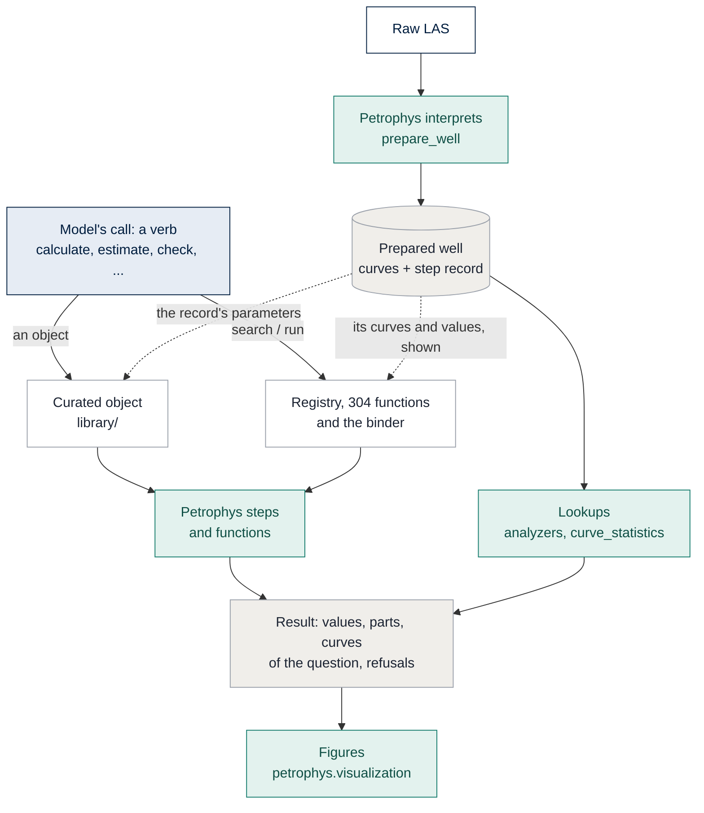

# Petrophys integration

PetroHarness computes no petrophysics of its own. Petrophys interprets the raw LAS, runs the analyzers and statistics
behind every lookup, answers every verb the model calls and draws every figure; the harness picks the inputs from the
well's record, says where each came from, and turns outputs and refusals into results the model can cite. This page
shows which Petrophys function stands behind each number; the tools themselves are in
[TOOLS_REFERENCE.md](TOOLS_REFERENCE.md).

## 1. At a glance



| Fact | Value | Where |
|---|---|---|
| Petrophys build | release 3.0.0 from PyPI (`pip install petrophys==3.0.0`) | `pyproject.toml`, `README.md` (install) |
| Interpretation of the raw LAS | Petrophys, once per well and setting, cached by content | `well/prepare.py`, `prepare_well` |
| Lookups | Petrophys's six analyzers on each lithology zone; every statistic from `curve_statistics` | `record/catalog.py`, `well/stats.py` |
| Verbs over Petrophys | `check`, `calculate`, `what_if`, `estimate`, `classify`, `summarize`, `calibrate` | `agent/library/` |
| Functions reachable by `search` and `run` | 304 public functions from 103 modules, generated at import | `agent/library/api.py`, `registry()` |
| Figures | Petrophys `visualization`; the harness has no drawing code | `figures.py` |
| The rule | A tool computes petrophysics only through Petrophys, or is a listed generic data operation | `tests/test_petrophys_integration.py` |

Each verb input is said with its source. Rw on the Brent Group of GeoLink 30/6-5, set against the record's:

```json
{"estimate": {"parameter": "rw"}}
```

```text
[E31] rw by apparent water resistivity (Petrophys apparent_water_resistivity: RWA = RDEP * PHIE^m / a, a 1 (library default; the record's is lithology_dependent) and m 2 (record)) over 358 clean, porous samples (VCL < 0.3, PHIE > 0.05), at formation temperature: min 0.01456, p5 0.03175, p10 0.03993, median 0.1011 ohm.m. ... The record's Rw: 0.07 ohm.m (rw_at_measured_temp at 230 degF); 0.06241-0.1967 ohm.m at formation temperature (method las_metadata_temperature_profile_corrected). Written: RWA (a curve of this question).
```

## 2. How it works

Petrophys reads, standardizes and interprets the raw LAS, keeping a step record of every method, input, parameter and
decision ([section 4](#4-petrophys-during-preparation)); its analyzers and `curve_statistics` stand behind every lookup.
A verb runs a curated object ([section 6](#6-curated-objects-by-verb)) or any registry function
([section 7](#7-the-function-registry)) with inputs from the binder ([section 8](#8-the-binder)); outputs become
curves and lines of the result ([section 9](#9-outputs)), refusals come back in Petrophys's words
([section 10](#10-refusals)), and after an answer in a conversation Petrophys draws the figures the model chooses
([section 11](#11-figures)).

## 3. The pinned Petrophys

PetroHarness is built and tested against one Petrophys commit, installed as a package on its own
(`requirements.lock` does not list it):

```bash
python3.10 -m venv .venv
.venv/bin/pip install -r requirements.lock
.venv/bin/pip install "petrophys==3.0.0"
.venv/bin/pip install -e . --no-deps
```

<details>
<summary>Installation and identity</summary>

| Name | Type | Default | Meaning | Defined in |
|---|---|---|---|---|
| Requirement | pip specifier | `petrophys==3.0.0` | The dependency: the Petrophys release the harness is tested with, from PyPI | `pyproject.toml` |
| Package version | str | `3.0.0` | `importlib.metadata.version("petrophys")` of the pinned build | installed metadata |
| `library_identity()` | function | - | The installed Petrophys's version and build: a source checkout's commit (with `+dirty`), else the commit pip recorded, else a hash of its installed files (`files-...`) | `well/prepare.py` |

- A prepared well is cached by the LAS content, the interpretation settings and `library_identity()`: it is reused only
  with the same Petrophys build.
- The registry, the method lists in the tool descriptions and the figure titles follow the installed build.

</details>

## 4. Petrophys during preparation

Three uses of Petrophys stand behind every lookup: its interpretation of the well (the step record), its analyzers run
on each lithology zone, and its `curve_statistics` for every statistic shown.

<details>
<summary>The interpretation</summary>

`src/petroharness/well/prepare.py`, `prepare_well(las_path, policy, interval, cache_dir, engines_dir, lithology_curve,
interpreter, interpret)` reads the LAS (`petrophys.io.read_las`), standardizes it (`petrophys.preprocessing.
standardization.standardize_curves`, renaming curves and converting units) and has Petrophys interpret it by one of four
routes. The interval, zones, units and the map: [WELL_PREPARATION.md](WELL_PREPARATION.md).

| Route | When | Petrophys entry | Defined in |
|---|---|---|---|
| Context interpretation | `data.interpret` is set (options such as a context profile) | `petrophys.interpret(las, **options)` | `_interpret_with_petrophys` |
| Batch interpreter | `data.interpreter` is set (`module:function`) | The data's own Petrophys batch interpreter, given a folder holding the LAS | `_interpret_with_interpreter` |
| Pinned engine | Neither is set and the policy names an `engine` | A pinned Petrophys source tree under `data.engines_dir`, run in a subprocess on the raw LAS | `_interpret_with_engine`, `well/runner.py` |
| Installed library | Neither is set and no engine is named | `petrophys.workflow.zoned_batch.run_dynamic_workflow_with_zones` with the policy's cutoffs and corrections | `_interpret` |

The step record a tool reads, here the saturation step of 30/6-5 (`{"step": {"name": "saturation"}}`, trimmed):

```text
[E5] step saturation: method archie+simandoux
  inputs: RDEP, PHIE_CC, VCL
  curves: SW, SXO
  a: lithology_dependent
  m: 2
  ...
  record: Model selected: archie+simandoux
  ...
  record: Archie coefficients from lithology (vendor_lithology_log[LITHOLOGY_GEOLINK])
  record: Rw range in this interval = 0.07099 to 0.07295 ohm.m, Rcl = 2.906 ohm.m
```

- Both `data.interpreter` and `data.interpret` set: `ValueError`. An engine interprets the whole well only.
- The cutoffs used are checked against the policy's (`_check_cutoffs`); a mismatch raises `RuntimeError`.
- Each step entry keeps the method, parameters, decisions, inputs, outputs and removed curves Petrophys lists
  (`prepare.step_entry`).

</details>

<details>
<summary>The analyzers</summary>

`src/petroharness/record/analyzers.py`, `_ANALYZERS`: one Petrophys analyzer per family, run on exactly each zone's
samples (`zone_results`, once per view), with the calculations the well was interpreted with
(`well.calculations.calculations`).

| Family | Petrophys module | Class |
|---|---|---|
| `hydrocarbon` | `petrophys.evaluation.diagnostics.hydrocarbon_analysis` | `HydrocarbonAnalysis` |
| `saturation` | `petrophys.evaluation.diagnostics.saturation_analysis` | `SaturationAnalysis` |
| `permeability` | `petrophys.evaluation.diagnostics.permeability_analysis` | `PermeabilityAnalysis` |
| `porosity` | `petrophys.evaluation.diagnostics.porosity_analysis` | `PorosityAnalysis` |
| `lithology` | `petrophys.evaluation.diagnostics.lithology_analysis` | `LithologyAnalysis` |
| `numerical` | `petrophys.evaluation.diagnostics.numerical_statistical_analysis` | `NumericalStatisticalAnalysis` |

The head of one section on 30/6-5 Brent, as the `section` tool shows it:

```text
[E4] porosity.total_porosity_quality_distribution: Porosity analyzer, total_porosity_quality_distribution: Porosity quality from the best available porosity measurement.
  ...
  classes (4): GOOD_POROSITY, POOR_POROSITY, EXCELLENT_POROSITY, FAIR_POROSITY; background class (a sample meeting no other class): none; ...
```

`make_analyzer` passes the policy's `analyzers.class_tables` (`current`, the library's own, unless
`data.analyzer_class_tables` names a set) where the analyzer takes them. Each class becomes depth runs per zone in the
analyzer store (`record/sections.py`, `Section`, `Run`), read by `section`, conditions (`section:CLASS`) and the class
views. The curves the analyzers derive are kept apart from the interpreted well
(`well/derived.DerivedCurves`).

</details>

<details>
<summary>Statistics</summary>

`src/petroharness/well/stats.py`, `statistics(x, names)`: the named statistics of the finite samples, from Petrophys
`evaluation.summaries.curve_statistics`.

| Harness name | Petrophys name |
|---|---|
| `mean` | `arithmetic_mean` |
| `min`, `max` | `minimum`, `maximum` |
| `median`, `p50` | `median` |
| `std`, `var` | `standard_deviation`, `variance` |
| `geometric_mean`, `harmonic_mean`, `third_power_average`, `mode` | same names |
| `p10`, `p25`, `p75`, `p90` | percentiles through `percentile_key` |
| `iqr`, `max_abs` | `p75 - p25`; the larger of the absolute minimum and maximum |

```python
import numpy as np
from petroharness.well.stats import statistics
statistics(np.array([0.1, 0.2, 0.3, 0.25, np.nan]), ["mean", "p10", "iqr", "max_abs"])
# {'mean': 0.21250000000000002, 'p10': 0.13, 'iqr': 0.0875, 'max_abs': 0.3, 'n': 4}
```

The summary layer (`well/summary.compute`) asks for any other percentile, and for percentiles on log10 values, through
`curve_statistics` with its `percentiles` argument ([TOOLS_REFERENCE.md](TOOLS_REFERENCE.md#7-the-summary-layer)).

</details>

## 5. The groups and the verbs

The brief lists the tools under seven groups. Five groups hold a verb over Petrophys (CALCULATE holds three), and each
verb is also the name its Petrophys packages are filed under in the registry (`PACKAGES`); DESCRIBE and COMPARE AND
GROUP read the record only.

| Group (brief heading) | The record's lookups | Verbs over Petrophys |
|---|---|---|
| `DESCRIBE: what the record holds` | `stats`, `profile`, `runs`, `values_at`, `section`, `step`, `formation_summary` | - |
| `COMPARE AND GROUP` | `compare`, `crossplot`, `overlap`, `lithology_stats`, `zone_contrast`, `curve_order`, `vertical_sequence` | - |
| `CHECK: data quality` | `spike_flags`, `adjacent_jumps`, `threshold_exceedance`, `data_record`, `lag_correlation` | `check` |
| `CALCULATE: recompute with Petrophys` | - | `calculate`, `what_if`, `estimate` |
| `CLASSIFY` | `zone_classes`, `unit_roles` | `classify` |
| `SUMMARIZE` | `pay_summary` | `summarize` |
| `CALIBRATE: against core, elastic properties` | `core_vs_log` | `calibrate` |

<details>
<summary>verb_tool</summary>

`src/petroharness/agent/library/api.py`, `verb_tool(verb, curated)`: the function a verb runs. It keeps the curated
function's arguments, makes every one of them optional, and adds `search`, `run`, `args` and `label`. A Petrophys function named as an
object is recognised by `_objects` and `_is_function`.

| Call holds | What runs |
|---|---|
| `search` | `find(f, verb, search)`: the matching functions |
| `run` | `run(f, verb, run, args, label)`; a `label` sent inside `args` is taken as the call's |
| `property`, `what` or `parameter` naming a Petrophys function, not an object | That function, with `parameters` and `args` as its arguments |
| The curated object's arguments | The curated function |
| None of these | `ToolError`: `<verb> needs <args> (one of its objects), or search (words) to list Petrophys's <verb> functions, or run (a function's name) with args` |

A Petrophys function named where an object belongs is run, on 30/6-5 Brent:

```text
{"classify": {"what": "detect_gas_effect"}}
[E1] Petrophys petrophys.interpretation.porosity.total_porosity.detect_gas_effect: Detect gas effect from neutron-density crossover. Inputs: nphi NPHI; phi_d PHID (it is filed under calculate). It returns: bool or np.ndarray True where gas effect detected
  result: written as DETECT_GAS_EFFECT; share set (%) 1.94 zones pooled; Z1 3.3333; Z2 0; ...; Z5 12.1212; ...
  curves of this question: DETECT_GAS_EFFECT (every lookup reads them)
```

</details>

## 6. Curated objects, by verb

The curated objects are the tested shortcuts to specific Petrophys functions or workflow steps; every input not given
is the record's, and the result names each input's source.

| Verb | Objects | Module |
|---|---|---|
| `calculate`, `what_if` | `clay_volume`, `porosity`, `water_resistivity`, `mud_filtrate_resistivity`, `saturation`, `permeability`, `rock_quality`, `bvw`, `mhi`, `net_pay`, `temperature` | `library/calculate.py` |
| `estimate` | `rw`, `archie_m`, `clay_point`, `gr_endpoints`, `matrix`, `temperature` | `library/estimate.py` |
| `check` | `held_readings`, `bad_hole`, `depth_shift` | `library/check.py` |
| `classify` | `gas`, `minerals`, `flow_units`, `electrofacies`, `moveable_hydrocarbons` | `library/classify.py` |
| `summarize` | `pay` | `library/summarize.py` |
| `calibrate` | `porosity`, `permeability`, `saturation`, `poro_perm`, `shear`, `elastic` | `library/calibrate.py` |

<details>
<summary>calculate and what_if</summary>

`src/petroharness/agent/library/` (every name below). A property is recomputed by Petrophys's own workflow step
(`petrophys.workflow.steps`), with the steps that read its outputs, on the prepared well.

| Name | Type | Default | Meaning |
|---|---|---|---|
| `PROPERTIES` | dict | 11 entries | What users call a property, to the library's step: `clay_volume`, `porosity`, `water_resistivity` (`formation_water`), `mud_filtrate_resistivity` (`mud_filtrate`), `saturation`, `permeability`, `rock_quality`, `bvw`, `mhi`, `net_pay`, `temperature` |
| `ALIASES` | dict | 19 entries | `vcl`, `shale_volume`, `vsh`, `phie`, `phit`, `rw`, `formation_water`, `rmf`, `mud_filtrate`, `sw`, `water_saturation`, `perm`, `pay`, `net_reservoir`, `cutoffs`, `fzi`, `rqi`, `bulk_volume_water`, `temp` |
| `catalog(kind)` | function | - | The step's description and parameters (default, description, choices) from `petrophys.mcp.catalog.step_kinds`, read in-process |
| `order()` | function | - | The steps in the library's workflow order: temperature, clay_volume, porosity, formation_water, mud_filtrate, saturation, permeability, rock_quality, bvw, mhi, net_pay |
| `RECORD_STEP` | dict | `clay_volume: vclay`, `formation_water: rw` | The record's name of a step, where it differs |
| `RECORD_NAMES` | dict | - | The record's names of a library parameter (`gr_clean`: `gr_min_used`, `gr_min`; `matrix_density`: `rho_ma`; `rw_temp_f`: `reference_temp_f`, `measured_temp_f`; ...) |
| `CURVE_ARGS` | set | - | Step arguments that name curves, not shown as parameters |
| `TARGETS` | dict | - | `what_if`'s default target per step (saturation SW, net_pay NET_PAY, porosity PHIE, ...) |
| `IMPLICIT` | dict | `TEMP: formation_water, mud_filtrate` | Inputs a step reads without listing them in `requires` |
| `MAX_VALUES` | int | 6 | Values `what_if` tries at most |

How one change runs (`library.run(f, kind, changes, with_downstream)`):

1. `defaults(f, kind)` reads the parameters the record states (a range whose ends agree counts); the method is the
   record's where the step lists it, else `auto` where the step offers it.
2. A changed choice (`matrix: limestone`) drops the record's values it sets itself (`matrix_density`, ...) unless they
   are asked too.
3. `_step(kind, params, asked)` builds the step, leaving out (up to 4 tries) parameters the method does not take; the
   asked ones among them are said as `not used`.
4. `downstream(kind, made)` adds the later steps that read what it writes.
5. Two runs on the prepared well (`petrophys.workflow.Workflow(...).run(well, strict=False)`): the baseline with the
   record's parameters and the changed one; where the record's parameters do not rebuild the step, the later steps run
   on the record's own outputs instead, and the result says so.
6. Each curve made is set against the baseline (or the record's curve), zones pooled and each zone, and written as
   `<CURVE>_<LABEL>`; `_reproduction` says whether the baseline reproduces the record's curve (95% of samples within
   1%); where it does not, the change is to be read as an effect, not as a new value of the record's curve.

The steps a change carries into, as the pinned Petrophys gives them:

| Changed step | Writes | Then runs |
|---|---|---|
| `temperature` | TEMP | formation_water, mud_filtrate |
| `clay_volume` | VCL | porosity, saturation, permeability, rock_quality, bvw, mhi, net_pay |
| `porosity` | PHID, PHIN, PHIT, PHIE | saturation, permeability, rock_quality, bvw, mhi, net_pay |
| `formation_water` (with `rw` and `rw_meas_temp`) | RW | saturation, bvw, mhi, net_pay |
| `mud_filtrate` (with `rmf` and `rmf_meas_temp`) | RMF | mhi |
| `saturation` | SW, SXO | bvw, mhi, net_pay |
| `permeability` | PERM | rock_quality |
| `rock_quality` | RQI, FZI, PHI_Z | - |
| `bvw` | BVW | - |
| `mhi` | MHI | - |
| `net_pay` | NET_ROCK, NET_RES, NET_PAY | - |

`what_if(f, property, parameter, values, target, parameters)` runs the same change once per value (each with its
downstream steps), and reports the target's mean (or a flag's share set) for the baseline and each value, pooled and per
zone. It writes no curves.

A limestone matrix on 30/6-5 Brent (the per-zone lines and the later curves cut):

```json
{"calculate": {"property": "porosity", "parameters": {"matrix": "limestone"}, "label": "LS"}}
```

```text
[E33] porosity recomputed by Petrophys with matrix limestone; inputs: method density (record), matrix limestone (asked), fluid_density 1 (record), fluid_slowness 189 (record), clay_porosity 0.2307 (record); then saturation, permeability, rock_quality, bvw, mhi, net_pay (they read its outputs)
  PHID: mean 0.1603 -> 0.1894 (+0.02907) zones pooled; 566 samples changed
    each zone (mean, baseline -> changed): Z1 0.1586 -> 0.1881; Z2 0.2269 -> 0.254; ...
    the baseline reproduces the record's PHID (99.1% of samples within 1%)
  ...
```

- `formation_water` needs `rw` with `rw_meas_temp`, or `salinity_ppm` (else a `ToolError` asks for them); an Rw the record
  states without its temperature is not used as a default.
- `DROPPED` (`library._Dropped`) is per thread, so questions run side by side do not read each other's dropped
  parameters.

</details>

<details>
<summary>estimate</summary>

`src/petroharness/agent/library/estimate.py`, `estimate` and `ESTIMATES`. Each estimate is set against the record's value of the
same parameter; `zones` limits the samples to those zones.

| Parameter | Method | Petrophys function | Samples and defaults | Writes |
|---|---|---|---|---|
| `rw` | `rwa` (first) | `interpretation.electrical.rw.rwa.apparent_water_resistivity`, with the record's `a` and `m` | VCL below `vcl_max` (0.3), PHIE above `phie_min` (0.05), at least 10 samples; reports min, p5, p10, median | `RWA` |
| `rw`, `archie_m` | `pickett` | `interpretation.electrical.cementation.pickett_analysis.pickett_analysis` | RT or RDEP with PHIE, clean samples VCL below `vcl_max`, water line at SW 1 | - |
| `rw` | `sp` | `interpretation.electrical.rw.sp_window.sp_rw_in_window` | Rmf from `rmf` and `rmf_temp_f`, else the LAS header; the record's TEMP | - |
| `clay_point` | `neutron_density` | `interpretation.clay_volume.nd_method.nd_shale_point` | Shale samples VCL above 0.6 | - |
| `gr_endpoints` | `percentiles` | `interpretation.clay_volume.gr_method.bounded_gr_baselines` on P5 and P95 | The samples asked and the whole well | - |
| `matrix` | `apparent` | `interpretation.lithology.apparent_matrix`: `apparent_total_porosity`, `apparent_matrix_density`, `apparent_matrix_volumetric_pe`; `matrix_properties.MINERAL_PROPERTIES` | Zone medians; Umaa needs PEF | `RHOMAA`, `UMAA` |
| `temperature` | `gradient` | `interpretation.temperature.temp_gradient.gradient_from_bht` | The record's TEMP per zone; BHT and TD from `bht_f` and `td`, else the LAS header | - |

A Pickett fit on the water-bearing sands of 30/6-5 Brent (Z13, Z14, Z15 and Z19, where SW is at or near 1):

```json
{"estimate": {"parameter": "rw", "method": "pickett", "zones": ["Z13", "Z14", "Z15", "Z19"]}}
```

```text
[E2] Pickett analysis (Petrophys pickett_analysis on RDEP and PHIE, clean samples VCL < 0.3, water line at SW 1): a 1, m 1.7884, n 2; m 1.7884, slope -1.7884, intercept -1.144, rw 0.07177, r_squared 0.4652, ..., n_points 152 (the record's: a 1, m 2; Rw 0.07 ohm.m (rw_at_measured_temp at 230 degF); 0.06241-0.1967 ohm.m at formation temperature (method las_metadata_temperature_profile_corrected))
```

Over the whole Brent Group the same call fits m -4.3186 (r_squared 0.2177), and Petrophys warns that the samples are
probably not all clean and water-bearing.

</details>

<details>
<summary>check</summary>

`src/petroharness/agent/library/check.py`, `OBJECTS`. Each flag found is written as a curve of the question.

| Object | Petrophys | Needs | Default threshold | Writes |
|---|---|---|---|---|
| `held_readings` | `preprocessing.quality.held_readings.find_held_readings` (one value repeated over its minimum run, 10 samples in the pinned build) | measured input logs | repeat tolerance 0 | `HELD_<CURVE>` |
| `bad_hole` | `preprocessing.quality.bad_hole.washout_detection.WashoutDetection` and `preprocessing.quality.wellbore.WellboreQC` (caliper rugosity) | CALI; BS for washout | washout limit CALI - BS 1.5 in | `WASHOUT`, `LARGE_HOLE`, `LOW_DENSITY`, `PEF_EXCLUDED`, `RUGOSE` |
| `depth_shift` | `interpretation.core_analysis.core_data`, `interpretation.core_analysis.depth_matching.find_core_depth_shift` | core plugs in the LAS (PHIC, KH_CORE, SWC or the like) | Petrophys's largest shift; core runs split at 3 m gaps | - |

Held readings on 30/6-5 Brent, every measured log:

```text
{"check": {"what": "held_readings"}}
[E42] Held readings (Petrophys find_held_readings: one value repeated over 10 or more samples, repeat tolerance 0 in each log's unit) in CALI, NPHI, RHOB, DTE, RDEP, SP, RSHA, RMED
  CALI: 12.4% of its samples here held; 6 runs, 14.4776 m in all: 2879.729-2881.1006 m, 2882.9294-2884.9106 m, ...; held at 8.453, 8.469, 8.492; by zone: Z7 65.9%; Z8 18.8%; Z15 38.8%; written: HELD_CALI
  none held: NPHI, RHOB, DTE, RDEP, SP, RSHA, RMED
```

</details>

<details>
<summary>classify</summary>

`src/petroharness/agent/library/classify.py`, `OBJECTS`.

| Object | Petrophys | Needs | Writes |
|---|---|---|---|
| `gas` | `interpretation.porosity.total_porosity.detect_gas_effect` (PHID above neutron porosity by more than 0.05); runs by `evaluation.intervals.flag_intervals` | PHID, and PHIN or NPHI | `GAS_FLAG` |
| `minerals`, method `solver` | `interpretation.lithology.MultiMineralSolver` (quartz, calcite, dolomite, anhydrite; porosity solved; residual and poor-fit flag) | RHOB, NPHI, VCL; PEF and DT add rows | `V_<MINERAL>`, `MM_POOR_FIT` |
| `minerals`, method `calcite_dolomite` | `interpretation.lithology.carbonate_minerals.solve_calcite_dolomite` with `CARBONATE_CALIBRATIONS["generic"]` | RHOB, PHIE or PHIT, VCL | `V_CALCITE`, `V_DOLOMITE` |
| `flow_units` | `evaluation.flow_units.flow_units_module.calculate_flow_units` (k-means on log FZI) | PERM, PHIE | `FLOW_UNIT` |
| `electrofacies` | `evaluation.diagnostics.numerical_statistical_analysis.NumericalStatisticalAnalysis().analyze`, its `ELECTROFACIES` curve (k-means on RHOB, NPHI, GR, RDEP over the well, up to 5 classes; `add_curves=False`, the well is not changed) | two of RHOB, NPHI, GR, RDEP | `EFACIES` |
| `moveable_hydrocarbons` | `interpretation.saturation.sxo.moveable_oil_saturation`, `residual_oil_saturation` | SXO from a flushed-zone log, SW | `MOS`, `SOR` |

GeoLink 15/9-14, 2700-3020 m, has a vendor lithology log and PEF. Its record keeps the log (`Input lithology was
available -> mineral volumes computed, LITHO not inferred or overwritten`); `classify minerals` solves on request:

```text
{"classify": {"what": "minerals"}}
[E1] minerals by Petrophys MultiMineralSolver (porosity solved with the minerals, VCL given) on rows RHOB, NPHI, PEF, DT; solved 100.0% of samples; poor fit (residual over the library's tolerance) 3.4%
  quartz mean volume over solved samples: Z2 0.4306; Z1 0.4123; Z4 0.3625; ... (30 other zones lower); pooled 0.06248
  ...
  written: V_QUARTZ, V_CALCITE, V_DOLOMITE, V_ANHYDRITE, MM_POOR_FIT (curves of this question)
```

- The electrofacies classes are read from the Petrophys numerical analyzer's public `analyze`, because no public
  function takes the curves or the class count; `k` and `curves` are therefore not applied, and the result says so.
- `moveable_hydrocarbons` is refused where the record's `sxo_method` is the quicklook, since `SXO - SW` would restate
  SW.

</details>

<details>
<summary>summarize</summary>

`src/petroharness/agent/library/summarize.py`, `OBJECTS`.

| Object | Petrophys | Needs | Writes |
|---|---|---|---|
| `pay` | `evaluation.net_pay.pay_summary.summarize_pay`, per zone, zones pooled and the whole interval, with one cutoff set (asked, else the record's `net_pay` step, else the library standard) and no exclusions | VCL, PHIE, SW | `NET_RES_<LABEL>`, `NET_PAY_<LABEL>` when a cutoff is asked |

```text
{"summarize": {"what": "pay", "sw_cutoff": 0.5}}
[E27] pay by Petrophys summarize_pay, cutoffs VCL < 0.3 (record), PHIE > 0.08 (library standard), SW < 0.5 (asked): flags recomputed ... with this one cutoff set and no exclusions (...); ...
  zones pooled: gross 86.7162, net rock 55.6261, net reservoir 54.2546, net pay 21.4883 (141 of 567 samples); net-to-gross reservoir 0.6257, pay 0.2478, pay PHIE 0.2243, pay SW 0.2474; HCPT 3.6274 m
  ...
  written: NET_RES_SW0_5, NET_PAY_SW0_5 (flags of this question: runs, stats and conditions read them)
```

The record's own flags, with its exclusions, are summarised by `pay_summary` (`record/catalog.pay_summary`: Petrophys
`calculate_net_gross` and `pay_averages`).

</details>

<details>
<summary>calibrate</summary>

`src/petroharness/agent/library/calibrate.py`, `OBJECTS`.

| Object | Petrophys | Needs | Writes |
|---|---|---|---|
| `porosity`, `permeability`, `saturation` | `interpretation.core_analysis.calibration.calibrate_porosity`, `calibrate_permeability` (log10), `calibrate_saturation`, on core from `core_data` | core plugs (PHIC or CPOR; KH_CORE or CPERM; SWC or CSW) and the log; 3 plugs at least per scope | - |
| `poro_perm` | `interpretation.core_analysis.fit_poro_perm`; on the log through `petrophys.model.core.CoreData` when there is no core | core porosity and permeability, else PHIE and PERM | `PERM_PP` |
| `shear` | `interpretation.saturation.sonic.rock_physics.slowness_to_velocity`, `vs_from_vp_greenberg_castagna` for the record's porosity matrix (sandstone, limestone or dolomite; sandstone otherwise) | DTC | `DTS_GC` |
| `elastic` | `interpretation.rock_physics.elastic.elastic_properties` | RHOB, DTC; DTS or DTS_GC for the shear properties | `VP`, `AI`; with shear `VS`, `POISSON`, `SHEAR_MOD`, `BULK_MOD`, `YOUNG_MOD` |

30/6-5 carries core plugs (PHIC, KH_CORE), so the transform is fitted on core:

```text
{"calibrate": {"what": "poro_perm"}}
[E29] poro-perm transform fitted on core plugs (Petrophys fit_poro_perm): log10(K) = A * porosity + B with A 21.6883, B -2.5285; R2 0.7761, RMSE 0.7435 (log10 mD), n 197. Written: PERM_PP (the transform applied to PHIE).
  against the record's PERM over 574 samples: geometric means PERM_PP 12.8774, PERM 11.9925 mD
```

A curve this question calculated is added to a copy of the prepared well before a core fit reads it
(`library.calibrate._well_with`).

</details>

## 7. The function registry

`library.api.registry()` files every public function of Petrophys's `interpretation`, `evaluation` and
`preprocessing` packages under the verb its package serves: 304 functions from 103 modules in the pinned build. Every
verb reaches them with `search` (words) and `run` (a name); a function added to Petrophys appears with no change here.
A function that needs a file or folder path (a parameter typed `Path` or `PathLike`, such as a CSV reader) is left
out, and an optional path parameter is not offered, so a call never reads or writes a file on the server.

<details>
<summary>Generation</summary>

`src/petroharness/agent/library/api.py`, `registry()` (cached):

1. `pkgutil.walk_packages(petrophys.__path__, "petrophys.")` lists every module.
2. A module is skipped when its name contains `._` (private), `borehole_imaging` (image logs, no LAS curves) or
   `.classification` (label tables) (`SKIP`), or when no `PACKAGES` prefix matches it.
3. Each module is imported; one that will not import offers nothing.
4. Each public function defined in the module (not imported into it) becomes an `Fn`: its signature, its docstring's
   first sentence, its numpy-style Parameters lines (`low, high : float` gives both the description;
   `library.api._param_docs`) and its Returns section.

| Petrophys package (after `petrophys.`) | Verb |
|---|---|
| `preprocessing.quality`, `preprocessing.imputation`, `preprocessing.normalization`, `interpretation.core_analysis.depth_matching` | `check` |
| `evaluation.sensitivity`, `evaluation.uncertainty` | `what_if` |
| `interpretation.core_analysis`, `interpretation.nmr.calibration`, `interpretation.saturation.height`, `interpretation.saturation.sonic`, `interpretation.rock_physics` | `calibrate` |
| `interpretation.electrical.rw`, `interpretation.electrical.cementation`, `interpretation.electrical.rmf`, `interpretation.temperature`, `interpretation.lithology.apparent_matrix`, `interpretation.lithology.matrix`, `interpretation.clay_volume.rcl`, `interpretation.clay_volume.nd_method` | `estimate` |
| `interpretation.lithology`, `interpretation.geochemistry`, `evaluation.flow_units`, `evaluation.rock_quality`, `evaluation.mhi`, `evaluation.zonation`, `evaluation.heterogeneity` | `classify` |
| `evaluation.net_pay`, `evaluation.summaries`, `evaluation.volumetrics`, `evaluation.bvw` | `summarize` |
| `interpretation` (everything else under it) | `calculate` |

```python
from collections import Counter
from petroharness.agent.library.api import registry
Counter(fn.verb for fn in registry())
# {'summarize': 39, 'classify': 39, 'what_if': 5, 'calculate': 83, 'estimate': 62, 'calibrate': 51, 'check': 25}
```

The first prefix that matches, in the order of `PACKAGES`, wins; so `interpretation.lithology.matrix` is `estimate` and
the rest of `interpretation.lithology` is `classify`. Modules under no prefix (for example `evaluation.diagnostics`)
have no verb and are not in the registry.

</details>

<details>
<summary>Fn</summary>

The fields of each registered `library.api.Fn`:

| Name | Type | Default | Meaning |
|---|---|---|---|
| `name` | str | - | The function's name |
| `path` | str | - | Its module, `petrophys.<...>` |
| `verb` | str | - | The verb it is filed under |
| `summary` | str | - | The docstring's first sentence, at most 160 characters |
| `params` | dict | - | name to (annotation text, default or `inspect.Parameter.empty`, description of at most 200 characters); `*args` and `**kwargs` left out |
| `returns` | str | `""` | The Returns section, at most 300 characters |
| `qualified` | property | - | `path.name` |
| `call()` | method | - | The function itself, imported |

```python
from petroharness.agent.library.api import lookup
lookup("calculate_net_gross")
# Fn(name='calculate_net_gross', path='petrophys.evaluation.summaries.net_gross', verb='summarize',
#    summary='Calculate net-to-gross ratios.',
#    params={'well': ('Well', <class 'inspect._empty'>, 'Well object with net flags'),
#            'top_depth': ('typing.Optional[float]', None, 'Top depth (default: well start)'),
#            ...},
#    returns='NetGrossResult Net-to-gross results')
```

</details>

<details>
<summary>Counts and groups</summary>

Generated from the pinned Petrophys (`len(library.api.functions(verb))` and `library.api.groups(verb)`):

<!-- generated: verbs (tests/docs_tables.py) -->
| Verb | Functions | Groups (named from the Petrophys modules) |
|---|---|---|
| `calculate` | 83 | gr, sp, thomas stieber, vcl, invasion classification, invasion, inversion, profile, permeability, coates denoo, impermeable flag, lith vcl, perm, timur, eaton, density porosity, effective porosity, density correction, hc correction, neutron correction, neutron porosity, porosity, sonic porosity, total porosity, archie, dual water, indonesia, nigeria schlumberger, north sea, simandoux, sw, sxo, waxman smits |
| `estimate` | 62 | nd, rcl, archie parameters, pickett analysis, rmf, rw, rwa, salinity rw, sp rw, sp window, temp correction, apparent matrix, matrix inference, matrix properties, temp corrections, temp gradient, temp profile |
| `calibrate` | 51 | core analysis calibration, grain size, nmr calibration, elastic, capillary, empirical, formation pressure, mdt pretest, pressure contacts, saturation height, scal, rock physics, sonic saturation |
| `summarize` | 39 | bvw, net pay cutoffs, net pay flags, net pay, pay summary, screening, averages, formation analysis, net gross, ranking, summaries statistics, zone summary, hydrocarbon pore volume |
| `classify` | 39 | flow units, roles, heterogeneity, mhi, rock quality, zonation, clay typing, elemental spectroscopy, spectral gamma, thorium uranium, carbonate minerals, crossplots, labels, lithology log, lithology, multi mineral solver |
| `check` | 28 | depth matching, impute, histogram matching, normalization, curve masking, flag generator, washout detection, depth alignment, depth match, held readings, value ranges |
| `what_if` | 5 | sensitivity, uncertainty |
| All | 307 | from 105 modules |
<!-- end generated: verbs -->

`menu_line(verb)` ends every verb's description with its count and groups:

```text
    search / run: any of Petrophys's 5 what_if functions (sensitivity, uncertainty): {"search": "<words>"} lists them with what each input takes and what this well has for it; {"run": "<name>", "args": {...}} calls one with the inputs you name (the rest keep Petrophys's defaults)
```

</details>

<details>
<summary>search</summary>

`library.api.find(f, verb, query)`: the functions matching the words.

| Name | Type | Default | Meaning | Defined in |
|---|---|---|---|---|
| Words | set | - | Lower-case words of two characters or more, from the query | `library.api._words` |
| Score | int | - | 3 per word in the function's name, plus 1 per word in its name, summary and parameter names; plus 2 when it is this verb's | `library.api.find` |
| Order | - | - | Highest score first, then by name | `library.api.find` |
| `MAX_FOUND` | int | 8 | Functions listed | `library/api.py` |
| Each line | text | - | `name (other verb): summary [It reads the well's curves itself.] Needs <each required input>. Optional: <the first 8 optional inputs>`, each input with its facts ([section 8](#8-the-binder)) | `library.api.find`, `_facts` |

On 30/6-5 Brent:

```json
{"check": {"search": "washout"}}
```

```text
[E34] check: Petrophys functions matching 'washout' (2 found; 28 serve check); run one with {"check": {"run": "<name>", "args": {...}}}
  detect_washout: Convenience function for washout detection. It reads the well's curves itself. Needs nothing. Optional: bit_size (number, in)
  washout_flag: Generate washout flag based on caliper and density correction. Needs cali (curve, in; Caliper here: CALI in); bit_size (curve, in; Bit Size here: BS in). Optional: drho (curve, g/cm3; Density Correction here: DRHO g/cm3); cali_threshold (number, in; default 1.5); drho_threshold (number, g/cm3; default 0.15)
```

- A search finds functions under every verb; another verb's function is marked with its verb, for example
  `detect_gas_effect (calculate)` under a `classify` search.
- No match lists up to 40 of the verb's function names.

</details>

<details>
<summary>run</summary>

`library.api.run(f, verb, function, args, label)`: one Petrophys function on the question's interval.

| Name | Type | Default | Meaning | Defined in |
|---|---|---|---|---|
| `function` | str | required | Looked up by its last dotted part, the one under this verb first | `library.api.lookup` |
| `args` | dict | `{}` | The inputs the model names, read by the binder ([section 8](#8-the-binder)) | `library.api.bind` |
| `label` | str | the function's name | The new curves' prefix | `library.api._label` |
| First line | text | - | `Petrophys <qualified name>: <summary> Inputs: <sources>`, then `(it is filed under <verb>)` for another verb's function and `It returns: <Returns>` | `library.api.run` |

Apparent water resistivity on 30/6-5 Brent. Called without its inputs, it is refused with what this interval offers
for each; called with them, it runs on exactly those (`a`, not named, keeps Petrophys's default):

```text
{"estimate": {"run": "apparent_water_resistivity"}}
apparent_water_resistivity needs rt (curve, ohm.m; Deep Resistivity here: RDEP ohm.m); phi (curve, v/v; Effective Porosity here: PHIE v/v). Send the whole call again, every input in one args: {"run": "apparent_water_resistivity", "args": {"rt": ..., "phi": ...}}

{"estimate": {"run": "apparent_water_resistivity", "args": {"rt": "RDEP", "phi": "PHIE", "m": 2}}}
[E4] Petrophys petrophys.interpretation.electrical.rw.rwa.apparent_water_resistivity: Apparent water resistivity ``Rwa = Rt * phi**m / a`` (ohm.m). Inputs: rt RDEP (asked); phi PHIE (asked); m 2 (asked). It returns: float or array Rwa in ohm.m; NaN where Rt or porosity is missing or not positive.
  result: written as APPARENT_WATER_RESIS; mean 0.4631 zones pooled; Z1 0.1235; Z2 0.0683; Z3 0.06196; Z4 0.4163; Z5 1.1193; Z6 0.2317; Z7 1.7013; ...
  curves of this question: APPARENT_WATER_RESIS (every lookup reads them)
```

</details>

## 8. The binder

The model names each input; the binder reads it as Petrophys declares the parameter and adds only the question's
scope. Petrophys declares every parameter of its public functions by kind (`petrophys.function_schema`, reviewed against
each function's code and checked against the signatures in Petrophys's CI): a curve of values, a curve name, one
number, a choice among named options, a condition, a depth window, the well. The binder does not choose an input for the
model: an input the call does not name keeps Petrophys's default, and a required input it does not name is asked for,
with what this interval offers for it.

```json
{"estimate": {"run": "nd_shale_point", "args": {"nphi": "NPHI", "rhob": "RHOB", "shale": "VCL > 0.6"}}}
```

```text
[E35] Petrophys petrophys.interpretation.clay_volume.nd_method.nd_shale_point: Neutron-density clay point read from a well's own shale samples. Inputs: nphi NPHI (asked); rhob RHOB (asked); shale VCL > 0.6 (asked). It returns: tuple of float ``(den_clay, neu_clay)``.
  0: 2.5701
  1: 0.2781
```

A whole-well function on 30/6-5 Brent gets the prepared well and the interval's top and bottom:

```text
{"summarize": {"run": "calculate_net_gross"}}
[E5] Petrophys petrophys.evaluation.summaries.net_gross.calculate_net_gross: Calculate net-to-gross ratios. Inputs: well (the prepared well); top_depth (the interval's); bottom_depth (the interval's). It returns: NetGrossResult Net-to-gross results
  gross_thickness: 117.0432
  ...
```

A curve the well does not hold, or a choice Petrophys does not offer, is refused with what the input takes:

```text
{"estimate": {"run": "pickett_analysis", "args": {"rt": "RT", "phi": "PHIE"}}}
pickett_analysis: 'RT' is not a curve here; rt (curve; Deep Resistivity here: RDEP ohm.m)

{"estimate": {"run": "pickett_analysis", "args": {"rt": "RDEP", "phi": "PHIE", "method": "fit"}}}
pickett_analysis: method is one of rma, ols, not 'fit'; leave it out for Petrophys's default ('rma')
```

<details>
<summary>What the model is shown for each input</summary>

`library.api._facts(f, fn, p)`, in a search listing (every input) and in the refusal of a call that leaves a required
input out:

| Part | When | Source |
|---|---|---|
| What it takes | always | The declaration (`_takes`): `curve`, `curve name(s)`, `number`, `one of a/b/c`, `condition`, `true or false`, `text`, with Petrophys's declared unit |
| `<quantity> here: <curves with units>` | the declaration names a standard curve (`curve("RDEP")`) | The curves of this well Petrophys's alias map reads as that curve (`get_standard_mnemonic`; RT and RESD both read as RDEP), named by `find_curve_type`; `no <quantity> curve here` when there is none (`_here`) |
| `the record's: <value> (<step>)` | a step of the record states a number under the parameter's name | `_record_params`: the last step that states it |
| `default <value>` | the parameter has a default other than `None` | The signature |

A function whose declaration includes the well adds `It reads the well's curves itself.` (the well required) or
`... unless given curves.` (the well optional).

</details>

<details>
<summary>The binding rules</summary>

Each parameter, in signature order:

| # | Parameter | Given | Source written | Defined in |
|---|---|---|---|---|
| 1 | Any the function does not take | named | `ToolError`: `<fn> takes <params>; not <names>. The call's shape: ...` | `bind` |
| 2 | `well` | - | A copy of the prepared well, when the well is required or the call names no curve of values: `well (the prepared well)`; a name given for it is dropped: `well: the prepared well, not the name given` | `bind`, `library.scratch_well` |
| 3 | `curve` | a curve name, or `DEPTH` | The curve's interval values (`DEPTH`: the sample depths, in the LAS unit); a curve whose unit is on another scale than the declared unit (pu where v/v is declared) is refused: `<p> <value> (asked)` | `_asked`, `_curve_values`, `_same_scale` |
| 4 | `mask` | a curve name or a condition (`VCL > 0.6`) | The curve above 0.5, or the condition's mask | `_asked`, `_condition` |
| 5 | `curve_name` | one name, or a list where many are taken | The name(s) as given | `_asked` |
| 6 | `choice` | one option, or a list where many are taken | The option, matched without case; another is refused with the options | `_asked` |
| 7 | `value`, `window` | a number, or text that is one | The number | `_asked` |
| 8 | `switch` | true/false, or text `true`, `yes`, `1`, `on` | The truth value | `_asked` |
| 9 | Any other | the value | The value as given | `_asked` |
| 10 | `window` (top or bottom) | not named | The interval's shallowest or deepest depth: `<p> (the interval's)` | `bind` |
| 11 | `depth` | not named | The interval's depths, when required or beside curves of values the call names: `depth (the interval's)` | `bind`, `_depths` |
| 12 | Required, any other kind | not named | `ToolError`: `<fn> needs <each with its facts>. Send the whole call again, every input in one args: {"run": "<fn>", "args": {<what the call gave>, "<missing>": ...}}` | `bind`, `_facts` |
| 13 | Otherwise | not named | Petrophys's default (not passed, not listed) | - |

- One call's curve inputs are the same samples: all curves over the interval, or all single numbers (a point:
  `apparent_water_resistivity` with `rt` 20 and `phi` 0.25). A number beside curves is refused with what the input
  takes (`fit_saturation_height: sw is a curve over the interval, so height must be one too, not the number 2958:
  ...`); Petrophys would fail on the shapes.
- A function Petrophys declares samplewise (`identify_lithology_zone(nphi: float, rhob: float)`, which labels one
  point) is applied sample by sample to the curves the call names (`_per_sample`, `_each_sample`); its source line ends
  `applied sample by sample (it takes one value of nphi and rhob)`, and labels come back as shares of the zones'
  samples.
- Every Petrophys call gets a copy of the prepared well (`library.scratch_well`): some functions change the well they
  are given (`apply_value_range_qc` clips curves in place), and the record every later step reads is that well.
- A result that carries its own error text (`pickett_analysis`: `Insufficient data`) is a refusal:
  `Petrophys <fn> could not compute it: <error>. Inputs: ...`.
- Units: Petrophys reads each curve's unit from the LAS and standardizes it when it prepares the well; `_same_scale`
  compares a named curve's unit with the declared one through Petrophys's unit tables (`model.units.UnitRegistry`),
  so v/v and fraction pass and pu does not.
- The curated objects say their inputs the same way (`rcl 2.906 (record)`, `matrix limestone (asked)`,
  `matrix_density from the asked choice (the record's <value> not used)`; `library._sources`).
- Depths go to Petrophys in the LAS depth unit (`f.view.prep.depth`), the unit it reads.

</details>

<details>
<summary>The declarations</summary>

`petrophys.function_schema.declaration(fn)` returns a `FunctionDeclaration`: its `parameters` (name to
`ParameterDeclaration`) and `samplewise`. The registry stores them on each `Fn` (`kinds`, `samplewise`).

| Kind | Takes | Fields |
|---|---|---|
| `curve` | A curve's values over the interval | `curve` (the standard curve it is, if one), `unit` |
| `curve_name` | A curve's name, read by the function from the well | `curve`, `many` |
| `value`, `values` | One number, several | `unit`, `curve` (the quantity a number stands for) |
| `choice` | One of named options | `choices`, `many` |
| `switch` | True or false | - |
| `per_zone` | One value per zone | - |
| `mask` | A condition over the samples | - |
| `depth` | The sample depths | - |
| `window` | The top or bottom of the depth window | `role` |
| `well` | The well | - |
| `text`, `object` | Text; a result or table | `many` |

A function Petrophys adds is declared in `petrophys/_function_declarations.py`; Petrophys's
`scripts/check_function_schema.py` fails its CI when a public function, or one of its parameters, is not declared.

</details>

## 9. Outputs

A function's value comes back as parts: an array over the interval becomes a curve of the question, read by every
lookup like a record curve; numbers, tables and text become lines of the result. A new curve's name says what made it
(30/6-5 Brent):

```text
calculate saturation, method simandoux         -> SW_SIMANDOUX, SXO_SIMANDOUX, BVW_SIMANDOUX, MHI_SIMANDOUX,
                                                  NET_ROCK_SIMANDOUX, NET_RES_SIMANDOUX, NET_PAY_SIMANDOUX
run thomas_stieber, label TS, part v_dispersed -> TS_V_DISPERSE        (the part cut to 10 characters)
run apparent_water_resistivity, no label       -> APPARENT_WATER_RESIS (the name cut to 20 characters)
summarize pay, sw_cutoff 0.5                   -> NET_RES_SW0_5, NET_PAY_SW0_5
```

<details>
<summary>Parts of a result</summary>

`library.api.run` reads the value a function returns as `(label, value)` parts (`library.api._parts`, down two
levels): a dataclass's fields, a dict's items, a tuple's or list's members (labelled 0, 1, ...), a Petrophys object's
public attributes. At most 24 parts are written; a curve goes through `library.register`.

| Part | Written as |
|---|---|
| A 1-D numeric array the length of the interval or the well | A curve of the question, `<LABEL>_<PART>`; its pooled mean and each zone's mean (the first 12 zones), or a flag's share set |
| Such an array of 2 to 12 distinct whole numbers | A class curve; the share of the zones' samples in each class |
| Another numeric array | Its size, min, median and max |
| A number | `<part>: <value>` |
| A table (an object with `head` and `to_string`) | Its first 12 rows, at most 1,500 characters |
| Anything else that is not a function | Its text, at most 200 characters |
| Warnings Petrophys raised | `Petrophys said: ...` (up to 3, each at most 160 characters) |

On 30/6-5 Brent (four parts cut):

```text
{"calculate": {"run": "thomas_stieber", "args": {"phi_sand": 0.25, "phi_shale": 0.1}, "label": "TS"}}
[E23] Petrophys petrophys.interpretation.clay_volume.thomas_stieber.thomas_stieber: Decompose total porosity and shale volume into laminar, dispersed and structural shale. Inputs: phit PHIT; vsh VCL; phi_sand 0.25 (asked); phi_shale 0.1 (asked)
  v_laminar: written as TS_V_LAMINAR; mean 0.2346 zones pooled; Z1 0.1959; Z2 0.09039; ...
  ...
  regime: written as TS_REGIME; classes, share of the zones' samples: 0 20.6%; 1 57.3%; 2 22.0%
  curves of this question: TS_V_LAMINAR, TS_V_DISPERSE, TS_V_STRUCTUR, TS_SAND_POROS, TS_NET_TO_GRO, TS_REGIME (every lookup reads them)
```

</details>

<details>
<summary>Names of new curves</summary>

| Source | Name | Defined in |
|---|---|---|
| `run` | `<LABEL>_<PART>`: the label (else the function's name) upper case, non-alphanumerics as `_`, at most 20 characters; the part at most 10, or whole when a part of the same result already took the cut name; `X` first when it does not start with a letter | `library.api._label` |
| `calculate` | `<CURVE>_<LABEL>`: the label (else the method or model, else `ALT`), at most 16 characters | `library._label` |
| `summarize` | `NET_RES_<LABEL>`, `NET_PAY_<LABEL>`, the label made from the asked cutoffs | `library.summarize.summarize` |
| `check`, `classify`, `estimate`, `calibrate` | Fixed names (`HELD_<CURVE>`, `WASHOUT`, `GAS_FLAG`, `RWA`, `RHOMAA`, `PERM_PP`, `DTS_GC`, `VP`, ...) | `library_check`, `library_classify`, `library`, `library_calibrate` |
| Every source | A name the record or its analyzers hold gets `_LIB` (then `_LIB2`, ...): a lookup reads the record's curve first, so the new one would be hidden. A curve computed on request before keeps its name | `library.free_name`, in `register` |

</details>

<details>
<summary>register</summary>

`src/petroharness/agent/library/shared.py`, `register(f, name, full, meaning, unit, step)`: a curve of the question, written
under `free_name(f, name)`, which it returns (every caller says the returned name).

| Name | Type | Default | Meaning | Defined in |
|---|---|---|---|---|
| `f.view.calculated[name]` | array | - | The values over the well's samples (NaN outside the interval) | `register` |
| `f.inv.curves[name]` | `inventory.Curve` | - | `source="computed"`, `meaning_from="step"`, the meaning and unit given, `step` (for example `saturation (model simandoux, on request)`), coverage, n and per-zone coverage | `register` |

Every lookup then reads the curve like a record curve, and its label says what made it (`stats` of `SW_SIMANDOUX` on
30/6-5 Brent, first line):

```text
[E9] SW_SIMANDOUX [v/v] = SW recomputed by Petrophys (saturation: model simandoux) (model output of the saturation (model simandoux, on request) step)
```

A curve computed again under the same name with other values, later in the question or by a later question of a
conversation, marks the earlier items that read it, and the same call asked again is computed anew (`ledger.Ledger._supersede`).

</details>

## 10. Refusals

A Petrophys refusal is never a crash: it reaches the model in Petrophys's own words, so the answer can say what the
user would have to provide. On 30/6-5 Brent, Dual Water needs a bound-water resistivity:

```json
{"calculate": {"property": "saturation", "method": "dual_water"}}
```

```text
calculate not run: Petrophys saturation: Invalid steps.saturation() parameters:
  - model='dual_water' needs rwb= (bound-water resistivity, ohm.m); it is not estimated
```

GeoLink 16/7-1, 1850-2300 m, has no neutron and no PEF; the map says so before any call (`measured logs not in the
input: NPHI (Neutron Porosity), PEF (Photoelectric Factor), ...`). A curated object that needs the neutron refuses; a
step Petrophys cannot run says why in the result:

```text
{"classify": {"what": "minerals"}}
classify not run: needs NPHI; it has no data here

{"calculate": {"property": "porosity", "method": "neutron_density"}}
calculate not run: Petrophys did not compute porosity with method neutron_density: porosity: Needs NPHI (neutron porosity), which is not on this well. Inputs: method neutron_density (asked), fluid_density 1 (record), fluid_slowness 189 (record), clay_porosity 0.15 (record)
```

<details>
<summary>Refusal messages, by situation</summary>

| Situation | Message | Defined in |
|---|---|---|
| A `run` whose function raises | `Petrophys <fn>: <ExceptionType>: <message, at most 400 characters>` | `library.api.run` |
| A step that refuses its parameters | `Petrophys <kind>: <message, at most 500 characters>` | `library._step` |
| A workflow run that fails | `Petrophys could not run <kind>: <ExceptionType>: <message, at most 300 characters>` | `library.run` |
| The asked step does not run (the steps after it would run on the record's inputs) | `Petrophys did not compute <kind> with <change>: <step>: <reason>. Inputs: ...`; in `what_if`, that value's line says `not written` | `library.calculate`, `library.what_if`, `library._ran` |
| A later step skipped or failing inside a run that succeeded | A line of the result: `Petrophys did not run: <step>: <reason>`, and `not computed: <curves> (the step that writes them did not run)` | `library.calculate` |
| A function's result that carries its own error | `Petrophys <fn> could not compute it: <error>. Inputs: ...` | `library.api.run` |
| A curated object's function that raises | `Petrophys <function>: <message>` (for example `Petrophys pickett_analysis: ...`) | `library*.py` |
| A Petrophys warning during `run` | A line of the result: `Petrophys said: ...` | `library.api.run` |
| A curated object's own notes | A line of the result: `Petrophys notes: ...` (depth shift), `Petrophys converted the core values: ...` | `library_check`, `library_calibrate` |

- A `ToolError` comes back in the next step's NEW as `<tool> not run: <message>`; the trace keeps it under `errors` (at
  most 200 characters each). It is not a ledger item.
- A refusal that is a line of a result (`Petrophys did not run`, `Petrophys said`) is part of the item: a claim can
  cite it, and the writer reads it.
- With the property alone, `calculate` lists each parameter with its source, including what a method needs and the
  record lacks (on 30/6-5: `rwb = None (library default): ... it is not estimated`).

</details>

## 11. Figures

`src/petroharness/figures.py` makes an answer's figures in a conversation or the web UI (a benchmark run draws none;
the answer's text is not touched). The candidates are the plots of the cited results and the standard displays built
from the same curves; one model call chooses up to three, and Petrophys draws them.

. Data: GeoLink, CC BY-SA 4.0.") . Data: GeoLink, CC BY-SA 4.0.")

<details>
<summary>Constants</summary>

In `src/petroharness/figures.py`:

| Name | Type | Default | Meaning |
|---|---|---|---|
| `MAX_FIGURES` | int | 3 | Figures on one answer at most |
| `MAX_RESULT_PLOTS` | int | 10 | Candidates from the cited results |
| `MAX_CANDIDATES` | int | 16 | Candidates shown to the model, the standard displays included |
| `FUNCTIONS` | dict | - | `log_viewer`: `plot`; `histogram`: `histograms`; `crossplot`: `crossplot` (their names on `petrophys`) |
| `DISPLAYS` | dict | 9 entries | The standard displays offered, each with the curves it reads beyond its signature |
| `OVERVIEW` | str | `overview.png` | The interval's log display, drawn once per conversation |

```python
from petroharness import figures as F
F.kind_of("pickett_plot")      # 'pickett'
F.summary("buckles_plot")      # 'Buckles plot: Sw against porosity, with hyperbolas of constant bulk-volume water (porosity x Sw)'
```

</details>

<details>
<summary>How a figure is made</summary>

`figures.attach(s, question, answer, cited, llm, usage, folder)` makes the figures of one answer in five steps.

| Step | Function | What it does |
|---|---|---|
| 1 | `figures.candidates(s, cited)` | Lists the plots of the results the answer cites (`forms`), then the standard displays of the interval drawn from the same curves (`displays`), as `Candidate(id, kind, source, title, spec)` |
| 2 | `figures.pick(llm, usage, question, answer, cands)` | One model call (stage `figures`, system text C9 `figures`) on the question, the answer and the candidates, with `figures.schema` as its JSON schema (the offered ids, at most 3); an empty reply is asked once more (`figures_retry`) |
| 3 | `figures.chosen(reply, cands)` | Reads `{"figures": ["F2", "F1"]}` (or the F ids it names), drops ids not offered, keeps the order |
| 4 | `figures.draw(f, cand)` | Petrophys draws the plot on the interval's well (`plot_well`) and saves it with `petrophys.visualization.save_figure` as PNG; the figure is closed; drawing holds a lock, because pyplot has one state per process |
| 5 | `figures.caption(n, cand, samples)` | The caption, naming the Petrophys function and the result or the interval |

The user message of the choice in the first answer of the Brent conversation (the answer and most candidates cut):

```text
QUESTION:
What are the porosity, water saturation and permeability of the Brent Group, and is any of it hydrocarbon-bearing?

THE ANSWER:
<the answer as written>

CANDIDATE FIGURES:
F1: Histogram of PHIE_CC [v/v] by zone (all zones) (from result E9)
...
F16: Buckles plot: Sw against porosity, with hyperbolas of constant bulk-volume water (porosity x Sw) (the interval's PHIE, SW) (a standard display of the interval)
```

</details>

<details>
<summary>Plots of a result</summary>

`figures.forms(f, item)`:

| Result tool | Plots offered |
|---|---|
| `stats` | A histogram of each of the first 3 curves by zone; a log display of up to 6 curves beside the zones' lithology |
| `crossplot` | The crossplot with the fitted least-squares line; with `x` = DEPTH, a log display of `y` |
| `compare` | The crossplot of `a` against `b`, with the 1:1 line when both have the same unit |
| `profile` | A log display of the curve |
| Any other tool | None |

The zones and the `where` condition of the result carry into the plot. A log display whose curves an offered one
already shows (same zones and condition) is not offered again, and one crossplot per pair is kept, the one with a line.

</details>

<details>
<summary>Standard displays</summary>

`DISPLAYS` and `figures.bind(f, function)`. A display is offered only when every curve it reads holds values here and
is among the curves the answer rests on (`figures.behind`: the curves the cited results' calls name and the inputs of
the steps that computed them, one step back, from `petroharness.basis`).

| Petrophys function | Kind | Curves it reads (one of each group) | What it shows (Petrophys's own first sentence) |
|---|---|---|---|
| `nd_plot` | `nd` | NPHI or PHIN; RHOB | Density-neutron chart: RHOB against NPHI (limestone units), with the sandstone, limestone and dolomite lines ticked 0-40 % porosity |
| `mn_plot` | `mn` | NPHI or PHIN; RHOB; DTC or DT | M-N plot: M (sonic and density) against N (neutron and density), with the quartz-calcite-dolomite triangle; porosity cancels out |
| `mid_plot` | `mid` | NPHI or PHIN; RHOB; DTC or DT | Matrix identification (MID) plot: apparent matrix density against apparent matrix slowness, with the sandstone, limestone and dolomite points |
| `pickett_plot` | `pickett` | PHIE; RT or RDEP | Pickett plot: deep resistivity against porosity on log-log axes, with lines of constant Sw (100, 80, 60, 40 and 20 %) of slope -m |
| `hingle_plot` | `hingle` | PHIE; RDEP or RT | Hingle plot: Rt^(-1/m) against porosity on linear axes, where lines of constant Sw pass through the matrix point; the water line's slope gives a * Rw |
| `buckles_plot` | `buckles` | PHIE; SW | Buckles plot: Sw against porosity, with hyperbolas of constant bulk-volume water (porosity x Sw) |
| `flow_unit_plot` | `flow_unit` | the core plugs: PHIC, CPOR or CPOR_AMB; KH_CORE, CPERM, K_CORE or PERM_CORE | Hydraulic flow units: RQI against normalized porosity on log-log axes, with a line of constant FZI for each unit |
| `triple_combo` | `triple_combo` | GR; RDEP, RT or RMED; RHOB; NPHI or PHIN | Standard triple-combo display: GR/caliper, resistivity, density-neutron |
| `zone_flags_plot` | `zone_flags` | every one of NET_ROCK, NET_RES and NET_PAY that holds values | Plot zone flags as colored columns |

`figures.bind` fills a display's signature from the interval, and says the source of each number:

| Parameter | Filled with |
|---|---|
| `well`, `data`, `result`, `top`, `bottom`, `figsize`, `title`, `color`, `chart`, `options`, `limits`, `kwargs` | Left to Petrophys (`_LEFT`); the well is given separately |
| The curves (`DISPLAYS`) | Each entry's first curve with values here, in the display's own lookup order (Pickett reads RT, else RDEP; Hingle RDEP, else RT); to its parameter as a name or as values, as Petrophys declares it, and every curve of the entry with values to a parameter that takes a list (`flag_curves`); none: the display is not offered |
| A number Petrophys declares a value | `DISPLAY_MEDIANS` (`rw`: the median of RW over the interval, the one water line the display draws), else the record's parameter of that name, else Petrophys's default |

`figures.bind(f, function)` on 30/6-5 Brent, as (arguments bound, curves read, sources of the numbers):

```text
pickett_plot -> (['phi', 'rt', 'rw', 'm', 'n'], ['PHIE', 'RDEP'],
                 ['rw 0.07195 (median of RW over the interval)', "a 1 (Petrophys' default)",
                  'm 2 (record, saturation)', 'n 2 (record, saturation)', "vcl_max 0.15 (Petrophys' default)"])
triple_combo -> ([], ['GR', 'RDEP', 'RHOB', 'NPHI'], [])
zone_flags_plot -> (['flag_curves'], ['NET_ROCK', 'NET_RES', 'NET_PAY'], [])
```

</details>

<details>
<summary>What Petrophys is given</summary>

In `src/petroharness/figures.py`; the overview is drawn for `session/conversation.Conversation.overview`.

| Name | Meaning |
|---|---|
| `plot_well(f, curves, zones, where, inside)` | The interval's well (`FormationView.interval_well`: depths in the reporting unit) with each curve as the results read it: curves the workflow's well lacks (an analyzer's, one computed on request) added, values outside the condition (and, with `inside`, outside the zones) empty |
| `zone_table(f, zones)` | The zones as the log viewer's lithology intervals (top, bottom, lithology) |
| `_viewer` | `pp.plot(well, curves=..., formation_name=..., lithology=<the zones>)` |
| `_histogram` | `pp.histograms` of each zone's values (`Zk LITH (n=N)`), 30 bins, outlines (`step`) with more than 3 zones |
| `_crossplot` | `pp.crossplot(well, x, y, color="DEPTH", chart="plain", x_log=..., y_log=...)` (points: a pair with a chart of its own is offered as that display), then the 1:1 line or the least-squares line of the plotted samples added with the plot's `add_line` |
| `_display` | The bound display, called with the well where it takes one (`well` or `data`); an Archie chart (a `vcl_max` parameter) draws clean rock only, so its sample count is the samples with VCL up to `vcl_max`, as the chart's help says |
| `overview(view, name)` | The interval's log viewer, with Petrophys's own tracks for the curves the well holds, beside the zones' lithology; PNG bytes |
| `visualization()` | `petrophys.visualization`, on the Agg canvas when nothing chose one before |

The record `attach` returns for the first answer of the Brent conversation (`trace.json`, `figures`, cut):

```json
{"candidates": [...],
 "chosen": ["F4", "F8", "F16"],
 "figures": [..., {"id": "F16", "kind": "buckles", "source": "interval",
              "spec": {"function": "buckles_plot", "curves": ["PHIE", "SW"]},
              "caption": "Figure 3. Buckles plot: Sw against porosity, with hyperbolas of constant bulk-volume water (porosity x Sw) (the interval's PHIE, SW); 768 samples. Drawn by Petrophys (pp.buckles_plot) from the interval's curves.",
              "file": "figures/figure_3_buckles.png", "samples": 768}],
 "errors": []}
```

- In a conversation, `Conversation._figures` runs `attach` once the answer is final, with the card's light thinking
  setting, and adds the call's token use as `usage`; files go to the question's `figures` folder, and
  `figures.markdown` adds a `## Figures` section to the answer file. A failure never costs the answer: it goes under
  `errors`.
- A plot missing from Petrophys belongs in Petrophys; once it exists, one line in `DISPLAYS` offers it
  ([EXTENDING.md](EXTENDING.md), "Add a figure kind").
- `tests/figures/test_figures.py` checks that the harness draws nothing itself and that every plot is a Petrophys
  function.

</details>

## 12. The rule: Petrophys computes

A tool computes petrophysics only through Petrophys: `tests/test_petrophys_integration.py` holds the rule for the
record's named computations and every tool; the curated objects and the registry call Petrophys by construction. A new
calculation belongs in Petrophys ([EXTENDING.md](EXTENDING.md), "Add a Petrophys function the model can reach").

```bash
.venv/bin/python -m pytest tests/test_petrophys_integration.py -q
```

<details>
<summary>The integration test</summary>

| Name | Value | Meaning | Defined in |
|---|---|---|---|
| `MODULES` | `record/catalog.py`, `record/sections.py`, `record/card.py`, `well/view.py`, `well/stats.py`, `well/formation.py`, `well/prepare.py`, `record/store.py`, `well/summary.py`, `agent/tools.py`, `agent/compute.py`, `agent/engine/` | The modules whose static call graph is read | `tests/test_petrophys_integration.py` |
| `ANALYZER_ENTRIES` | `analyzers.zone_results`, `analyzers.zone_classes_raw` | Reaching these runs a Petrophys analyzer | same |
| `GENERIC` | see below | Generic data operations, each with its reason; their statistics go through Petrophys only | same |
| `RECORD_READERS` | `provenance`, `step` | Render the workflow's step record: library output read, not computed | same |

`test_every_tool_reaches_petrophys_or_is_a_listed_data_operation` follows each function of `record.catalog.CATALOG`
and each tool of `agent.toolset.TOOLSET` through the harness calls to a Petrophys import or an analyzer run (a catalog
computation run by name, `_run(f, "name")` or `CATALOG["name"]`, reaches what it reaches; the verbs are not followed).
One that reaches neither and is not listed fails with `WHY: petrophys computes, the harness orchestrates. FIX: put the
computation in petrophys and call it, or list the tool in GENERIC with why it is a generic data operation.`; a listed
name that names no tool fails as stale. `test_the_graph_sees_library_calls` checks the checker.

| `GENERIC` entry | Reason in the test |
|---|---|
| `adjacent_jumps` | changes between adjacent samples above a threshold |
| `zone_contrast` | zone means grouped by the high and low zones of a curve |
| `threshold_exceedance` | samples beyond a threshold, per zone |
| `spike_flags` | samples beyond k standard deviations |
| `values_at` | the values of curves at given depths (each nearest sample) |
| `lag_correlation` | the correlation of two curves with one shifted by a depth lag |

- Generic data operations computed in the harness, outside `CATALOG`: the least-squares line and Pearson correlation
  of `crossplot` (`engine.line_fit`), the differences and Spearman rank correlation of `compare` (`engine.pair`), the
  spike screen (`compute.spikes`), the lag correlation (`compute.lag_correlation`), and the thirds of a single zone
  (`tools._thirds`, `compute._sequence_in_zone`).
- The `spike_flags` entry of `GENERIC` is the `spike_flags` tool, which runs `compute.spikes`.

</details>

## 13. Limits and errors

Most limits come back as a `ToolError` the model can act on, or as a line of the result; the binder's are in
[section 8](#8-the-binder), the parts limit in [section 9](#9-outputs), the figures' in [section 11](#11-figures).

<details>
<summary>Each situation and what happens</summary>

| Situation | What happens | Where |
|---|---|---|
| A function name not in the registry | `no Petrophys function '<name>'; search lists them, e.g. {"<verb>": {"search": "<words>"}}` | `library.api.lookup` |
| A text argument for an array that is neither a curve nor a condition | `<fn>: <p> '<v>' is neither a curve here nor a condition` | `library.api.bind` |
| A property or method the step catalog does not list | `no property ...` or `<kind> has no method ...; methods: ...` | `library.kind_of`, `library._changes` |
| A parameter of another property | `ToolError` with the call that changes it | `library._changes` |
| Parameters that cannot be reconciled after 4 tries | `Petrophys <kind>: the parameters could not be reconciled with the step` | `library._step` |
| A `what_if` target the runs do not write | `ToolError` naming what they write | `library.what_if` |
| `estimate rw` by rwa with fewer than 10 clean, porous samples | `ToolError` suggesting `vcl_max`, `phie_min` or more zones | `library.estimate` |
| `calibrate` core fits without 3 plugs with log values | `ToolError` naming the core curves needed | `library.calibrate._core_fit` |
| `check bad_hole` without CALI | `ToolError`; the record's BAD_HOLE, where present, rests on DRHO alone | `library.check.bad_hole` |
| No readable figure choice | `the model gave no readable choice of figures`; no figures | `figures.attach` |

</details>

## 14. Related pages

- [TOOLS_REFERENCE.md](TOOLS_REFERENCE.md): every tool, its arguments, results and limits.
- [TOOLS.md](../TOOLS.md): the tools by kind of request.
- [EXTENDING.md](EXTENDING.md): adding a Petrophys function, a tool or a figure kind.
- [WELL_PREPARATION.md](WELL_PREPARATION.md): the raw LAS to the interval, the interpretation and the map.
- [INTERPRETATION_SETTINGS.md](INTERPRETATION_SETTINGS.md): every Petrophys setting, the zone rule and cutoffs.
- [SESSIONS.md](../SESSIONS.md): conversations and their figures.
- [RECORDS.md](RECORDS.md): the trace, the session log and the figure records.
- [TESTING.md](TESTING.md): the test suite and the gates.
