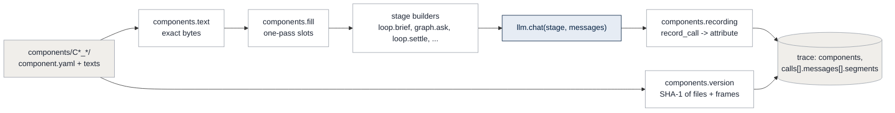
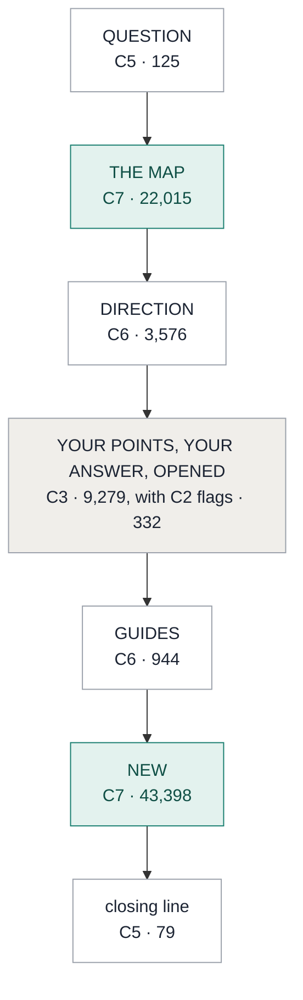

# Prompt components

Every fixed text the model reads belongs to one of ten components, C1 to C10, each a folder under
[src/petroharness/agent/components/](../../src/petroharness/agent/components/). Each has a version hash, and the trace
attributes every character of every request to a component, so a change to one text shows in the versions and in the
calls it reaches. For developers who change a prompt text, compare two sets of texts, or read a call in a trace.

## 1. At a glance

Which component reaches which call. The examples on this page come from a recorded conversation on GeoLink 30/6-5,
Brent Group (2841–2958 m).

| Component | READ | Steps | Settle | Writer | Repair | Figures |
|---|---|---|---|---|---|---|
| C1 system | brief | brief | brief | | | |
| C2 guardrails | | claim flags, NOT DONE, syntax fix | claim flags, syntax fix | | the request | |
| C3 memory | earlier questions | points, answer, OPENED | points, answer | points, limits | the draft | |
| C4 tools | tool list | tool list, tool errors | tool list | | | |
| C5 orchestration | instructions, QUESTION | instructions, QUESTION | instructions, BOOKKEEPING | QUESTION | QUESTION | QUESTION |
| C6 skills | TOPIC AREAS | DIRECTION, GUIDES | | | | |
| C7 scripts | THE MAP | THE MAP, FIRST LOOK, NEW | THE MAP, ALL RESULTS | RESULTS, THE MAP | RESULTS, THE MAP | |
| C8 middleware | | notes in NEW | | | | |
| C9 answer | | conventions | aspects rule | rules, curve card, zone table, conventions | rules | rules, THE ANSWER, candidates |
| C10 reading | brief rules | brief rules, absent note | brief rules, settle rule, absent note | absent note | absent note | |

A repair replays the writer's two messages, plus the draft (C3) and the request (C2).

- **One folder per component**, `C<n>_<name>/`: `component.yaml` and its texts (`.md`, or `.json` lists and dicts),
  loaded as exact bytes; `{name}` slots are filled in one pass ([components.py](../../src/petroharness/agent/components.py)).
- **Version**: the first 12 hex digits of SHA-1 over a component's files and frames. `PETROHARNESS_COMPONENTS=<folder>`
  runs another set.
- **Attribution**: every character of every message of every call, as `[component, version, start, end]` spans in
  `trace["calls"]`; a text under 24 characters (`MIN_MATCH`) is attributed by its section header or the stage's owner.

## 2. How it works



1. **Load.** `components.meta(cid)` reads `component.yaml`, `components.text(cid, entry)` an entry's exact text (a
   `.json` entry as its list or dict); both are cached for the process.
2. **Fill.** `components.fill(cid, entry, **values)` fills each `{name}` slot that has a value, in one pass, so a value is never read as a slot; a few
   slots are filled by the stage builder with `str.replace` or `str.format` (section 4).
3. **Assemble.** The stage builders (`loop.read_question`, `graph.look`, `graph.ask`, `graph.plan`, `loop.parse`,
   `loop.settle`, `writer.prompt`, `graph.repair`, `figures.pick`) join component texts with the state's text into a
   system and a user message (section 6).
4. **Version.** `graph.turn` writes `components.versions()` to `trace["components"]`.
5. **Attribute.** `components.recording(llm, trace, library)` wraps the client's `chat`; after each successful call
   `components.record_call` appends the spans of every message to `trace["calls"]`. The request is unchanged.

## 3. Component files

A component is a folder: `component.yaml` names its entries (one text file each) and its frames (the source files
whose output it frames, which count toward its version but are not its texts).

<details>
<summary><code>component.yaml</code></summary>

| Name | Type | Default | Meaning | Defined in |
|---|---|---|---|---|
| `id` | `str` | required | `C1` to `C10`; must equal the folder's id | `component.yaml`, checked by `tests/agent/test_components.py` |
| `name` | `str` | required | the name after the id (`system`, `guardrails`, ...); must equal `components.COMPONENTS[id]` | `component.yaml` |
| `purpose` | `str` | required | one line on what the component owns | `component.yaml` |
| `texts` | `dict[str, str]` | `{}` | entry name to file name in the folder | `component.yaml`, read by `components.text` |
| `frames` | `list[str]` | `[]` | glob patterns, relative to `src/petroharness/`, of the source files whose text is part of the component's version | `component.yaml`, read by `components._files` |

C10, as shipped:

```yaml
id: C10
name: reading
purpose: 'how evidence is read and graded: caveats, levels and rankings, negatives, absence'
texts:
  brief_weaknesses: brief_weaknesses.md
  brief_levels: brief_levels.md
  settle_weaknesses: settle_weaknesses.md
  absent_note: absent_note.md
frames:
- agent/vocabulary.py
```

- The folder is `components.folder(cid)`: `<HERE>/<cid>_<name>`, for example `C10_reading`.
- A comment beside an entry in `component.yaml` says where the entry is used; code does not read the comments.

</details>

<details>
<summary>Entries and slots</summary>

An entry is one text file; a template entry has `{name}` slots.

| Name | Type | Default | Meaning | Defined in |
|---|---|---|---|---|
| `.md` entry | `str` | | the exact bytes the model reads, trailing newline included | `components.text` |
| `.json` entry | `list` or `dict` | | strings the code picks by index or key (tool descriptions, flag templates, rule lists) | `components.text` |
| `SLOT` | regex | `\{([A-Za-z_][A-Za-z0-9_]*)\}` | a slot is an identifier in braces; JSON braces such as `{"points": ...}` are not slots | `components.SLOT` |
| `fill(cid, entry, **values)` | function | | the entry with its slots filled | `components.fill` |
| `fill_text(template, **values)` | function | | the same on any template text | `components.fill_text` |
| guide fragments | entries | | text about guides is its own entry, filled into its template's slot only when a skill library is plugged (C1 `brief_direction`, `brief_guide`; C5 `step1_guides`, `step1_guide_call`; C8 `not_run_guide`) | `loop.brief`, `loop.step1`, `graph.decide` |

One-pass filling (cases from `tests/agent/test_components.py`):

```python
>>> fill_text("a {x} b {y}", x="{y}")
'a {y} b {y}'
>>> fill_text("{X} and {x}", X="up")
'up and {x}'
>>> fill_text('{"points": [...]} - {n} questions', n=3)
'{"points": [...]} - 3 questions'
```

`test_no_text_is_in_two_components` checks that no string of 24 characters or more is in two components.

</details>

<details>
<summary>Frames</summary>

| Name | Meaning | Defined in |
|---|---|---|
| frame | a glob relative to the package (`agent/map.py`, `resources/profiles/*.yaml`) | `component.yaml` `frames` |
| frame text | headers and fixed phrases written in that code (`FIRST LOOK (`, `RESULTS (everything the investigation computed, by id):`) | the frame files |
| shared frames | `agent/graph.py` frames C5 and C8; `agent/claims.py` frames C2 and C3: a change there changes both versions | `component.yaml` of each |

Each component's frames are listed in section 4.

</details>

## 4. The ten components

| Component | Owns | Frames |
|---|---|---|
| C1 system | the role, the protocol and the reply format (the system message of READ, every step, settle) | none |
| C2 guardrails | what code says when a check fails: claim flags, the done refusal, the syntax fix, repair requests | `agent/claims.py`, `agent/checks.py` |
| C3 memory | the state the model reads back: its points, its claims, the ledger, the earlier questions of a conversation | `agent/ledger.py`, `agent/claims.py`, `session/earlier.py` |
| C4 tools | what the model can call and how: tool descriptions, argument vocabularies, the condition grammar | `agent/schemas.py`, `agent/toolset.py`, `tools/spec.py`, `agent/engine.py` |
| C5 orchestration | what each stage asks (reading, step 1, step k, points, settle and its bookkeeping), and each section header's owner | `agent/graph.py`, `agent/loop.py` |
| C6 skills | the DIRECTION index and the GUIDES block (the guide lines are the library's) | `resources/topics.yaml`, `agent/direction.py` |
| C7 scripts | the tool outputs and the map: text computed by Petrophys and the harness's code | `agent/tools.py`, `agent/compute.py`, `agent/map.py`, `agent/inventory.py`, `agent/notes.py`, `agent/routes.py` |
| C8 middleware | the hooks around each call: actions left out, results withheld, edits not applied | `agent/graph.py` |
| C9 answer | the writer's system texts, the zone-table rule, the one guideline for bases and conventions, the figure choice | `agent/writer.py`, `resources/rules/shapes.yaml`, `resources/profiles/*.yaml` |
| C10 reading | how evidence is read and graded: caveats, levels and rankings, negatives, absence | `agent/vocabulary.py` |

<details>
<summary>C1 system</summary>

| Entry | File | Slots | Holds | Used by |
|---|---|---|---|---|
| `brief` | `brief.md` | `{direction}`, `{guide_action}` (fill); `{TOOLS}`, `{ACTIONS}` (replace) | the role, what each step shows, the reply keys, the edit and action shapes, the grades, the number rule, what to look at before finishing | `loop.brief` |
| `brief_direction` | `brief_direction.md` | | `DIRECTION (guides you can read on demand); ` | `loop.brief`, with a library |
| `brief_guide` | `brief_guide.md` | `{ACTIONS}` | the `{"guide": "<facet>"}` action line | `loop.brief`, with a library |

The start of `brief.md`:

```text
You are a senior petrophysicist answering one question about one formation in one well. You build the answer as a
set of claims and refine it step by step as evidence comes in. ...
```

`loop.brief` appends C10 `brief_weaknesses` and `brief_levels`, then fills `{TOOLS}` with `loop.tools_text()` and
`{ACTIONS}` with `6`. `brief.md` holds the stop sentence (`Stop when every point is settled and nothing on the list
under "Before you finish" is left.`).

</details>

<details>
<summary>C2 guardrails</summary>

| Entry | File | Slots | Holds | Used by |
|---|---|---|---|---|
| `flags` | `flags.json` | per key: `{missing}`, `{numbers}`, `{number}`, `{items}`, `{said}`, `{curves}`, `{name}`, `{shown}`, `{how}` | the claim flags: keys `K1` to `K4`, `K5_present`, `K5_route`, `K7_unavailable`, `K7_absent`, `K8` to `K11` (`K3_held`, `K3_none` are K3's parts) | `claims._flag` |
| `not_done` | `not_done.md` | `{why}`, `{issues}` | `NOT DONE ({why}): {issues}. Settle each, then set done.` | `graph.decide` |
| `skip` | `skip.md` | | NEW after an unreadable reply | `graph.skip` |
| `fix` | `fix.md` | `{error}`, `{text}` (`str.format`) | the request to fix a reply's JSON syntax | `loop.parse` |
| `repair_contradictions` | `repair_contradictions.md` | | the head of up to 4 contradiction messages | `graph.repair` |
| `repair_numbers` | `repair_numbers.md` | `{numbers}` | up to 12 numbers no result, the map or the question shows | `graph.repair` |
| `repair_words` | `repair_words.md` | `{words}` | up to 8 phrases about the investigation | `graph.repair` |
| `repair_leaks` | `repair_leaks.md` | `{leaks}` | up to 4 working notes left in the answer | `graph.repair` |
| `repair_keep` | `repair_keep.md` | | `Keep everything else as it is. ...` closing every repair request | `graph.repair` |

One key of `flags.json`:

```json
{"K1": "K1 {missing} not opened (cite opened items, or MAP for the description)", ...}
```

The flags are described in [INVESTIGATION_STATE.md](INVESTIGATION_STATE.md), section 8.

</details>

<details>
<summary>C3 memory</summary>

| Entry | File | Slots | Holds | Used by |
|---|---|---|---|---|
| `earlier_head` | `earlier_head.md` | | `EARLIER IN THIS SESSION (the same well and interval, oldest first; ...)`, quoted under "Later questions of a conversation" | `session/earlier.py` `block` |

- YOUR POINTS, YOUR ANSWER and OPENED are rendered by the framing code (`Claims.render`, `Session.opened`).
- C3 also owns, by position, the model's own earlier reply when a call replays it as an assistant turn (section 8).

</details>

<details>
<summary>C4 tools</summary>

| Entry | File | Slots | Holds | Used by |
|---|---|---|---|---|
| `tool_descriptions` | `tool_descriptions.json` | | a dict of 30 tool descriptions, one per tool name | `toolset._text` |
| `library` | `library.md` | | the line heading the tool list: search Petrophys before a hand calculation | `loop.tools_text` |
| `condition` | `condition.md` | | the condition grammar in the `where` argument's description | `toolset.WHERE` |
| `zones_argument` | `zones_argument.md` | | the `zones` argument's description | `toolset.ZONES` |
| `grammar` | `grammar.md` | | the condition grammar repeated in a bad condition's error message | `engine.GRAMMAR` |
| `argument_texts` | `argument_texts.json` | | an example value per text argument, for type errors (`condition`, `where`, `a`, `b`, `curve`, `y`, `x`, `key`, `name`, `relation`, `baseline`, `topic`, `op`) | `schemas._TEXTS` |

`argument_texts.json` in an error message (`schemas.arguments`):

```text
condition must be text, e.g. "SW < 0.5 and PHIE > 0.1", not ['SW < 0.5']
```

A new tool's description goes into `tool_descriptions.json` ([TOOLS_REFERENCE.md](TOOLS_REFERENCE.md)).

</details>

<details>
<summary>C5 orchestration</summary>

| Entry | File | Slots | Holds | Used by |
|---|---|---|---|---|
| `read` | `read.md` | | the READ instructions: topics and named measurements | `loop.read_question` |
| `read_depth` | `read_depth.md` | | the same, and `depth`: `direct` or `investigate` | `loop.read_question` (depth read) |
| `direct_step` | `direct_step.md` | | a direct question's look step | `graph.look` |
| `step1` | `step1.md` | `{guide_sentence}`, `{guide_call}` (fill); `{ACTIONS}` (replace) | step 1's instructions and example reply | `loop.step1` |
| `step1_guides` | `step1_guides.md` | `{ACTIONS}` | the sentence on reading guides | `loop.step1`, with a library |
| `step1_guide_call` | `step1_guide_call.md` | `{guide}` | the example's guide call | `loop.step1`, with a library |
| `step1_later` | `step1_later.md` | | a later question of a conversation: read what is open first | `graph.ask` |
| `step1_reply` | `step1_reply.md` | | a later question's answer length (`"reply": "brief"` or `"full"`), when depth is not read | `graph.ask` |
| `points_scope` | `points_scope.md` | | points stay within the question | `graph.ask` (step 1) |
| `points_ask` | `points_ask.md` | `{n}` | step 1's points asked for once, when its edits number points its reply did not write | `graph.plan` |
| `step_next` | `step_next.md` | | the closing line of step k | `graph.ask` |
| `step_last` | `step_last.md` | `{done}` | the last step: no actions | `graph.ask` |
| `step_settled_check` | `step_settled_check.md` | | added when every point is settled: go through "Before you finish" | `graph.ask` |
| `settle` | `settle.md` | | the final step's instructions | `loop.settle` |
| `settle_lists` | `settle_lists.json` | `{items}` per list | the BOOKKEEPING head and its `named`, `unused` and `hypotheses` lists | `loop.bookkeeping` |
| `section_owners` | `section_owners.json` | | frame header to owning component (section 8) | `components.headers` |

`step_last.md`, filled with `done="set done to true"`:

```text
This is the last step: edit your answer for what NEW shows and set done to true (no actions).
```

`step1` names, in its example, the library's guide on `net_reservoir_pay` (`loop.EXAMPLE_TOPIC`), else the library's
first guide.

</details>

<details>
<summary>C6 skills</summary>

| Entry | File | Slots | Holds | Used by |
|---|---|---|---|---|
| `guides_head` | `guides_head.md` | | `GUIDES (a guide is shown in full at the step after you read it, then short; ...)` | `Session.guides_text` |
| `guide_short` | `guide_short.md` | `{name}`, `{calls}` | a guide read earlier, as its Compare calls | `Session.guides_text` |

A guide read earlier, as step 3 of the first Brent question showed it:

```text
net_reservoir_pay, read earlier; its Compare calls: pay_summary; runs NET_RES; runs NET_PAY; runs CONDITION; stats PHIE, PERM, VCL, SW, RDEP where NET_PAY; ...
```

The library's lines are attributed to C6 (`Library.lines`); its version is the trace's `skills`, not part of C6's
([SKILLS.md](SKILLS.md)).

</details>

<details>
<summary>C7 scripts</summary>

| Entry | File | Slots | Holds | Used by |
|---|---|---|---|---|
| `one_value` | `one_value.md` | `{step}`, `{meaning}` | the label of a step curve that holds one value over the whole well, whatever set it (its record says how) | `map.parameter` |

In the map of 30/6-5 Brent:

```text
VANHY 0: one value over the whole well as the lithology step wrote it (anhydrite volume fraction, v/v)
```

THE MAP, FIRST LOOK, NEW and ALL RESULTS sections are C7's by their headers.

</details>

<details>
<summary>C8 middleware</summary>

| Entry | File | Slots | Holds | Used by |
|---|---|---|---|---|
| `not_run` | `not_run.md` | `{items}`, `{guide}` | actions no tool reads | `graph.decide`, `Session.run` |
| `not_run_guide` | `not_run_guide.md` | | `, guide` in `not_run`'s list of actions | `graph.decide`, with a library |
| `actions_left_out` | `actions_left_out.md` | `{cap}`, `{dropped}` | lookups beyond the cap | `graph.decide` |
| `extra_left_out` | `extra_left_out.md` | `{cap}`, `{what}`, `{dropped}` | guides or calculations beyond a step's own caps (`what`: `guides` or `calculations`) | `graph.decide` |
| `done_waits` | `done_waits.md` | `{items}` | done while results are withheld | `graph.decide` |
| `withheld` | `withheld.md` | | results over NEW's budget, first in the next NEW | `graph.act` |
| `withheld_last` | `withheld_last.md` | | the same before the last step: settle shows every result | `graph.act` |
| `shown_above` | `shown_above.md` | `{id}` | `[{id}] shown above in this NEW` | `graph.act` |
| `nothing_new` | `nothing_new.md` | | `(nothing new)` | `graph.act`, `graph.look` |
| `edits_not_applied` | `edits_not_applied.md` | | `Edits not applied:` before the edit messages | `graph.act` |

`actions_left_out`, filled with a cap of 6 and 2 left out:

```text
Only the first 6 actions ran (2 left out): one focus, at most 6 actions a step.
```

</details>

<details>
<summary>C9 answer</summary>

| Entry | File | Slots | Holds | Used by |
|---|---|---|---|---|
| `write` | `write.md` | | the writer's role and reporting rules 1 to 8 | `writer.prompt` |
| `table_rule` | `table_rule.md` | | rule 9 when a zone table is inserted: write `{{ZONE_TABLE}}` on its own line | `writer.prompt` |
| `points_rule` | `points_rule.md` | | rule 10: one part per point | `writer.prompt` |
| `later_rule` | `later_rule.md` | | rule 11 for a later question of a conversation | `writer.prompt` |
| `reply_brief` | `reply_brief.md` | | the short answer's role and rules 1 to 5 | `writer.prompt` (brief) |
| `brief_later` | `brief_later.md` | | rule 6 of a short answer to a later question | `writer.prompt` (brief) |
| `brief_direct` | `brief_direct.md` | | a direct question's writer may reply `INVESTIGATE` | `writer.prompt` (brief, direct) |
| `aspects_rule` | `aspects_rule.md` | | the one guideline for bases and conventions | `loop.settle` |
| `figures` | `figures.md` | | the system message of the figure choice | `figures.pick` |

`aspects_rule.md`:

```text
Where the way a number is summarised changes the answer (per zone or overall; zone means or samples; which average; which threshold), give the results that differ and say which you lead with and why. ...
```

`{{ZONE_TABLE}}` in `table_rule` is not filled: the rule is appended as written, and the model writes the marker.

</details>

<details>
<summary>C10 reading</summary>

| Entry | File | Slots | Holds | Used by |
|---|---|---|---|---|
| `brief_weaknesses` | `brief_weaknesses.md` | | readings and their weaknesses; negatives need the zone-level count; a class not computed is not `none` | `loop.brief` |
| `brief_levels` | `brief_levels.md` | | levels and rankings against the workflow's thresholds | `loop.brief` |
| `settle_weaknesses` | `settle_weaknesses.md` | | a caveat lowers a grade; it does not turn classes or flags into a denial | `loop.settle` |
| `absent_note` | `absent_note.md` | `{items}` | `Named but not in this well's record: {items}` | `vocabulary.note` |

On GeoLink 16/7-1 (2000–2560 m), which has no neutron and no PEF, for a question that names both (`vocabulary.note`
on that well; data: GeoLink, CC BY-SA 4.0):

```text
Named but not in this well's record: neutron porosity (NPHI); photoelectric factor (PEF)
```

</details>

## 5. Components by stage

A change that touches one component changes that component's version only, and the trace's spans show which calls
carry its texts. One recorded investigation step (step 3 of the first Brent question), characters by component:

| Message | Characters | By component |
|---|---|---|
| system | 27,297 | C1 16,477 · C4 9,774 · C10 1,046 |
| user | 79,748 | C7 65,413 · C3 9,279 · C6 4,520 · C2 332 · C5 204 |

<details>
<summary>Component, stages and files</summary>

Which stage's requests each component reaches (its files are in its block in section 4).

| Component | Stages that use it |
|---|---|
| C1 system | `read`, `read_retry`, every `step_k` and `step_k_retry` (look and investigation), `step_1_points`, `settle` |
| C2 guardrails | `step_k` (flags in YOUR ANSWER; `skip` and `not_done` in NEW), `step_k_fix`, `settle_fix`, `settle` (flags), `repair_n` |
| C3 memory | `step_k` (YOUR TOPICS, YOUR POINTS, YOUR ANSWER, OPENED), `settle`, `writer` (THE QUESTION'S POINTS, LIMITS THE INVESTIGATION FOUND), `step_1_points` and `repair_n` (the replayed assistant turn), any call with EARLIER IN THIS SESSION |
| C4 tools | every call with the brief (the tool list); `step_k` (tool error messages in NEW) |
| C5 orchestration | `read`, `step_k`, `step_1_points`, `settle`; the QUESTION section of every user message |
| C6 skills | `read` (TOPIC AREAS), `step_k` (DIRECTION, GUIDES; guide text in a look step's NEW) |
| C7 scripts | `read` and `step_k` (THE MAP), `step_1` (FIRST LOOK), `step_k` (NEW), `settle` (THE MAP, ALL RESULTS), `writer` (RESULTS, THE MAP) |
| C8 middleware | `step_k` (NEW's notes), look steps (`nothing_new`) |
| C9 answer | `writer`, `writer_retry`, `writer_again`, `repair_n`, `repair_n_again`, `figures`; `settle` (`aspects_rule`); the conventions block (THIS DATA'S REPORTING CONVENTIONS) in the steps and the writer |
| C10 reading | every call with the brief (`brief_weaknesses`, `brief_levels`); `settle` (`settle_weaknesses`); the absent note in steps, settle and the writer |

</details>

## 6. How each request is assembled

Each request is a system message and a user message built from sections; a section's header names its owner. The user
message of step 3 of the first Brent question, section by section, with its characters:



<details>
<summary>READ</summary>

The first model call: the model chooses its topic areas, lists what the question names and, unless the run asked for
`--investigate`, says whether the question is direct.

| Message | Part | Component | Meaning | Defined in |
|---|---|---|---|---|
| system | the brief | C1, C4, C10 | as for every step | `loop.brief` |
| user | C5 `read` or `read_depth` | C5 | the instructions; `read_depth` when `Session.reads_depth` | `loop.read_question` |
| user | `QUESTION:` | C5 | the question | `loop.read_question` |
| user | earlier questions | C3 | later questions only | `loop.read_question` |
| user | `THE MAP` | C7 | the map with all notes (topics not chosen yet) | `loop.read_question` |
| user | `TOPIC AREAS:` | C6 | one line per area: `name - when` | `loop.read_question` |

The end of the READ user message of the first Brent question:

```text
TOPIC AREAS:
data_quality - hole condition, tool and environmental effects, spikes, gaps, depth matching, log quality
...
```

The call carries a JSON schema (`loop.read_schema`). Stages `read` and `read_retry`; owners `C1`, `C5`.

</details>

<details>
<summary>Look steps of a direct question</summary>

A direct question's step: one call that states the results are open, or names at most 4 lookups.

| Message | Part | Component | Meaning | Defined in |
|---|---|---|---|---|
| system | the brief | C1, C4, C10 | | `graph.look` |
| user | the head | C5, C10, C3, C9, C7, C6 | QUESTION, absent note, earlier questions, conventions, THE MAP, DIRECTION | `graph.first_look` |
| user, step 1 | `YOUR TOPICS:`, `FIRST LOOK (` | C3, C7 | the topics and the first look | `graph.look` |
| user, step 2 | `OPENED (`, `NEW (from step 1):` | C3, C7 | what is open and what the last step returned | `graph.look` |
| user | C5 `direct_step` | C5 | the look step's instructions | `graph.look` |

A recorded look step: the public mini set's third question, "What water resistivity did the saturation use?", read
as direct (`tests/gate/mini/brent/turns/03.tape.jsonl.gz`, line `n` 1). After the head (`QUESTION:`, `EARLIER IN THIS
SESSION (`, `THE MAP`, `DIRECTION`; 30,123 of its 38,129 characters):

```text
YOUR TOPICS: water_saturation

FIRST LOOK (each zone's key curves for the topics you chose: water_saturation; opened for you):
[E21] Each zone, every curve (its mean; a flag: the share set; class codes: each class's share):
  Z1: SW mean 0.7765; RDEP mean 5.2172; RW mean 0.0729; ...

You read this question as direct: it asks for something one or two results state as they are. ...
- If the results opened above already state what is asked, reply {"done": true}.
- Otherwise open what is still missing, at most 4 lookups, ...
- If answering takes several results weighed together, or no lookup gives what is asked, reply {"depth": "investigate"} ...
```

The conventions block's header, `THIS DATA'S REPORTING CONVENTIONS (`, is C9's in `section_owners`.

</details>

<details>
<summary>Investigation steps</summary>

Step 1 sets the points and the first draft; step k reads NEW and edits the claims.

| Message | Part | Component | Meaning | Defined in |
|---|---|---|---|---|
| system | the brief | C1, C4, C10 | | `graph.ask` |
| user | the head | C5, C10, C3, C9, C7, C6 | as above | `graph.first_look` |
| user, step 1 | `YOUR TOPICS:`, `FIRST LOOK (`, C5 `step1`, C5 `points_scope` | C3, C7, C5 | later questions add C5 `step1_later` (and `step1_reply`) | `graph.ask`, `loop.step1` |
| user, step k | `YOUR POINTS:`, `YOUR ANSWER (` | C3 (flags C2) | the points and the claims with their flags | `graph.ask`, `Claims.render` |
| user, step k | `OPENED (fetch exact lines` | C3 | the ledger's listing and digests | `Session.opened` |
| user, step k | `GUIDES (a guide` | C6 | the guides read | `Session.guides_text` |
| user, step k | `NEW (from step` | C7 (notes C8, C2) | what the last actions returned | `graph.act` |
| user, step k | C5 `step_next` or `step_last`, and `step_settled_check` | C5 | the closing instruction | `graph.ask` |

In step 3 of the first Brent question (the diagram above), the C3 section holds two C2 spans, 27989–28155 and
30843–31009: K10 flags inside YOUR ANSWER. An entry found in the text is its component's, whatever section it is in.

</details>

<details>
<summary>Points request and syntax fix</summary>

Two repair calls of the investigation.

| Message | Part | Component | Meaning | Defined in |
|---|---|---|---|---|
| `step_1_points`, 1 and 2 | the step 1 system and user messages | C1, C5 | as sent | `graph.plan` |
| `step_1_points`, 3 | the step 1 reply as an assistant turn | C3 | the model's own text | `llm.assistant_turn` |
| `step_1_points`, 4 | C5 `points_ask` | C5 | asks for the points the edits number | `graph.plan` |
| `step_k_fix` or `settle_fix`, 1 | C2 `fix` with the parse error and the reply | C2 | one user message, no system message | `loop.parse` |

The fourth message of the points request of the second Brent question (`points_ask` with `n = 3`):

```text
Your reply has no points. Reply with only the points your edits refer to, as JSON: {"points": ["..."], "intent": "..."} - 3 questions the answer must settle, numbered as your edits number them.
```

- `points_ask` is filled with `components.fill`; its JSON braces are not slots, only `{n}` is.
- The fix call's stage is the fixed call's stage with `_fix` (`step_<k>_fix`, `settle_fix`;
  `loop.parse(..., stage=)`).
- `fix` is filled with `str.format(error=..., text=...)`, so `fix.md` must contain no other braces.

</details>

<details>
<summary>Settle</summary>

The final step: every opened result in view, the claims made final.

| Message | Part | Component | Meaning | Defined in |
|---|---|---|---|---|
| system | the brief | C1, C4, C10 | | `loop.settle` |
| user | `QUESTION:`, absent note, earlier questions | C5, C10, C3 | | `loop.settle` |
| user | `THE MAP` | C7 | | `loop.settle` |
| user | `YOUR POINTS:`, `YOUR ANSWER:` | C3 | the claims with their flags | `loop.settle` |
| user | `ALL RESULTS:` | C7 | every result, whole while 24,000 characters last | `writer.opened_results` |
| user | `BOOKKEEPING (` | C5 | C5 `settle_lists` | `loop.bookkeeping` |
| user | C5 `settle`, C10 `settle_weaknesses`, `- ` C9 `aspects_rule` | C5, C10, C9 | the instructions | `loop.settle` |

The settle user message of the first Brent question, from BOOKKEEPING:

```text
BOOKKEEPING (lists to act on as you see fit; nothing here holds the answer back):
- opened, cited by no claim (does each bear on what the question asks?): E10 stats PHIE_CC, SW, PERM_CC, PERM, VCL (zones Z1, Z4, Z5, Z7, Z9, Z13, Z19)

FINAL STEP: the investigation is over and no more results can be opened. ...
```

</details>

<details>
<summary>Writer</summary>

The answer, written from the question's points, every result and the provenance card.

| Message | Part | Component | Meaning | Defined in |
|---|---|---|---|---|
| system, full | C9 `write`, `9. ` + `table_rule` (with a zone table), `points_rule`, `later_rule` (later question) | C9 | the reporting rules | `writer.prompt` |
| system, short | C9 `reply_brief`, `brief_later` (later question), `brief_direct` (direct question) | C9 | the short answer's rules | `writer.prompt` |
| user | `QUESTION:`, earlier questions, absent note, conventions | C5, C3, C10, C9 | | `writer.prompt` |
| user | `THE QUESTION'S POINTS (the answer covers each):`, `LIMITS THE INVESTIGATION FOUND (...)` | C3 | the points, and the settled claims' `weak` notes by point | `writer.readings`, `writer.doubts` |
| user | `RESULTS (everything the investigation computed, by id):` | C7 | every result of this question in full (on a later question, also the earlier results its claims cite or its look steps read), cut at 60,000 characters | `writer.prompt` |
| user | `WHAT THE CURVES ARE (...)` | C9 | the provenance card (`writer.curve_card`) | `writer.prompt` |
| user | `THE ZONE TABLE (` | C9 | the code-composed zone table (list and report shapes, full answers only) | `writer.zone_table` |
| user | `THE MAP` | C7 | the map without its notes | `writer.writer_map` |

The writer's user message for the first Brent question (87,563 characters; its answer has a zone table), span by
span: `QUESTION:` (C5, 0–126); the points, and the limits from 729 (C3, 126–3395); `RESULTS` (C7, 3395–61655);
`WHAT THE CURVES ARE`, and `THE ZONE TABLE` from 64563 (C9, 61655–67206); `THE MAP` (C7, 67206–87563).

- Each section of the user message has its header in `section_owners`: the points and limits are C3's, RESULTS C7's,
  the curve card, the zone table and the conventions C9's.
- Stages `writer`, `writer_retry`, `writer_again`; owners `C9`, `C9`.
- The prompt and the checker: [WRITER_AND_CHECKER.md](WRITER_AND_CHECKER.md).

</details>

<details>
<summary>Verify and repair</summary>

The checker is code; a repair is one call that replays the writer's request with the draft and the findings.

| Message | Part | Component | Meaning | Defined in |
|---|---|---|---|---|
| 1, 2 | the writer's system and user messages | C9 owners | as sent | `graph.repair` |
| 3 | the draft as an assistant turn | C3 | the model's own text | `llm.assistant_turn` |
| 4 | C2 `repair_contradictions` + up to 4 messages; `repair_numbers`; `repair_words`; `repair_leaks`; `repair_keep` | C2 | the findings and the request to keep the rest | `graph.repair` |

The fourth message of the first repair of the first Brent question:

```text
These numbers are not shown by any result, the map or the question: 4.86, 0.055, 0.060, 0.756. Take each exactly as a claim or a result shows it (with its id in brackets), or remove it. These words talk about the investigation, not the formation: 'not opened', 'the MAP'. ... Keep everything else as it is. ...
```

- Stages `repair_<n>` and `repair_<n>_again`; owners `C9`, `C9`, `C3`, `C2`.
- At most two repair rounds with the writer variant `open` (the default), one otherwise (`graph.after_verify`).

</details>

<details>
<summary>Figures</summary>

After a conversation's answer is final, one call chooses which of Petrophys's plots to attach.

| Message | Part | Component | Meaning | Defined in |
|---|---|---|---|---|
| system | C9 `figures` | C9 | the choice's rules | `figures.pick` |
| user | `QUESTION:`, `THE ANSWER:`, `CANDIDATE FIGURES:` | C5, C9, C9 | the question, the answer, one line per candidate (`F1: <title> (from result E4)`) | `figures.pick` |

A candidate line and the reply's schema (its list of 16 candidates shortened), from the first Brent question:

```text
F4: Log display of PHIE_CC, SW, PERM, PERM_CC, VCL against depth, beside the zones' lithology (all zones) (from result E9)
```

```json
{"type": "object", "properties": {"figures": {"type": "array", "items": {"enum": ["F1", "F2", "...", "F16"]}, "maxItems": 3}},
 "required": ["figures"]}
```

The call runs on its own client after the question's graph has ended (`Conversation._figures`). That client records
into the question's trace (`components.recording`), so the call is in `trace["calls"]` with owners `C9`, `C9`; its
usage is in `trace["figures"]["usage"]`, not in `trace["usage"]`.

</details>

<details>
<summary>Later questions of a conversation</summary>

What changes in the requests when a question continues a conversation.

| Stage | Part | Component | Meaning | Defined in |
|---|---|---|---|---|
| every call with the head | EARLIER IN THIS SESSION | C3 | the earlier questions, their openings and claims with result ids, within 6,000 characters | `session/earlier.py` `block` |
| `step_1` | C5 `step1_later` | C5 | read what is open before opening the same again | `graph.ask` |
| `step_1` | C5 `step1_reply` | C5 | the answer length, asked only when depth is not read | `graph.ask` |
| full writer | C9 `later_rule` | C9 | the form follows the question; refer to earlier answers | `writer.prompt` |
| short writer | C9 `brief_later` | C9 | the same for a short answer | `writer.prompt` |

The start of EARLIER IN THIS SESSION in the second Brent question:

```text
EARLIER IN THIS SESSION (the same well and interval, oldest first; the ids are results listed in OPENED, read them with get):
Question 1: What are the porosity, water saturation and permeability of the Brent Group, and is any of it hydrocarbon-bearing?
  Answered: Where. The Brent Group is logged as 20 zones, ...
```

`graph.reply_form` sends a later question to `write_brief` when step 1 said `"reply": "brief"`.

</details>

## 7. Versions

A version changes when the component's texts or framing code change. The ten versions in the Brent conversation's
setup record (the same in `trace["components"]` and in the mini set's `tests/gate/mini/brent/set.json`,
`setup.components`):

```json
{"C1": "6f8f4c39893a", "C2": "1bd4a923bb18", "C3": "a35c7f5f0be5", "C4": "57cd02cee605", "C5": "b40542f539d8",
 "C6": "5fc0e8cf8998", "C7": "f5c6434e1229", "C8": "beafa87e2cf0", "C9": "5c430eea66e9", "C10": "20c9aaaad36a"}
```

To try other texts, copy the folder and point `PETROHARNESS_COMPONENTS` at the copy before the process starts:

```bash
cp -r src/petroharness/agent/components /tmp/components_b
# edit /tmp/components_b/C10_reading/brief_levels.md
PETROHARNESS_COMPONENTS=/tmp/components_b petroharness --las well.las --question "..."
```

<details>
<summary><code>components.version</code></summary>

What a version hashes.

| Name | Type | Meaning | Defined in |
|---|---|---|---|
| files | `list[Path]` | `component.yaml`, every file in `texts`, every file matching `frames` under `src/petroharness/`; sorted and unique | `components._files` |
| hash | SHA-1 | for each file: its path (relative to the components folder, else to the package), a zero byte, its bytes | `components.version` |
| version | `str` | the first 12 hex digits | `components.version` |
| `versions()` | `dict` | all ten, written to `trace["components"]` and to the setup record | `components.versions` |

- Versions are cached per process (`lru_cache`); a test that edits a file clears the caches
  (`test_a_version_follows_its_files`).
- A whitespace change in a text changes the version: entries are loaded and hashed as exact bytes.

</details>

<details>
<summary><code>PETROHARNESS_COMPONENTS</code></summary>

Runs the harness on another copy of the components folder.

| Name | Type | Default | Meaning | Defined in |
|---|---|---|---|---|
| `PETROHARNESS_COMPONENTS` | environment variable | unset | a folder laid out as `agent/components/` (ten `C<n>_<name>/` folders) | `components.HERE` |
| `HERE` | `Path` | `src/petroharness/agent/components` | the folder texts are read from | `components.HERE` |
| `REPO` | `Path` | `src/petroharness` | where frames are read from, whatever `HERE` is | `components.REPO` |

- `HERE` is read when `petroharness.agent.components` is imported, and several modules read texts at import time
  (`loop.STEP1`, `loop.BRIEF_WEAKNESSES`, `writer.TABLE_RULE`, ...), so the variable must be set before the process
  starts.
- Uses: an A/B of component versions; or, with a golden tape replayed in collect mode
  (`tape.replay(llm, tape, collect=True)`), the list of calls an edit reaches.
- Every entry the code reads must exist in the copy: a missing file fails when it is read, and most entries are read
  at import.

</details>

## 8. Attribution

Entry texts claim their own characters, section headers what follows them, and the stage's owner the rest. The first
spans of the system message of every READ, step and settle call in the Brent conversation (27,297 characters: the
brief, its tool list and C10's rules):

```json
[["C1", "6f8f4c39893a", 0, 3225], ["C4", "57cd02cee605", 3225, 3552], ["C1", "6f8f4c39893a", 3552, 3665],
 ["C4", "57cd02cee605", 3665, 4728], ["C1", "6f8f4c39893a", 4728, 4808], ["C4", "57cd02cee605", 4808, 5211]]
```

<details>
<summary><code>components.attribute</code></summary>

Every character of a message attributed to one component, as contiguous spans.

| Name | Type | Default | Meaning | Defined in |
|---|---|---|---|---|
| `message` | `str` | required | one message's content | `components.attribute` |
| `owner` | `str` | required | the component of text no entry or header claims | `components.attribute` |
| `skills` | `tuple[str]` | `()` | the plugged library's lines (C6) | `components.attribute` |
| `catalog(skills)` | `list` | | every entry's literal pieces between slots of at least 24 characters, or equal to a section header (each list or dict string on its own), and the library lines, longest first | `components.catalog` |
| `headers()` | `list` | | C5 `section_owners` as `(header, component)` | `components.headers` |
| result | `list` | | `[[cid, version, start, end], ...]`, covering the message exactly, adjacent same-component characters merged | `components.attribute` |

- Each catalog piece, longest first, claims every occurrence whose characters are all unclaimed.
- Headers mark section starts: a header counts at the message's start, after a newline, or when it begins with a
  newline itself. Each unclaimed character goes to the component of the nearest preceding header, else to `owner`.
- Runs of one component become spans with that component's version.
- A text shorter than 24 characters (`MIN_MATCH`) is not searched for, because it would match by chance; it is
  attributed by header or owner. An entry piece equal to a section header is searched however short.
- Text that code writes with no entry (a tool's output, the claims, a section header) is attributed by its section.

</details>

<details>
<summary>Section owners</summary>

C5 `section_owners.json`: the header that opens a section, and the component that owns the section.

| Header | Owner |
|---|---|
| `QUESTION:\n`, `BOOKKEEPING (` | C5 |
| `EARLIER IN THIS SESSION (`, `YOUR TOPICS:`, `YOUR POINTS:\n`, `YOUR ANSWER (`, `YOUR ANSWER:\n`, `OPENED (fetch exact lines`, `THE QUESTION'S POINTS (`, `LIMITS THE INVESTIGATION FOUND (` | C3 |
| `\nTHE MAP\n`, `THE MAP\n`, `FIRST LOOK (`, `NEW (from step`, `ALL RESULTS`, `RESULTS (everything the investigation computed` | C7 |
| `DIRECTION\n`, `TOPIC AREAS:\n`, `GUIDES (a guide` | C6 |
| `THE ZONE TABLE (`, `WHAT THE CURVES ARE (`, `THIS DATA'S REPORTING CONVENTIONS (`, `THE ANSWER:\n`, `CANDIDATE FIGURES:\n` | C9 |
| `Named but not in this well's record` | C10 |
| `Edits not applied:\n` | C2 |

`Edits not applied:\n` is also C8's `edits_not_applied` entry. An entry equal to a header is searched however short,
so the header's characters are C8's and the edit messages under it C2's.

</details>

<details>
<summary>Owners by stage</summary>

`components.OWNERS`: the component that owns a message's text no entry or header claims, by stage and message
position.

| Stage pattern | Owners by message |
|---|---|
| `read`, `read_retry` | C1, C5 |
| `step_<k>`, `step_<k>_retry` | C1, C5 |
| `step_<k>_fix`, `settle_fix` | C2 |
| `step_1_points` | C1, C5, C3, C5 |
| `settle` | C1, C5 |
| `writer`, `writer_retry`, `writer_again` | C9, C9 |
| `repair_<n>`, `repair_<n>_again` | C9, C9, C3, C2 |
| `figures`, `figures_retry` | C9, C9 |
| any other stage, or a position past the list | C3: the model's own text in an assistant turn (`components.owners`) |

</details>

<details>
<summary>The call record</summary>

What `trace["calls"]` holds for each successful model call.

| Name | Type | Meaning | Defined in |
|---|---|---|---|
| `stage` | `str` | the call's stage (`read`, `step_3`, `settle`, `writer`, `repair_1`, ...) | `components.record_call` |
| `messages` | `list` | one entry per message sent | `components.record_call` |
| `messages[].role` | `str` | `system`, `user` or `assistant` | `components.record_call` |
| `messages[].segments` | `list` | the spans of `attribute` | `components.record_call` |
| `recording(llm, trace, library)` | function | wraps `llm.chat` for one question; `graph.turn` calls it, and `Conversation._figures` for the figures call | `components.recording` |

The record of step 2 of the first Brent question, shortened:

```json
{"stage": "step_2", "messages": [
  {"role": "system", "segments": [["C1", "6f8f4c39893a", 0, 3225], ["C4", "57cd02cee605", 3225, 3552], "..."]},
  {"role": "user", "segments": [["C5", "b40542f539d8", 0, 125], ["C7", "f5c6434e1229", 125, 22140], "..."]}]}
```

- `trace["calls"]` and `trace["usage"]` have one entry per call of the question graph, in the same order; a call that
  raises is in neither. The figure choice's calls (`figures`, `figures_retry`) come last in `calls`; their usage
  entries are in `trace["figures"]["usage"]`. The first Brent question has 13 calls and 12 usage entries.
- The message texts are not stored in `calls`; the tapes (`petroharness.tape`) hold them.

</details>

## 9. Limits and errors

Beyond the cases the sections above state (a text in two components, a short entry, a stage not in `OWNERS`, the
figure choice's usage):

| Situation | What happens | Where |
|---|---|---|
| An entry file is missing | `FileNotFoundError` when the entry is read; most entries are read at import | `components.text` |
| A `.json` entry is not JSON | `json.JSONDecodeError` when read | `components.text` |
| A slot has no value | it stays as written in the request | `components.fill_text` |
| `fix.md` gains other braces | `str.format` raises when a reply is repaired | `loop.parse` |
| A section has no header in `section_owners` | its characters go to the section before it | `components.attribute` |
| `PETROHARNESS_COMPONENTS` set after import | no effect in that process | `components.HERE` |

## 10. Related pages

- [agent/components/README.md](../../src/petroharness/agent/components/README.md): the component folder's own rules.
- [INVESTIGATION_STATE.md](INVESTIGATION_STATE.md): the state the requests are rebuilt from, and the flags.
- [SKILLS.md](SKILLS.md): the library whose lines are C6's.
- [WRITER_AND_CHECKER.md](WRITER_AND_CHECKER.md): the writer's prompt, the checker and the repairs.
- [GRAPH.md](../GRAPH.md): the nodes that make each call.
- [DESIGN.md](../DESIGN.md): G2, every model-facing line has a stated provenance.
- [TESTING.md](TESTING.md): the component tests, the golden tapes and the request gate.
