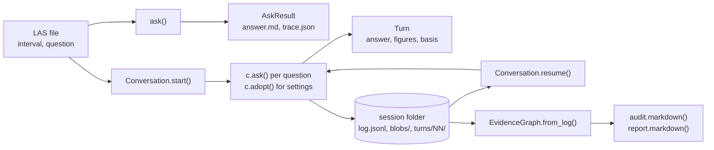
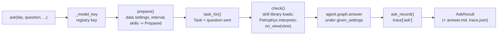

# Python API reference

Every command of the [command line](CLI.md) is a thin layer over a public Python function: one question with `ask()`,
a conversation with `Conversation`, its audit trail and report from `EvidenceGraph`, and the setup, settings and field
notes helpers. The examples run on GeoLink well 30/6-5 (Brent Group, 2841-2958 m), which ships with Petrophys; a
case that well does not have (a log in feet, no lithology log, a missing log, a faulty tops file) is shown on the
sample well that has it. The outputs in the comments are real: from those wells and from a recorded two-question
conversation on 30/6-5.

## 1. At a glance



One question about the Brent Group:

```python
import petrophys
from petroharness.ask import ask

r = ask(petrophys.sample("30/6-5"),
        "What are the porosity, water saturation and permeability of the Brent Group, and is any of it hydrocarbon-bearing?",
        tops=petrophys.sample("formations_30_6-5.csv"), formation="BRENT GP.",
        model_url="http://localhost:8000/v1", out="out/brent")
print(r.status)                        # ok, unresolved_numbers, or error: ...
print(r.interval)
# {'name': 'BRENT GP.', 'top': 2841.0, 'base': 2958.0, 'unit': 'm', 'samples': 768,
#  'from': 'tops file formations_30_6-5.csv, base: stated base'}
print(r.trace["ask"]["lithology"])
# {'source': 'lithology log', 'curve': 'LITHOLOGY_GEOLINK', 'how': 'detected'}
```

- Wrong inputs raise before any model call. A run that fails does not raise: its `status` is `error: <type>`
  ([section 12](#12-limits-and-errors)).
- The model is reached at `model_url`, else `PETROHARNESS_MODEL_URL`; `llm_factory` plugs in a client of your own
  ([section 11](#11-model-clients-and-tapes)).
- `out=None` writes nothing. A conversation always keeps its session folder.

| Object | Module | Purpose | Returns or holds |
|---|---|---|---|
| `ask()` | [`petroharness.ask`](../../src/petroharness/ask.py) | One question about one LAS file | `AskResult` |
| `prepare()`, `task_for()`, `check()`, `ask_record()` | `petroharness.ask` | The steps of `ask()` before and after the model runs | `Prepared`, `Task`, the trace's `ask` block |
| `Conversation` | [`petroharness.session`](../../src/petroharness/session/conversation.py) | Any number of questions on one interval, kept in a session folder | `Turn` per question |
| `SessionLog` | [`petroharness.session.log`](../../src/petroharness/session/log.py) | The append-only event log of a conversation | events, blobs |
| `answer()`, `benchmark()`, `main()` | [`petroharness.cli`](../../src/petroharness/cli.py) | A prepared task through the question graph; the console script | `{"answer", "status", "trace"}` |
| `EvidenceGraph`, `audit`, `report` | [`petroharness.evidence`](../../src/petroharness/evidence/) | The evidence graph of a session folder, its audit trails, the conversation document | graph, Markdown, JSON |
| `Setup`, `of()`, `config_for()`, `differences()` | [`petroharness.core.setup`](../../src/petroharness/core/setup.py) | The setup record and its hash | `Setup`, a 12-character hash |
| `schema()`, `validate()`, `load()` | [`petroharness.well.settings`](../../src/petroharness/well/settings.py), [`petroharness.well.notes`](../../src/petroharness/well/notes.py) | Interpretation settings and field notes files | dicts |
| `tape.record()`, `tape.Replayer` | [`petroharness.tape`](../../src/petroharness/tape.py) | Record and replay model calls | tapes |

Configuration objects (`HarnessConfig`, `given_settings`, the model registry) are in
[CONFIGURATION.md](CONFIGURATION.md#11-configuration-in-python).

## 2. How it works

`ask()` prepares the interval, has Petrophys interpret the well, runs the question graph and records what was asked
(`src/petroharness/ask.py`):



`Conversation.ask()` runs one question through the session graph instead, `open -> turn -> project -> figures ->
commit` (`petroharness.session.graph.run`, [GRAPH.md](../GRAPH.md#the-session-graph)): the first question is answered
as `ask()` answers it, a later one on the same ledger with the earlier questions in view.

<details>
<summary>The steps of ask(), one by one</summary>

1. Resolves `las` to an absolute path and strips the question; a missing file or an empty question raises.
2. Picks the model registry key with `_model_key`: the endpoints from `model_url`, else `PETROHARNESS_MODEL_URL`,
   and the card from `model_card` and `model` (`petroharness.models.register`).
3. Loads `field_notes` with `petroharness.well.notes.load` and puts their settings under `interpretation`.
4. Calls `prepare()`: the data settings for this LAS (`_settings`), the interpretation settings (`_interpretation`),
   the interval (`_interval`), the depth unit and the skill library, as a `Prepared`. The interpreted well is cached in
   `<out>/.cache`, or in a temporary folder removed when `ask()` returns.
5. Calls `task_for()` for the `Task` and the question as sent, then `check()`: the skill library must load,
   Petrophys interprets the well, the interval must hold samples, and `on_view(view)` is called.
6. Inside `config.given_settings(p.given)`, runs the question graph `agent.graph.answer` (rep 1, writer `open`,
   format `profile`, step cap `max_steps` or 8) ([GRAPH.md](../GRAPH.md)).
7. Adds `answer` and the `ask` block (`ask_record()`) to the trace (which `agent.graph.answer` has stamped with the
   setup it answered under, `setup` and `setup_parts`), builds the `AskResult` and, with `out`, writes `answer.md`
   and `trace.json`.

</details>

## 3. One question: ask

### ask

`ask()` answers one question about one interval of one LAS file and returns an `AskResult`. The interval is a
formation of a tops file, a pair of depths, or, with neither, the whole well.

```python
ask(las, question: str, *, formation=None, tops=None, top=None, base=None, depth_unit=None, lithology_curve=None,
    formation_lithology=None, profile=None, out=None, model_url=None, model=None, model_card=None, settings=None,
    skills=None, max_steps=None, llm_factory=None, on_view=None, direct=True, interpretation=None,
    field_notes=None, zones=None, zones_sheet=None) -> AskResult
```

```python
# the cored interval of 25/5-1, by depth (no tops file ships with it)
r = ask(petrophys.sample("25/5-1"), "How does the log porosity compare with the core porosity?",
        top=2990, base=3290, model_url="http://localhost:8000/v1")
r.interval
# {'name': 'depth interval 2990-3290 m', 'top': 2990.0, 'base': 3290.0, 'unit': 'm', 'samples': 1969,
#  'from': 'depths given'}

# the Brent Group under interpretation settings of your own (endpoint from PETROHARNESS_MODEL_URL)
r2 = ask(petrophys.sample("30/6-5"), "Which zone has the best reservoir quality?",
         tops=petrophys.sample("formations_30_6-5.csv"), formation="BRENT GP.",
         interpretation={"rw": 0.05, "sw_model": "indonesia", "m": 2.2, "zone_min_thickness_m": 1.0})
```

<details>
<summary>Arguments of ask()</summary>

| Argument | Type | Default | Meaning | Defined in |
|---|---|---|---|---|
| `las` | path or str | required | The well's LAS file. | `ask.ask` |
| `question` | str | required | The question; stripped, must not be empty. | `ask.ask` |
| `formation` | str or None | None | The formation in `tops`, or a label for `top`/`base`; alone, looked up in the settings' `data.tops_csv`. | `interval._interval` |
| `tops` | path or None | None | A tops table (CSV, TSV or Excel), columns found by meaning ([USAGE.md](../USAGE.md#turning-formation-information-into-a-tops-file)). Excludes `base`; with `top`, the row of that top for a name the table lists twice. | `well.tops.read_tops`, `TopsTable.interval` |
| `top`, `base` | float or None | None | The interval's depths, both included; one alone runs to the log's first or last depth. With `tops`, `top` is the top of the row meant, as the file writes it. | `interval._interval` |
| `depth_unit` | `"m"`, `"ft"` or None | None (the tops file's unit, else the LAS's) | The unit of the depths given and of the answer's depths. | `interval._interval` |
| `lithology_curve` | str or None | None (detected) | The lithology log's mnemonic. | `interval._settings`, `ask.check` |
| `formation_lithology` | str or None | None | The formation's lithology as the user states it; added to the question. | `interval.task_for` |
| `profile` | str or None | None | A Petrophys context profile (`interpret: {context_profile: NAME}`). | `interval._settings` |
| `out` | path or None | None | A folder for `answer.md`, `trace.json` and `.cache/`. None writes nothing. | `ask.ask` |
| `model_url` | str or None | None (`PETROHARNESS_MODEL_URL`) | The endpoints, comma-separated. | `ask._model_key` |
| `model` | str or None | None | The served model's name (the generic card unless `model_card` is given). | `models.card_file` |
| `model_card` | str or None | None (the K2-Horizon-7B card) | A model card's YAML file, or a packaged card's name. | `models.card_file` |
| `settings` | path or None | None (`PETROHARNESS_DATA` if set) | A data settings YAML whose `data:` section is the base. | `interval._settings` |
| `skills` | str or None | None (`PETROHARNESS_SKILLS`, else the packaged library) | A skill library folder, or `"none"`. | `interval.prepare` |
| `max_steps` | int or None | None (8, `agent.state.MAX_STEPS`) | The investigation's step cap. | `ask.ask` |
| `llm_factory` | callable or None | None (`petroharness.llm.LLM`) | `llm_factory(cfg)` returns the model client ([section 11](#11-model-clients-and-tapes)). With it and no endpoint, no endpoint is needed. | `ask._model_key` |
| `on_view` | callable or None | None | Called with the interval's `FormationView` once Petrophys has interpreted the well, before the first model call. | `ask.check` |
| `direct` | bool | True | The model first says whether the question is direct; False gives every question the full investigation. | `agent.graph.turn` |
| `interpretation` | dict or None | None | Interpretation settings, `{setting: value}` ([CONFIGURATION.md](CONFIGURATION.md#5-interpretation-settings)); over the field notes' settings. | `interval._interpretation` |
| `field_notes` | path or None | None | A field notes file: its settings are in force, its notes go with the question. | `well.notes.load` |
| `zones` | path or None | None | Your zones: a table (CSV, TSV or Excel) of zone, top and bottom (optional `depth_unit` and `well` columns). They frame the answer in place of the lithology zones (Z1, Z2, ... under your names; the lithology zones are kept as L1, L2, ...). | `well.user_zones.read_zones` |
| `zones_sheet` | str or None | None (the first sheet) | The Excel sheet of the zones. | `well.user_zones.read_zones` |

</details>

<details>
<summary>Errors and failed runs of ask()</summary>

- Wrong inputs raise before any model call: `FileNotFoundError`, `ValueError`, or `FormationNotFound` (a
  `LookupError`) for a name the tops file lacks. A Petrophys failure raises `RuntimeError`.
- A failure during the question graph does not raise: the result's `status` is `error: <exception type>`, and the
  trace holds `error` and `traceback`. A writer whose last draft is empty gives `status`
  `error: empty answer (the writer's last draft was empty)`, with that reason in the trace's `error`.
- A bad skill library raises `LibraryError` (a `ValueError`) in `check()`, before Petrophys interprets the well.
- `interpretation` with Petrophys settings and a `profile` (or a data `interpreter`) raises `ValueError`; the zone
  rule (`zone_min_thickness_m`, `zone_vcl_bands`, `zone_layout`) may be set with either.

Three interval errors on the sample wells that have them, as `prepare()` raises them for `ask()` (each says what is
wrong, why, and the fix; `prepare`, `Inputs` and `key` as in [section 4](#4-the-building-blocks-of-ask)):

```python
s = petrophys.sample
# a tops file that lists a formation twice (Taranaki tuhua-7)
prepare(Path(s("tuhua-7")).resolve(), key, Inputs(tops=s("formations_tuhua-7.csv"), formation="Manganui"),
        cache=Path("cache"))
# FormationNotFound: WHAT: formation 'Manganui' is listed 2 times in formations_tuhua-7.csv (line 3: top 874.014,
# base 1250.75; line 10: top 2164.99, base 2347.42). WHY: a repeated name (e.g. a repeated section) does not say
# which interval is meant. FIX: choose the one you mean by its top: --formation NAME --tops FILE --top D, or give its
# depths alone: --formation NAME --top D --base D.

# a tops file in feet asked for in metres (KGS 1046123714)
prepare(Path(s("1046123714")).resolve(), key, Inputs(tops=s("1046123714_formation_tops.csv"),
        formation="Lansing-Kansas City", depth_unit="m"), cache=Path("cache"))
# ValueError: WHAT: the tops file 1046123714_formation_tops.csv states its depths in ft and the depth unit given is
# m. WHY: one of them is wrong. FIX: drop --depth-unit (the file's unit is used) or correct the file.

# a multi-well tops table that has no rows for this well (the COSTA table, read for GeoLink 30/6-5)
prepare(Path(s("30/6-5")).resolve(), key, Inputs(tops=s("formations_costa.csv"), formation="KHARAIB-2"),
        cache=Path("cache"))
# FormationNotFound: WHAT: the tops file formations_costa.csv has no rows for this well (it goes by '30_6-5',
# '30/6-5', '30/6-5'; the file's well column lists HW-3, HW-4, HW-5, HW-6, HW-7, HW-8, HW-9, HW-10, HW-24, HW-25,
# HW-26, HW-27, HW-28, HW-29, HW-30, HW-31, HW-32). WHY: a table with a well column is read for this well only. FIX:
# put this well's name (the LAS file's name or its WELL header) in that column, or drop the column from a table that
# holds only this well.
```

Data: Taranaki Basin Curated Well Logs Dataset (New Zealand Petroleum & Minerals), CDLA-Sharing-1.0. Kansas Geological
Survey (kgs.ku.edu). Costa Gomes, Geiger and Arnold (2022), COSTA model, Heriot-Watt University, CC BY.

</details>

### AskResult

`AskResult` is the dataclass `ask()` returns: the answer as delivered, its `status`, the full `trace`, the `interval`
asked about, and the files written. `ok` is True unless `status` starts with `error`.

<details>
<summary>Fields of AskResult</summary>

| Field | Type | Default | Meaning | Defined in |
|---|---|---|---|---|
| `answer` | str | required | The answer as delivered ("" when there is none). | `ask.AskResult` |
| `status` | str | required | `ok`, `unresolved_numbers` (a number no result shows survived the checker), `error: <type>`, or `error: empty answer (the writer's last draft was empty)`. | `ask.AskResult`, `agent.graph.answer_status` |
| `trace` | dict | required | The full trace ([ARCHITECTURE.md](../ARCHITECTURE.md#the-trace)), plus `answer`, the `ask` block, and the setup: `setup` (its hash) and `setup_parts` (the record, [EVIDENCE.md](../EVIDENCE.md#the-setup-record)). | `ask.ask`, `agent.graph.answer` |
| `interval` | dict | required | What was asked about: `name`, `top` and `base` (rounded to 4 decimals), `unit`, `samples`, `from`. | `ask.check` |
| `out_dir` | Path or None | None | The output folder, when `out` was given. | `ask.AskResult` |
| `files` | dict | `{}` | `{"answer": Path, "trace": Path}` when files were written. | `ask.ask` |
| `ok` | property, bool | - | True unless `status` starts with `error`. | `ask.AskResult.ok` |

</details>

<details>
<summary>The trace's ask block, on 30/6-5 Brent</summary>

```json
{"ask": {"las": ".../petrophys/datasets/geolink/30_6-5.las",
         "question": "What are the porosity, water saturation and permeability of the Brent Group, and is any of it hydrocarbon-bearing?",
         "question_sent": null,
         "interval": {"name": "BRENT GP.", "top": 2841.0, "base": 2958.0, "unit": "m", "samples": 768,
                      "from": "tops file formations_30_6-5.csv, base: stated base"},
         "lithology": {"source": "lithology log", "curve": "LITHOLOGY_GEOLINK", "how": "detected"},
         "zones": [{"zone": "Z1", "lithology": "SAND", "top": 2841.3242, "base": 2845.7439}, "... (20 zones)"],
         "model": "K2-Horizon-7B", "settings": "built from the LAS",
         "skills": {"library": "researched", "version": "18c03ad5d3f8"}, "skills_given": null,
         "interpret": {"vcl_cutoff": 0.3, "sw_cutoff": 0.7}, "interpreter": null,
         "petrophys": "3.0.0@files-c5de047fe601"}}
```

- `question_sent` is the question as the model read it, when it differs (the operator's lithology or the field notes
  added); `field_notes` (`name`, `sha256`, `settings`, `notes`) is present only when a file was given.
- `lithology.source` is `lithology log` (with `curve` and `how`: `named` or `detected`), `mineral solver` (no
  lithology log: the lithology Petrophys's mineral solver wrote, with its `curve`, `method`, `domain`, `inputs`,
  `decisions`, and the well's `solved` and `samples`), `shale-volume bands` (with `bands`; neither a log nor a solved
  lithology) or `none`. A well without a lithology log, such as Taranaki tuhua-7 (McKee Formation), gives
  `{"source": "mineral solver", "curve": "LITHO", "method": "canonical_multi_mineral_solver", "domain": "clastic",
  "inputs": ["RHOB", "VCL", "NPHI", "PHIE", "PEF", "DTC"], "decisions": ["No lithology curve or lithology intervals
  were available -> inferred LITHO from mineral volumes", "..."], "solved": 13418, "samples": 13652}`.

</details>

## 4. The building blocks of ask

`ask()` is `prepare()`, `task_for()` and `check()`, then the question graph, then `ask_record()`. The first three call
no model: they check an interval, and have Petrophys interpret it, before any question is asked.

```python
from pathlib import Path
import petrophys
from petroharness.ask import Inputs, check, prepare, task_for
from petroharness.models import register

las = Path(petrophys.sample("30/6-5")).resolve()
key = register(["http://localhost:8000/v1"])            # the default card on this endpoint: 'k2-horizon-7b'
p = prepare(las, key, Inputs(formation="BRENT GP.", tops=petrophys.sample("formations_30_6-5.csv")), cache=Path("cache"))
print(p.source, p.data["interpret"])                    # built from the LAS {'vcl_cutoff': 0.3, 'sw_cutoff': 0.7}
task, sent = task_for(p, "Which zone has the best reservoir quality?")
check(p, task)                                          # Petrophys interprets the well
print(p.used["samples"], len(p.view.zones), p.litho["curve"])      # 768 20 LITHOLOGY_GEOLINK
```

A whole-log question on an old well logged in feet, with no lithology log (Teapot 17-WX-21): with no formation and
no depths the interval is the whole log, in the LAS's own unit, and the zones are runs of the lithology Petrophys's
mineral solver wrote.

```python
from petroharness.well import settings

p = prepare(Path(petrophys.sample("teapot_17-wx-21")).resolve(), key, Inputs(), cache=Path("cache"))
task, sent = task_for(p, "Where are the porous intervals in this well, and what do they hold?")
check(p, task)
p.used
# {'name': 'whole well', 'top': 0.0, 'base': 5649.5, 'unit': 'ft', 'samples': 11300,
#  'from': 'the whole log (no formation or depths given)'}
p.litho["source"], p.litho["curve"], p.litho["domain"], len(p.view.zones)
# ('mineral solver', 'LITHO', 'clastic', 102)
used = settings.used(p.view.prep)                       # what Petrophys used, read from its step record
used["sw_model"], used["a"]
# ({'value': 'indonesia+archie', 'step': 'saturation'}, {'value': 0.81, 'step': 'saturation'})
```

Data: Teapot Dome (NPR-3), RMOTC, U.S. Department of Energy.

<details>
<summary>Intervals, units and missing logs on other sample wells</summary>

Each case on the sample well that has it, through the same three calls:

```python
def interval(name, **kw):                     # the interval as ask() would use it, with no model call
    p = prepare(Path(petrophys.sample(name)).resolve(), key, Inputs(**kw), cache=Path("cache"))
    check(p, task_for(p, "(the interval)")[0])
    return p

# a tops file in feet; with no stated base, the base is the next top (KGS 1046123714)
interval("1046123714", tops=petrophys.sample("1046123714_formation_tops.csv"), formation="Lansing-Kansas City").used
# {'name': 'Lansing-Kansas City', 'top': 3991.0, 'base': 4080.0, 'unit': 'ft', 'samples': 178,
#  'from': 'tops file 1046123714_formation_tops.csv, base: next top LKC G'}

# the same interval asked for in metres on that feet log: the answer reports in metres
interval("1046123714", top=1216.5, base=1243.6, depth_unit="m").used
# {'name': 'depth interval 1216.5-1243.6 m', 'top': 1216.5, 'base': 1243.6, 'unit': 'm', 'samples': 178,
#  'from': 'depths given'}

# a multi-well tops table with a well column: the rows of this well are read (COSTA HW-3, a carbonate in feet)
interval("HW-3", tops=petrophys.sample("formations_costa.csv"), formation="KHARAIB-2").used
# {'name': 'KHARAIB-2', 'top': 7805.0, 'base': 8020.0, 'unit': 'ft', 'samples': 431,
#  'from': 'tops file formations_costa.csv, base: stated base'}

# a well with no neutron and no PEF log (GeoLink 16/7-1): Petrophys interprets it and records what it did instead
p = interval("16/7-1")
"NPHI" in p.view.prep.input_curves, "PEF" in p.view.prep.input_curves          # (False, False)
p.view.prep.steps["porosity"]["parameters"]["phit_method"]                     # 'density_only'
p.view.prep.steps["porosity"]["decisions"]          # among them:
# 'Density-only porosity: PHIT = PHID because PHIN was unavailable'
```

Data: Kansas Geological Survey (kgs.ku.edu). Costa Gomes, Geiger and Arnold (2022), COSTA model, Heriot-Watt
University, CC BY. GeoLink, CC BY-SA 4.0.

</details>

<details>
<summary>prepare</summary>

`prepare()` builds the data settings and the interval for one LAS, with no model call and no interpretation yet.

```python
prepare(las: Path, key: str, inputs: Inputs, *, cache: Path) -> Prepared

Inputs(formation=None, tops=None, top=None, base=None, depth_unit=None, lithology_curve=None, formation_lithology=None,
       profile=None, settings=None, skills=None, interpretation=None, field_notes=None, zones=None, zones_sheet=None)
```

| Argument | Type | Default | Meaning | Defined in |
|---|---|---|---|---|
| `las` | Path | required | The LAS file, already resolved to an absolute path. | `interval.prepare` |
| `key` | str | required | A model registry key (`petroharness.models.register`). | `interval.prepare` |
| `inputs` | `Inputs` | required | What the interval is prepared from: the arguments `ask()`, a conversation, the web UI and the setup command share, one field each. `Inputs.of(mapping)` takes the fields a mapping or an argparse namespace holds. | `interval.Inputs` |
| `inputs.formation` ... `inputs.skills` | as `ask()` | as `ask()` | As in `ask()`. | `interval.prepare` |
| `inputs.interpretation` | dict or None | None | The settings in force; a field notes file's settings are merged under them. | `interval._interpretation`, `Inputs.loaded` |
| `inputs.field_notes` | path, dict or None | None | A field notes file, or the notes already read from one (`well.notes.load(path)`). | `Inputs.loaded` |
| `inputs.zones`, `inputs.zones_sheet` | as `ask()` | as `ask()` | Your zones, read into `data.zones` (and the file's name into `data.zones_source`). | `interval.prepare`, `well.user_zones.read_zones` |
| `cache` | Path | required | The folder the interpreted well is cached in (`data.cache_dir` unless the settings file sets one). | `interval._settings` |

- The data settings start from `settings` (else `PETROHARNESS_DATA`); `las_dir` defaults to the LAS's folder and
  `cache_dir` to `cache`. The full order: [CONFIGURATION.md](CONFIGURATION.md#2-how-it-works).
- `data.depth_unit` is set to `"las"` when the report unit is the LAS's own, else to the report unit, unless the
  settings file sets it. A `depth_unit` argument wins over the settings file's.

</details>

<details>
<summary>Prepared</summary>

`Prepared` is the dataclass for one interval of one LAS, ready for questions.

| Field | Type | Default | Meaning | Defined in |
|---|---|---|---|---|
| `las` | Path | required | The LAS file. | `interval.Prepared` |
| `key` | str | required | The model registry key. | `interval.Prepared` |
| `data` | dict | required | The data settings built for this LAS (the `data:` section, [CONFIGURATION.md](CONFIGURATION.md#4-the-data-section)). | `interval._settings` |
| `source` | str | required | Where they came from: the settings file's path, or `built from the LAS`. | `interval._settings` |
| `span` | dict | required | The interval asked about: `name`, `top`, `base`, `closed`, `unit`, `from`, `las_unit`, `report`, and `units` (the tops file's units inside the interval) when it lists any. | `interval._interval` |
| `said` | str | required | The operator's lithology for the formation ("" when not given). | `interval.prepare` |
| `given` | dict | required | The settings every question runs under, for `config.given_settings`: `{"data", "eval": {}, "skills"?}`. | `interval.prepare` |
| `skills_given` | str or None | None | The `skills` argument as given. | `interval.prepare` |
| `lithology_curve` | str or None | None | The lithology curve named. | `interval.prepare` |
| `view` | FormationView or None | None | The interval's view, set by `check()`. | `ask.check` |
| `used` | dict | `{}` | The interval as used, set by `check()` (`AskResult.interval`). | `ask.check` |
| `litho` | dict | `{}` | Where the zones came from, set by `check()`. | `ask.check` |
| `notes` | dict | `{}` | The field notes in force. | `interval.prepare` |

```python
p.span          # 30/6-5, Brent Group
# {'name': 'BRENT GP.', 'top': 2841.0, 'base': 2958.0, 'closed': True, 'unit': 'm',
#  'from': 'tops file formations_30_6-5.csv, base: stated base',
#  'units': [['Ness Fm.', 2841.0, 2865.0], ['Etive Fm.', 2865.0, 2958.0]], 'las_unit': 'm', 'report': 'm'}
prepare(Path(petrophys.sample("25/5-1")).resolve(), key, Inputs(top=2990, base=3290), cache=Path("cache")).span
# {'name': 'depth interval 2990-3290 m', 'top': 2990.0, 'base': 3290.0, 'closed': True, 'unit': 'm',
#  'from': 'depths given', 'las_unit': 'm', 'report': 'm'}
```

</details>

<details>
<summary>task_for, check and ask_record</summary>

These three functions turn a `Prepared` into a question the graph can run and record what was asked.

| Function | Returns | Arguments (defaults) | Meaning | Defined in |
|---|---|---|---|---|
| `task_for(p, question, turn=1)` | `(Task, str)` | `turn`: the question's number in a conversation | The `Task` (id `a` + 10 hex digits of a SHA-256 of the LAS, question, interval and turn) and the question as sent: with `(The operator states this formation's lithology: ...)`, the tops file's units inside the interval under `reach: focus` (`(The tops file lists these units inside this interval: ...)`; under the default `reach: well` the map lists the file's units instead) and the field notes statement appended when present. | `interval.task_for` |
| `check(p, task, on_view=None)` | None | `on_view`: callback | Builds the `FormationView` (Petrophys interprets the well), raises when the interval has no samples or the named lithology curve has no data, fills `p.view`, `p.used`, `p.litho`, then calls `on_view(view)`. | `ask.check` |
| `ask_record(p, question, sent, trace)` | dict | none | The trace's `ask` block ([AskResult](#askresult)). | `ask.ask_record` |

```python
p = prepare(las, key, Inputs(formation="BRENT GP.", tops=petrophys.sample("formations_30_6-5.csv"),
                             formation_lithology="sandstone"), cache=Path("cache"))
task_for(p, "Which zone has the best reservoir quality?")[1]
# "Which zone has the best reservoir quality?\n\n(The operator states this formation's lithology: sandstone.)"
```

- The operator's lithology is appended unless the zone layout is `formation`, which shows it on the zone.
- `check()` runs under the prepared data settings directly (`HarnessConfig(data=DataPaths(**p.data), eval=None)`), so
  a misspelt data key raises here.

</details>

<details>
<summary>parser, interval_options, run_options, options and main</summary>

These functions are the question command; `chat` and `setup` reuse the option groups.

| Function | Returns | Arguments (defaults) | Meaning | Defined in |
|---|---|---|---|---|
| `parser()` | `argparse.ArgumentParser` | none | The question command's parser (`prog="petroharness"`): `--las` (required), `--question` or `--question-file`, `--out`, and the two option groups. | `ask.parser` |
| `interval_options(ap)` | None | `ap`: a parser | Adds `--formation`, `--tops`, `--zones`, `--zones-sheet`, `--top`, `--base`, `--depth-unit`, `--lithology-curve`, `--formation-lithology`, `--field-notes`, `--profile`. | `ask.interval_options` |
| `run_options(ap, endpoint=True)` | None | `ap`: a parser; `endpoint`: add `--model-url` | Adds `--model`, `--model-card`, `--model-url` (not with `endpoint=False`, as `petroharness setup` uses it), `--settings`, `--skills`, `--max-steps`, `--investigate`. | `ask.run_options` |
| `options(args)` | dict | `args`: parsed namespace | The parsed command line as `ask()` keyword arguments (the question read from `--question-file` when given); `out` defaults to `./petroharness-out/<LAS stem>`. | `ask.options` |
| `main(argv=None)` | int | `argv`: the arguments | The command: 0 answered, 1 failed, 2 wrong inputs ([CLI.md](CLI.md#3-petroharness-one-question)). | `ask.main` |

```python
from petroharness.ask import main
code = main(["--las", petrophys.sample("30/6-5"), "--tops", petrophys.sample("formations_30_6-5.csv"),
             "--formation", "BRENT GP.", "--question", "What is the mean porosity?",
             "--model-url", "http://localhost:8000/v1"])
```

</details>

## 5. Conversation

A `Conversation` keeps one interval open for any number of questions. The well is interpreted once, every question
reads what earlier ones opened, and everything is kept in the session folder, so a conversation can be resumed,
audited and reported later.

```python
import petrophys
from petroharness.session import Conversation

c = Conversation.start(petrophys.sample("30/6-5"), "brent-session", formation="BRENT GP.",
                       tops=petrophys.sample("formations_30_6-5.csv"), model_url="http://localhost:8000/v1")
first = c.ask("What are the porosity, water saturation and permeability of the Brent Group, and is any of it "
              "hydrocarbon-bearing?")
second = c.ask("Which zone has the best reservoir quality, and how does the log permeability compare with the core?")
```

### Conversation.start

`Conversation.start()` starts a conversation on one interval of a LAS file, kept in `folder`; the well is interpreted
before any question.

```python
Conversation.start(las, folder, *, formation=None, tops=None, top=None, base=None, depth_unit=None,
                   lithology_curve=None, formation_lithology=None, profile=None, settings=None, skills=None,
                   model_url=None, model=None, model_card=None, max_steps=None, llm_factory=None, on_view=None,
                   figures=True, direct=True, interpretation=None, field_notes=None, zones=None,
                   zones_sheet=None) -> Conversation
```

<details>
<summary>Arguments of Conversation.start, and what the log keeps</summary>

| Argument | Type | Default | Meaning | Defined in |
|---|---|---|---|---|
| `las` | path | required | The LAS file. | `Conversation.start` |
| `folder` | path | required | The session folder; must not hold a `log.jsonl` yet. | `Conversation._new` |
| `figures` | bool | True | Draw each answer's figures (one more model call per answer) and `overview.png`. | `Conversation.start` |
| all others | as `ask()` | as `ask()` | As in `ask()`; `field_notes` is a path, loaded here. | `Conversation.start` |

- The inputs (all arguments but `las`, `folder`, `model_url`, `llm_factory` and `on_view`) are kept in the log's
  `session_start` event, so `resume()` needs only the folder. The endpoint is not kept.
- The `session_start` event also holds `mode: "las"`, the LAS path and SHA-256, the interval, lithology, zones, model
  label, Petrophys build and harness commit.

</details>

### Conversation.resume

`Conversation.resume()` reopens a conversation from its folder, ready for the next question.

```python
Conversation.resume(folder, *, model_url=None, key=None, llm_factory=None, on_view=None, direct=None) -> Conversation
```

```python
later = Conversation.resume("brent-session", model_url="http://localhost:8000/v1")
later.log.events("session_resume")[-1]["differences"]       # [] : every recorded result opened again as it was
later.ask("What water resistivity did the saturation use?")
```

<details>
<summary>Arguments of Conversation.resume, and how the ledger is rebuilt</summary>

| Argument | Type | Default | Meaning | Defined in |
|---|---|---|---|---|
| `folder` | path | required | A folder a conversation was started in. | `Conversation.resume` |
| `model_url` | str or None | None (`PETROHARNESS_MODEL_URL`) | The endpoints from here on. | `Conversation._open` |
| `key` | str or None | None (the one it started with) | A model registry key, for a conversation on prepared tasks only. | `Conversation.resume` |
| `llm_factory` | callable or None | None | The model client factory. | `Conversation.resume` |
| `on_view` | callable or None | None | Called with the interval's view when the well is interpreted. | `Conversation._prepared` |
| `direct` | bool or None | None (as started) | The route for the questions from here on. | `Conversation.resume` |

- The well is prepared again (from `.cache`) and every recorded result is opened again in order; each must come back
  with its id and text. A difference is listed in the `session_resume` event (`questions`, `results`,
  `differences`), and the conversation goes on.
- Settings and zones changes are replayed where they were made, and one made after the last question is applied at
  the end; a scope or frame set after the last question is kept for the next one.

</details>

### Conversation.ask

`ask(question)` answers the next question of a conversation on a LAS file and returns its `Turn`. The question is
stripped and must not be empty.

```python
print(second.number, second.status, second.folder)     # 2 ok .../brent-session/turns/02
```

<details>
<summary>How Conversation.ask runs a question</summary>

| Argument | Type | Default | Meaning | Defined in |
|---|---|---|---|---|
| `question` | str | required | The question; stripped, must not be empty. | `Conversation.ask` |

- The question runs through the session graph: `open` logs it, `turn` runs the question graph (the later-question
  graph after the first), `project` reads the methods and parameters and the number links, `figures` draws the
  figures (when on and answered), `commit` writes `turns/NN/` and the `turn_end` event.
- Raises `ValueError` on a conversation on prepared tasks (use `ask_task`).

</details>

### Conversation.adopt

`adopt(changes, by="user")` changes interpretation settings from the next question on; the well is interpreted
again.

```python
c.adopt({"m": 1.8, "zone_layout": "formation"})         # after two questions: from question 3 on
# [{'key': 'm', 'from': None, 'to': 1.8}, {'key': 'zone_layout', 'from': None, 'to': 'formation'}]
c.adopt({"m": 1.8})                                     # [] : already in force, nothing logged
c.adopt({"m": None})                                    # back to the default
# [{'key': 'm', 'from': 1.8, 'to': None}]
```

<details>
<summary>Arguments and rules of Conversation.adopt</summary>

| Argument | Type | Default | Meaning | Defined in |
|---|---|---|---|---|
| `changes` | dict | required | `{setting: value}`; `None` takes a setting back to its default. | `Conversation.adopt` |
| `by` | str | `"user"` | Who asked, kept in the `settings` event. | `Conversation.adopt` |

- Returns `[]` and logs nothing when the settings asked for are those in force.
- Raises `ValueError` for an unknown setting or value, for Petrophys settings in a conversation started with a
  `profile`, and on a conversation on prepared tasks.
- The ledger goes on; a result opened before the change says, when read again, that it rests on the earlier
  settings ([SESSIONS.md](../SESSIONS.md#changing-a-setting)).

</details>

### Conversation.set_scope, set_frame and adopt_zones

These three methods change, from the next question on, the stretches the questions are about, the zones they report
by, and your zones; they are what the chat commands `/scope`, `/frame` and `/zones` call
([SESSIONS.md](../SESSIONS.md#changing-the-scope-the-frame-or-the-zones)).

```python
c.set_scope(["Dunlin GP.", "2900-3000"])     # ['Dunlin GP.', '2900-3000']
c.set_scope([])                             # [] : the interval again
c.set_frame("lithology")                    # 'lithology'; set_frame("zones") or None: the zones in force
c.adopt_zones("ness_etive.csv")             # 'your zones from ness_etive.csv'
c.adopt_zones(None)                         # 'the lithology zones (your zones taken away)'
```

<details>
<summary>Arguments and rules of set_scope, set_frame and adopt_zones</summary>

| Method | Returns | Arguments (defaults) | Meaning | Defined in |
|---|---|---|---|---|
| `set_scope(scope, by="user", chosen=False)` | list | `scope`: units of the tops file, your zones, depth ranges `TOP-BASE` or the whole well; `[]` for the interval. `chosen`: the user's answer to a question back, the next question's stretch | The stretches the questions from the next one on are about. The question session keeps it until it is changed; a question that names other stretches computes on those. | `Conversation.set_scope`, `agent.state.Session.take_user_scope` |
| `set_frame(frame, by="user")` | str or None | `frame`: `"lithology"`, or `"zones"`, `"none"` or None for the zones in force | `"lithology"`: every lookup reports by the lithology zones under your zones. | `Conversation.set_frame` |
| `adopt_zones(zones, sheet=None, by="user")` | str | `zones`: a zones file, or None to take your zones away; `sheet`: its Excel sheet | Your zones from the next question on. The interval is prepared again under them (no new interpretation) and the live session moves to it; earlier results say they were read under the earlier zones. | `Conversation.adopt_zones`, `Conversation._zones` |

- Each change is logged with the question it takes effect at: a `scope` event (`scope`, `by`, `interval` when the
  scope is cleared, `chosen`), a `frame` event (`frame`, `by`) or a `zones` event (`zones`, `sheet`, `by`).
  `earlier()` names it to the next questions.
- `set_scope` checks the scope on the well once a question has run: a scope that names nothing in the well raises
  `ValueError` (`WHAT: scope <items>: <why>. FIX: name a unit of the tops file, one of your zones, a depth range
  TOP-BASE or the whole well.`). Under `reach: focus` it raises `WHAT: this conversation answers for its interval only
  (its data settings set reach "focus"). FIX: start it without that setting to ask about other stretches.`
- `set_frame` raises `ValueError` for another frame: `WHAT: frame '<frame>'. FIX: /frame lithology, or /frame zones
  (the zones in force).`
- `adopt_zones` raises on a conversation on prepared tasks, and for a zones file that cannot be used; the zones in
  force then stay.
- On resume, `zones` events are replayed where they were made; a scope or frame set after the last question is kept
  for the next one.

</details>

<details>
<summary>settings, sources and changes</summary>

These members say which interpretation settings are in force and where each came from.

| Member | Returns | Arguments (defaults) | Meaning | Defined in |
|---|---|---|---|---|
| `settings` | dict (property) | none | The settings in force: the field notes' and `start()`'s `interpretation`, as changed since. | `Conversation.settings` |
| `sources()` | dict | none | `{setting: "field notes" or "user"}`. | `Conversation.sources` |
| `changes()` | list | none | Each `settings` event: `{"turn", "changes", "by"}`, `turn` being the question it took effect at. | `Conversation.changes` |

```python
print(c.settings, c.sources(), c.changes())             # after the first adopt() above
# {'m': 1.8, 'zone_layout': 'formation'} {'m': 'user', 'zone_layout': 'user'}
# [{'turn': 3, 'changes': [{'key': 'm', 'from': None, 'to': 1.8}, {'key': 'zone_layout', 'from': None,
#   'to': 'formation'}], 'by': 'user'}]
```

</details>

<details>
<summary>overview, earlier, on_tasks and ask_task</summary>

These members give the interval display, the earlier-questions block, and the prepared-task form of a conversation.

| Member | Returns | Arguments (defaults) | Meaning | Defined in |
|---|---|---|---|---|
| `overview()` | Path or None | none | `overview.png`, drawn once by Petrophys's log viewer; None when figures are off or drawing failed (said in the log). | `Conversation.overview` |
| `earlier()` | str | none | The `EARLIER IN THIS SESSION` block the next question's prompts will show ("" before the first question). | `Conversation.earlier` |
| `on_tasks(folder, key, *, llm_factory=None, writer="open", fmt="profile", max_steps=None, figures=False, direct=True)` | Conversation | as listed | A conversation whose questions are prepared `Task`s of one well and interval, run under the data settings in force. | `Conversation.on_tasks` |
| `ask_task(task)` | Turn | `task`: a `Task` | The next question as a prepared task. | `Conversation.ask_task` |

```python
c.earlier()[:80]
# 'EARLIER IN THIS SESSION (the same well and interval, oldest first; the ids are r'
```

</details>

<details>
<summary>Attributes of a Conversation</summary>

A `Conversation` exposes its state as plain attributes.

| Attribute | Type | Default | Meaning | Defined in |
|---|---|---|---|---|
| `folder` | Path | - | The session folder. | `Conversation.__init__` |
| `key` | str | - | The model registry key. | `Conversation.__init__` |
| `p` | Prepared or None | None | The prepared interval (None on prepared tasks). | `Conversation.__init__` |
| `inputs` | dict | `{}` | The inputs kept in the log, `interpretation` updated by `adopt`. | `Conversation.__init__` |
| `llm_factory` | callable or None | None | The model client factory. | `Conversation.__init__` |
| `writer`, `fmt`, `max_steps` | str, str, int or None | `"open"`, `"profile"`, None | The writer's repair rounds, the answer format, the step cap. | `Conversation.__init__` |
| `depth` | bool | True | The direct route is on. | `Conversation.__init__` |
| `figures` | bool | False in the constructor, True from `start()` | Figures are drawn. | `Conversation.__init__` |
| `log` | SessionLog | - | The session log. | `Conversation.__init__` |
| `record_sha` | str or None | the last `record` event's | The SHA-256 of the well's record as last kept in the log (a new `record` event is logged when it changes). | `Conversation.__init__` |
| `setup` | Setup or None | None | What this process answers under, set by the first question. | `session.graph.open_question` |
| `turns` | list of dict | `[]` | One `turn_end` record per question (not `Turn` objects). | `session.graph.commit` |
| `live` | Session or None | None | The question session with its ledger (`petroharness.agent.state.Session`). | `session.graph.turn` |
| `on_view` | callable or None | None | Called with the view whenever the well is interpreted. | `Conversation._open` |

```python
sorted(c.turns[0])
# ['answer_sha256', 'basis', 'calls', 'cited', 'claims', 'completion_tokens', 'earlier_chars', 'figures', 'opened',
#  'opening', 'prompt_tokens', 'question', 'seconds', 'shows', 'status', 'steps', 'task_id', 'turn']
```

- A `turns` record also holds `settings_changed` when the settings changed for that question, and `read_from` for a
  short answer: the results it was read from (it has no claims to cite them by).

</details>

## 6. Turn and the session log

### Turn

`Turn` is the dataclass `Conversation.ask()` returns for one answered question: its number, question, answer, status
and trace, its folder `turns/NN`, the figures drawn and the steps the answer rests on. `ok` is True unless `status`
starts with `error`.

```python
second.figures[0]
# {'id': 'F9', 'kind': 'crossplot', 'source': 'E17', 'spec': {...},
#  'caption': 'Figure 1. Crossplot of PERM_CC [mD] against PERM [mD] (zones Z1, Z4, Z5, Z6, Z7, Z9, Z13, Z14, Z15,
#              Z18, Z19, Z20), with the 1:1 line; 343 samples. Drawn by Petrophys (pp.crossplot) from result E17.',
#  'file': 'figures/figure_1_crossplot.png', 'samples': 343}
[(b["step"], b["why"]) for b in second.basis][:4]
# [('normalization', 'named'), ('vclay', 'named'), ('porosity', 'named'), ('core_correction', 'named')]
```

![The figure second.figures[0] names](../images/geolink-30_6-5-brent-perm-crossplot.png "The file second.figures[0] names, in second.folder: core-calibrated permeability PERM_CC against the log's PERM in the Brent Group of 30/6-5, coloured by depth, with the 1:1 line. Drawn by Petrophys from result E17. Data: GeoLink, CC BY-SA 4.0.")

<details>
<summary>Fields of Turn</summary>

| Field | Type | Default | Meaning | Defined in |
|---|---|---|---|---|
| `number` | int | required | The question's number, from 1. | `session.conversation.Turn` |
| `question` | str | required | The question as asked. | `Turn` |
| `answer` | str | required | The answer as delivered. | `Turn` |
| `status` | str | required | `ok`, `unresolved_numbers`, `error: <type>` or `error: empty answer (the writer's last draft was empty)`. | `Turn` |
| `trace` | dict | required | The question's trace: as `AskResult.trace` without `setup_parts` (the session log's `setup` event holds the parts), plus `basis`, `figures` and, after a settings change, `settings`. | `session.graph` |
| `folder` | Path | required | `turns/NN`. | `Turn` |
| `figures` | list | `[]` | The figures drawn: `id`, `kind`, `source`, `spec`, `caption`, `file` (relative to `folder`), `samples`. | `figures.attach` |
| `basis` | list | `[]` | The steps the answer rests on: `step`, `method`, `curves`, `inputs`, `parameters`, `why` (`named` or `upstream`). | `basis.used` |
| `ok` | property, bool | - | True unless `status` starts with `error`. | `Turn.ok` |

- `trace["figures"]` is the whole figure record: `candidates`, `chosen`, `figures`, `errors`, `usage`. At most 3
  figures are drawn per answer (`figures.MAX_FIGURES`).

</details>

<details>
<summary>SessionLog</summary>

`SessionLog` reads and appends the events of `log.jsonl` and keeps the texts they name under `blobs/`.

| Member | Returns | Arguments (defaults) | Meaning | Defined in |
|---|---|---|---|---|
| `SessionLog(folder)` | SessionLog | `folder` | Opens the log; creates `blobs/` when missing. | `session.log.SessionLog` |
| `append(kind, turn=0, /, **data)` | dict | `kind`, `turn` positional | Appends `{seq, time (UTC), turn, type, **data}`. | `SessionLog.append` |
| `events(kind=None)` | list | `kind`: an event type | Every event, or those of one type. | `SessionLog.events` |
| `blob(text)` | str | `text` | Keeps a text once under its SHA-256 and returns the hash. | `SessionLog.blob` |
| `read(sha)` | str | `sha` | A kept text. | `SessionLog.read` |

```python
from petroharness.session.log import SessionLog

log = SessionLog("brent-session")
[e["type"] for e in log.events()][:5]          # ['session_start', 'display', 'setup', 'question', 'result']
r = log.events("result")[0]
print(r["id"], r["tool"], log.read(r["sha256"])[:40])     # E1 stats Each zone, every curve (its mean; a flag
```

- Event types: `session_start`, `setup`, `display`, `question`, `result`, `record`, `figure`, `turn_end`, `settings`,
  `zones`, `scope`, `frame`, `session_resume` ([SESSIONS.md](../SESSIONS.md#the-session-folder), [EVIDENCE.md](../EVIDENCE.md)).

</details>

## 7. Prepared questions and benchmark mode

Benchmark mode and scripts run prepared questions (`Task`s from a question file) through `cli.answer()`, or as a
conversation with `Conversation.on_tasks()`. A task carries the question, the well and the interval; the evaluation
index stays outside it.

<details>
<summary>cli.answer</summary>

`answer()` runs one prepared task through the question graph, as benchmark mode does.

```python
petroharness.cli.answer(task, model_key: str, rep: int, max_steps: int, writer: str = "", fmt: str = "profile",
                        direct: bool = True) -> dict
```

| Argument | Type | Default | Meaning | Defined in |
|---|---|---|---|---|
| `task` | `petroharness.tasks.Task` | required | The question, well, interval and LAS path. | `cli.answer` |
| `model_key` | str | required | A key of `petroharness.models.MODELS`. | `agent.graph.task_config` |
| `rep` | int | required | The repetition; with the task id, it picks the endpoint. | `agent.graph.task_config` |
| `max_steps` | int | required | The step cap. | `cli.answer` |
| `writer` | str | `""` | `"open"` allows two repair rounds, `""` one. | `cli.answer` |
| `fmt` | str | `"profile"` | `"profile"` (the report style's format) or `"default"` (the writer's own). | `cli.answer` |
| `direct` | bool | True | The direct route; False gives the full investigation. | `cli.answer` |

```python
import os
os.environ["PETROHARNESS_DATA"] = "/path/to/data.yaml"            # read when the task's configuration is built
from petroharness.cli import answer
from petroharness.config import HarnessConfig
from petroharness.models import register
from petroharness.tasks import load_tasks

cfg = HarnessConfig()
tasks, index = load_tasks(cfg.eval.questions, cfg.data.las_dir)
key = register(["http://localhost:8000/v1"], model="Qwen/Qwen3-32B")
out = answer(tasks[0], key, 1, 8, writer="open")
print(out["status"], out["answer"][:200])
```

- The data settings are those in force: `config.given_settings(...)` when set, else the data config file
  ([CONFIGURATION.md](CONFIGURATION.md#3-finding-the-data-config)).
- The trace's `commit` is `cli.COMMIT`, read once when `petroharness.cli` is imported (`core.setup.harness_commit`):
  the checkout's short commit, with `+dirty` when `src/` has uncommitted changes; "" for an installed package.
- The trace names the setup it answered under, with `mode` `tasks`: `setup` (the hash) and `setup_parts` (the
  record).

</details>

<details>
<summary>cli.main, cli.benchmark and cli.save</summary>

These are the console script and benchmark mode's runner.

| Function | Returns | Arguments (defaults) | Meaning | Defined in |
|---|---|---|---|---|
| `main()` | int or None | reads `sys.argv` | Dispatches to a command ([CLI.md](CLI.md#2-how-it-works)). | `cli.main` |
| `benchmark(argv=None)` | None | `argv`: arguments | Benchmark mode ([CLI.md](CLI.md#9-petroharness-benchmark)); prints and writes the summary. | `cli.benchmark` |
| `save(prefix, model_key, arm, items, index, gt_dir=None)` | None | `gt_dir`: the reference folder (None: `runs/gt_subsets/dev`) | Writes each group's traces, responses file and reference subset under `runs/`. | `cli.save` |

```python
from petroharness.cli import benchmark
benchmark(["--arm", "run1", "--ids", "ids.json", "--gt-dir", "/path/to/references", "--model", "Qwen/Qwen3-32B"])
```

</details>

<details>
<summary>Task and load_tasks</summary>

`Task` (a pydantic model) is a question as the harness sees it, and `load_tasks()` reads a question file into tasks.

| Field | Type | Default | Meaning | Defined in |
|---|---|---|---|---|
| `task_id` | str | required | Opaque id (`opaque_id(qa_id)`: `t` + 10 hex digits). | `tasks.Task` |
| `question` | str | required | The question. | `tasks.Task` |
| `well` | str | required | The LAS file's stem. | `tasks.Task` |
| `formation` | str | required | The top name, or the interval's name. | `tasks.Task` |
| `las_path` | Path | required | The LAS file. | `tasks.Task` |
| `top`, `base` | float or None | None | An explicit interval; without one a tops table is needed. `base` None runs to the end of the log. | `tasks.Task` |
| `depth_unit` | str or None | None | Unit of `top`/`base`: None is metres, `"las"` the LAS's own, or `m`/`ft`. | `tasks.Task` |
| `base_closed` | bool | False | A stated base is included; a base that is the next top is not. | `tasks.Task` |
| `formation_lithology` | str or None | None | The formation's lithology as the data states it (upper case). | `tasks.Task` |

A question file of two rows, one a formation of a tops table, one a depth interval:

```json
[{"qa_id": "q0001", "question": "What is the mean effective porosity of the Brent Group?", "las_path": "30_6-5.las",
  "formation": "BRENT GP.", "category": "porosity"},
 {"qa_id": "q0002", "question": "What is the mean core porosity of the cored interval?", "las_path": "25_5-1.las",
  "formation": {"name": "cored interval", "top": 2990, "base": 3290}, "category": "porosity"}]
```

```python
from petroharness.tasks import load_tasks
tasks, index = load_tasks("questions.json", Path(petrophys.sample("30/6-5")).parent, categories=["porosity"])
tasks[1].formation, tasks[1].top, tasks[1].base, tasks[1].depth_unit, tasks[1].base_closed
# ('cored interval', 2990.0, 3290.0, 'las', True)
index[tasks[0].task_id]          # {'qa_id': 'q0001', 'category': 'porosity'}
```

- `load_tasks(questions_file, las_dir, categories=None)` returns `(tasks, index)`; the index (`qa_id`, `category`) is
  for scoring only and never reaches a task. The row format: [CLI.md](CLI.md#9-petroharness-benchmark).

</details>

## 8. Evidence, audit and report

### EvidenceGraph

`EvidenceGraph` is a conversation's evidence graph, rebuilt from its `log.jsonl` and `blobs/` alone, with no well, no
Petrophys and no model ([EVIDENCE.md](../EVIDENCE.md)). On the Brent conversation:

```python
from petroharness.evidence import EvidenceGraph

g = EvidenceGraph.from_log("brent-session")
g.questions()                    # [1, 2]
t = g.trail(1)
sorted(t)
# ['answer', 'claims', 'curves', 'figures', 'las', 'numbers', 'question', 'results', 'session', 'settings', 'steps']
t["numbers"]["0.125"]            # ['E1', 'E9', 'E10']: the results that show this number of answer 1
g.out("C1.1", "cites")           # ['E2', 'E1', 'E8', 'E9', 'E10']: the results claim 1 of answer 1 cites
g.out("A1", "carries")           # ['F1.1', 'F1.2', 'F1.3']: the answer's three figures
```

<details>
<summary>Members of EvidenceGraph</summary>

| Member | Returns | Arguments (defaults) | Meaning | Defined in |
|---|---|---|---|---|
| `nodes` | dict | - | `{id: {"kind": ..., ...}}`; ids `las`, `session`, `curve:<NAME>`, `step:<name>` (`@gen<k>` after a settings change), `Q<n>`, `E<k>`, `A<n>`, `C<n>.<k>`, `F<n>.<k>`. | `evidence.graph.EvidenceGraph` |
| `links` | list | - | `{"kind", "from", "to", ...}`; kinds `from`, `computed_by`, `reads`, `opened`, `answered_by`, `states`, `cites`, `shows` (with `numbers`), `carries`, `draws`. | `EvidenceGraph` |
| `from_log(folder)` | EvidenceGraph | `folder` | Builds the graph; the same log always gives the same graph. | `EvidenceGraph.from_log` |
| `questions()` | list of int | none | The question numbers. | `EvidenceGraph.questions` |
| `out(nid, kind=None)`, `into(nid, kind=None)` | list | `kind`: a link kind | The ids a node links to, or that link to it. | `EvidenceGraph.out`, `into` |
| `upstream(curves)` | (list, list) | `curves`: curve node ids | The curves and steps those curves rest on, back to the measured logs. | `EvidenceGraph.upstream` |
| `trail(n)` | dict | `n`: question number | Everything answer `n` rests on; raises `KeyError` when it has no answer. | `EvidenceGraph.trail` |
| `to_json()` | dict | none | `{"nodes", "links"}` in a fixed order. | `EvidenceGraph.to_json` |
| `node(nid, kind, **data)`, `link(kind, src, dst, **data)` | str, None | building | Add a node or a link (a link needs both ends and is kept once). | `EvidenceGraph.node`, `link` |

</details>

<details>
<summary>What trail(n) holds</summary>

- `question` (`n`, `text`), `answer` (`status`, `sha256`, `opening`), `claims` (`id`, `text`, `grade`, `results`),
  `numbers` (`{number: [ids]}`), `results` (`id`, `tool`, `args`, `sha256`, `question`, `curves`), `curves` (`name`,
  `unit`, `source`, `step`, `named`), `steps` (`step`, `method`, `parameters`, `reads`), `settings` (the changes made
  up to question `n`), `figures`, `las`, `session`.
- A question with no answer raises `KeyError` naming the questions there are: `g.trail(5)` on the Brent conversation
  gives `'WHAT: question 5 has no answer in this conversation. FIX: one of [1, 2].'`

</details>

<details>
<summary>audit and report functions</summary>

These functions write the audit trail and the conversation document that `petroharness audit` and
`petroharness report` print.

| Function | Returns | Arguments (defaults) | Meaning | Defined in |
|---|---|---|---|---|
| `audit.markdown(g, n)` | str | `g`: EvidenceGraph, `n`: question | The trail of answer `n` as Markdown ([CLI.md](CLI.md#5-petroharness-audit)). | `evidence.audit.markdown` |
| `audit.main(argv=None)` | int | arguments | The `audit` command. | `evidence.audit.main` |
| `report.markdown(folder)` | str | `folder`: session folder | The whole conversation as one document ([CLI.md](CLI.md#6-petroharness-report)). | `evidence.report.markdown` |
| `report.main(argv=None)` | int | arguments | The `report` command. | `evidence.report.main` |
| `links.shows(text, items, skip_integers_below=20)` | dict | `items`: ledger items | `{number as written: [result ids]}`, at most 300 numbers (`MAX_NUMBERS`); whole numbers below 20 are skipped. | `evidence.links.shows` |
| `record.snapshot(inv)` | dict | `inv`: the inventory | The well's record as `{"curves", "steps"}`, at most 24 parameters a step (`MAX_PARAMETERS`). | `evidence.record.snapshot` |
| `record.behind(snap, named)` | list | `named`: curve names | The steps behind the named curves and those they read from. | `evidence.record.behind` |
| `basis.used(s, cited, answer="")` | list | `s`: a live session | The steps and parameters an answer rests on (`Turn.basis`). | `basis.used` |
| `basis.markdown(rows)` | str | rows | The "Methods and parameters this answer rests on" section ("" for none). | `basis.markdown` |

```python
from pathlib import Path
from petroharness.evidence import EvidenceGraph, audit, report

g = EvidenceGraph.from_log("brent-session")
Path("trail-1.md").write_text(audit.markdown(g, 1))                         # '# Audit trail: question 1' ...
Path("brent-session/report.md").write_text(report.markdown("brent-session"))   # '# Conversation report: 30_6-5.las' ...
```

</details>

## 9. Setup

A `Setup` is what a run is made of: the harness and Petrophys builds, the prompt components, the skill library, the
model and the hashes of its card, the data settings and the policy ([EVIDENCE.md](../EVIDENCE.md#the-setup-record)).
Two runs under the same setup have the same 12-character hash.

```python
from petroharness.config import given_settings
from petroharness.core import setup

cfg, given = setup.config_for(model="Qwen/Qwen3-32B")
with given_settings(given):
    s = setup.of(cfg)
print(s.model, s.max_steps, s.mode, len(s.hash()))      # Qwen/Qwen3-32B 8 interactive 12
cfg2, given2 = setup.config_for()                         # the default card
with given_settings(given2):
    print(setup.differences(s.to_dict(), setup.of(cfg2).to_dict()))      # ['card', 'model']
```

<details>
<summary>Setup</summary>

`Setup` is the frozen dataclass of what a run is made of.

| Field | Type | Default | Meaning | Defined in |
|---|---|---|---|---|
| `harness` | str | required | The package version (`1.3.1`). | `core.setup.Setup` |
| `commit` | str | required | The checkout's short commit, `+dirty` when `src/` has changes; "" for an installed package. | `harness_commit` |
| `petrophys` | str | required | The Petrophys build (version and commit, or a hash of its installed files). | `well.prepare.library_identity` |
| `components` | dict | required | Prompt component (`C1` ... `C10`) -> version. | `agent.components.versions` |
| `functions` | str | required | Hash of the Petrophys functions the tools offer. | `functions_hash` |
| `skills` | dict | required | `{"library", "version"}`. | `agent.direction.stamp` |
| `model` | str | required | The served model's name. | `Setup` |
| `card` | str | required | Hash of the card's request settings, without `base_url`, `api_key_env`, `timeout_s`, `max_retries`, `label`, `model`. | `of` |
| `data` | str | required | Hash of the data settings, without `las_dir`, `tops_csv`, `cache_dir`, `engines_dir`, `lithology_nomenclature`. | `of` |
| `policy` | str | required | First 12 hex digits of the policy file's SHA-256. | `of` |
| `writer`, `fmt`, `max_steps` | str, str, int | required | Repair rounds, answer format, step cap. | `Setup` |
| `mode` | str | required | `interactive` or `tasks`. | `Setup` |
| `depth` | bool | required | The direct route is on. | `Setup` |

</details>

<details>
<summary>Setup functions</summary>

These functions build, compare and print setup records.

| Function | Returns | Arguments (defaults) | Meaning | Defined in |
|---|---|---|---|---|
| `of(cfg, *, writer="open", fmt="profile", max_steps=None, mode="interactive", depth=True)` | Setup | `cfg`: a HarnessConfig with its card applied | The setup a configuration answers under; `max_steps` None records 8. | `core.setup.of` |
| `config_for(model=None, model_card=None, settings=None, skills=None)` | (HarnessConfig, dict) | as listed; `settings` None: `PETROHARNESS_DATA`, else none | The configuration a question would run under with no well, and the settings to run `of()` under. | `core.setup.config_for` |
| `for_well(args)` | Setup | the parsed `petroharness setup` arguments, with `las` | The setup a question about the interval of `args.las` answers under: the data settings built from the LAS as `ask()` builds them (`interval.prepare`), the configuration as each question's (`agent.graph.task_config`). | `core.setup.for_well` |
| `Setup.hash()` | str | none | 12 hex digits of the SHA-256 of the sorted JSON record. | `Setup.hash` |
| `Setup.to_dict()` | dict | none | The record. | `Setup.to_dict` |
| `differences(a, b)` | list | two records (dicts) | The parts that differ (`"card"`, `"components.C9"`); `[]` for the same setup. | `core.setup.differences` |
| `text(s)` | str | a Setup | The record as `petroharness setup` prints it. | `core.setup.text` |
| `harness_commit()` | str | none | The checkout's short commit when the package's own source files are tracked there (`+dirty` when `src/` has uncommitted changes), else "". | `core.setup.harness_commit` |
| `functions_hash()` | str | none | The hash of the registry of Petrophys functions, the same in every process (defaults written by `stable_repr`: sets and dict keys sorted, object addresses dropped). | `core.setup.functions_hash`, `core.setup.stable_repr` |
| `main(argv=None)` | int | arguments | The `setup` command. | `core.setup.main` |

Two conversations compared by the last setup each logged:

```python
import json
from petroharness.core import setup

def last_setup(folder):
    rows = [json.loads(x) for x in open(f"{folder}/log.jsonl") if x.strip()]
    e = [r for r in rows if r["type"] == "setup"][-1]
    return {k: v for k, v in e.items() if k not in ("seq", "time", "turn", "type", "hash")}

setup.differences(last_setup("session-a"), last_setup("session-b"))     # [] when both ran under the same setup
```

</details>

## 10. Interpretation settings and field notes

`petroharness.well.settings` lists and checks the interpretation settings, the names `interpretation=`, `adopt()`,
`/set` and field notes use; `petroharness.well.notes` reads a field notes file. Each setting in detail:
[INTERPRETATION_SETTINGS.md](INTERPRETATION_SETTINGS.md).

```python
from petroharness.well import settings as T
T.validate({"m": "high", "zone_vcl_bands": [0.6, 0.3], "bogus": 1})
# {'m': 'give a number', 'zone_vcl_bands': 'give two edges between 0 and 1, the first below the second',
#  'bogus': 'not a setting this panel knows'}
T.validate({"rw": 0.05, "sw_model": "indonesia", "m": 2.2, "zone_min_thickness_m": 1.0})     # {}
T.split({"m": 1.8, "zone_min_thickness_m": 1.0})      # ({'m': 1.8}, {'zone_min_thickness_m': 1.0})
```

<details>
<summary>petroharness.well.settings</summary>

These functions list, check and describe the interpretation settings.

| Function | Returns | Arguments (defaults) | Meaning | Defined in |
|---|---|---|---|---|
| `schema()` | dict | none | `{"groups": [{"key", "title", "about", "fields": [...]}], "petrophys": build}`; each field has `key`, `label`, `kind` (`number`, `integer`, `switch`, `choice`, `bands`, `text`), `unit`, `choices`, `default`, `help`, `more`, `common`, `petrophys`, `heading` (the zone fields add `length` or `choice_labels`). | `well.settings.schema` |
| `validate(settings)` | dict | `settings` | `{setting: what is wrong}`; empty when all can be used. A refusal by Petrophys that names no setting is under `_petrophys`. | `well.settings.validate` |
| `split(settings)` | (dict, dict) | `settings` | (Petrophys's options, the zone rule's data settings). | `well.settings.split` |
| `used(prep)` | dict | a prepared well | `{setting: {"value", "step"}}` read from the step record (with `unit` where the step records one); [section 4](#4-the-building-blocks-of-ask) reads it on Teapot 17-WX-21. | `well.settings.used` |
| `merged(in_force, changes)` | dict | two dicts | The settings after a change; `None` removes a setting. | `well.settings.merged` |
| `diff(before, after)` | list | two dicts | `[{"key", "from", "to"}]` for each setting that differs. | `well.settings.diff` |
| `describe(changes)` | str | a diff | The change in words, as the log, the prompts and the answer's header name it. | `well.settings.describe` |
| `values(settings)` | str | a dict | The settings as values in words. | `well.settings.values` |

```python
d = T.diff({"m": 2}, {"m": 1.8, "rw": 0.04})
# [{'key': 'm', 'from': 2, 'to': 1.8}, {'key': 'rw', 'from': None, 'to': 0.04}]
T.describe(d)                                  # 'm 2 -> 1.8; rw the default -> 0.04'
T.values({"m": 1.8, "sw_cutoff": 0.6})         # 'm 1.8; sw_cutoff 0.6'
```

</details>

<details>
<summary>petroharness.well.notes</summary>

These functions read a field notes file and say how its notes reach the model.

| Function | Returns | Arguments (defaults) | Meaning | Defined in |
|---|---|---|---|---|
| `load(path)` | dict | `path` | `{"path", "sha256", "name", "settings", "notes"}`; raises with the entry and the fix ([CONFIGURATION.md](CONFIGURATION.md#6-field-notes-file)): `FileNotFoundError` for a missing file, `ValueError` for anything else wrong, such as more than 20 notes or a note over 300 characters. | `well.notes.load` |
| `statement(notes)` | str | loaded notes | `(The user's field notes for this field, <name>: <notes>)`, added to every question; "" with no notes. | `well.notes.statement` |
| `sources(in_force, notes, changed=None)` | dict | as listed | `{setting: "field notes" or "user"}`. | `well.notes.sources` |

```yaml
# north.yaml
name: North field study
settings:
  m: 1.8
  sw_cutoff: 0.6
notes:
  - Report water saturation from the Indonesia model.
  - Call the upper sand the A sand.
```

```python
from petroharness.well.notes import load, sources, statement
n = load("north.yaml")
print(n["name"], n["settings"])          # North field study {'m': 1.8, 'sw_cutoff': 0.6}
statement(n)
# "(The user's field notes for this field, North field study: Report water saturation from the Indonesia model.
#  Call the upper sand the A sand.)"
sources({"m": 1.8, "sw_cutoff": 0.6, "rw": 0.04}, n)
# {'m': 'field notes', 'sw_cutoff': 'field notes', 'rw': 'user'}
```

</details>

## 11. Model clients and tapes

Every model call goes through one client, built by `llm_factory(cfg)` from the question's `HarnessConfig`; the
default is `petroharness.llm.LLM`. A tape records the requests and replies at that boundary, so a recorded
conversation can be replayed with no model server. The public mini set does so on the Brent Group (run from the
repository root, with `PETROHARNESS_DATA` and `PETROHARNESS_SKILLS` unset, on the Petrophys build it was recorded
with):

```python
import petrophys
from petroharness import tape
from petroharness.llm import LLM
from petroharness.session import Conversation

replayer = tape.Replayer(tape.load("tests/gate/mini/brent/turns/01.tape.jsonl"))

def factory(cfg):                       # the harness's own client, answered from the recording
    llm = LLM(cfg)
    llm.client.chat.completions.create = replayer
    return llm

c = Conversation.start(petrophys.sample("30/6-5"), "mini-session", formation="BRENT GP.",
                       tops=petrophys.sample("formations_30_6-5.csv"), llm_factory=factory)
turn = c.ask("What are the porosity and water saturation of the Brent Group, and is any of it hydrocarbon-bearing?")
print(turn.status, replayer.left())     # ok 0
```

<details>
<summary>The model client contract</summary>

| Member | Type | Default | Meaning | Defined in |
|---|---|---|---|---|
| `chat(stage, messages, usage, max_tokens, json_schema=None, temperature=None, retry=False)` | method -> str | required | One completion: the reply text. `usage` is a `petroharness.llm.Usage`. | `llm.LLM.chat` |
| `set_light(on)` | method | optional | Switches the card's light thinking setting on or off (used for the figures call). | `agent.graph._light` |
| `client.chat.completions.create` | attribute | `LLM` only | The OpenAI SDK call; tapes wrap it. | `llm.LLM.__init__` |

</details>

<details>
<summary>Tapes</summary>

`petroharness.tape` records and replays the requests and replies at the model boundary.

| Function | Returns | Arguments (defaults) | Meaning | Defined in |
|---|---|---|---|---|
| `record(llm, path)` | list | an `LLM`, a path | Wraps the client: each call is sent and appended to `path` (JSON lines) and the list. | `tape.record` |
| `load(path)` | list | a path | A tape; reads `path.gz` when only the compressed copy exists. | `tape.load` |
| `Replayer(tape, collect=False)` | callable | a tape | Serves the recorded replies in order; a request that differs raises `TapeMismatch` (with `collect`, it is kept in `.diffs`). `.left()` counts calls not made. | `tape.Replayer` |
| `replay(llm, tape, collect=False)` | Replayer | an `LLM`, a tape | Installs a `Replayer` on the client. | `tape.replay` |

```python
from petroharness import tape
recorded = tape.load("brent-session/turns/01/tape.jsonl")
print(len(recorded), sorted(recorded[0]))        # 13 ['n', 'reply', 'request']
```

- A conversation records each question's tape to `turns/NN/tape.jsonl` by itself when the client has the OpenAI
  SDK's `client.chat.completions`, as `LLM` does.

</details>

## 12. Limits and errors

Wrong inputs raise before any model call (`FileNotFoundError`, `ValueError`, `FormationNotFound`). A failure while the
model answers never raises: the `status` says `error: <type>` and the trace holds `error` and `traceback`. A failed
figure or projection costs nothing but itself.

<details>
<summary>Every error, what happens and where</summary>

| Situation | What happens | Where |
|---|---|---|
| No LAS file at the path | `FileNotFoundError` | `ask.ask`, `Conversation.start` |
| An empty question | `ValueError` | `ask.ask`, `Conversation.ask` |
| No endpoint and no `llm_factory` | `ValueError` naming `PETROHARNESS_MODEL_URL` | `ask._model_key` |
| Unknown or bad model card | `ValueError` | `models.card_file`, `models.card_settings` |
| Wrong interval inputs (tops with depths, unit, base above top, a name the tops file lacks, a tops file that cannot be read as a table) | `ValueError`, or `FormationNotFound` (`LookupError`) | `interval._interval`, `well.tops` |
| The interval has no samples, or the named lithology curve has no data | `ValueError` | `ask.check` |
| A settings file that does not exist, a misspelt data key, or a `data.interpret` setting Petrophys does not have | `FileNotFoundError`, or a pydantic `ValidationError` or another `ValueError` | `interval._settings`, `ask.check`, `well.prepare._interpret_with_petrophys` |
| Petrophys cannot interpret the LAS | `RuntimeError` | `well.prepare` |
| A bad skill library | `LibraryError` (a `ValueError`) before Petrophys interprets the well (`ask()`, `Conversation.start`, `Conversation.resume`) | `ask.check`, `agent.direction.load` |
| Hosted tracing on | `RuntimeError` when `petroharness.agent.graph` is imported, and again before each conversation question | `agent.graph.no_hosted_tracing` |
| The model fails during a question | No exception: `status` is `error: <type>`; the trace holds `error` and `traceback` | `agent.graph.turn` |
| The writer's last draft is empty | No exception: `status` is `error: empty answer (the writer's last draft was empty)`; the trace's `error` says so | `agent.graph.answer_status` |
| `Conversation.start` on a folder with a conversation | `ValueError` | `Conversation._new` |
| `Conversation.resume` on a folder without one | `ValueError` | `Conversation.resume` |
| `adopt` with a wrong setting, or Petrophys settings under a profile, or on prepared tasks | `ValueError`; nothing changes | `Conversation.adopt` |
| `ask` on a conversation on prepared tasks | `ValueError` (use `ask_task`) | `Conversation.ask` |
| `EvidenceGraph.trail(n)` with no answer `n` | `KeyError` naming the questions there are | `EvidenceGraph.trail` |
| A figure or projection fails | No exception: said in the trace (`figures.errors`, `projection_error`) and the answer stands | `session.graph` |

</details>

## 13. Related pages

- [CLI.md](CLI.md): the commands built on these functions.
- [CONFIGURATION.md](CONFIGURATION.md): the data config, interpretation settings, environment variables, `HarnessConfig`.
- [USAGE.md](../USAGE.md): a formation evaluation of your own well.
- [SESSIONS.md](../SESSIONS.md): conversations, settings changes, field notes.
- [GRAPH.md](../GRAPH.md): the question graph, the later-question graph and the session graph.
- [EVIDENCE.md](../EVIDENCE.md): the evidence graph and the setup record.
- [ARCHITECTURE.md](../ARCHITECTURE.md#the-trace): what a trace holds.
- [INTERPRETATION_SETTINGS.md](INTERPRETATION_SETTINGS.md): each interpretation setting in detail.
- [TESTING.md](TESTING.md): the tests and gates that use the tapes.
