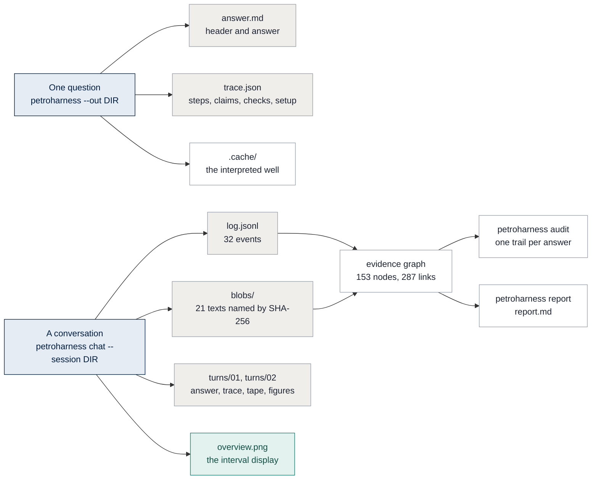
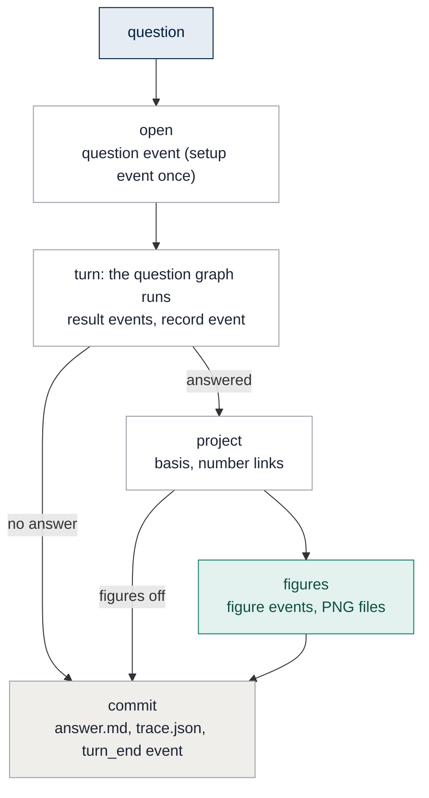
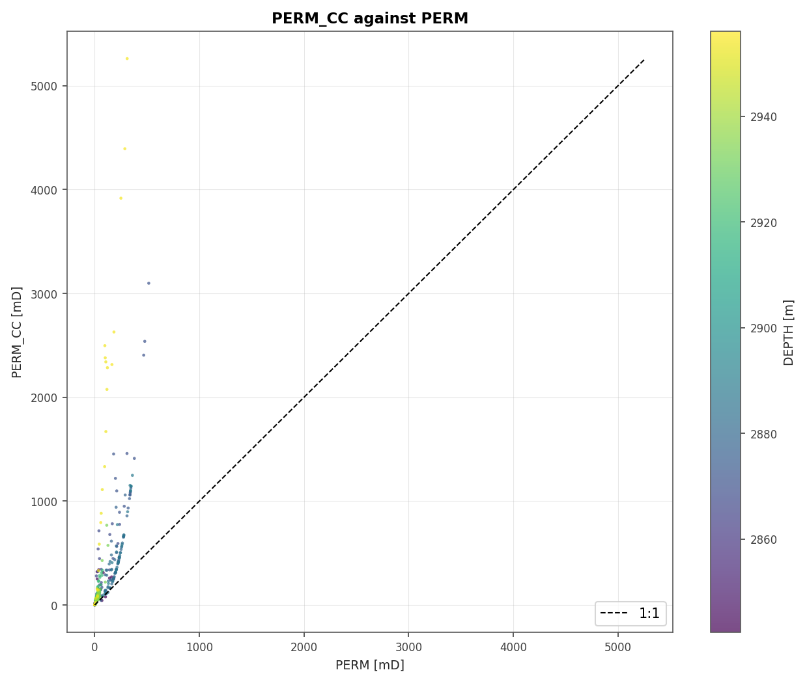
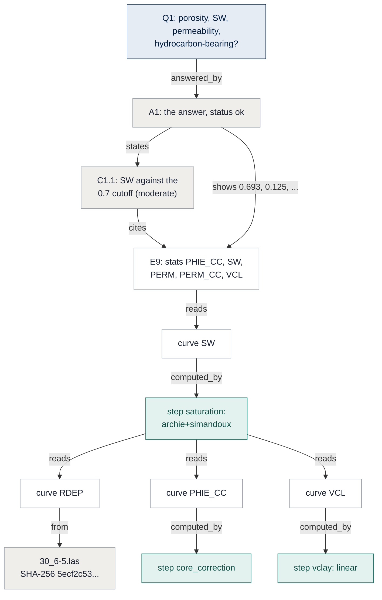

# Records reference

Every answer leaves a record of how it was made, and a conversation keeps one log from which each answer can be
audited without the code. This page lists each record field by field; paths are relative to `src/petroharness/`.
The examples come from a two-question conversation on the Brent Group of GeoLink 30/6-5 (2841–2958 m) and the public
mini set `brent`, with local paths shortened and the served model's name and event times replaced.

## 1. At a glance

What the Brent conversation left behind, and what is built from it:



- A single question writes `answer.md` and `trace.json` (with its setup record): no log, no tape.
- A conversation keeps `log.jsonl` and `blobs/`, every text once under its SHA-256; each question adds `turns/NN/`.
- Every question runs under one 12-character setup hash.
- The evidence graph (built on demand, not stored), the audit trail and the report need only the log and the blobs.

## 2. How it works



1. **A single question** (`ask.ask`) runs the question graph (`agent.graph.answer`) and writes the two files; the
   trace's `setup` and `setup_parts` hold the setup record.
2. **A conversation** starts with `Conversation.start` (`session_start`); `petroharness chat` draws `overview.png`
   (`Conversation.overview`, `display`).
3. **Each question** runs the session graph (`session/graph.py`): `open_question` creates `turns/NN/` and logs `setup`
   (when it changed) and `question`; `turn` runs the question graph with a taped client and logs a `result` per new
   ledger item and a `record` when the well's record changed; `project` reads the methods, parameters and number
   links off the answer; `figures` logs a `figure` per figure; `commit` writes the two files and logs `turn_end`.
4. **A settings change** (`Conversation.adopt`) logs `settings`; **a resume** (`Conversation.resume`) rebuilds the
   ledger from the `result` events and logs `session_resume`.

## 3. The output folder of one question

`ask.ask(..., out=DIR)` writes the answer, the trace and the cache; `petroharness --out` defaults to
`./petroharness-out/<LAS stem>`. For 30/6-5 with the default settings:

```text
petroharness-out/30_6-5/
├── answer.md
├── trace.json
└── .cache/
    └── reference_v2_81e94bcb/
        └── 30_6-5__full_well__5ecf2c53826981f9.pkl
```

With `out=None` (the Python default) nothing is written and the cache goes to a temporary folder.

<details>
<summary>Folder contents</summary>

| Entry | Type | Present | Meaning | Defined in |
|---|---|---|---|---|
| `answer.md` | file | always | The header and the answer ([section 4](#4-answermd)); no figures and no methods section | `ask.py`, `_answer_md` |
| `trace.json` | file | always | The trace ([section 5](#5-tracejson)), with `answer`, `ask`, `setup` and `setup_parts`; no `basis`, `figures` or `session` keys | `ask.py`, `ask`; `agent/graph.py`, `answer` |
| `.cache/` | folder | always | The interpreted well, reused by a later run on the same LAS and settings | `well/prepare.py`, `_cache_path` |

The cache path is `<cache_dir>/<policy name>_<8 hex>/<LAS stem>__<scope>__<16 hex>.pkl`: 8 hex of a hash of the
policy's interpretation keys, the interpretation version and the Petrophys build (with the engine, a named lithology
curve, a data interpreter and the `interpret` options when given), and the start of the LAS file's SHA-256, so a
revised LAS under the same name never reuses a cached well.

</details>

## 4. answer.md

The header says what was asked and how the interval was read; a rule ends it; the answer follows, then, in a
conversation, its figures and the methods and parameters it rests on. The Brent conversation's `turns/01/answer.md`,
cut:

```markdown
# 30_6-5: BRENT GP.

- **Question:** What are the porosity, water saturation and permeability of the Brent Group, and is any of it hydrocarbon-bearing?
- **Interval:** 2841-2958 m (768 samples; tops file formations_30_6-5.csv, base: stated base)
- **Lithology:** zones from the lithology log LITHOLOGY_GEOLINK (detected)
- **Model:** K2-Horizon-7B
- **Skill library:** researched (version 18c03ad5d3f8)
- **Status:** ok, 8 investigation steps

---
# Brent Group, Well 30_6-5 — Porosity, Saturation, Permeability and Hydrocarbon Potential
...
## Figures


...

## Methods and parameters this answer rests on

Read from the well's record, not written by the model. The steps that computed the curves this answer names:

- **net_pay**: cutoff_flags. computed NET_PAY, PRIME_OIL_TARGET. read VCL, PHIE_CC, SW. parameters vcl_cutoff = 0.3; phie_cutoff = lithology_dependent; sw_cutoff = 0.7; ...
...
```

A well without a lithology log is zoned by the lithology Petrophys's mineral solver gives, and its header says so:
Taranaki tuhua-7, McKee (Data: Taranaki Basin Curated Well Logs Dataset (New Zealand Petroleum & Minerals),
CDLA-Sharing-1.0.), written by the header code for the prepared interval. No model ran, so there is no status and no
answer:

```markdown
# tuhua-7: McKee

- **Question:** What are the porosity and water saturation of the McKee Formation, and is any of it hydrocarbon-bearing?
- **Interval:** 1935.02-2017.78 m (544 samples; tops file formations_tuhua-7.csv, base: stated base)
- **Lithology:** no lithology log: lithology zones from Petrophys's mineral solver (LITHO, clastic domain, canonical multi mineral solver)
- ...
```

<details>
<summary>Layout</summary>

| Part | Type | Present | Content | Defined in |
|---|---|---|---|---|
| Header | Markdown list | interactive runs | Title, question, interval, lithology, model, skill library, status and route, field notes, settings changes ([WRITER_AND_CHECKER.md](WRITER_AND_CHECKER.md#10-the-answer-header)) | `ask.py`, `_answer_md` |
| `---` | rule | always | Ends the header | `ask.py`, `_answer_md` |
| Answer | Markdown | always | The delivered answer, or `(no answer: <error or status>)` | `agent/graph.py`, `delivered` |
| `## Figures` | section | conversation, at least one figure drawn | Each figure as a Markdown image of `figures/figure_<n>_<kind>.png` with its caption as the alt text, then the caption in italics | `figures.py`, `markdown` |
| `## Methods and parameters this answer rests on` | section | conversation, the answer names a computed curve | The steps behind the curves the answer and its cited results name ([below](#methods-and-parameters-rows)), then `The steps those read from:` | `basis.py`, `markdown` |

- A conversation on prepared tasks writes `**Question N:** <question>`, `---` and the answer instead of the header.
- Each methods line is `**<step>**: <method>. computed <curves>. read <inputs>. parameters <k> = <v>; ...`
  (`basis.line`); a float is written with `:.6g`, a boolean as `yes` or `no`.

</details>

<a id="methods-and-parameters-rows"></a>
<details>
<summary>Methods and parameters rows</summary>

`basis.used(session, cited, answer)` returns the rows; they are also `trace.basis` and `Turn.basis`. Defined in
`evidence/record.py`.

| Field | Type | Default | Meaning | Defined in |
|---|---|---|---|---|
| `step` | str | none | The workflow step's name | `behind` |
| `method` | str | `computed on request in this conversation` for a curve computed on request | The method the step recorded | `behind` |
| `curves` | list of str | the step's first 6 outputs | The named curves it computed | `behind` |
| `inputs` | list of str | `[]` | What the step read, as recorded | `behind` |
| `parameters` | object | `{}` | Its scalar parameters ([section 10](#10-the-record-snapshot)) | `parameters` |
| `why` | str | none | `named`: it computed a curve the answer or a cited result's call names; `upstream`: a named step reads from it, however far back | - |

```json
{"step": "bad_hole", "method": "caliper_drho_flags", "curves": ["BAD_HOLE"], "inputs": ["CALI", "BS", "DRHO", "RHOB", "PEF"],
 "parameters": {"cali_minus_bs_threshold_in": 1.5, "...": "..."}, "why": "named"}
```

</details>

Each figure is a PNG beside the answer, drawn by Petrophys and logged in a `figure` event ([section 7](#7-the-session-log)):



## 5. trace.json

The trace is one JSON object per question, written with `json.dumps(trace, indent=1, default=str)` by `ask.ask`, the
session graph's `commit` or `cli.benchmark`. Each block below lists every key of one group and when it exists.

<details>
<summary>Run identity</summary>

Set in `agent/graph.py` unless noted.

| Key | Type | Present | Meaning | Set by |
|---|---|---|---|---|
| `task_id` | str | always | The task's id: `a` + 10 hex of SHA-256 over the LAS path, question and interval (and `\|question N` for N > 1) for interactive runs; `t` + 10 hex for prepared tasks | `interval.py`, `task_for`; `tasks.py` |
| `well` | str | always | The LAS file's stem | `turn` |
| `formation` | str | always | The interval's name | `turn` |
| `harness` | str | always | `petroharness <package version>` (`agent.graph.HARNESS`, from `petroharness.__version__`) | `turn` |
| `commit` | str | always | The harness commit (`cli.COMMIT` = `core.setup.harness_commit()`): the short commit when `core/setup.py` is a tracked file, with `+dirty` when `src/` has changes; `""` for an installed package | `cli.py`; `core/setup.py`, `harness_commit` |
| `model` | str | always | The model's name as people read it (`graph.public_model`): `--model`, else the card's `label`, else the card's served name; never the registry key or the endpoint URLs | `turn`, `public_model` |
| `skills` | object | always | `{"library": <name>, "version": <hash>}`, or `{"library": "none", "version": null}` | `agent/direction.py`, `stamp` |
| `components` | object | always | Each prompt component's version, `C1` to `C10`: 12 hex of SHA-1 over its files and the code it frames | `agent/components.py`, `versions` |
| `reads_depth` | bool | always | Whether the READ call was asked if the question is direct (false with `--investigate`) | `turn` |
| `options` | object | after the investigation | The switches in force (`options.py`); `{}` when none is defined | `close` |
| `status` | str | always | `ok`, `unresolved_numbers`, `ask_user` (asked back, nothing computed), `outside` (a request outside what the harness does), `stopped` (its user stopped it: no answer, and `stopped: true` in the trace), `error: empty answer (the writer's last draft was empty)` or `error: <exception type>` | `turn`, `finalize`, `answer_status` |
| `seconds` | float | always | Wall time of the question graph, to 0.1 s | `turn` |
| `error`, `traceback` | str | the run failed | `<type>: <message>`, and the last 4,000 characters of the traceback; for an empty answer only `error`, `the writer's last draft was empty` | `turn`, `finalize` |
| `answer` | str | always | The delivered answer | `ask.py`, `session/graph.py`, `cli.py` |

```json
{"task_id": "a2f8275dd57", "well": "30_6-5", "formation": "BRENT GP.", "harness": "petroharness 1.3.0",
 "commit": "<commit>", "model": "K2-Horizon-7B", "skills": {"library": "researched", "version": "18c03ad5d3f8"},
 "components": {"C1": "6f8f4c39893a", "...": "..."}, "reads_depth": true, "status": "ok", "seconds": 903.5}
```

</details>

<details>
<summary>Reading and first look</summary>

Set in `agent/graph.py` unless noted.

| Key | Type | Present | Meaning | Set by |
|---|---|---|---|---|
| `map_chars` | int | always | Length of the map, set after `build` and after the READ call | `build`, `read_step` |
| `read` | object | always | The READ call: `reply` (first 3,000 characters), `parse` (`ok`, `retry`, `failed`), `topics`, `named`, and `depth` when asked (`direct` or `investigate`; `outside` for a request outside what the harness does). `reply` keeps the word as the model wrote it | `agent/read.py`, `read_question` |
| `topics` | list of str | always | The topic areas the model chose (at most 4; `[]` when unreadable, or when the model named none: a request outside what the harness does needs none) | `agent/read.py`, `read_question` |
| `absent` | list of objects | always | `{"name", "curves"}` for each measurement the question names with no data here | `first_look` |
| `overview` | str | a first look ran | The first look's call, as `stats {"curves": [...]}` | `first_look` |
| `depth` | object | a direct question went to an investigation | `{"read": "direct", "investigated_from_step": k, "why": ...}` from a look step, or `{"read": "direct", "investigated_from": "the writer", "why": ...}` | `look`, `write_brief` |
| `scope` | object | a question with a tops file, zones or depth ranges to choose from | The stretches the READ named (`read`), those used (`used`), the reason when none could be (`note`), the units merged (`merged`); `by: "user"` when the user's scope stood in, `frame` when the answer is framed by your zones | `agent/read.py`, `read_question` |
| `read_scope_again` | object | the READ named no usable stretch | The second READ call, asked once with the reason: `reply` (first 1,500 characters), `scope`, `note` | `agent/read.py`, `read_question` |
| `scope_chosen` | list | the question answers a question back | The stretches the user chose, used whatever the READ reads | `agent/read.py`, `read_question` |
| `ask_user`, `ask_choices` | str, list of objects | the question was asked back | The question back, and its choices (`{"label", "question"}`, with `scope` where a choice is a stretch); nothing was computed (status `ask_user`) | `agent/read.py`, `read_question` |
| `outside` | bool | the request is outside what the harness does | `true`; the answer says what the harness does, with example questions (status `outside`) | `agent/read.py`, `read_question` |
| `question_notes`, `reader_notes` | str, list of objects | the question names something the record lacks | The note the model is shown under the question, and the same as data for the answer's reader (`{"kind": "absent" or "empty", "name", "curves", ...}`; `agent/vocabulary.py`, `facts`) | `first_look` |

```json
"read": {"reply": "...", "parse": "ok", "topics": ["porosity", "water_saturation", "permeability_rock_quality", "hydrocarbon_detection"],
         "named": ["porosity", "water saturation", "permeability", "Brent Group", "hydrocarbon-bearing"], "depth": "investigate"}
```

</details>

<details>
<summary>Investigation</summary>

Set in `agent/graph.py` unless noted.

| Key | Type | Present | Meaning | Set by |
|---|---|---|---|---|
| `steps` | list of objects | after the investigation | One record per step ([Step records](#step-records)), look steps included | `close` |
| `points` | list of str | after the investigation | The question's points (at most 6, each at most 240 characters) | `close` |
| `intent` | str | after the investigation | `value`, `locate`, `characterize`, `compare`, `explain` or `qc_check` | `close` |
| `guides` | list of str | after the investigation | The skill guides read, in order | `close` |
| `opened` | list of pairs | after the investigation | `[id, call text]` for every item in the ledger, earlier questions' included | `close` |
| `errors` | list of str | after the investigation | Each rejected tool call's message, first 200 characters | `close` |
| `claims` | list of objects | claims exist | The claims in force ([Claim records](#claim-records)), after `settle` when it ran | `close`; `agent/settle.py`, `settle` |
| `dropped` | list of objects | claims exist | The claims dropped, same fields | `close`; `agent/settle.py`, `settle` |
| `done_issues` | list of str | claims exist | What the done rule still finds: points without a settled claim, hypotheses left, flagged claims | `agent/claims.py`, `done_issues` |
| `settle` | object | the settle step ran | The settle record ([below](#the-settle-record)) | `agent/settle.py`, `settle` |

Question 1: `"opened": [["E1", "stats PHIT, PHIE, ..."], ...]`, `"done_issues": ["flagged claims: C3 (fix or drop each)"]`.

</details>

<a id="step-records"></a>
<details>
<summary>Step records</summary>

Each entry of `steps` is one step of the investigation, or one look step of a direct question. Set in
`agent/graph.py` unless noted.

| Field | Type | Present | Meaning | Set by |
|---|---|---|---|---|
| `step` | int | always | The step number k | `ask`, `look` |
| `direct` | bool | look steps | `true` for a look step | `look` |
| `prompt_chars` | int | always | Characters of the system and user messages | `ask`, `look` |
| `prompt_tokens` | int or null | always | Prompt tokens of the step's own call (its retry when the first reply was empty), not of a syntax-fix call | `ask`, `look` |
| `reply` | str | always | The reply, first 6,000 characters | `ask`, `look` |
| `repaired` | object | the reply was not one readable JSON object | `error` (200 characters), `broken` (the reply, 20,000 characters), `by`: `salvage`, `fix` or `salvage, incomplete` | `agent/replies.py`, `parse` |
| `asks` | str | step 1 | What the question asks (point 1) | `plan` |
| `points_asked` | bool | step 1, when the points were asked for in an extra call | Whether that call gave them | `plan` |
| `focus` | str | readable steps | The step's focus, first 300 characters | `decide` |
| `edits`, `edit_msgs` | list | readable steps | The claim edits as sent, and a message for each edit that could not be applied | `decide` |
| `actions` | list of str | readable steps | The actions run, as `action_text` (`stats {...}`, `get E5 Z3`, `guide porosity`) | `decide`, `look` |
| `guide_sections` | list of str | readable steps | Sections and stats a guide read the first time opened | `decide` |
| `unread` | list of str | an action could not be read | Each unreadable action as JSON, 200 characters | `decide`, `look` |
| `done`, `done_issues`, `held_done` | bool, list, list | as set | Whether the model set done; the done rule's issues; results withheld when done was set | `decide` |
| `withheld`, `carried`, `guides_read` | lists | after actions ran | Results left out of NEW for its budget; withheld results shown now; guides read | `act` |
| `new_chars` | int | after actions ran | Characters of the next NEW block | `act` |
| `stopped` | str | converged | `converged` after `POLISH_STEPS = 2` steps that only rephrased | `act` |
| `answer` | str | readable steps | The claims as rendered after the step | `decide`, `act` |
| `error` | str | unreadable | `unreadable reply` | `skip` |
| `over_cap`, `to_investigation` | int, str | look steps | Lookups beyond `DIRECT_ACTIONS = 4`; why the question went to an investigation | `look` |

Step 1 of question 1, whose reply was salvaged (cut):

```json
{"step": 1, "repaired": {"error": "the reply is not one readable JSON object (cut off, or invalid syntax: ...)", "broken": "...", "by": "salvage"},
 "prompt_chars": 62799, "prompt_tokens": 18149, "actions": ["guide net_reservoir_pay", "section {\"key\": \"net_pay_flag_analysis\"}", "..."],
 "done": false, "withheld": [], "carried": [], "new_chars": 9652}
```

</details>

<a id="claim-records"></a>
<details>
<summary>Claim records</summary>

Each entry of `claims` and `dropped` is a `Claim` as `__dict__`. Defined in `agent/claims.py`.

| Field | Type | Default | Meaning | Defined in |
|---|---|---|---|---|
| `id` | str | none | `C1`, `C2`, ... in order of addition within the question | `Claims.apply` |
| `point` | int | none | The point it answers (1-based) | `Claim` |
| `text` | str | none | The finding | `Claim` |
| `means` | str | `""` | What it means for the point | `Claim` |
| `ev` | list of str | `[]` | Cited result ids, and `MAP` for the map | `parse_ev` |
| `grade` | str | `hypothesis` | One of `hypothesis`, `low`, `moderate`, `high`, `not indicated`, `undetermined` (`GRADES`) | - |
| `weak` | str | `""` | Its limits | `Claim` |
| `flags` | list of str | `[]` | The code checks' findings, `K1` to `K11` (C2 `flags.json`) | `Claims.check` |
| `history` | list of objects | `[]` | `{"op": "add" or "revise", "text", "ev", "grade", "flags"}`, `{"op": "drop", "why"}`, and `{"op": "cite", "by": "code", "ev": [...]}` when code added a citation for a number only that result holds | `Claims.apply`, `check` |

```json
{"id": "C2", "point": 2, "text": "Finding: SW sits against the 0.7 net-pay cutoff ...", "ev": ["E2", "E1", "E8", "E9", "E10"],
 "grade": "moderate", "flags": [], "history": [{"op": "add", "...": "...", "grade": "hypothesis"}, {"op": "cite", "by": "code", "ev": ["E1"]},
 {"op": "revise", "...": "...", "flags": ["K10 graded, but the text still reads as a hypothesis: ..."]}, "..."], "...": "..."}
```

</details>

<a id="the-settle-record"></a>
<details>
<summary>The settle record</summary>

Set in `agent/settle.py`, `settle` unless noted.

| Field | Type | Present | Meaning | Set by |
|---|---|---|---|---|
| `claims_before`, `claims_after` | int | always | Claims before and after the step | `settle` |
| `issues_before`, `issues_after` | list of str | always | The done rule's issues before and after | `settle` |
| `bookkeeping` | str | always | The lists shown to the model (`""` when empty) | `bookkeeping` |
| `reply`, `prompt_chars` | str, int | always | The reply (6,000 characters) and the user message's length | `settle` |
| `edits`, `edit_msgs` | list | a readable reply | The edits and the messages of edits not applied | `settle` |
| `repaired` | object | the reply needed repair | As in a step record; the fix call's stage is `settle_fix` | `parse` |
| `error` | str | unreadable | `unreadable reply` | `settle` |

</details>

<details>
<summary>Writer keys</summary>

Set in `agent/graph.py`.

| Key | Type | Present | Meaning | Set by |
|---|---|---|---|---|
| `writer_format` | str | a writer ran | `profile` when the report style's format block applied, else `default` | `_write` |
| `writer_user_chars` | int | a writer ran | Length of the writer's user message | `_write` |
| `shape` | str | a writer ran | `direct_value`, `list` or `report` | `_write` |
| `writer_variant` | str | a writer ran | `open` (two repair rounds) or `""` (one) | `_write` |
| `cited_lines_chars` | int | a writer ran | Length of `writer.cited_lines` (not shown to the model) | `_write` |
| `fetched_lines` | object | the investigation fetched lines with get or find | Lines fetched per result id (`{id: count}`), read with their results | `_write` |
| `draft_chars` | int | a writer ran | Length of the first draft after note cleaning | `_write` |
| `draft_notes_removed` | bool | the first reply held working notes | `true`: the answer after the notes was kept; `false`: the writer was asked again | `_write` |
| `verify_rounds` | list of objects | finalize ran | Each checker round: `round`, `unsupported`, `process`, `contradictions`, `leaks`, and `kept_draft` on a refused repair | `verify`, `repair` |
| `zone_table` | str | finalize ran | The code-composed table, `""` for none | `finalize` |
| `draft` | str | finalize ran | The writer's last draft as written, with its ids and the `{{ZONE_TABLE}}` token | `finalize` |
| `render_leftovers` | list of str | ids survived delivery | The ids found by `compose.leftover_citations` | `finalize` |

Question 1 (`"shape": "report"`) needed one repair round:

```json
"verify_rounds": [{"round": 0, "unsupported": ["4.86", "0.055", "0.060", "0.756"], "process": ["not opened", "the MAP"], "contradictions": [], "leaks": []},
                  {"round": 1, "unsupported": [], "process": [], "contradictions": [], "leaks": []}]
```

The writer and checker are described in [WRITER_AND_CHECKER.md](WRITER_AND_CHECKER.md).

</details>

<details>
<summary>Model calls</summary>

`calls` holds one entry per successful model call of the question graph, and in a conversation with figures the
figure choice's call after them, attributed to prompt components by `components.record_call`.

| Field | Type | Default | Meaning | Defined in |
|---|---|---|---|---|
| `stage` | str | none | `read`, `read_retry`, `step_<k>`, `step_<k>_retry`, `step_<k>_fix`, `step_1_points`, `settle`, `settle_fix`, `writer`, `writer_retry`, `writer_again`, `repair_<n>`, `repair_<n>_again`, `figures`, `figures_retry` | `agent/graph.py`, `agent/read.py`, `agent/settle.py`, `figures.py` |
| `messages[].role` | str | none | `system`, `user` or `assistant` | `agent/components.py`, `record_call` |
| `messages[].segments` | list of `[component, version, start, end]` | none | Character spans covering the message exactly: a component's text found in the message is that component's; the rest belongs to the nearest preceding section header's owner (C5 `section_owners`), else to the message's owner by stage (`components.OWNERS`) | `agent/components.py`, `attribute` |

The writer call of question 1:

```json
{"stage": "writer", "messages": [
  {"role": "system", "segments": [["C9", "5c430eea66e9", 0, 3160]]},
  {"role": "user", "segments": [["C5", "b40542f539d8", 0, 126], ["C3", "a35c7f5f0be5", 126, 3395], "...",
                                ["C7", "f5c6434e1229", 67206, 87563]]}]}
```

- Entries shorter than `MIN_MATCH = 24` characters are not searched for, unless an entry equals a section header.
- The figures call is in `calls` (stage `figures`); its token use is in `figures.usage`, not in `usage`.
- Each part of the writer's user message has its own section header: the points and limits are C3's, `RESULTS` C7's,
  `WHAT THE CURVES ARE`, the zone table and the conventions C9's, `THE MAP` C7's.

</details>

<details>
<summary>Token use</summary>

`usage` holds one entry per model call of the question graph, in order. Defined in `llm.py`.

| Field | Type | Present | Meaning | Defined in |
|---|---|---|---|---|
| `usage` | list of objects | always | The trace key: one entry per model call, with the fields below | `agent/graph.py`, `turn` |
| `stage` | str | always | The call's stage, as in `calls` | `Usage.add` |
| `prompt_tokens`, `completion_tokens` | int | always | As the server reports them (0 when none) | `Usage.add` |
| `seconds` | float | always | Time of the call, to 0.01 s | `Usage.add` |
| `reasoning_chars`, `content_tokens` | int | the reply carried reasoning | Reasoning length; completion tokens apportioned to the content by character share | `Usage.add` |
| `finish_reason` | str | not `stop` | The server's finish reason (`length` and so on); `whitespace` for a reply the client ended because it ran whitespace on end | `Usage.add`, `LLM._streamed` |
| `max_tokens_shrunk` | int | the server refused the prompt as too long | The output allowance the request was sent again with | `LLM.chat` |
| `template_kwargs` | object | a retry call with the card's retry settings | The chat template settings used | `LLM.chat` |
| `light` | bool | a call at the card's light thinking setting | `true` | `LLM.chat` |
| `discarded` | str | a reply the client did not pass on | `truncated reasoning reply` (a reasoning model's reply cut at the cap) or `whitespace without end` (a reply ended as it ran whitespace; its token counts are not known and read 0): the reply was returned as `""` | `LLM.chat` |

```json
{"stage": "figures", "prompt_tokens": 5481, "completion_tokens": 173, "seconds": 2.54, "light": true}
```

</details>

<details>
<summary>Inputs and conversation keys</summary>

Set in `session/graph.py` unless noted.

| Key | Type | Present | Meaning | Set by |
|---|---|---|---|---|
| `ask` | object | interactive runs and conversations on a LAS file | The inputs of the question (below) | `ask.py`, `ask_record` |
| `session` | object | later questions of a conversation | `turn`, `ledger_start` (the ledger index where this question's results start), `earlier_chars` (length of the EARLIER block), and `reply` (`brief` or `full`) when step 1 chose it | `agent/graph.py`, `turn`, `plan` |
| `setup` | str | always | The setup hash ([section 9](#9-the-setup-record)) | `agent/graph.py`, `answer`; `session/graph.py`, `turn` |
| `setup_parts` | object | single questions (`graph.answer`: `petroharness`, `ask.ask`, benchmark runs) | Every field of the setup record; a conversation keeps them in its `setup` event instead | `agent/graph.py`, `answer` |
| `settings` | object | the conversation's settings were changed | `turn`, `in_force` (the settings now), `sources` (`field notes` or `user` per setting), `changes` (every change so far: `turn`, `changes`, `by`), `changed` (the changes made for this question) | `turn` |
| `basis` | list of objects | conversations, answered | The methods and parameters rows ([section 4](#methods-and-parameters-rows)) | `project` |
| `projection_error` | str | the projection failed | `<type>: <message>`, 300 characters | `project` |
| `figures` | object | conversations with figures, answered | `candidates`, `chosen`, `figures`, `errors`, `usage` ([WRITER_AND_CHECKER.md](WRITER_AND_CHECKER.md#11-figures-after-the-answer)) | `figures` |

Question 2's `session`: `{"turn": 2, "ledger_start": 10, "earlier_chars": 2853, "reply": "full"}`.

The `ask` object (defined in `ask.py` unless noted):

| Field | Type | Default | Meaning | Defined in |
|---|---|---|---|---|
| `las` | str | none | The LAS file's absolute path | `ask_record` |
| `question`, `question_sent` | str, str or null | none | The question as asked; the text sent to the model when it differs (operator lithology, field notes appended) | `ask_record` |
| `interval` | object | none | `name`, `top`, `base` (4 decimals), `unit`, `samples`, `from` | `check` |
| `lithology` | object | none | `source` (`lithology log`, `mineral solver`, `shale-volume bands`, `none`), `curve`, and `how` (`named`, `detected`), the solver's `method`, `domain`, `inputs`, `decisions`, `solved` and `samples`, or `bands` | `check` |
| `zones` | list of objects | none | `zone`, `lithology`, `top`, `base` per zone | `ask_record` |
| `model` | str | none | The model's name as people read it | `_model_label` |
| `settings` | str | `built from the LAS` | Where the data settings came from (a file path, or built from the LAS) | `_settings` |
| `skills`, `skills_given` | object, str or null | none | The library read; the `--skills` value given | `ask_record` |
| `interpret`, `interpreter` | object or null, str or null | none | The options passed to `petrophys.interpret`; a data interpreter when one is set | `ask_record` |
| `petrophys` | str | none | The Petrophys build, `<version>@<commit>` or `<version>@files-<hash>` | `well/prepare.py`, `library_identity` |
| `field_notes` | object | absent without notes | `name`, `sha256`, `settings`, `notes` of the field notes file | `ask_record` |

```json
"ask": {"las": "<site-packages>/petrophys/datasets/geolink/30_6-5.las", "question_sent": null, "interval": {"...": "..."},
        "lithology": {"source": "lithology log", "curve": "LITHOLOGY_GEOLINK", "how": "detected"},
        "settings": "built from the LAS", "interpret": {"vcl_cutoff": 0.3, "sw_cutoff": 0.7}, "petrophys": "3.0.0@files-c5de047fe601", "...": "..."}
```

On tuhua-7, McKee (no lithology log), abridged:

```json
"lithology": {"source": "mineral solver", "curve": "LITHO", "method": "canonical_multi_mineral_solver", "domain": "clastic",
              "inputs": ["RHOB", "VCL", "NPHI", "PHIE", "PEF", "DTC"],
              "decisions": ["No lithology curve or lithology intervals were available -> inferred LITHO from mineral volumes", "..."],
              "solved": 13418, "samples": 13652}
```

`solved` and `samples` count the whole well, as the lithology step records them. A well with neither a lithology log
nor a solved lithology records `{"source": "shale-volume bands", "curve": "VCL", "bands": [0.3, 0.6]}` (the band
edges in force).

</details>

## 6. The session folder

A conversation lives in one folder (`petroharness chat --session DIR`; by default
`./petroharness-sessions/<LAS stem>-<YYYYmmdd-HHMMSS>`). The Brent conversation's:

```text
brent/
├── log.jsonl
├── blobs/                 21 files named by SHA-256
├── overview.png
├── turns/
│   ├── 01/
│   │   ├── answer.md
│   │   ├── trace.json
│   │   ├── tape.jsonl
│   │   └── figures/       figure_1_log_viewer.png, figure_2_log_viewer.png, figure_3_buckles.png
│   └── 02/ ...
└── .cache/
    └── reference_v2_81e94bcb/30_6-5__full_well__5ecf2c53826981f9.pkl
```

`Conversation.start` refuses a folder that already holds `log.jsonl` (`WHAT: a conversation already lives in ...`).
The log and the blobs are the record; the rest can be rebuilt from them and the well's files.

<details>
<summary>Folder layout</summary>

| Entry | Type | Present | Meaning | Defined in |
|---|---|---|---|---|
| `log.jsonl` | file | always | The events, in order ([section 7](#7-the-session-log)) | `session/log.py` |
| `blobs/<sha256>` | files | always | The texts the events name ([section 8](#8-blobs)) | `session/log.py`, `blob` |
| `overview.png` | file | figures on, drawn | The interval's log display by Petrophys (`pp.plot`) | `session/conversation.py`, `overview` |
| `turns/NN/answer.md` | file | each question | The answer file ([section 4](#4-answermd)); NN is the question number, two digits | `session/graph.py`, `commit` |
| `turns/NN/trace.json` | file | each question | The trace ([section 5](#5-tracejson)) | `session/graph.py`, `commit` |
| `turns/NN/tape.jsonl` | file | each question with a real model client | Every model request and reply ([section 14](#14-tapes)) | `session/conversation.py`, `_factory` |
| `turns/NN/figures/` | folder | at least one figure drawn | `figure_<n>_<kind>.png` | `figures.py`, `attach` |
| `.cache/` | folder | conversations on a LAS file | The interpreted well | `well/prepare.py` |
| `report.md` | file | after `petroharness report` | The conversation as one document ([section 13](#13-audit-trail-and-report)) | `evidence/report.py` |

</details>

## 7. The session log

`log.jsonl` holds one JSON object per event, appended in order. The Brent conversation logged 32: `session_start`,
`display`, then per question `setup` (question 1 only: it did not change), `question`, a `result` per result,
`record` (question 1 only), a `figure` per figure and `turn_end`.

| Event type | `turn` | Written by | When |
|---|---|---|---|
| `session_start` | 0 | `Conversation.start`, `Conversation.on_tasks` | once, first line |
| `display` | 0 | `Conversation.overview` | when the overview is drawn (or fails) |
| `setup` | n | `session/graph.py`, `open_question` | before question n, when the setup hash differs from the last `setup` event |
| `question` | n | `session/graph.py`, `open_question` | each question |
| `result` | n | `session/graph.py`, `turn` | each new ledger item of question n |
| `record` | n | `session/graph.py`, `turn` | after question n, when the well's record changed |
| `figure` | n | `session/graph.py`, `figures` | each figure drawn |
| `turn_end` | n | `session/graph.py`, `commit` | each question, last |
| `settings` | n | `Conversation.adopt` | a settings change taking effect at question n |
| `session_resume` | 0 | `Conversation.resume` | each resume |

<details>
<summary>Common fields</summary>

`SessionLog.append(kind, turn, **data)` (`session/log.py`) writes one JSON object per line and returns it.

| Field | Type | Default | Meaning |
|---|---|---|---|
| `seq` | int | none | 1, 2, ... in file order (counted from the events already in the file when the log is opened) |
| `time` | str | none | UTC time, ISO 8601 to the second (`YYYY-MM-DDTHH:MM:SS+00:00`) |
| `turn` | int | 0 | The question the event belongs to; 0 for the session itself |
| `type` | str | none | The event type (above) |

</details>

<details>
<summary>session_start</summary>

The first event: what the conversation was started with. Defined in `session/conversation.py`.

| Field | Type | Default | Meaning | Defined in |
|---|---|---|---|---|
| `mode` | str | none | `las` (a LAS file) or `tasks` (prepared questions) | - |
| `las`, `las_sha256` | str | `las` mode | The LAS file's absolute path and the SHA-256 of its bytes | `Conversation.start` |
| `inputs` | object | `las` mode | `formation`, `tops`, `top`, `base`, `depth_unit`, `lithology_curve`, `formation_lithology`, `profile`, `settings`, `skills`, `model`, `model_card`, `max_steps`, `figures`, `direct`, and `interpretation`, `field_notes` when given (paths as strings); a resume re-prepares the well from them | `INPUTS` |
| `interval`, `lithology`, `zones` | object, object, list | `las` mode | As in the trace's `ask` object | `interval.py`, `check` |
| `model` | str | none | `las` mode: the model's name as people read it; `tasks` mode: the registry key | `Conversation.start`, `on_tasks` |
| `writer`, `fmt`, `max_steps`, `figures`, `direct` | various | `tasks` mode | The run's writer variant, format, step cap, figures and route setting | `Conversation.on_tasks` |
| `petrophys` | str | none | The Petrophys build | `well/prepare.py`, `library_identity` |
| `harness` | str | none | The harness commit (`cli.COMMIT`, as the trace's `commit`), not the package version: that is the `setup` event's `harness` | `Conversation.start`, `on_tasks` |

```json
{"seq": 1, "time": "<time>", "turn": 0, "type": "session_start", "mode": "las", "las": "<site-packages>/.../30_6-5.las",
 "las_sha256": "5ecf2c53...801b9", "inputs": {"formation": "BRENT GP.", "tops": "<site-packages>/.../formations_30_6-5.csv", "...": "..."},
 "interval": {"...": "..."}, "model": "K2-Horizon-7B", "petrophys": "3.0.0@files-c5de047fe601", "harness": "<commit>", "...": "..."}
```

</details>

<details>
<summary>setup</summary>

The setup record of the process answering from this question on ([section 9](#9-the-setup-record)).

| Field | Type | Default | Meaning | Defined in |
|---|---|---|---|---|
| `hash` | str | none | The setup hash, 12 hex | `core/setup.py`, `Setup.hash` |
| every `Setup` field | various | none | `harness`, `commit`, `petrophys`, `components`, `functions`, `skills`, `model`, `card`, `data`, `policy`, `writer`, `fmt`, `max_steps`, `mode`, `depth` | `core/setup.py`, `Setup` |

```json
{"seq": 3, "time": "<time>", "turn": 1, "type": "setup", "hash": "d70dbbf039dd",
 "harness": "1.3.0", "commit": "<commit>", "petrophys": "3.0.0@files-c5de047fe601",
 "components": {"C1": "6f8f4c39893a", "...": "..."}, "functions": "1e177d0c7ca2", "model": "<served model name>",
 "card": "33012b760d52", "data": "61dcbf7ecfe4", "policy": "7631a4a859eb", "writer": "open", "max_steps": 8, "...": "..."}
```

The hash was computed with the real served name; with the name replaced it no longer matches.

</details>

<details>
<summary>question</summary>

| Field | Type | Default | Meaning | Defined in |
|---|---|---|---|---|
| `text` | str | none | The question as asked | `session/graph.py`, `open_question` |
| `task` | object | none | The `Task`: `task_id`, `question` (as sent), `well`, `formation`, `las_path`, `top`, `base`, `depth_unit`, `base_closed`, `formation_lithology` | `tasks.py`, `Task` |

```json
{"seq": 4, "time": "<time>", "turn": 1, "type": "question", "text": "What are the porosity, water saturation ...",
 "task": {"task_id": "a2f8275dd57", "well": "30_6-5", "formation": "BRENT GP.", "top": 2841.0, "base": 2958.0, "...": "..."}}
```

</details>

<details>
<summary>result</summary>

One event per result the question opened, in ledger order.

Defined in `agent/ledger.py` unless noted.

| Field | Type | Default | Meaning | Defined in |
|---|---|---|---|---|
| `id` | str | none | `E1`, `E2`, ...; the ids go on across the conversation | `Ledger.open` |
| `tool` | str | none | The tool (`stats`, `runs`, `section`, `calc`, a Petrophys verb, ...) | `Item` |
| `args` | object | none | The arguments as the ledger normalized them (`calc`: `{"expression": ...}`) | `Item` |
| `sha256` | str | none | SHA-256 of the result's text, the name of its blob | `session/log.py`, `blob` |
| `chars` | int | none | Length of the text | `session/graph.py`, `turn` |

```json
{"seq": 5, "time": "<time>", "turn": 1, "type": "result", "id": "E1", "tool": "stats",
 "args": {"curves": ["PHIT", "PHIE", "PHIE_CC", "...", "PERM_CC"]},
 "sha256": "b02a9b8733ad9663fc2acf812b476a9366002b99f634c136cc7489574259fb7b", "chars": 8113}
```

</details>

<details>
<summary>record</summary>

The well's computation record, kept as a blob when it differs from the last one kept. Set in `session/graph.py`,
`turn`.

| Field | Type | Default | Meaning |
|---|---|---|---|
| `sha256` | str | none | Blob holding `json.dumps(snapshot, sort_keys=True)` ([section 10](#10-the-record-snapshot)) |
| `curves` | int | none | Curves in the snapshot |
| `steps` | int | none | Steps in the snapshot |

```json
{"seq": 15, "time": "<time>", "turn": 1, "type": "record",
 "sha256": "cac1f78cd7868c930f58f873a9454151fc62f810c5dbcc1da5c99c635a21b9d2", "curves": 90, "steps": 18}
```

The snapshot is compared by its hash after every question, so a new `record` follows any change to the record, for
example a curve computed on request or a settings change that alters the interpretation.

</details>

<details>
<summary>figure</summary>

Defined in `figures.py`.

| Field | Type | Default | Meaning | Defined in |
|---|---|---|---|---|
| `id` | str | none | The candidate's id, `F1`, `F2`, ... within the question's candidates | `Candidate` |
| `kind` | str | none | `histogram`, `log_viewer`, `crossplot`, or a display's short name (`pickett`, `nd`, `mn`, `mid`, `hingle`, `buckles`, `flow_unit`, `triple_combo`, `net_pay_summary`) | `kind_of` |
| `source` | str | none | The result it draws (`E<k>`), or `interval` for a standard display | `Candidate` |
| `caption` | str | none | The caption (`figures.caption`) | - |
| `file` | str | none | Path relative to `turns/NN/` | `attach` |
| `samples` | int | none | Samples drawn | `draw` |

The event of the figure in [section 4](#4-answermd):

```json
{"seq": 29, "time": "<time>", "turn": 2, "type": "figure", "id": "F9", "kind": "crossplot", "source": "E17",
 "caption": "Figure 1. Crossplot of PERM_CC [mD] against PERM [mD] (zones Z1, Z4, ...), with the 1:1 line; 343 samples. Drawn by Petrophys (pp.crossplot) from result E17.",
 "file": "figures/figure_1_crossplot.png", "samples": 343}
```

</details>

<details>
<summary>turn_end</summary>

The question's summary; later questions, the resume and the evidence graph read it. Set in `session/graph.py`,
`commit` unless noted.

| Field | Type | Default | Meaning | Defined in |
|---|---|---|---|---|
| `question`, `task_id` | str | none | The question as asked, and its task id | `commit` |
| `status` | str | none | `ok`, `unresolved_numbers`, `ask_user`, `outside`, `stopped`, `error: empty answer (...)` or `error: <type>`, as the trace's `status` | `commit` |
| `opening` | str | `""` | The answer's first prose paragraph of at least 40 characters, at most 600 (`earlier.opening`) | `session/earlier.py`, `opening` |
| `claims` | list of objects | `[]` | The settled claims (not `hypothesis`): `point`, `text`, `grade`, `ev` | `turn` |
| `opened` | list of str | `[]` | The ids this question opened | `commit` |
| `cited` | list of str | `[]` | The ids the settled claims cite, sorted by length then text (`MAP` included when cited) | `commit` |
| `answer_sha256` | str | none | Blob holding the delivered answer | `commit` |
| `earlier_chars` | int | 0 | Length of the EARLIER block the question was shown | `commit` |
| `figures` | int | 0 | Figures drawn | `commit` |
| `basis` | list of str | `[]` | The step names of the methods rows | `commit` |
| `shows` | object | `{}` | Each number the answer states -> the ids of the results that show it ([section 12](#12-number-links)) | `evidence/links.py`, `shows` |
| `steps` | int | 0 | Step records in the trace | `commit` |
| `calls` | int | 0 | Usage entries with prompt tokens (the figures call is not counted) | `commit` |
| `prompt_tokens`, `completion_tokens` | int | 0 | Sums over the question's usage entries | `commit` |
| `seconds` | float | none | The trace's `seconds` | `commit` |
| `settings_changed` | list | absent | The changes made for this question, `[{key, from, to}]` | `commit` |
| `read_from` | list of str | absent | An answer without settled claims: the results it was read from (look steps' results, then the question's own) | `commit` |

```json
{"seq": 32, "time": "<time>", "turn": 2, "type": "turn_end", "question": "Which zone has the best reservoir quality, ...",
 "status": "ok", "opening": "Z19 (Sand, 2951.66–2955.01 m) has the strongest permeability ...", "claims": ["..."],
 "opened": ["E11", "...", "E18"], "cited": ["E1", "E7", "E10", "E11", "..."], "earlier_chars": 2853, "figures": 3,
 "shows": {"1627.6": ["E1", "E9", "E10", "E11", "E17"], "...": "..."}, "steps": 8, "calls": 14, "seconds": 832.4, "...": "..."}
```

</details>

<details>
<summary>settings</summary>

| Field | Type | Default | Meaning | Defined in |
|---|---|---|---|---|
| `changes` | list of objects | none | `{"key", "from", "to"}` per setting changed (`null`: the default) | `well/settings.py`, `diff` |
| `by` | str | `user` | Who asked | `Conversation.adopt` |
| `interpretation` | object | none | The settings in force after the change | `Conversation.adopt` |
| `interval`, `zones` | object, list | none | The interval and the zones of the well interpreted again | `Conversation.adopt` |
| `zones_before` | list | absent | The zones before the change, when it cut them anew (the same fields as `zones`); a `zones` event (your zones file) carries `zones_before` and `zones_now` the same way | `Conversation.adopt`, `Conversation.adopt_zones` |

`Conversation.adopt({"m": 1.8})` on a resumed copy of the Brent conversation, before question 3 (`adopt` logs nothing
when the settings asked for are those in force):

```json
{"seq": 34, "time": "<time>", "turn": 3, "type": "settings", "changes": [{"key": "m", "from": null, "to": 1.8}],
 "by": "user", "interpretation": {"m": 1.8}, "interval": {"name": "BRENT GP.", "...": "..."}, "zones": ["..."]}
```

</details>

<details>
<summary>display</summary>

Set in `Conversation.overview`.

| Field | Type | Default | Meaning |
|---|---|---|---|
| `name` | str | `overview` | The display |
| `file`, `function`, `bytes` | str, str, int | drawn | `overview.png`, `plot`, the PNG's size |
| `error` | str | failed | `<type>: <message>`, 300 characters |

```json
{"seq": 2, "time": "<time>", "turn": 0, "type": "display", "name": "overview", "file": "overview.png",
 "function": "plot", "bytes": 1740820}
```

</details>

<details>
<summary>session_resume</summary>

| Field | Type | Default | Meaning | Defined in |
|---|---|---|---|---|
| `questions` | int | none | Questions found in the log (`turn_end` events) | `Conversation.resume` |
| `results` | int | none | Ledger items after the rebuild | `Conversation.resume` |
| `differences` | list of objects | `[]` | `{"id", "what"}` per result that did not come back the same | `Conversation._rebuild` |

A resumed copy of the Brent conversation: all 18 results opened again with the same ids and texts.

```json
{"seq": 33, "time": "<time>", "turn": 0, "type": "session_resume", "questions": 2, "results": 18, "differences": []}
```

</details>

<details>
<summary>How a resume rebuilds the conversation</summary>

`Conversation.resume(folder)` reads the first `session_start`, prepares the well again from its `inputs` (from the
cache), and calls `Conversation._rebuild`.

| Step | Rule | Defined in |
|---|---|---|
| 1 | The questions are the `turn_end` events, in order; their tasks come from the `question` events | `Conversation.resume`, `_rebuild` |
| 2 | Before each question, every `settings` event of that question is applied: the well is interpreted again and the ledger marked | `Conversation._apply` |
| 3 | The first answered question builds the session (`Session.build`); each later one moves it on (`Session.next_turn`) | `Conversation._rebuild` |
| 4 | Each `result` event of the question is opened again (`Ledger.open`, or `Ledger.calc` for `calc`) | `Conversation._rebuild` |
| 5 | A result that raises is reported `not opened again: ...`; one with another id `opened again as E<k>`; one whose text hash differs `its text differs from the recorded one` | `Conversation._rebuild` |
| 6 | `settings` events after the last question are applied | `Conversation._rebuild` |
| 7 | `session_resume` is appended with the differences; the conversation goes on | `Conversation.resume` |

- A first question that failed before the well was read (an error with no `result` event) is skipped.
- `--resume` takes `--investigate`; otherwise the route setting is the one the conversation started with.

</details>

<details>
<summary>What a later question reads from the log</summary>

The block `EARLIER IN THIS SESSION` of a later question's prompts is built by code from the `turn_end` records and
the `settings` events. Defined in `session/earlier.py`.

| Name | Type | Value | Meaning |
|---|---|---|---|
| `EARLIER_CHARS` | int | 6000 | The block's budget: the newest questions whole, older ones by question and opening, the oldest counted |
| `OPENING_CHARS` | int | 600 | An answer's opening as shown and as kept in `turn_end.opening` |
| `QUESTION_CHARS` | int | 300 | A question as shown |
| `CLAIM_CHARS` | int | 240 | A claim as shown |

The block a third question would see after the change of `m` above (`Conversation.earlier()`, cut):

```text
EARLIER IN THIS SESSION (the same well and interval, oldest first; the ids are results listed in OPENED, read them with get):
Question 1: What are the porosity, water saturation and permeability of the Brent Group, and is any of it hydrocarbon-bearing?
  Answered: Where. The Brent Group is logged as 20 zones, Z1–Z20, ...
  - Finding: SW sits against the 0.7 net-pay cutoff ... (moderate; E2, E1, E8, E9, E10)
  ...
Settings changed before question 3 (by the user): m the default -> 1.8. The well was interpreted again with them. Results E1 to E18 and the answers before rest on the earlier settings; read again, a result says so.
```

When the budget runs out, the oldest questions are counted in one line:
`Questions <first> to <last>: <n> earlier questions not shown here (find reads their results)`.

</details>

## 8. Blobs

`SessionLog.blob(text)` keeps a text once under the SHA-256 of its UTF-8 bytes (written as UTF-8 whatever the locale)
and returns that hash: to verify a blob, hash its bytes and compare with its name. An existing blob is never written
again. Result E9's blob starts:

```text
PHIE_CC [v/v] = core-calibrated effective porosity, v/v (model output of the core_correction step)
  Z1, PHIE_CC: n 30 of 30, mean 0.1264
  ...
```

<details>
<summary>Blob files</summary>

| Blob | Type | Named by | Content | Defined in |
|---|---|---|---|---|
| Result text | text | `result.sha256` | The ledger item's full text, as opened (without the `[E<k>]` prefix) | `session/graph.py`, `turn` |
| Answer | text | `turn_end.answer_sha256` | The delivered answer | `session/graph.py`, `commit` |
| Record snapshot | JSON text | `record.sha256` | `json.dumps(snapshot, sort_keys=True)` | `session/graph.py`, `turn` |

</details>

## 9. The setup record

Everything that decides an answer, under one 12-character hash; the endpoint, the API key, timeouts and local folders
are not part of it. `core.setup.of(cfg, writer, fmt, max_steps, mode, depth)` returns a frozen `Setup`;
`petroharness setup` prints it. Verifying the Brent `setup` event's hash, and comparing two records:

```python
import hashlib, json
record = {k: v for k, v in event.items() if k not in ("seq", "time", "turn", "type", "hash")}
hashlib.sha256(json.dumps(record, sort_keys=True, default=str).encode()).hexdigest()[:12]   # 'd70dbbf039dd', the event's hash

from petroharness.core import setup
setup.differences(record, other)   # ['card', 'components.C9'] for a record with another card and another C9
```

<details>
<summary>Fields</summary>

Set in `core/setup.py`, `of` unless noted.

| Field | Type | Default | Meaning | Defined in |
|---|---|---|---|---|
| `harness` | str | none | The package version (`petroharness.__version__`, `1.3.0`) | `of` |
| `commit` | str | `""` for an installed package | The harness commit when `core/setup.py` is a tracked file, with `+dirty` when `src/` has changes | `harness_commit` |
| `petrophys` | str | none | The Petrophys build (`library_identity`) | `well/prepare.py` |
| `components` | object | none | Each component's version | `agent/components.py`, `versions` |
| `functions` | str | none | `_sha` over `[[qualified name, verb, [[param, str(annotation), stable_repr(default)], ...]], ...]` of the Petrophys registry; `stable_repr` sorts sets and dict keys and drops object addresses, so the hash is the same in every process | `functions_hash`, `stable_repr` |
| `skills` | object | none | The plugged library's stamp | `agent/direction.py`, `stamp` |
| `model` | str | none | The served model's name | `of` |
| `card` | str | none | `_sha` of the card's model settings without `base_url`, `api_key_env`, `timeout_s`, `max_retries`, `label` and `model` | `_NOT_THE_MODEL` |
| `data` | str | none | `_sha` of the data settings without `las_dir`, `tops_csv`, `cache_dir`, `engines_dir`, `lithology_nomenclature` | `_PLACES` |
| `policy` | str | `""` when the file is missing | First 12 hex of SHA-256 of the policy file's bytes | `of` |
| `writer` | str | `open` | The writer variant | `of` |
| `fmt` | str | `profile` | The reader format | `of` |
| `max_steps` | int | 8 (`state.MAX_STEPS`) | The step cap | `of` |
| `mode` | str | `interactive` | `interactive` or `tasks` | `of` |
| `depth` | bool | `true` | Whether the READ call says if a question is direct | `of` |

</details>

<details>
<summary>The hash</summary>

Defined in `core/setup.py`.

| Function | Rule |
|---|---|
| `_sha(value)` | `sha256(json.dumps(value, sort_keys=True, default=str).encode()).hexdigest()[:12]` |
| `Setup.hash()` | `_sha(Setup.to_dict())` |
| `differences(a, b)` | the keys that differ, a dict key as `<field>.<key>`; `[]` for the same setup |

</details>

<details>
<summary>Where it is recorded</summary>

| Place | What | Defined in |
|---|---|---|
| `setup` event | the hash and every field, before the first question a process answers, when the hash differs from the last `setup` event | `session/graph.py`, `open_question` |
| `trace.setup` | the hash, on every question, single or of a conversation | `agent/graph.py`, `answer`; `session/graph.py`, `turn` |
| `trace.setup_parts` | every field, on a single question (a single question has no session log to hold them) | `agent/graph.py`, `answer` |
| Audit trail, report | the last hash, in the Source section and the report's header | `evidence/audit.py`, `evidence/report.py` |
| `petroharness setup [--json]` | the record for the given model, settings and skills (`--model`, `--model-card`, `--settings`, else `PETROHARNESS_DATA`, `--skills`, `--max-steps`, `--investigate`); with `--las` and the interval options, the record a question about that interval answers under | `core/setup.py`, `main`, `for_well` |

A single `petroharness` question's `trace.setup` is the hash `petroharness setup --las` prints for the same well,
interval and options.

</details>

## 10. The record snapshot

`evidence.record.snapshot(inventory)` reads the well's workflow record into plain data: each curve's source, unit and
step, and each step's method, inputs, outputs and scalar parameters. From the Brent record blob (90 curves, 18 steps),
cut:

```json
{"curves": {"KH_CORE": {"source": "input", "step": "", "unit": "mD"},
            "RW": {"source": "computed", "step": "rw", "unit": "ohm.m"}, "...": "..."},
 "steps": [{"inputs": [], "method": "las_metadata_temperature_profile_corrected", "outputs": ["RW"],
            "parameters": {"measured_temp_f": 230.0, "rw_at_measured_temp": 0.07, "source_priority": "las.RW", "...": "..."},
            "step": "rw"}, "..."]}
```

<details>
<summary>Snapshot fields</summary>

Defined in `evidence/record.py`.

| Field | Type | Default | Meaning | Defined in |
|---|---|---|---|---|
| `curves.<NAME>.source` | str | none | `input` (measured, from the LAS), `computed`, `analyzer`, `copy`, and so on, as the inventory records | `snapshot` |
| `curves.<NAME>.unit` | str | `""` | The unit | `snapshot` |
| `curves.<NAME>.step` | str | `""` | The step that computed it (computed curves only) | `snapshot` |
| `steps[].step`, `method` | str | none | The step and its method | `snapshot` |
| `steps[].inputs`, `outputs` | list of str | `[]` | What it read and wrote | `snapshot` |
| `steps[].parameters` | object | `{}` | Scalar parameters (rules below) | `parameters` |

| Rule | Value | Defined in |
|---|---|---|
| Parameters kept | numbers, booleans and strings of 1 to 80 characters, in record order (the blob's `sort_keys` sorts them) | `parameters` |
| Parameters left out | keys ending in `_note`, `_notes`, `_source_file`, `_path`; `None`; lists, dicts, tuples, sets | `_SKIP` |
| Cap | `MAX_PARAMETERS = 24` per step | - |
| Curve names | `NAME = \b[A-Z][A-Z0-9_]+\b` | - |

- `record.step_of(snapshot)` maps each curve to its step: the curve's own record first, then the step whose outputs
  name it.
- `record.behind(snapshot, names)` walks from the named curves to their steps and on upstream; `basis.used` applies it
  to the names in the answer and in its cited results' calls.

</details>

## 11. The evidence graph

`EvidenceGraph.from_log(folder)` joins the log's events into one graph, from each claim back to the LAS file. The
Brent graph has 153 nodes and 287 links; one path through it, for the first claim of answer 1:



```python
from petroharness.evidence import EvidenceGraph

g = EvidenceGraph.from_log("brent")
t = g.trail(1)
t["numbers"]["0.693"]             # ['E1', 'E9']
[s["step"] for s in t["steps"]]   # ['porosity', 'core_correction', 'vclay', 'saturation', 'permeability', 'rock_quality', 'net_pay', 'normalization']
g.out("C2.1", "cites")            # ['E11', 'E15']: the results claim 1 of question 2 cites
```

Building the graph twice from the same folder gives the same `to_json()`.

<details>
<summary>Nodes</summary>

A node is `{"kind": ..., fields}`; a field whose value is `null` is left out. Defined in `evidence/graph.py`.

| Node id | Kind | Fields | From event | Defined in |
|---|---|---|---|---|
| `las` | `las` | `path`, `sha256` | `session_start` (`las` mode) | - |
| `session` | `session` | `mode`, `interval`, `model`, `petrophys`, `harness`; `settings` (`[{turn, changes, by}]`); `setups` (every hash) and `setup` (the last) | `session_start`, `settings`, `setup` | - |
| `curve:<NAME>`, `curve:<NAME>@gen<k>` | `curve` | `unit`, `source` | `record` | `_record` |
| `step:<name>`, `step:<name>@gen<k>` | `step` | `method`, `parameters` | `record` | `_record` |
| `Q<n>` | `question` | `text` | `question` | - |
| `E<k>` | `result` | `tool`, `args`, `sha256`, `chars`, `question` | `result` | - |
| `A<n>` | `answer` | `status`, `sha256`, `opening`, `question` | `turn_end` | - |
| `C<n>.<k>` | `claim` | `text`, `grade`, `point`, `question` | `turn_end.claims`, k-th in order | - |
| `F<n>.<k>` | `figure` | `figure` (the kind), `file`, `caption`, `source`, `question` | `figure`, k-th of question n | - |

The graph's claim ids (`C<n>.<k>`) number the settled claims of `turn_end` in order; they are not the investigation's
`C1`, `C2` ids (C1.1 above is claim C2 of question 1's trace).

</details>

<details>
<summary>Links</summary>

A link is `{"kind", "from", "to"}` (plus `numbers` for `shows`). It is added only when both ends are nodes, and once
per kind and pair. Defined in `evidence/graph.py`.

| Kind | From | To | Made from | Defined in |
|---|---|---|---|---|
| `from` | a measured curve (`source: input`) | `las` | `record` | `_record` |
| `computed_by` | a computed curve | its step | `record` (`step_of`), and each step output the interval has no samples of | `_record` |
| `reads` | a step | a curve its inputs name | `record` | `_record` |
| `reads` | a result | a curve named in its arguments (`record.names(json.dumps(args))`) | `result` | `from_log` |
| `opened` | `Q<n>` | each result of question n | `result` | - |
| `answered_by` | `Q<n>` | `A<n>` | `turn_end` | - |
| `states` | `A<n>` | each of its claims | `turn_end` | - |
| `cites` | a claim | each result it cites (`MAP` makes no link) | `turn_end` | - |
| `shows` | `A<n>` | a result showing some of its numbers, with `numbers` | `turn_end.shows` | - |
| `carries` | `A<n>` | each of its figures | `figure` | - |
| `draws` | a figure | the result it plots (a standard display, source `interval`, has none) | `figure` | - |

A `to_json()` excerpt:

```json
{"nodes": {"E9": {"kind": "result", "tool": "stats", "args": {"curves": ["PHIE_CC", "SW", "PERM", "PERM_CC", "VCL"]},
                  "sha256": "0b5d357f...583eabf01", "chars": 5921, "question": 1}, "...": "..."},
 "links": [{"kind": "cites", "from": "C1.1", "to": "E9"},
           {"kind": "shows", "from": "A1", "to": "E9", "numbers": ["...", "0.693", "..."]}, "..."]}
```

</details>

<details>
<summary>Generations after a settings change</summary>

Defined in `evidence/graph.py`.

| Rule | Value | Defined in |
|---|---|---|
| Generation of question n | `1 + (number of settings events with turn <= n)` | `from_log` |
| Node ids | generation 1 keeps `curve:<NAME>`, `step:<name>`; generation k > 1 is `curve:<NAME>@gen<k>`, `step:<name>@gen<k>` | `_at` |
| A `record` event at question n | builds the nodes of question n's generation | `from_log` |
| A result of question n | reads the curve of its generation, else of the latest earlier generation holding it, else `curve:<NAME>` | `_curve` |
| Names in the trail | the `@gen<k>` suffix is removed (`_name`) | - |

</details>

<details>
<summary>The trail of one answer</summary>

`EvidenceGraph.trail(n)` returns everything answer n rests on; `KeyError` when there is no `A<n>`. Defined in
`evidence/graph.py`.

| Key | Type | Meaning | Defined in |
|---|---|---|---|
| `question` | object | `n`, `text` | `trail` |
| `answer` | object | `status`, `sha256`, `opening` | `trail` |
| `claims` | list | `id`, `text`, `grade`, `results` (ids cited) | `trail` |
| `numbers` | object | number -> ids showing it, in the order the graph's `shows` links were made (not ledger order) | `trail` |
| `results` | list | the results the claims cite, then those showing a number: `id`, `tool`, `args`, `sha256`, `question`, `curves` (names its call reads) | `trail` |
| `curves` | list | `name`, `unit`, `source`, `step`, `named` (read by a result, not only upstream) | `upstream` |
| `steps` | list | `step`, `method`, `parameters`, `reads` | `upstream` |
| `settings` | list | the settings changes up to question n | `trail` |
| `figures` | list | `figure`, `file`, `caption`, `source` | `trail` |
| `las`, `session` | object | the `las` and `session` nodes | `trail` |

Answer 1's number `1628` is `['E1', 'E7', 'E9', 'E10']` in `turn_end.shows` (ledger order) and `E1, E9, E10, E7` in
its trail (link order).

</details>

## 12. Number links

For each number the answer states, `evidence.links.shows(text, items, checks, wells)` gives the results that show it,
read as the checker reads (`checks.number_provenance`). `project` calls it with the whole ledger, the checks' settings
(`view.reg.checks`) and the well's name, into `turn_end.shows`. From answer 1:

```json
"shows": {"0.693": ["E1", "E9"], "342": ["E1", "E9"], "1628": ["E1", "E7", "E9", "E10"], "28.4%": ["E1", "E3"], "...": "..."}
```

Both Brent answers reach the cap of 300 numbers. In the mini set's `set.json` (`turns.<NN>.shows`), question 3 ("What
water resistivity did the saturation use?", one look step that opened `E21`) links seven numbers:

```json
"shows": {"0.0719": ["E21"], "0.07099": ["E21"], "0.07295": ["E21"], "567": ["E1", "E5", "...", "E21"], "...": "..."}
```

<details>
<summary>shows</summary>

Defined in `evidence/links.py` unless noted.

| Name | Type | Value | Meaning | Defined in |
|---|---|---|---|---|
| Matching | rule | the checker's `_supported` against one result at a time | A number matches a shown value at its written precision, a percentage also a shown fraction or its complement | `agent/checks.py` |
| Shown values | rule | the result's values, the magnitudes of its negative values, and every number in `[E<k>] <text>` | As the checker reads a result | `agent/writer.py`, `_Magnitudes` |
| Removed first | rule | the well's name (`checks.well_name_pattern`), each `numbers.ignore` pattern, every citation (`compose.strip_citations`) | As the checker removes them | `shows` |
| `skip_integers_below` | int | `numbers.skip_integers_below` of the checks' settings (20 in `checks.yaml`; 20 when unset) | Integers below it without `%` are left out | `shows` |
| `MAX_NUMBERS` | int | 300 | Numbers kept per answer | - |
| Keys | str | the number as written, with `%` for a percentage | Each key once, in the order of the text | - |
| Ids | list of str | ledger order | Every result showing it; numbers no single result shows are absent | - |

- A number supported only by the map, the zone table, the curve card, the points and limits, the question or
  arithmetic on two numbers has no link.
- A number the checker does not check (a digit of the well's name, a match of an `ignore` pattern, a small count) has
  no link either.

</details>

## 13. Audit trail and report

`petroharness audit SESSION` writes each answer's trail from the session folder alone; `petroharness report SESSION`
writes the whole conversation as one document, by default `SESSION/report.md`, and prints its path.

```bash
petroharness audit brent --question 2 --json --out trail2.json
petroharness report brent          # writes brent/report.md
```

The audit trail of question 1, cut:

```markdown
# Audit trail: question 1

**Question:** What are the porosity, water saturation and permeability of the Brent Group, ...

**Answer:** status ok; text SHA-256 `ed3363aacb1f55482b4645206e90de2b0d441d2af541af8e7598c50adba9bd2e`
...
## Numbers the answer states and the results that show them

| Number | Shown by |
|---|---|
| 0.693 | E1, E9 |
...
## Results

| Result | Asked in | Call | Curves it read | Text SHA-256 |
|---|---|---|---|---|
| E9 | question 1 | `stats(curves=["PHIE_CC", "SW", "PERM", "PERM_CC", "VCL"])` | PHIE_CC, SW, PERM, PERM_CC, VCL | `0b5d357fa6b66019` |
...
## Source
...
- Setup (petroharness setup; the session log's setup event holds its parts): d70dbbf039dd
```

<details>
<summary>petroharness audit</summary>

Defined in `evidence/audit.py`: the options in `main`, the sections in `markdown`.

| Option | Type | Default | Meaning |
|---|---|---|---|
| `SESSION` | path | none | The session folder |
| `--question N` | int | every answered question | One question |
| `--json` | flag | off | JSON: the whole graph (`to_json`), or with `--question` that question's trail |
| `--out FILE` | path | stdout | Write to a file |

| Section of the Markdown trail | Content |
|---|---|
| `# Audit trail: question N` | the question, the answer's status and text SHA-256, the opening as a quote |
| `## Settings changed in this conversation` | each change up to this question (only when there was one) |
| `## Claims and the results they cite` | `<i>. <text> (<grade>): <ids>`, or `No settled claim.` |
| `## Numbers the answer states and the results that show them` | a table `Number`, `Shown by` |
| `## Results` | a table `Result`, `Asked in`, `Call`, `Curves it read`, `Text SHA-256` (first 16 hex) |
| `## Curves` | a table `Curve`, `Unit`, `Where it comes from` (`computed by step`, `measured (the LAS file)`) |
| `## Steps Petrophys ran` | `**<step>**: <method>. Read <curves>. Parameters: <k> = <v>; ...` |
| `## Figures` | each figure's file and caption (only when there are figures) |
| `## Source` | the LAS path and SHA-256, the Petrophys build, the harness commit, the model, the setup hash |

A trail's results are those its claims cite, then those that show its numbers, whichever question opened them:
question 2's trail lists ten results of question 1.

</details>

<details>
<summary>petroharness report</summary>

Defined in `evidence/report.py`, `markdown` unless noted.

| Part | Content |
|---|---|
| `# Conversation report: <LAS file name>` | `prepared tasks` instead of a name for a tasks conversation |
| Header list | interval, LAS file and SHA-256, model, Petrophys, `PetroHarness: <version> commit <commit>, setup <hash>`, `N answered of M asked` |
| Overview | `overview.png` with a caption, when present |
| `## Question n: <question>` | the status, then the answer file without its header; its headings two levels down (at most six); figure links rewritten to `turns/NN/figures/...` (`_answer`) |
| `# Audit trails` | each answer's audit trail, its headings one level down |

```markdown
# Conversation report: 30_6-5.las

- **Interval:** BRENT GP. (2841.0-2958.0 m; 768 samples)
- **LAS file:** `<site-packages>/petrophys/datasets/geolink/30_6-5.las`, SHA-256 `5ecf2c53...801b9`
- ...
- **PetroHarness:** 1.3.0 commit <commit>, setup `d70dbbf039dd`
- **Questions:** 2 answered of 2 asked
```

</details>

## 14. Tapes

`tape.record(llm, path)` wraps the client's `chat.completions.create` and appends one JSON line per call: the request
as sent and the reply as received, so a question replays without a model server. The mini set
(`tests/gate/mini/brent/turns/`) keeps one per question: question 1's has 14 lines (`n` 0 to 12, then 0 again for the
figure choice); question 3, read as direct, has 4 (READ, one look step, the short answer, the figure choice).
Question 1's first line, cut:

```json
{"n": 0,
 "request": {"model": "<served model name>", "messages": [{"role": "system", "content": "..."}, {"role": "user", "content": "..."}],
             "max_tokens": 32768, "temperature": 1.0, "extra_body": {"chat_template_kwargs": {"reasoning_effort": "high"}},
             "top_p": 0.95, "response_format": {"type": "json_schema", "json_schema": {"name": "read", "...": "..."}}},
 "reply": {"content": "{\"topics\": [\"porosity\", ...], ...}", "tool_calls": [], "finish_reason": "stop", "reasoning": "...",
           "usage": {"prompt_tokens": 14277, "completion_tokens": 492, "total_tokens": 14769}}}
```

<details>
<summary>Tape lines</summary>

Defined in `tape.py`.

| Field | Type | Default | Meaning | Defined in |
|---|---|---|---|---|
| `n` | int | none | The call's index for this client, from 0 (the figures call of a question has its own client, so it starts at 0 again) | `record` |
| `request` | object | none | The request as plain JSON: `model`, `messages`, the token cap (`max_tokens` or the card's parameter name), `temperature`, `extra_body.chat_template_kwargs`, `top_p`, `seed`, `response_format`, as sent | `_plain` |
| `reply.content` | str | none | The reply text | `_reply` |
| `reply.tool_calls` | list | `[]` | `{"id", "name", "arguments"}` per tool call | `_reply` |
| `reply.finish_reason` | str | none | As the server reports it | `_reply` |
| `reply.reasoning` | str or null | null | The reasoning field (`reasoning` or `reasoning_content`) | `_reply` |
| `reply.usage` | object or null | null | `prompt_tokens`, `completion_tokens`, `total_tokens` | `_reply` |

</details>

<details>
<summary>Replay and comparison</summary>

Defined in `tape.py`.

| Name | Type | Value | Meaning |
|---|---|---|---|
| `load(path)` | function | JSON lines; `<path>.gz` when only the compressed copy exists | Reads a tape |
| `Replayer(tape, collect=False)` | class | serves the recorded replies in order | Each request is compared with the recorded one (`_diff`); a difference raises `TapeMismatch` naming the call and the place |
| `Replayer.left()` | method | int | Recorded calls never made |
| `collect=True` | mode | off | A differing request is kept in `.diffs` and still answered (what an edit reaches) |
| `replay(llm, tape)` | function | | Installs a `Replayer` as the client's `create` |
| `VOLATILE` | set | `{"harness", "commit", "seconds", "traceback"}` | Trace keys left out of a comparison; the usage entries' `seconds` too |
| `ADDED` | tuple | `("calls", "components", "draft_chars")` | Keys compared only when the recording has them |
| `compare_run(got, want, replayer, fixed, versions)` | function | `""` when equal | Every call made, the same answer and status, the same trace (the setup by its parts, less `harness` and `commit`; not its hash); `versions=False` drops the component versions, the setup's too (`unstamped`) |

Replaying a question of the public mini set, as `tests/gate/test_mini.py` does:

```python
from petroharness import tape
from petroharness.llm import LLM

served = tape.Replayer(tape.load("tests/gate/mini/brent/turns/01.tape.jsonl"))   # reads 01.tape.jsonl.gz

def factory(cfg):
    llm = LLM(cfg)
    llm.client.chat.completions.create = served
    return llm
```

- The mini set `brent` keeps `set.json` (the sample well, its tops file and formation, the questions, the interval, the
  Petrophys build, the setup record and what each question must reproduce) and `turns/NN.tape.jsonl.gz`,
  `turns/NN.answer.md` ([tests/gate/README.md](../../tests/gate/README.md)).
- A single `petroharness` question writes no tape; `tests/agent/record_golden.py` records the golden tapes.

</details>

## 15. Limits and errors

<details>
<summary>Each failure and what the records show</summary>

| Situation | What happens | Where |
|---|---|---|
| `Conversation.start` on a folder with `log.jsonl` | `ValueError`: `a conversation already lives in ...` | `session/conversation.py`, `_new` |
| `Conversation.resume` on a folder without a `session_start` | `ValueError`: `no conversation in ...` | `session/conversation.py`, `resume` |
| A recorded result does not open again, opens under another id, or has another text | listed in `session_resume.differences`; the conversation goes on | `session/conversation.py`, `_rebuild` |
| A question fails | `status: error: <type>`, `trace.error` and `trace.traceback`; no projection or figures; `turn_end` is still written | `agent/graph.py`, `turn`; `session/graph.py`, `after_turn` |
| The writer's last draft is empty | `status: error: empty answer (the writer's last draft was empty)`, `trace.error` without a traceback; `answer.md` shows `(no answer: the writer's last draft was empty)`; no projection or figures | `agent/graph.py`, `finalize`; `session/graph.py`, `after_turn` |
| The projection fails | `trace.projection_error`; `basis` and `shows` are empty | `session/graph.py`, `project` |
| The overview cannot be drawn | a `display` event with `error` | `session/conversation.py`, `overview` |
| A blob a `record` event names is missing | building the evidence graph raises `FileNotFoundError` | `evidence/graph.py`, `from_log` |
| `petroharness audit` or `report` on a folder without `log.jsonl` | `WHAT: ... holds no session log`, exit 2 | `evidence/audit.py`, `evidence/report.py` |
| `petroharness audit --question N` for a question without an answer | `WHAT: question N has no answer in this conversation`, exit 2 | `evidence/graph.py`, `trail` |
| A replayed request differs from the tape | `TapeMismatch: call <i>: <path>: ...` | `tape.py`, `Replayer` |
| The replay sends more requests than recorded | `TapeMismatch: call <i>: the replay sent a request the recording does not have` | `tape.py`, `Replayer` |
| A number no single result shows | no `shows` entry for it | `evidence/links.py`, `shows` |
| A result reads curves its call does not name (a section) | no `reads` link from it | `evidence/graph.py`, `from_log` |
| More than 300 numbers in one answer | the rest have no `shows` entry | `evidence/links.py`, `MAX_NUMBERS` |

</details>

## 16. Related pages

- [WRITER_AND_CHECKER.md](WRITER_AND_CHECKER.md): how the answer recorded here is written, checked and delivered.
- [../SESSIONS.md](../SESSIONS.md): conversations, settings changes, field notes and resume, from the user's side.
- [../EVIDENCE.md](../EVIDENCE.md): the evidence graph, the audit trail, the setup record and `petroharness setup`, in
  brief.
- [../GRAPH.md](../GRAPH.md): the question graph whose nodes fill the trace, and the session graph whose nodes write
  the records.
- [../../tests/gate/README.md](../../tests/gate/README.md): the public mini set and the tape gates.
- [../../src/petroharness/session/log.py](../../src/petroharness/session/log.py): the session log.
