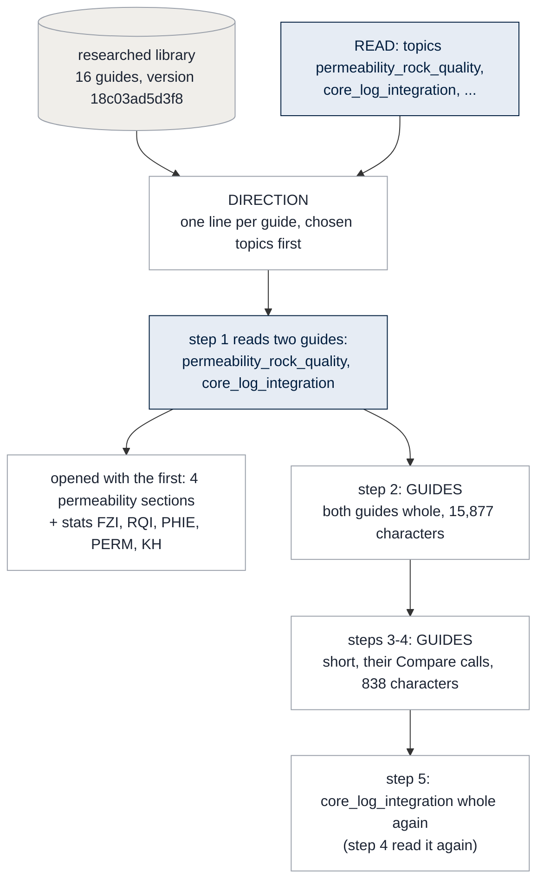
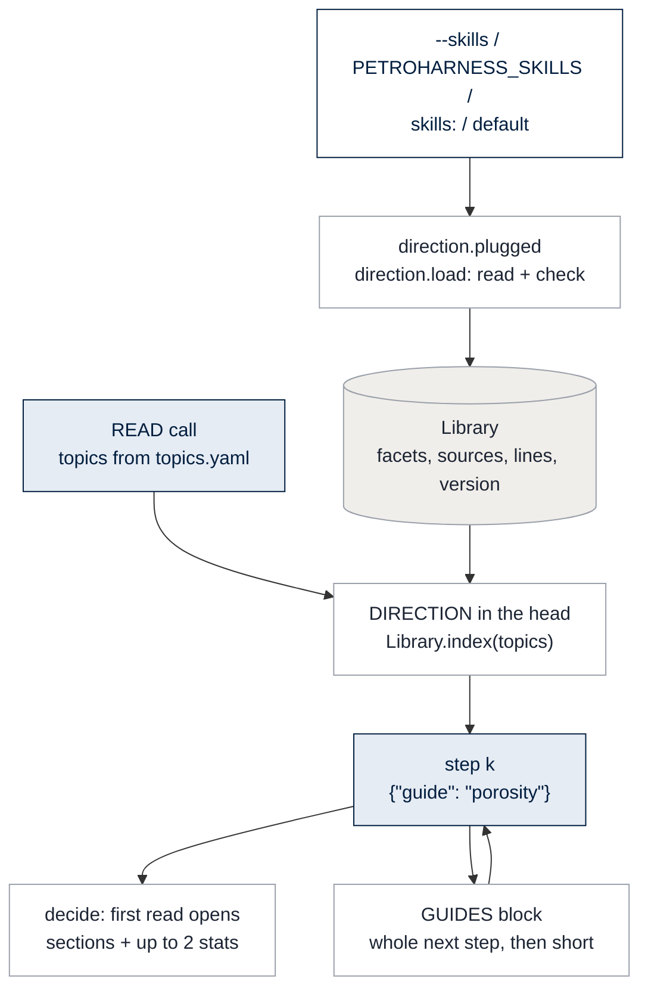

# Skills

The guides the model reads come from a skill library: a folder of sourced guides, plugged into a run by one setting.
A guide gives direction, never an answer: what to consider, which results to set side by side, the criteria a call
needs, how evidence is misread, and what logs cannot establish. This page is for developers and domain experts who
write or review guides.

## 1. At a glance

How the guides reached the second question of a recorded conversation on GeoLink 30/6-5, Brent Group: "Which zone has
the best reservoir quality, and how does the log permeability compare with the core?"



| Fact | Value |
|---|---|
| Topic areas | 14, owned by the harness ([resources/topics.yaml](../../src/petroharness/resources/topics.yaml)); a library cannot add one |
| Default library | `skills/researched`: one guide per topic area and two common guides (`answer`, `route`) |
| Choosing a library | `--skills`, else `PETROHARNESS_SKILLS`, else a model card's top-level `skills:` (`HarnessConfig.skills`; a data settings file has no `skills` key), else the default; `none` for no guides |
| Loading | read and checked before the first question; every problem reported at once as WHAT / WHY / FIX |
| Index | DIRECTION in every step prompt: one line per guide under its topic areas, the chosen topics first |
| Reading a guide | the action `{"guide": "<name>"}`, up to 2 a step (`state.MAX_GUIDES`), outside the 6 lookups |
| GUIDES block | a guide whole at the step after it is read, short (its Compare calls) after that |
| Provenance | every Decide, Know, Easily misread and Do not state line has a `sources.yaml` row: class `a` (literature), `g` (guideline) or `b` (workflow fact) |
| Trace record | `trace["skills"] = {"library": <name or "none">, "version": <12 hex digits>}` |
| Code | [agent/direction.py](../../src/petroharness/agent/direction.py) |

## 2. How it works



1. **Choose.** `direction.plugged` resolves `config.skills_setting` to a folder, or `None` for `none`; `graph.turn`
   calls it before the question runs, `cli` before a batch.
2. **Load and check.** `direction.load` reads and checks `library.yaml`, `refs.yaml` and every guide folder, and
   returns a `Library` with a version hash, or raises `LibraryError` listing every problem.
3. **Read the question.** The READ call (`read.read_question`) chooses one to four topic areas from
   `direction.areas()`; they key the first look, the map's notes, the index order and what a guide opens.
4. **Show the index.** `graph.first_look` puts `DIRECTION` (`Library.index(topics)`) in the head of every look and
   investigation step.
5. **Read a guide.** `Session.run` renders a `{"guide": "<name>"}` for the interval (`Library.guide`) and adds it to
   `Session.guides`; the first read also has `graph.decide` open what the guide names for the first topic.
6. **Keep it in view.** `Session.guides_text` shows every guide read: whole at the next step, then short.

## 3. Choosing a library

```bash
petroharness --las well.las --question "..." --skills none                  # no guides
petroharness --las well.las --question "..." --skills ./my_library          # a folder of your own
PETROHARNESS_SKILLS=/path/to/my_library petroharness chat --las well.las    # the same for a session
```

<details>
<summary>The skills setting</summary>

One setting picks the library, read in this order of precedence.

| Name | Type | Default | Meaning | Defined in |
|---|---|---|---|---|
| `--skills PATH\|none` | command option | unset | `petroharness`, `petroharness chat` and `petroharness setup`; a relative path that exists is resolved from the working directory | `ask.run_options`, `interval.prepare` |
| `ask(skills=...)` | `str` or `None` | `None` | the Python API's argument; the same as `--skills` | `ask.ask` |
| `skills` (web UI) | `str` | `default` | `default`, `none` or a folder that must exist | `ui/adapter.py` |
| `PETROHARNESS_SKILLS` | environment variable | unset | used when no `--skills` is given | `config.SKILLS_ENV` |
| `skills` | configuration field | `skills/researched` | `HarnessConfig.skills`; a configuration YAML read by `HarnessConfig.load` may set the top-level key `skills` | `config.HarnessConfig`, `config.DEFAULT_SKILLS` |

- `config.skills_setting(cfg)` returns the value given in code (`--skills`, through `config.given_settings`), else
  `PETROHARNESS_SKILLS`, else `cfg.skills`, else `skills/researched`.
- `direction.plugged` reads `none` in any case as no library. Any other value is a folder: `~` is expanded, and a
  relative path is resolved against `src/petroharness/resources/`.
- A loaded library is cached per path (`direction.load`, up to 8 paths per process).

</details>

## 4. Topic areas

The harness owns fourteen topic areas. The READ call chooses one to four for each question, and every guide declares
the areas it serves. The READ reply of the first question of the Brent conversation:

```json
{"topics": ["porosity", "water_saturation", "permeability_rock_quality", "hydrocarbon_detection"],
 "named": ["porosity", "water saturation", "permeability", "Brent Group", "hydrocarbon-bearing"],
 "depth": "investigate"}
```

- The READ reply's schema allows one to four topics, each an area name; names that are not areas are dropped, and a
  reply with none is unreadable.
- The first topic is the primary one: the lookups a guide opens follow its families (section 7).

<details>
<summary><code>topics.yaml</code></summary>

The harness's topic areas: the READ call chooses from them, and every guide declares the areas it serves.

| Name | Type | Meaning | Defined in |
|---|---|---|---|
| `areas` | mapping | area name to its fields, in the order the READ call and the index list them | `topics.yaml` |
| `when` | `str` | what the area covers, shown to the READ call as `name - when` | `topics.yaml` |
| `families` | `list[str]` | the workflow's analyzer families the area reads | `topics.yaml`, `direction.families` |
| `overview` | `list[str]` | its key curves for the first look, at most 8 | `topics.yaml`, `direction.overview` |

```yaml
areas:
  porosity:
    when: how much pore space, from which tools, total vs effective, secondary porosity
    families: [porosity]
    overview: [PHIT, PHIE, PHIE_CC, PHID, PHIN, PHIS, PHI_SEC, VCL]
```

- `direction.areas()` returns the areas in file order; `families(topics)` and `overview(topics)` return each family
  or curve once, in topic order.
- The topics are used for: the READ reply's schema (`read.read_schema`), the first look (`graph.first_look`), the
  map's notes (`map.scoped_notes`), the index order, the sections a guide opens (`graph.decide`), the scope of the K8
  claim check (`Claims.families`) and the standard curves of the by-interval zone table (`writer.zone_table`).

</details>

<details>
<summary>The fourteen areas</summary>

Every topic area, what it covers, the analyzer families it reads and its first-look curves.

| Area | When (shown to the READ call) | Families | Overview curves |
|---|---|---|---|
| `data_quality` | hole condition, tool and environmental effects, spikes, gaps, depth matching, log quality | numerical | CALI, BS, DRHO, BAD_HOLE, GR, RHOB, NPHI, DTC |
| `lithology_mineralogy` | rock types, mineral content, log responses of rocks, lithology logs | lithology | GR, RHOB, NPHI, PEF, DTC, VCL |
| `shale_clay` | shale or clay volume, its distribution and its effects on other logs | lithology, porosity | GR, VCL, NPHI, RHOB, PHIT, PHIE |
| `porosity` | how much pore space, from which tools, total vs effective, secondary porosity | porosity | PHIT, PHIE, PHIE_CC, PHID, PHIN, PHIS, PHI_SEC, VCL |
| `water_saturation` | water saturation, its model and parameters, irreducible water, bulk volume water | saturation | SW, RDEP, RW, PHIE, VCL, BVW |
| `hydrocarbon_detection` | whether and where hydrocarbons are indicated, and which kind | hydrocarbon, saturation | SW, RDEP, PHIE, BVW, CROSSOVER_FLAG, NET_PAY |
| `fluid_contacts` | fluid contacts and transition zones | saturation, hydrocarbon | SW, RDEP, PHIE, VCL, BVW |
| `invasion_movability` | invasion profiles, flushed zone, whether hydrocarbons moved | saturation, permeability, hydrocarbon | RDEP, RMED, RSHA, RXO, SXO, MHI, SW |
| `permeability_rock_quality` | permeability, its level and controls, rock quality and flow units | permeability | PERM, PERM_CC, PHIE, FZI, RQI, VCL |
| `net_reservoir_pay` | net reservoir and pay, cutoffs and thickness | hydrocarbon, permeability | NET_PAY, NET_RES, VCL, PHIE, SW, PERM |
| `log_facies_stratigraphy` | log facies, vertical sequences, boundaries and trends | lithology | GR, RHOB, NPHI, DTC, VCL |
| `elastic_properties` | velocities, Vp/Vs, moduli, mechanical properties | numerical | DTC, DTS, RHOB, VP_VS_RATIO |
| `statistics_data_analysis` | statistics, distributions, correlations, comparisons and trends of curves | numerical | none: the curves the question names |
| `core_log_integration` | comparing logs with core, core-calibrated curves | porosity, permeability | PHIE_CC, PHIT, PHIE, PERM_CC, PERM |

</details>

## 5. The library format

A library is a folder: `library.yaml`, `refs.yaml`, and one folder per guide holding `SKILL.md` (the guide) and
`sources.yaml` (the provenance of its lines).

```text
my_library/
  library.yaml
  refs.yaml
  porosity_check/
    SKILL.md
    sources.yaml
```

<details>
<summary>Folder layout</summary>

| Name | Type | Default | Meaning | Defined in |
|---|---|---|---|---|
| `library.yaml` | YAML mapping | required | `name`, `description`, `common` | `direction.load` |
| `refs.yaml` | YAML mapping | `{}` when absent | the references the provenance rows cite | `direction.load` |
| `<guide>/SKILL.md` | text | required per guide folder | the guide | `direction.read_skill` |
| `<guide>/sources.yaml` | YAML mapping | `{}` when absent | the provenance rows of the guide's lines | `direction.load` |
| hidden folders | | ignored | folders starting with `.` or `__` are not guides | `direction._guide_dirs` |

The library's version hashes `library.yaml`, `refs.yaml` and each guide's `SKILL.md` and `sources.yaml` (path, zero
byte, bytes; SHA-1, first 12 hex digits). Other files do not count.

</details>

<details>
<summary><code>library.yaml</code></summary>

The library's identity and the guides listed for every question. The keys must be exactly these three.

| Name | Type | Default | Meaning | Defined in |
|---|---|---|---|---|
| `name` | `str` | required | the library's name, recorded in `trace["skills"]` | `direction.LIBRARY_KEYS` |
| `description` | `str` | required | one line | `direction.LIBRARY_KEYS` |
| `common` | `list[str]` | required (may be `[]`) | guides listed under `common` in the index for every question; each must exist | `direction.LIBRARY_KEYS` |

The packaged library's:

```yaml
name: researched
description: One guide per topic area, written from the petrophysics literature and reviewed line by line.
common: [answer, route]
```

</details>

<details>
<summary><code>SKILL.md</code></summary>

One guide: frontmatter, a title, then one section per part with one bullet per line.

| Name | Type | Default | Meaning | Defined in |
|---|---|---|---|---|
| `name` | frontmatter `str` | required | the folder's name; lower-case letters, digits and `_` (`direction.GUIDE_NAME`) | `direction.read_skill` |
| `when` | frontmatter `str` | required | the guide's index line | `direction.read_skill` |
| `areas` | frontmatter `list[str]` | required | the topic areas it serves; `[]` for a common guide | `direction.read_skill` |
| `option` | frontmatter `str` | absent | lists the guide only while that switch is on | `direction.Library.listed` |
| `## Consider` | part `consider` | optional | questions to ask of the data | `direction.PARTS` |
| `## Compare` | part `compare` | optional | lookups, rendered for the interval (below) | `direction.PARTS` |
| `## Decide` | part `decide` | optional | methods and criteria a call needs, stated generally, with their uncertainty | `direction.PARTS` |
| `## Know` | part `know` | optional | textbook facts and workflow facts | `direction.PARTS` |
| `## Easily misread` | part `misread` | optional | traps, stated as fact | `direction.PARTS` |
| `## Do not state` | part `ceiling` | optional | what logs cannot establish, and what would | `direction.PARTS` |

The start of the packaged `porosity` guide:

```markdown
---
name: porosity
when: Questions on how porous a zone or interval is, which porosity curve to trust, why porosity logs disagree, shale or gas effects, secondary porosity, bad hole, or how log porosity compares with core.
areas: [porosity]
---

# porosity

## Consider
- Which porosity does the question mean: total (PHIT), effective (PHIE), one log (PHID, PHIN, PHIS), core-calibrated (PHIE_CC) or core plugs (PHIC)? Each measures something different.
```

- The format is strict (`direction.read_skill`): a line outside the frontmatter that is not empty, not `# <name>`,
  not a known `## ` heading and not a `- ` bullet under a part is an error; so is any frontmatter key other than
  `name`, `when`, `areas` and `option`.
- `direction.write_skill` writes a facet back in the same format; the packaged guides read and write back to the same
  bytes (`test_skill_file_is_canonical`). Write one finding per bullet, with no line break inside a bullet.
- A line may carry a switch gate: `[option] text` is shown only while that switch is on, `[!option] text` only while
  it is off (`direction.gated`). A gate must name a switch of `options.py`, which defines none at present, so a
  gated line fails the load check.
- The packaged guides end Decide with an answer-shape line (`Answer shape: quantify (...)`), in one of five forms:
  locate, quantify, relate, classify or explain. Load does not require it.

</details>

<details>
<summary>Compare lines</summary>

Each Compare line is a tool call the harness can parse and run, with a note in parentheses on what it shows.

| Form | Kind | Read as | Defined in |
|---|---|---|---|
| `stats A, B [where COND]` | lookup | `stats` with `curves` (and `where`) | `direction.parse_source` |
| `profile A [where COND]` | lookup | `profile` with `curve` (and `where`) | `direction.parse_source` |
| `compare A B` | lookup | `compare` with `a`, `b` | `direction.parse_source` |
| `crossplot Y X [log_y] [log_x]` | lookup | `crossplot` with `y`, `x` and the log flags | `direction.parse_source` |
| `runs COND` | lookup | `runs` with `condition` | `direction.parse_source` |
| `section KEY` | lookup | `section` with `key` | `direction.parse_source` |
| `step NAME` | lookup | `step` with `name` | `direction.parse_source` |
| `<computation> [ARG]` | lookup | a computed-table tool with its leading argument (a curve list when it leads with `curves`) | `direction.parse_source` |
| template | recipe | a line with a placeholder word (`CURVE`, `CURVES`, `NAME`, `KEY`, `CONDITION`, `VALUE`, `A`, `B`) is not parsed and is shown on every interval | `direction.PLACEHOLDER` |

```python
>>> parse_source("stats PHIE, SW where NET_PAY   (note)")
('stats', {'curves': ['PHIE', 'SW'], 'where': 'NET_PAY'})
>>> parse_source("crossplot RHOB NPHI"), parse_source("zone_contrast PERM"), parse_source("core_vs_log")
(('crossplot', {'y': 'RHOB', 'x': 'NPHI'}), ('zone_contrast', {'curve': 'PERM'}), ('core_vs_log', {}))
>>> parse_source("runs CONDITION")
None
```

- When a guide is rendered for an interval, in full or short, a parsed line is shown only where it runs
  (`direction.runs_here`): a computation runs without a `ToolError`; a `section` key or a `step` name exists here; a
  `stats` line has at least one of its curves and every name of its condition; any other lookup has every name it
  reads. What is absent goes unsaid.
- The packaged area guides keep 1 to 12 Compare lines each, none repeated, at most 5 of them templates, checked by the
  library's tests; load checks only that each line parses.

</details>

<details>
<summary><code>sources.yaml</code></summary>

The provenance of a guide's lines: one row per line of Decide, Know, Easily misread and Do not state, in order.

| Name | Type | Default | Meaning | Defined in |
|---|---|---|---|---|
| `decide`, `know`, `misread`, `ceiling` | `list[row]` | `[]` | one row per line of that part, in order; no other keys | `direction.ROWS` |
| `class` | `str` | required | `a` literature, with references; `g` a general guideline; `b` a workflow fact, named | `direction.CLASSES` |
| `refs` | `list[str]` | required for `a` | keys of `refs.yaml`, each optionally followed by what is cited (`Mavko2009 (Vp-Vs relations)`) | `direction.REF_KEY` |
| `fact` | `str` | required for `b` | the workflow or harness fact the line states | `direction.load` |
| `verified` | `str` | optional | on rows that state a number: `textbook`, `opened` or `softened` | packaged library convention |
| `note` | `str` | optional | the reviewer's note | packaged library convention |
| `origin` | `str` | optional | a common guide's row: what motivated the line | packaged library convention |

From the packaged `answer` guide:

```yaml
know:
- class: b
  fact: 'the workflow reports every value per lithology zone (zones are its unit of analysis, docs/DESIGN.md G7)'
- class: g
  note: a finding is reported with what weakens it
ceiling:
- class: b
  fact: 'the harness''s number provenance: a number comes from an opened result or calc'
```

- Consider and Compare lines have no rows: Consider lines are questions, and Compare lines are lookups whose output is
  computed by code.
- A ref is matched by its leading key (`[A-Za-z0-9_-]+`), so text after the key is free.

</details>

<details>
<summary><code>refs.yaml</code></summary>

The literature the rows cite: one entry per key.

| Name | Meaning | Defined in |
|---|---|---|
| key | the key rows cite | `refs.yaml` |
| entry | the reference | `refs.yaml` |
| entry by guide | where guides cite one work differently: guide name to that guide's entry | `refs.yaml` |

```yaml
Author2004: 'Author, A., 2004, A well log analysis textbook, 2nd ed. Chapter on porosity logs.'
```

`refs.yaml` is not model-facing. Load checks only that every cited key exists; the packaged library's tests also check
that every entry is cited.

</details>

## 6. The packaged library

`researched`, the default: one guide per topic area, written from the petrophysics literature and reviewed line by
line, and two common guides. Its trace record in the Brent conversation:

```json
{"library": "researched", "version": "18c03ad5d3f8"}
```

<details>
<summary><code>researched</code></summary>

Lines per part and the rendered size in characters of each guide.

| Guide | Areas | Lines (Consider, Compare, Decide, Know, Easily misread, Do not state) | Rendered size | Defined in |
|---|---|---|---|---|
| `answer` | common | 3, 2, 3, 3, 0, 1 | 1,594 | `researched/answer/` |
| `route` | common | 2, 2, 1, 2, 1, 1 | 1,114 | `researched/route/` |
| `data_quality` | data_quality | 6, 11, 9, 10, 6, 4 | 8,392 | `researched/data_quality/` |
| `lithology_mineralogy` | lithology_mineralogy | 6, 12, 9, 10, 6, 4 | 8,449 | `researched/lithology_mineralogy/` |
| `shale_clay` | shale_clay | 6, 9, 8, 10, 6, 4 | 7,467 | `researched/shale_clay/` |
| `porosity` | porosity | 6, 12, 7, 9, 6, 4 | 7,504 | `researched/porosity/` |
| `water_saturation` | water_saturation | 6, 11, 9, 10, 6, 4 | 7,803 | `researched/water_saturation/` |
| `hydrocarbon_detection` | hydrocarbon_detection | 6, 11, 9, 9, 6, 4 | 7,499 | `researched/hydrocarbon_detection/` |
| `fluid_contacts` | fluid_contacts | 6, 10, 9, 8, 6, 4 | 7,013 | `researched/fluid_contacts/` |
| `invasion_movability` | invasion_movability | 6, 12, 9, 10, 6, 4 | 7,484 | `researched/invasion_movability/` |
| `permeability_rock_quality` | permeability_rock_quality | 6, 12, 9, 10, 6, 4 | 8,977 | `researched/permeability_rock_quality/` |
| `net_reservoir_pay` | net_reservoir_pay | 6, 12, 9, 9, 6, 4 | 7,271 | `researched/net_reservoir_pay/` |
| `log_facies_stratigraphy` | log_facies_stratigraphy | 5, 10, 8, 10, 6, 4 | 7,279 | `researched/log_facies_stratigraphy/` |
| `elastic_properties` | elastic_properties | 6, 7, 8, 10, 6, 4 | 6,940 | `researched/elastic_properties/` |
| `statistics_data_analysis` | statistics_data_analysis | 6, 10, 9, 10, 6, 3 | 7,764 | `researched/statistics_data_analysis/` |
| `core_log_integration` | core_log_integration | 6, 10, 9, 8, 6, 4 | 6,775 | `researched/core_log_integration/` |

- Rendered size is `Library.guide(name)` in characters with no interval (every Compare line shown); for an interval,
  the Compare lines that cannot run there are left out. On 30/6-5 Brent every Compare line of `porosity` runs, so its
  rendered size there is also 7,504.
- `answer` holds general answering guidance and names no basis for a number; `route` is for how a curve or class the
  answer uses was computed.
- The library's order is its common guides first, then the others by the first topic area each serves, then by name.
  It orders the index within an area and the list of guides named when a guide does not exist.

</details>

## 7. How guides reach the prompts

A guide reaches the model four ways: the DIRECTION index in every step's head, the guide action, the GUIDES block
that keeps every guide read in view, and the lookups code opens with a guide the first time it is read. Guide lines
are attributed to C6.

<details>
<summary>DIRECTION: the index</summary>

One line per guide, under each topic area it serves, in the head of every look and investigation step.

| Name | Kind | Meaning | Defined in |
|---|---|---|---|
| `index(topics)` | method | the chosen topics' areas first, then `common`, then the other areas in `topics.yaml` order | `direction.Library.index` |
| one-guide area | rule | an area whose only listed guide is named for the area is one line: `  <area>: <when>` | `direction.Library.index` |
| other areas | rule | `  <area>:` then `    <guide>: <when>` per guide | `direction.Library.index` |
| empty areas | rule | an area with no listed guide is not shown | `direction.Library.index` |
| `listed(name)` | method | a guide with `option` is listed only while that switch is on | `direction.Library.listed` |

The index in the first Brent question, whose four topics come first (cut after `common`):

```text
Direction by topic area, your topics first (guide FACET reads one):
  porosity: Questions on how porous a zone or interval is, which porosity curve to trust, why porosity logs disagree, shale or gas effects, secondary porosity, bad hole, or how log porosity compares with core.
  ...
  common:
    answer: every question
    route: how a curve or class the answer uses was computed, its model, inputs and parameters
  ...
```

- With no topics (an unreadable READ reply) the first line is `Direction by topic area (guide FACET reads one):` and
  the areas follow in `topics.yaml` order after `common`.
- The packaged index is 3,564 characters whichever topics are chosen (every area is listed; the topics set the
  order); the library's tests cap it at 4,000.
- DIRECTION is not in the READ call (which lists the topic areas instead), the settle step or the writer.

</details>

<details>
<summary>The guide action</summary>

The model reads a guide with `{"guide": "<name>"}`; `Session.run` renders it for the interval.

| Name | Kind | Meaning | Defined in |
|---|---|---|---|
| action | `{"guide": name}` | also `{"tool": "guide", "name": name}` (or `"facet"`); the name is stripped and lower-cased | `replies.coerce_action`, `Session.run` |
| per step | `int`, `2` (`MAX_GUIDES`) | guides read in an investigation step, outside the 6 lookups | `graph.decide` |
| look step | rule | a guide counts toward the look step's 4 lookups, and its text goes into NEW | `graph.look` |
| render | `str` | `GUIDE <name> (when: ...)`, then each part with lines: `Consider:`, `Compare:`, `Decide:`, `Know:`, `Easily misread:`, `Do not state:` | `direction.Library.guide` |
| unknown name | `str` | `GUIDE no facet '<name>'; facets: <every guide>`, in NEW | `direction.Library.guide` |

The guide of the example library in section 10, rendered for 30/6-5 Brent:

```text
GUIDE porosity_check (when: How porous each zone is, and which porosity curve to read.)
Consider:
  - Which porosity does the question mean: total (PHIT) or effective (PHIE)?
Compare:
  - stats PHIT, PHIE   (total and effective porosity: n of N and the statistics in each zone)
  - compare PHID PHIN   (density against neutron porosity in each zone: the two averages, the difference and its spread)
  ...
Do not state:
  - Logs alone cannot show that pores are connected; core permeability or a pressure test would.
```

- The brief tells the model what the parts are for (C1 `brief_guide`): Decide lines are the criteria a call needs,
  and Do not state lines are what the data cannot establish, which a claim may give as indicated and graded, never as
  established.
- Guides beyond 2 in one step are not run; the next prompt says how many were left out (C8 `extra_left_out`).

</details>

<details>
<summary>GUIDES: the block in the step prompt</summary>

Every guide read stays in view, outside NEW and its budget.

| Name | Kind | Meaning | Defined in |
|---|---|---|---|
| head | C6 `guides_head` | `GUIDES (a guide is shown in full at the step after you read it, then short; read it again to see it in full):` | `Session.guides_text` |
| fresh guides | `list`, `State.guides_new` | read at the last step: shown whole (`GUIDE ...`) | `graph.act`, `Session.guides_text` |
| earlier guides | `str` | C6 `guide_short`: `<name>, read earlier; its Compare calls: <calls>` | `Library.calls` |
| order | rule | the short ones first, then the whole ones, each group in the order read | `Session.guides_text` |
| empty | rule | no block before any guide is read, and none with no library | `Session.guides_text` |

The block at step 3 of the first Brent question, both guides short:

```text
GUIDES (a guide is shown in full at the step after you read it, then short; read it again to see it in full):
net_reservoir_pay, read earlier; its Compare calls: pay_summary; runs NET_RES; runs NET_PAY; runs CONDITION; stats PHIE, PERM, VCL, SW, RDEP where NET_PAY; ...
hydrocarbon_detection, read earlier; its Compare calls: runs CROSSOVER_FLAG; runs NPHI < PHID; runs NET_PAY; ...
```

- Reading a guide again puts it back in full at the next step: in that question, step 7 read `hydrocarbon_detection`
  again, and step 8 showed it whole after the short `net_reservoir_pay`.
- GUIDES appears in steps 2 and later of an investigation; step 1 has none yet.

</details>

<details>
<summary>What a guide opens with it</summary>

The first time a guide is read, code opens, with no action slot, what it names that bears on the READ call's first
topic.

| Name | Kind | Meaning | Defined in |
|---|---|---|---|
| primary topic | `str`, `Session.topics[0]` | none: nothing is opened with a guide | `graph.decide` |
| sections | lookups | each `section` of the guide's Compare list that this interval has (`Library.sections`), whose family is one of the primary topic's families, and that is not open yet | `graph.decide` |
| workflow stats | lookups, at most 2 (`MAX_GUIDE_STATS`) | when the guide serves the primary topic: its plain `stats` lines whose curves are all the workflow's own (computed by a step or an analyzer) and present here (`Library.workflow_stats`) | `graph.decide` |
| record | trace | `guide_sections` in the step record | `graph.decide` |

Step 1 of the second Brent question (primary topic `permeability_rock_quality`) read that area's guide, and code
opened four sections and one `stats` with it:

```json
{"guide_sections": [
  "permeability.permeability_distribution_analysis",
  "permeability.flow_unit_classification_system",
  "permeability.permeability_variation_controls",
  "permeability.overall_permeability_interpretation",
  "stats {\"curves\": [\"FZI\", \"RQI\", \"PHIE\", \"PERM\", \"KH\"]}"]}
```

What a guide opens, and which of its Compare lines it shows, depend on the well. The `porosity` guide as the primary
topic's guide, on 30/6-5 Brent and on GeoLink 16/7-1, 2000–2560 m, which has no neutron, no PEF and no core
(`Library.calls`, `sections` and `workflow_stats` on each well; data: GeoLink, CC BY-SA 4.0):

| | 30/6-5 Brent | 16/7-1, 2000–2560 m |
|---|---|---|
| Compare lines shown | 12 | 9: `compare PHID PHIN`, `crossplot RHOB NPHI`, `stats DS_SEPARATION, PHI_SEC` left out |
| Sections opened | 4 porosity sections | the same 4 |
| Stats opened | `stats PHIT, PHIE, PHIE_CC, BAD_HOLE`; `stats PHID, PHIN, PHIS, PHIT, PEF` (the first 2 of 3) | none: no plain stats line has all its curves, computed by the workflow, here |

On the same two wells `core_log_integration` shows 10 and 2 Compare lines (`core_vs_log`, `step porosity`).

- Common guides serve no area, so they open sections only, never stats.
- A guide that does not serve the primary topic and names no section of its families opens nothing: in the first
  Brent question (primary topic `porosity`), `net_reservoir_pay` and `hydrocarbon_detection` opened no lookups.
- The opened results go into NEW with the step's other results.

</details>

<details>
<summary>Attribution</summary>

Guide lines in a request are attributed to C6 ([PROMPT_COMPONENTS.md](PROMPT_COMPONENTS.md)).

| Name | Type | Meaning | Defined in |
|---|---|---|---|
| `Library.lines` | `tuple[str]` | every line of every part of every guide, in library order | `direction.load` |
| `components.recording(llm, trace, library)` | function | passes the lines to the attribution as C6 entries | `components.recording` |

```python
>>> lib.lines[:2]
('Which porosity does the question mean: total (PHIT) or effective (PHIE)?',
 'stats PHIT, PHIE   (total and effective porosity: n of N and the statistics in each zone)')
```

The library's version is `trace["skills"]["version"]`, not part of C6's component version.

</details>

## 8. Provenance and load checks

`direction.load` checks the format and the provenance of every line, collects every problem and raises them at once,
before the first question. A library with four problems:

```text
skill library <library> cannot be used (4 problems):
- WHAT: pay_notes declares areas that are not topic areas: ['pay']. WHY: the harness owns the topic areas; a library cannot add one. FIX: use names from <package>/resources/topics.yaml.
- WHAT: pay_notes: the Compare line 'histogram NET_PAY   (a histogram)' is not a lookup the harness can run. WHY: ... FIX: ...
- WHAT: pay_notes has 1 decide lines and 0 sources rows. WHY: every Decide, Know, Easily misread and Do not state line has its provenance row, in order (G2). FIX: give one row per line in pay_notes/sources.yaml.
- WHAT: common names guides the library lacks: ['answer']. WHY: ... FIX: ...
```

- The error is `direction.LibraryError` (a `ValueError`). It stops the run before its first question: `graph.turn`
  calls `direction.plugged` before the graph starts.
- Load checks provenance and format, not wording: a line that states a conclusion loads (section 9).

<details>
<summary><code>direction.load</code></summary>

Every check, and its message (WHAT).

| Check | Applies to | Message (WHAT) | Defined in |
|---|---|---|---|
| folder | fatal | `no skill library at <path> (no library.yaml there)` | `direction.load` |
| readable YAML | each file | `<file> is not readable YAML (...)`; `<file> holds a <type>` | `direction.load` |
| library keys | `library.yaml` | `library.yaml has the keys [...]` when not exactly `name`, `description`, `common` | `direction.load` |
| common | `library.yaml` | `common is ...` when not a list; `common names guides the library lacks: [...]` | `direction.load` |
| guide folder | each folder | `the folder <name> has no SKILL.md` | `direction.load` |
| guide name | each guide | `the guide name '<name>' is not lower case letters, digits and underscores`; `<name>/SKILL.md is named '<x>'` | `direction.load` |
| format | each guide | `<name>/SKILL.md does not parse (...)` | `direction.read_skill` |
| areas | each guide | `<name> declares no areas`; `<name> declares areas that are not topic areas: [...]` | `direction.load` |
| listed | library | `the guides [...] serve no topic area and are not common` | `direction.load` |
| gates | each line | `<name>: no switch '<x>' (switches: none) in '...'` | `direction.gated` |
| Compare | each line | `<name>: the Compare line '...' is not a lookup the harness can run` | `direction.parse_source` |
| sources parts | each guide | `<name>/sources.yaml has the parts [...]` beyond `decide`, `know`, `misread`, `ceiling` | `direction.load` |
| row count | each part | `<name> has <n> <part> lines and <m> sources rows` | `direction.load` |
| row class | each row | `<name> <part> <i>: no class` | `direction.load` |
| class a | each row | `<name> <part> <i>: class a with no refs` | `direction.load` |
| class b | each row | `<name> <part> <i>: class b with no fact` | `direction.load` |
| refs | each row | `<name> <part> <i>: refs not in refs.yaml: [...]` | `direction.load` |
| guides | library | `the library has no guides` | `direction.load` |

</details>

<details>
<summary>The tests</summary>

What the test suite checks over a library, beyond the load checks.

| Test | Over | Checks | Defined in |
|---|---|---|---|
| `test_every_line_has_its_provenance` | the plugged library | every Decide, Know, Easily misread and Do not state line has its row | `tests/agent/test_skills.py` |
| `test_every_reference_is_defined_and_every_entry_is_cited` | the plugged library | every cited key is defined and every `refs.yaml` entry is cited | `tests/agent/test_skills.py` |
| `test_skills_are_generic` | the plugged library | no `option` and no gate tag | `tests/agent/test_skills.py` |
| `test_skill_file_is_canonical` | the packaged guides | each `SKILL.md` writes back to the same bytes | `tests/agent/test_skills.py` |
| `test_no_prescriptions` | every model-facing text | no conclusion form in the components, the topic areas or the guides of every packaged library (G3) | `tests/test_generality.py` |
| `test_no_benchmark_words`, `test_no_benchmark_overlap` | every packaged library | no evaluation words and no 6-gram shared with evaluation text (G5) | `tests/test_generality.py` |
| `tests/test_lint.py` | the package | no well, formation or dataset names and no depth literals | `tests/test_lint.py` |

```bash
PETROHARNESS_SKILLS=/path/to/my_library .venv/bin/python -m pytest tests/agent/test_skills.py -q
.venv/bin/python -m pytest tests/test_generality.py tests/test_lint.py -q
```

The size limits of the packaged library (an index of at most 4,000 characters, a guide of at most 9,000) and the
Compare-line rules are checked by its tests, not at load.

</details>

## 9. Guides are lookups and criteria

A guide gives direction, never a verdict. A Decide criterion and a Do not state limit from the packaged `porosity`
guide, as it renders for 30/6-5 Brent:

```text
- In clean, liquid-filled rock on the right matrix, PHID and PHIN agree within a few porosity units (p.u., percent of rock volume). Lasting separation points to wrong matrix, shale, gas or bad hole; test each.
- Logs alone cannot establish pore type (vugs, molds, fractures) with confidence; core description, thin sections, image logs or nuclear magnetic resonance (NMR) logs would.
```

<details>
<summary>The rule</summary>

What each part may say.

| Part | Kind | Provenance | May say |
|---|---|---|---|
| Consider | questions | | what to ask of the data (skills README) |
| Compare | lookups | | a tool call and a note on what the tool computes, never what to conclude (`direction.parse_source`) |
| Decide | criteria | class `a`, `g` or `b` row | methods and criteria stated generally, with their uncertainty |
| Know | facts | row | textbook facts with references; workflow facts, named |
| Easily misread | facts | row | traps, stated as fact |
| Do not state | limits | row | what logs cannot establish, and what would establish it |

- Presence, fluid, mobility, flow units, controls, rankings and verdicts are the model's readings
  ([DESIGN.md](../DESIGN.md), G3); a guide line justified by how one question was answered is not allowed (G2).
- A reporting convention of a reader belongs in the report style (`resources/profiles/report_style.yaml`) or the
  data config, never in a guide.

</details>

## 10. Writing your own library

A new library is a folder in the layout of section 5; it needs no code change.

| Step | Do | Defined in |
|---|---|---|
| 1 | create `library.yaml` (`name`, `description`, `common`) and `refs.yaml` | section 5 |
| 2 | one folder per guide with `SKILL.md`; name the folder as the guide; declare `areas` from `topics.yaml` | `direction.read_skill` |
| 3 | one `sources.yaml` row per Decide, Know, Easily misread and Do not state line | `direction.ROWS` |
| 4 | `direction.load(Path(...))`, or a run with `--skills <folder>`: fix every WHAT / WHY / FIX | `direction.load` |
| 5 | run `tests/agent/test_skills.py` with `PETROHARNESS_SKILLS` naming the library, then `tests/test_generality.py` and `tests/test_lint.py` | section 8 |
| 6 | a change to what the model reads changes behaviour: measure it end to end and record what you measured | `AGENTS.md`, rule 8 |

<details>
<summary>A minimal library that loads</summary>

`porosity_check/SKILL.md` is the guide rendered in section 7.

```yaml
# library.yaml
name: field_notes
description: Porosity guidance written for our own wells.
common: []
```

```yaml
# porosity_check/sources.yaml
decide:
- class: g
  note: a general reporting guideline
know:
- class: a
  refs:
  - Author2004 (porosity logs)
ceiling:
- class: g
  note: what logs cannot establish, and what would
```

```markdown
---
name: porosity_check
when: How porous each zone is, and which porosity curve to read.
areas: [porosity]
---

# porosity_check

## Consider
- Which porosity does the question mean: total (PHIT) or effective (PHIE)?

## Compare
- stats PHIT, PHIE   (total and effective porosity: n of N and the statistics in each zone)
- compare PHID PHIN   (density against neutron porosity in each zone: the two averages, the difference and its spread)
- stats CURVES where CONDITION   (a curve's statistics over only the samples where a condition holds)
- step porosity   (the porosity method with its matrix and fluid parameters)

## Decide
- Give each zone's porosity on each porosity curve the record holds, and say which curve each value comes from.

## Know
- Effective porosity excludes clay-bound water; total porosity includes it.

## Do not state
- Logs alone cannot show that pores are connected; core permeability or a pressure test would.
```

- With `refs.yaml` holding the `Author2004` key (section 5), this library loads as
  `{"library": "field_notes", "version": "<12 hex digits>"}`, and its index lists `porosity_check` under `porosity`.
- An area without a guide is not shown in the index. Areas still drive the first look and the notes whatever the
  library covers.
- To change one guide of the packaged library, edit its `SKILL.md` and the line's row in `sources.yaml`; a new
  reference goes into `refs.yaml`.

</details>

## 11. Running with no guides

With `--skills none` the topics, the first look and the notes work as with a library, and nothing speaks of guides. A
guide call is said back in NEW:

```text
Not run (not an action this harness reads): {"guide": "porosity"}. Actions are the tools listed (as {"tool name": {arguments}}), get, find and calc.
```

<details>
<summary><code>skills: none</code></summary>

What changes with no library.

| Name | With a library | With no library | Defined in |
|---|---|---|---|
| `Session.library` | the plugged `Library` | `None` | `direction.plugged` |
| DIRECTION | in the head | not in the head | `graph.first_look` |
| brief (C1) | with the guide fragments | `{direction}` and `{guide_action}` filled with `""` | `prompts.brief` |
| step 1 (C5) | with the guide fragments | `{guide_sentence}` and `{guide_call}` filled with `""` | `prompts.step1` |
| guide action | read | not an action: said back by C8 `not_run`, whose action list leaves out `guide` | `replies.coerce_action`, `graph.decide` |
| GUIDES | when a guide is read | never shown | `Session.guides_text` |
| lookups a guide opens | as section 7 | none | `graph.decide` |
| READ, topics, first look, notes | | unchanged: they use the topic areas | `read.read_question`, `graph.first_look` |
| trace `skills` | name and version | `{"library": "none", "version": null}` | `direction.stamp` |

`tests/agent/test_skill_library.py` checks that with no library no model-facing text speaks of guides and a run
completes.

</details>

## 12. Limits and errors

Beyond the load errors of section 8, an unknown guide, a Compare line that cannot run here and a guide call with no
library (sections 7 and 11):

| Situation | What happens | Where |
|---|---|---|
| The setting names a folder with no `library.yaml` | `LibraryError` with one WHAT / WHY / FIX; the run does not start | `direction.load` |
| A library has problems | `LibraryError` listing every problem; the run does not start | `direction.load` |
| `--skills` names a relative path that does not exist | it is passed on and resolved against `src/petroharness/resources/`, then fails to load | `interval.prepare`, `direction.plugged` |
| The web UI names a folder that does not exist | an input error before the run | `ui/adapter.py` |
| More than 2 guides in one step | the first 2 run; the next prompt says how many were left out | `graph.decide`, C8 `extra_left_out` |
| The READ reply has no readable topics | the index in `topics.yaml` order; no lookups are opened with a guide | `read.read_question`, `graph.decide` |

## 13. Related pages

- [resources/skills/README.md](../../src/petroharness/resources/skills/README.md): the library format as the package
  states it.
- [INVESTIGATION_STATE.md](INVESTIGATION_STATE.md): the step loop that reads guides, and the state the topics key.
- [PROMPT_COMPONENTS.md](PROMPT_COMPONENTS.md): C6 and the guide fragments of C1, C5 and C8.
- [DESIGN.md](../DESIGN.md): G2 (provenance) and G3 (no conclusions).
- [EXTENDING.md](EXTENDING.md): recipes, including a new guide.
- [CONFIGURATION.md](CONFIGURATION.md): settings and environment variables.
- [USAGE.md](../USAGE.md): `--skills` on the command line.
