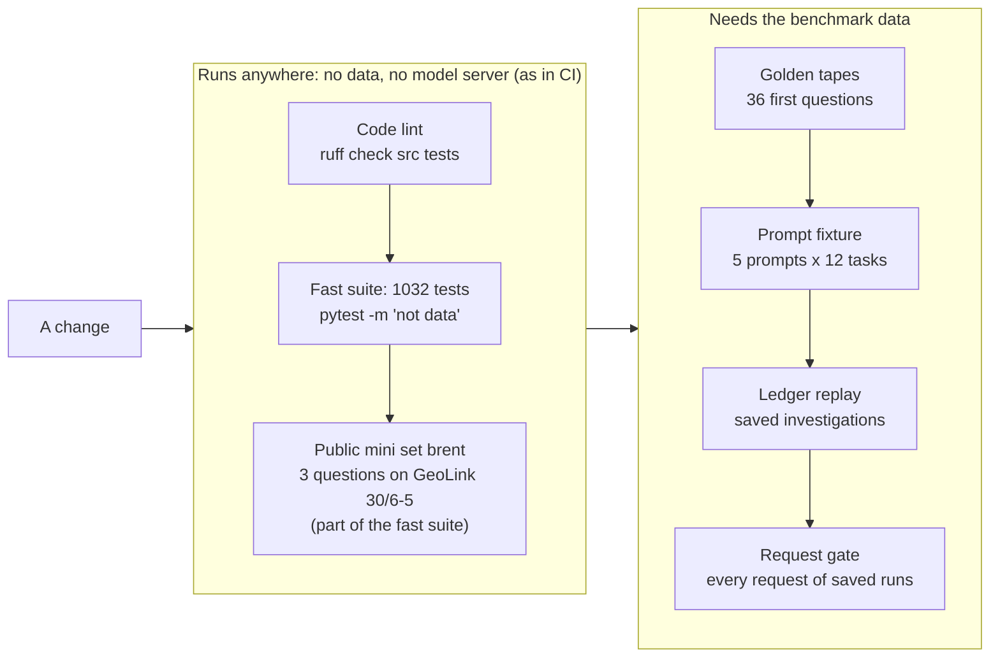
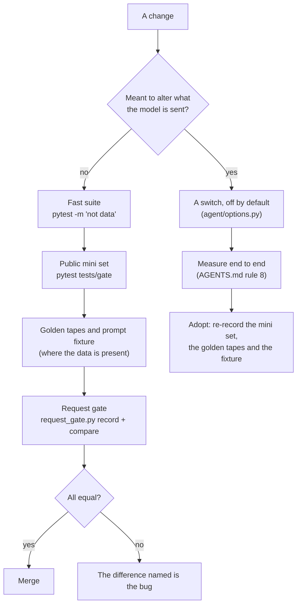
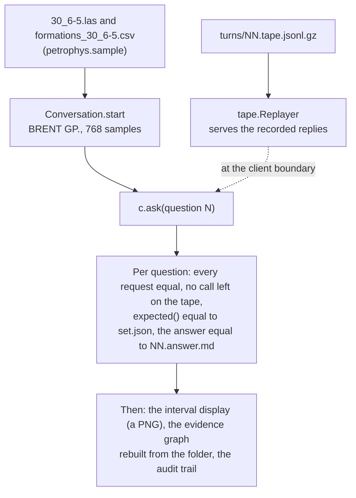

# Testing reference

The test suite of PetroHarness and its regression gates: how to run them, what each part covers, and how a change
shows that it alters nothing it should not. No test calls a model: the gates replay recorded model replies and compare
every request the code builds with the recorded one. For developers who run the tests, keep the gates green or add
tests; the rules a change must follow are in [AGENTS.md](../../AGENTS.md), the contribution workflow in
[CONTRIBUTING.md](../../CONTRIBUTING.md).

## 1. At a glance



The three commands most changes need, none of which needs data or a model server:

```bash
# the code lint
.venv/bin/ruff check src tests
# the fast suite, on each edit
.venv/bin/python -m pytest -o addopts= -q -m "not data" -n 16 -p no:cacheprovider tests
# the public mini set
.venv/bin/python -m pytest -o addopts= -q tests/gate
```

| Item | Value | Defined in |
|---|---|---|
| Runner | pytest, with `pytest-xdist` for `-n`; `ruff` for the code lint (the `dev` extra) | [pyproject.toml](../../pyproject.toml) `[project.optional-dependencies]` |
| Test paths | `testpaths = ["tests"]`; `pythonpath = ["src", "tests", "tests/agent"]`; `addopts = "-q"` | `pyproject.toml` `[tool.pytest.ini_options]` |
| Test modules | 87: 21 top-level, 50 in `tests/agent`, 6 in `tests/session`, 4 in `tests/ui`, 2 in `tests/gate`, one each in `tests/basis`, `tests/core`, `tests/evidence`, `tests/figures` | `tests/` |
| Collected with no data config | 1409 tests, 15 modules skipped at collection, in a checkout that holds the golden tapes and the prompt fixture (without them, their 48 parametrized cases are not collected) | `pytest --collect-only` |
| Collected with `-m "not data"` and no data config | 1032 tests (377 deselected), same checkout | `pytest --collect-only -m "not data"` |
| Markers | `data` (needs data files), `llm` (needs a live model endpoint; declared, used by no test) | `pyproject.toml` `markers` |
| Skip without data | A test or module that fails with `WHAT: no data settings` is reported as skipped | [tests/conftest.py](../../tests/conftest.py) |
| CI | GitHub Actions, Python 3.10, `ruff check src tests` then `pytest tests -q -p no:cacheprovider`, 45-minute limit | [.github/workflows/tests.yml](../../.github/workflows/tests.yml) |
| Gates anyone can run | The public mini set `brent` (`tests/gate`) | [tests/gate/README.md](../../tests/gate/README.md) |
| Gates that need private data | Golden tapes, prompt fixture, ledger replay, request gate | `tests/agent/`, `tests/gate/request_gate.py` |

## 2. How it works

No test calls a model: replies come from stand-in models or from recorded tapes replayed at the client boundary.
A test whose input is absent (the data config, the sample wells, the tapes) skips and names what is missing. The
gates rebuild every request of a recorded run and compare it with the recording, then the answers and traces; a
difference is either a bug or a behaviour change, which is a switch until it is measured.



<details>
<summary>The suite step by step</summary>

1. pytest collects `tests/` with `src`, `tests` and `tests/agent` on the import path (`pyproject.toml`), and
   `tests/conftest.py` puts `tests/` first on `sys.path`.
2. Tests that read wells build a `HarnessConfig`, which reads the data config named by `PETROHARNESS_DATA` or
   `configs/data.local.yaml` (`config.user_settings`). Without one it raises
   `WHAT: no data settings at <path> ...`, and the hooks `pytest_runtest_makereport` and
   `pytest_make_collect_report` in `conftest.py` turn that failure into a skip with the reason
   `no data settings file (configs/data.local.yaml or PETROHARNESS_DATA)`.
3. Other inputs are found through environment variables (`WELLLOGBENCH`, `PETROHARNESS_SAMPLE_LAS`,
   `PETROHARNESS_RUNS`) or files in the checkout (golden tapes, the prompt fixture, the mini set). Each test that
   needs one skips with a message that names it when it is absent.
4. No test calls a model. Model replies come from stand-in models (`tests/ui/ui_stub.py`, scripted models in
   `tests/agent/test_b5_loop.py`) or from recorded tapes replayed at the client boundary (`petroharness.tape`).
5. The regression gates replay recorded runs and compare every request the code builds with the recorded one
   (`tape.Replayer`), then the answers and traces (`tape.compare_run`). A difference is either a bug or a behaviour
   change that must be measured and re-recorded.
6. CI installs the locked requirements and the pinned Petrophys, runs `ruff`, then the suite with no data and no
   model server: the public mini set is the gate that runs there.

</details>

## 3. Running the suite

| Run | What it runs | Needs |
|---|---|---|
| [The fast suite](#the-fast-suite) | Every test not marked `data`, in parallel: what to run on each edit | Nothing |
| [The full suite](#the-full-suite) | Every test, with every input the tests can use | A data config, `WELLLOGBENCH`, the sample wells, saved runs |
| [As CI runs it](#the-suite-as-ci-runs-it) | Every test with nothing set: the data tests skip | Nothing |
| [The code lint](#the-code-lint-ruff) | `ruff check src tests`: what must never land | The `dev` extra |

<details>
<summary>The fast suite</summary>

Runs every test that needs no data files, in parallel; it is what to run on each edit.

| Name | Type | Default | Meaning | Defined in |
|---|---|---|---|---|
| `-o addopts=` | pytest option | `-q` from `pyproject.toml` | Clears the configured `-q` so the one given below is the only one. | `pyproject.toml` |
| `-m "not data"` | marker expression | all tests | Deselects the tests marked `data`. | `pyproject.toml` `markers` |
| `-n N` | pytest-xdist | serial | Runs on N processes. | `pytest-xdist` |
| `-p no:cacheprovider` | pytest option | cache on | Writes no `.pytest_cache`. | pytest |

```bash
.venv/bin/ruff check src tests
.venv/bin/python -m pytest -o addopts= -q -m "not data" -n 16 -p no:cacheprovider tests
```

- Modules that read the data config at import (15, listed in [section 6](#6-test-layout)) still skip without one, with
  or without `-m`.
- The public mini set (`tests/gate/test_mini.py`) carries no marker, so it runs in the fast suite.

</details>

<details>
<summary>The full suite</summary>

Runs every test, with every input the tests can use.

| Name | Type | Default | Meaning | Defined in |
|---|---|---|---|---|
| `PETROHARNESS_DATA` | path | `configs/data.local.yaml` | The data config of a dataset with reference files (`eval.*`); its `data.tops_csv` must have a `form` column for the lint's formation names. | `config.DATA_FILE_ENV`, `tests/test_lint.py` |
| `WELLLOGBENCH` | folder | unset | The folder of `<dataset>.yaml` data configs for the golden tapes and the calibration and check tests. | `tests/agent/test_golden_tapes.py` |
| `PETROHARNESS_SAMPLE_LAS` | folder | `sample_las` (relative) | A folder holding the Petrophys sample wells the tests name. | `tests/ui/test_ui_runs.py` and others |
| `PETROHARNESS_RUNS` | glob | unset | Saved benchmark run folders, for the saved-run tests. | `tests/test_citations.py`, `tests/agent/test_b7_writer.py` |

```bash
PETROHARNESS_DATA=/path/to/data.yaml WELLLOGBENCH=/path/to/configs PETROHARNESS_SAMPLE_LAS=/path/to/sample_las \
  .venv/bin/python -m pytest -o addopts= -q -n 16 -p no:cacheprovider tests
```

- The sample wells the tests use are `tuhua-7.las` with `formations_tuhua-7.csv`, `1046123714.las` with
  `1046123714_formation_tops.csv`, and `teapot_17-wx-21.las`. Petrophys ships them in different folders of its
  `datasets` package, so `PETROHARNESS_SAMPLE_LAS` is a folder you assemble (copies or links,
  [section 5](#5-environment-variables)); a test whose file is missing skips.
- The prompt fixture comparison also needs a data config for each dataset beside the one in `PETROHARNESS_DATA`,
  named `<dataset>.yaml` ([section 7](#the-prompt-fixture)).

</details>

<details>
<summary>The suite as CI runs it</summary>

The workflow `tests` runs on every push to `main` or `dev` and on every pull request.

| Name | Type | Default | Meaning | Defined in |
|---|---|---|---|---|
| `runs-on` | runner | `ubuntu-latest` | The machine. | `.github/workflows/tests.yml` |
| `timeout-minutes` | integer | 45 | The job's time limit. | `tests.yml` |
| Python | version | `3.10`, pip cache on | `actions/setup-python@v5`. | `tests.yml` |
| Install | steps | | `pip install -r requirements.lock`; Petrophys from GitHub at commit `7aa9968e72e7c09a28e68af383471184af9f5f52`; `pip install -e ".[dev]" --no-deps`. | `tests.yml` |
| Lint | step | | `ruff check src tests`. | `tests.yml` |
| Tests | step | `LANGSMITH_TRACING=false` | `python -m pytest tests -q -p no:cacheprovider`, with no data config, no model server and no `WELLLOGBENCH`. | `tests.yml` |

```bash
# reproduce the CI test step locally
env -u PETROHARNESS_DATA -u WELLLOGBENCH -u PETROHARNESS_SAMPLE_LAS -u PETROHARNESS_RUNS -u PETROHARNESS_SKILLS \
    -u PETROHARNESS_SET -u PETROHARNESS_COMPONENTS LANGSMITH_TRACING=false \
    .venv/bin/python -m pytest tests -q -p no:cacheprovider
```

- With no data config, every module that reads it at import is skipped. `tests/test_lint.py` runs there, all but its
  check of well and formation names, which reads the data config ([section 8](#the-lint)).
- The golden tapes and the prompt fixture are not in the public repository, so their tests have nothing to compare
  there; the public mini set is the request-level gate that CI runs.
- CI installs Petrophys from GitHub at the pinned commit, the build the mini set was recorded with, so the mini set
  replays there. Petrophys installed by pip from a local folder records no commit, so it counts as another build
  (`files-` and a hash of its files), and the mini set skips ([The public mini set](#the-public-mini-set)).
- Remove `configs/data.local.yaml` (or move it aside) to reproduce CI exactly: the data config is read from it when
  `PETROHARNESS_DATA` is unset.

</details>

<details>
<summary>The code lint (ruff)</summary>

`ruff check src tests` rejects what must never land; style is left to review.

| Name | Type | Default | Meaning | Defined in |
|---|---|---|---|---|
| `line-length` | integer | 120 | The line length ruff assumes. | `pyproject.toml` `[tool.ruff]` |
| `target-version` | string | `py310` | The Python version. | `[tool.ruff]` |
| `select` | rule codes | `E9`, `F63`, `F7`, `F82`, `F401` | Syntax errors, impossible comparisons, statement errors, undefined names, unused imports. | `[tool.ruff.lint]` |

```bash
.venv/bin/ruff check src tests
```

</details>

## 4. Markers and skips

Two markers are declared; selecting by them is the usual way to split the suite.

| Marker | Meaning | Defined in |
|---|---|---|
| `data` | Needs the data files the data config names, or the sample wells. Set per test, or for a whole module with `pytestmark = pytest.mark.data` (`tests/ui/test_ui_runs.py`, `tests/session/test_adopt.py`). | `pyproject.toml` |
| `llm` | Needs a live model endpoint. No test uses it: no test calls a model. | `pyproject.toml` |

```bash
.venv/bin/python -m pytest -o addopts= -q -m data tests/agent/test_golden_tapes.py -n 12
```

An absent input is a skip that names it. With no data config, the 15 modules that read it at import skip at
collection:

```bash
.venv/bin/python -m pytest -o addopts= -q -rs --collect-only tests 2>&1 | grep SKIPPED
```

```text
SKIPPED [1] tests/agent/test_b0_inventory.py:0: no data settings file (configs/data.local.yaml or PETROHARNESS_DATA)
SKIPPED [1] tests/agent/test_b1_map.py:0: no data settings file (configs/data.local.yaml or PETROHARNESS_DATA)
[…]
SKIPPED [1] tests/test_zones.py:0: no data settings file (configs/data.local.yaml or PETROHARNESS_DATA)
1409 tests collected in 4.36s
```

<details>
<summary>Skip messages</summary>

What each absent input does, and the reason pytest prints.

| Name | Type | Meaning | Defined in |
|---|---|---|---|
| No data config | conftest skip | `no data settings file (configs/data.local.yaml or PETROHARNESS_DATA)`, for a test or a whole module (at collection) that raised `WHAT: no data settings`. | `tests/conftest.py` |
| `WELLLOGBENCH` unset | `skipif` | `WELLLOGBENCH is not set (the folder of the datasets' data configs)`. | `test_golden_tapes.py`, `test_components.py`, `test_library_calibrate.py`, `test_library_check.py` |
| No `tests/golden/` | `skipif` or no cases | `test_components.py`: `no golden tapes in this checkout`. `test_golden_tapes.py` builds its cases from the `selection.json` files present, so with none it has no cases and pytest reports it skipped for an empty parameter set. | `test_components.py`, `test_golden_tapes.py` |
| No prompt fixture | skip or no cases | `the prompt fixture is not in this checkout`; the byte-for-byte comparison has no cases. | `tests/agent/test_skill_library.py` |
| No dataset config beside the data config | skip | `no <dataset> data config beside the one in use`. | `test_skill_library.py` |
| No sample wells | skip | `no sample wells at <folder> (PETROHARNESS_SAMPLE_LAS)` or `no sample wells (PETROHARNESS_SAMPLE_LAS)`. | the sample-well tests ([section 6](#6-test-layout)) |
| `PETROHARNESS_RUNS` unset | `skipif` | `PETROHARNESS_RUNS is not set (a glob of saved run folders)`; `no responses in the PETROHARNESS_RUNS folders` when the glob finds none. | `tests/test_citations.py`, `tests/agent/test_b7_writer.py` |
| No recorded mini set | `skipif` | `no recorded mini set in this checkout (tests/gate/record_mini.py)`. | `tests/gate/test_mini.py` |
| Another Petrophys version or build | skip | Another version: `recorded with Petrophys <version@build>; this is <version@build>: the curves, and so the prompts, differ`. The same version, another build: `recorded with another build of Petrophys <version> (<version@build>; this is <version@build>): its curves may differ`. | `tests/gate/test_mini.py`, `record_mini.other_build` |
| No benchmark question files | skip | `the benchmark's QA pairs are not here` (`test_no_benchmark_overlap`). | `tests/test_generality.py` |
| `PETROHARNESS_SKILLS=none` | skip | `no skill library plugged (PETROHARNESS_SKILLS=none)`. | `test_read.py`, `test_skills.py`, `test_b4_direction.py` (whole module) |

</details>

## 5. Environment variables

Most data tests need one of three: `PETROHARNESS_DATA` (the data config), `WELLLOGBENCH` (the folder of the
datasets' configs) or `PETROHARNESS_SAMPLE_LAS` (the sample wells); the saved-run tests need `PETROHARNESS_RUNS`.
Leave `PETROHARNESS_SET` and `PETROHARNESS_COMPONENTS` unset for the gates.

<details>
<summary>Variables the tests read</summary>

Every environment variable a test reads or sets, and what the tests do with it.

| Name | Type | Default | Meaning | Defined in |
|---|---|---|---|---|
| `PETROHARNESS_DATA` | path | `configs/data.local.yaml` | The data config of the dataset the data tests run on. Golden and component tests set it to `$WELLLOGBENCH/<dataset>.yaml` per case; the mini set, the sample-well tests and the UI tests remove it so the settings are built from the LAS. | `config.DATA_FILE_ENV`; `monkeypatch` in many tests |
| `WELLLOGBENCH` | folder | unset | The folder of `<dataset>.yaml` data configs. | `test_golden_tapes.py`, `record_golden.py`, `test_components.py`, `test_library_calibrate.py`, `test_library_check.py` |
| `PETROHARNESS_SAMPLE_LAS` | folder | `sample_las` | The sample wells folder. | `test_ask.py`, `test_library_api.py`, `test_library_calibrate.py`, `test_library_check.py`, `test_library_classify.py`, `test_library_summarize.py`, `test_library_tools.py`, `test_writer_sources.py`, `tests/test_class_tables.py`, `tests/test_interval_units.py`, `tests/core/test_setup.py`, `tests/session/test_adopt.py`, `tests/session/test_chat_command.py`, `tests/session/test_field_notes.py`, `tests/ui/test_ui_runs.py` |
| `PETROHARNESS_RUNS` | glob | unset | Saved benchmark run folders: `responses/*.json` (citations) and `traces/*.json` (the writer replay test). | `test_citations.py`, `test_b7_writer.py` |
| `PETROHARNESS_SKILLS` | folder or `none` | the packaged library | The library the skill tests check; `none` skips the tests that need one. Some tests set or remove it. | `test_skills.py`, `test_skill_library.py`, `test_ask.py` |
| `PETROHARNESS_SET` | `name=value,...` | unset | Switches; golden tests set it to `""`. Leave it unset for the gates. | `test_golden_tapes.py`, `test_components.py`, `record_golden.py` |
| `PETROHARNESS_MODEL_URL` | URLs | unset | Read by the recorders and the live scripts (`record_mini.py`, `record_golden.py live`, `replay.py`, `b4_traps.py`, `b5_traps.py`); removed by the mini set test; set and removed by `test_ask.py`. | `models.env_urls` |
| `PETROHARNESS_COMPONENTS` | folder | the packaged components | Read by the package at import: another copy of the component texts. Leave it unset for the gates; the fixture and tapes are recorded on the packaged texts. | `agent.components.HERE` |
| `LANGSMITH_TRACING` | `true`/`false` | unset | CI sets `false`; `test_graph_flow.py` sets `true` to check that hosted tracing is refused. | `agent.graph.no_hosted_tracing` |

Assembling the sample wells folder:

```bash
export PETROHARNESS_SAMPLE_LAS=$PWD/sample_las
mkdir -p sample_las && .venv/bin/python - <<'PY'
import pathlib, petrophys
for name in ("tuhua-7", "1046123714", "teapot_17-wx-21"):
    las = pathlib.Path(petrophys.sample(name))
    for f in las.parent.glob(las.stem + "*"):
        (pathlib.Path("sample_las") / f.name).unlink(missing_ok=True)
        (pathlib.Path("sample_las") / f.name).symlink_to(f)
    tops = las.parent / f"formations_{las.stem}.csv"
    if tops.exists():
        (pathlib.Path("sample_las") / tops.name).unlink(missing_ok=True)
        (pathlib.Path("sample_las") / tops.name).symlink_to(tops)
PY
```

`petrophys.sample(name)` returns the path of each of the three sample wells. `record_mini.py` finds the mini set's
well, GeoLink `30/6-5`, and its tops file `formations_30_6-5.csv` the same way, so the mini set needs no
`PETROHARNESS_SAMPLE_LAS`.

</details>

## 6. Test layout

Counts are tests collected with no data config, in a checkout that holds the golden tapes and the prompt fixture.

| Folder | Modules | Tests | Without `data` | What it covers |
|---|---|---|---|---|
| [`tests/`](#top-level-tests-testspy) | 31 (4 skip at collection) | 571 | 536 | Whole-harness and cross-cutting tests |
| [`tests/agent`](#testsagent) | 53 (11 skip at collection) | 1020 | 692 | The inventory and map, the tools, the ledger, the guides, the loop, the claims, the writer, the verbs |
| [`tests/session`](#testssession) | 7 | 62 | 16 | Conversations: follow-ups, settings changes, scope and zones changes, field notes, depth, the session graph |
| [`tests/ui`](#testsui) | 4 | 79 | 70 | The web UI server, its progress events and its plot |
| [`tests/gate`](#testsgate-and-testsgolden) | 2 | 5 | 5 | The public mini set and the request gate's comparison |
| [`tests/basis`, `core`, `evidence`, `figures`](#testsbasis-testscore-testsevidence-testsfigures) | 1 each | 5, 9, 5, 8 | 4, 7, 2, 4 | The parts a conversation adds |

The "Type" column of each module table says what the module needs, and "Tests" how many it collects with no data
config.

<details>
<summary>Top-level tests (<code>tests/*.py</code>)</summary>

Whole-harness and cross-cutting tests.

| Name | Type | Tests | Meaning | Defined in |
|---|---|---|---|---|
| `test_audit_fixes.py` | Petrophys sample wells | 17 | Fixes from the audits of names, reach, advice and traces: SP clay volume equals the record's VCL_SP, Petrophys messages whole, a fallback method not called the record's, number inputs, misplaced actions, `runs.limit`, stretches in `where`, flow roles without permeability, a selection's flag. | `tests/test_audit_fixes.py` |
| `test_call_door.py` | Petrophys sample wells | 37 | `zones` read at the call door for every tool and `where` for a verb's run (reach well): every tool on a unit outside the focus, two units and a range; Pickett on the water leg against the raw arrays; calls that differ only at the door are two results. | `tests/test_call_door.py` |
| `test_citations.py` | none; saved runs for one test | 98 | Every citation form models produce is removed before delivery; numbers and tables survive. | `tests/test_citations.py` |
| `test_class_tables.py` | sample wells for 3 | 5 | The analyzers' class tables: the packaged policy uses the library's current set, and a data settings file may name a context package's set (`data.analyzer_class_tables`). | `tests/test_class_tables.py` |
| `test_core_reference.py` | data config (module) | skipped at collection | The core reference taken from a core-corrected LAS curve where there are no plug samples, and the porosity step's parameters on demand. | `tests/test_core_reference.py` |
| `test_encoding.py` | none | 2 | Text the harness reads and writes is UTF-8 whatever the machine's locale: every text read and write names the encoding, and the session log keeps text under any locale. | `tests/test_encoding.py` |
| `test_engine.py` | data config (module) | skipped at collection | A policy that names a pinned interpretation engine runs it on the raw LAS. | `tests/test_engine.py` |
| `test_formation_zone_layout.py` | none | 6 | `data.zone_layout: formation` makes the interval one zone; the default layout is unchanged. | `tests/test_formation_zone_layout.py` |
| `test_generality.py` | data for 2 tests | 12 | The generality contract, G1 to G8 ([section 8](#the-generality-tests)). | `tests/test_generality.py` |
| `test_interpret_option.py` | none | 14 | `data.interpret`: `petrophys.interpret` interprets the LAS and its step record is the well's. | `tests/test_interpret_option.py` |
| `test_interpretation_settings.py` | none | 27 | The interpretation settings: every Petrophys setting offered once or left out on purpose, Petrophys's own choices and help, the policy's defaults, per-setting errors, and that a run's settings reach Petrophys and the zone rule. | `tests/test_interpretation_settings.py` |
| `test_interval_units.py` | sample wells for 1 | 2 | An interval given in feet on a log in metres (or the other way) holds the samples its limits name. | `tests/test_interval_units.py` |
| `test_intervals.py` | data config (module) | skipped at collection | Tasks load without reference fields, and intervals match the reference formation bounds. | `tests/test_intervals.py` |
| `test_label_fixes.py` | Petrophys sample wells (`data`) | 29 | Labels read from the record as data, one rule each: one-value curves, the invasion pair the record used, the analyzers' run descriptions, a class curve's code labels, NET_EXCLUSION and the net-pay split, the VCL rule, parameter notes, a held value for any curve, the temperature's source, functions for an absent derived quantity, the plugs beside the core-calibrated curves, Petrophys's advice at the call door. | `tests/test_label_fixes.py` |
| `test_lint.py` | data for 1 test (via the conftest skip) | 5 | No well, formation or dataset names and no depth literals in code, rules or prompts ([section 8](#the-lint)). | `tests/test_lint.py` |
| `test_llm.py` | none | 11 | The client's plumbing for any model family: template variables, truncated replies of reasoning models, the reasoning field. | `tests/test_llm.py` |
| `test_model_names.py` | none | 3 | The default model's registry key and packaged card carry its public name, the endpoints come from `PETROHARNESS_MODEL_URL` alone, and no working names are left in the package or the docs. | `tests/test_model_names.py` |
| `test_petrophys_integration.py` | none | 2 | Every catalog computation and toolset tool reaches Petrophys or is a listed generic data operation or record reader ([section 8](#the-petrophys-integration-test)). | `tests/test_petrophys_integration.py` |
| `test_prepare_cutoffs.py` | none | 3 | A cutoff Petrophys sets per depth by lithology is recorded as text; only single-number cutoffs are compared with the policy's. | `tests/test_prepare_cutoffs.py` |
| `test_provenance.py` | none | 34 | Where a curve comes from, read from the step record and the LAS, never assumed. | `tests/test_provenance.py` |
| `test_reach_text.py` | Petrophys sample wells | 6 | The brief and the map under reach well: the reach line, the units of the tops file, the zones line. | `tests/test_reach_text.py` |
| `test_runs_intervals.py` | Petrophys sample wells | 9 | `runs` under reach well: every interval top to base, uncut by zones, with each zone's thickness, against the raw arrays. | `tests/test_runs_intervals.py` |
| `test_scope.py` | Petrophys sample wells | 10 | A question's scope (reach well): the READ call's `scope`, applied as every lookup's default zones; a call's own zones win; reach focus unchanged. | `tests/test_scope.py` |
| `test_selection.py` | Petrophys sample wells | 130 | Selections: units, depth ranges in m and ft, several items, refusals, each tool's output against the raw arrays, and the reach focus snapshot. | `tests/test_selection.py` |
| `test_smoke.py` | data for 1 test (via the conftest skip) | 3 | The installed Petrophys is version 3; the configuration loads; the Petrophys build is Petrophys's own. | `tests/test_smoke.py` |
| `test_stretch.py` | Petrophys sample wells | 54 | `FormationView.stretch` and the focus snapshot: any stretch of the well gets its own zones; the benchmark's focus views are byte for byte. | `tests/test_stretch.py` |
| `test_stretch_synthetic.py` | Petrophys sample wells | 16 | Synthetic wells and tops files through the real pipeline: stretches, open and stated bases, a bottom-up LAS (strict xfail). | `tests/test_stretch_synthetic.py` |
| `test_tape_rules.py` | none | 10 | The rules of `tape.compare_run`: removed switches pass only at their value fixed in code, a new switch must be off, the `calls` key is skipped when only the replay has it, and the version stamps and the setup's hash and commit do not decide behaviour ([section 9](#9-component-versions-and-the-golden-tests)). | `tests/test_tape_rules.py` |
| `test_trace_identity.py` | none | 4 | What a trace says about the harness and the model: the package version and the model's name as people read it, never a registry key or endpoints; an empty answer is an error, not `ok`. | `tests/test_trace_identity.py` |
| `test_user_zones.py` | Petrophys sample wells | 22 | The user's zones file: reading (CSV, TSV, Excel, several wells, refusals), the frame (Z ids, names), lithology zones as L ids and `by`, the way in (CLI, prepare, conversation). | `tests/test_user_zones.py` |
| `test_zones.py` | data config (module) | skipped at collection | Zone segmentation reproduces the reference zone names and bounds. | `tests/test_zones.py` |

```bash
.venv/bin/python -m pytest -o addopts= -q tests/test_generality.py tests/test_petrophys_integration.py
```

`tests/_reference.py` gives tests read-only access to reference material (`CFG = HarnessConfig()` at import, so
every module that imports it needs the data config). The harness never imports it (AGENTS.md rule 1).

</details>

<details>
<summary><code>tests/agent</code></summary>

The harness's own parts: the inventory and map, the tools, the ledger, the guides, the investigation loop, the claims,
the writer and the verbs over Petrophys.

| Name | Type | Tests | Meaning | Defined in |
|---|---|---|---|---|
| `test_absence.py` | data for 2 | 19 | What a question names resolves to curves; a measurement the record lacks is detected generally. | `tests/agent/test_absence.py` |
| `test_ask.py` | sample wells for 2 | 57 | `petroharness.ask` and the default command: the tops reader, interval rules, settings built from the LAS, model cards, the command line. | `tests/agent/test_ask.py` |
| `test_b0_inventory.py` | data config (module) | skipped at collection | The inventory on every formation of the configured dataset, with mutations of real wells. | `tests/agent/test_b0_inventory.py` |
| `test_b1_map.py` | data config (module) | skipped at collection | The map on every formation. | `tests/agent/test_b1_map.py` |
| `test_b1_notes.py` | data for 6 | 21 | The map's notes against the record's provenance facts and references computed from the curves. | `tests/agent/test_b1_notes.py` |
| `test_b2_compute.py` | data for 14 | 26 | The catalog's computations as named tools. | `tests/agent/test_b2_compute.py` |
| `test_b2_dense.py` | data config (module) | skipped at collection | Dense tool checks on every formation. | `tests/agent/test_b2_dense.py` |
| `test_b2_tools.py` | data config (module) | skipped at collection | The tools against an independent reference (`b2_reference.py`) on every formation. | `tests/agent/test_b2_tools.py` |
| `test_b3_ledger.py` | data config (module) | skipped at collection | The ledger on every formation. | `tests/agent/test_b3_ledger.py` |
| `test_b4_direction.py` | data for 4; skipped with no library | 19 | The guide index and the guides: Compare lines that parse and render, sizes, sources. | `tests/agent/test_b4_direction.py` |
| `test_b4_trap_rules.py` | none | 39 | The rules the trap script `b4_traps.py` judges claims by, on hand-written claims. | `tests/agent/test_b4_trap_rules.py` |
| `test_b5_calls.py` | data for 31 | 108 | The shapes of tool calls models send, read as meant; `calc` arithmetic on shown numbers. | `tests/agent/test_b5_calls.py` |
| `test_b5_citations.py` | none | 6 | Citation bookkeeping and the lookups-per-step limit. | `tests/agent/test_b5_citations.py` |
| `test_b5_loop.py` | data for 19 | 70 | The investigation loop: action and reply shapes, and the control flow under a scripted model. | `tests/agent/test_b5_loop.py` |
| `test_b5_traps.py` | data for 1 | 34 | The trap rules of `b5_traps.py` on hand-written claims. | `tests/agent/test_b5_traps.py` |
| `test_b6_claims.py` | data for 10 | 113 | The claims: checks, grades, edits; with `-m data`, claims built from every formation's real results. | `tests/agent/test_b6_claims.py` |
| `test_b7_writer.py` | data for 18; saved runs for 1 | 51 | The writer: its prompt, its rules, the repair rounds under a scripted model, the replay's rebuild on saved traces. | `tests/agent/test_b7_writer.py` |
| `test_components.py` | `WELLLOGBENCH` and golden tapes for 3 | 22 | Component entries load as exact bytes, templates fill in one pass, versions follow the files, every character of every call is attributed. | `tests/agent/test_components.py` |
| `test_compose.py` | none | 6 | The zone table placed once: a writer table that repeats it is left out, one with a column of its own stays; an empty heading is left out. | `tests/agent/test_compose.py` |
| `test_crossplot.py` | data config (module) | skipped at collection | The crossplot lookup against numpy. | `tests/agent/test_crossplot.py` |
| `test_curve_catalog.py` | data for 2 | 11 | The curve catalog and the step records in plain words. | `tests/agent/test_curve_catalog.py` |
| `test_fetched_lines.py` | Petrophys sample wells (`data`) | 5 | What get and find show beyond a result's text is kept for the question and read under the result by the writer and settle (a scripted direct question through the writer). | `tests/agent/test_fetched_lines.py` |
| `test_flex.py` | data config (module) | skipped at collection | Tools on any zone layout; the harness's tool names in the workflow's messages. | `tests/agent/test_flex.py` |
| `test_golden_tapes.py` | `WELLLOGBENCH` and golden tapes | 36 cases in a checkout that has them | The golden tapes ([section 7](#the-golden-tapes)). | `tests/agent/test_golden_tapes.py` |
| `test_graph_flow.py` | none | 2 | The question graph's shape against its blueprint; hosted tracing refused. | `tests/agent/test_graph_flow.py` |
| `test_guide_sections.py` | data for 6 | 6 | A guide read the first time opens the workflow sections it names, beside the model's action cap. | `tests/agent/test_guide_sections.py` |
| `test_lag.py` | data config (module) | skipped at collection | `lag_correlation` and the guide that names it. | `tests/agent/test_lag.py` |
| `test_levels_and_rankings.py` | data config (module) | skipped at collection | The workflow's flow roles pass through; the zone table adds a geometric mean by the shape of the values. | `tests/agent/test_levels_and_rankings.py` |
| `test_library_api.py` | sample wells for 12 | 19 | The registry of Petrophys functions, search and run, and the binder; every function run as the model may call it, with no harness fault and no change to the record. | `tests/agent/test_library_api.py` |
| `test_library_calibrate.py` | sample wells, `WELLLOGBENCH` | 10 | The `calibrate` verb. | `tests/agent/test_library_calibrate.py` |
| `test_library_check.py` | sample wells, `WELLLOGBENCH` | 6 | The `check` verb. | `tests/agent/test_library_check.py` |
| `test_library_classify.py` | sample wells | 9 | The `classify` verb. | `tests/agent/test_library_classify.py` |
| `test_library_summarize.py` | sample wells | 4 | The `summarize` verb. | `tests/agent/test_library_summarize.py` |
| `test_library_tools.py` | sample wells for 11, Petrophys's bundled 16/7-1 for 1 | 19 | `calculate`, `estimate` and `what_if`: the catalog read as menus, calls checked, downstream steps. | `tests/agent/test_library_tools.py` |
| `test_measured_build.py` | data for 8 | 18 | Six behaviours of the investigation and the writer that are fixed in code, each asserted. | `tests/agent/test_measured_build.py` |
| `test_options.py` | none | 16 | The switch framework: no switch is defined; an unknown name raises. | `tests/agent/test_options.py` |
| `test_plumbing.py` | data for 8 | 18 | The plumbing between the tools, the ledger and the prompts. | `tests/agent/test_plumbing.py` |
| `test_read.py` | data for 10 | 23 | The READ call and what its topics key, with a stub model. | `tests/agent/test_read.py` |
| `test_recipes.py` | none | 18 | Every test a guide's Consider or Decide line describes has its Compare call (`fixtures/guide_recipes.yaml`). | `tests/agent/test_recipes.py` |
| `test_section_zones.py` | data config (module) | skipped at collection | A section lookup ends with its classes per zone, pooled and over the interval. | `tests/agent/test_section_zones.py` |
| `test_settle.py` | data for 2 | 2 | The settle step. | `tests/agent/test_settle.py` |
| `test_settle_lists.py` | data for 3 | 4 | The lists the settle prompt shows. | `tests/agent/test_settle_lists.py` |
| `test_shape.py` | data for 12 | 15 | The summary layer reads a curve's shape (codes, flags, log-normal) from its values. | `tests/agent/test_shape.py` |
| `test_skill_library.py` | data for 15 (12 are the prompt fixture) | 27 | The pluggable skill library, and the prompt fixture ([section 7](#the-prompt-fixture)). | `tests/agent/test_skill_library.py` |
| `test_skills.py` | none; skipped with no library | 55 | The plugged library: generic, canonical files, provenance of every line. | `tests/agent/test_skills.py` |
| `test_summary.py` | data for 32 | 35 | One summary layer under every summarising tool: each zone, pooled, whole interval. | `tests/agent/test_summary.py` |
| `test_tool_lines.py` | data for 15 | 22 | What the tools show. | `tests/agent/test_tool_lines.py` |
| `test_tool_registration.py` | none | 14 | Every list of tools follows the definitions in `agent/toolset.py`. | `tests/agent/test_tool_registration.py` |
| `test_views_and_scope.py` | data config (module) | skipped at collection | What the tools and the writer show zone by zone, and what the model's topics scope. | `tests/agent/test_views_and_scope.py` |
| `test_writer_evidence.py` | data for 7 | 11 | The writer reads the points, every opened result and the provenance card. | `tests/agent/test_writer_evidence.py` |
| `test_writer_sources.py` | sample wells for 3 | 4 | The checker accepts the numbers the writer was shown (the map without its notes, the points, the limits), and the limits leave out empty weakness notes. | `tests/agent/test_writer_sources.py` |
| `test_written_before.py` | Petrophys sample wells (`data`) | 2 | Settle lists the claims whose text came before results their point's claims cite (unit cases; a scripted investigation). | `tests/agent/test_written_before.py` |
| `test_zone_fill.py` | data for 1 | 10 | The analyzers' derived curves and how the formation view reads them. | `tests/agent/test_zone_fill.py` |

```bash
.venv/bin/python -m pytest -o addopts= -q tests/agent/test_tool_registration.py tests/agent/test_options.py
```

</details>

<details>
<summary>Scripts and fixtures in <code>tests/agent</code></summary>

Files pytest does not collect: recorders, replays, live-model scripts and fixed data.

| Name | Type | Default | Meaning | Defined in |
|---|---|---|---|---|
| `record_golden.py` | recorder | | Records the golden tapes (`live`) or rewrites their results (`replay`). | [section 7](#the-golden-tapes) |
| `prompt_fixture.py` | renderer | | Renders the prompt fixture. | [section 7](#the-prompt-fixture) |
| `replay.py` | replay | | The ledger replay of saved investigations. | [section 7](#the-ledger-replay) |
| `b2_reference.py` | module | | An independent reference of what each tool should return, used by the tool tests. | `tests/agent/b2_reference.py` |
| `b4_traps.py`, `b5_traps.py` | live scripts | | Trap scenarios run with a live model (`PETROHARNESS_MODEL_URL`) on real formations; their final claims are checked by rule. `python tests/agent/b4_traps.py OUT.json [--root WORKTREE] [--per 8] [--only NAME]`. | the files' docstrings |
| `b5_traces.py` | script | | Measures of the investigation loop on saved runs' traces: `python tests/agent/b5_traces.py OUT.json PREFIX [PREFIX ...]`. | `tests/agent/b5_traces.py` |
| `fixtures/prompts.json.gz` | data | not in the public repository | The prompt fixture. | `test_skill_library.py` |
| `fixtures/guide_recipes.yaml` | data | | The reviewed pairs of guide lines and the Compare calls that run their tests. | `test_recipes.py` |
| `fixtures/skill_library_mini/` | data | | A second skill library of two guides (`clay_volume`, `pore_space`) with `library.yaml` and `refs.yaml`. | `test_skill_library.py` |

```bash
PETROHARNESS_DATA=/path/to/data.yaml PETROHARNESS_MODEL_URL=http://localhost:8000/v1 \
    .venv/bin/python tests/agent/b5_traps.py out/traps.json --per 8
```

</details>

<details>
<summary><code>tests/basis</code>, <code>tests/core</code>, <code>tests/evidence</code>, <code>tests/figures</code></summary>

One module each, for the parts a conversation adds.

| Name | Type | Tests | Meaning | Defined in |
|---|---|---|---|---|
| `basis/test_basis.py` | data for 1 | 5 | The methods and parameters an answer rests on (`petroharness.basis`). | `tests/basis/test_basis.py` |
| `core/test_setup.py` | data for 2 | 9 | The setup record and its hash (`petroharness.core.setup`): the same in every process, the command with `PETROHARNESS_DATA` and with `--las`, and the harness's own commit. | `tests/core/test_setup.py` |
| `evidence/test_evidence.py` | data for 3 | 5 | The evidence graph, the number links and the audit trail. | `tests/evidence/test_evidence.py` |
| `figures/test_figures.py` | data for 4 | 8 | Figures: the harness draws nothing itself, candidates, binding, the model's choice, captions. | `tests/figures/test_figures.py` |

```bash
.venv/bin/python -m pytest -o addopts= -q tests/basis tests/core tests/evidence tests/figures
```

</details>

<details>
<summary><code>tests/session</code></summary>

Conversations: follow-up questions, settings changes, field notes, depth and the session graph.

| Name | Type | Tests | Meaning | Defined in |
|---|---|---|---|---|
| `test_adopt.py` | sample wells (module marked `data`) | 8 | Changing a setting in a conversation (`Conversation.adopt`). | `tests/session/test_adopt.py` |
| `test_chat_command.py` | sample wells (module marked `data`) | 2 | `petroharness chat` stops with exit status 2 and a WHAT / FIX line on a skill library that cannot be used or a missing questions file, before any question. | `tests/session/test_chat_command.py` |
| `test_conversation.py` | data for 5 | 8 | A conversation on one interval; the log rebuilds it. | `tests/session/test_conversation.py` |
| `test_depth.py` | data for 14 | 17 | The direct route: the READ call's depth, look steps, a short answer. | `tests/session/test_depth.py` |
| `test_field_notes.py` | sample wells for 7 | 14 | Field notes: per-entry errors, settings in force from the start, notes with every question. | `tests/session/test_field_notes.py` |
| `test_scope_conversation.py` | Petrophys sample wells | 10 | The scope adapts during a conversation: each question's own scope, the user's `/scope`, `/frame lithology`, `/zones` mid-conversation and a bad file, the log and resume, reach focus. | `tests/session/test_scope_conversation.py` |
| `test_session_graph.py` | none | 3 | The session graph and the later-question graph against their blueprints. | `tests/session/test_session_graph.py` |

```bash
PETROHARNESS_SAMPLE_LAS=$PWD/sample_las .venv/bin/python -m pytest -o addopts= -q tests/session
```

</details>

<details>
<summary><code>tests/ui</code></summary>

The web UI server, its progress events and its plot ([WEB_UI_API.md](WEB_UI_API.md)).

| Name | Type | Tests | Meaning | Defined in |
|---|---|---|---|---|
| `test_ui_server.py` | none | 45 | The server without a model: the page, uploads, LAS headers, tops listings, input checks, the refused requests (403), endpoint health and choice, the command. | `tests/ui/test_ui_server.py` |
| `test_ui_progress.py` | none | 23 | `progress.Observed` passes calls through unchanged and reports them; results and replies read with the harness's parsers. | `tests/ui/test_ui_progress.py` |
| `test_ui_wellplot.py` | none | 2 | The plot's scales and thinning. | `tests/ui/test_ui_wellplot.py` |
| `test_ui_runs.py` | sample wells (module marked `data`) | 9 | Questions through the API end to end with the stand-in model on `tuhua-7`: interval forms, events, saved runs, rating, queue, follow-ups, figures, lineage, audit. | `tests/ui/test_ui_runs.py` |
| `ui_stub.py` | stand-in model | | `StubModel`: replies by stage (READ, step 1, step 2, settle, writer, repair); records every call; an optional gate holds calls. | `tests/ui/ui_stub.py` |

```bash
PETROHARNESS_SAMPLE_LAS=$PWD/sample_las .venv/bin/python -m pytest -o addopts= -q tests/ui
```

</details>

<details>
<summary><code>tests/gate</code> and <code>tests/golden</code></summary>

The recorded runs the regression gates replay.

| Name | Type | Tests | Meaning | Defined in |
|---|---|---|---|---|
| `gate/test_mini.py` | none | 3 | Two unit tests of the request gate's comparison and reply rebuilding, and one replay per recorded mini set. | [section 7](#the-public-mini-set) |
| `gate/test_record_mini.py` | none | 2 | The recorder: a live recording that fails leaves the earlier one as it was; a set recorded with another Petrophys build is a reason to skip. | `tests/gate/test_record_mini.py` |
| `gate/record_mini.py` | recorder | | Records the mini set live or rewrites its expectations by replay. | [section 7](#the-public-mini-set) |
| `gate/request_gate.py` | maintainer tool | | Hashes every request built for saved runs, and compares two hash files. | [section 7](#the-request-gate) |
| `gate/mini/<name>/` | data, shipped | | `set.json` and `turns/NN.tape.jsonl.gz`, `turns/NN.answer.md` per question; the one set is `brent`. | `record_mini.py` |
| `golden/<dataset>/` | data, not in the public repository | | `selection.json`, `<task>.tape.jsonl.gz`, `<task>.result.json.gz`. | `record_golden.py` |

```bash
.venv/bin/python -m pytest -o addopts= -q tests/gate
```

</details>

## 7. Regression gates

Each gate answers "did this change alter what it should not?" at a different reach.

| Gate | Kind | Runs | What it replays and compares | Defined in |
|---|---|---|---|---|
| [Public mini set](#the-public-mini-set) | pytest | everywhere | A three-question conversation on the Brent Group of GeoLink 30/6-5, a Petrophys sample well, replayed request for request, with answers, opened results, number links, steps, figures, the interval display and the audit trail. | `tests/gate/test_mini.py` |
| [Golden tapes](#the-golden-tapes) | pytest, `data` | needs `WELLLOGBENCH` and the tapes | First questions of benchmark datasets replayed through the question graph: requests, answer, status and trace equal. | `tests/agent/test_golden_tapes.py` |
| [Prompt fixture](#the-prompt-fixture) | pytest, `data` | needs the fixture and the dataset configs | Five prompts of each of 12 tasks rendered with a stub model, compared byte for byte. | `tests/agent/test_skill_library.py` |
| [Ledger replay](#the-ledger-replay) | script | needs saved runs and the data config | Saved investigations rebuilt through the ledger with no model: the same opened results and claim flags. | `tests/agent/replay.py` |
| [Request gate](#the-request-gate) | script | needs saved runs and the data config | Every request of every saved run of a reference build rebuilt and hashed; two builds compared. | `tests/gate/request_gate.py` |

```bash
# anyone
.venv/bin/python -m pytest -o addopts= -q tests/gate
# with the data
WELLLOGBENCH=/path/to/configs .venv/bin/python -m pytest -o addopts= -q -m data -n 12 \
    tests/agent/test_golden_tapes.py
```

Re-record by replay when the change is to what is done with the model's replies and every request is unchanged.
Re-record live when the requests change on purpose, after the change is measured
([EXTENDING.md](EXTENDING.md#11-keep-the-gates-green)).

### The public mini set

The set `brent`: a conversation on the Brent Group (2841–2958 m, 768 samples) of GeoLink well 30/6-5, which ships
with Petrophys with its tops file. It was recorded live once and is replayed with no model server and no private data
(`tests/gate/record_mini.py`, `tests/gate/test_mini.py`). The well has a lithology log to zone by and core to compare
with. The three questions, the second and third follow-ups in the same conversation:

1. What are the porosity and water saturation of the Brent Group, and is any of it hydrocarbon-bearing?
2. Which zone has the best reservoir quality, and how does the log permeability compare with the core?
3. What water resistivity did the saturation use?

They take both routes a question can take:

| Question | Route | Status | Steps | Model calls | Figures chosen |
|---|---|---|---|---|---|
| 1 | investigation | ok | 8 | 14 | histogram of E1, log viewer of E5, histogram of E6 |
| 2 | investigation | ok | 8 | 13 | log viewer of E18, histogram of E13, Buckles plot of the interval |
| 3 | direct (a short answer) | ok | 1 | 4 | histogram of E21, log viewer of E21 |

The model calls are the recorded ones on each tape; the last is the call that chooses the figures. Every request the
code builds must equal the recorded one byte for byte, and everything else a user gets must come out the same:



An answer the replay must reproduce word for word (question 3, `turns/03.answer.md`):

> The saturation used RW = 0.0719 ohm.m on average across the Brent Group’s zoned samples (0.07099–0.07295 ohm.m
> range, n=567), model output of the `rw` step (`las_metadata_temperature_profile_corrected`), feeding the
> `archie+simandoux` saturation model. […]

The set is recorded with Petrophys `3.0.0@7aa9968e72e7c09a28e68af383471184af9f5f52`, installed from GitHub at that
commit, as CI installs it. Running it and re-recording it by replay:

```bash
# the test: a replay, no server, no data
.venv/bin/python -m pytest -o addopts= -q tests/gate
# record live
PETROHARNESS_MODEL_URL=http://localhost:8000/v1 .venv/bin/python tests/gate/record_mini.py
# rewrite the expectations from the tapes
.venv/bin/python tests/gate/record_mini.py --replay
```

```text
brent question 1: ok, answer unchanged
brent question 2: ok, answer unchanged
brent question 3: ok, answer unchanged
brent: expectations rewritten from the tapes in <checkout>/tests/gate/mini/brent
```

With Petrophys installed any other way, the replay test skips and says why; the other four gate tests still run:

```text
..s..                                                                    [100%]
SKIPPED [1] tests/gate/test_mini.py:92: recorded with another build of Petrophys 3.0.0 (3.0.0@7aa9968e72e7c09a28e68af383471184af9f5f52; this is 3.0.0@files-c5de047fe601): its curves may differ
4 passed, 1 skipped in 1.57s
```

<details>
<summary>What a recorded set holds and how it is recorded</summary>

| Name | Type | Default | Meaning | Defined in |
|---|---|---|---|---|
| `SETS` | dict | one set, `brent` | Name to `{"sample": "30/6-5", "tops": "formations_30_6-5.csv", "formation": "BRENT GP.", "questions": [3 questions]}`. | `record_mini.SETS` |
| `set.json` | JSON | | `name`, `sample`, `tops`, `formation`, `questions`, `interval`, `petrophys` (the build), `setup` (`hash` and the setup record), `turns`. | `record_mini.record` |
| `turns["NN"]` | object | | What question NN must reproduce: `status`, `answer_sha256`, `opened`, `cited`, `shows`, `basis`, `reply`, `figures` (`[kind, source]` pairs). | `record_mini.expected` |
| `turns/NN.tape.jsonl.gz` | gzip JSON lines | | Every model request and reply of question NN. | `tape.record` |
| `turns/NN.answer.md` | Markdown | | The answer. | `record_mini.record` |
| `record_mini.py [NAME ...]` | live recorder | every set | Starts the conversation with `Conversation.start` and asks the questions with the default model card at `PETROHARNESS_MODEL_URL`, recording into `mini/.<name>.recording` and printing `<name> question N: <status>, <steps> steps` per question. The set's folder is replaced only when every question was answered; at a question that fails it stops and the earlier recording stays as it was. | `record_mini.record` |
| `record_mini.py --replay [NAME ...]` | replay recorder | every set | Keeps the tapes and rewrites the answers and `set.json` as this code gives them from the tapes. Writes nothing if a request is not on the tape, the replay makes fewer calls, or the figures call mismatches. | `record_mini.replay` |

In the set `brent`, `interval` is `{"name": "BRENT GP.", "top": 2841.0, "base": 2958.0, "unit": "m", "samples": 768,
"from": "tops file formations_30_6-5.csv, base: stated base"}`.

</details>

<details>
<summary>What the test asserts, and when it skips</summary>

- The test removes `PETROHARNESS_DATA`, `PETROHARNESS_SKILLS` and `PETROHARNESS_MODEL_URL`, so it runs as a user with
  no settings. `PETROHARNESS_SET` and `PETROHARNESS_COMPONENTS` are not removed: leave them unset.
- It asserts that the interval equals the recorded `interval`, then, per question: no trace error (a request that
  differs raises `TapeMismatch` and is reported here), no `TapeMismatch` in the figures errors, no calls left on the
  tape, `expected()` equal to `set.json`, and the answer equal to `NN.answer.md`. Then the interval display is a PNG,
  the evidence graph rebuilds from the session folder (with the LAS's SHA-256 and every question), the first answer's
  trail has results, steps and an input curve, and the audit trail holds `## Steps Petrophys ran`.
- The whole Petrophys build (`version@build`) is compared for the skip (`record_mini.other_build`): another version,
  or another build of the same version, skips with its reason, since another build may compute other curves.
- Record from a clean checkout of the commit the tapes are for. A live recording that stops at a failed question
  exits `<name>: question N failed (<error>); the earlier recording is kept`, and removes its own
  `.<name>.recording` folder.

</details>

<details>
<summary>The golden tapes</summary>

Recorded first questions from three benchmark datasets, 12 each, replayed through the question graph with no server
(`tests/agent/test_golden_tapes.py`, `tests/agent/record_golden.py`). They are kept with the benchmark data, not in the
public repository; without them the test has no cases.

| Name | Type | Default | Meaning | Defined in |
|---|---|---|---|---|
| `selection.json` | JSON | | `questions` (`task_id`, `qa_id`, `category`), `model` (the model registry key the tapes were recorded with), `code`, `commit`, `recorded` (`live` or `replay`), `tapes_from` (`code`, `commit` of the live recording). | `record_golden.main` |
| `<task>.tape.jsonl.gz` | gzip JSON lines | | One line per call: `{"n", "request", "reply": {"content", "tool_calls", "finish_reason", "reasoning", "usage"}}`. | `tape.record` |
| `<task>.result.json.gz` | gzip JSON | | `{"answer", "status", "trace"}` as `graph.answer` returned it. | `record_golden.one` |
| Test | pytest, `data` | one case per question | Sets `PETROHARNESS_DATA=$WELLLOGBENCH/<dataset>.yaml` and `PETROHARNESS_SET=""`, loads the task, replays the tape through `graph.answer(..., llm_factory=Taped)` and compares with `tape.compare_run(..., versions=False)`; a difference in version stamps only is a warning. | `test_golden_tape_replays_identically` |
| `record_golden.py replay [DATASET ...]` | recorder | all datasets | Keeps every tape and rewrites each result from it; exits with `<dataset> <task>: <error>` when the code makes a request the tape does not hold, or `N recorded calls never made`. | `record_golden.one` |
| `record_golden.py live [--workers N] DATASET ...` | recorder | `--workers 12` | Records new tapes and results from the model at `PETROHARNESS_MODEL_URL`, N questions at a time. | `record_golden.one` |

```bash
WELLLOGBENCH=/path/to/configs .venv/bin/python -m pytest -o addopts= -q -m data -n 12 tests/agent/test_golden_tapes.py
WELLLOGBENCH=/path/to/configs PYTHONPATH=src:tests/agent .venv/bin/python tests/agent/record_golden.py replay
WELLLOGBENCH=/path/to/configs PETROHARNESS_MODEL_URL=http://localhost:8000/v1 PYTHONPATH=src:tests/agent \
    .venv/bin/python tests/agent/record_golden.py live --workers 12 <dataset>
```

- What `tape.compare_run` compares, in order: a `TapeMismatch` error in the replay; calls left on the tape; the
  answer; the status; then the trace without its volatile keys (`VOLATILE`: `harness`, `commit`, `seconds`,
  `traceback`) and without the usage log's `seconds`. The setup is compared by its parts (`setup_parts` less
  `harness` and `commit`); its hash, which covers the commit, is left out.
- Switches: a switch the recording does not know must be off (`trace.options: new switches on: [...]`); a switch the
  code no longer has passes only when the recording ran it at the value now fixed in code (`fixed`).
- Keys of `ADDED` (`calls`, `components`, `draft_chars`) that only the replay has are skipped.
- Each question builds its formation, about 10 s each, so run the test with `-n`.
- `record_golden.py` records the checkout's commit (`git rev-parse --short HEAD`) in `selection.json`: record from a
  clean checkout of the commit the tapes are for.

</details>

<details>
<summary>The prompt fixture</summary>

Five rendered prompts for each of 12 tasks, compared byte for byte with the packaged skill library plugged
(`tests/agent/fixtures/prompts.json.gz`, `tests/agent/test_skill_library.py`, `tests/agent/prompt_fixture.py`). Like
the golden tapes it is recorded on benchmark wells and is not in the public repository.

| Name | Type | Default | Meaning | Defined in |
|---|---|---|---|---|
| `STRINGS` | tuple | `brief`, `read`, `step1`, `direction`, `step2` | The brief (system prompt); the READ prompt; the step-1 user prompt with its first look; the DIRECTION index; the step-2 user prompt after step 1 read two guides and one action the harness does not read. | `prompt_fixture.STRINGS` |
| Fixture file | gzip JSON | | `{"rendered_by": LABEL, "tasks": [{"dataset", "qa_id", "task_id", "brief", "read", "step1", "direction", "step2"}]}`; 6 tasks of the first dataset, 3 of each other. | `prompt_fixture.main` |
| `test_the_prompt_fixture` | pytest | | Checks the fixture's shape and its `rendered_by` label. | `test_skill_library.py` |
| `test_with_the_researched_library_plugged_the_prompts_are_the_fixtures` | pytest, `data` | one case per task | Renders each task with `prompt_fixture.render` (a stub model, no call) and fails at the first differing character, showing 60 characters each side. | `test_skill_library.py` |
| Rendering | script | | `PYTHONPATH=<src> PETROHARNESS_DATA=<a dataset's yaml> python tests/agent/prompt_fixture.py IDS_DIR OUT.json.gz LABEL`; `IDS_DIR` holds `smoke_ids_<dataset>.json` (`{"qa_ids": [...]}`), and each dataset's config is `<dataset>.yaml` beside `PETROHARNESS_DATA`. | `prompt_fixture.main` |

```bash
PETROHARNESS_DATA=/path/to/configs/<dataset>.yaml \
    .venv/bin/python -m pytest -o addopts= -q -m data tests/agent/test_skill_library.py
```

- The tasks are rendered with each dataset's default reporting settings (`data.basis: all`, no conventions), so the
  general and the benchmark data files render the same fixture.
- When re-rendering, keep the label `test_the_prompt_fixture` expects, or update the test with the fixture.

</details>

<details>
<summary>The ledger replay</summary>

Rebuilds saved investigations through the ledger with no model call, to show that the tools still open the same
results and the claim checks still flag the same claims (`tests/agent/replay.py`).

| Name | Type | Default | Meaning | Defined in |
|---|---|---|---|---|
| `PREFIX` | argument | required | Saved runs under the repository's `runs/`: every `runs/PREFIX_*/traces/*.json`. | `replay.main` |
| `OUT.json` | argument | required | Where the rows are written. | `replay.main` |
| `--baseline` | switch | off | Measure the traced answers: no settle step and no writer, so no model call. Without it, the settle step and the writer run on each rebuilt session (endpoints from `PETROHARNESS_MODEL_URL`, the default model card). | `replay.main` |
| `--variant NAME` | text | `""` | The writer variant to run. | `replay.main` |
| `--format` | `profile` or `default` | `profile` | The answer format. | `replay.main` |
| `--limit N` | integer | 0 (all) | Only the first N traces. | `replay.main` |
| `rebuild(trace, task, cfg)` | function | | Opens the traced first look and every traced action in order (a call that failed then fails now; one that runs now but failed then is dropped), restores the claims and re-checks them. Reports `opened_equal`, `flags_equal`, `n_opened`. | `replay.rebuild` |
| `metrics(s, answer, trace)` | function | | The writer's per-answer checks (untraced numbers, claim coverage, notes, points, absence said, confidence, tables, unknown names, zone naming, format, verdict clauses, contradictions). | `replay.metrics` |

```bash
PETROHARNESS_DATA=/path/to/data.yaml .venv/bin/python tests/agent/replay.py <prefix> out/replay.json --baseline
```

```text
<prefix> variant=(current) baseline=True: rebuilt exactly N of M
{ "n": M, ... }
```

- Each output row is `{"task_id", "topics", "rebuild", "answer", "metrics", "verify_rounds", "settle"}`.
- A change that should not alter the investigation keeps "rebuilt exactly" at its value on the reference runs.
- The data config must hold the question file (`eval.questions`) and the LAS folder the runs used.

</details>

<details>
<summary>The request gate</summary>

Rebuilds every request of every saved run of a reference build and hashes it, so two builds can be compared over far
more questions than the golden tapes hold (`tests/gate/request_gate.py`).

| Name | Type | Default | Meaning | Defined in |
|---|---|---|---|---|
| `record --runs RUNS` | folder | required | Saved runs, laid out as the benchmark runner writes them: `RUNS/<PREFIX>_<category>/traces/<task id>.json`. | `request_gate.record` |
| `--prefix PREFIX` | text | required | The runs' prefix (`<arm>_<model>` of benchmark mode). | `request_gate.main` |
| `--ids IDS.json` | file | required | `{"qa_ids": [...]}`: the questions to replay. | `request_gate.record` |
| `--card CARD` | model card | required | The card the runs were made with (`models.register` with an unused URL). | `request_gate.record` |
| `--writer` | text | `open` | The writer's repair rounds the runs used. | `request_gate.main` |
| `--out FILE` | path | required | The hash file: one JSON line per run, `{"task_id", "calls": [[stage, [message hashes], schema hash, max_tokens, temperature, retry], ...], "status", "answer"}` (answer hashed). | `request_gate.record` |
| `--workers N` | integer | 1 | Replays per process. Keep 1: replays in several threads of one process are not fully deterministic. | `request_gate.main` |
| `--investigate` | switch | off | The runs gave every question the full investigation. | `request_gate.main` |
| `compare BASE NEW [BASE2 NEW2 ...]` | files | pairs | Counts every difference by kind (number of calls, stage, messages, parameters, status, answer, run missing, file missing) and prints up to 10 examples; exits 0 only when every run is equal. | `request_gate.compare` |

```bash
# on the reference build
PETROHARNESS_DATA=/path/to/data.yaml PYTHONPATH=/path/to/reference/src python tests/gate/request_gate.py record \
    --runs RUNS --prefix PREFIX --ids IDS.json --card CARD --out base/PREFIX.jsonl
# on the changed code
PETROHARNESS_DATA=/path/to/data.yaml PYTHONPATH=src python tests/gate/request_gate.py record \
    --runs RUNS --prefix PREFIX --ids IDS.json --card CARD --out new/PREFIX.jsonl
python tests/gate/request_gate.py compare base/PREFIX.jsonl new/PREFIX.jsonl
```

```text
PREFIX           N/N identical

N/N runs identical (calls, messages, parameters, status, answer)
```

- A replay is not the run again: a step's reply is rebuilt from the fields its trace kept (`step_reply`), and the
  writer's and a repair's reply is the run's final answer (`Replies`). Both builds get the same replies, which is what
  the gate compares.
- `record` exits 1 when any replay raised (its status is `ERROR ...`), and prints
  `PREFIX: N runs, M calls, K replay errors`.
- Start one process per run set to use several cores.

</details>

## 8. Static guards

Three tests read the code rather than run it:

| Guard | Keeps out | Needs | Defined in |
|---|---|---|---|
| [The lint](#the-lint) | Well, formation and dataset names and depth literals in code, rules and prompts (AGENTS.md rule 2) | A data config for one of its five checks | `tests/test_lint.py` |
| [The generality tests](#the-generality-tests) | Breaches of the generality contract G1 to G8 | Data for 2 tests | `tests/test_generality.py` |
| [The Petrophys integration test](#the-petrophys-integration-test) | A tool that computes petrophysics without Petrophys (AGENTS.md rule 4) | Nothing | `tests/test_petrophys_integration.py` |

```bash
.venv/bin/python -m pytest -o addopts= -q tests/test_lint.py tests/test_generality.py tests/test_petrophys_integration.py
```

<details>
<summary>The lint</summary>

`tests/test_lint.py` keeps dataset facts out of the package (AGENTS.md rule 2): no well, formation or dataset names
and no depth literals in code, rules or prompts.

| Name | Type | Meaning | Defined in |
|---|---|---|---|
| `GUARDED` | file set | `resources/rules`, `resources/policy`, `resources/profiles`, `resources/models`, `configs/`, every `src/petroharness/**/*.py`, and the model-facing texts (`MODEL_TEXTS`). | `test_lint.GUARDED` |
| `MODEL_TEXTS` | file set | The components' `.md`, `.json` and `.yaml` files, every packaged guide's `SKILL.md`, and `resources/topics.yaml`. | `test_lint.MODEL_TEXTS` |
| `LLM_FACING` | file set | The resource files and `MODEL_TEXTS`. | `test_lint.LLM_FACING` |
| `DATASET_FREE` | file set | The resource files and every `src/petroharness/**/*.py`, except `configs/data.local.yaml`. | `test_lint.DATASET_FREE` |
| `test_no_well_or_formation_names` | test | No well name (each LAS stem in `data.las_dir`, upper case, also with `_` as `/`) and no formation stem (the tops CSV's `form` column, the text before ` FM.`, ` GP.` or ` MB.`, at least 4 characters) in a `GUARDED` file. | `test_lint` |
| `test_no_depth_literals` | test | No decimal depth (`DECIMAL_DEPTH`, such as `2456.5 ft` or `2456.5-2470.0`) in a `GUARDED` file, and no integer or thousands-separated depth with a length unit (`INTEGER_OR_FEET_DEPTH`, such as `2500 m`, `8,200 ft`) in an `LLM_FACING` file. | `test_lint` |
| `test_no_dataset_identifiers_in_code_rules_or_prompts` | test | No match of `DATASET_IDENTIFIERS` (a benchmark dataset's name, a national well and stratigraphy registry's names, its well-name and top-rank regex forms, a lithology workbook's names) in a `DATASET_FREE` file, except the `(file, line)` pairs in `ALLOWED` (one, with its reason) and `PENDING` (empty). An entry that no longer matches a line fails. | `test_lint` |
| `test_lint_patterns_catch_what_they_are_for` | test | The patterns themselves, on positive and negative examples. | `test_lint` |
| `test_guarded_files_exist` | test | At least 4 files in `GUARDED` and in `DATASET_FREE`. | `test_lint` |

```bash
PETROHARNESS_DATA=/path/to/data.yaml .venv/bin/python -m pytest -o addopts= -q tests/test_lint.py
```

- Only `test_no_well_or_formation_names` reads the data config (it imports `tests/_reference.py` inside the test);
  without one it is skipped and the other four checks run, as in CI. Run it with a data config before a pull request.
- Tests may name anything; only the package, its resources and `configs/` are guarded.

</details>

<details>
<summary>The generality tests</summary>

`tests/test_generality.py` holds the guards of the generality contract ([DESIGN.md](../DESIGN.md#the-generality-contract-g1-g8));
two rules are guarded by other files.

| Rule | Tests | Meaning | Defined in |
|---|---|---|---|
| G1 | `test_no_benchmark_inputs` | No `category` parameter in `graph.answer`, `Session.build` or `cli.answer`; no `category` field in `Run` or `Session`; no `.category` or `category=` token in the agent's code. | `tests/test_generality.py` |
| G2 | other files | Every guide line has its provenance row (`tests/agent/test_skills.py`); every fixed text belongs to one component and every call is attributed (`tests/agent/test_components.py`). | [DESIGN.md](../DESIGN.md#g2-every-line-the-model-reads-has-a-stated-provenance) |
| G3 | `test_no_prescriptions`, `test_the_prescription_patterns_catch_the_conclusion_forms` | None of the conclusion forms of `PRESCRIPTIONS` (5 patterns) in any model-facing text (`_model_facing`: components, topic areas, every packaged guide); the patterns checked on examples. `PRESCRIPTION_ALLOWED` and `PRESCRIPTION_PENDING` are empty; a stale entry fails. | `tests/test_generality.py` |
| G4 | `test_no_question_patterns`, `test_the_zone_table_follows_no_question_wording` (`data`), `test_no_question_form_or_scope_rules` | Outside `agent/vocabulary.py`, no `re.search`, `match`, `fullmatch` or `findall` over the question text in the agent's code (an AST scan, itself probed); the writer's zone table is the same whatever statistic the question names; no question-form rules, asked-absent stand-ins or point scopes exist. | `tests/test_generality.py` |
| G5 | `test_no_benchmark_words`, `test_no_benchmark_overlap` | No `benchmark`, `judge`, `reference answer`, `references` or `GT` in model-facing text; no 6-gram of a model-facing text in a benchmark question or reference answer (curve-list 6-grams exempt; `OVERLAP_ALLOWED` lists textbook phrases with reasons). The overlap test skips without the question files. | `tests/test_generality.py` |
| G6 | `test_no_preference_phrases`, `test_the_one_guideline_reaches_the_settle_step` | None of the `NO_PREFERENCE` phrases (a basis or convention chosen for the model) in model-facing text, the report style or the strings of `agent/`, `record/` and `well/` code; one guideline for bases (`C9` `aspects_rule`) shared by the settle step; the report style holds only `format`. | `tests/test_generality.py` |
| G7 | other files | `tests/test_zones.py`, `tests/test_formation_zone_layout.py`, `tests/agent/test_section_zones.py`, and the per-zone tests of `tests/agent/test_summary.py`. | [DESIGN.md](../DESIGN.md#g7-lithology-zones-are-the-unit-of-analysis) |
| G8 | `test_the_checks_are_the_approved_fact_checks`, `test_no_overrides` (`data`), `test_no_question_form_or_scope_rules` | The claim flags (`FACT_FLAGS`) and repair texts (`REPAIRS`) are the approved fact checks (`APPROVED_FACT_CHECKS`); claims and an answer a verdict-pushing check would change reach the settle step and the answer unchanged, unflagged and unrepaired. | `tests/test_generality.py` |

```bash
.venv/bin/python -m pytest -o addopts= -q tests/test_generality.py -m "not data"
```

A claim flag needs its check id in `APPROVED_FACT_CHECKS` first; another repair text changes `REPAIRS`.

</details>

<details>
<summary>The Petrophys integration test</summary>

`tests/test_petrophys_integration.py` checks AGENTS.md rule 4 statically: every catalog computation and every tool of
the toolset reaches Petrophys (a verb runs Petrophys's registered functions) or is a listed generic data operation or
record reader.

| Name | Type | Default | Meaning | Defined in |
|---|---|---|---|---|
| `MODULES` | dict | 12 modules | `record/catalog.py`, `record/sections.py`, `record/card.py`, `well/view.py`, `well/stats.py`, `well/formation.py`, `well/prepare.py`, `record/store.py`, `well/summary.py`, `agent/tools.py`, `agent/compute.py`, `agent/engine.py`: the call graph is built over them from their ASTs. | `test_petrophys_integration.MODULES` |
| `ANALYZER_ENTRIES` | set | `zone_results`, `zone_classes_raw` | Reaching either runs a Petrophys analyzer; so does a function that names `_ANALYZERS`. | `test_petrophys_integration.ANALYZER_ENTRIES` |
| `GENERIC` | dict | 7 entries | Generic data operations with their reason: `correlation`, `adjacent_jumps`, `zone_relation`, `zone_contrast`, `threshold_exceedance`, `depth_trend`, `spike_flags`. | `test_petrophys_integration.GENERIC` |
| `RECORD_READERS` | dict | `provenance`, `step` | Tools that render the workflow's step record. | `test_petrophys_integration.RECORD_READERS` |
| `test_every_tool_reaches_petrophys_or_is_a_listed_data_operation` | test | | Every name in `record.catalog.CATALOG` and every non-verb tool of `agent.toolset.TOOLSET` reaches a `petrophys` import or an analyzer, or is in `GENERIC` or `RECORD_READERS`; an entry naming no tool fails as stale. | `tests/test_petrophys_integration.py` |
| `test_the_graph_sees_library_calls` | test | | The checker itself: ten tools known to call Petrophys are found to, and `formation.segment_zones` is not. | `tests/test_petrophys_integration.py` |

```bash
.venv/bin/python -m pytest -o addopts= -q tests/test_petrophys_integration.py
```

The failure message is the fix: `WHY: petrophys computes, the harness orchestrates. FIX: put the computation in
petrophys and call it, or list the tool in GENERIC with why it is a generic data operation.`

</details>

## 9. Component versions and the golden tests

Every fixed text the model reads belongs to a component C1 to C10 (`src/petroharness/agent/components/`), and each
component's version, a hash of its files, is stamped into every trace and the setup record. The versions the public
mini set was recorded with (`tests/gate/mini/brent/set.json`, `setup.components`):

```json
{"C1": "6f8f4c39893a", "C2": "1bd4a923bb18", "C3": "a35c7f5f0be5", "C4": "57cd02cee605", "C5": "b40542f539d8",
 "C6": "5fc0e8cf8998", "C7": "f5c6434e1229", "C8": "beafa87e2cf0", "C9": "5c430eea66e9", "C10": "20c9aaaad36a"}
```

A stamp is not behaviour: a comment edited in a frame file changes the version and the setup hash, while every gate
still passes; the golden tapes pass with a warning until they are re-recorded by replay.

<details>
<summary>Version stamps in traces</summary>

| Name | Type | Meaning | Defined in |
|---|---|---|---|
| `component.yaml` | file | `texts` (entry to file) and `frames` (globs of package files whose output the component frames). | `components.meta` |
| `version(cid)` | 12 hex digits | SHA-1 over the component's `component.yaml`, its text files and its frame files, each path then its bytes, sorted by path. | `components.version` |
| Frames | file globs | C2: `agent/claims.py`, `agent/checks.py`. C3: `agent/ledger.py`, `agent/claims.py`, `session/earlier.py`. C4: `agent/schemas.py`, `agent/toolset.py`, `tools/spec.py`, `agent/engine.py`. C5: `agent/graph.py`, `agent/loop.py`. C6: `resources/topics.yaml`, `agent/direction.py`. C7: `agent/tools.py`, `agent/compute.py`, `agent/map.py`, `agent/inventory.py`, `agent/notes.py`, `agent/routes.py`. C8: `agent/graph.py`. C9: `agent/writer.py`, `resources/rules/shapes.yaml`, `resources/profiles/*.yaml`. C10: `agent/vocabulary.py`. C1: none. | `agent/components/C*/component.yaml` |
| `trace["components"]` | object | Component id to version, for the run. | `components.versions` |
| `trace["calls"][].messages[].segments` | list | `[component, version, start, end]` spans covering every character of every message. | `components.attribute`, `record_call` |
| `setup.components` | object | The same versions in the setup record, whose hash changes with them ([SETUP.md](../SETUP.md)). | `core.setup` |

</details>

<details>
<summary>What a pure-comment change in a frame file does</summary>

A comment edited in a frame file (for example `agent/loop.py`, a C5 frame) changes no request, but it changes the
bytes the version hashes.

| Name | Type | Default | Meaning | Defined in |
|---|---|---|---|---|
| Component version | stamp | changes | The version of every component that frames the file changes (C5 here; `agent/graph.py` changes C5 and C8). | `components.version` |
| Golden tapes | verdict | pass, with a warning | `compare_run(..., versions=False)` strips the stamps (`tape.unstamped`) and decides; the second comparison with stamps differs, so the test warns `<task>: same behaviour, version stamps differ from the recording (...)`. | `test_golden_tapes.py`, `tape.unstamped` |
| Public mini set | verdict | pass | `expected()` holds no version; the requests are unchanged. `set.json`'s `setup` keeps the old versions until `record_mini.py --replay` rewrites it. | `record_mini.expected` |
| Prompt fixture, request gate | verdict | pass | They compare prompt text and request hashes, which a comment does not change. | `test_skill_library.py`, `request_gate.py` |
| Component tests | verdict | pass | `test_every_call_of_a_golden_replay_is_attributed_whole` compares the replay's `components` with `C.versions()` computed at test time. | `tests/agent/test_components.py` |
| Setup hash | value | changes | `petroharness setup` prints another hash. | `core.setup` |

```bash
# after a comment-only edit: behaviour equal, stamps re-recorded from the same tapes
WELLLOGBENCH=/path/to/configs .venv/bin/python -m pytest -o addopts= -q -m data -n 12 tests/agent/test_golden_tapes.py
WELLLOGBENCH=/path/to/configs PYTHONPATH=src:tests/agent .venv/bin/python tests/agent/record_golden.py replay
.venv/bin/python tests/gate/record_mini.py --replay
```

- Re-recording by replay after such an edit is what clears the warning; the tapes are not touched.
- `PETROHARNESS_COMPONENTS=<folder>` runs the harness on another copy of the component texts; with a golden tape
  replayed in collect mode (`tape.replay(llm, tape, collect=True)`), `Replayer.diffs` lists the calls an edit reaches
  ([components README](../../src/petroharness/agent/components/README.md)).

</details>

## 10. Limits and errors

The three met most often: no data config (tests and 15 modules skip), a request that differs from a tape
(`TapeMismatch`, the test fails there), and another Petrophys build (the mini set skips, naming both builds).

<details>
<summary>Every limit and error, what happens and where</summary>

| Situation | What happens | Where |
|---|---|---|
| No data config | Tests and 15 modules skip with `no data settings file (...)` | `tests/conftest.py` |
| No data config in CI | `tests/test_lint.py` skips only its well and formation names check | `tests/_reference.py`, `tests/test_lint.py` |
| A request differs from a tape | `TapeMismatch: call N: <path>: differs at character K: ...` in the trace's error; the test fails there | `tape.Replayer` |
| The replay makes fewer calls than the tape | `the replay made fewer model calls than the recording` (mini set), `N recorded calls never made` (golden) | `test_mini.py`, `tape.compare_run` |
| Same behaviour, other version stamps | Golden test passes with a warning | `test_golden_tapes.py` |
| A switch the recording does not know, on in a replay | Golden comparison fails: `trace.options: new switches on: [...]` | `tape.compare_run` |
| Petrophys version differs from the mini set's | The mini set skips, naming both builds | `test_mini.py`, `record_mini.other_build` |
| Same Petrophys version, different build | The mini set skips: `recorded with another build of Petrophys <version> (...): its curves may differ` | `test_mini.py`, `record_mini.other_build` |
| `record_mini.py --replay` meets a request not on the tape | Exits `<name> question N: the code no longer builds the recorded requests (...); nothing written. Record it again live.` | `record_mini.replay` |
| A live mini-set recording fails mid-way | Exits `<name>: question N failed (...); the earlier recording is kept`; the set's folder is unchanged | `record_mini.record` |
| `record_golden.py` without `WELLLOGBENCH` | Exits `set WELLLOGBENCH to the folder of the datasets' data configs (<dataset>.yaml)` | `record_golden.main` |
| `request_gate.py compare` with an odd number of files | argparse error `compare takes pairs of files: BASE.jsonl NEW.jsonl ...` | `request_gate.main` |
| Request gate replays in threads | Not fully deterministic; use `--workers 1` | `request_gate.py` |
| `PETROHARNESS_SKILLS=none` | Library tests skip; the prompt fixture comparison removes the variable itself | `test_skills.py`, `test_skill_library.py` |
| `LANGSMITH_TRACING=true` in the shell | Importing the question graph raises; tests that run a question fail | `agent.graph.no_hosted_tracing` |

</details>

## 11. Related pages

- [tests/gate/README.md](../../tests/gate/README.md): the gates in short, and when a gate fails.
- [DEVELOPMENT.md](../DEVELOPMENT.md#testing): the testing guide and the reference runs.
- [CONTRIBUTING.md](../../CONTRIBUTING.md): showing that a change is safe.
- [AGENTS.md](../../AGENTS.md): the rules for changing the code, with their reasons.
- [DESIGN.md](../DESIGN.md): the generality contract G1 to G8.
- [EXTENDING.md](EXTENDING.md): recipes for extending the harness, with the tests each needs.
- [WEB_UI_API.md](WEB_UI_API.md): the server the `tests/ui` tests exercise.
- [SETUP.md](../SETUP.md): the setup record and its hash.
- [GRAPH.md](../GRAPH.md#reproducing-a-run-tapes): tapes in the question graph.
