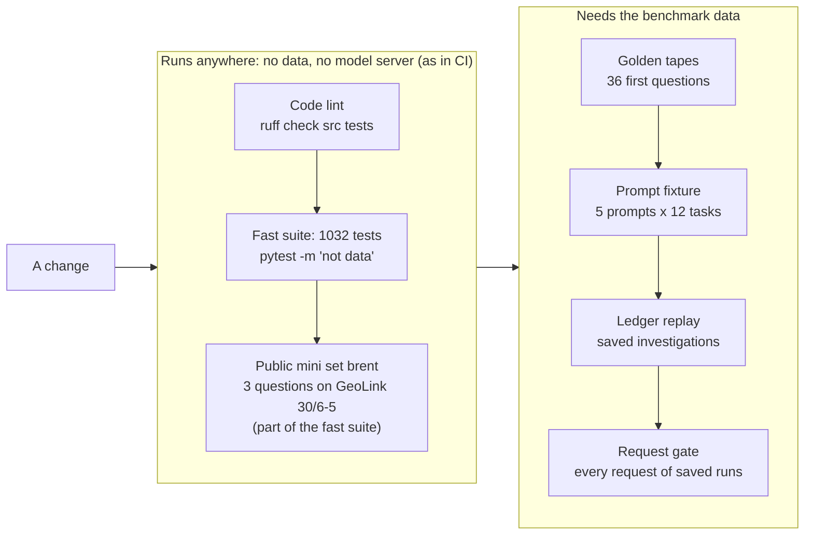
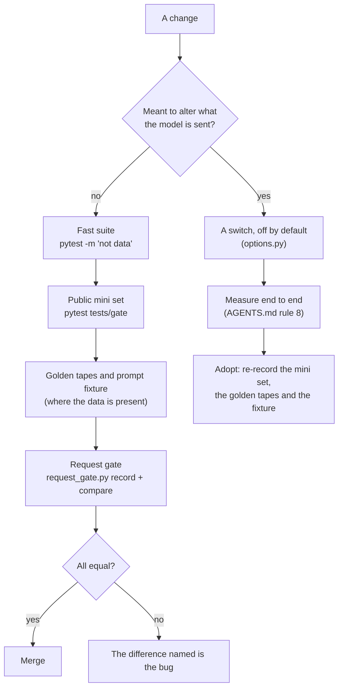
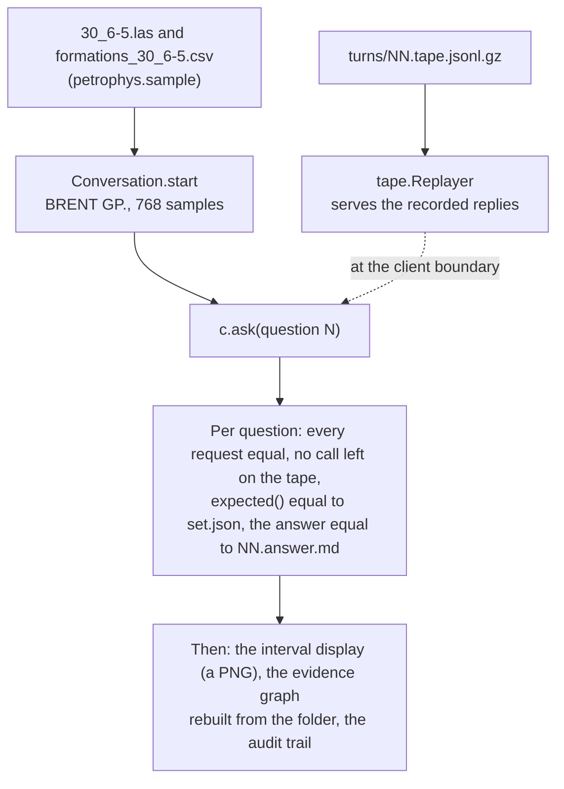

# Testing reference

The test suite of PetroHarness and its regression gates: how to run them, what each part covers, and how a change
shows that it alters nothing it should not. No test calls a model: the gates replay recorded model replies and compare
every request the code builds with the recorded one. For developers who run the tests, keep the gates green or add
tests; the rules a change must follow are in [AGENTS.md](../../AGENTS.md), the contribution workflow in
[CONTRIBUTING.md](../../CONTRIBUTING.md).

## 1. At a glance



The three commands most changes need, none of which needs data or a model server:

```bash
# the code lint
.venv/bin/ruff check src tests
# the fast suite, on each edit
.venv/bin/python -m pytest -o addopts= -q -m "not data" -n 16 -p no:cacheprovider tests
# the public mini set
.venv/bin/python -m pytest -o addopts= -q tests/gate
```

| Item | Value | Defined in |
|---|---|---|
| Runner | pytest, with `pytest-xdist` for `-n`; `ruff` for the code lint (the `dev` extra) | [pyproject.toml](../../pyproject.toml) `[project.optional-dependencies]` |
| Test paths | `testpaths = ["tests"]`; `pythonpath = ["src", "tests", "tests/agent"]`; `addopts = "-q"` | `pyproject.toml` `[tool.pytest.ini_options]` |
| Test modules | 87: 21 top-level, 50 in `tests/agent`, 6 in `tests/session`, 4 in `tests/ui`, 2 in `tests/gate`, one each in `tests/basis`, `tests/core`, `tests/evidence`, `tests/figures` | `tests/` |
| Collected with no data config | 1409 tests, 15 modules skipped at collection, in a checkout that holds the golden tapes and the prompt fixture (without them, their 48 parametrized cases are not collected) | `pytest --collect-only` |
| Collected with `-m "not data"` and no data config | 1032 tests (377 deselected), same checkout | `pytest --collect-only -m "not data"` |
| Markers | `data` (needs data files), `llm` (needs a live model endpoint; declared, used by no test) | `pyproject.toml` `markers` |
| Skip without data | A test or module that fails with `WHAT: no data settings` is reported as skipped | [tests/conftest.py](../../tests/conftest.py) |
| CI | GitHub Actions, Python 3.10, `ruff check src tests` then `pytest tests -q -p no:cacheprovider`, 45-minute limit | [.github/workflows/tests.yml](../../.github/workflows/tests.yml) |
| Gates anyone can run | The public mini set `brent` (`tests/gate`) | [tests/gate/README.md](../../tests/gate/README.md) |
| Gates that need private data | Golden tapes, prompt fixture, ledger replay, request gate | `tests/agent/`, `tests/gate/request_gate.py` |

## 2. How it works

No test calls a model: replies come from stand-in models or from recorded tapes replayed at the client boundary.
A test whose input is absent (the data config, the sample wells, the tapes) skips and names what is missing. The
gates rebuild every request of a recorded run and compare it with the recording, then the answers and traces; a
difference is either a bug or a behaviour change, which is a switch until it is measured.



<details>
<summary>The suite step by step</summary>

1. pytest collects `tests/` with `src`, `tests` and `tests/agent` on the import path (`pyproject.toml`), and
   `tests/conftest.py` puts `tests/` first on `sys.path`.
2. Tests that read wells build a `HarnessConfig`, which reads the data config named by `PETROHARNESS_DATA` or
   `configs/data.local.yaml` (`config.user_settings`). Without one it raises
   `WHAT: no data settings at <path> ...`, and the hooks `pytest_runtest_makereport` and
   `pytest_make_collect_report` in `conftest.py` turn that failure into a skip with the reason
   `no data settings file (configs/data.local.yaml or PETROHARNESS_DATA)`.
3. Other inputs are found through environment variables (`WELLLOGBENCH`, `PETROHARNESS_SAMPLE_LAS`,
   `PETROHARNESS_RUNS`) or files in the checkout (golden tapes, the prompt fixture, the mini set). Each test that
   needs one skips with a message that names it when it is absent.
4. No test calls a model. Model replies come from stand-in models (`tests/ui/ui_stub.py`, scripted models in
   `tests/agent/test_b5_loop.py`) or from recorded tapes replayed at the client boundary (`petroharness.tape`).
5. The regression gates replay recorded runs and compare every request the code builds with the recorded one
   (`tape.Replayer`), then the answers and traces (`tape.compare_run`). A difference is either a bug or a behaviour
   change that must be measured and re-recorded.
6. CI installs the locked requirements and the pinned Petrophys, runs `ruff`, then the suite with no data and no
   model server: the public mini set is the gate that runs there.

</details>

## 3. Running the suite

| Run | What it runs | Needs |
|---|---|---|
| [The fast suite](#the-fast-suite) | Every test not marked `data`, in parallel: what to run on each edit | Nothing |
| [The full suite](#the-full-suite) | Every test, with every input the tests can use | A data config, `WELLLOGBENCH`, the sample wells, saved runs |
| [As CI runs it](#the-suite-as-ci-runs-it) | Every test with nothing set: the data tests skip | Nothing |
| [The code lint](#the-code-lint-ruff) | `ruff check src tests`: what must never land | The `dev` extra |

<a id="the-fast-suite"></a>
<details>
<summary>The fast suite</summary>

Runs every test that needs no data files, in parallel; it is what to run on each edit.

| Name | Type | Default | Meaning | Defined in |
|---|---|---|---|---|
| `-o addopts=` | pytest option | `-q` from `pyproject.toml` | Clears the configured `-q` so the one given below is the only one. | `pyproject.toml` |
| `-m "not data"` | marker expression | all tests | Deselects the tests marked `data`. | `pyproject.toml` `markers` |
| `-n N` | pytest-xdist | serial | Runs on N processes. | `pytest-xdist` |
| `-p no:cacheprovider` | pytest option | cache on | Writes no `.pytest_cache`. | pytest |

```bash
.venv/bin/ruff check src tests
.venv/bin/python -m pytest -o addopts= -q -m "not data" -n 16 -p no:cacheprovider tests
```

- Modules that read the data config at import (15, listed in [section 6](#6-test-layout)) still skip without one, with
  or without `-m`.
- The public mini set (`tests/gate/test_mini.py`) carries no marker, so it runs in the fast suite.

</details>

<a id="the-full-suite"></a>
<details>
<summary>The full suite</summary>

Runs every test, with every input the tests can use.

| Name | Type | Default | Meaning | Defined in |
|---|---|---|---|---|
| `PETROHARNESS_DATA` | path | `configs/data.local.yaml` | The data config of a dataset with reference files (`eval.*`); its `data.tops_csv` must have a `form` column for the lint's formation names. | `config.DATA_FILE_ENV`, `tests/test_lint.py` |
| `WELLLOGBENCH` | folder | unset | The folder of `<dataset>.yaml` data configs for the golden tapes and the calibration and check tests. | `tests/agent/test_golden_tapes.py` |
| `PETROHARNESS_SAMPLE_LAS` | folder | none: Petrophys's own files | A folder of the sample wells the tests name, read first where it holds the file. | `tests/ui/test_ui_runs.py` and others |
| `PETROHARNESS_RUNS` | glob | unset | Saved benchmark run folders, for the saved-run tests. | `tests/test_citations.py`, `tests/agent/test_b7_writer.py` |

```bash
PETROHARNESS_DATA=/path/to/data.yaml WELLLOGBENCH=/path/to/configs PETROHARNESS_SAMPLE_LAS=/path/to/sample_las \
  .venv/bin/python -m pytest -o addopts= -q -n 16 -p no:cacheprovider tests
```

- The sample wells the tests use are `tuhua-7.las` with `formations_tuhua-7.csv`, `1046123714.las` with
  `1046123714_formation_tops.csv`, and `teapot_17-wx-21.las`, read from Petrophys's `datasets` package
  (`tests/_wells.SAMPLES`), so they run with no setup; `PETROHARNESS_SAMPLE_LAS` names a folder to read them from
  instead ([section 5](#5-environment-variables)).
- The prompt fixture comparison also needs a data config for each dataset beside the one in `PETROHARNESS_DATA`,
  named `<dataset>.yaml` ([section 7](../../tests/gate/README.md#the-prompt-fixture)).

</details>

<a id="the-suite-as-ci-runs-it"></a>
<details>
<summary>The suite as CI runs it</summary>

The workflow `tests` runs on every push to `main` or `dev` and on every pull request.

| Name | Type | Default | Meaning | Defined in |
|---|---|---|---|---|
| `runs-on` | runner | `ubuntu-latest` | The machine. | `.github/workflows/tests.yml` |
| `timeout-minutes` | integer | 45 | The job's time limit. | `tests.yml` |
| Python | version | `3.10`, pip cache on | `actions/setup-python@v5`. | `tests.yml` |
| Install | steps | | `pip install -r requirements.lock`; Petrophys from GitHub at commit `821afba53cff552a01ef9cd052b1301e2b2897a0`; `pip install -e ".[dev]" --no-deps`. | `tests.yml` |
| Lint | step | | `ruff check src tests`. | `tests.yml` |
| Tests | step | `LANGSMITH_TRACING=false` | `python -m pytest tests -q -p no:cacheprovider`, with no data config, no model server and no `WELLLOGBENCH`. | `tests.yml` |

```bash
# reproduce the CI test step locally
env -u PETROHARNESS_DATA -u WELLLOGBENCH -u PETROHARNESS_SAMPLE_LAS -u PETROHARNESS_RUNS -u PETROHARNESS_SKILLS \
    -u PETROHARNESS_SET -u PETROHARNESS_COMPONENTS LANGSMITH_TRACING=false \
    .venv/bin/python -m pytest tests -q -p no:cacheprovider
```

- With no data config, every module that reads it at import is skipped. `tests/test_lint.py` runs there, all but its
  check of well and formation names, which reads the data config ([section 8](#the-lint)).
- The golden tapes and the prompt fixture are not in the public repository, so their tests have nothing to compare
  there; the public mini set is the request-level gate that CI runs.
- CI installs Petrophys from GitHub at the pinned commit, the build the mini set was recorded with, so the mini set
  replays there. Petrophys installed by pip from a local folder records no commit, so it counts as another build
  (`files-` and a hash of its files), and the mini set skips ([The public mini set](#the-public-mini-set)).
- Remove `configs/data.local.yaml` (or move it aside) to reproduce CI exactly: the data config is read from it when
  `PETROHARNESS_DATA` is unset.

</details>

<a id="the-code-lint-ruff"></a>
<details>
<summary>The code lint (ruff)</summary>

`ruff check src tests` rejects what must never land; style is left to review.

| Name | Type | Default | Meaning | Defined in |
|---|---|---|---|---|
| `line-length` | integer | 120 | The line length ruff assumes. | `pyproject.toml` `[tool.ruff]` |
| `target-version` | string | `py310` | The Python version. | `[tool.ruff]` |
| `select` | rule codes | `E9`, `F63`, `F7`, `F82`, `F401` | Syntax errors, impossible comparisons, statement errors, undefined names, unused imports. | `[tool.ruff.lint]` |

```bash
.venv/bin/ruff check src tests
```

</details>

## 4. Markers and skips

Two markers are declared; selecting by them is the usual way to split the suite.

| Marker | Meaning | Defined in |
|---|---|---|
| `data` | Needs the data files the data config names, or the sample wells. Set per test, or for a whole module with `pytestmark = pytest.mark.data` (`tests/ui/test_ui_runs.py`, `tests/session/test_adopt.py`). | `pyproject.toml` |
| `llm` | Needs a live model endpoint. No test uses it: no test calls a model. | `pyproject.toml` |

```bash
.venv/bin/python -m pytest -o addopts= -q -m data tests/agent/test_golden_tapes.py -n 12
```

An absent input is a skip that names it. With no data config, the 15 modules that read it at import skip at
collection:

```bash
.venv/bin/python -m pytest -o addopts= -q -rs --collect-only tests 2>&1 | grep SKIPPED
```

```text
SKIPPED [1] tests/agent/test_b0_inventory.py:0: no data settings file (configs/data.local.yaml or PETROHARNESS_DATA)
SKIPPED [1] tests/agent/test_b1_map.py:0: no data settings file (configs/data.local.yaml or PETROHARNESS_DATA)
[…]
SKIPPED [1] tests/test_zones.py:0: no data settings file (configs/data.local.yaml or PETROHARNESS_DATA)
1409 tests collected in 4.36s
```

<details>
<summary>Skip messages</summary>

What each absent input does, and the reason pytest prints.

| Name | Type | Meaning | Defined in |
|---|---|---|---|
| No data config | conftest skip | `no data settings file (configs/data.local.yaml or PETROHARNESS_DATA)`, for a test or a whole module (at collection) that raised `WHAT: no data settings`. | `tests/conftest.py` |
| `WELLLOGBENCH` unset | `skipif` | `WELLLOGBENCH is not set (the folder of the datasets' data configs)`. | `test_golden_tapes.py`, `test_components.py`, `test_library_calibrate.py`, `test_library_check.py` |
| No `tests/golden/` | `skipif` or no cases | `test_components.py`: `no golden tapes in this checkout`. `test_golden_tapes.py` builds its cases from the `selection.json` files present, so with none it has no cases and pytest reports it skipped for an empty parameter set. | `test_components.py`, `test_golden_tapes.py` |
| No prompt fixture | skip or no cases | `the prompt fixture is not in this checkout`; the byte-for-byte comparison has no cases. | `tests/agent/test_skill_library.py` |
| No dataset config beside the data config | skip | `no <dataset> data config beside the one in use`. | `test_skill_library.py` |
| No sample wells | skip | `no sample wells at <folder> (PETROHARNESS_SAMPLE_LAS)` or `no sample wells (PETROHARNESS_SAMPLE_LAS)`. | the sample-well tests ([section 6](#6-test-layout)) |
| `PETROHARNESS_RUNS` unset | `skipif` | `PETROHARNESS_RUNS is not set (a glob of saved run folders)`; `no responses in the PETROHARNESS_RUNS folders` when the glob finds none. | `tests/test_citations.py`, `tests/agent/test_b7_writer.py` |
| No recorded mini set | `skipif` | `no recorded mini set in this checkout (tests/gate/record_mini.py)`. | `tests/gate/test_mini.py` |
| Another Petrophys version or build | skip (fail where `PETROHARNESS_GATE_REQUIRED` is set, as in CI) | Another version: `recorded with Petrophys <version@build>; this is <version@build>: the curves, and so the prompts, differ`. The same version, another build: `recorded with another build of Petrophys <version> (<version@build>; this is <version@build>): its curves may differ`. | `tests/gate/test_mini.py`, `record_mini.other_build` |
| No benchmark question files | skip | `the benchmark's QA pairs are not here` (`test_no_benchmark_overlap`). | `tests/test_generality.py` |
| `PETROHARNESS_SKILLS=none` | skip | `no skill library plugged (PETROHARNESS_SKILLS=none)`. | `test_read.py`, `test_skills.py`, `test_b4_direction.py` (whole module) |

</details>

## 5. Environment variables

Most data tests need one of three: `PETROHARNESS_DATA` (the data config), `WELLLOGBENCH` (the folder of the
datasets' configs) or `PETROHARNESS_SAMPLE_LAS` (the sample wells); the saved-run tests need `PETROHARNESS_RUNS`.
Leave `PETROHARNESS_SET` and `PETROHARNESS_COMPONENTS` unset for the gates.

<details>
<summary>Variables the tests read</summary>

Every environment variable a test reads or sets, and what the tests do with it.

| Name | Type | Default | Meaning | Defined in |
|---|---|---|---|---|
| `PETROHARNESS_DATA` | path | `configs/data.local.yaml` | The data config of the dataset the data tests run on. Golden and component tests set it to `$WELLLOGBENCH/<dataset>.yaml` per case; the mini set, the sample-well tests and the UI tests remove it so the settings are built from the LAS. | `config.DATA_FILE_ENV`; `monkeypatch` in many tests |
| `WELLLOGBENCH` | folder | unset | The folder of `<dataset>.yaml` data configs. | `test_golden_tapes.py`, `record_golden.py`, `test_components.py`, `test_library_calibrate.py`, `test_library_check.py` |
| `PETROHARNESS_SAMPLE_LAS` | folder | `sample_las` | The sample wells folder. | `test_ask.py`, `test_library_api.py`, `test_library_calibrate.py`, `test_library_check.py`, `test_library_classify.py`, `test_library_summarize.py`, `test_library_tools.py`, `test_writer_sources.py`, `tests/test_class_tables.py`, `tests/test_interval_units.py`, `tests/core/test_setup.py`, `tests/session/test_adopt.py`, `tests/session/test_chat_command.py`, `tests/session/test_field_notes.py`, `tests/ui/test_ui_runs.py` |
| `PETROHARNESS_RUNS` | glob | unset | Saved benchmark run folders: `responses/*.json` (citations) and `traces/*.json` (the writer replay test). | `test_citations.py`, `test_b7_writer.py` |
| `PETROHARNESS_SKILLS` | folder or `none` | the packaged library | The library the skill tests check; `none` skips the tests that need one. Some tests set or remove it. | `test_skills.py`, `test_skill_library.py`, `test_ask.py` |
| `PETROHARNESS_SET` | `name=value,...` | unset | Switches; golden tests set it to `""`. Leave it unset for the gates. | `test_golden_tapes.py`, `test_components.py`, `record_golden.py` |
| `PETROHARNESS_MODEL_URL` | URLs | unset | Read by the recorders and the live scripts (`record_mini.py`, `record_golden.py live`, `replay.py`, `b4_traps.py`, `b5_traps.py`); removed by the mini set test; set and removed by `test_ask.py`. | `models.env_urls` |
| `PETROHARNESS_COMPONENTS` | folder | the packaged components | Read by the package at import: another copy of the component texts. Leave it unset for the gates; the fixture and tapes are recorded on the packaged texts. | `agent.components.HERE` |
| `LANGSMITH_TRACING` | `true`/`false` | unset | CI sets `false`; `test_graph_flow.py` sets `true` to check that hosted tracing is refused. | `agent.graph.no_hosted_tracing` |

Assembling the sample wells folder:

```bash
export PETROHARNESS_SAMPLE_LAS=$PWD/sample_las
mkdir -p sample_las && .venv/bin/python - <<'PY'
import pathlib, petrophys
for name in ("tuhua-7", "1046123714", "teapot_17-wx-21"):
    las = pathlib.Path(petrophys.sample(name))
    for f in las.parent.glob(las.stem + "*"):
        (pathlib.Path("sample_las") / f.name).unlink(missing_ok=True)
        (pathlib.Path("sample_las") / f.name).symlink_to(f)
    tops = las.parent / f"formations_{las.stem}.csv"
    if tops.exists():
        (pathlib.Path("sample_las") / tops.name).unlink(missing_ok=True)
        (pathlib.Path("sample_las") / tops.name).symlink_to(tops)
PY
```

`petrophys.sample(name)` returns the path of each of the three sample wells. `record_mini.py` finds the mini set's
well, GeoLink `30/6-5`, and its tops file `formations_30_6-5.csv` the same way, so the mini set needs no
`PETROHARNESS_SAMPLE_LAS`.

</details>

## 6. Test layout

Helpers the tests share live in `tests/_support/`: `model.py` holds the one scripted model (`ScriptedModel` replies by
stage and keeps every call; `in_turn` replies from a list whatever the stage), `formations.py` the configured dataset's
formations, built once, and `sessions.py` a built session on a formation with net pay. A test that needs a model writes
its replies, not a model class.

| Folder | What it covers |
|---|---|
| `tests/` | Whole-harness and cross-cutting tests: the generality contract, the lint, the Petrophys integration, the interval and its inputs, labels, tool texts, the rules at shared points, the generated doc tables |
| `tests/agent` | The harness's own parts: the inventory and map, the tools, the ledger, the guides, the loop, the claims, the writer, the verbs, the components |
| `tests/session` | Conversations: follow-ups, settings changes, scope and zones changes, field notes, depth, the session graph |
| `tests/ui` | The web UI server, its progress events and its plot |
| `tests/gate` | The public mini set and the request gate's comparison |
| `tests/basis`, `core`, `evidence`, `figures` | The parts a conversation adds |
| `tests/_support` | The scripted model, the dataset's formations and the sessions built on them |

Each test module says in its docstring what it covers and what it needs (a test that reads benchmark data is marked
`data`; [section 4](#4-markers-and-skips)). `tests/_reference.py` gives tests read-only access to reference material
(`CFG = HarnessConfig()` at import, so a module that imports it needs the data config); the harness never imports it
(AGENTS.md rule 1).

<details>
<summary>Scripts and fixtures in <code>tests/agent</code></summary>

Files pytest does not collect: recorders, replays, live-model scripts and fixed data.

| Name | Type | Default | Meaning | Defined in |
|---|---|---|---|---|
| `record_golden.py` | recorder | | Records the golden tapes (`live`) or rewrites their results (`replay`). | [section 7](../../tests/gate/README.md#the-golden-tapes) |
| `prompt_fixture.py` | renderer | | Renders the prompt fixture. | [section 7](../../tests/gate/README.md#the-prompt-fixture) |
| `replay.py` | replay | | The ledger replay of saved investigations. | [section 7](../../tests/gate/README.md#the-ledger-replay) |
| `b2_reference.py` | module | | An independent reference of what each tool should return, used by the tool tests. | `tests/agent/b2_reference.py` |
| `b4_traps.py`, `b5_traps.py` | live scripts | | Trap scenarios run with a live model (`PETROHARNESS_MODEL_URL`) on real formations; their final claims are checked by rule. `python tests/agent/b4_traps.py OUT.json [--root WORKTREE] [--per 8] [--only NAME]`. | the files' docstrings |
| `b5_traces.py` | script | | Measures of the investigation loop on saved runs' traces: `python tests/agent/b5_traces.py OUT.json PREFIX [PREFIX ...]`. | `tests/agent/b5_traces.py` |
| `fixtures/prompts.json.gz` | data | not in the public repository | The prompt fixture. | `test_skill_library.py` |
| `fixtures/guide_recipes.yaml` | data | | The reviewed pairs of guide lines and the Compare calls that run their tests. | `test_recipes.py` |
| `fixtures/skill_library_mini/` | data | | A second skill library of two guides (`clay_volume`, `pore_space`) with `library.yaml` and `refs.yaml`. | `test_skill_library.py` |

```bash
PETROHARNESS_DATA=/path/to/data.yaml PETROHARNESS_MODEL_URL=http://localhost:8000/v1 \
    .venv/bin/python tests/agent/b5_traps.py out/traps.json --per 8
```

</details>

## 7. Regression gates

Each gate answers "did this change alter what it should not?" at a different reach.

| Gate | Kind | Runs | What it replays and compares | Defined in |
|---|---|---|---|---|
| [Public mini set](#the-public-mini-set) | pytest | everywhere | A three-question conversation on the Brent Group of GeoLink 30/6-5, a Petrophys sample well, replayed request for request, with answers, opened results, number links, steps, figures, the interval display and the audit trail. | `tests/gate/test_mini.py` |
| [Golden tapes](../../tests/gate/README.md#the-golden-tapes) | pytest, `data` | needs `WELLLOGBENCH` and the tapes | First questions of benchmark datasets replayed through the question graph: requests, answer, status and trace equal. | `tests/agent/test_golden_tapes.py` |
| [Prompt fixture](../../tests/gate/README.md#the-prompt-fixture) | pytest, `data` | needs the fixture and the dataset configs | Five prompts of each of 12 tasks rendered with a stub model, compared byte for byte. | `tests/agent/test_skill_library.py` |
| [Ledger replay](../../tests/gate/README.md#the-ledger-replay) | script | needs saved runs and the data config | Saved investigations rebuilt through the ledger with no model: the same opened results and claim flags. | `tests/agent/replay.py` |
| [Request gate](../../tests/gate/README.md#the-request-gate) | script | needs saved runs and the data config | Every request of every saved run of a reference build rebuilt and hashed; two builds compared. | `tests/gate/request_gate.py` |

```bash
# anyone
.venv/bin/python -m pytest -o addopts= -q tests/gate
# with the data
WELLLOGBENCH=/path/to/configs .venv/bin/python -m pytest -o addopts= -q -m data -n 12 \
    tests/agent/test_golden_tapes.py
```

Re-record by replay when the change is to what is done with the model's replies and every request is unchanged.
Re-record live when the requests change on purpose, after the change is measured
([EXTENDING.md](EXTENDING.md#13-keep-the-gates-green)).

### The public mini set

The set `brent`: a conversation on the Brent Group (2841–2958 m, 768 samples) of GeoLink well 30/6-5, which ships
with Petrophys with its tops file. It was recorded live once and is replayed with no model server and no private data
(`tests/gate/record_mini.py`, `tests/gate/test_mini.py`). The well has a lithology log to zone by and core to compare
with. The three questions, the second and third follow-ups in the same conversation:

1. What are the porosity and water saturation of the Brent Group, and is any of it hydrocarbon-bearing?
2. Which zone has the best reservoir quality, and how does the log permeability compare with the core?
3. What water resistivity did the saturation use?

They take both routes a question can take:

| Question | Route | Status | Steps | Model calls | Figures chosen |
|---|---|---|---|---|---|
| 1 | investigation | ok | 8 | 14 | histogram of E1, log viewer of E5, histogram of E6 |
| 2 | investigation | ok | 8 | 13 | log viewer of E18, histogram of E13, Buckles plot of the interval |
| 3 | direct (a short answer) | ok | 1 | 4 | histogram of E21, log viewer of E21 |

The model calls are the recorded ones on each tape; the last is the call that chooses the figures. Every request the
code builds must equal the recorded one byte for byte, and everything else a user gets must come out the same:



An answer the replay must reproduce word for word (question 3, `turns/03.answer.md`):

> The saturation used RW = 0.0719 ohm.m on average across the Brent Group’s zoned samples (0.07099–0.07295 ohm.m
> range, n=567), model output of the `rw` step (`las_metadata_temperature_profile_corrected`), feeding the
> `archie+simandoux` saturation model. […]

The set is recorded with Petrophys `3.0.0@7aa9968e72e7c09a28e68af383471184af9f5f52`, installed from GitHub at that
commit, as CI installs it. Running it and re-recording it by replay:

```bash
# the test: a replay, no server, no data
.venv/bin/python -m pytest -o addopts= -q tests/gate
# record live
PETROHARNESS_MODEL_URL=http://localhost:8000/v1 .venv/bin/python tests/gate/record_mini.py
# rewrite the expectations from the tapes
.venv/bin/python tests/gate/record_mini.py --replay
```

```text
brent question 1: ok, answer unchanged
brent question 2: ok, answer unchanged
brent question 3: ok, answer unchanged
brent: expectations rewritten from the tapes in <checkout>/tests/gate/mini/brent
```

With Petrophys installed any other way, the replay test skips and says why; the other four gate tests still run:

```text
..s..                                                                    [100%]
SKIPPED [1] tests/gate/test_mini.py:92: recorded with another build of Petrophys 3.0.0 (3.0.0@7aa9968e72e7c09a28e68af383471184af9f5f52; this is 3.0.0@files-c5de047fe601): its curves may differ
4 passed, 1 skipped in 1.57s
```

<details>
<summary>What a recorded set holds and how it is recorded</summary>

| Name | Type | Default | Meaning | Defined in |
|---|---|---|---|---|
| `SETS` | dict | one set, `brent` | Name to `{"sample": "30/6-5", "tops": "formations_30_6-5.csv", "formation": "BRENT GP.", "questions": [3 questions]}`. | `record_mini.SETS` |
| `set.json` | JSON | | `name`, `sample`, `tops`, `formation`, `questions`, `interval`, `petrophys` (the build), `setup` (`hash` and the setup record), `turns`. | `record_mini.record` |
| `turns["NN"]` | object | | What question NN must reproduce: `status`, `answer_sha256`, `opened`, `cited`, `shows`, `basis`, `reply`, `figures` (`[kind, source]` pairs). | `record_mini.expected` |
| `turns/NN.tape.jsonl.gz` | gzip JSON lines | | Every model request and reply of question NN. | `tape.record` |
| `turns/NN.answer.md` | Markdown | | The answer. | `record_mini.record` |
| `record_mini.py [NAME ...]` | live recorder | every set | Starts the conversation with `Conversation.start` and asks the questions with the default model card at `PETROHARNESS_MODEL_URL`, recording into `mini/.<name>.recording` and printing `<name> question N: <status>, <steps> steps` per question. The set's folder is replaced only when every question was answered; at a question that fails it stops and the earlier recording stays as it was. | `record_mini.record` |
| `record_mini.py --replay [NAME ...]` | replay recorder | every set | Keeps the tapes and rewrites the answers and `set.json` as this code gives them from the tapes. Writes nothing if a request is not on the tape, the replay makes fewer calls, or the figures call mismatches. | `record_mini.replay` |

In the set `brent`, `interval` is `{"name": "BRENT GP.", "top": 2841.0, "base": 2958.0, "unit": "m", "samples": 768,
"from": "tops file formations_30_6-5.csv, base: stated base"}`.

</details>

<details>
<summary>What the test asserts, and when it skips</summary>

- The test removes `PETROHARNESS_DATA`, `PETROHARNESS_SKILLS` and `PETROHARNESS_MODEL_URL`, so it runs as a user with
  no settings. `PETROHARNESS_SET` and `PETROHARNESS_COMPONENTS` are not removed: leave them unset.
- It asserts that the interval equals the recorded `interval`, then, per question: no trace error (a request that
  differs raises `TapeMismatch` and is reported here), no `TapeMismatch` in the figures errors, no calls left on the
  tape, `expected()` equal to `set.json`, and the answer equal to `NN.answer.md`. Then the interval display is a PNG,
  the evidence graph rebuilds from the session folder (with the LAS's SHA-256 and every question), the first answer's
  trail has results, steps and an input curve, and the audit trail holds `## Steps Petrophys ran`.
- The whole Petrophys build (`version@build`) is compared for the skip (`record_mini.other_build`): another version,
  or another build of the same version, skips with its reason, since another build may compute other curves.
- Record from a clean checkout of the commit the tapes are for. A live recording that stops at a failed question
  exits `<name>: question N failed (<error>); the earlier recording is kept`, and removes its own
  `.<name>.recording` folder.

</details>

The golden tapes, the prompt fixture, the ledger replay and the request gate need the benchmark's data, which is not
in the public repository; maintainers run them, as [tests/gate/README.md](../../tests/gate/README.md#gates-that-need-the-benchmarks-data)
describes.

## 8. Static guards

Three tests read the code rather than run it:

| Guard | Keeps out | Needs | Defined in |
|---|---|---|---|
| [The lint](#the-lint) | Well, formation and dataset names and depth literals in code, rules and prompts (AGENTS.md rule 2) | A data config for one of its five checks | `tests/test_lint.py` |
| [The generality tests](#the-generality-tests) | Breaches of the generality contract G1 to G8 | Data for 2 tests | `tests/test_generality.py` |
| [The Petrophys integration test](#the-petrophys-integration-test) | A tool that computes petrophysics without Petrophys (AGENTS.md rule 4) | Nothing | `tests/test_petrophys_integration.py` |

```bash
.venv/bin/python -m pytest -o addopts= -q tests/test_lint.py tests/test_generality.py tests/test_petrophys_integration.py
```

<a id="the-lint"></a>
<details>
<summary>The lint</summary>

`tests/test_lint.py` keeps dataset facts out of the package (AGENTS.md rule 2): no well, formation or dataset names
and no depth literals in code, rules or prompts.

| Name | Type | Meaning | Defined in |
|---|---|---|---|
| `GUARDED` | file set | `resources/rules`, `resources/policy`, `resources/profiles`, `resources/models`, `configs/`, every `src/petroharness/**/*.py`, and the model-facing texts (`MODEL_TEXTS`). | `test_lint.GUARDED` |
| `MODEL_TEXTS` | file set | The components' `.md`, `.json` and `.yaml` files, every packaged guide's `SKILL.md`, and `resources/topics.yaml`. | `test_lint.MODEL_TEXTS` |
| `LLM_FACING` | file set | The resource files and `MODEL_TEXTS`. | `test_lint.LLM_FACING` |
| `DATASET_FREE` | file set | The resource files and every `src/petroharness/**/*.py`, except `configs/data.local.yaml`. | `test_lint.DATASET_FREE` |
| `test_no_well_or_formation_names` | test | No well name (each LAS stem in `data.las_dir`, upper case, also with `_` as `/`) and no formation stem (the tops CSV's `form` column, the text before ` FM.`, ` GP.` or ` MB.`, at least 4 characters) in a `GUARDED` file. | `test_lint` |
| `test_no_depth_literals` | test | No decimal depth (`DECIMAL_DEPTH`, such as `2456.5 ft` or `2456.5-2470.0`) in a `GUARDED` file, and no integer or thousands-separated depth with a length unit (`INTEGER_OR_FEET_DEPTH`, such as `2500 m`, `8,200 ft`) in an `LLM_FACING` file. | `test_lint` |
| `test_no_dataset_identifiers_in_code_rules_or_prompts` | test | No match of `DATASET_IDENTIFIERS` (a benchmark dataset's name, a national well and stratigraphy registry's names, its well-name and top-rank regex forms, a lithology workbook's names) in a `DATASET_FREE` file, except the `(file, line)` pairs in `ALLOWED` (one, with its reason) and `PENDING` (empty). An entry that no longer matches a line fails. | `test_lint` |
| `test_lint_patterns_catch_what_they_are_for` | test | The patterns themselves, on positive and negative examples. | `test_lint` |
| `test_guarded_files_exist` | test | At least 4 files in `GUARDED` and in `DATASET_FREE`. | `test_lint` |

```bash
PETROHARNESS_DATA=/path/to/data.yaml .venv/bin/python -m pytest -o addopts= -q tests/test_lint.py
```

- Only `test_no_well_or_formation_names` reads the data config (it imports `tests/_reference.py` inside the test);
  without one it is skipped and the other four checks run, as in CI. Run it with a data config before a pull request.
- Tests may name anything; only the package, its resources and `configs/` are guarded.

</details>

<a id="the-generality-tests"></a>
<details>
<summary>The generality tests</summary>

`tests/test_generality.py` holds the guards of the generality contract ([DESIGN.md](../DESIGN.md#the-generality-contract-g1-g8));
two rules are guarded by other files.

| Rule | Tests | Meaning | Defined in |
|---|---|---|---|
| G1 | `test_no_benchmark_inputs` | No `category` parameter in `graph.answer`, `Session.build` or `cli.answer`; no `category` field in `Run` or `Session`; no `.category` or `category=` token in the agent's code. | `tests/test_generality.py` |
| G2 | other files | Every guide line has its provenance row (`tests/agent/test_skills.py`); every fixed text belongs to one component and every call is attributed (`tests/agent/test_components.py`). | [DESIGN.md](../DESIGN.md#g2-every-line-the-model-reads-has-a-stated-provenance) |
| G3 | `test_no_prescriptions`, `test_the_prescription_patterns_catch_the_conclusion_forms` | None of the conclusion forms of `PRESCRIPTIONS` (5 patterns) in any model-facing text (`_model_facing`: components, topic areas, every packaged guide); the patterns checked on examples. `PRESCRIPTION_ALLOWED` and `PRESCRIPTION_PENDING` are empty; a stale entry fails. | `tests/test_generality.py` |
| G4 | `test_no_question_patterns`, `test_the_zone_table_follows_no_question_wording` (`data`), `test_no_question_form_or_scope_rules` | Outside `agent/vocabulary.py`, no `re.search`, `match`, `fullmatch` or `findall` over the question text in the agent's code (an AST scan, itself probed); the writer's zone table is the same whatever statistic the question names; no question-form rules, asked-absent stand-ins or point scopes exist. | `tests/test_generality.py` |
| G5 | `test_no_benchmark_words`, `test_no_benchmark_overlap` | No `benchmark`, `judge`, `reference answer`, `references` or `GT` in model-facing text; no 6-gram of a model-facing text in a benchmark question or reference answer (curve-list 6-grams exempt; `OVERLAP_ALLOWED` lists textbook phrases with reasons). The overlap test skips without the question files. | `tests/test_generality.py` |
| G6 | `test_no_preference_phrases`, `test_the_one_guideline_reaches_the_settle_step` | None of the `NO_PREFERENCE` phrases (a basis or convention chosen for the model) in model-facing text, the report style or the strings of `agent/`, `record/` and `well/` code; one guideline for bases (`C9` `aspects_rule`) shared by the settle step; the report style holds only `format`. | `tests/test_generality.py` |
| G7 | other files | `tests/test_zones.py`, `tests/test_formation_zone_layout.py`, `tests/agent/test_section_zones.py`, and the per-zone tests of `tests/agent/test_summary.py`. | [DESIGN.md](../DESIGN.md#g7-the-zones-in-force-are-the-unit-of-analysis) |
| G8 | `test_the_checks_are_the_approved_fact_checks`, `test_no_overrides` (`data`), `test_no_question_form_or_scope_rules` | The claim flags (`FACT_FLAGS`) and repair texts (`REPAIRS`) are the approved fact checks (`APPROVED_FACT_CHECKS`); claims and an answer a verdict-pushing check would change reach the settle step and the answer unchanged, unflagged and unrepaired. | `tests/test_generality.py` |

```bash
.venv/bin/python -m pytest -o addopts= -q tests/test_generality.py -m "not data"
```

A claim flag needs its check id in `APPROVED_FACT_CHECKS` first; another repair text changes `REPAIRS`.

</details>

<a id="the-petrophys-integration-test"></a>
<details>
<summary>The Petrophys integration test</summary>

`tests/test_petrophys_integration.py` checks AGENTS.md rule 4 statically: every catalog computation and every tool of
the toolset reaches Petrophys (a verb runs Petrophys's registered functions) or is a listed generic data operation or
record reader.

| Name | Type | Default | Meaning | Defined in |
|---|---|---|---|---|
| `MODULES` | dict | 12 modules | `record/catalog.py`, `record/sections.py`, `record/card.py`, `well/view.py`, `well/stats.py`, `well/formation.py`, `well/prepare.py`, `record/store.py`, `well/summary.py`, `agent/tools.py`, `agent/compute.py`, `agent/engine/`: the call graph is built over them from their ASTs. | `test_petrophys_integration.MODULES` |
| `ANALYZER_ENTRIES` | set | `zone_results`, `zone_classes_raw` | Reaching either runs a Petrophys analyzer; so does a function that names `_ANALYZERS`. | `test_petrophys_integration.ANALYZER_ENTRIES` |
| `GENERIC` | dict | 6 entries | Generic data operations with their reason: `adjacent_jumps`, `zone_contrast`, `threshold_exceedance`, `spike_flags`, `values_at`, `lag_correlation`. | `test_petrophys_integration.GENERIC` |
| `RECORD_READERS` | dict | `step`, `section` | Tools that render the workflow's step record. | `test_petrophys_integration.RECORD_READERS` |
| `test_every_tool_reaches_petrophys_or_is_a_listed_data_operation` | test | | Every name in `record.catalog.CATALOG` and every non-verb tool of `agent.toolset.TOOLSET` reaches a `petrophys` import or an analyzer, or is in `GENERIC` or `RECORD_READERS`; an entry naming no tool fails as stale. | `tests/test_petrophys_integration.py` |
| `test_the_graph_sees_library_calls` | test | | The checker itself: ten tools known to call Petrophys are found to, and `formation.segment_zones` is not. | `tests/test_petrophys_integration.py` |

```bash
.venv/bin/python -m pytest -o addopts= -q tests/test_petrophys_integration.py
```

The failure message is the fix: `WHY: petrophys computes, the harness orchestrates. FIX: put the computation in
petrophys and call it, or list the tool in GENERIC with why it is a generic data operation.`

</details>

## 9. Component versions and the golden tests

Every fixed text the model reads belongs to a component C1 to C10 (`src/petroharness/agent/components/`), and each
component's version, a hash of its files, is stamped into every trace and the setup record. The versions the public
mini set was recorded with (`tests/gate/mini/brent/set.json`, `setup.components`):

```json
{"C1": "6f8f4c39893a", "C2": "1bd4a923bb18", "C3": "a35c7f5f0be5", "C4": "57cd02cee605", "C5": "b40542f539d8",
 "C6": "5fc0e8cf8998", "C7": "f5c6434e1229", "C8": "beafa87e2cf0", "C9": "5c430eea66e9", "C10": "20c9aaaad36a"}
```

A stamp is not behaviour: a comment edited in a frame file changes the version and the setup hash, while every gate
still passes; the golden tapes pass with a warning until they are re-recorded by replay.

<details>
<summary>Version stamps in traces</summary>

| Name | Type | Meaning | Defined in |
|---|---|---|---|
| `component.yaml` | file | `texts` (entry to file) and `frames` (globs of package files whose output the component frames). | `components.meta` |
| `version(cid)` | 12 hex digits | SHA-1 over the component's `component.yaml`, its text files and its frame files, each path then its bytes, sorted by path. | `components.version` |
| Frames | file globs | C2: `agent/claims.py`, `agent/checks.py`. C3: `agent/ledger.py`, `agent/claims.py`, `session/earlier.py`. C4: `agent/schemas.py`, `agent/toolset.py`, `tools/spec.py`, `agent/engine/`. C5: `agent/graph.py`, `agent/state.py`, `agent/prompts.py`, `agent/read.py`, `agent/replies.py`, `agent/settle.py`. C6: `resources/topics.yaml`, `agent/direction.py`. C7: `agent/tools.py`, `agent/compute.py`, `agent/map.py`, `agent/inventory.py`, `agent/notes.py`, `record/routes.py`. C8: `agent/graph.py`. C9: `agent/writer.py`, `resources/rules/shapes.yaml`, `resources/profiles/*.yaml`. C10: `agent/vocabulary.py`. C1: none. | `agent/components/C*/component.yaml` |
| `trace["components"]` | object | Component id to version, for the run. | `components.versions` |
| `trace["calls"][].messages[].segments` | list | `[component, version, start, end]` spans covering every character of every message. | `components.attribute`, `record_call` |
| `setup.components` | object | The same versions in the setup record, whose hash changes with them ([EVIDENCE.md](../EVIDENCE.md#the-setup-record)). | `core.setup` |

</details>

<details>
<summary>What a pure-comment change in a frame file does</summary>

A comment edited in a frame file (for example `agent/state.py`, a C5 frame) changes no request, but it changes the
bytes the version hashes.

| Name | Type | Default | Meaning | Defined in |
|---|---|---|---|---|
| Component version | stamp | changes | The version of every component that frames the file changes (C5 here; `agent/graph.py` changes C5 and C8). | `components.version` |
| Golden tapes | verdict | pass, with a warning | `compare_run(..., versions=False)` strips the stamps (`tape.unstamped`) and decides; the second comparison with stamps differs, so the test warns `<task>: same behaviour, version stamps differ from the recording (...)`. | `test_golden_tapes.py`, `tape.unstamped` |
| Public mini set | verdict | pass | `expected()` holds no version; the requests are unchanged. `set.json`'s `setup` keeps the old versions until `record_mini.py --replay` rewrites it. | `record_mini.expected` |
| Prompt fixture, request gate | verdict | pass | They compare prompt text and request hashes, which a comment does not change. | `test_skill_library.py`, `request_gate.py` |
| Component tests | verdict | pass | `test_every_call_of_a_golden_replay_is_attributed_whole` compares the replay's `components` with `C.versions()` computed at test time. | `tests/agent/test_components.py` |
| Setup hash | value | changes | `petroharness setup` prints another hash. | `core.setup` |

```bash
# after a comment-only edit: behaviour equal, stamps re-recorded from the same tapes
WELLLOGBENCH=/path/to/configs .venv/bin/python -m pytest -o addopts= -q -m data -n 12 tests/agent/test_golden_tapes.py
WELLLOGBENCH=/path/to/configs PYTHONPATH=src:tests/agent .venv/bin/python tests/agent/record_golden.py replay
.venv/bin/python tests/gate/record_mini.py --replay
```

- Re-recording by replay after such an edit is what clears the warning; the tapes are not touched.
- `PETROHARNESS_COMPONENTS=<folder>` runs the harness on another copy of the component texts; with a golden tape
  replayed in collect mode (`tape.replay(llm, tape, collect=True)`), `Replayer.diffs` lists the calls an edit reaches
  ([components README](../../src/petroharness/agent/components/README.md)).

</details>

## 10. Limits and errors

The three met most often: no data config (tests and 15 modules skip), a request that differs from a tape
(`TapeMismatch`, the test fails there), and another Petrophys build (the mini set skips, naming both builds).

<details>
<summary>Every limit and error, what happens and where</summary>

| Situation | What happens | Where |
|---|---|---|
| No data config | Tests and 15 modules skip with `no data settings file (...)` | `tests/conftest.py` |
| No data config in CI | `tests/test_lint.py` skips only its well and formation names check | `tests/_reference.py`, `tests/test_lint.py` |
| A request differs from a tape | `TapeMismatch: call N: <path>: differs at character K: ...` in the trace's error; the test fails there | `tape.Replayer` |
| The replay makes fewer calls than the tape | `the replay made fewer model calls than the recording` (mini set), `N recorded calls never made` (golden) | `test_mini.py`, `tape.compare_run` |
| Same behaviour, other version stamps | Golden test passes with a warning | `test_golden_tapes.py` |
| A switch the recording does not know, on in a replay | Golden comparison fails: `trace.options: new switches on: [...]` | `tape.compare_run` |
| Petrophys version differs from the mini set's | The mini set skips, naming both builds (in CI, with `PETROHARNESS_GATE_REQUIRED`, it fails) | `test_mini.py`, `record_mini.other_build` |
| Same Petrophys version, different build | The mini set skips: `recorded with another build of Petrophys <version> (...): its curves may differ` | `test_mini.py`, `record_mini.other_build` |
| `record_mini.py --replay` meets a request not on the tape | Exits `<name> question N: the code no longer builds the recorded requests (...); nothing written. Record it again live.` | `record_mini.replay` |
| A live mini-set recording fails mid-way | Exits `<name>: question N failed (...); the earlier recording is kept`; the set's folder is unchanged | `record_mini.record` |
| `record_golden.py` without `WELLLOGBENCH` | Exits `set WELLLOGBENCH to the folder of the datasets' data configs (<dataset>.yaml)` | `record_golden.main` |
| `request_gate.py compare` with an odd number of files | argparse error `compare takes pairs of files: BASE.jsonl NEW.jsonl ...` | `request_gate.main` |
| Request gate replays in threads | Not fully deterministic; use `--workers 1` | `request_gate.py` |
| `PETROHARNESS_SKILLS=none` | Library tests skip; the prompt fixture comparison removes the variable itself | `test_skills.py`, `test_skill_library.py` |
| `LANGSMITH_TRACING=true` in the shell | Importing the question graph raises; tests that run a question fail | `agent.graph.no_hosted_tracing` |

</details>

## 11. Related pages

- [tests/gate/README.md](../../tests/gate/README.md): the gates in short, and when a gate fails.
- [DEVELOPMENT.md](../DEVELOPMENT.md#testing): the testing guide and the reference runs.
- [CONTRIBUTING.md](../../CONTRIBUTING.md): showing that a change is safe.
- [AGENTS.md](../../AGENTS.md): the rules for changing the code, with their reasons.
- [DESIGN.md](../DESIGN.md): the generality contract G1 to G8.
- [EXTENDING.md](EXTENDING.md): recipes for extending the harness, with the tests each needs.
- [WEB_UI_API.md](WEB_UI_API.md): the server the `tests/ui` tests exercise.
- [EVIDENCE.md](../EVIDENCE.md#the-setup-record): the setup record and its hash.
- [GRAPH.md](../GRAPH.md#reproducing-a-run-tapes): tapes in the question graph.
