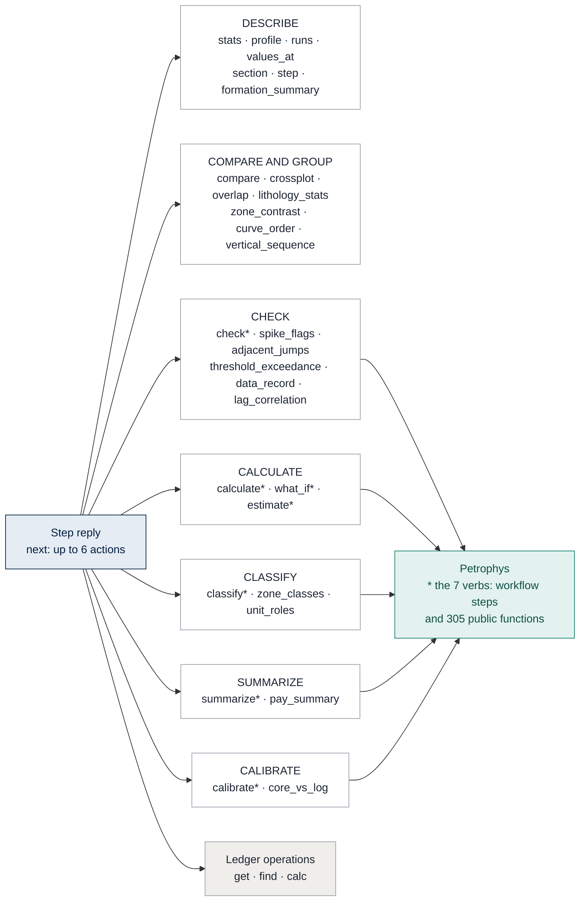
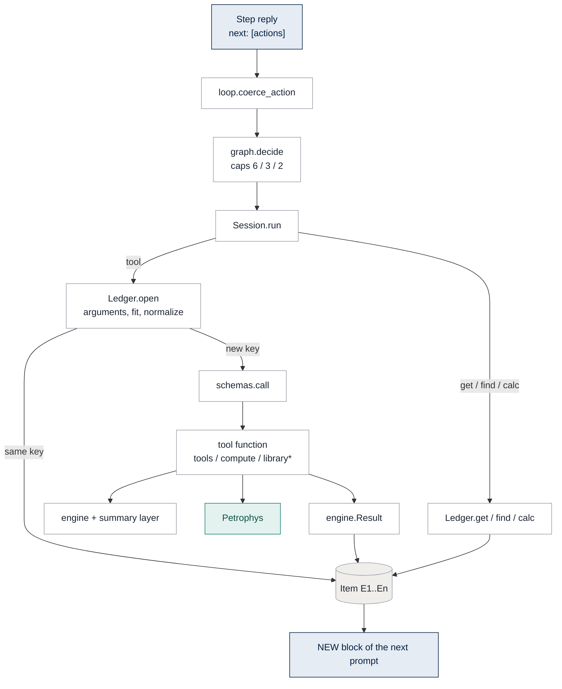

# Tools reference

Every tool the language model can call while it investigates a formation: the 30 tools of
`src/petroharness/agent/toolset.py`, the ledger operations `get`, `find` and `calc`, and the code that reads, checks
and runs a call. Every example that shows well data is a real call on the Brent Group (2841–2958 m) of GeoLink well
30/6-5, the interval of [Evaluate a formation](../USAGE.md). Where a tool reads differently on another well, its
block adds that well's real output: COSTA HW-3, a carbonate logged in feet with no lithology log, caliper, PEF or
shallow resistivity (Data: Costa Gomes, Geiger and Arnold (2022), COSTA model, Heriot-Watt University, CC BY.), and
GeoLink 16/7-1, a halite section with no neutron or PEF log (Data: GeoLink, CC BY-SA 4.0.). The guide-level overview
is [Tools](../TOOLS.md); how the tools reach Petrophys is in [Petrophys integration](PETROPHYS_INTEGRATION.md).

## 1. At a glance



| Fact | Value | Where |
|---|---|---|
| Tools the model is shown | 30, in 7 groups | `src/petroharness/agent/toolset.py`, `TOOLSET` |
| Verbs over Petrophys | 7: `check`, `calculate`, `what_if`, `estimate`, `classify`, `summarize`, `calibrate` | `Tool.verb` is `True` |
| Petrophys functions reachable by `search` and `run` | 305 | `src/petroharness/agent/library_api.py`, `registry()` |
| Ledger operations | `get`, `find`, `calc` (and `guide` when a skill library is plugged) | `src/petroharness/agent/loop.py`, `coerce_action` |
| Actions per investigation step | 6 tool, `get` and `find` actions (`ACTIONS`); up to 3 `calc` (`MAX_CALCS`) and 2 `guide` (`MAX_GUIDES`) beside them | `src/petroharness/agent/loop.py`, `graph.decide` |
| Actions per look step of a direct question | 4 of any kind (`DIRECT_ACTIONS`) | `src/petroharness/agent/loop.py`, `graph.look` |
| Result text cap | 9,000 characters (`WIDE_CHARS`); every line stays in the ledger | `src/petroharness/agent/engine.py` |
| NEW and OPENED budgets per step prompt | 12,000 (`NEW_CHARS`) and 6,000 (`OPENED_CHARS`) characters | `src/petroharness/agent/loop.py` |

## 2. How it works

The model writes actions; code reads them, caps them, runs each call once and keeps every result whole as a numbered
item (`E1`, `E2`, ...). An identical call returns the item it opened before.



<details>
<summary>The call path, step by step</summary>

1. `loop.tools_text` writes the brief's tool block from `schemas.named()` (`Toolset.schemas`), one line per tool under
   the headings of `Toolset.by_group`; `loop.brief` puts it in place of `{TOOLS}` in the C1 system text.
2. The model writes its actions in the `next` list of a step reply; `loop.coerce_action` reads each one
   ([coerce_action](#coerce_action)).
3. `graph.decide` keeps at most 2 guides, 3 calcs and 6 other actions; what it cuts or cannot read is said back in
   the next prompt (C8 `actions_left_out`, `extra_left_out`, `not_run`).
4. `graph.act` runs each action through `Session.run`; a tool goes to `Ledger.open`, which reads, fits and keys the
   call and runs it once through `schemas.call` ([section 5](#5-how-a-call-is-read-and-run)).
5. The function reads the interval through `engine` and the summary layer, or has Petrophys compute, and returns an
   `engine.Result`; the ledger keeps it as item `E<n>` and shows it in NEW, or withholds it to the next step
   ([section 8](#8-results-the-ledger-and-the-prompt)).
6. A `ToolError` is the model's to read: `<tool> not run: <message>`, kept in `Ledger.errors`.

</details>

## 3. The master table

Generated from the definitions (`TOOLSET`: each tool's `verb`, `table`, `main`, `lead` and `run`). "Bare value fills" is `Tool.main`, the argument a call such as
`{"runs": "NET_PAY"}` fills; "Listing leads with" is `Tool.lead`, the argument a one-line listing starts with. For the
verbs also take `search`, `run`, `args` and `label` ([Search and run](#search-and-run)). Each tool's name opens
its block below, with every argument, its type and default.

| # | Tool | Kind | Bare value fills | Listing leads with | Runs |
|---|---|---|---|---|---|
| 1 | [`stats`](#stats) | lookup | `curves` | `curves` | `tools.stats` |
| 2 | [`profile`](#profile) | lookup | `curve` | `curve` | `tools.profile` |
| 3 | [`runs`](#runs) | lookup | `condition` | `condition` | `tools.runs` |
| 4 | [`values_at`](#values_at) | lookup | `curves` | `curves` | `tools.values_at` |
| 5 | [`section`](#section) | lookup | `key` | `key` | `tools.section` |
| 6 | [`step`](#step) | lookup | `name` | `name` | `tools.step` |
| 7 | [`formation_summary`](#formation_summary) | computed table | `curves` | `curves` | `compute.formation_summary` |
| 8 | [`compare`](#compare) | lookup | `a` | `a` | `tools.compare` |
| 9 | [`crossplot`](#crossplot) | lookup | `y` | `y` | `tools.crossplot` |
| 10 | [`overlap`](#overlap) | lookup | `a` | - | `tools.overlap` |
| 11 | [`lithology_stats`](#lithology_stats) | computed table | `curves` | `curves` | `compute.lithology_stats` |
| 12 | [`zone_contrast`](#zone_contrast) | computed table | `curve` | `curve` | `compute.zone_contrast` |
| 13 | [`curve_order`](#curve_order) | computed table | `curves` | `curves` | `compute.curve_order` |
| 14 | [`vertical_sequence`](#vertical_sequence) | computed table | `curves` | `curves` | `compute.vertical_sequence` |
| 15 | [`check`](#check) | verb over Petrophys | `what` | - | `library_api.verb_tool` over `library_check.check` |
| 16 | [`spike_flags`](#spike_flags) | computed table | `curves` | `curves` | `compute.spike_flags` |
| 17 | [`adjacent_jumps`](#adjacent_jumps) | computed table | `curve` | `curve` | `compute.adjacent_jumps` |
| 18 | [`threshold_exceedance`](#threshold_exceedance) | computed table | `curve` | `curve` | `compute.threshold_exceedance` |
| 19 | [`data_record`](#data_record) | computed table | `zones` | - | `compute.data_record` |
| 20 | [`lag_correlation`](#lag_correlation) | computed table | `curves` | `curves` | `compute.lag_correlation` |
| 21 | [`calculate`](#calculate) | verb over Petrophys | `property` | - | `library_api.verb_tool` over `library.calculate` |
| 22 | [`what_if`](#what_if) | verb over Petrophys | `property` | - | `library_api.verb_tool` over `library.what_if` |
| 23 | [`estimate`](#estimate) | verb over Petrophys | `parameter` | - | `library_api.verb_tool` over `library.estimate` |
| 24 | [`classify`](#classify) | verb over Petrophys | `what` | - | `library_api.verb_tool` over `library_classify.classify` |
| 25 | [`zone_classes`](#zone_classes) | computed table | `topic` | `topic` | `compute.zone_classes` |
| 26 | [`unit_roles`](#unit_roles) | computed table | `zones` | - | `compute.unit_roles` |
| 27 | [`summarize`](#summarize) | verb over Petrophys | `what` | - | `library_api.verb_tool` over `library_summarize.summarize` |
| 28 | [`pay_summary`](#pay_summary) | computed table | `curves` | - | `compute.pay_summary` |
| 29 | [`calibrate`](#calibrate) | verb over Petrophys | `what` | - | `library_api.verb_tool` over `library_calibrate.calibrate` |
| 30 | [`core_vs_log`](#core_vs_log) | computed table | `zones` | - | `compute.core_vs_log` |

<details>
<summary>The groups, as the brief heads them</summary>

In the order the brief lists them (`Toolset.by_group`):

| Constant | Heading in the brief |
|---|---|
| `DESCRIBE` | `DESCRIBE: what the record holds` |
| `COMPARE` | `COMPARE AND GROUP` |
| `CHECK` | `CHECK: data quality` |
| `CALCULATE` | `CALCULATE: recompute with Petrophys` |
| `CLASSIFY` | `CLASSIFY` |
| `SUMMARIZE` | `SUMMARIZE` |
| `CALIBRATE` | `CALIBRATE: against core, elastic properties` |

</details>

## 4. The tool definition

A tool is one frozen dataclass, `Tool` (`src/petroharness/tools/spec.py`, which imports nothing of the harness),
defined in `src/petroharness/agent/toolset.py` and added to the ordered `Toolset`, which checks it at import and from
which every list of tools is read (the brief, the reply parser, the web UI).

<details>
<summary>Tool</summary>

| Name | Type | Default | Meaning | Defined in |
|---|---|---|---|---|
| `name` | `str` | required | The name the model writes as a JSON key, `{"stats": {...}}` | `tools/spec.py`, `Tool` |
| `run` | `Callable` | required | `run(formation, **arguments) -> Result` | `tools/spec.py`, `Tool` |
| `group` | `str` | required | The brief heading it is listed under; one of the toolset's groups | `tools/spec.py`, `Tool` |
| `description` | `str` or `Callable[[], str]` | required | The text the model reads; a function where it is built when asked (a verb's method list) | `tools/spec.py`, `Tool` |
| `arguments` | `dict` or `Callable[[], dict]` | `{}` | Argument name to JSON schema, in the order the brief lists them | `tools/spec.py`, `Tool` |
| `required` | `tuple` | `()` | The arguments a call must give | `tools/spec.py`, `Tool` |
| `main` | `str` | `"curves"` | The argument a bare value fills; one of `arguments` when the tool defines any (`Toolset.add`) | `tools/spec.py`, `Tool` |
| `lead` | `str` | `""` | The argument a one-line listing of a call leads with; `""` for none | `tools/spec.py`, `Tool` |
| `table` | `bool` | `False` | The result is a computed table (title, rows, facts) and its digest reads it in order | `tools/spec.py`, `Tool` |
| `verb` | `bool` | `False` | A verb over Petrophys: it also takes `search`, `run`, `args` and `label` | `tools/spec.py`, `Tool` |

| Method | Returns |
|---|---|
| `Tool.text()` | The description, calling it when it is a function |
| `Tool.properties()` | A deep copy of the arguments, calling them when they are a function |
| `Tool.schema()` | `{"type": "function", "function": {"name", "description", "parameters": {"type": "object", "properties", "required"}}}` |
| `Tool.parameters()` | The names `run` takes after the formation, from its signature |

**Example**

```python
Tool("adjacent_jumps", K.adjacent_jumps, CHECK, _text("adjacent_jumps"),
     {"curve": CURVE, "threshold": {"type": "number"}, "zones": ZONES},
     ("curve", "threshold"), main="curve", lead="curve", table=True),
```

**Notes**

- The schemas are used to write the brief's text (`loop.tools_text`); requests are not sent with native tool-calling
  schemas.
- The web UI reads the same definitions: `ui/server.py` groups tools by `Toolset.by_group` and lists the verbs by
  `Tool.verb`.

</details>

<details>
<summary>Toolset</summary>

The ordered set of definitions, `src/petroharness/tools/spec.py`, `Toolset`.

| Name | Type | Default | Meaning | Defined in |
|---|---|---|---|---|
| `groups` | `tuple` | required | The brief's headings, in order | `Toolset.__init__` |
| `add(*tools)` | method | - | Defines tools and checks each one (below) | `Toolset.add` |
| `names()` | method | - | The tool names in definition order | `Toolset.names` |
| `functions()` | method | - | `{name: run}`; `toolset.TOOLS` is this dict | `Toolset.functions` |
| `schemas()` | method | - | Every `Tool.schema()`, in definition order | `Toolset.schemas` |
| `by_group()` | method | - | `((heading, (names...)), ...)`; a group with no tool is left out | `Toolset.by_group` |
| `main(name)` | method | `"curves"` for an unknown name | The argument a bare value fills | `Toolset.main` |
| `lead(name)` | method | `""` for an unknown name | The argument a listing leads with | `Toolset.lead` |

**Notes**

`Toolset.add` raises `ValueError` at import for each of these:

| Situation | Message starts with |
|---|---|
| A name that is not a Python identifier | `WHAT: a tool named ...` |
| A name defined twice | `WHAT: the tool <name> is defined twice.` |
| A group not in `groups` | `WHAT: the tool <name> is in the group ...` |
| `run` not callable | `WHAT: the tool <name> has nothing to run.` |
| An empty description | `WHAT: the tool <name> has no description.` |
| A required argument the arguments do not define (static arguments only) | `WHAT: the tool <name> requires ...` |
| A `main` the arguments do not define (static arguments, at least one) | `WHAT: a bare value given to the tool <name> fills ...` |
| A `lead` the arguments do not define (static arguments only) | `WHAT: the tool <name> is listed by its argument ...` |

`tests/agent/test_tool_registration.py` checks every definition and that every list of tools follows them.

</details>

<details>
<summary>Descriptions and shared argument schemas</summary>

The texts come from component C4, `src/petroharness/agent/components/C4_tools/`.

| Name | Type | Default | Meaning | Defined in |
|---|---|---|---|---|
| `_TEXTS` | dict | - | Each tool's description (`tool_descriptions.json`), which `_text(name)` reads | `agent/toolset.py` |
| `CONDITION` | str | - | The condition grammar in one sentence (`condition.md`) | `agent/toolset.py` |
| `ZONES` | schema | array of string | Zone ids, a lithology, or `ALL`; all zones when left out (`zones_argument.md`) | `agent/toolset.py` |
| `WHERE` | schema | string | "only the samples where " + `CONDITION` | `agent/toolset.py` |
| `STATS` | schema | array of string | The statistics, listing `engine.STATISTICS` and the default set | `agent/toolset.py` |
| `CURVE`, `CURVES` | schema | string; array of string | One curve; curve names | `agent/toolset.py` |
| `library.md` | text | - | The first line of the brief's tool block: search Petrophys's functions before a hand calculation | `C4_tools/library.md` |
| `argument_texts.json` | dict | - | Examples `schemas.arguments` quotes when a text argument has the wrong type | `C4_tools/argument_texts.json` |
| `grammar.md` | text | - | The condition grammar `engine.select` quotes in its errors (`engine.GRAMMAR`) | `C4_tools/grammar.md` |

**Example**

The verbs' descriptions are built when asked, so the method lists follow the installed Petrophys:

```text
calculate  _TEXTS["calculate"] + library.menu_text() + library_api.menu_line("calculate")
what_if    _TEXTS["what_if"] + menu_line("what_if")
estimate   _TEXTS["estimate"] + one line per library.ESTIMATES entry + menu_line("estimate")
check, classify, summarize, calibrate
           _TEXTS[name] + one line per OBJECTS entry of library_check / library_classify /
           library_summarize / library_calibrate + menu_line(name)
```

**Notes**

- A verb's `properties()` adds `search`, `run` and `args`, and `label` unless the verb defines its own (`calculate`
  does: "the new curves' suffix").
- None of a verb's arguments is required: `search` and `run` work without its own arguments.

</details>

## 5. How a call is read and run

An action in the reply becomes a tuple (`coerce_action`); its arguments are parsed (`schemas.arguments`) and fitted
to the tool (`schemas.fit`); the ledger builds the call's key (`normalize`) and runs a call it has not seen
(`schemas.call`); `Session.run` returns the text for NEW.

<details>
<summary>coerce_action</summary>

`src/petroharness/agent/loop.py`, `coerce_action(a, guides=True)`: one action of the reply's `next` list as a tuple.

| Model writes | Read as |
|---|---|
| `{"stats": {"curves": ["SW"]}}` | `("tool", "stats", {"curves": ["SW"]})` |
| `{"stats": ["SW"]}` | `("tool", "stats", {"curves": ["SW"]})` |
| `{"runs": "NET_PAY"}` | `("tool", "runs", {"condition": "NET_PAY"})`: a bare value fills `Tool.main` |
| `{"compare": ["PHIE", "PHIE_CC"]}` | `("tool", "compare", {"a": "PHIE", "b": "PHIE_CC"})` |
| `{"crossplot": ["RHOB", "NPHI"]}` | `("tool", "crossplot", {"y": "RHOB", "x": "NPHI"})` |
| `{"tool": "stats", "args": {"curves": ["GR"]}}` | `("tool", "stats", {"curves": ["GR"]})`; `action` and `type` work as `tool` |
| `{"get": "E5", "find": "Z3"}` | `("get", "E5", "Z3")`; `query`, `terms`, `zone` or `where` work as `find` |
| `{"find": "Z3"}` | `("find", "Z3")` |
| `{"calc": "78.8 + 58.4"}` | `("calc", "78.8 + 58.4")` |
| `{"guide": "porosity"}` | `("guide", "porosity")`; `None` when no skill library is plugged |
| Anything else | `None`: said back as not run |

**Notes**

A `get` whose id does not match `E<digits>` is `None`. The reply parser knows only the names in `TOOLSET` and `get`,
`find`, `guide`, `calc`, `tool` and `action` (`loop._ACT_KEY`).

</details>

<details>
<summary>schemas.arguments</summary>

`src/petroharness/agent/schemas.py`, `arguments(raw)`: the arguments as a dict.

| Name | Type | Default | Meaning | Defined in |
|---|---|---|---|---|
| JSON text | str | - | Parsed; text that is not JSON raises `ToolError` | `arguments` |
| Empty values | any | - | `None`, `[]`, `""`, `"null"`, `"none"` are dropped | `arguments` |
| Numbers as text | str | - | Read as numbers for the keys in `_NUMERIC` | `_NUMERIC` |
| `zones` | bool, int | - | `true` or `false` means every zone; an int is one zone number | `arguments` |
| `statistics` | `true`, `"all"`, `"*"` | - | The default set (the argument is dropped) | `arguments` |
| List keys | str | - | `curves`, `zones`, `statistics`, `inputs`: one name, a comma list or JSON text becomes a list | `_LISTS` |
| `curve` | list | - | Kept as a list here; `fit` reads it per tool | `arguments` |
| Text keys | non-text | - | `ToolError` quoting an example from `argument_texts.json` | `_TEXTS` |
| Number keys | non-number | - | `ToolError`: "<key> must be a number" | `_NUMERIC` |

**Notes**

`_NUMERIC` holds `limit`, `window` (int) and `min_thickness`, `max_thickness`, `tolerance`, `threshold`, `k`,
`min_change`, `max_lag`, `vcl_max`, `phie_min`, `vcl_cutoff`, `phie_cutoff`, `sw_cutoff`, `rmf`, `rmf_temp_f`, `bht_f`,
`td` (float).

</details>

<details>
<summary>schemas.fit</summary>

`src/petroharness/agent/schemas.py`, `fit(name, args)`: a call's arguments as the tool reads them.

| Shape sent | Becomes | Defined in |
|---|---|---|
| `find`, `reason`, `note`, `notes`, `purpose`, `why`, `comment`, `intent` | Dropped (words about the call) | `_ASIDES` |
| `zones`: `true`, `"all"`, `"pooled"`, `"each zone"` and similar | Dropped: every zone | `_ALL`, `_zone_list` |
| `zones`: `2`, `"Z1-Z3"`, `"Z1 LIMESTONE"` | `["Z2"]`, `["Z1", "Z2", "Z3"]`, `["Z1"]` (ranges up to 200 zones) | `_zone_list` |
| `statistics` as one string, `"standard deviation"` | A list; several-word names read as one | `_plain_args`, `_STAT_PHRASE` |
| `statistics` names | The summary layer's names (`summary.statistic_name`), without repeats | `_stat` |
| `statistics` `n` or `count` for `lithology_stats` | Dropped (its table always shows n) | `_NO_COUNT` |
| `baseline`, `scale`, `rule` as `"default"`, `"none"`, `""` | Dropped: the default | `_plain_args` |
| `op` in words (`gt`, `"less than"`, `"at least"`) | Its sign | `_OP_WORDS` |
| `where` with no comparison and only scope words (`"all zones pooled"`) | Dropped; zone ids in it move to `zones` | `_NO_CONDITION`, `_SCOPE_WORDS` |
| `curve` where the tool takes `curves` | `curves: [curve]` | `fit` |
| `curves` of one where the tool takes `curve` | `curve` | `fit` |
| `curves` of several where the tool takes one `curve` | `ToolError`: call it once per curve | `fit` |
| `overlap` with `conditions`, `curves` or `condition` as a pair | `a` and `b` | `fit` |
| `runs` with `where` and no `condition` | `condition` | `fit` |
| `runs` with both, no `or` | `condition and where` | `fit` |
| `runs` `limit` 0, or a whole float | Dropped; an int | `fit` |

**Example**

```python
schemas.fit("stats", schemas.arguments({"curves": "PHIE, SW", "zones": "Z1-Z3",
                                        "statistics": "mean median standard deviation"}))
# {'curves': ['PHIE', 'SW'], 'zones': ['Z1', 'Z2', 'Z3'], 'statistics': ['mean', 'median', 'std']}
schemas.fit("runs", {"where": "NET_PAY", "limit": 0})            # {'condition': 'NET_PAY'}
schemas.fit("stats", {"curves": ["PHIE"], "where": "Z2 zones pooled"})   # {'curves': ['PHIE'], 'zones': ['Z2']}
```

</details>

<details>
<summary>schemas.call</summary>

`src/petroharness/agent/schemas.py`, `call(f, name, raw)`: one call run.

| Situation | What happens |
|---|---|
| Unknown tool name | `ToolError`: `no tool '<name>'; tools: ...` |
| Arguments the function does not take | Run without them; the result's first line is `(ignored <names>: <tool> takes <parameters>)` |
| A required argument missing (the function raises `TypeError`) | `ToolError`: `<tool> needs <required>; it takes <parameters>` |

**Example**

```text
call:   {"stats": {"curves": ["GR"], "foo": 1}}
result: [E1] (ignored foo: stats takes curves, zones, statistics, where)
        GR [API] = Gamma Ray (model output of the normalization step)
          Z1 SAND 2841.3242-2845.7439 m, GR: n 30 of 30, mean 47.6636, median 44.766, p10 38.9846, p90 55.2779, ...
          ...
```

</details>

<details>
<summary>Ledger.open and the call key</summary>

`src/petroharness/agent/ledger.py`, `Ledger.open(tool, raw)`: runs a call, or returns the item an identical call
opened. `normalize(tool, args)` builds the key:

| Name | Type | Default | Meaning | Defined in |
|---|---|---|---|---|
| Defaults | - | - | The function's own defaults are written into the key, so `{"runs": "X"}` and `{"runs": {"condition": "X", "limit": 20}}` are one call | `normalize` |
| `curves`, `zones`, `statistics` | list | - | Upper case (statistics as given), without repeats, in order | `normalize` |
| `condition`, `where` | str | - | Spacing around operators made one; names upper case, `and`/`or` kept; `=` written `==` | `normalize` |
| `a`, `b`, `curve`, `y`, `x` | str | - | Upper case | `normalize` |

**Example**

```text
{"runs": {"condition": "SW < 0.6 and PHIE > 0.1", "limit": 5}}  ->  runs{"condition": "SW < 0.6 and PHIE > 0.1", "limit": 5}
{"runs": "WASHOUT"}                                             ->  runs{"condition": "WASHOUT", "limit": 20}
{"crossplot": {"y": "RHOB", "x": "NPHI"}}                       ->  crossplot{"log_x": false, "log_y": false, "x": "NPHI", "y": "RHOB"}
{"stats": {"curves": ["GR"], "foo": 1}}                         ->  stats{"curves": ["GR"]}
```

**Notes**

The key is `tool + json.dumps(args, sort_keys=True)` over the arguments the tool takes (`schemas.known_args`). A tool
name not in `TOOLSET` raises `ToolError`; every rejected call is appended to `Ledger.errors` as
`(tool, arguments, message)`.

</details>

<details>
<summary>Session.run</summary>

`src/petroharness/agent/loop.py`, `Session.run(act)`: one action, returning the text for NEW and the item it shows.

| Action | Text returned |
|---|---|
| A tool, opened for the first time | `[E<n>] <result text>` |
| A tool, opened before | `[E<n>] (opened before: <call>) <result text>`: the whole item again |
| A tool that raises `ToolError` | `<tool> not run: <message>` |
| A tool that raises anything else | `<tool> not run: the arguments could not be used (<Type>: <message>)` |
| `get`, `find`, `calc` | See [section 16](#16-ledger-operations); a failed calc is `calc not run: <message>` |
| `guide` | `GUIDE <guide text>`, kept for the GUIDES block ([SKILLS.md](SKILLS.md)) |

**Example**

```text
[E1] (opened before: stats GR (foo 1)) (ignored foo: stats takes curves, zones, statistics, where)
  ...
```

</details>

## 6. Selecting curves, zones and samples

Tools name curves as the map lists them, zones by id or lithology (`Z7`, `SAND`, `ALL`), and samples by a condition
(`SW < 0.6 and PHIE > 0.1`, `Z2-Z4`, `NET_PAY`, an analyzer class). Every value block starts with the curve's label,
which says what the curve is and the cautions the record knows.

<details>
<summary>Curves</summary>

`src/petroharness/agent/engine.py`, `curve(f, name)` and `curves(f, names)`: a name as a curve with data in the
interval.

| Situation | What happens |
|---|---|
| A curve with data | The name, upper case |
| A misspelt name with one clear match (ratio at least 0.85, or two matches 0.08 apart) | That curve, silently |
| A name the well or the curve registry knows, with no data here | `ToolError`: `'<X>' has no data in this interval; ...` |
| Any other name | `ToolError`: `'<X>' is not a curve here; did you mean ...?; curves with data: ...` |
| `curves` of none | `ToolError`: `name at least one curve; curves with data: ...` |

**Example**

```text
{"stats": {"curves": ["PHIX"]}}
-> 'PHIX' is not a curve here; did you mean PHIT, PHIS, PHIN, PHIC?; curves with data: ACOUSTIC_IMPEDANCE, BAD_HOLE, BS, ...
```

**Notes**

`stats` is the exception for several names: it runs on those with data and says the others first ("No data in this
interval for: ..." or "No curve named ... (did you mean ...?)"). Curves written by a calculation in this question
([section 12](#12-calculate-tools)) are curves with data like any other.

</details>

<details>
<summary>Zones</summary>

`engine.zones(f, asked)`: the zones asked for, in the order asked.

| Asked | Zones |
|---|---|
| Nothing | Every zone |
| `ALL`, `*`, `ALL ZONES`, `POOLED`, `ZONES POOLED` | Every zone |
| `Z3` | That zone |
| A lithology (`SILT`, `CROSSBEDDED SAND`; a final `S` is ignored) | Every zone of that lithology |
| A prefix with `*` (`SIL*`) | Every zone whose lithology starts with it |
| Anything else | `ToolError`: `no zone <X>; zones: ...; or a lithology: ...; or ALL` |

**Example**

```text
{"stats": {"curves": ["PHIE"], "zones": ["CROSSBEDDED SAND"], "statistics": ["mean"]}}
  Z4 CROSSBEDDED SAND 2865.8606-2869.366 m, PHIE (uncalibrated): n 24 of 24, mean 0.1889
  Z5 CROSSBEDDED SAND 2870.2803-2875.157 m, PHIE (uncalibrated): n 33 of 33, mean 0.2156
  these zones pooled, PHIE (uncalibrated): n 57 of 57, mean 0.2044
  ...

{"stats": {"curves": ["GR"], "zones": ["Z25"]}}
-> no zone Z25; zones: Z1, Z2, Z3, ..., Z20; or a lithology: COAL, CROSSBEDDED SAND, SAND, SILT; or ALL
```

</details>

<details>
<summary>Conditions</summary>

`engine.select(f, condition)` turns a condition into a mask over the interval's samples, used by `where`, `runs`,
`overlap` and any `args` value of a Petrophys function. Terms are joined by `and` and `or`; `and` binds first.

| Term | Example | Selects |
|---|---|---|
| CURVE OP NUMBER, CURVE OP CURVE | `SW < 0.5`, `NPHI < PHID` | Samples where both sides have values and the comparison holds; OP is one of `<` `<=` `>` `>=` `=` `!=` (`=` is `==`) |
| Sums and differences | `PHIT - PHIE > 0.03` | Either side may add and subtract curves and numbers |
| Absolute value | `abs(DRHO) > 0.05` | `abs(X)` is read as the absolute value of X |
| Depth | `DEPTH >= 2880` | `DEPTH` is the sample depth in the reporting unit |
| A depth window | `2877-2891`, `depth 2877 to 2891 m` | Samples between the two depths |
| A zone or range of zones | `Z2`, `Z2-Z4` | The zones' samples |
| A flag curve's name | `NET_PAY`, `WASHOUT` | Samples where the flag is above 0.5: the flags listed in `rules/curves.yaml` (`flags`), and the flags a verb wrote in this question (`WASHOUT`, `GAS_FLAG`, `HELD_<CURVE>`, `NET_PAY_<LABEL>`; `FormationView.is_flag`) |
| An analyzer class | `porosity.total_porosity_quality_distribution:GOOD_POROSITY`, or `GOOD_POROSITY` when one section has it | The zone samples inside the class's runs (the analyzer store) |
| A curve's name alone, or `X finite`, `X valid`, `X present` | `FZI` | Samples where the curve has a value |

**Example**

```text
{"runs": {"condition": "porosity.total_porosity_quality_distribution:EXCELLENT_POROSITY"}}
[E3] Runs where EXCELLENT_POROSITY (porosity.total_porosity_quality_distribution), inside the zones (12 runs)

{"runs": {"condition": "Z8 and VCL < 0.3", "max_thickness": 0.5, "limit": 3}}
[E4] Runs where Z8 and VCL < 0.3, runs at most 0.5 m thick, inside the zones (3 runs)
```

**Notes**

The selection reads back in the result's first line (`Samples where NET_PAY > 0.5`). A flag that is not computed at
some samples says so on that line (`engine.uncomputed_said`).

| Condition problem | Error |
|---|---|
| Empty | `the condition is empty; <grammar>` |
| A comparison with no curve | `'<term>' compares no curve; <grammar>` |
| A class in several sections | `'<X>' is a class in N sections: ...; write section:<X>` |
| A section with no such class | `no class '<X>' in a section '<key>'` |
| A name that is no curve, flag or class | `'<X>' is not a curve with data, a flag or an analyzer class here; <grammar>; curves with data: ...` |
| Text it cannot read (`SW << 0.5`) | `cannot read '<term>'; <grammar>` |

</details>

<details>
<summary>Values a tool reads</summary>

| Name | Meaning | Defined in |
|---|---|---|
| `restricted(f, c, sel)` | A curve's interval values, empty outside the selection and where a flag is not computed | `engine.py` |
| `flag_inputs(f, c)` | What a flag or class the workflow wrote is computed from, read from its step's record lines and catalog line | `engine.py` |
| `uncomputed(f, c)` | The samples where such a flag is not computed (an input has no value there), with the reasons | `engine.py` |
| `no_codes(f, tool, *cs)` | Refuses class-code curves for tools that average, fit or screen values | `engine.py` |

**Example**

```text
{"stats": {"curves": ["PHIE"], "where": "NET_PAY"}}
[E5] Samples where NET_PAY > 0.5
PHIE [v/v] = effective porosity, v/v (model output of the porosity step; uncalibrated: the core-calibrated PHIE_CC is in this interval)
  ...
  zones pooled, PHIE (uncalibrated): n 170 of 567, mean 0.2149, median 0.2248, ...
```

**Notes**

`no_codes` is applied by `compare`, `crossplot`, `zone_contrast`, `curve_order`, `threshold_exceedance`, `spike_flags`,
`adjacent_jumps`, `vertical_sequence` and `lag_correlation`. Its message names where the class shares are: `stats
<curve>`, and another curve class by class with `stats <curve> where <code curve> == <code>`.

</details>

<details>
<summary>Curve labels and cautions</summary>

Every value block starts with the curve's label, `engine.label(f, c)`: `NAME [unit] = meaning (status)`. The status,
`engine.status`, says what the curve is and the cautions the record knows, never from the curve's name.

| Status head | When |
|---|---|
| `measurement`, `input curve` | An input curve; a measurement when the registry lists it as a measured log |
| `<kind> of the <step> step` | A curve a workflow step wrote (kind from the curve catalog: model output, flag, class, parameter) |
| `<kind> of the analyzers` | A curve the analyzers derived |
| `copy of <X>` | A copy of another curve |

| Caution (short tag) | Meaning | Defined in |
|---|---|---|
| `parameter` | One value for the whole well | `engine.cautions` |
| `uncalibrated` | A core-calibrated twin (meaning "core-calibrated" + this meaning) is in the interval | `engine.calibrated_twin` |
| `quicklook` | Computed by a quicklook transform here (for example SXO from SW) | `engine._quicklook` |
| `quicklook input` | Computed from a quicklook curve | `engine.cautions` |
| `fallback input` | A fallback input of its step (`PHIE+PHIT`) fed it at some samples, with the count | `engine._fallback_used` |
| `not computed by the workflow` | An analyzer's own computation | `engine.cautions` |
| `not computed here` | A flag never set whose input has no value in this interval | `engine.cautions` |

**Example**

```text
engine.label(f, "RHOB")   RHOB [g/cm3] = Bulk Density (measurement)
engine.tagged(f, "PHIE")  PHIE (uncalibrated)
engine.provenance(f, ["SW"])
                          - SW [v/v] = water saturation in the uninvaded zone, v/v (model output of the saturation step); at its maximum 1 in 36% of the zoned samples (a limit or a default value)
```

**Notes**

`engine.tagged(f, c)` writes the short tags beside the name on value lines. `engine.limits(f, c)` adds, for the
writer's provenance card (`engine.provenance`), whether a value curve is constant over the zoned samples or held at its
maximum or minimum on at least `LIMIT_SHARE` = 0.05 of them.

</details>

## 7. The summary layer

Every tool that summarises a curve takes its bases, statistics, rankings, thresholds and class views from one module,
`src/petroharness/well/summary.py`. The shape of the data decides, never the curve's name; the layer picks no
convention, and the model chooses and says why. Each curve is summarised on four bases, as in this `stats` result:

```text
  Z7 SAND 2877.5955-2890.8542 m, SW: n 88 of 88, mean 0.2265, median 0.2141, ..., min 0.0954 at 2879.8816 m (Z7), max 0.5294 at 2890.8542 m (Z7)
  zones pooled, SW: n 567 of 567, mean 0.6929, median 0.7415, ...
  whole interval (201 samples outside any zone), SW: n 768 of 768, mean 0.7182, ...
  outside any zone (201 samples; not a zone), SW: n 201 of 201, mean 0.7893, min 0.3423 at 2861.8982 m, max 1 at 2845.8962 m
```

<details>
<summary>Bases</summary>

`summary.bases(view, zs)` returns `Basis(kind, label, idx, zone)` in this order; `engine.bases` drops the whole interval
when the data config sets `data.basis: zones`.

| Kind | Label | Samples | Shown when |
|---|---|---|---|
| `zone` | the zone, written by the caller (`Z7 SAND 2877.5955-2890.8542 m`) | the zone's samples | always |
| `pooled` | `zones pooled`, or `these zones pooled` for a subset | every sample of the zones asked | always |
| `whole` | `whole interval (N samples outside any zone)` | every sample of the interval | only where a sample outside the zones has a value (`summary.differs`) |
| outside | `outside any zone (N samples; not a zone)` | the samples between zones | after the whole interval, with `n`, `mean`, `min`, `max` (`OUTSIDE_STATISTICS`) |

**Notes**

The samples outside the zones are runs of the zones' reading no thicker than the zone minimum (`summary.what_outside`): a
labelled gap, not a zone.

</details>

<details>
<summary>Statistics</summary>

| Name | Value | Meaning | Defined in |
|---|---|---|---|
| `DEFAULT` | `n`, `mean`, `median`, `p10`, `p90`, `min`, `max` | The set shown when none is named; `min` and `max` carry their depth and zone | `summary.py` |
| `STATISTICS` | `n`, `mean`, `median`, `geo_mean`, `harmonic_mean`, `mode`, `min`, `max`, `range`, `std`, `variance`, `cv`, `iqr` | Every statistic computed, plus any percentile `p1` to `p99` | `summary.py` |
| `ALIASES` | `count`, `average`, `avg`, `geomean`, `sd`, `stdev`, `var`, `cov`, `p50`, ... | Usual names read as the layer's | `summary.py` |
| `DERIVATIONS` | `sum = n * mean`, `standard_error = std / sqrt(n)`, `midrange = (min + max) / 2`, `semi_iqr = iqr / 2`, `p0 = min`, `p100 = max` | A statistic not computed: the line says how to derive it with `calc` | `summary.py` |
| `compute(x, wanted, log)` | - | The statistics of the finite samples, by Petrophys `evaluation.summaries.curve_statistics` (through `well/stats.statistics`); `cv`, `range`, `iqr` from them | `summary.py` |

**Example**

```text
{"stats": {"curves": ["PHIE"], "statistics": ["sum"]}}
[E6] no statistic 'sum' in this tool (it computes n, mean, median, geo_mean, harmonic_mean, mode, min, max, range, std, variance, cv, iqr and any percentile p1-p99): sum = n * mean; compute it with calc from the values shown
...
```

**Notes**

`n` is always first: a mean of three samples says so. The geometric and harmonic means are shown only where every value
is positive. Names are read by `summary.statistic_name`: `standard deviation` is `std`, `percentile 25` is `p25`.

</details>

<details>
<summary>Shape</summary>

| Name | Value | Meaning | Defined in |
|---|---|---|---|
| `SHAPE_DECADES` | 2.0 | Values that are all positive and span more than this many orders of magnitude (log10 of max over min) are log-shaped; a curve with a value at or below 0 is not | `summary.decades`, `summary.log_shaped` |
| `log_shaped(x)` | - | The default set gets `geo_mean` after `median`, and its percentiles are read on log10 values | `summary.names`, `summary.compute` |
| `shape_note(x)` | - | The label says so: `positive values spanning 6.3 orders of magnitude: ...` | `summary.py` |

**Example**

A log-shaped curve with named statistics (`p50` is read as `median`). In 30/6-5 the core-calibrated PERM_CC is
log-shaped; the uncalibrated PERM, which holds values at 0, is not.

```text
call:   {"stats": {"curves": ["PERM_CC"], "statistics": ["mean", "geo_mean", "p50"]}}
result: [E1] PERM_CC [mD] = core-calibrated permeability, mD (model output of the permeability step); positive values
        spanning 6.3 orders of magnitude: the geometric mean is added and the percentiles are read on log10 values
          Z1 SAND 2841.3242-2845.7439 m, PERM_CC: n 20 of 30, mean 135.9845, geo_mean 61.1339, median 94.1611
          ...
          zones pooled, PERM_CC: n 363 of 567, mean 342.4819, geo_mean 84.1287, median 106.6387
          ...
```

</details>

<details>
<summary>What the values are</summary>

`summary.kind_of(x)` reads a curve's finite values over the whole well (`summary.curve_kind`, once per view), so every
interval reads the curve alike.

| Kind | Rule | Each basis shows |
|---|---|---|
| `flag` | Whole numbers, exactly 0 and 1 | `n`, the samples set, their share and thickness |
| `classes` | 2 to `CLASS_MAX` = 30 distinct whole numbers, fewer than `CLASS_SHARE` = 0.05 of the samples | `n`, then each class present with its share, samples and thickness; never a mean of codes |
| `one value` | One whole number only | `every value <code>` |
| `values` | Anything else | The statistics |

**Example**

The lithology log of 30/6-5, read as classes with the labels of its code table:

```text
[E8] LITHOLOGY_GEOLINK [_] = lithology code (class, supplied in the input); class codes (12 integer values over the well: 1 (SAND), 2 (SAND), 3 (CROSSBEDDED SAND), 5 (SILT), ...): each basis gives the share of each class (codes are labels, not quantities)
  Z1 SAND 2841.3242-2845.7439 m, LITHOLOGY_GEOLINK: n 30 of 30, class 2 (SAND) 100.0% (30 samples, 4.4197 m)
  ...
  whole interval (201 samples outside any zone), LITHOLOGY_GEOLINK: n 768 of 768, ..., class 7 (SHALE) 3.3% (25 samples, 3.805 m; only outside the zones), ...
```

A flag gives its share set:

```text
NET_PAY = flag, NET_RES and SW below the cutoff (flag of the net_pay step); 0/1 values over the well: each basis gives the share set to 1
  ...
  zones pooled, NET_PAY: n 567 of 567, set in 170 samples (30.0% of those with a value), thickness 25.2532 m
```

**Notes**

The lithology log's codes carry the labels of the code table the zones are read with (`summary.code_labels`,
`5 (SILT)`); other codes are shown as they are. A class held only outside the zones says `only outside the zones`.

</details>

<details>
<summary>Rankings and depth order</summary>

| Name | Value | Meaning | Defined in |
|---|---|---|---|
| `rankings(rows, shown, v, of)` | - | Two lines: the highest and the lowest zone by each statistic shown, side by side; ties list every zone; none is called the best | `summary.py` |
| `depth_order(...)` | - | Each statistic's zone values against the zones' mid-depths, as a Spearman rank correlation (three zones at least) | `summary.py` |
| `ORDER_MIN_ZONES` | 5 | With fewer zones the words say the order cannot be told from chance | `summary.order_words` |
| `direction_words(rc)` | - | Positive: `higher downward`; negative: `higher upward`; 0: `no order with depth` | `summary.py` |

**Example**

```text
  highest zone by each statistic of VCL: mean Z3 (0.8407); median Z18 (0.8846); p10 Z17 (0.787); p90 Z18 (0.9378); min Z17 (0.7758); max Z18 (1)
  lowest zone by each statistic of VCL: mean Z7 (0.02675); median Z7 (0); p10 Z5, Z7 (0); p90 Z7 (0.07013); min Z1, Z5, Z7 (0); max Z14 (0.2046)
  with depth (rank correlation of each zone's VCL value with its mid-depth over 20 zones; ...): mean 0.1158 (higher downward); ...
```

</details>

<details>
<summary>Thresholds and class views</summary>

| Name | Meaning | Defined in |
|---|---|---|
| `threshold_source(given_by_model, rule)` | `your threshold`, or `the workflow's: <rule>` | `summary.py` |
| `class_views(view, zone_class, masks, background, v, pct, unit)` | A classification both ways: each zone's class from its mean, and the share of its samples in each class; then the zones pooled (by zone mean over the zoned thickness, and by samples) and the whole interval where a class is set outside the zones | `summary.py`, `ClassViews` |

**Example**

```text
- threshold VCL > 0.4 (your threshold)
- read from base to top; a step counts when GR changes by at least 7.215 (the workflow's: petrophys stacking_pattern's default, ...)
    Z5 CROSSBEDDED SAND 2870.2803-2875.157 m: by its mean EXCELLENT_POROSITY; samples EXCELLENT_POROSITY 72.7%, ...
```

</details>

## 8. Results, the ledger and the prompt

A result is text the model reads plus every line with its numbers. The ledger keeps it whole as an `Item`; the prompt
shows it in full once (NEW), then as a digest (OPENED), and `get` reads any of its lines again.

<details>
<summary>Result and Out</summary>

| Name | Type | Default | Meaning | Defined in |
|---|---|---|---|---|
| `Result.text` | str | - | What the model is shown, within `max_chars()`; ends with a line naming what was cut | `engine.Result` |
| `Result.numbers` | list | `[]` | Every number of the result | `engine.Result` |
| `Result.rows` | list | `[]` | Every `(line, its numbers)`, the cut ones too | `engine.Result` |
| `Out.v`, `Out.i`, `Out.pct`, `Out.depth`, `Out.span`, `Out.zone` | method | - | Write a value, count, share (one decimal), depth, depth span or zone, keeping the number with its line | `engine.Out` |
| `Out.fit(rows, budget, what, label)` | method | `budget = max_chars()` | Rows shown while they fit (260 characters kept for the cut line), the rest held | `engine.Out` |
| `Out.hold` / `Out.keep` | method | - | A line kept in the result but not shown; `keep` when a shown line already names its `get` | `engine.Out` |
| `WIDE_CHARS` | int | 9000 | `max_chars()`: the cap of one result's text | `engine.py` |

**Example**

`stats` of 18 curves over 20 zones: the full zone rows do not fit, so each zone is shown on one row with every curve's
mean, and the last line names what is held:

```text
[E10] Each zone, every curve (its mean; a flag: the share set; class codes: each class's share):
  Z1: GR mean 47.6636; RHOB mean 2.3883; NPHI mean 0.22; DTC mean 86.0892; RDEP mean 5.2172; RMED mean 5.2874; ...
  ...
(not shown here, to keep within the size limit: zones Z10-Z20; the full rows of zones Z1-Z20 of GR, RHOB, NPHI, ...; they are in this result: get E10 with find "Z1" ...
```

**Notes**

When lines are held, `engine.cut_note` ends the text with the line above. The engine writes `get this result with
find` (`CUT_GET`); the ledger puts the item's id in its place.

</details>

<details>
<summary>Numbers as written</summary>

Every number in a result is written by `agent/map.num` and kept with its line.

| Value | Written | Rule |
|---|---|---|
| A whole number | `7`, `5` (for 5.0) | Integers as integers |
| 1 or more | `12.3457`, `1234.5679` | At most 4 decimals |
| Below 1 | `0.01235`, `0.00007184` | 4 significant figures, never in exponent form |
| Missing | `n/a` | Not finite |

**Notes**

The checker tests a claim's numbers against those its cited items show (`ledger.shown_values`), at the precision the
claim states (`checks.number_provenance`; [INVESTIGATION_STATE.md](INVESTIGATION_STATE.md)).

</details>

<details>
<summary>Item</summary>

`src/petroharness/agent/ledger.py`, `Item`: one opened result, kept whole outside the model.

| Name | Type | Default | Meaning | Defined in |
|---|---|---|---|---|
| `id` | str | - | `E1`, `E2`, ... in the order opened | `Ledger.open` |
| `tool` | str | - | The tool name, or `calc` | `Item` |
| `args` | dict | - | The arguments after `fit` | `Item` |
| `key` | str | - | The normalized call | `normalize` |
| `rows` | list | - | Every line with its numbers | `Result.rows` |
| `text` | str | - | The text shown | `Result.text` |
| `numbers` | list | `[]` | Every number | `Result.numbers` |
| `call_text()` | method | - | The call in one line, at most 90 characters: tool, its lead argument, the rest in brackets | `Item.call_text` |

**Example**

The listing the model sees under OPENED (`Ledger.listing`), for the ledger most examples on this page come from:

```text
  E1 stats PHIE, SW
  ...
  E3 runs SW < 0.6 and PHIE > 0.1 (limit 5)
  ...
  E7 compare PHID vs PHIN
  E8 crossplot PERM on PHIE (log_y True)
  E9 overlap (a NET_PAY; b VCL < 0.3)
  ...
  E20 calculate (property saturation; method simandoux)
```

`compare` lists `a vs b` and `crossplot` lists `y on x`; a tool with no `lead` starts its brackets after the name.

</details>

<details>
<summary>How results reach the prompt</summary>

| Block | Content | Budget | Defined in |
|---|---|---|---|
| NEW | The results the last actions opened, whole; results withheld at the last step first | `NEW_CHARS` = 12000 | `graph.act` |
| Withheld | A result that does not fit NEW is named and shown first at the next step | - | `graph.act`, C8 `withheld` |
| OPENED | Every item listed, then digests of earlier items, newest first | `OPENED_CHARS` = 6000 | `Session.opened` |
| Digest | An item of at most `DIGEST_CHARS` = 700 characters is its own digest (a `section` up to `SECTION_DIGEST_CHARS` = 1600); else its label lines, pooled lines and summary lines, and `(N more lines: get E<n> with find: ...)` | - | `Ledger.digest` |

**Example**

The digest of the `stats` item E1 under OPENED:

```text
[E1] PHIE [v/v] = effective porosity, v/v (model output of the porosity step; uncalibrated: the core-calibrated PHIE_CC is in this interval)
  zones pooled, PHIE (uncalibrated): n 567 of 567, mean 0.133, median 0.1559, ...
SW [v/v] = water saturation in the uninvaded zone, v/v (model output of the saturation step)
  zones pooled, SW: n 567 of 567, mean 0.6929, median 0.7415, ...
  (44 more lines: get E1 with find: a zone (Z1-Z20), a curve, class, parameter or depth)
```

**Notes**

A result asked for again in the step that shows it is replaced by `[E<n>] shown above in this NEW`. The trace keeps
every opened call as `(id, call_text)` under `opened`, and every refused call under `errors`
([RECORDS.md](RECORDS.md)).

</details>

## 9. Describe tools

What the interpreted interval holds, read without recomputing it.

| Tool | What it gives |
|---|---|
| [`stats`](#stats) | Statistics of one or more curves over each zone, the zones pooled and the whole interval, from the summary layer |
| [`profile`](#profile) | One curve zone by zone from the top, with the zones ranked by each statistic and each statistic's trend with depth |
| [`runs`](#runs) | Where a condition holds, zone by zone: thickness and share of each zone, the total, and the runs top to base |
| [`values_at`](#values_at) | Curves read at depths: each depth's nearest sample, where it lies and each curve's value there; a range lists its samples |
| [`section`](#section) | One analyzer section as recorded, its classes as located runs, then its classes both ways |
| [`step`](#step) | One workflow step as recorded: method, inputs, the curves it wrote, equations, parameters and the record's lines |
| [`formation_summary`](#formation_summary) | The formation in brief: each statistic with the zones ranked high to low, the lithology shares and the zones in bad hole |

<details>
<summary>stats</summary>

| Argument | Type | Default | Meaning | Defined in |
|---|---|---|---|---|
| `curves` | array of string | required | Curves; one name as text is a list of one | `tools.stats` |
| `zones` | array of string | every zone | Zones, lithologies or `ALL` ([Zones](#zones)) | `engine.zones` |
| `statistics` | array of string | the default set | Any of `STATISTICS` or `pNN`; an unknown one gives its derivation line | `engine.statistics` |
| `where` | string | every sample | Only the samples where a condition holds | `engine.where` |

**Example**

```json
{"stats": {"curves": ["PHIE", "SW"]}}
```

```text
[E1] PHIE [v/v] = effective porosity, v/v (model output of the porosity step; uncalibrated: the core-calibrated PHIE_CC is in this interval)
  Z7 SAND 2877.5955-2890.8542 m, PHIE (uncalibrated): n 88 of 88, mean 0.2256, median 0.2317, p10 0.2073, p90 0.244, min 0.1539 at 2890.397 m (Z7), max 0.253 at 2888.8731 m (Z7)
  ...
  zones pooled, PHIE (uncalibrated): n 567 of 567, mean 0.133, median 0.1559, p10 0, p90 0.2337, ...
SW [v/v] = water saturation in the uninvaded zone, v/v (model output of the saturation step)
  ...
```

**GeoLink 16/7-1**, 2100–2600 m (GeoLink data, CC BY-SA 4.0). A curve with no data is named first; the others run:

```json
{"stats": {"curves": ["RDEP", "NPHI"]}}
```

```text
[E4] No data in this interval for: NPHI
RDEP [ohm.m] = Resistivity - Deep (model output of the normalization step); positive values spanning 3.6 orders of magnitude: the geometric mean is added and the percentiles are read on log10 values
  Z4 HALITE 2154.6799-2568.446 m, RDEP: n 2716 of 2716, mean 3481.5028, median 3689.899, geo_mean 3280.8289, ...
  ...
```

**Notes**

- Computation: the statistics come from Petrophys `curve_statistics` through the summary layer; counts and thickness
  (a zone's thickness times its sample share, `engine.thickness`) are the harness's.
- A flag shows its share set ([What the values are](#what-the-values-are)); where it is not computed at some samples
  (an input has no value there), it says so instead of counting them as 0.
- With `where` and more than one zone, a comparison-only condition adds `zones whose means meet it`: each zone read by
  its mean values (`tools.zone_mean_verdict`).
- When every zone's full row does not fit, `tools._render` shows shorter rows (fewer statistics, no depths), then one
  row per zone with each curve's mean; the full rows stay in the item for `get` ([Result and Out](#result-and-out)).

</details>

<details>
<summary>profile</summary>

| Argument | Type | Default | Meaning | Defined in |
|---|---|---|---|---|
| `curve` | string | required | One curve | `tools.profile` |
| `zones` | array of string | every zone | Zones, sorted top to base | `tools.profile` |
| `statistics` | array of string | the default set | As `stats` | `engine.statistics` |
| `where` | string | every sample | As `stats` | `engine.where` |

**Example**

```json
{"profile": {"curve": "VCL"}}
```

```text
[E2] VCL [v/v] = shale (clay) volume fraction, v/v (model output of the vclay step), zone by zone from the top
  Z1 SAND 2841.3242-2845.7439 m, VCL: n 30 of 30, mean 0.2316, median 0.2417, p10 0.009937, p90 0.3701, ...
  ...
  highest zone by each statistic of VCL: mean Z3 (0.8407); median Z18 (0.8846); ...
  lowest zone by each statistic of VCL: mean Z7 (0.02675); median Z7 (0); ...
  with depth (rank correlation of each zone's VCL value with its mid-depth over 20 zones; positive: higher deeper, negative: higher upward): mean 0.1158 (higher downward); ...
```

**Notes**

- A flag or class codes are shown as shares zone by zone and are not ranked.
- With one zone, `tools._thirds` adds the zone's upper, middle and lower thirds (by sample order) with median, mean
  and n.

</details>

<details>
<summary>runs</summary>

| Argument | Type | Default | Meaning | Defined in |
|---|---|---|---|---|
| `condition` | string | required | A condition ([Conditions](#conditions)) | `engine.select` |
| `zones` | array of string | every zone | The zones whose runs count | `engine.zones` |
| `limit` | integer | 20 | How many runs to list; more are cut to the longest, the rest kept for `get` | `tools.runs` |
| `min_thickness` | number | none | Only runs at least this thick, in the depth unit | `tools.runs` |
| `max_thickness` | number | none | Only runs at most this thick (thin beds) | `tools.runs` |

**Example**

```json
{"runs": {"condition": "SW < 0.6 and PHIE > 0.1", "limit": 5}}
```

```text
[E3] Runs where SW < 0.6 and PHIE > 0.1, inside the zones (12 runs)
  Z7 SAND 2877.5955-2890.8542 m: 13.2587 m (100.0% of the zone)
  ...
  zones whose means meet it (on PHIE, SW; each zone by its mean values): Z4-Z5, Z7 (3 of 20 zones, 26.0% of their thickness)
  all zones: 24.6631 m (29.6% of the zoned thickness)
  whole interval (201 samples outside any zone): 28.9183 m (24.7% of the gross)
  outside any zone (201 samples, ...): 3.6528 m in 8 runs: 2848.6394, 2852.9067-2853.0591, ...
  shallowest top 2842.5435 m (Z1); deepest base 2896.1882 m (Z9)
  longest runs (top-base, thickness, zone; the other runs: get E3 with find "other runs"), top to base, 5 of 12:
    2842.5435-2843.4578 m, 1.0313 m, Z1
    ...
    2877.5955-2890.8542 m, 13.2587 m, Z7
```

**Notes**

- Runs are consecutive selected samples inside one zone (`engine.extent`); a run's thickness is the zone's thickness
  times its sample share.
- The runs a cut list does not show are kept as `other runs` lines for `get`, up to `KEPT_CHARS` = 4500 characters,
  thickest first; any further runs are counted with their largest thickness.
- Errors: a negative thickness, `max_thickness` of 0, or `limit` below 1 raise `ToolError`.

</details>

<details>
<summary>values_at</summary>

| Argument | Type | Default | Meaning | Defined in |
|---|---|---|---|---|
| `curves` | array of string | required | Curves; one name as text is a list of one | `tools.values_at` |
| `depths` | array of number or string | required | Depths, each read at the well's nearest sample (`2900`, `"9500 ft"`), or ranges `TOP-BASE` (`"2895-2905"`), each read at every sample in it | `tools.values_at` |

**Example**

```json
{"values_at": {"curves": ["GR", "RHOB"], "depths": [2900, "2895-2905"]}}
```

The lines it writes, as `tools.values_at` builds them (placeholders in angle brackets):

```text
<curves> read at the depths asked (the well's own samples, every <step> <unit>):
  at <depth>: the sample at <depth> (<where>): <curve> <value>; ...
  at <depth>: the nearest sample (<gap> <unit> away) at <depth> (<where>): <curve> <value>; ...
  at <depth>: beyond the log, which spans <top>-<base> <unit>
  <TOP-BASE>: <n> samples
  <depth> (<where>): <curve> <value>; ...
```

**Notes**

- It reads the whole well, not only the interval. `<where>` is the zone that holds the sample, `between zones`, or
  `outside the interval`, with the unit of the tops file that holds it where one does.
- A depth with no unit is in the reporting unit; `m` or `ft` after the number converts it
  (`selection.parse_range`). Range limits written with decimals are the samples they round to.
- A curve with no value at a single depth's sample gives its nearest reading:
  `<curve> no value (its nearest reading <value> at <depth>, <gap> <unit> away)`. In a range, it reads
  `<curve> no value`.
- A range lists at most `VALUES_AT_MAX` = 40 samples, one line each after its count; a longer range adds `, the first
  40 listed (a longer stretch is a stats or profile call)` to the count.
- Errors (`ToolError`): no depths (`name the depths: depths [2900] (each nearest sample), or ["2895-2905"] (every
  sample in it)`), a value that is no depth (`'<text>' is not a depth: give a number (<unit>, or with m or ft) or
  TOP-BASE`), a range with no sample (`<text>: no sample of the well lies in it; the log spans <top>-<base> <unit>`),
  and a range whose top lies below its base or whose unit is not m or ft.

</details>

<details>
<summary>section</summary>

| Argument | Type | Default | Meaning | Defined in |
|---|---|---|---|---|
| `key` | string | required | `family.section`; `family:section`, `family/section` and the section name alone are accepted | `tools.section` |

**Example**

```json
{"section": {"key": "porosity.total_porosity_quality_distribution"}}
```

```text
[E4] porosity.total_porosity_quality_distribution: Porosity analyzer, total_porosity_quality_distribution: Porosity quality from the best available porosity measurement.
  method: Each sample takes the first finite porosity of PHIE_CC, PHIT, PHID, PHIS, then PHIN/NPHI (PHIE is not in this order); ...
  classes (4): GOOD_POROSITY, POOR_POROSITY, EXCELLENT_POROSITY, FAIR_POROSITY; background class (a sample meeting no other class): none; ...
  ...
  EXCELLENT_POROSITY: criterion > 0.2 (PHI, v/v); 12 runs, top to base; runs: Z1 (SAND) 2842.69580-2843.30542; ...
    EXCELLENT_POROSITY in all: 19.7 m, 23.6% of the zoned thickness
  ...
  class views (each zone's class from its mean values, and the share of its samples in each class; ...):
    ...
```

**Notes**

- Computation: Petrophys's analyzers, run on each lithology zone (`record/catalog.zone_results`); the zone-mean class
  is the analyzer run on zone means (`catalog.zone_classes_raw`) for the families in `ZONE_MEAN_FAMILIES` (porosity,
  permeability, saturation, lithology, hydrocarbon).
- A class with at most `FULL_RUNS` = 12 runs is listed in full; a longer one is cut to its thickest within
  `RUNS_ROOM` = 700 characters and ends with `(every run: condition <key>:<class>)`. A section with at most
  `SEQUENCE_RUNS` = 16 runs over more than one class also lists every run top to base.
- A step's name given as a key runs `step` instead. An unknown key lists every section; an ambiguous one asks for the
  full key.
- Thresholds of a section that classified nothing here read `none apply here (...)` (`engine.index_not_computed`).

</details>

<details>
<summary>step</summary>

| Argument | Type | Default | Meaning | Defined in |
|---|---|---|---|---|
| `name` | string | required | A step name as the map lists it, for example `saturation` | `tools.step` |

**Example**

```json
{"step": {"name": "saturation"}}
```

```text
[E5] step saturation: method archie+simandoux
  inputs: RDEP, PHIE_CC, VCL
  curves: SW, SXO
  a: lithology_dependent
  ...
  record: in this interval SXO is from shallow resistivity at 494 samples; 1 where SW is 1 too (water-bearing, either route) at 274 samples (of its 768 samples with SXO and SW)
  ...
  record: Archie coefficients from lithology (vendor_lithology_log[LITHOLOGY_GEOLINK])
  record: Rw range in this interval = 0.07099 to 0.07295 ohm.m, Rcl = 2.906 ohm.m
  ...
```

**COSTA HW-3**, Kharaib-2, 7805–8020 ft (COSTA data, CC BY). Archie alone, and SXO is the quicklook:

```json
{"step": {"name": "saturation"}}
```

```text
[E1] step saturation: method archie
  inputs: RT, (PHIE_CC where present, otherwise PHIE), VCL
  ...
  a: 1
  m: 2.03
  ...
  sxo_method: fifth_root_quicklook
  ...
  record: in this interval SXO is the quicklook SW^(1/5) at 397 samples; 1 where SW is 1 too (water-bearing, either route) at 34 samples (of its 431 samples with SXO and SW); where SXO is the quicklook it is a formula of SW (and MHI = SW^0.8), not a flushed-zone reading: ...
  ...
  record: well-wide record: SXO fallback: SXO = SW^(1/5) because RSHA/RXO/RESS and RMF unavailable
```

**Notes**

- Parameters whose names end in a bookkeeping suffix (`_source`, `_requested`, `_count`, `_samples`, ...) are left
  out, and nested parameters lose their sample tallies, which count the whole well (`tools._BOOKKEEPING`, `_TALLY`).
- The first record lines are this interval's routes, counted sample by sample by `agent/routes.py`
  (`route_lines`): which resistivity pair gives `INVASION_RATIO` (`SHALLOW` = `RXO`, `RSHA`, `RESS`, `RMED`; the
  fallback `RMED`) and where SXO comes from shallow resistivity, where it is the quicklook `SW^(1/5)`, and where both
  are 1 (water-bearing). A record line about the whole well's routes is labelled `well-wide record:`
  (`routes.well_wide`).
- `routes.contradictions` uses the same counts to flag a claim or a draft that calls this interval's route the
  well-wide fallback ([WRITER_AND_CHECKER.md](WRITER_AND_CHECKER.md)).

</details>

<details>
<summary>formation_summary</summary>

| Argument | Type | Default | Meaning | Defined in |
|---|---|---|---|---|
| `curves` | array of string | `["PHIE"]` | Curves to rank | `record/catalog.formation_summary` |
| `statistics` | array of string | the default set, with `geo_mean` by shape | Statistics (`n` is always the first row) | `catalog.formation_summary` |

**Example**

```json
{"formation_summary": {"curves": ["PHIE"]}}
```

```text
[E6] Formation summary: each statistic with the zones ranked high to low (n in zone order), the zones pooled and the whole interval
  ...
  PHIE | statistic: mean | each zone, high to low: Z7 0.2256, Z5 0.2156, Z19 0.2017, ..., Z17 0 | zones pooled: 0.133 | whole interval (201 samples outside any zone): 0.128
  ...
- Lithology by thickness: SAND 42.37 m (51% of zoned, 36% of gross); SILT 29.72 m (36% of zoned, 25% of gross); ...
- zones with bad hole above 50% of their samples (the policy's confidence limit): Z2 (89%), Z3 (65%)
```

**Notes**

- Computation: the summary layer (Petrophys statistics). The bad-hole limit is the policy's
  `confidence.max_bad_hole_fraction` (0.5 when the policy sets none).
- Computed tables are rendered by `compute._result`: the title, each row as one line with every cell named by its
  column, then the facts as `- ` lines.
- With `zones`, `compute._run` runs the catalog computation on the zones asked (`FormationView.of_zones`): each
  per-zone row, the pooled lines (`these zones pooled`) and the zoned thickness cover those zones, while the whole
  interval, its samples and the count outside any zone stay the formation's. `compute._result` then leaves out a row
  whose zone cell (`Z3`) names a zone not asked. `data_record` computes every zone and only filters its rows.

</details>

## 10. Compare and group tools

Curves and conditions against each other, and the zones grouped.

| Tool | What it gives |
|---|---|
| [`compare`](#compare) | Two curves where both have values: the zone level first, then each zone, the zones pooled and the whole interval |
| [`crossplot`](#crossplot) | A least-squares line of `y` on `x`, or on depth, for each zone, the zones pooled and the whole interval |
| [`overlap`](#overlap) | Where two conditions or classes hold together and apart, each zone from the top, then the runs of each set |
| [`lithology_stats`](#lithology_stats) | Per rock type of the zones, then the zones pooled and the whole interval: thickness shares and the curves' statistics |
| [`zone_contrast`](#zone_contrast) | What differs between the zones with higher and lower values of a curve: shale volume, porosity (or the inputs given) and lithology mix, thickness-weighted |
| [`curve_order`](#curve_order) | Whether curves keep an order (for example resistivities shallow to deep), zone by zone and then sample by sample, in both directions |
| [`vertical_sequence`](#vertical_sequence) | Zones from base to top with the change of a curve's zone mean from the zone below, grouped into packages of steps in one direction (cleaning- or dirtying-up) |

<details>
<summary>compare</summary>

| Argument | Type | Default | Meaning | Defined in |
|---|---|---|---|---|
| `a` | string | required | The first curve | `tools.compare` |
| `b` | string | required | The second curve, different from `a` | `tools.compare` |
| `zones` | array of string | every zone | Zones | `engine.zones` |
| `tolerance` | number | none | Shares beyond `a - b > t` and `< -t`, and within `t`; at least 0 | `engine.pair` |
| `where` | string | every sample | Only the samples where a condition holds | `engine.where` |

**Example**

```json
{"compare": {"a": "PHID", "b": "PHIN"}}
```

```text
[E7] PHID against PHIN (difference PHID - PHIN)
  PHID [v/v] = density porosity, v/v (model output of the porosity step)
  PHIN [v/v] = neutron porosity corrected to the matrix, v/v (model output of the porosity step)
  zone level (each zone's mean of PHID and of PHIN where both have values, 20 zones): rank correlation of the zone means 0.1218 over 20 zones (PHID higher where PHIN is higher)
  by zone mean: PHID above PHIN in 1 of 20 zones (Z7); below in 19; ...
  Z1 SAND 2841.3242-2845.7439 m: n 30 of 30, mean PHID 0.1586, mean PHIN 0.24, difference mean -0.08147, ...
  ...
  zones pooled: n 567 of 567, mean PHID 0.1603, mean PHIN 0.2564, difference mean -0.09612, ...
```

**GeoLink 16/7-1**, 2100–2600 m (GeoLink data, CC BY-SA 4.0). With no neutron there is no PHIN, and the call is refused with the curves that have data:

```json
{"compare": {"a": "PHID", "b": "PHIN"}}
```

```text
compare not run: 'PHIN' has no data in this interval; did you mean PHIT, PHIE, PHID, PHI_Z?; curves with data: BAD_HOLE, BS, BVW, CALI, ...
```

**Notes**

- Computation: generic data operations in the harness (means, the standard deviation of `a - b`, and the Spearman
  rank correlation of `engine.rank_correlation`, ties at their average rank).
- `a - b` is shown only on one scale (`engine.same_scale`: the same unit family, both in percent or neither);
  otherwise the means and the rank correlation only.
- The zone level needs two zones with values; with two zones it says which zone has the higher mean of each.

</details>

<details>
<summary>crossplot</summary>

| Argument | Type | Default | Meaning | Defined in |
|---|---|---|---|---|
| `y` | string | required | The curve on the vertical axis | `tools.crossplot` |
| `x` | string | required | A curve, or `DEPTH` (`DEPT` and `MD` too, when no such curve exists) | `tools._axis` |
| `zones` | array of string | every zone | Zones | `engine.zones` |
| `log_y` | boolean | `false` | Fit log10(y); values at or below 0 are left out and counted | `tools._axis` |
| `log_x` | boolean | `false` | Fit against log10(x) | `tools._axis` |
| `where` | string | every sample | Only the samples where a condition holds | `engine.where` |

**Example**

```json
{"crossplot": {"y": "PERM", "x": "PHIE", "log_y": true}}
```

```text
[E8] Least-squares line log10(PERM) = intercept + slope * PHIE; slope (log10 mD per v/v)
  PERM [mD] = permeability, mD (...) (fitted as log10)
  PHIE [v/v] = effective porosity, v/v (...)
  log10 leaves out 62 of 636 samples of PERM with a value (at or below 0)
  zone level (...): rank correlation of the zone means 0.9876 over 18 zones (log10(PERM) higher where PHIE is higher); the line through the zone means: slope 27.5232, intercept -3.5629, R2 0.9142 (n 18 zones)
  ...
  zones pooled, log10(PERM) on PHIE: n 423 of 567, slope 22.1365, intercept -2.6319, R2 0.9021, correlation 0.9498 (...)
```

**Notes**

- Computation: generic least squares (`numpy.polyfit` of degree 1, `numpy.corrcoef`) in `engine.line_fit`.
- Fewer than 3 samples give `too few samples for a line`; a constant x gives `x is constant: no line`.
- With `x` = `DEPTH`, each line ends with the trend in words (`higher downward` or `higher upward`).
- `log_y` and `log_x` take booleans, `"true"`, `"yes"`, `"1"`, `"false"`, `"no"`, `"0"`, `""`, 0 or 1; anything else
  raises `ToolError`.

</details>

<details>
<summary>overlap</summary>

| Argument | Type | Default | Meaning | Defined in |
|---|---|---|---|---|
| `a` | string | required | Condition A, in the condition grammar | `tools.overlap` |
| `b` | string | required | Condition B, different from A | `tools.overlap` |
| `zones` | array of string | every zone | Zones | `engine.zones` |
| `limit` | integer | 12 | Runs of each set listed before cutting to the thickest | `tools.overlap` |

**Example**

```json
{"overlap": {"a": "NET_PAY", "b": "VCL < 0.3"}}
```

```text
[E9] Overlap of A = NET_PAY > 0.5 and B = VCL < 0.3: each zone from the top, the thickness of each (in m) and its share of the zone
  Z1 SAND 2841.3242-2845.7439 m: A 1.9152 (43.3%), B 2.9465 (66.7%), A and B 1.9152 (43.3%), A without B 0 (0.0%), B without A 1.0313 (23.3%)
  ...
  zones pooled: A 25.2532 (30.3%), B 53.7769 (64.5%), A and B 25.2532 (30.3%), A without B 0 (0.0%), B without A 28.5236 (34.2%)
  ...
  A and B, 9 runs, top to base: Z1 (SAND) 2842.54346-2844.37231; ...
  A without B: no run
  ...
```

**Notes**

- Computation: generic set operations on two sample masks.
- A cut run list keeps the rest as `<set> other runs in <zone>` lines for `get`, up to `KEPT_CHARS`.

</details>

<details>
<summary>lithology_stats</summary>

| Argument | Type | Default | Meaning | Defined in |
|---|---|---|---|---|
| `curves` | array of string | required | Curves | `compute.lithology_stats` |
| `statistics` | array of string | the default set | Statistics; `n` and `count` are dropped (the table shows n) | `schemas._NO_COUNT` |
| `zones` | array of string | every zone | The zones computed and pooled ([formation_summary](#formation_summary) notes) | `compute._run` |

**Example**

```json
{"lithology_stats": {"curves": ["PHIE"]}}
```

```text
[E10] By lithology, then the zones pooled and the whole interval: thickness, shares and statistics of PHIE
  SAND | zones: Z1, Z7, Z9, Z13, Z14, Z15, Z19 | zoned thickness (m): 42.37 | share of zoned (%): 50.8 | interval thickness (m): 49.92 | share of interval (%): 42.7 | n PHIE: 285 | mean PHIE: 0.1809 | ...
  ...
  zones pooled | zones: - | zoned thickness (m): 83.36 | share of zoned (%): 100 | ... | n PHIE: 567 | mean PHIE: 0.133 | ...
  ...
- outside any zone (...): SILT 75 samples (11.42 m), ..., SHALE 25 samples (3.805 m; no zone of this rock type), ...
```

**COSTA HW-3**, Kharaib-2, 7805–8020 ft (COSTA data, CC BY). The rock types are shale-volume bands, here one clean zone:

```json
{"lithology_stats": {"curves": ["PHIE"]}}
```

```text
[E5] By lithology, then the zones pooled and the whole interval: thickness, shares and statistics of PHIE
  CLEAN (VCL BAND) | zones: Z1 | zoned thickness (ft): 215 | share of zoned (%): 100 | ... | n PHIE: 431 | mean PHIE: 0.1721 | ...
  ...
```

**Notes**

- Computation: `record/catalog.lithology_stats` on the summary layer (Petrophys statistics), pooled over each rock
  type's zone samples. A flag or class codes give their shares.

</details>

<details>
<summary>zone_contrast</summary>

| Argument | Type | Default | Meaning | Defined in |
|---|---|---|---|---|
| `curve` | string | required | The curve that ranks the zones | `compute.zone_contrast` |
| `inputs` | array of string | `control_inputs` of `rules/curves.yaml` (`VCL`, `PHIE`) | The curves compared between the halves | `catalog.zone_contrast` |
| `zones` | array of string | every zone | The zones the computation runs on; the other zones take no part | `compute._run` |

**Example**

```json
{"zone_contrast": {"curve": "PERM"}}
```

```text
[E11] Zone contrast: zones with higher vs lower PERM
  higher PERM | zones: Z1, Z4, Z5, Z6, Z7, Z13, Z14, Z15, Z19 | thickness (m): 50.75 | PERM: 95.45 | VCL: 0.1326 | PHIE: 0.1829 | lithology: SAND 79%, CROSSBEDDED SAND 17%, SILT 4%
  lower PERM | zones: Z3, Z8, Z9, Z10, Z11, Z12, Z16, Z18, Z20 | thickness (m): 26.67 | PERM: 3.341 | VCL: 0.5719 | PHIE: 0.056 | lithology: SILT 81%, COAL 11%, SAND 8%
- zones ranked by zone-mean PERM; the higher and lower halves (the middle zone of an odd count left out); ...
...
- partly related by construction (the formula ties them; that qualifies, it does not deny, a control): PERM is computed partly from PHIE; PERM also has inputs besides PHIE
```

**Notes**

- Computation: a generic data operation (listed in `tests/test_petrophys_integration.py`, `GENERIC`).
- An input the curve is computed from is said to be related by construction, read from the step record
  (`catalog.construction_relation`): wholly when the curve is computed from it alone, partly when it is one input of
  several.

</details>

<details>
<summary>curve_order</summary>

| Argument | Type | Default | Meaning | Defined in |
|---|---|---|---|---|
| `curves` | array of string | required | Two or more curves, in the order to test | `compute.curve_order` |
| `relation` | string | `decreasing` | `decreasing` (c1 > c2 > ...), `increasing` (c1 < c2 < ...) or `between` | `compute.curve_order` |
| `zones` | array of string | every zone | The zones the computation runs on: their zone rows and their samples; the whole interval stays the formation's | `compute._run` |

**Example**

```json
{"curve_order": {"curves": ["RMED", "RDEP"], "relation": "increasing"}}
```

```text
[E12] Curve order of RMED, RDEP (asked: increasing), by zone, then sample by sample
  Z1 | lithology: SAND | depth (m): 2841.3–2845.7 | mean RMED: 5.287 | mean RDEP: 5.217 | % samples increasing: 70 | fluid (zone SW): water 0.7765 | matches expected RMED vs RDEP: no | zone-mean order: decreasing
  ...
- expected profile: Rmf 0.0284 and Rw 0.07195 ohm.m (interval medians at formation temperature; ...): ...
- both directions, sample by sample: RMED > RDEP in 61.4%, RMED < RDEP in 38.6%, neither (the curves cross) in 0.0%; ...
...
```

**Notes**

- Computation: generic comparisons; for resistivities, the expected invasion order comes from Petrophys
  (`interpretation.electrical.invasion.expected_resistivity_order`) and `rules/curves.yaml` `invasion_profile`.

</details>

<details>
<summary>vertical_sequence</summary>

| Argument | Type | Default | Meaning | Defined in |
|---|---|---|---|---|
| `curves` | array of string | `GR`, else `VCL` (the first with data) | The curves; each named curve gets its zone means, steps, threshold and packages | `catalog.vertical_sequence` |
| `min_change` | number | Petrophys `stacking_pattern`'s: 10% of the zone-mean range, at least 3 API for GR or 0.03 for VCL | The smallest step that counts, in the curve's units; refused with several curves | `catalog.vertical_sequence` |

**Example**

```json
{"vertical_sequence": {"curves": ["GR"]}}
```

```text
[E13] Vertical sequence of zone-mean GR, base to top
  Z20 | lithology: SILT | depth (m): 2955.2–2957.9 | mean GR: 61.31 | change from zone below: n/a | step:
  Z19 | lithology: SAND | depth (m): 2951.7–2955.0 | mean GR: 40.76 | change from zone below: -20.55 | step: cleaner
  ...
- read from base to top; a step counts when GR changes by at least 7.215 (the workflow's: ...)
- packages: Z20→Z19 abrupt decrease upward, GR 61.31→40.76; ...; Z17→Z15 cleaning-up (coarsening-upward), GR 99.2→36.05; ...
```

**Notes**

- Computation: Petrophys `evaluation.intervals.stacking_pattern`, once per curve.
- With several curves the columns are named per curve (`GR change from zone below`, `GR step`), and the facts give
  each curve's threshold and packages. `min_change` with several curves raises `ToolError`: `WHAT: min_change with 2
  curves. WHY: it is a change in one curve's units. FIX: ask one curve at a time with min_change, or leave min_change
  out (each curve's default threshold applies).`
- With one zone, `compute._sequence_in_zone` gives each curve's mean in the zone's lower, middle and upper thirds (up
  to 4 curves) and whether it increases or decreases upward. With no zone it raises `ToolError`.

</details>

## 11. Check tools

Data quality, from Petrophys's checks to generic screens.

| Tool | What it gives |
|---|---|
| [`check`](#check) | A verb over Petrophys for data-quality questions the record answers only in part; flags it finds are written as curves of the question |
| [`spike_flags`](#spike_flags) | Outliers: samples beyond mean plus or minus k standard deviations of each zone's own values, with adjacent jumps |
| [`adjacent_jumps`](#adjacent_jumps) | Changes between adjacent samples larger than a threshold in the curve's units (for example sonic cycle skips) |
| [`threshold_exceedance`](#threshold_exceedance) | The share of samples beyond a threshold in each zone, and whether the zone's mean is beyond it |
| [`data_record`](#data_record) | The workflow's data-completeness record per zone: primary logs missing, each measured log's coverage and gaps, and the derived curves with no value with the inputs they lack |
| [`lag_correlation`](#lag_correlation) | Depth matching by cross-correlation: for each pair of the curves, the correlation at zero lag and its strongest value within plus or minus `max_lag` |

<details>
<summary>check</summary>

| Argument | Type | Default | Meaning | Defined in |
|---|---|---|---|---|
| `what` | string | required unless `search` or `run` | `held_readings`, `bad_hole` or `depth_shift` | `library_check.OBJECTS` |
| `curves` | array of string | the object's own | `held_readings`: the logs (every measured input log); `depth_shift`: one log (PHIE, PERM or SW by the core property) | `library_check` |
| `zones` | array of string | every zone | Zones for the per-zone shares | `library_check._zone_shares` |
| `threshold` | number | the object's | `held_readings`: repeat tolerance (0); `bad_hole`: washout limit CALI - BS in inches (1.5); `depth_shift`: largest shift to scan, in depth units (Petrophys's default) | `library_check` |
| `search`, `run`, `args`, `label` | - | - | Every Petrophys `check` function ([Search and run](#search-and-run)) | `library_api.verb_tool` |

**Example**

```json
{"check": {"what": "bad_hole"}}
```

```text
[E14] Bad hole by its parts (Petrophys WashoutDetection: washout CALI - BS > 1.5 in, large hole CALI > 17.5 in, low density RHOB < 2.1 g/cc, PEF outside 0.5-7; WellboreQC: caliper rugosity, the rolling std of dCALI/dDepth above 0.5 in/m)
  WASHOUT: 8.5% of the interval (washout: CALI - BS above the limit); 9 runs, 9.9058 m in all: 2849.0967-2850.6206 m, ...; by zone: Z2 88.9%; Z3 65.0%; written: WASHOUT
  LARGE_HOLE: none here (large hole: CALI above the large-hole limit)
  ...
  the record's BAD_HOLE (all parts together): 8.5% of the interval
```

**COSTA HW-3**, Kharaib-2, 7805–8020 ft (COSTA data, CC BY). Without a caliper the object is refused:

```json
{"check": {"what": "bad_hole"}}
```

```text
check not run: bad_hole needs a caliper (CALI); this well has none (the record's BAD_HOLE, where present, rests on DRHO alone)
```

**Notes**

- Written curves: `HELD_<CURVE>`, `WASHOUT`, `LARGE_HOLE`, `LOW_DENSITY`, `PEF_EXCLUDED`, `RUGOSE`; each run list
  shows the `MAX_RUNS` = 8 thickest runs. They are flags of the question: in a condition, `WASHOUT` alone selects
  `WASHOUT > 0.5` ([Conditions](#conditions)).
- Refusals: `bad_hole` without `CALI`; `depth_shift` with no core plugs in the interval's LAS; `held_readings` with no
  measured log. The Petrophys functions behind each object are listed in
  [PETROPHYS_INTEGRATION.md](PETROPHYS_INTEGRATION.md#6-curated-objects-by-verb).

</details>

<details>
<summary>spike_flags</summary>

| Argument | Type | Default | Meaning | Defined in |
|---|---|---|---|---|
| `curves` | array of string | required | Curves to screen | `compute.spike_flags` |
| `k` | number | 2 and 3 (`WORKFLOW_KS`), the workflow's deviation rule | Standard deviations, above 0 and at most 20 | `compute.spike_flags` |
| `baseline` | string | `zone` | `zone` (each zone its own), `zoned` (the zones' samples pooled), `interval` (every sample); a zone id means that zone alone | `compute.spike_flags` |
| `zones` | array of string | every zone | Zones screened | `compute.spikes` |
| `scale` | string | `linear` | `linear` or `log10` (bounds still in curve units) | `compute.spikes` |
| `window` | integer | none | 3 to 201: a centred rolling median and robust std (1.4826 MAD) of that many samples inside each zone | `compute._rolling` |

**Example**

```json
{"spike_flags": {"curves": ["RHOB"]}}
```

```text
[E15] Spike screen: samples beyond mean +/- 2 and 3 std of each zone's own mean and std (each zone its own baseline) (...); ...
RHOB [g/cm3] = Bulk Density (measurement)
  Z1 SAND 2841.3242-2845.7439 m, RHOB: n 30, mean 2.3883, std 0.09286; bounds at 2 std 2.2026 to 2.5741; at 3 std 2.1098 to 2.6669 g/cm3; beyond: 1 at 2 std, 0 at 3 std; ...
  ...
  zones pooled, RHOB: beyond: 24 samples at 2 std, 2 samples at 3 std; none beyond 2 std in 8 zones: Z2, Z6, Z8, Z9, Z10, Z11, Z13, Z20
  whole interval (201 samples outside any zone), RHOB: the samples outside the zones have no zone baseline and are not screened
  ...
```

**GeoLink 16/7-1**, 2100–2600 m (GeoLink data, CC BY-SA 4.0). A bound below 0 for a resistivity reads `none`:

```json
{"spike_flags": {"curves": ["RDEP"]}}
```

```text
  Z1 LIMESTONE 2100.1208-2129.2292 m, RDEP: n 192, mean 5.0845, std 7.9539; bounds at 2 std none (below 0) to 20.9923; at 3 std none (below 0) to 28.9462 ohm.m; ...
  ...
```

**Notes**

- Computation: a generic data operation in `compute.spikes` (mean and standard deviation, or rolling median and MAD).
- A zone with fewer than 3 values is not screened and is named; a bound below 0 for a non-negative curve, or above 1
  for a fraction, reads `none`.
- `rule` is accepted and not used.

</details>

<details>
<summary>adjacent_jumps</summary>

| Argument | Type | Default | Meaning | Defined in |
|---|---|---|---|---|
| `curve` | string | required | One curve | `compute.adjacent_jumps` |
| `threshold` | number | required | A positive change in the curve's units | `compute.adjacent_jumps` |
| `zones` | array of string | every zone | The zones computed and pooled ([formation_summary](#formation_summary) notes) | `compute._run` |

**Example**

```json
{"adjacent_jumps": {"curve": "DTC", "threshold": 15}}
```

```text
[E16] Adjacent-sample changes of DTC larger than 15 us/ft: each zone, the zones pooled, the whole interval
  Z1 | lithology: SAND | depth (m): 2841.3–2845.7 | changes beyond threshold: 0 | largest |change|: 4.14
  ...
- threshold 15 us/ft (your threshold)
- zones pooled: largest adjacent change 10.74 us/ft at 2952.3–2952.4 m; 0 changes exceed 15 us/ft
- whole interval (201 samples outside any zone): largest adjacent change -13.75 us/ft at 2862.2–2862.4 m; 0 changes exceed 15 us/ft
```

**Notes**

- Computation: a generic data operation (`GENERIC` in the integration test). The whole-interval line counts every
  adjacent pair, across zone contacts too.

</details>

<details>
<summary>threshold_exceedance</summary>

| Argument | Type | Default | Meaning | Defined in |
|---|---|---|---|---|
| `curve` | string | required | One curve | `compute.threshold_exceedance` |
| `threshold` | number | the policy's `qc_thresholds` for the curve (DRHO 0.05 absolute; DCAL 1.5) | The threshold | `catalog.threshold_exceedance` |
| `op` | string | `>` | `>`, `>=`, `<`, `<=` | `compute.threshold_exceedance` |
| `absolute` | boolean | the policy's, else `false` | Compare the absolute value; a number here is read as the threshold with absolute true | `catalog.threshold_exceedance` |
| `zones` | array of string | every zone | The zones computed and pooled ([formation_summary](#formation_summary) notes) | `compute._run` |

**Example**

```json
{"threshold_exceedance": {"curve": "VCL", "threshold": 0.4}}
```

```text
[E17] Threshold exceedance VCL > 0.4: each zone (% of its samples, and its mean), the zones pooled, the whole interval
  Z2 | lithology: SILT | depth (m): 2856.1–2858.7 | % samples: 100 | mean VCL: 0.6742 | mean beyond: yes
  ...
- threshold VCL > 0.4 (your threshold)
- zones pooled: 30.0% of 567 samples; 13 contiguous runs; max VCL = 1
- whole interval (201 samples outside any zone): 34.6% of 768 samples; 19 contiguous runs; max VCL = 1
```

**Notes**

- Computation: a generic data operation. With no threshold and none in the policy it raises `ToolError` asking for
  one.

</details>

<details>
<summary>data_record</summary>

| Argument | Type | Default | Meaning | Defined in |
|---|---|---|---|---|
| `zones` | array of string | every zone | Filters the table's rows; the computation and its facts cover every zone | `compute.data_record` |

**Example**

```json
{"data_record": {}}
```

```text
[E18] Data-completeness record per lithology zone (the workflow's group record)
  Z1 | lithology: SAND | depth (m): 2841.3–2845.7 | samples: 30 | lithology labels valid: 30/30 (100.0%); NaN 0, sentinel 0 | measured logs with a value: CALI 100%; BS 100%; ... | gaps in measured logs: none | derived curves with no value: VP_VS_RATIO (no DTS), ...
  ...
- primary logs not in the input: RXO, DTS; computed by the workflow, with values here: TEMP, RMF, RW
(not shown here, to keep within the size limit: rows Z19-Z20; they are in this result: get E18 with find "Z19-Z20")
```

**Notes**

- Computation: Petrophys `reporting.reference_export` (the primary-log list and the lithology-label record).
- A primary log the workflow computed is said as computed, not missing (`compute.data_record`).

</details>

<details>
<summary>lag_correlation</summary>

| Argument | Type | Default | Meaning | Defined in |
|---|---|---|---|---|
| `curves` | array of string | required | 2 to 5 curves (the first 5 are used) | `compute.lag_correlation` |
| `max_lag` | number | 3 m in the reporting unit | Search half-width in depth units | `compute.lag_correlation` |
| `zones` | array of string | the whole interval | Each zone asked for on its own | `compute.lag_correlation` |

**Example**

```json
{"lag_correlation": {"curves": ["GR", "RHOB"]}}
```

```text
[E19] Lag correlation (depth matching by cross-correlation; dz = z_a - z_b at the peak, positive when a's features read deeper than b's; search +/- 20 samples = 3.047 m, step 0.1523 m)
  2841.0193-2957.9102 m
    GR [API] = Gamma Ray (model output of the normalization step) vs RHOB [g/cm3] = Bulk Density (measurement): r at zero lag 0.5291 (n 768); peak r 0.5506 at dz 0.457 m (GR reads 0.457 m deeper than RHOB; n 765)
```

**Notes**

- Computation: a generic Pearson correlation at each lag (`numpy.corrcoef`); a lag needs at least 10 samples where
  both have values. A peak at the search edge says a larger `max_lag` may move it.

</details>

## 12. Calculate tools

The three verbs of this group run Petrophys's workflow steps or functions on the prepared well. Their method lists come
from the installed Petrophys when the description is built, and every curve they write becomes a curve of the question
that every lookup and condition reads. The binder, the registry and the outputs are detailed in
[PETROPHYS_INTEGRATION.md](PETROPHYS_INTEGRATION.md).

| Tool | What it gives |
|---|---|
| [`calculate`](#calculate) | Recompute a property with Petrophys's own workflow step, with another method or other parameters, and the steps that read its outputs |
| [`what_if`](#what_if) | An input's effect on a target: Petrophys recomputes for each value, every other input the record's; it writes no curves |
| [`estimate`](#estimate) | Estimate a parameter from the well's own logs with Petrophys, set against the record's value of the same parameter |
| [Search and run](#search-and-run) | Any of Petrophys's public functions, through every verb |

<details>
<summary>calculate</summary>

| Argument | Type | Default | Meaning | Defined in |
|---|---|---|---|---|
| `property` | string | required unless `search` or `run` | One of `library.PROPERTIES` or its aliases (`sw`, `vcl`, `rw`, `perm`, `pay`, ...) | `library.kind_of` |
| `method` | string | the record's | One of the methods the property lists (for saturation the `model`) | `library._changes` |
| `parameters` | object | the record's | Parameter values the step takes | `library._changes` |
| `label` | string | the method, else `ALT` | Suffix of the curves it writes: `<CURVE>_<LABEL>` (upper case, at most 16 characters) | `library._label` |
| `downstream` | boolean | `true` | Also recompute the steps that read its outputs | `library.calculate` |

**Example**

Water saturation of the Brent Group recomputed with Simandoux, every other input the record's:

```json
{"calculate": {"property": "saturation", "method": "simandoux"}}
```

```text
[E20] saturation recomputed by Petrophys with model simandoux; inputs: model simandoux (asked), m 2 (record), n 2 (record), rcl 2.906 (record); then bvw, mhi, net_pay (they read its outputs)
  SW: mean 0.7127 -> 0.6841 (-0.02854) zones pooled; 327 samples changed
    each zone (mean, baseline -> changed): Z1 0.7545 -> 0.7335; Z2 0.5867 -> 0.7482; ...
    the baseline differs from the record's SW (31.8% of samples within 1%): the record was made with settings the library step does not take; read the change as its effect (baseline -> changed), not as a new value of the record's SW
  ...
  written: SW_SIMANDOUX, SXO_SIMANDOUX, BVW_SIMANDOUX, MHI_SIMANDOUX, NET_ROCK_SIMANDOUX, NET_RES_SIMANDOUX, NET_PAY_SIMANDOUX (curves of this question: ...)
```

Each change is set against a baseline, the step run again with the record's parameters; where that baseline does not
reproduce the record's curve, the result says so.

With the property alone (`{"calculate": {"property": "saturation"}}`), the result lists the step's parameters, each with the record's value or the library default, and the choices of method.

**Notes**

- The properties and their methods, as the installed Petrophys's step catalog gives them:

| Property | Step | Methods | Parameters |
|---|---|---|---|
| `clay_volume` | `clay_volume` | `method`: gr, sp, neutron_density, minimum; `nd_matrix`: sandstone, limestone, dolomite | `gr_clean`, `gr_shale`, `gr_transform`, `sp_clean`, `sp_shale` |
| `porosity` | `porosity` | `method`: density, neutron_density, neutron, sonic | `matrix`, `matrix_density`, `matrix_neutron`, `matrix_slowness`, `fluid_density`, `fluid_slowness`, `clay_porosity`, `hc_type` |
| `water_resistivity` | `formation_water` | - | `rw`, `rw_temp_f`, `salinity_ppm` |
| `mud_filtrate_resistivity` | `mud_filtrate` | - | `rmf`, `rmf_temp_f` |
| `saturation` | `saturation` | `model`: archie, simandoux, modified_simandoux, indonesia, north_sea, nigeria_schlumberger, dual_water, waxman_smits, auto | `a`, `m`, `n`, `rcl`, `vsh_exp`, `shale_exp`, `rwb`, `clay_porosity`, `cec`, `b_coeff`, `m_star`, `matrix_density`, `salinity_ppm`, `vcl_cutoff`, `lithology` |
| `permeability` | `permeability` | `method`: auto, timur, coates, wyllie_rose, lith_vcl | `swirr`, `fallback_method`, `min_core_points` |
| `rock_quality` | `rock_quality` | - | none (recomputed from its inputs) |
| `bvw` | `bvw` | - | none |
| `mhi` | `mhi` | - | none |
| `net_pay` | `net_pay` | - | `vcl_cutoff`, `phie_cutoff`, `sw_cutoff`, `lithology`, `exclude_non_reservoir` |
| `temperature` | `temperature` | - | `bht_f`, `td_ft`, `surface_temp_f`, `gradient_f_per_100ft` |

- A parameter that belongs to another property is refused with the call that changes it (`rw` belongs to
  `water_resistivity`); `parameter` or `values` sent to `calculate` point to `what_if`.
- A method joining models with `+` (`archie+indonesia`) is the routing `auto` runs; the error says so.
- A model the well cannot feed is refused in Petrophys's words:
  `calculate not run: Petrophys saturation: Invalid steps.saturation() parameters: - model='dual_water' needs rwb=
  (bound-water resistivity, ohm.m); it is not estimated`.

</details>

<details>
<summary>what_if</summary>

| Argument | Type | Default | Meaning | Defined in |
|---|---|---|---|---|
| `property` | string | required | The property whose input changes | `library.what_if` |
| `parameter` | string | required | The input (`sw_cutoff`, `m`, `rcl`), or `model` / `method` | `library.what_if` |
| `values` | array of number or string | required | The values to try; at most `MAX_VALUES` = 6 are used | `library.what_if` |
| `target` | string | the property's main curve (`TARGETS`: saturation SW, net_pay NET_PAY, ...) | A curve the step or the steps after it write | `library.TARGETS` |
| `parameters` | object | none | Inputs held fixed for every value (`{"rw_temp_f": 105}`) | `library.what_if` |

**Example**

```json
{"what_if": {"property": "saturation", "parameter": "model", "values": ["archie", "simandoux", "indonesia"]}}
```

```text
[E21] saturation: model tried at archie, simandoux, indonesia (the record's: auto); SW (mean), zones pooled and each zone; every other input is the record's
  baseline (record's parameters): 0.7127 pooled; Z1 0.7545; ...
    the baseline differs from the record's SW at 524 of 768 samples (31.8% within 1%): the record was made with settings the library step does not take; read the change as its effect (baseline -> changed), not as a new value of the record's SW
  model archie: 0.789 pooled; Z1 0.8138; ...
  model simandoux: 0.6841 pooled; Z1 0.7335; ...
  model indonesia: 0.6904 pooled; Z1 0.6764; ...
```

The cementation exponent the same way:

```text
[E41] saturation: m tried at 1.8, 2.0, 2.2 (the record's: 2.0); SW (mean), zones pooled and each zone; every other input is the record's
  baseline (record's parameters): 0.7127 pooled; Z1 0.7545; ...
    the baseline differs from the record's SW at 524 of 768 samples (31.8% within 1%): the record was made with settings the library step does not take; read the change as its effect (baseline -> changed), not as a new value of the record's SW
  m 1.8: 0.6721 pooled; Z1 0.652; ...
  ...
  m 2.2: 0.7449 pooled; Z1 0.8468; ...
```

**Notes**

- A flag target is shown as its share set in percent, other targets as their mean.
- Under the baseline, whether it reproduces the record's curve: only when every sample is within 1%; otherwise at how
  many samples it differs, to be read as the change's effect, not as a new value of the record's curve
  (`library._reproduction`).
- A value whose run did not run the asked step is reported as not run; when none ran, the call is refused with
  Petrophys's reason (`library._ran`).
- A target the runs do not write raises `ToolError` naming the curves they do write.

</details>

<details>
<summary>estimate</summary>

| Argument | Type | Default | Meaning | Defined in |
|---|---|---|---|---|
| `parameter` | string | required unless `search` or `run` | `rw`, `archie_m`, `clay_point`, `gr_endpoints`, `matrix`, `temperature` | `library.ESTIMATES` |
| `method` | string | the parameter's first method | rw: `rwa`, `pickett`, `sp`; archie_m: `pickett`; clay_point: `neutron_density`; gr_endpoints: `percentiles`; matrix: `apparent`; temperature: `gradient` | `library.ESTIMATES` |
| `zones` | array of string | every zone | The samples used | `library._zone_mask` |
| `vcl_max` | number | 0.3 | The clean samples' VCL limit (rwa, pickett) | `library.estimate` |
| `phie_min` | number | 0.05 | The porous samples' PHIE floor (rwa) | `library.estimate` |
| `rmf`, `rmf_temp_f` | number | the LAS header's | Mud-filtrate resistivity (ohm.m) and its temperature (degF), for rw by sp | `library._rw_sp` |
| `bht_f`, `td` | number | the LAS header's | Bottom-hole temperature (degF) and its depth (the well's depth unit), for temperature | `library._temperature` |

**Example**

Formation-water resistivity from the clean, porous samples of the Brent Group:

```json
{"estimate": {"parameter": "rw"}}
```

```text
[E31] rw by apparent water resistivity (Petrophys apparent_water_resistivity: RWA = RDEP * PHIE^m / a, a 1 (library default; the record's is lithology_dependent) and m 2 (record)) over 358 clean, porous samples (VCL < 0.3, PHIE > 0.05), at formation temperature: min 0.01456, p5 0.03175, p10 0.03993, median 0.1011 ohm.m. In water-bearing clean rock RWA equals Rw; hydrocarbons raise it, so Rw is read from the low end. The record's Rw: 0.07 ohm.m (rw_at_measured_temp at 230 degF); ... Written: RWA (a curve of this question).
```

**COSTA HW-3**, Kharaib-2, 7805–8020 ft (COSTA data, CC BY). The apparent matrix; without PEF there is no Umaa:

```json
{"estimate": {"parameter": "matrix"}}
```

```text
[E2] apparent matrix by Petrophys (...): RHOmaa per zone (median) Z1 2.6074 (n 431); zones pooled 2.6074 g/cc. Written: RHOMAA.
  no PEF here: Umaa (the RHOmaa-Umaa lithology plot) needs it
  ...
```

**GeoLink 16/7-1**, 2100–2600 m (GeoLink data, CC BY-SA 4.0). The same call without neutron:

```text
estimate not run: needs one of NPHI; none has data here
```

**Notes**

- Written curves: `RWA` (rw by rwa), `RHOMAA` and `UMAA` (matrix).
- Refusals: rw by rwa with fewer than 10 clean, porous samples; rw by sp without Rmf or without the record's TEMP; a
  method the parameter does not list.

</details>

<details>
<summary>Search and run</summary>

Every verb also takes `search` and `run`, which reach every public Petrophys function filed under it
([PETROPHYS_INTEGRATION.md](PETROPHYS_INTEGRATION.md#7-the-function-registry)).

| Argument | Type | Default | Meaning | Defined in |
|---|---|---|---|---|
| `search` | string | none | Words; lists up to `MAX_FOUND` = 8 matching functions, this verb's first | `library_api.find` |
| `run` | string | none | A function's name as `search` lists it | `library_api.run` |
| `args` | object | none | The function's inputs, each as Petrophys declares it: a curve name, a condition (`VCL > 0.6`), a number or a choice; inputs left out keep Petrophys's defaults | `library_api.bind` |
| `label` | string | the function's name | Prefix of the curves it writes: `<LABEL>_<PART>` | `library_api._label` |

**Example**

```json
{"check": {"search": "washout"}}
```

```text
[E34] check: Petrophys functions matching 'washout' (2 found; 25 serve check); run one with {"check": {"run": "<name>", "args": {...}}}
  detect_washout: Convenience function for washout detection. It reads the well's curves itself. Needs nothing. Optional: bit_size (number, in; Bit Size here: BS in)
```

```json
{"calculate": {"run": "thomas_stieber", "args": {"phit": "PHIT", "vsh": "VCL", "phi_sand": 0.25, "phi_shale": 0.1}, "label": "TS"}}
```

```text
[E23] Petrophys petrophys.interpretation.clay_volume.thomas_stieber.thomas_stieber: Decompose total porosity and shale volume into laminar, dispersed and structural shale. Inputs: phit PHIT (asked); vsh VCL (asked); phi_sand 0.25 (asked); phi_shale 0.1 (asked)
  v_laminar: written as TS_V_LAMINAR; mean 0.2346 zones pooled; Z1 0.1959; ...
  ...
  curves of this question: TS_V_LAMINAR, TS_V_DISPERSE, TS_V_STRUCTUR, TS_SAND_POROS, TS_NET_TO_GRO, TS_REGIME (every lookup reads them)
```

**Notes**

- `search` takes precedence over `run`, and `run` over the verb's own objects.
- A Petrophys function named where an object belongs (`{"classify": {"what": "detect_gas_effect"}}`) is run, with
  `parameters` and `args` as its arguments.

</details>

## 13. Classify tools

Classes of the rock, its fluids and its flow.

| Tool | What it gives |
|---|---|
| [`classify`](#classify) | Classify the rock or its fluids with Petrophys; classes and flags are written as curves of the question |
| [`zone_classes`](#zone_classes) | A classification topic both ways: each zone's class from its mean values and the share of its samples in each class, then the zones pooled and the whole interval |
| [`unit_roles`](#unit_roles) | The workflow's flow roles by permeability: its strongest zone, the largest flow capacity and possible baffles |

<details>
<summary>classify</summary>

| Argument | Type | Default | Meaning | Defined in |
|---|---|---|---|---|
| `what` | string | required unless `search` or `run` | `gas`, `minerals`, `flow_units`, `electrofacies`, `moveable_hydrocarbons` | `library_classify.OBJECTS` |
| `method` | string | `solver` for minerals; `kmeans` for flow_units | minerals: `solver` or `calcite_dolomite`; flow_units: `kmeans` | `library_classify` |
| `curves` | array of string | the object's | Not applied by electrofacies (the library fixes the curves) | `library_classify` |
| `zones` | array of string | every zone | Zones shown and pooled | `library_classify._picked` |
| `k` | integer | chosen by the library | flow_units: 1 to 6 units; not applied by electrofacies | `library_classify._flow_units` |

**Example**

```json
{"classify": {"what": "flow_units", "k": 3}}
```

```text
[E24] flow units by Petrophys calculate_flow_units (FZI from PERM and PHIE, k-means on log FZI): 3 units over 423 samples, k 3 asked
  ...
  unit 3: mean FZI 2.3678 (geometric), 281 samples; share of each zone's samples: Z7 97.7%; Z19 95.7%; Z5 93.5%; ... (6 other zones lower)
  FZI boundaries between units: 0.41, 1.5386
  written: FLOW_UNIT (classes 1-3; a class curve of this question)
```

**GeoLink 16/7-1**, 2100–2600 m (GeoLink data, CC BY-SA 4.0). `{"classify": {"what": "minerals"}}` without neutron:

```text
classify not run: needs NPHI; it has no data here
```

**Notes**

- Written curves: `GAS_FLAG`, `V_<MINERAL>` and `MM_POOR_FIT`, `FLOW_UNIT`, `EFACIES`, `MOS` and `SOR`. A name the
  record already holds (not one this question computed) gets `_LIB` added (`library_classify._name`).
- Past `MANY` = 12 zones, per-zone lists keep the highest 12 and count the rest.
- `moveable_hydrocarbons` is refused where SXO is the quicklook transform of SW, with the record's reason.

</details>

<details>
<summary>zone_classes</summary>

| Argument | Type | Default | Meaning | Defined in |
|---|---|---|---|---|
| `topic` | string | required | A topic of `rules/topics.yaml` (for example `hc_indicators`, `porosity_quality`, `flow_units`) | `compute.zone_classes` |

**Example**

```json
{"zone_classes": {"topic": "porosity_quality"}}
```

```text
[E25] Classes both ways: each zone's class from its mean values and the share of its samples in each class; then the zones pooled and the whole interval
  Z1 | lithology: SAND | depth (m): 2841.3–2845.7 | total_porosity_quality_distribution (zone mean): GOOD_POROSITY | ... | porosity_quality_assessment_characteristics (zone mean): GOOD_RESERVOIR | ...
  ...
- classes grade one property; net rock (the workflow's: its NET_ROCK flag, else the policy's VCL cutoff 0.3): Z2, Z3, Z6, Z8, Z10, Z11, Z12, Z17, Z18, Z20 fail the net-rock cutoff: a high class there is limited by clay (a limit on the class, not a verdict on the rock)
...
```

**Notes**

- Computation: Petrophys's analyzers run on zone means and on the samples (`catalog.zone_classes_raw`,
  `catalog.sample_labels`).
- An unknown topic lists every topic, with close names first (`did you mean porosity_quality, porosity_verdict?`).

</details>

<details>
<summary>unit_roles</summary>

| Argument | Type | Default | Meaning | Defined in |
|---|---|---|---|---|
| `zones` | array of string | every zone | The zones the computation runs on; the other zones take no part | `compute._run` |

**Example**

```json
{"unit_roles": {}}
```

```text
[E26] The workflow's flow roles by permeability (PERM_CC): 'strongest', flow capacity, possible baffles
  Z1 | thickness (m): 4.42 | mean PERM_CC (mD): 136 | k*h (mD*m): 601 | role (the workflow's): flow interval (water-bearing)
  ...
- roles as the workflow assigns them (Petrophys flow_roles on each zone's mean PERM_CC, with the policy's thresholds: good 10 mD, poor 1 mD, baffle 2 decades below the 'strongest' zone, seal fraction 0.5); ...
- the workflow's 'strongest' role: Z19 SAND 2951.7–2955.0 m, PERM_CC 1628 mD, VCL 0.1928, SW 1; water-bearing
...
```

**Notes**

- Computation: Petrophys `evaluation.flow_units.flow_roles`, on `PERM_CC` where it has values, else `PERM`. The roles
  are passed through as the workflow gives them, not re-ranked.

</details>

## 14. Summarize tools

Net rock, reservoir and pay.

| Tool | What it gives |
|---|---|
| [`summarize`](#summarize) | Net rock, reservoir and pay, net-to-gross, pay averages and hydrocarbon pore thickness per zone and pooled, with the cutoffs given, by Petrophys `summarize_pay` |
| [`pay_summary`](#pay_summary) | The record's own net flags summarised: net rock, net reservoir and net pay thickness and fraction, the pay averages, the screening confidence and the cutoffs |

<details>
<summary>summarize</summary>

| Argument | Type | Default | Meaning | Defined in |
|---|---|---|---|---|
| `what` | string | `pay` | The one object, `pay` | `library_summarize.OBJECTS` |
| `zones` | array of string | every zone | Zones; with several, the zones pooled come first | `library_summarize.summarize` |
| `vcl_cutoff` | number | the record's, else the library standard | A fraction from 0 to 1 | `library_summarize.summarize` |
| `phie_cutoff` | number | the record's, else the library standard | A fraction from 0 to 1 | `library_summarize.summarize` |
| `sw_cutoff` | number | the record's, else the library standard | A fraction from 0 to 1 | `library_summarize.summarize` |

**Example**

```json
{"summarize": {"what": "pay", "sw_cutoff": 0.5}}
```

```text
[E27] pay by Petrophys summarize_pay, cutoffs VCL < 0.3 (record), PHIE > 0.08 (library standard), SW < 0.5 (asked): flags recomputed from VCL, PHIE and SW with this one cutoff set and no exclusions (the record's NET_PAY leaves bad hole and non-reservoir lithology out; pay_summary gives the record's own flags); thicknesses in m, averages over the pay
  zones pooled: gross 86.7162, net rock 55.6261, net reservoir 54.2546, net pay 21.4883 (141 of 567 samples); net-to-gross reservoir 0.6257, pay 0.2478, pay PHIE 0.2243, pay SW 0.2474; HCPT 3.6274 m
  ...
  written: NET_RES_SW0_5, NET_PAY_SW0_5 (flags of this question: runs, stats and conditions read them)
```

**Notes**

- The flags `NET_RES_<LABEL>` and `NET_PAY_<LABEL>` are written only when a cutoff is asked; the label is made from
  the asked cutoffs (`sw0.5` becomes `SW0_5`).
- A cutoff outside 0 to 1, or a missing VCL, PHIE or SW, raises `ToolError`.

</details>

<details>
<summary>pay_summary</summary>

| Argument | Type | Default | Meaning | Defined in |
|---|---|---|---|---|
| none | - | - | It takes no arguments | `compute.pay_summary` |

**Example**

```json
{"pay_summary": {}}
```

```text
[E28] Net-to-gross summary (thickness m, fraction of gross)
  NET_ROCK | thickness (m): 66.6 | fraction: 0.569
  NET_RES | thickness (m): 62.94 | fraction: 0.5378
  NET_PAY | thickness (m): 28.19 | fraction: 0.2409
- net reservoir / net rock = 0.9451; net pay / net reservoir = 0.4479
...
- cutoffs in order: 43% of the interval fails the shale-volume cutoff (not NET_ROCK); ...
- gross 117 m (the interval's sample cells); Cutoffs: NET_ROCK VCL<0.3; NET_RES +PHIE_CC>0.08; NET_PAY +SW<0.7
```

**Notes**

- Computation: Petrophys `calculate_net_gross` and `calculate_pay_averages` on the interval's well, and
  `cutoff_attrition` for the cutoffs in order.

</details>

## 15. Calibrate tools

Logs against core, and elastic properties. Well 30/6-5 holds core plugs (PHIC, KH_CORE, SWC), so both tools run on
its own core.

| Tool | What it gives |
|---|---|
| [`calibrate`](#calibrate) | Set logs against core, or derive elastic properties, with Petrophys |
| [`core_vs_log`](#core_vs_log) | Core plug statistics against the log values at the core depths, in each zone with core samples, the zones pooled and the whole interval |

<details>
<summary>calibrate</summary>

| Argument | Type | Default | Meaning | Defined in |
|---|---|---|---|---|
| `what` | string | required unless `search` or `run` | `porosity`, `permeability`, `saturation`, `poro_perm`, `shear`, `elastic` | `library_calibrate.OBJECTS` |
| `curves` | array of string | the object's (`PHIE`, `PERM`, `SW`) | One log curve for the core fits | `library_calibrate._one` |
| `zones` | array of string | every zone | Zones; scopes are the zones pooled, then each zone | `library_calibrate._scopes` |

**Example**

```json
{"calibrate": {"what": "porosity"}}
```

```text
[E37] PHIE against core PHIC (Petrophys calibrate_porosity: R2 of the core-log correlation, bias = mean(log - core), RMSE, and the fitted line log = slope * core + intercept; a slope near 1 with a small bias is a calibrated log). core_vs_log gives the values side by side.
  zones pooled: n 199 plugs, R2 0.6239, bias -0.04662 (log - core), RMSE 0.06751; line: log = 0.9872 * core + -0.04439
  ...
```

```json
{"calibrate": {"what": "poro_perm"}}
```

```text
[E29] poro-perm transform fitted on core plugs (Petrophys fit_poro_perm_transform): log10(K) = A * porosity + B with A 21.6883, B -2.5285; R2 0.7761, RMSE 0.7435 (log10 mD), n 197. Written: PERM_PP (the transform applied to PHIE).
  against the record's PERM over 423 samples: geometric means PERM_PP 18.1695, PERM 17.1488 mD
```

**COSTA HW-3**, Kharaib-2, 7805–8020 ft (COSTA data, CC BY). With no core plugs, the transform is fitted on the log:

```text
[E8] poro-perm transform fitted on the log (PHIE and PERM: no core porosity and permeability here) (Petrophys fit_poro_perm_transform): log10(K) = A * porosity + B with A 21.26, B -1.1519; R2 0.9381, RMSE 0.2885 (log10 mD), n 431. Written: PERM_PP (the transform applied to PHIE).
```

**Notes**

- Written curves: `PERM_PP` (poro_perm), `DTS_GC` (shear), and for elastic `VP`, `AI`, and with a shear slowness
  `VS`, `POISSON`, `SHEAR_MOD`, `BULK_MOD`, `YOUNG_MOD` (`_EL` added where the record already holds the name).
- The core fits need at least 3 plugs with log values in a scope; without them the call is refused naming the core
  curves it needs (`PHIC or CPOR`, `KH_CORE or CPERM`, `SWC or CSW`). Without core plugs, `poro_perm` is fitted on
  the log's own PHIE and PERM, and its first line says so.
- `elastic` uses a measured DTS, else a `DTS_GC` this question predicted; without either it gives Vp and acoustic
  impedance only.

</details>

<details>
<summary>core_vs_log</summary>

| Argument | Type | Default | Meaning | Defined in |
|---|---|---|---|---|
| `zones` | array of string | every zone | The zones computed and pooled ([formation_summary](#formation_summary) notes) | `compute._run` |

**Example**

```json
{"core_vs_log": {}}
```

```text
[E30] Core vs log comparison: each zone with core samples, the zones pooled and the whole interval
  PHIC | where: Z1 | curve: PHIC | n: 7 | mean: 0.1417 | median: 0.142 | geo_mean: - | p10: 0.1098 | p90: 0.1804 | min: 0.093 | max: 0.193
  PHIC | where: Z1 | curve: PHIE at core depths | n: 7 | mean: 0.146 | median: 0.1532 | geo_mean: - | p10: 0.1052 | p90: 0.1789 | min: 0.1021 | max: 0.1833
  ...
- KH_CORE: core statistics and the logs at the core depths; positive values spanning 5.5 orders of magnitude: the geometric mean is added and the percentiles are read on log10 values
- PHIE_CC/PERM_CC available (same-well core calibration)
(not shown here, to keep within the size limit: rows PHIC to SWC (84); they are in this result: get E30 with find "Z1" (a zone at a time: Z1, Z5-Z16, Z18))
```

**COSTA HW-3**, Kharaib-2, 7805–8020 ft (COSTA data, CC BY). The LAS has no plugs but supplies core-corrected curves, and they are the reference:

```text
[E9] Core vs log comparison: each zone with core samples, the zones pooled and the whole interval
- PHIC: no core plug samples in the interval; PHIE_CC, the core-corrected curve the LAS supplies, is the core reference
- PHIE against PHIE_CC by zone, then the zones pooled and the whole interval (PHIE_CC mean vs PHIE mean): Z1 CLEAN (VCL BAND) n=351 0.2443 vs 0.1677, difference mean -0.0766 sd 0.1227, beyond 0.03 in 92%; ...
...
```

**Notes**

- The pairs are `core.log_pairs` of `rules/curves.yaml`: PHIC with PHIE, PHIE_CC, PHIT; KH_CORE with PERM, PERM_CC;
  SWC with SW. A core fraction stored in percent is converted to the log's unit first (Petrophys
  `model.units.core_saturation_to_fraction`).
- Statistics are the summary layer's default set, with `geo_mean` by the shape of the core values.

</details>

## 16. Ledger operations

These three actions read the ledger instead of the well. They are listed in the brief after the tools (C1 `brief.md`),
and `calc` and `guide` do not count toward the 6 actions of a step.

| Operation | What it gives |
|---|---|
| [`get`](#get) | Lines of one opened item that match `find`, or the whole item without `find` |
| [`find`](#find) | `get` over every opened item: which items match, then each item's lines while they fit |
| [`calc`](#calc) | Arithmetic on numbers the opened results show, kept as an item of its own so the computed number can be cited |

<details>
<summary>get</summary>

| Name | Type | Default | Meaning | Defined in |
|---|---|---|---|---|
| `get` | string | required | An item id, `E<digits>` | `Ledger.get` |
| `find` | string | none | Terms separated by commas, semicolons or vertical bars: zones (`Z3`, `Z3-Z5`) and words | `ledger._terms` |
| `GET_CHARS` | int | 6000 | A get is cut here (at least the result cap), with how to narrow it | `ledger.py` |
| `MISS_NAMES` | int | 15 | Names a get that matched nothing lists | `ledger.py` |

**Example**

```json
{"get": "E1", "find": "Z7"}
```

```text
[E1] stats PHIE, SW (find: Z7)
PHIE [v/v] = effective porosity, v/v (model output of the porosity step; uncalibrated: the core-calibrated PHIE_CC is in this interval)
  Z7 SAND 2877.5955-2890.8542 m, PHIE (uncalibrated): n 88 of 88, mean 0.2256, median 0.2317, ...
SW [v/v] = water saturation in the uninvaded zone, v/v (model output of the saturation step)
  Z7 SAND 2877.5955-2890.8542 m, SW: n 88 of 88, mean 0.2265, median 0.2141, ...
  zones pooled, SW: n 567 of 567, mean 0.6929, ...
  ...
```

**Notes**

- Matching (`ledger.get_lines`): zone terms are alternatives, word terms are alternatives, and the two kinds must both
  match. A block's head (a curve's label) comes first for context; a word naming a head selects its whole block.
- A word that names nothing in the item whole matches whole parts of names between underscores (`MOVEABLE` finds
  `HIGH_MOVEABLE_HC`).
- A section's class line asked by zone keeps only that zone's runs, or says `none in Z3`; a cut list says its runs
  there are not listed, with the condition that lists every run.
- A miss returns `nothing in E<n> matches ... (read as ...)` and the item's names.

</details>

<details>
<summary>find</summary>

| Name | Type | Default | Meaning | Defined in |
|---|---|---|---|---|
| `find` | string | required | Terms, as for `get` | `Ledger.find` |
| `FIND_CHARS` | int | 6000 | Items shown up to here; the rest are named | `ledger.py` |

**Example**

```json
{"find": "NET_PAY"}
```

```text
NET_PAY is in E9, E20, E27, E28, E33

[E9] overlap (a NET_PAY; b VCL < 0.3) (find: NET_PAY)
Overlap of A = NET_PAY > 0.5 and B = VCL < 0.3: each zone from the top, the thickness of each (in m) and its share of the zone
  ...
(not shown here: E20, E27, E28, E33; get one of them)
```

</details>

<details>
<summary>calc</summary>

| Name | Type | Default | Meaning | Defined in |
|---|---|---|---|---|
| `calc` | string | required | `+ - * / **` and brackets, with `sqrt`, `ln`, `log10`, `exp`, `abs`, `min`, `max`, `sum`, `mean`; `%` is dropped, `^`, `×`, `÷` read as operators | `ledger.evaluate` |
| Inputs | numbers | - | Each a number an opened item, the map or the question shows at its stated precision, or a whole number up to 100 (a constant); at least one shown | `Ledger.calc` |
| `MAX_CALCS` | int | 3 | Calcs per step, beside the 6 actions | `loop.py` |

**Example**

In a ledger that opened `pay_summary` as E1 and `lithology_stats` as E2, the share of net pay in the gross:

```json
{"calc": "100 * 28.19 / 117"}
```

```text
[E3] calc 100 * 28.19 / 117 = 24.094
  inputs: 100 (E2), 28.19 (E1), 117 (E1)
```

**Notes**

- Where `+` or `-` meets `*`, `/` or `**` without brackets, a `read as:` line shows the order used (`ledger.grouping`).
- Refused: `log( )` (write `log10` or `ln`), an expression with no operation, a number no result shows (the message
  points to searching Petrophys for a quantity it computes), division by zero, an exponent above 64, a result that is
  not finite.
- The same expression returns its existing item (`[E3] (opened before: calc 100 * 28.19 / 117) ...`).

</details>

## 17. Limits and errors

Every refusal reaches the model as text: what was not run, and why. Each limit is described where it applies: action caps and unreadable actions in [the call path](#the-call-path-step-by-step); unknown tools and
bad arguments in [schemas.arguments](#schemasarguments) and [schemas.call](#schemascall); curves, zones, conditions
and class codes in [section 6](#6-selecting-curves-zones-and-samples); statistics not computed in
[Statistics](#statistics); size limits in [Result and Out](#result-and-out) and
[How results reach the prompt](#how-results-reach-the-prompt); repeated calls and other exceptions in
[Session.run](#sessionrun); per-tool limits in each tool's block. Two cases are described only here:

| Situation | What happens | Where |
|---|---|---|
| An item read again after a later question recomputed its curve, or after the settings changed | Its text with a note that these are the earlier values | `Ledger.show`, `Ledger._supersede`, `Ledger.rewell` |
| Petrophys refuses a call | `ToolError` with Petrophys's own message | `library*.py` ([PETROPHYS_INTEGRATION.md](PETROPHYS_INTEGRATION.md#10-refusals)) |

## 18. Related pages

- [TOOLS.md](../TOOLS.md): the tools by kind of request, and how to add one.
- [PETROPHYS_INTEGRATION.md](PETROPHYS_INTEGRATION.md): the verbs, the function registry, the binder, refusals and
  figures.
- [INVESTIGATION_STATE.md](INVESTIGATION_STATE.md): the ledger, claims, points and the step loop.
- [PROMPT_COMPONENTS.md](PROMPT_COMPONENTS.md): the C4 texts and how each request is built.
- [WELL_PREPARATION.md](WELL_PREPARATION.md): the interval, its zones and the map the tools read.
- [EXTENDING.md](EXTENDING.md): recipes for a new tool.
- [ARCHITECTURE.md](../ARCHITECTURE.md) and [GRAPH.md](../GRAPH.md): where the tools sit in the question graph.
