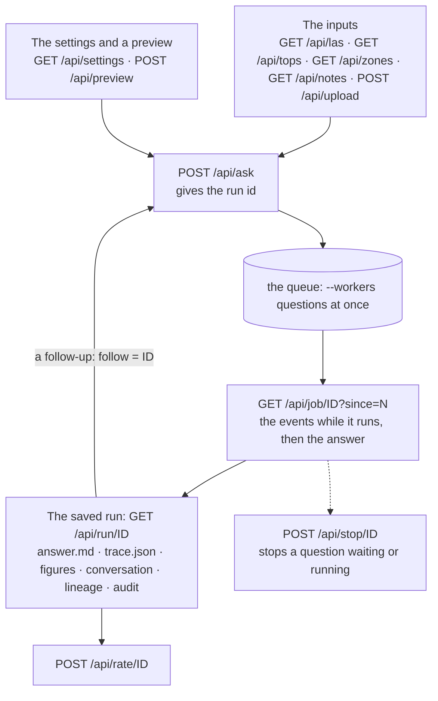
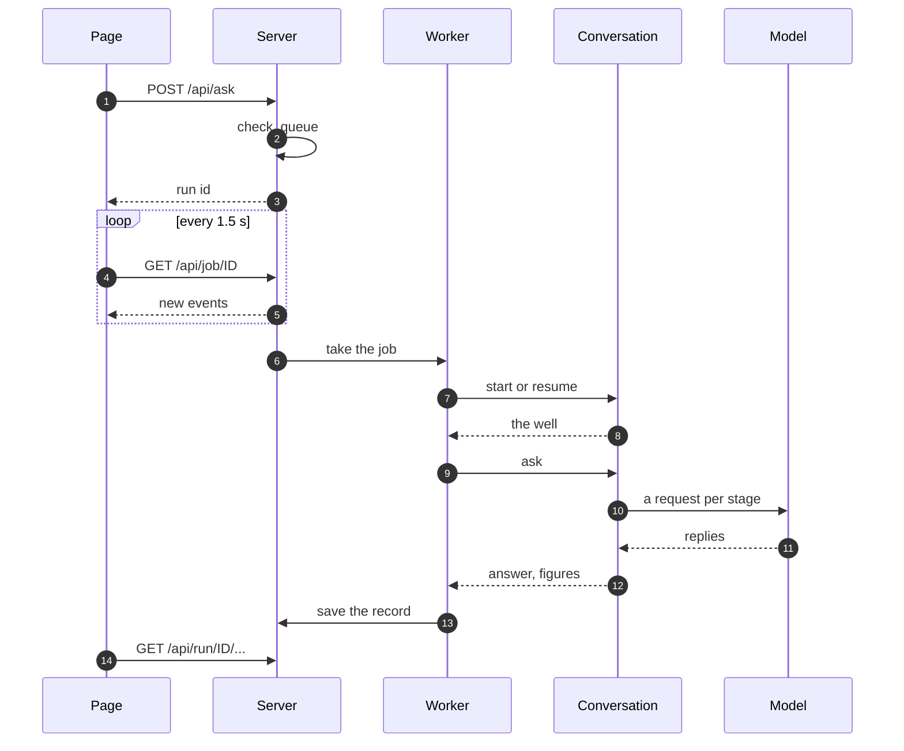
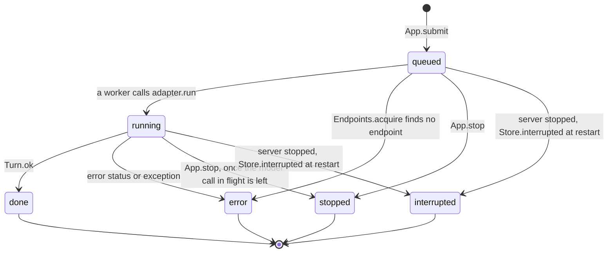

# Web UI server and API reference

`petroharness ui` serves one page and a JSON API over HTTP. The page's inputs are checked and previewed before a
question is asked, each question waits in a queue for a worker thread, its progress arrives as events, and every
question stays on disk with its answer, figures, lineage and audit trail. This page documents every route, the job
queue, the events and the storage, for developers who script against the server or change it. Using the page in a
browser: [UI.md](../UI.md).

## 1. At a glance



| Item | Value |
|---|---|
| Address | `http://127.0.0.1:7860`; saved runs in `./petroharness-ui-runs` |
| API | JSON over HTTP, `GET` and `POST` only, no login; a request another site's page could send is refused (403, [section 14](#14-security-notes)) |
| Questions at once | 4 (`--workers`); the rest wait in a first-in, first-out queue |
| Model | the server's model card and endpoints; a request cannot choose the model |

| Route | Returns |
|---|---|
| [`GET /`](#get--and-get-indexhtml), [`GET /img/NAME`](#get-imgname) | the page, its images |
| [`GET /api/config`](#get-apiconfig) | the model, the endpoints and their health, the queue, the defaults |
| [`GET /api/settings`](#get-apisettings) | the interpretation settings, in groups, with defaults and help |
| [`POST /api/preview`](#post-apipreview) | the interval, its zones and the value each setting took on the well |
| [`GET /api/samples`](#get-apisamples) | Petrophys's sample wells, each with its header and its tops sample |
| [`GET /api/las`](#get-apilas) | a LAS file's header |
| [`GET /api/tops`](#get-apitops) | the formations of a tops file, each with its interval, and what is wrong in the file |
| [`GET /api/zones`](#get-apizones) | the user's zones of a zones file, and what is wrong in them |
| [`GET /api/notes`](#get-apinotes) | a field notes file, checked |
| [`POST /api/upload`](#post-apiupload) | stores a LAS, tops, zones or field notes file |
| [`POST /api/ask`](#post-apiask) | queues a question and gives its run id |
| [`GET /api/job/ID`](#get-apijobid) | a job's status and its events from `since` on |
| [`POST /api/stop/ID`](#post-apistopid) | stops a question that is waiting or running |
| [`GET /api/runs`](#get-apiruns) | the run list |
| [`GET /api/run/ID`](#get-apirunid) | one run's record in full |
| [`GET /api/run/ID/answer.md`, `trace.json`](#get-apirunidanswermd-and-get-apirunidtracejson) | the answer file, the trace |
| [`GET /api/run/ID/figures/NAME`](#get-apirunidfiguresname) | one figure (PNG) |
| [`GET /api/run/ID/conversation`](#get-apirunidconversation) | every question of the run's conversation |
| [`GET /api/run/ID/lineage`](#get-apirunidlineage) | what the answer rests on (JSON) |
| [`GET /api/run/ID/audit`](#get-apirunidaudit) | the answer's audit trail (Markdown) |
| [`GET /api/run/ID/logview`](#get-apirunidlogview-and-logdata) | the log viewer: every curve it can show, the tracks, the zones |
| [`GET /api/run/ID/logdata`](#get-apirunidlogview-and-logdata) | the log viewer: curves in a depth window |
| [`POST /api/rate/ID`](#post-apirateid) | records a rating of the run |

A question from a script, on the GeoLink sample well 30/6-5:

```bash
petroharness ui &
LAS=$(python -c "import petrophys; print(petrophys.sample('30/6-5'))")
TOPS=$(python -c "import petrophys; print(petrophys.sample('formations_30_6-5.csv'))")
curl -s -X POST localhost:7860/api/ask -H 'Content-Type: application/json' -d '{"las": "'$LAS'",
  "interval": {"mode": "tops", "tops": "'$TOPS'", "formation": "BRENT GP."},
  "question": "What are the porosity, water saturation and permeability of the Brent Group, and is any of it hydrocarbon-bearing?"}'
```

```json
{"id": "RUN_1"}
```

Then poll `GET /api/job/RUN_1?since=N` until `status` is no longer `queued` or `running`, and read
`GET /api/run/RUN_1/answer.md`. The examples on this page are this question and its follow-up on the Brent Group
(2841–2958 m) of 30/6-5, the conversation of [Evaluate a formation](../USAGE.md), answered by this server with the
model's recorded replies played back, so its model calls take no time in them; their token counts are the model's.
A run id is `YYYYmmdd-HHMMSS-xxxxxx`, the time it was made and 6 random hex digits; the examples write the two runs'
ids as `RUN_1` (the question) and `RUN_2` (the follow-up), and every time stamp as `YYYY-mm-ddTHH:MM:SS+00:00`.
Data: GeoLink, CC BY-SA 4.0.

## 2. How it works



<details>
<summary>The steps of a question, in the code</summary>

1. `petroharness ui` reaches `ui.server.main` through `cli.main`. `main` builds an `App` (the runs folder, the model
   endpoints and the worker threads) and one or two HTTP servers (`make_servers`), then serves until Ctrl+C.
2. `App.__init__` opens the runs folder (`Store`) and marks every saved run left `queued` or `running` by a stopped
   server as `interrupted` (`Store.interrupted`). It starts `--workers` daemon threads named `petroharness-ui-1`,
   `petroharness-ui-2`, and so on, each running `App._work`.
3. The browser loads `GET /` (the single page `ui/static/index.html`) and `GET /api/config`, which it polls again
   every 20 s for the endpoints' health and the queue counts.
4. While the user fills in the inputs, the page reads the LAS header (`GET /api/las` or `POST /api/upload`), the
   formations of a tops file (`GET /api/tops`), the user's zones (`GET /api/zones`), the settings panel
   (`GET /api/settings`) and a preview of the interpretation (`POST /api/preview`).
5. `POST /api/ask` calls `App.submit`. The inputs are checked at once by `adapter.arguments`, a `Job` is created with
   a new run id, a `phase: queued` event is emitted, the run folder is prepared, `run.json` is written and the job is
   put on the queue. The response is `{"id": RUN_ID}`.
6. A worker takes the job (`App._work`), reserves the least busy healthy endpoint (`Endpoints.acquire`) and calls
   `adapter.run`. A first question starts a conversation (`session.Conversation.start`); a follow-up resumes the
   conversation of the run it follows (`Conversation.resume`).
7. The model client is wrapped in `progress.Observed`, which emits a `call` event before each model request, a
   `results` event for results first shown in a prompt, and a `reply` event after each reply; each request is a
   `POST /v1/chat/completions` to the reserved endpoint. Petrophys's interpretation of the interval emits a `well`
   event (through `on_view`, `wellplot.payload`), and the interval's log display (`Conversation.overview`) a
   `display` event.
8. When the question is answered (`Conversation.ask` returns a `Turn` with the answer, the trace and the figures),
   `adapter.run` copies `answer.md`, `trace.json` and the figures into the run folder,
   fills `Job.answer` and `Job.result` (`adapter.summary`), sets `done` or `error` and emits `phase: finished`.
9. The worker saves the record (`Store.save`) and only then sets `Job.saved`. From that moment `GET /api/job/<id>`
   reports the job as finished, with the answer and the result.
10. The page stops polling, reloads the run list and configuration, and reads the run's lineage, conversation,
    figures and audit trail from their routes.

</details>

## 3. Command line and environment

```bash
petroharness ui --port 7931 --workers 1 --runs DIR --model-url http://HOST:8000/v1,http://localhost:8001/v1
```

```text
PetroHarness UI on http://127.0.0.1:7931
  runs: DIR; workers: 1; model: K2-Horizon-7B (<served model name>); endpoints: http://HOST:8000/v1, http://localhost:8001/v1
```

Both lines go to standard error (the host, the served model's name and the folder are replaced here). The endpoints
come from `--model-url` or `PETROHARNESS_MODEL_URL`; `python -m petroharness.ui.server` runs the same command.

Every flag of `petroharness ui`, what it prints at start and its exit status:
[CLI.md](CLI.md#8-petroharness-ui). The environment variables the server reads (the model endpoints, the API key, the
data settings, the skill library, the switches): [CONFIGURATION.md](CONFIGURATION.md#10-environment-variables);
`GET /api/config` shows the ones in force ([section 5](#5-routes-the-page-configuration-and-settings)).

## 4. Responses and errors

Every error body is `{"error": "<message>"}`, and a message about an input says what is wrong and the fix (WHAT /
WHY / FIX). On the server above, with the 30/6-5 sample files:

```bash
curl -s localhost:7931/api/run/not-a-run-id                                       # 404
curl -s -X POST localhost:7931/api/ask -H 'Content-Type: application/json' -d '{"las": "'$LAS'",
  "question": "q", "interval": {"mode": "tops", "tops": "'$TOPS'", "formation": "BRENT"}}'   # 400
curl -s -X POST localhost:7931/api/ask -d '{}'                                    # 403: not JSON
curl -s -o /dev/null -w '%{http_code}\n' -X DELETE localhost:7931/api/runs        # 501
```

```text
{"error": "no run 'not-a-run-id'"}
{"error": "WHAT: formation 'BRENT' is not in the tops file formations_30_6-5.csv. Did you mean 'BRENT GP.'? WHY: its interval comes from its row there. FIX: use one of the names it lists (NORDLAND GP., Utsira Fm., […], BRENT GP., Ness Fm., Etive Fm., […], Statfjord Fm.), or give the interval's depths (--top/--base) instead of the tops file."}
{"error": "WHAT: a request the page does not send. FIX: use the page this server serves."}
501
```

<details>
<summary>Response format</summary>

Every response is written by `Handler._send`, with the same headers, and every JSON body by `Handler._json`. The
server answers in HTTP/1.0 (the standard library's default) with `Server: PetroHarnessUI` and the Python version.

| Name | Type | Default | Meaning | Defined in |
|---|---|---|---|---|
| `Content-Type` | header | `application/json` | `text/html; charset=utf-8` for the page, `image/png`, `image/svg+xml` or `image/x-icon` for images and figures, `text/markdown; charset=utf-8` for Markdown files. | `Handler._send`, `CONTENT_TYPES` |
| `Content-Length` | header | the body's length | Always sent. | `Handler._send` |
| `Cache-Control` | header | `no-store` | Always sent. | `Handler._send` |
| `Content-Disposition` | header | not sent | `inline; filename="<run id>-answer.md"`, `"<run id>-trace.json"` or `"<run id>-audit.md"` on the file routes. | `Handler._route` |
| Error body | JSON | none | `{"error": "<message>"}` on every 400, 403, 404 and 500. | `Handler._route` |

- A `POST` must declare `Content-Type: application/json` (an upload may instead carry its `X-Filename` header); its
  body is then parsed as JSON, and an empty body is `{}`.

</details>

<details>
<summary>Status codes</summary>

`Handler._route` maps what happened to one status code; the standard library answers methods the handler lacks.

| Status | When | Body |
|---|---|---|
| 200 | The route answered. | JSON, the page, an image or a file. |
| 400 | `InputError`, or any other `ValueError`, `LookupError` (other than `KeyError`) or `OSError` raised while handling: wrong inputs, an unreadable file, a bad verdict, a non-integer `since`. | `{"error": message}`; input messages follow the WHAT / WHY / FIX form. |
| 403 | An `/api/` request the server refuses before routing it (`Handler._refused`): from another origin, a `POST` the page does not send, or, on a loopback address, for a host name the server does not answer ([section 14](#14-security-notes)). | `{"error": message}` in the WHAT / FIX form. |
| 404 | A path that is no route, a run id that does not match `RUN_ID`, a run with no `run.json`, a file name that is not served, a run with no audit trail; any `KeyError`. | `{"error": "not found"}`, or the `KeyError`'s message as raised (`not found` when it has none). |
| 500 | Any other exception. The traceback is printed on the server's standard error and the server goes on. | `{"error": "<ExceptionType>: <message>"}` |
| 501 | A method other than `GET` and `POST` (`PUT`, `DELETE`, `HEAD`, `OPTIONS`, ...): the standard library's answer, since the handler defines only `do_GET` and `do_POST`. | The standard library's HTML error page. |

- A `KeyError`'s message is sent whole: an unknown run answers `{"error": "no run '00000000-000000-000000'"}`, and a
  file name the run routes do not serve answers with the name itself (`{"error": "run.json"}`).
- A non-integer `since` answers Python's own message: `{"error": "invalid literal for int() with base 10: 'x'"}`.

</details>

## 5. Routes: the page, configuration and settings

What the page loads first: itself and its images, the server's configuration, and the contents of its settings panel,
which a preview of the interpretation fills with what Petrophys made of the well.

<a id="get--and-get-indexhtml"></a>
<details>
<summary>GET / and GET /index.html</summary>

Serves the single page, `src/petroharness/ui/static/index.html`, as `text/html; charset=utf-8`.

| Name | Type | Default | Meaning | Defined in |
|---|---|---|---|---|
| (none) | | | The page takes no parameters. Its own address fragments are `#run=<id>` (open a run) and `#replay=<id>&speed=N` (play a saved run back). | `Handler._route`, `index.html` |

```bash
curl -s localhost:7860/ | head -c 200
```

</details>

<a id="get-imgname"></a>
<details>
<summary>GET /img/NAME</summary>

Serves an image of the page from `ui/static/img/`.

| Name | Type | Default | Meaning | Defined in |
|---|---|---|---|---|
| `NAME` | path segment | required | A file directly in `ui/static/img/` with suffix `.png`, `.svg` or `.ico` (`CONTENT_TYPES`). | `Handler._route` |

```bash
curl -s -o mark.png localhost:7860/img/petroharness_mark.png      # 200, image/png
```

- The resolved file must sit directly in `static/img`; anything else answers 404 `{"error": "not found"}`.

</details>

<a id="get-apiconfig"></a>
<details>
<summary>GET /api/config</summary>

Returns what the page needs to know about the server: the version, the model, the endpoints and their health, the
queue, the defaults and the tool groups.

| Name | Type | Meaning | Defined in |
|---|---|---|---|
| `version` | string | The package version (`petroharness.__version__`). | `App.config` |
| `model` | string | The served model's name the endpoints are asked for; `(stand-in model)` when the app runs with a test model. | `App.config`, `served_model` |
| `label` | string | The model's name as people read it: `--model`, else the card's `label`, else the served name. | `models.label` |
| `endpoints` | list of objects | One row per endpoint (`Endpoints.health`): `url`, `ok`, `models` (the ids `/models` lists), `ms` (probe time) or `error`, and `busy` (questions it is answering). Empty with a test model. | `Endpoints._probe`, `Endpoints.health` |
| `workers` | integer | Questions answered at once. | `App.config` |
| `running` | integer | Jobs in memory whose status is `running`. | `App.config` |
| `queued` | integer | Jobs waiting in the queue. | `App.config` |
| `runs` | string | The runs folder, absolute. | `App.config` |
| `max_steps` | integer | The default step cap, 8. | `agent.state.MAX_STEPS` |
| `profiles` | list of strings | Petrophys's context profiles (`petrophys.reporting.context_profiles.list_context_profiles()`); empty when the installed Petrophys lists none. | `adapter.context_profiles` |
| `topics` | object | Topic area name to its `when` line (`resources/topics.yaml`). | `agent.direction.areas` |
| `verbs` | object | Tool name to its group as the brief heads it, capitalized (`Describe`, `Compare and group`, `Check`, `Calculate`, `Classify`, `Summarize`, `Calibrate`). | `server.verbs`, `agent.toolset.TOOLSET.by_group` |
| `petrophys_verbs` | list of strings | The tools that are verbs over Petrophys (`Tool.verb`). | `server.petrophys_verbs` |
| `skills_env` | string | The value of `PETROHARNESS_SKILLS`, or `""`. | `App.config` |
| `settings_env` | string | The value of `PETROHARNESS_DATA`, or `""`. | `App.config` |
| `examples` | list of strings | Questions to start with, each with `{interval}` for the interval's name: the harness's own examples (component C9 `outside_examples`), as it offers them when a request is outside what it does. | `server.examples` |
| `typical` | object | How long a question takes on this server: `{"direct": [seconds, runs], "investigation": [seconds, runs]}`, the median time of the saved runs that answered (status `done`, result `ok` or `unresolved_numbers`), of the latest 400 runs, each kind once it has 3 runs; `{}` before. Read again at most every 5 minutes. The page's time left. | `App.typical`, `TYPICAL_MIN`, `TYPICAL_RUNS`, `TYPICAL_TTL` |

The server of [section 3](#3-command-line-and-environment), one endpoint up and one down (the host, the served
model's name and the runs folder replaced):

```json
{"version": "1.0.0", "model": "<served model name>", "label": "K2-Horizon-7B",
 "endpoints": [{"url": "http://HOST:8000/v1", "ok": true, "models": ["<served model name>"], "ms": 6, "busy": 0},
               {"url": "http://localhost:8001/v1", "ok": false, "models": [],
                "error": "URLError: <urlopen error [Errno 111] Connection refused>", "busy": 0}],
 "workers": 1, "running": 0, "queued": 0, "runs": "DIR", "max_steps": 8,
 "profiles": ["costa_v1", "danish_v1", "geolink_train_v1", "geolink_v1"],
 "topics": {"data_quality": "hole condition, tool and environmental effects, spikes, gaps, depth matching, log quality",
            "lithology_mineralogy": "rock types, mineral content, log responses of rocks, lithology logs", […]},
 "verbs": {"stats": "Describe", "profile": "Describe", "runs": "Describe", "values_at": "Describe", "section": "Describe",
           "step": "Describe", "formation_summary": "Describe", "compare": "Compare and group", "crossplot": "Compare and group", […]},
 "petrophys_verbs": ["check", "calculate", "what_if", "estimate", "classify", "summarize", "calibrate"],
 "skills_env": "", "settings_env": ""}
```

Here `topics` names 14 topic areas and `verbs` 30 tools.

- An endpoint that answers but does not list the model has `ok: false` and
  `error: "serves <ids>, not <model>"`. A probe that fails gives `error: "<ExceptionType>: <message>"`, cut to
  120 characters of the message.
- The health rows are cached for 15 s; a request after that probes every endpoint again, in parallel.

</details>

<a id="get-apisettings"></a>
<details>
<summary>GET /api/settings</summary>

Returns the interpretation settings for the settings panel: Petrophys's own settings, read from the installed library,
and the harness's zone rule, in groups (`well.settings.schema`, cached per process).

| Name | Type | Meaning | Defined in |
|---|---|---|---|
| `groups` | list | One object per group, in the order of `GROUPS`: `key`, `title`, `about`, `fields`. Keys: `zones`, `clay`, `porosity`, `water`, `saturation`, `permeability`, `pay`, `temperature`, `mud`, `lithology`, `input`, and `more` ("More from Petrophys") when Petrophys has settings no group names. The common fields come first in each group. | `well.settings.GROUPS`, `schema` |
| `groups[].fields[].key` | string | The setting's name, as `interpretation` takes it. | `schema` |
| `...label` | string | The name shown (`LABELS`, else the key with spaces). | `well.settings.LABELS` |
| `...kind` | string | `number`, `integer`, `switch`, `choice`, `bands` or `text`. | `schema.field` |
| `...unit` | string | For a `number` or `integer`, the first unit (of those in `UNITS`) that Petrophys's help names, in its first sentence, else in the rest; `""` when it names none; `""` for a switch or a choice; the zone thickness is `m`, the bands `v/v`. | `well.settings._unit` |
| `...choices` | list | The values Petrophys accepts for a `choice` setting, read from its own validation message. | `well.settings._choices` |
| `...choice_labels` | object | Zone layout only: the words shown for each choice. | `well.settings.ZONE_FIELDS` |
| `...default` | any | The policy's value for the zone rule and the `vcl_cutoff`, `sw_cutoff` and `phie_cutoff` settings (`cutoffs.vcl_max`, `sw_max`, and `phie_min_clastic`); Petrophys's default for the rest; `null` where Petrophys reads it from the LAS header or derives it from the data. | `schema`, `_zone_default` |
| `...help`, `...more` | string | Petrophys's first sentence, and its whole help; for the zone rule, the harness's own two texts. | `well.settings._first`, `_plain`, `ZONE_FIELDS` |
| `...common` | boolean | One of the settings shown first (`COMMON`). | `well.settings.COMMON` |
| `...petrophys` | boolean | `true` for a Petrophys setting, `false` for the zone rule. | `schema` |
| `...heading` | string | Petrophys's own group heading for the setting (`Zones` for the zone rule). | `well.settings._doc_fields` |
| `...length` | boolean | Zone thickness only: a length, shown in the well's depth unit by the page. | `well.settings.ZONE_FIELDS` |
| `petrophys` | string | The Petrophys build (`version@build`). | `well.prepare.library_identity` |

On the published Petrophys build the groups hold 3, 6, 11, 4, 12, 5, 4, 4, 9, 4 and 3 fields, and no `more` group:

```json
{"groups": [
  {"key": "zones", "title": "Zones", "about": "How the interval is split into zones: the unit every answer reports on.",
   "fields": [{"choices": [], "unit": "m", "more": "Thin-bedded intervals (a few feet per bed) keep few zones […]",
               "heading": "Zones", "key": "zone_min_thickness_m", "label": "Minimum zone thickness", "kind": "number",
               "length": true, "help": "A run of one lithology (or one shale-volume band) no thicker than this is not a zone; […]",
               "default": 2.0, "common": true, "petrophys": false}, […]]},
  […],
  {"key": "saturation", "title": "Water saturation", "about": "The saturation model and its parameters.",
   "fields": [{"key": "sw_model", "label": "Saturation model", "kind": "choice", "unit": "",
               "choices": ["auto", "archie", "north_sea", "nigeria_schlumberger", "simandoux", "modified_simandoux",
                           "indonesia", "dual_water", "waxman_smits"],
               "default": "auto", "help": "\"auto\" (routed per sample by clay content) or one of \"archie\", […]",
               "more": "[…]", "common": true, "petrophys": true, "heading": "Water saturation"},
              {"key": "m", "label": "Cementation m", "kind": "number", "unit": "", "choices": [], "default": null,
               "help": "Cementation exponent m; one value, or one per lithology as for a.", "more": "[…]",
               "common": true, "petrophys": true, "heading": "Archie parameters (None: lithology-dependent defaults)"},
              […]]},
  […]],
 "petrophys": "3.0.0@files-c5de047fe601"}
```

</details>

<a id="post-apipreview"></a>
<details>
<summary>POST /api/preview</summary>

Interprets the well under the inputs and settings given, before any question, and returns the interval, its zones and
the value each setting took on this well (`adapter.preview`).

| Name | Type | Default | Meaning | Defined in |
|---|---|---|---|---|
| body | JSON object | required | The inputs of `POST /api/ask` without `question` (any `question` given is replaced), checked as for a question. `las` and `interval` are used; `interpretation`, `field_notes`, `lithology_curve`, `formation_lithology`, `profile` and `skills` are honoured. | `adapter.preview`, `adapter.PREPARE_KEYS` |
| `interpretation` | object | `{}` | The settings to preview. Field notes' settings are applied under them. | `adapter.preview` |

Response fields:

| Name | Type | Meaning | Defined in |
|---|---|---|---|
| `interval` | object | `name`, `top`, `base`, `unit`, `samples` and `from` (where the interval came from). | `ask.check` (`Prepared.used`) |
| `lithology` | object | How the zones were read: `{"source": "lithology log", "curve", "how": "named" \| "detected"}`; without a lithology log, `{"source": "mineral solver", "curve", "method", "domain", "inputs", "decisions", "solved", "samples"}` (the lithology Petrophys's mineral solver wrote); with neither, `{"source": "shale-volume bands", "curve": "VCL", "bands"}`; or `{"source": "none", "curve": null}`. | `ask.check` (`Prepared.litho`) |
| `unit` | string | The depth unit of the zones. | `adapter.preview` |
| `zones` | list | `{"zone", "lithology", "top", "base"}` per zone, depths rounded to 4 decimals. | `adapter.preview` |
| `zoned` | number | The summed thickness of the zones. | `adapter.preview` |
| `interval_thickness` | number or null | Base minus top of the interval. | `adapter.preview` |
| `min_thickness` | number or null | The policy's minimum zone thickness in the reporting unit. | `adapter.preview` |
| `used` | object | Setting name to `{"value", "step"}`, and `"unit"` where the step records one beside the setting (`td_unit` beside `td_ft`): the value Petrophys applied (its `<name>_used` parameter where the step records one, as `gr_min_used` when it lowered `gr_min`) and the workflow step that recorded it. The cutoffs are read from the `net_pay` step. | `well.settings.used` |

The Brent Group with `m` set to 1.8:

```bash
curl -s -X POST localhost:7931/api/preview -H 'Content-Type: application/json' -d '{"las": "'$LAS'",
  "interval": {"mode": "tops", "tops": "'$TOPS'", "formation": "BRENT GP."}, "interpretation": {"m": 1.8}}'
```

```json
{"interval": {"name": "BRENT GP.", "top": 2841.0, "base": 2958.0, "unit": "m", "samples": 768,
              "from": "tops file formations_30_6-5.csv, base: stated base"},
 "lithology": {"source": "lithology log", "curve": "LITHOLOGY_GEOLINK", "how": "detected"},
 "unit": "m",
 "zones": [{"zone": "Z1", "lithology": "SAND", "top": 2841.3242, "base": 2845.7439},
           {"zone": "Z2", "lithology": "SILT", "top": 2856.1069, "base": 2858.6977}, […]],
 "zoned": 83.3629, "interval_thickness": 117.0, "min_thickness": 2.0,
 "used": {"vcl_cutoff": {"value": 0.3, "step": "net_pay"}, "phie_cutoff": {"value": "lithology_dependent", "step": "net_pay"},
          "sw_cutoff": {"value": 0.7, "step": "net_pay"}, […], "gr_min": {"value": 20.0, "step": "vclay"}, […],
          "sw_model": {"value": "archie+simandoux", "step": "saturation"}, […], "m": {"value": 1.8, "step": "saturation"}, […]}}
```

The response names 20 zones and 25 settings. It took 6.1 s; the same preview again took 0.3 s, from the cache.

A preview shows what a setting changes before any question. The COSTA carbonate well HW-3, Kharaib-2 (in feet, no
lithology log, so its zones are runs of the lithology Petrophys's mineral solver gives), previewed with no settings
and then as a limestone:

```bash
HW3=$(python -c "import petrophys; print(petrophys.sample('HW-3'))")
COSTA_TOPS=$(python -c "import petrophys; print(petrophys.sample('formations_costa.csv'))")
curl -s -X POST localhost:7931/api/preview -H 'Content-Type: application/json' -d '{"las": "'$HW3'",
  "interval": {"mode": "tops", "tops": "'$COSTA_TOPS'", "formation": "KHARAIB-2"},
  "interpretation": {"lithology_domain": "carbonate", "matrix_type": "limestone"}}'
```

```json
{"interval": {"name": "KHARAIB-2", "top": 7805.0, "base": 8020.0, "unit": "ft", "samples": 431,
              "from": "tops file formations_costa.csv, base: stated base"},
 "lithology": {"source": "mineral solver", "curve": "LITHO", "method": "generic_calcite_dolomite_density_closure",
               "domain": "carbonate", "inputs": ["RHOB", "VCL", "PHIE"],
               "decisions": ["No lithology curve or lithology intervals were available -> inferred LITHO from mineral volumes", […]],
               "solved": 410, "samples": 431},
 "unit": "ft", "zones": [{"zone": "Z1", "lithology": "LIMESTONE", "top": 7805.0, "base": 7844.5},
                         {"zone": "Z2", "lithology": "LIMESTONE", "top": 7845.5, "base": 7854.5}, […]],
 "zoned": 179.0, "interval_thickness": 215.0, "min_thickness": 6.5617,
 "used": {"vcl_cutoff": {"value": 0.3, "step": "net_pay"}, "phie_cutoff": {"value": 0.045, "step": "net_pay"}, […],
          "lithology_domain": {"value": "carbonate", "step": "vclay"}, "matrix_type": {"value": "limestone", "step": "porosity"},
          "nphi_ma": {"value": 0.0, "step": "porosity"}, "rho_ma": {"value": 2.71, "step": "porosity"}, […],
          "dt_ma": {"value": 47.6, "step": "porosity"}, […], "carbonate_calibration": {"value": "generic", "step": "lithology"}, […]}}
```

The response names 9 zones, limestone and one dolomite. With no settings the same well is read as `clastic` with a
`sandstone` matrix (`rho_ma` 2.65, `nphi_ma` -0.02, `dt_ma` 55.5) and a `phie_cutoff` of 0.08; the solver, in its
clastic domain (`canonical_multi_mineral_solver`), then labels 8 zones, sandstone and one dolomite, 187 ft zoned. The
minimum zone thickness, 2 m in the policy, is reported in the well's feet. Data: Costa Gomes, Geiger and Arnold (2022),
COSTA model, Heriot-Watt University, CC BY.

- The preview runs on the request's own thread and can take as long as an interpretation of the well. The
  interpreted well is kept in the runs folder's shared `.cache`, so the question that follows reuses it.
- Settings that cannot be used answer 400 with every problem listed (`WHAT: interpretation settings that cannot be
  used: m: give a number. FIX: correct or reset them.`). Petrophys settings with a context profile answer 400.

</details>

## 6. Routes: inputs and uploads

The page reads each input as it is given: a LAS file's header, the formations of a tops file, the user's zones, a
field notes file. A file the server cannot read by path is uploaded first, and the path the upload returns is used
from then on.

<a id="get-apisamples"></a>
<details>
<summary>GET /api/samples</summary>

Petrophys's sample wells, for the start page's one-click start (`adapter.samples`): each log sample Petrophys lists
(`petrophys.datasets.list_samples("logs")`), read once per server. The harness names no sample: the list, the names
and the folders are Petrophys's.

| Name | Type | Meaning | Defined in |
|---|---|---|---|
| `name` | string | The sample's name, as `petrophys.sample` takes it. | `adapter.samples` |
| `folder` | string | Its dataset folder in Petrophys. | `adapter.samples` |
| `las` | string | The LAS file's path on the server. | `adapter.samples` |
| `well`, `top`, `base`, `unit`, `curves` | | The `WELL` header, the `STRT` and `STOP` depths, the depth unit (`m`, `ft` or null) and the number of curves besides depth. | `adapter.samples` |
| `tops` | object or null | `{"path", "name", "formations"}`: a tops sample of Petrophys with rows for this well (a well column naming it, or, without one, a file name that holds the well's), and the number of names the tops reader finds for it. | `adapter.samples`, `read_tops` |

A sample that cannot be read is left out.

</details>

<a id="get-apilas"></a>
<details>
<summary>GET /api/las</summary>

Returns a LAS file's header as the page shows it (`adapter.las_info`).

| Name | Type | Default | Meaning | Defined in |
|---|---|---|---|---|
| `path` | query string | required | A LAS file on the server; `~` is expanded. | `adapter._file` |

Response fields:

| Name | Type | Meaning | Defined in |
|---|---|---|---|
| `path`, `name` | string | The resolved path and the file name. | `adapter.las_info` |
| `well`, `uwi` | string | The `WELL` and `UWI` header items, or `""`. | `adapter.las_info` |
| `names` | list | The names the well goes by: the file stem, then `WELL`, `UWI`, `API`, `APIN` where set. | `interval._las_header` |
| `depth_unit` | `m`, `ft` or null | The depth unit read from the first curve's unit. | `interval._las_header`, `well.tops.depth_unit_name` |
| `depth_unit_raw` | string | The first curve's unit as written. | `adapter.las_info` |
| `top`, `base` | number or null | The first and last finite depth of the log. | `adapter.las_info` |
| `step` | number or null | The median depth step, rounded to 6 decimals. | `adapter.las_info` |
| `samples` | integer | The number of depth samples. | `adapter.las_info` |
| `curves` | list | `{"mnemonic", "unit", "description"}` for every curve after the depth. | `adapter.las_info` |
| `lithology_candidates` | list | Mnemonics whose mnemonic or description matches the lithology-log pattern. | `well.formation.LITHOLOGY_LOG` |

```bash
curl -s "localhost:7931/api/las?path=$LAS"
```

```json
{"path": "[…]/petrophys/datasets/geolink/30_6-5.las", "name": "30_6-5.las", "well": "30/6-5", "uwi": "30/6-5",
 "names": ["30_6-5", "30/6-5", "30/6-5"], "depth_unit": "m", "depth_unit_raw": "m", "top": 176.60999,
 "base": 3556.08032, "step": 0.15235, "samples": 22176,
 "curves": [{"mnemonic": "LITHOLOGY_GEOLINK", "unit": "_", "description": "Lithology_geolink"},
            {"mnemonic": "CALI", "unit": "in", "description": "CALI"},
            {"mnemonic": "DRHO", "unit": "g/cm3", "description": "DRHO"}, […]],
 "lithology_candidates": ["LITHOLOGY_GEOLINK"]}
```

The 20 curves are LITHOLOGY_GEOLINK, CALI, DRHO, NPHI, RHOB, PEF, GR, DTC, DTE, RDEP, SP, RSHA, RMED, BS, PHIC, GDEN,
KH_CORE, KV_CORE, SWC and SOC.

The header is returned as the file writes it, so faults show before any question. The Kansas well 1046123714 (Morgan
No. 1-17) leaves most curve units blank, writes each curve's description before the colon, where LAS keeps a value (so
every description reads empty), and gives both calipers the unit `GAPI`:

```bash
KGS=$(python -c "import petrophys; print(petrophys.sample('1046123714'))")
curl -s "localhost:7931/api/las?path=$KGS"
```

```json
{"path": "[…]/petrophys/datasets/kgs/1046123714.las", "name": "1046123714.las", "well": "Morgan No. 1-17", "uwi": "",
 "names": ["1046123714", "Morgan No. 1-17", "15-153-21,062-00-00"], "depth_unit": "ft", "depth_unit_raw": "FT",
 "top": -2.0, "base": 4695.5, "step": 0.5, "samples": 9396,
 "curves": [{"mnemonic": "BVTX", "unit": "", "description": ""}, […],
            {"mnemonic": "SP", "unit": "MV", "description": ""}, {"mnemonic": "RILD", "unit": "", "description": ""}, […],
            {"mnemonic": "DCAL", "unit": "GAPI", "description": ""}, {"mnemonic": "RHOB", "unit": "", "description": ""}, […],
            {"mnemonic": "GR", "unit": "", "description": ""}, {"mnemonic": "MCAL", "unit": "GAPI", "description": ""}, […]],
 "lithology_candidates": []}
```

Data: Kansas Geological Survey (kgs.ku.edu).

- A missing path answers `WHAT: no LAS file given. FIX: give its path on the server, or upload it.` and a missing
  file `WHAT: no LAS file at <path>. FIX: give the path of an existing file on the server, or upload it.` (400). A
  file that does not parse answers `WHAT: <name> could not be read as a LAS file (<error>). FIX: give a LAS 2.0 file
  ...` (400).
- A file whose depth goes back against its direction, or gives one depth twice in a row, answers 400 with where
  (`well.prepare.depth_order`), e.g. `WHAT: the depth in 30_6-5_splice.las goes back at line 17920, from 2899.9983 to
  2880.0339 m: 2880.0339-2899.9983 m is logged twice (spliced runs or a repeated section). WHY: ... FIX: keep one run
  over the overlap so the depths run one way down the file, and load it again.` The same check refuses the file at
  `POST /api/ask` and when a question prepares it. A file that runs one way, down or up, is read as it is.

</details>

<a id="get-apitops"></a>
<details>
<summary>GET /api/tops</summary>

Returns the formations a tops file names, each with the interval a question about it would use, and, with `las`, which
fall beyond the log (`adapter.tops_info`, `adapter._fits_log`, `well.tops.read_tops`).

| Name | Type | Default | Meaning | Defined in |
|---|---|---|---|---|
| `path` | query string | required | The tops file on the server (CSV, TSV, text or Excel). | `adapter.tops_info` |
| `las` | query string | none | A LAS file: a table with a well column is then read for that well only, depths with no stated unit are in the LAS's unit, and each formation is checked against the log's depths (`fits`, `outside`). | `adapter.tops_info`, `adapter._fits_log` |
| `unit` | query string | none | The depth unit of a file that states none (`m`, `ft`, or a spelling `depth_unit_name` reads). | `adapter.tops_info` |

Response fields:

| Name | Type | Meaning | Defined in |
|---|---|---|---|
| `path`, `name` | string | The resolved path and file name. | `adapter.tops_info` |
| `columns` | object | The role of each column found (`name`, `top`, and where present `base`, `unit`, `well`) to the column's header. | `well.tops.read_tops` |
| `wells` | list | The wells the table was read for: the values of its well column that name this LAS's well; empty for a table with no well column. | `well.tops.read_tops` |
| `formations` | list | One row per name: `{"name", "top", "base", "unit", "closed", "base_from"}`; for a name listed twice `{"name", "repeated": [...]}`, one item per listing, `{"top", "base", "line", "unit", "closed", "base_from"}`, or `{"top", "base", "line", "unit", "error"}` when that listing's interval cannot be built; for a name whose interval cannot be built `{"name", "error"}` (the reader's WHAT / FIX message). With `las`, a row or listing wholly beyond the log's depths also has `"outside": true`. | `adapter.tops_info`, `TopsTable.interval` |
| `fits` | object | With `las` only: `{"outside", "of", "log"}`, the rows and listings beyond the log, those with a top, and the log's depth range (`"176.61-3556.08 m"`); when more than half are beyond it and the rows share one unit, `hint` says so and, when their depths read in the other unit fit the log, that the file's depth unit may be wrong. Absent when the LAS cannot be read or gives no depth range or no unit (m or ft). | `adapter._fits_log` |

```bash
curl -s "localhost:7931/api/tops?path=$TOPS&las=$LAS"
```

```json
{"path": "[…]/petrophys/datasets/formations_30_6-5.csv", "name": "formations_30_6-5.csv",
 "columns": {"unit": "depth_unit", "name": "formation_name", "top": "top_depth", "base": "bottom_depth"},
 "wells": [],
 "formations": [{"name": "NORDLAND GP.", "top": 181.0, "base": 726.0, "unit": "m", "closed": true, "base_from": "stated base"},
                […],
                {"name": "BRENT GP.", "top": 2841.0, "base": 2958.0, "unit": "m", "closed": true, "base_from": "stated base"},
                {"name": "Ness Fm.", "top": 2841.0, "base": 2865.0, "unit": "m", "closed": true, "base_from": "stated base"},
                {"name": "Etive Fm.", "top": 2865.0, "base": 2958.0, "unit": "m", "closed": true, "base_from": "stated base"},
                […]],
 "fits": {"outside": 0, "of": 20, "log": "176.61-3556.08 m"}}
```

The file names 20 formations, groups and the formations within them alike, all within the log.

A table of several wells has a well column and is read for the LAS's well only, so it needs `las`. The COSTA tops
table, without and with the carbonate well HW-3:

```bash
HW3=$(python -c "import petrophys; print(petrophys.sample('HW-3'))")
COSTA_TOPS=$(python -c "import petrophys; print(petrophys.sample('formations_costa.csv'))")
curl -s "localhost:7931/api/tops?path=$COSTA_TOPS"                  # 400
curl -s "localhost:7931/api/tops?path=$COSTA_TOPS&las=$HW3"
```

```json
{"error": "WHAT: the tops file formations_costa.csv has no rows for this well (it goes by no name; the file's well column lists HW-3, HW-4, HW-5, HW-6, HW-7, HW-8, HW-9, HW-10, HW-24, HW-25, HW-26, HW-27, HW-28, HW-29, HW-30, HW-31, HW-32). WHY: a table with a well column is read for this well only. FIX: put this well's name (the LAS file's name or its WELL header) in that column, or drop the column from a table that holds only this well."}
{"path": "[…]/petrophys/datasets/formations_costa.csv", "name": "formations_costa.csv",
 "columns": {"unit": "depth_unit", "name": "formation_name", "top": "top_depth", "base": "bottom_depth", "well": "well"},
 "wells": ["HW-3"],
 "formations": [{"name": "KHARAIB-2", "top": 7805.0, "base": 8020.0, "unit": "ft", "closed": true, "base_from": "stated base"}],
 "fits": {"outside": 0, "of": 1, "log": "7805-8020 ft"}}
```

Data: Costa Gomes, Geiger and Arnold (2022), COSTA model, Heriot-Watt University, CC BY.

A name listed twice comes back with each listing's interval. Taranaki tuhua-7's tops file lists four of its eight
names twice (Manganui, Taimana, Tikorangi, Otaraoa); each of the Manganui rows states its base:

```bash
TUHUA=$(python -c "import petrophys; print(petrophys.sample('tuhua-7'))")
TUHUA_TOPS=$(python -c "import petrophys; print(petrophys.sample('formations_tuhua-7.csv'))")
curl -s "localhost:7931/api/tops?path=$TUHUA_TOPS&las=$TUHUA"
```

```json
{"name": "Manganui", "repeated": [{"top": 874.014, "base": 1250.7468, "line": 3, "unit": "m", "closed": true, "base_from": "stated base"},
                                  {"top": 2164.9944, "base": 2347.4172, "line": 10, "unit": "m", "closed": true, "base_from": "stated base"}]}
```

Data: Taranaki Basin Curated Well Logs Dataset (New Zealand Petroleum & Minerals), CDLA-Sharing-1.0.

- A listing of a repeated name is asked about with its `top`, as the file writes it:
  `"interval": {"mode": "tops", "tops": "[…]/formations_tuhua-7.csv", "formation": "Manganui", "top": 2164.9944}` runs
  on 2164.9944–2347.4172 m, and the run list names it `Manganui from 2164.99`. Without `top`, `POST /api/ask` answers
  400 `WHAT: formation 'Manganui' is listed 2 times in formations_tuhua-7.csv (line 3: top 874.014, base 1250.75; line
  10: top 2164.99, base 2347.42). WHY: a repeated name (e.g. a repeated section) does not say which interval is meant.
  FIX: choose the one you mean by its top: --formation NAME --tops FILE --top D, or give its depths alone: --formation
  NAME --top D --base D.`; with a top that is no row's, 400 `WHAT: formation 'X' has no row with top D in FILE (…).
  FIX: give the top of one of its rows (--top D), as the file writes it.`
- The page lists what is wrong in the file as it loads, from these fields: a row's `error`, in a few words ("Ness Fm.:
  line 15: its base 2841 is not below its top 2865, fix the row."), each `repeated` name, and `fits.hint`, else the
  count of rows beyond the log. On 30/6-5, a copy of its tops file written in feet but labelled metres gives the hint
  "17 of 20 formations fall beyond the log (176.61-3556.08 m); read in ft they fit it. The file's depth unit (m) may
  be wrong: fix it in the file." Rows with `error` or `outside` cannot be chosen there.
- Any `ValueError`, `LookupError` or `OSError` of the tops reader is returned as a 400 with its own message.

</details>

<a id="get-apizones"></a>
<details>
<summary>GET /api/zones</summary>

Reads the user's zones from a zones file, as Petrophys reads formation tops, and returns them with what is wrong in
them before a question is asked (`adapter.zones_info`, `well.user_zones.read_zones`). A question takes the file as its
`zones` input: the zones then frame the answer in place of the lithology zones.

| Name | Type | Default | Meaning | Defined in |
|---|---|---|---|---|
| `path` | query string | required | The zones file on the server (CSV, TSV, text or Excel): a zone name, a top and a bottom per row (`zone,top,bottom`), with an optional `well` and `depth_unit` column. | `adapter.zones_info`, `well.user_zones.read_zones` |
| `las` | query string | none | A LAS file: a table with a well column is read for that well only, and each zone is checked against the log's depths. | `adapter.zones_info`, `adapter._fits_log` |

Response fields:

| Name | Type | Meaning | Defined in |
|---|---|---|---|
| `path`, `name` | string | The resolved path and file name. | `adapter.zones_info` |
| `zones` | list | `{"name", "top", "base", "unit", "line"}` per zone, shallowest first; `unit` is `null` when the file states none (the LAS's own unit). With `las`, a zone wholly beyond the log also has `"outside": true`. | `adapter.zones_info`, `read_zones` |
| `problems` | list of strings | One sentence per problem: each pair of zones that overlap, then each zone beyond the log (with `las`). Empty when there is none. | `adapter.zones_info` |
| `overlaps` | list of strings | The problems that are overlaps: a question with these zones is refused before it is queued. | `adapter.zones_info` |

On 30/6-5, a file `zones_belowtd.csv` with a zone Brent at 2841–2958 and a zone Below TD at 3600–3700, read with
`las`, lists both zones, the second marked `outside`, and one problem:

```text
zone,top,bottom
Brent,2841,2958
Below TD,3600,3700
```

```bash
ZONES=$PWD/zones_belowtd.csv          # the file above, where the server can read it
curl -s "localhost:7931/api/zones?path=$ZONES&las=$LAS"
```

```json
{"path": "[…]/zones_belowtd.csv", "name": "zones_belowtd.csv", "zones": […],
 "problems": ["Below TD (3600-3700) lies beyond the log (176.61-3556.08 m): it gets no sample, and answers say so."]}
```

- Zones that overlap are said as `A and B overlap (TOP-BASE): each sample belongs to one zone, so a question with
  these zones is refused; make them meet or leave a gap.` The route still answers 200; `POST /api/ask` with the file
  answers 400 `WHAT: zones of <name> overlap: ... FIX: correct the file, or ask without your zones.` A zone beyond the
  log is said and not refused.
- A missing `path` answers `WHAT: no zones file given. FIX: give its path on the server, or upload it.`, a missing
  file `WHAT: no zones file at <path>. ...` (400). A file Petrophys cannot read, one with tops only (`WHAT: the zones
  file <name> gives tops only. ...`), a depth unit other than m or ft, no zone, or a well column that names other
  wells only answers 400 with the reader's WHAT / FIX message.

</details>

<a id="get-apinotes"></a>
<details>
<summary>GET /api/notes</summary>

Reads and checks a field notes file ([SESSIONS.md](../SESSIONS.md#field-notes)) and returns what the page shows
(`adapter.notes_info`, `well.notes.load`).

| Name | Type | Default | Meaning | Defined in |
|---|---|---|---|---|
| `path` | query string | required | A YAML file with `name`, `settings` and `notes`. | `adapter.notes_info` |

Response fields:

| Name | Type | Meaning | Defined in |
|---|---|---|---|
| `path` | string | The resolved path. | `well.notes.load` |
| `name` | string | The notes' `name`, else the file stem. | `well.notes.load` |
| `settings` | object | The interpretation settings in the file, checked as the settings panel checks them. | `well.notes.load` |
| `notes` | list | The notes as sentences, whitespace collapsed. | `well.notes.load` |

A file `brent_notes.yaml`:

```yaml
name: Brent study
settings:
  m: 1.8
  sw_cutoff: 0.6
notes:
  - Compare log porosity and permeability with the core where the well has it.
```

```json
{"path": "[…]/brent_notes.yaml", "name": "Brent study", "settings": {"m": 1.8, "sw_cutoff": 0.6},
 "notes": ["Compare log porosity and permeability with the core where the well has it."]}
```

- Top-level keys other than `name`, `settings` and `notes`, settings that cannot be used, more than 20 notes
  (`MAX_NOTES`) or a note over 300 characters (`MAX_NOTE_CHARS`) answer 400 with the fix.

</details>

<a id="post-apiupload"></a>
<details>
<summary>POST /api/upload</summary>

Stores the request body as a file under the runs folder's `uploads/` and returns what the page needs for its kind.

| Name | Type | Default | Meaning | Defined in |
|---|---|---|---|---|
| `kind` | query string | `las` | `las`, `tops`, `zones` or `notes`. Anything else answers 400 `WHAT: upload kind. FIX: kind=las, kind=tops, kind=zones or kind=notes.` | `Handler._route` |
| `X-Filename` | header | required | The file's name; its suffix decides whether the file is accepted. An upload without it answers 403 (sent as `application/json`, it gets past that check and its empty name is refused for its suffix, 400). | `Store.upload`, `Handler._refused` |
| body | bytes | required | The file's bytes, at most `MAX_UPLOAD` (1024 MiB), declared by `Content-Length`. | `Handler._body` |

| Kind | Accepted suffixes | Response | Defined in |
|---|---|---|---|
| `las` | `.las` | The `GET /api/las` object of the stored file. A file that does not read as LAS is deleted again and answers 400. | `store.LAS_SUFFIXES`, `adapter.las_info` |
| `tops` | `.csv`, `.tsv`, `.txt`, `.xlsx`, `.xls` | `{"path", "name"}` | `store.TOPS_SUFFIXES` |
| `zones` | as for `tops` | `{"path", "name"}`; the page then reads the file with `GET /api/zones`. | `store.TOPS_SUFFIXES` |
| `notes` | `.yaml`, `.yml` | The `GET /api/notes` object of the stored file. | `store.NOTES_SUFFIXES`, `adapter.notes_info` |

```bash
curl -s -X POST 'localhost:7931/api/upload?kind=las' -H 'X-Filename: 30_6-5.las' --data-binary @$LAS
curl -s -X POST 'localhost:7931/api/upload?kind=tops' -H 'X-Filename: formations_30_6-5.csv' --data-binary @$TOPS
```

```json
{"path": "DIR/uploads/30_6-5.las", "name": "30_6-5.las", "well": "30/6-5", "uwi": "30/6-5", […]}
{"path": "DIR/uploads/formations_30_6-5.csv", "name": "formations_30_6-5.csv"}
```

- The stored name is the given stem with every character outside `A-Za-z0-9_.-` replaced by `_`, leading and trailing
  `.` and `_` removed (`upload` when nothing is left), and the suffix in lower case.
- A file of the same name with the same first 8 hex digits of its SHA-256 is overwritten; a different file of the same
  name is stored as `<stem>_<8 hex digits><suffix>`.
- A wrong suffix answers `WHAT: 'notes.yaml' is not a LAS file. FIX: upload a file ending in .las.` (or the tops,
  zones or field notes wording); an empty body `WHAT: '<name>' is empty. FIX: upload the
  file again.`; a body over the limit `WHAT: the upload is N MB. FIX: keep it under 1024 MB.` (all 400).
- The body is read into memory whole before it is written.

</details>

## 7. Routes: questions and runs

A question is asked with `POST /api/ask` and followed with `GET /api/job/ID`; once it has finished, its record, files,
conversation, lineage and audit trail are read by the run routes, which serve a saved run as well as one in memory.

<a id="post-apiask"></a>
<details>
<summary>POST /api/ask</summary>

Queues a question and returns its run id; everything that can be wrong in the inputs is said before the question
waits for a worker (`App.submit`, `adapter.arguments`).

| Name | Type | Default | Meaning | Defined in |
|---|---|---|---|---|
| `las` | string | required | The LAS file on the server (a path, or the `path` an upload returned). | `adapter.arguments` |
| `question` | string | required | The question, at most 8000 characters after trimming. | `adapter.arguments`, `MAX_QUESTION` |
| `interval` | object | `{"mode": "whole"}` | `{"mode": "whole"}`; `{"mode": "tops", "tops": PATH, "formation": NAME[, "unit": "m" \| "ft"][, "top": D]}`, where `top` is the top of the row meant, as the file writes it, for a name the file lists twice ([`GET /api/tops`](#get-apitops)); or `{"mode": "depths", "top": D, "base": D[, "unit": "m" \| "ft"][, "name": LABEL]}`. | `adapter.arguments`, `TopsTable.interval` |
| `lithology_curve` | string | detected | The lithology log's mnemonic. | `adapter.arguments` |
| `formation_lithology` | string | none | The formation's lithology as the user knows it; it reaches the model with the question, marked as the user's statement. | `adapter.arguments`, `interval.task_for` |
| `profile` | string | none | A Petrophys context profile; must be one of `GET /api/config`'s `profiles` when that list is not empty. | `adapter.arguments` |
| `skills` | string | `default` | `default` (the server's `PETROHARNESS_SKILLS`, else the packaged library), `none`, or a library folder on the server. | `adapter.arguments` |
| `max_steps` | integer | 8 | The investigation's step cap, 1 to 30. | `adapter.arguments`, `MAX_STEPS_LIMIT` |
| `depth` | string | `""` | `investigate` gives every question the full investigation (`direct=False`); `""` or `auto` lets the model say whether the question is direct. | `adapter.arguments` |
| `interpretation` | object | `{}` | Interpretation settings, setting name to value (`GET /api/settings`). | `adapter.arguments`, `well.settings.validate` |
| `field_notes` | string | none | A field notes file on the server (a path, or the `path` an upload returned). | `adapter.arguments`, `adapter.notes_info` |
| `zones` | string | none | A zones file on the server (a path, or the `path` an upload returned): the user's zones frame the answer in place of the lithology zones ([`GET /api/zones`](#get-apizones)). | `adapter.arguments`, `adapter.zones_info` |
| `follow` | string | none | A run id: the question becomes the next question of that run's conversation ([section 11](#11-conversations-and-follow-ups)). | `App.submit` |
| `scope` | list of strings | none | The stretches the question is about, each a depth range or a unit's name, set before it runs as the user's choice (a choice of a question back, [section 11](#answering-a-question-back)); a first question or a follow-up. At most 12, each under 200 characters; anything but a list of texts answers 400 `WHAT: scope must be a list of stretches ...`. | `adapter.scope_input`, `App.submit`, `adapter.run` |

Response:

| Name | Type | Meaning | Defined in |
|---|---|---|---|
| `id` | string | The new run id, `YYYYmmdd-HHMMSS-xxxxxx` (local time, 6 random hex digits); every run route checks an id against `RUN_ID = \d{8}-\d{6}-[0-9a-f]{6}`. | `Store.new_id`, `store.RUN_ID` |

The request and its answer are in [section 1](#1-at-a-glance). A core well with no tops file is asked about by its
depths, `"interval": {"mode": "depths", "top": T, "base": B, "unit": "m", "name": LABEL}`.

- Checks made before queueing, each a 400 with WHAT / FIX: a missing or empty `las`, `tops`, `field_notes` or `zones`
  file, a zones file the reader refuses or whose zones overlap; a `scope` that is not a list of texts; an empty or
  overlong question; a tops interval without a formation, a
  formation the tops file cannot give an interval for (a name it lists twice, given without `top`), or a `top` that is
  none of the formation's rows; depths with neither top nor base, a top or base that is not a number, a base not
  below the top; a unit that is not `m` or `ft`; an unknown interval mode; an unknown context profile; a `skills` folder that does not
  exist; `max_steps` not a whole number from 1 to 30; a `depth` other than `investigate` or `auto`;
  `interpretation` that is not an object or holds settings that cannot be used; Petrophys settings, or field notes
  with Petrophys settings, together with a context profile. On 30/6-5: `{"top": 2958, "base": 2841}` answers
  `WHAT: the base (2841) is not below the top (2958). FIX: give the top above the base (depths increase downwards).`,
  `"max_steps": 31` answers `WHAT: max steps 31. FIX: give 1 to 30.`
- Checks that need the well interpreted (an interval with no samples, a named lithology curve with no data) are made
  by the worker: the job then ends in `error` with the message.
- The model options (`--model`, `--model-card`) are the server's; a request cannot choose the model.

</details>

<a id="get-apijobid"></a>
<details>
<summary>GET /api/job/ID</summary>

Returns a job's status and the events from `since` on; the page polls it to follow a run (`App.job_view`).

| Name | Type | Default | Meaning | Defined in |
|---|---|---|---|---|
| `ID` | path segment | required | The run id. | `App.job_view` |
| `since` | query integer | `0` | The index of the first event to return. A value that is not an integer answers 400. | `Handler._route` |

Response: the fields of the run record ([section 10](#10-the-run-record)) with these differences.

| Name | Type | Meaning | Defined in |
|---|---|---|---|
| `events` | list | The events from index `since` on. | `Job.view`, `App.job_view` |
| `n_events` | integer | The number of events so far: the next `since`. | `Job.view` |
| `queue_position` | integer or null | 1-based place in the queue while waiting; `null` otherwise. Present only for a job held in memory. | `App.position` |
| `live` | object | The model call in flight as the server streams it, present only while one streams: `{"n", "stage", "thinking", "thinking_chars", "reply_chars"}`, `thinking` the last 6,000 characters of its reasoning so far; updated at most every 0.25 s and never saved (the call's `reply` event carries what is kept). | `Job.set_live`, `progress.Observed` |
| `answer`, `result` | string, object | `""` and `null` until the record is saved. | `Job.view` |
| `finished` | string or null | Present only when the run is read from disk (a job no longer in memory). | `App.job_view` |

The first poll of the Brent question:

```json
{"id": "RUN_1", "status": "queued", "inputs": {"las": "[…]/30_6-5.las", "question": "What are the porosity, […]",
  "interval": {"mode": "tops", "tops": "[…]/formations_30_6-5.csv", "formation": "BRENT GP."}},
 "label": "BRENT GP.", "created": "YYYY-mm-ddTHH:MM:SS+00:00", "elapsed": 0.0, "endpoint": "",
 "events": [{"t": 0.0, "kind": "phase", "name": "queued"}], "n_events": 1, "answer": "", "result": null, "error": "",
 "rating": {}, "conversation": {"root": "RUN_1"}, "queue_position": null}
```

Thirteen polls, 1.5 s apart, returned 1, 2, 0, 0, 0, 1, 0, 1, 2, 14, 14, 4 and 1 new events; the last read `done`
with the answer (14,444 characters) and the result. `queue_position` is `null` from the first poll: a free worker
had already taken the job off the queue.

- A job whose answer is complete but whose record is not yet saved still reads `running` (`Job.view`). Once it reads
  `done`, `stopped`, `error` or `interrupted`, `run.json` on disk holds the whole record.

</details>

<a id="get-apiruns"></a>
<details>
<summary>GET /api/runs</summary>

Lists the runs for the run list: the unfinished jobs in memory first (newest id first), then the saved runs, newest
first (`App.runs`, `store.brief`).

| Name | Type | Meaning | Defined in |
|---|---|---|---|
| `id`, `status` | string | The run id and its status. | `store.brief` |
| `outcome` | string or null | The answer's status (`result.status`): `ok`, `unresolved_numbers`, `ask_user` (it asked the user back), `outside` (a request outside what it does), `stopped` (its user stopped it) or `error: ...`; `null` until the run has a result. The page shows `ask_user` as *asks you*. | `store.brief` |
| `question` | string | The question. | `store.brief` |
| `las`, `las_path` | string | The LAS file's name and its path on the server. | `store.brief` |
| `label` | string | The interval as the list names it: the formation (with `from TOP` for one listing of a name the tops file lists twice, `Manganui from 2164.99`), the depth label or span, or `whole well` (`adapter.interval_label`). | `adapter.interval_label` |
| `created`, `elapsed` | string, number | The creation time (UTC, ISO 8601) and seconds since the job started. | `store.brief` |
| `verdict` | string | The rating's verdict, or `""`. | `store.brief` |
| `turn` | integer | The question's number in its conversation (1 for a first question or a run not yet run). | `store.brief` |
| `root` | string | The conversation's first run. | `store.brief` |

```json
[{"id": "RUN_2", "status": "done", "outcome": "ok",
  "question": "Which zone has the best reservoir quality, and how does the log permeability compare with the core?",
  "las": "30_6-5.las", "las_path": "[…]/30_6-5.las", "label": "BRENT GP.", "created": "YYYY-mm-ddTHH:MM:SS+00:00",
  "elapsed": 10.1, "verdict": "", "turn": 2, "root": "RUN_1"},
 {"id": "RUN_1", "status": "done", "outcome": "ok",
  "question": "What are the porosity, […]", "las": "30_6-5.las", "las_path": "[…]/30_6-5.las", "label": "BRENT GP.", "created": "YYYY-mm-ddTHH:MM:SS+00:00",
  "elapsed": 17.7, "verdict": "", "turn": 1, "root": "RUN_1"}]
```

- Saved runs are read from at most the 500 newest `run.json` files, by folder name (`Store.history(limit=500)`). A
  `run.json` that cannot be read is skipped.

</details>

<a id="get-apirunid"></a>
<details>
<summary>GET /api/run/ID</summary>

Returns one run's record in full: the job in memory (`Job.record`) or the saved `run.json`
([section 10](#10-the-run-record)).

| Name | Type | Default | Meaning | Defined in |
|---|---|---|---|---|
| `ID` | path segment | required | The run id. | `Handler._route` |

```bash
curl -s localhost:7860/api/run/RUN_1 | python -m json.tool | head -40
```

- The record holds every event, so the page's replay (`#replay=<id>&speed=N`) needs only this route.

</details>

<a id="get-apirunidanswermd-and-get-apirunidtracejson"></a>
<details>
<summary>GET /api/run/ID/answer.md and GET /api/run/ID/trace.json</summary>

Returns the run's answer file or full trace, as `petroharness.ask` writes them ([USAGE.md](../USAGE.md#the-output)).

| Name | Type | Default | Meaning | Defined in |
|---|---|---|---|---|
| `ID` | path segment | required | The run id. | `Store.file` |
| file name | path segment | required | `answer.md` (`text/markdown; charset=utf-8`) or `trace.json` (`application/json`). Any other name answers 404. | `Store.file` |

```bash
curl -s -D - localhost:7860/api/run/RUN_1/answer.md
```

```text
HTTP/1.0 200 OK
Server: PetroHarnessUI Python/3.10.9
Date: […]
Content-Type: text/markdown; charset=utf-8
Content-Length: 20632
Cache-Control: no-store
Content-Disposition: inline; filename="RUN_1-answer.md"

# 30_6-5: BRENT GP.
[…]
```

- A run without the file (still running, or failed before an answer) answers 404 `<id> has no answer.md`.

</details>

<a id="get-apirunidfiguresname"></a>
<details>
<summary>GET /api/run/ID/figures/NAME</summary>

Returns one PNG of the run: a figure of its answer or the interval's log display (`Store.figure`).

| Name | Type | Default | Meaning | Defined in |
|---|---|---|---|---|
| `NAME` | path segment | required | `overview.png`, or a name matching `figure_<n>_<kind>.png` where `<kind>` is lower-case letters in `_`-separated words (`figure_\d+_[a-z]+(_[a-z]+)*\.png`). | `Store.figure` |

```bash
curl -s -o fig.png localhost:7860/api/run/RUN_1/figures/figure_3_buckles.png
```

- The names a run has are in its record: `result.figures[].file`, and the `display` event's `file`. The Brent
  question has `figure_1_log_viewer.png`, `figure_2_log_viewer.png`, `figure_3_buckles.png` and `overview.png`.
- Another name answers 404 with the name (`{"error": "notes.txt"}`).

</details>

<a id="get-apirunidconversation"></a>
<details>
<summary>GET /api/run/ID/conversation</summary>

Returns the conversation the run belongs to, as it stands now: every question in order, including those asked after
this run and one still waiting or running (`App.conversation`).

| Name | Type | Meaning | Defined in |
|---|---|---|---|
| `root` | string | The conversation's first run. | `App.conversation` |
| `turns` | list | One object per question, ordered by creation time then id. | `App.conversation` |
| `turns[].id`, `.turn` | string, integer | The run id and the question's number; a question not yet run is numbered after the last one. | `App.conversation` |
| `turns[].question`, `.status`, `.created`, `.elapsed`, `.answer` | | From the run's record. | `App.conversation` |
| `turns[].outcome` | string or null | The answer's status (`result.status`), as in the run list: the page opens the box of a question that asked back with "Asked you: …" (`ask_user`) or "Outside what it does: …" (`outside`). | `App.conversation` |
| `turns[].interpretation` | object | The settings the question ran under (the inputs' `interpretation`). | `App.conversation` |
| `turns[].settings_changed` | list | `[{"key", "from", "to"}]`: the settings changed for this question. | `result.settings_changes.changed` |
| `turns[].figures` | list | `{"file", "caption"}` of each figure. | `result.figures` |

Read from the first question, after the follow-up was answered:

```json
{"root": "RUN_1",
 "turns": [{"id": "RUN_1", "turn": 1,
            "question": "What are the porosity, […]", "status": "done", "outcome": "ok", "created": "YYYY-mm-ddTHH:MM:SS+00:00", "elapsed": 17.7,
            "answer": "# Brent Group, Well 30_6-5 — Porosity, Saturation, Permeability and Hydrocarbon […]",
            "interpretation": {}, "settings_changed": [],
            "figures": [{"file": "figure_1_log_viewer.png", "caption": "Figure 1. Log display of PHIE_CC, SW, PERM, PERM_CC, VCL against depth, […]"}, […]]},
           {"id": "RUN_2", "turn": 2,
            "question": "Which zone has the best reservoir quality, […]", "status": "done", "outcome": "ok", "created": "YYYY-mm-ddTHH:MM:SS+00:00", "elapsed": 10.1,
            "answer": "## Which zone has the best reservoir quality, and how does log permeability comp […]",
            "interpretation": {}, "settings_changed": [],
            "figures": [{"file": "figure_1_crossplot.png", "caption": "Figure 1. Crossplot of PERM_CC [mD] against PERM [mD] […]"}, […]]}]}
```

- The questions are the unfinished jobs in memory of the conversation and every saved run whose `root` is the
  conversation's, however many runs the folder holds (`Store.conversation` reads the `run.json` files from the root's
  second on, since a follow-up's id starts with its later time).

</details>

<a id="get-apirunidlineage"></a>
<details>
<summary>GET /api/run/ID/lineage</summary>

Returns what the run's answer rests on, for the page's computation graph: `EvidenceGraph.trail(turn)` of the
conversation's evidence graph ([EVIDENCE.md](../EVIDENCE.md)).

| Name | Type | Meaning | Defined in |
|---|---|---|---|
| `question` | object | `{"n", "text"}`. | `evidence.graph.EvidenceGraph.trail` |
| `answer` | object | `{"status", "sha256", "opening"}`. | `EvidenceGraph.trail` |
| `claims` | list | `{"id", "text", "grade", "results"}`: the settled claims and the result ids they cite. | `EvidenceGraph.trail` |
| `numbers` | object | A number the answer states to the result ids that show it. | `EvidenceGraph.trail` |
| `results` | list | `{"id", "tool", "args", "sha256", "question", "curves"}` for each cited or number-showing result. | `EvidenceGraph.trail` |
| `curves` | list | `{"name", "unit", "source", "step", "named"}`: the curves those results read and the curves upstream of them. | `EvidenceGraph.trail`, `upstream` |
| `steps` | list | `{"step", "method", "parameters", "reads"}`: the Petrophys steps behind those curves. | `EvidenceGraph.trail` |
| `settings` | list | The conversation's settings changes up to this question: `{"turn", "changes", "by"}`. | `EvidenceGraph.trail` |
| `figures` | list | `{"figure", "file", "caption", "source"}`. | `EvidenceGraph.trail` |
| `las` | object | `{"kind", "path", "sha256"}`. | `EvidenceGraph.trail` |
| `session` | object | The session node: `kind`, `mode`, `interval`, `model`, `petrophys`, `harness`, `setups`, `setup`, and `settings` once a setting was changed. | `EvidenceGraph.trail` |

For the first Brent question: 9 claims, 300 numbers, 10 results, 34 curves and 8 Petrophys steps.

```json
{"question": {"n": 1, "text": "What are the porosity, […]"},
 "answer": {"status": "ok", "sha256": "ed3363aacb1f55482b4645206e90de2b0d441d2af541af8e7598c50adba9bd2e",
            "opening": "Where. The Brent Group is logged as 20 zones, Z1–Z20, spanning 2841.3–2957.9 m gross (116.9 m); […]"},
 "claims": [{"id": "C1.1", "text": "Finding: SW sits against the 0.7 net-pay cutoff in three ways across 20 zones (E9, E8): […]", […]}, […]],
 "numbers": {"20": ["E1", "E2", "E3", "E6", "E8", "E9", "E10"], "2841.3": ["E1", "E2", "E3", "E6", "E8", "E9", "E10", "E4", "E5"], […]},
 "results": [{"id": "E2", "tool": "section", "args": {"key": "net_pay_flag_analysis"}, "sha256": "d9e5520c[…]", "question": 1, "curves": []}, […]],
 "curves": [{"name": "PHIT", "unit": "v/v", "source": "computed", "step": "porosity", "named": true}, […]],
 "steps": [{"step": "porosity", "method": "component_based", "parameters": {"dt_fl": 189.0, "dt_ma_max": 55.5, […]}, […]}, […]],
 "settings": [],
 "figures": [{"figure": "log_viewer", "file": "figures/figure_1_log_viewer.png", "caption": "Figure 1. […]", "source": "E9"}, […]],
 "las": {"kind": "las", "path": "[…]/30_6-5.las", "sha256": "5ecf2c53[…]"},
 "session": {"kind": "session", "mode": "las", "interval": {"name": "BRENT GP.", […]}, "model": "K2-Horizon-7B",
             "petrophys": "3.0.0@files-c5de047fe601", […]}}
```

- A run with no conversation log or no answer answers 404
  `<id> has no audit trail (it has no answer yet, or was answered by an earlier version)`.

</details>

<a id="get-apirunidlogview-and-logdata"></a>
<details>
<summary>GET /api/run/ID/logview and logdata</summary>

The log viewer's two reads of a run (`App.logs`, `ui/wellplot.py`). The run's well is read from the runs' shared cache,
as Petrophys interpreted it under the run's settings (`adapter.view_of`); the last six runs asked for stay open.

`GET /api/run/ID/logview?extent=interval|well` (`wellplot.log_index`): what the viewer can show of the extent, the
question's interval (the default) or the whole well.

| Field | Type | Meaning |
|---|---|---|
| `extent`, `unit`, `top`, `base`, `samples`, `step` | | the extent, its depth unit and range, its samples and their spacing |
| `curves` | list | every curve with a value there: `name`, `unit`, `about`, `source` (`LAS`: measured, in the LAS file; `Petrophys`: computed), `family`, `kind` (`curve`, `flag`, `classes`), `log` (reads better on a log scale) and `scale` (left and right edge values to start from) |
| `tracks` | list | the tracks the page starts with: `title`, `log`, `curves` (names) |
| `flags` | list | the flag curves shown as strips |
| `lithology`, `zones` | lists | the lithology runs and the zones (`zone`, `lithology`, `top`, `base`) |
| `made`, `cutoffs` | objects | how the zones were made, and the net-pay step's cutoffs, as the `well` event gives them |

`GET /api/run/ID/logdata?top=T&base=B&curves=A,B&points=N&extent=...` (`wellplot.log_window`): the named curves between
two depths, at most `N` samples each (default 1,500): `depth` and `values` (`{curve: [...]}`), `samples` (the window's
samples) and `every` (1: every sample; k: every k-th, a flag keeping a set sample of each k). A name the well lacks is
left out. `top` or `base` missing or not a number, or an unknown `extent`: 400.

</details>

<a id="get-apirunidaudit"></a>
<details>
<summary>GET /api/run/ID/audit</summary>

Returns the audit trail of the run's answer as Markdown (`evidence.audit.markdown`), served with
`Content-Disposition: inline; filename="<id>-audit.md"`.

| Name | Type | Default | Meaning | Defined in |
|---|---|---|---|---|
| `ID` | path segment | required | The run id. | `App.audit` |

```text
# Audit trail: question 1

**Question:** What are the porosity, water saturation and permeability of the Brent Group, and is any of it hydrocarbon-bearing?

**Answer:** status ok; text SHA-256 `ed3363aacb1f55482b4645206e90de2b0d441d2af541af8e7598c50adba9bd2e`

> Where. The Brent Group is logged as 20 zones, Z1–Z20, spanning 2841.3–2957.9 m gross (116.9 m); the zones themselves cover 83.4 m (71 % of the interval).

## Claims and the results they cite

1. Finding: SW sits against the 0.7 net-pay cutoff in three ways across 20 zones (E9, E8): […]
[…]

## Numbers the answer states and the results that show them

| Number | Shown by |
|---|---|
| 20 | E1, E2, E3, E6, E8, E9, E10 |
[…]
```

- The same 404 as the lineage route applies.

</details>

<a id="post-apistopid"></a>
<details>
<summary>POST /api/stop/ID</summary>

Stops a question that is waiting or running (`App.stop`); the page's Stop button. The body is an empty JSON object.

Response:

| Name | Type | Meaning | Defined in |
|---|---|---|---|
| `id` | string | The run. | `App.stop` |
| `status` | string | `stopped`: the question was still waiting and is off the queue. `stopping`: it is running and has been told to stop; `GET /api/job/ID` reads `running` until the model call in flight is left, then `stopped`. | `App.stop` |

```bash
curl -s -X POST localhost:7860/api/stop/RUN_1 -H 'Content-Type: application/json' -d '{}'
```

```json
{"id": "RUN_1", "status": "stopping"}
```

- A run that has finished answers 400 `WHAT: that question is not running. FIX: nothing to stop.`; an unknown run 404.
- A stopped run has no answer and no error. One that had entered its conversation (`conversation.turn` is set) can be
  followed by the next question; one stopped while the well was interpreted cannot.

</details>

<a id="post-apirateid"></a>
<details>
<summary>POST /api/rate/ID</summary>

Records the user's rating of a run (`Store.rate`).

| Name | Type | Default | Meaning | Defined in |
|---|---|---|---|---|
| `verdict` | string | `""` | `good`, `partly`, `wrong`, or `""` (no verdict); case-insensitive. Anything else answers 400. | `store.VERDICTS`, `Store.rate` |
| `note` | string | `""` | Free text, cut to 4000 characters. | `Store.rate` |

Response: the rating stored in the record.

| Name | Type | Meaning | Defined in |
|---|---|---|---|
| `verdict`, `note` | string | As stored. | `Store.rate` |
| `rated` | string | The time of rating, UTC, ISO 8601 to the second. | `Store.rate` |

```bash
curl -s -X POST localhost:7860/api/rate/RUN_1 -H 'Content-Type: application/json' \
    -d '{"verdict": "good", "note": "zone table matches the log display"}'
```

```json
{"verdict": "good", "note": "zone table matches the log display", "rated": "YYYY-mm-ddTHH:MM:SS+00:00"}
```

- `{"verdict": "great"}` answers 400 `WHAT: verdict 'great'. FIX: use one of good, partly, wrong.`
- A rating of a job still in memory is also set on the job, so the worker's final save keeps it.

</details>

## 8. The job lifecycle

A job is one question. Its status moves through these states; the run list and `GET /api/job` report it.



A question waiting or running can be stopped (`POST /api/stop/ID`). There is no route to delete a run.

<details>
<summary>States</summary>

| Name | Type | Default | Meaning | Defined in |
|---|---|---|---|---|
| `queued` | status | the status of a new job | Waiting in the queue; `queue_position` gives its place. | `adapter.Job.__init__`, `App.submit` |
| `running` | status | | A worker runs it. A job whose answer is complete but whose record is not saved yet also reads `running`. | `adapter.run`, `Job.view` |
| `done` | status | | The question was answered (`Turn.ok`: the answer's status does not start with `error`, so it is `ok`, `unresolved_numbers`, `ask_user` or `outside`). A run that asked the user back (`ask_user`) or said a request is outside what it does (`outside`) is `done` with nothing computed: its `result.status` says which, and `result.ask` holds the text and the choices ([section 11](#answering-a-question-back)). | `adapter.run`, `agent.graph.ask_user` |
| `error` | status | | No endpoint could be reserved, the inputs failed a check the worker makes, the run raised, or the answer's status starts with `error`. `error` holds the message; an unexpected exception also stores `result.traceback` (the last 4000 characters). | `App._work`, `adapter.run` |
| `stopped` | status | | Its user stopped it (`POST /api/stop/ID`): taken off the queue, or ended once the model call in flight was left. No answer and no `error`; `result.status` is `stopped` when the question had entered its conversation. | `App.stop`, `adapter.run` |
| `interrupted` | status | | Set at the next start of the server on every saved run left `queued` or `running`, with `error: "the server stopped before this run finished"`. Its events are kept. | `Store.interrupted` |

</details>

<details>
<summary>Queue and concurrency</summary>

How jobs wait and run at once.

| Name | Type | Default | Meaning | Defined in |
|---|---|---|---|---|
| Queue | `queue.Queue` | unbounded | First in, first out. `App.waiting` keeps the ids in order for `queue_position` and `queued`. | `App.__init__`, `App.submit` |
| Workers | daemon threads | `--workers` (4) | Each takes the next job, reserves an endpoint, runs it, saves it. | `App._work` |
| Endpoint reservation | counter per endpoint | | The least busy healthy endpoint is chosen and counted busy until the job ends. | `Endpoints.acquire`, `Endpoints.release` |
| Conversation lock | `threading.Lock` per session folder | | One question of a conversation runs at a time; a second waits for the first inside its worker. | `adapter._asking`, `adapter._ASKING` |
| Requests | thread per request | `request_queue_size` 64 | `http.server.ThreadingHTTPServer` (the server uses the standard library only): HTTP requests are served while workers run; a preview runs on its request's thread. | `ui.server._Server` |
| Memory | | 100 finished jobs | Finished jobs beyond the newest 100 are dropped from memory and served from `run.json`. | `App._forget`, `KEEP_FINISHED` |

```bash
# the questions running and waiting, and the workers
curl -s localhost:7860/api/config | python -c 'import json,sys; c=json.load(sys.stdin); print(c["running"], c["queued"], c["workers"])'
```

- A job in the queue or running ends by finishing, by being stopped (`POST /api/stop/ID`), or by stopping the server
  (it is then marked `interrupted` at the next start). A stop is cooperative: a worker thread is never killed; the
  model call in flight is left as its reply streams (`LLM.stop_if`), and no further call is made.
- A follow-up checks that the run it follows is `done`, or `stopped` with a question in its conversation. Two follow-ups sent to the same run are both accepted;
  the conversation lock runs them one after the other, and each is numbered in the order it ran.

</details>

## 9. Progress events

Each job keeps a list of events, returned by `GET /api/job/ID?since=N` while it runs and saved in its record. The 40
events of the Brent question, grouped (`t` in seconds since the job started):

| `t` | `kind` | Stage or name | What it carries |
|---|---|---|---|
| 0.0 | `phase` | `queued`, `started`, `interpreting` | the endpoint (`""` here) |
| 7.3 | `well` | | the interval's logs for the page's plot: 8 tracks, 4 flags, 20 zones, cutoffs VCL 0.3 and SW 0.7 |
| 9.3 | `display` | | `overview.png`, the interval's log display by Petrophys |
| 11.9 | `call`, `reply` | `read` | topics `porosity`, `water_saturation`, `permeability_rock_quality`, `hydrocarbon_detection`; depth `investigate`; 14,279 prompt tokens |
| 12.5–14.2 | `results`, `call`, `reply` | `step_1` … `step_8` | results E1 to E10, each when first shown to the model and again when shown more fully; each step's focus, claim edits and next actions |
| 14.5 | `call`, `reply` | `settle` | 5 claim edits |
| 15.0 | `results`, `call`, `reply` | `writer` | the draft, 11,955 characters |
| 15.1 | `call`, `reply` | `repair_1` | the checker's findings; the repaired draft, 12,156 characters |
| 15.4 | `call`, `reply` | `figures` | `{"figures": ["F4", "F8", "F16"]}` |
| 17.7 | `phase` | `finished` | status `done` |

<details>
<summary>Common fields and delivery</summary>

Every event is a JSON object appended to `Job.events` by `Job.emit`, saved in `run.json` and returned by
`GET /api/job/ID?since=N`.

| Name | Type | Default | Meaning | Defined in |
|---|---|---|---|---|
| `t` | number | | Seconds since the job started, rounded to 0.1; before the job starts (the `queued` event), seconds since it was created. | `Job.emit` |
| `kind` | string | | `phase`, `well`, `display`, `settings`, `scope`, `call`, `results` or `reply`. | `Job.emit` callers |
| Delivery | polling | every 1.5 s; 0.6 s while a call streams (`live`) | The page calls `GET /api/job/<id>?since=<n>`, appends the events, sets `since` to `n_events`, shows `live` in the call in flight, and stops when the status is no longer `queued` or `running`. | `index.html` (`tick`) |
| Replay | saved events | `speed` 8 | `#replay=<id>&speed=N` loads `GET /api/run/<id>` and shows the events up to a time that advances `0.1 * speed` seconds every 100 ms; `speed=0` holds it at the start. `window.__replay.open(id, 0)` and `__replay.seek(t)` drive it from the console. | `index.html` (`openReplay`, `replaySeek`) |

```bash
# follow a run as the page does
id=RUN_1; since=0
while :; do
  out=$(curl -s "localhost:7860/api/job/$id?since=$since")
  echo "$out" | python -c 'import json,sys; [print(e["t"], e["kind"], e.get("name") or e.get("stage") or "") for e in json.load(sys.stdin)["events"]]'
  since=$(echo "$out" | python -c 'import json,sys; print(json.load(sys.stdin)["n_events"])')
  status=$(echo "$out" | python -c 'import json,sys; print(json.load(sys.stdin)["status"])')
  [ "$status" = queued ] || [ "$status" = running ] || break
  sleep 1.5
done
```

</details>

<details>
<summary>Event kinds</summary>

Each kind, who emits it, and its fields beyond `t` and `kind`.

| Name | Type | Default | Meaning | Defined in |
|---|---|---|---|---|
| `phase` / `queued` | phase | | `{"name": "queued"}` when the job is accepted. | `App.submit` |
| `phase` / `started` | phase | | `{"name": "started", "endpoint": URL}`; `endpoint` is `""` with a test model. | `adapter.run` |
| `phase` / `interpreting` | phase | | `{"name": "interpreting"}`, right after `started`, before Petrophys interprets the well. | `adapter.run` |
| `phase` / `stopping` | phase | | `{"name": "stopping"}` when a running question is told to stop; `finished` follows once the model call in flight is left. | `App.stop` |
| `phase` / `finished` | phase | | `{"name": "finished", "status": "done" \| "stopped" \| "error", "error": MESSAGE}`; `error` is present only when not empty. | `adapter.run`, `App.stop`, `App._work` |
| `well` | interval plot | | The interval's logs for the page's plot (`wellplot.payload`, [below](#the-well-events-plot-payload)), or `{"error": "<Type>: <message>"}` when the plot cannot be built (the run goes on). Emitted each time the well is prepared for the run: for a first question when the conversation starts, for a follow-up when it resumes, and again after an adopted settings change. | `adapter.run.plot`, `ui.wellplot.payload` |
| `display` | file | | `{"file": "overview.png"}`: the interval's log display by Petrophys, copied to the run's `figures/`. Absent when it could not be drawn. | `adapter.run`, `Conversation.overview` |
| `settings` | change list | | `{"changes": [{"key", "from", "to"}, ...]}` on a follow-up that carries `interpretation`; `[]` when the settings asked for are those in force. `from` or `to` `null` means the default. | `adapter.run`, `Conversation.adopt` |
| `scope` | stretch list | | `{"scope": [...]}` on a follow-up that carries `scope`, after the `well` and `display` events and before the question is read: the stretches as the conversation set them for this question (`Conversation.set_scope(..., chosen=True)`). From the tuhua-7 choice: `{"t": 2.6, "kind": "scope", "scope": ["874.014-1250.75 m"]}`. | `adapter.run`, `Conversation.set_scope` |
| `call` | model call | | `{"stage", "type", "n"}` before a request; `number` for a step or a repair; `findings` (the checker's request, at most 4000 characters) for a repair. | `progress.Observed.chat` |
| `results` | results | | `{"stage", "items": [{"id", "title", "text", "digest"}]}`: results that appear in this request's prompts for the first time, or more fully than before, in id order; emitted just before the request's `call` event. `title` is the first line (at most 200 characters); `digest` is `true` for a shortened result. | `progress.Observed._scan`, `progress.results_in` |
| `reply` | model reply | | `{"stage", "type", "n", "seconds"}`, the usage fields `prompt_tokens`, `completion_tokens`, `finish_reason`, `discarded` where the client logged them, and what the reply says ([Stage types](#stage-types)); `thinking` and `thinking_chars` when the server returned reasoning for the call (`LLM.last_reasoning`: the text, whole up to 12,000 characters, else its first 4,000 and last 8,000 with the count left out between; and its full length); or `error` (at most 400 characters) when the call raised; `stopped: true` when the call was left because its user stopped the question. | `progress.Observed.chat` |

From the Brent question: the first `results` event, the `call` of the repair round of the follow-up, and the `reply`
of step 2.

```json
{"t": 12.5, "kind": "results", "stage": "step_1", "items": [{"id": "E1",
  "title": "Each zone, every curve (its mean; a flag: the share set; class codes: each class's share):",
  "text": "Each zone, every curve (its mean; a flag: the share set; class codes: each class's share):\n  Z1: PHIT mean 0.1912; PHIE mean 0.1382; PHIE_CC mean 0.1264; […]", "digest": false}]}
{"t": 7.9, "kind": "call", "stage": "repair_1", "type": "repair", "n": 13, "number": 1,
 "findings": "These statements contradict this interval's data; correct each: WHAT: the answer says core-calibrated porosity/permeability is unavailable. […]"}
{"t": 12.5, "kind": "reply", "stage": "step_2", "type": "step", "n": 3, "seconds": 0.0, "prompt_tokens": 22961,
 "completion_tokens": 3695,
 "edits": [{"op": "revise", "id": "C2", "grade": "moderate", "ev": ["E2"]}, {"op": "revise", "id": "C4", "grade": "moderate", "ev": ["E3", "E1"]},
           {"op": "add", "point": 5, "grade": "low", "text": "Hydrocarbon status per the integrated analyzer: […]", "ev": ["E3"]}, […]],
 "focus": "Zone and pooled porosity (PHIT/PHIE/PHIE_CC) with lithology and VCL control",
 "next": ["get E1 PHIE_CC", "get E1 PHIT", "get E1 VCL", "get E1 PERM_CC", "get E1 PERM"], "done": false}
```

- `n` numbers the calls of one run in order, across the question's client and the figures call's client (one shared
  counter).
- The page names a settings change from the `settings` event as soon as it arrives, before the answer is written,
  and shows no line when the event's `changes` is empty; once the run is finished, it reads the change from
  `result.settings_changes` (`index.html`: `digest`, `settingsLine`).

</details>

<a id="stage-types"></a>
<details>
<summary>Stage types</summary>

`progress.kind_of(stage)` maps the harness's stage names to the `type` of `call` and `reply` events, and
`progress.read_reply_of` reads the reply with the harness's own parsers.

| Name | Type | Default | Meaning | Defined in |
|---|---|---|---|---|
| `read` | stage starting `read` | | Reply fields: `topics`, `named`, and `depth` where the reply states one; or `{"unreadable": true, "text"}`. | `progress.kind_of`, `read_reply_of` |
| `step` | `step_<k>` | `number` = k | `edits`, `focus` (300 characters), `next` (each action as one line of text), `done`, and where present `points` (6 at most, 240 characters each), `asks`, `intent` (240 characters each), and `salvaged: true` when the reply was not one JSON object and the loop read it from its complete edits and actions; or `{"empty": true}` / `{"unreadable": true, "text"}`. | `progress.read_reply_of`, `edit_view`, `replies.complete_salvage` |
| `settle` | `settle`, or `step_0_...` (the settle step's reply repair) | | `edits` (and `salvaged`, as for a step); or `empty` / `unreadable`. | `progress.kind_of` |
| `writer` | stage starting `writer` | | `{"draft", "chars"}`: the first 1200 characters (`TEXT_CHARS`) and the length. | `progress.read_reply_of` |
| `repair` | `repair_<k>` | `number` = k | `{"draft", "chars"}`. | `progress.read_reply_of` |
| `other` | any other stage, for example `figures` | | `{"text"}`: the first 1200 characters. | `progress.read_reply_of` |

- A claim edit is shown as `{"op", "id", "point", "grade", "text", "ev"}` with empty fields left out; `text` is the
  edit's text or its `why`, cut to 280 characters (`EDIT_CHARS`); `ev` holds at most 12 ids.
- `unreadable` with the reply's first 1200 characters marks a reply that is not one JSON object and that the loop
  cannot read whole from its complete edits and actions either (the harness then asks the model for a fixed reply);
  one it can is shown with `salvaged: true`, as the loop reads it. If reading a reply raises anything else, the reply
  event carries `unreadable: "<Type>: <message>"`. The run is unaffected either way.
- A result block is recognized in a user message as `[E<n>] ` at the start of the message, after a blank line, or
  right under a `FIRST LOOK...:`, `NEW (from step N):` or `ALL RESULTS...:` header; it runs to the next blank line.

</details>

<a id="the-well-events-plot-payload"></a>
<details>
<summary>The well event's plot payload</summary>

`wellplot.payload(view)` builds the `well` event from the interval as Petrophys interpreted it.

| Name | Type | Default | Meaning | Defined in |
|---|---|---|---|---|
| `unit`, `top`, `base`, `samples`, `step` | | | The reporting unit, the interval's ends, the sample count and the depth step of the thinned curves. | `wellplot.payload` |
| `depth` | list | | The depths, thinned to at most 1500 points (`MAX_POINTS`). | `wellplot.MAX_POINTS`, `_thin` |
| `tracks` | list | | `{"title", "log", "curves": [{"name", "unit", "about", "source": "LAS" \| "Petrophys", "scale": [left, right], "values"}]}` for the tracks of `TRACKS` that have data: Gamma ray, Resistivity, Density · neutron, Sonic, Shale volume, Porosity, Water saturation, Permeability. `about` is the curve's description, cut to 120 characters. | `wellplot.TRACKS` |
| `scale` | pair | | The conventional scale (`SCALES`) when 9 in 10 values fall on it, else the values' P1 to P99 in the conventional direction. | `wellplot._scale` |
| `flags` | list | | Up to 4 (`FLAGS_SHOWN`) flag curves of the curve registry with data: `{"name", "values"}`, each window's maximum kept when thinned. | `wellplot.FLAGS_SHOWN` |
| `lithology` | list | | `{"lithology", "top", "base"}` for each run of one lithology label, extended half a depth step beyond its first and last sample. | `wellplot.payload` |
| `lithology_curve`, `zone_bands` | string or null, list or null | | The lithology log the zones come from, and the shale-volume band edges when the zones are bands; both null where the zones come from a solved lithology, which `made` names. | `wellplot.payload` |
| `made` | object | | How the interval was interpreted and zoned, as the page says it under the plot: `run` (`{"kind": "dynamic workflow"}`, or `context profile`, `interpreter` or `engine` with its `name`), `steps` (the workflow steps Petrophys ran), `lithology` (`{"source": "lithology log", "curve", "codes"}`; `{"source": "mineral solver", "curve", "method", "domain", "inputs", "decisions", "solved", "samples"}`; `{"source": "shale-volume bands", "bands", "method"}`; or `{"source": "none"}`) and `zone_rule` (`layout`, `user`, `file`, and `min_thickness` in the reporting unit). | `wellplot.made` |
| `zones` | list | | `{"zone", "lithology", "top", "base", "thickness", "samples", "stats"}`; `stats` holds the mean of `VCL`, `PHIE`, `SW` (`MEANS`), the median of `PERM` (`MEDIANS`) and, per flag, the percentage of samples set. | `wellplot.MEANS`, `MEDIANS` |
| `means`, `medians` | list | | `["VCL", "PHIE", "SW"]` and `["PERM"]`. | `wellplot.payload` |
| `cutoffs`, `cutoff_step` | object, string | | The numeric `<curve>_cutoff` parameters of the `net_pay` step (`CUTOFF_STEP`), by curve, for curves with data. | `wellplot.CUTOFF_STEP` |

The Brent Group's 768 samples are fewer than 1500, so nothing is thinned. Its `phie_cutoff` is
`lithology_dependent`, not a number, so `cutoffs` holds VCL and SW only:

```json
{"t": 7.3, "kind": "well", "unit": "m", "top": 2841.0, "base": 2958.0, "samples": 768, "step": 0.15235,
 "depth": [2841.0, 2841.2, 2841.3, […]],
 "tracks": [{"title": "Gamma ray", "log": false, "curves": [
              {"name": "GR", "unit": "API", "about": "GR", "source": "LAS", "scale": [0, 150], "values": [130.88, 105.75, […]]},
              {"name": "CALI", "unit": "in", "about": "CALI", "source": "LAS", "scale": [6, 16], "values": [9.578, 9.234, […]]}]},
            {"title": "Resistivity", "log": true, "curves": [{"name": "RDEP", […]}, {"name": "RMED", […]}, {"name": "RSHA", […]}]},
            […],
            {"title": "Shale volume", "log": false, "curves": [
              {"name": "VCL", "unit": "v/v", "about": "Clay Volume", "source": "Petrophys", "scale": [0, 1], "values": [1.0, 0.89967, […]]}]},
            […]],
 "flags": [{"name": "NET_ROCK", "values": […]}, {"name": "NET_RES", "values": […]}, {"name": "NET_PAY", "values": […]}, {"name": "RESFLAG", "values": […]}],
 "lithology": [{"lithology": "SHALE", "top": 2840.9, "base": 2841.2}, {"lithology": "SAND", "top": 2841.2, "base": 2845.8}, […]],
 "lithology_curve": "LITHOLOGY_GEOLINK", "zone_bands": null,
 "made": {"run": {"kind": "dynamic workflow"}, "steps": ["normalization", "input_context", […], "net_pay"],
          "lithology": {"source": "lithology log", "curve": "LITHOLOGY_GEOLINK", "codes": 36},
          "zone_rule": {"layout": "lithology_runs", "user": false, "file": null, "min_thickness": 2.0}},
 "zones": [{"zone": "Z1", "lithology": "SAND", […]}, […],
           {"zone": "Z4", "lithology": "CROSSBEDDED SAND", "top": 2865.9, "base": 2869.4, "thickness": 3.5054,
            "samples": 24, "stats": {"VCL": 0.15634, "PHIE": 0.18894, "SW": 0.41102, "PERM": 43.725,
                                     "NET_ROCK": 95.833, "NET_RES": 95.833, "NET_PAY": 95.833, "RESFLAG": 95.833}}, […]],
 "means": ["VCL", "PHIE", "SW"], "medians": ["PERM"], "cutoffs": {"VCL": 0.3, "SW": 0.7}, "cutoff_step": "net_pay"}
```

On Taranaki tuhua-7, McKee Formation, which has no lithology log, `lithology_curve` and `zone_bands` are null and
`made.lithology` is the solver's record (`wellplot.made` on the prepared interval, abridged; Data: Taranaki Basin
Curated Well Logs Dataset (New Zealand Petroleum & Minerals), CDLA-Sharing-1.0.):

```json
{"source": "mineral solver", "curve": "LITHO", "method": "canonical_multi_mineral_solver", "domain": "clastic",
 "inputs": ["RHOB", "VCL", "NPHI", "PHIE", "PEF", "DTC"],
 "decisions": ["No lithology curve or lithology intervals were available -> inferred LITHO from mineral volumes", […]],
 "solved": 13418, "samples": 13652}
```

</details>

## 10. The run record

`run.json`, `GET /api/run/ID` and `GET /api/job/ID` (with the differences in
[`GET /api/job/ID`](#get-apijobid)) share one record, built by `Job.view` and `Job.record`. The Brent question's
record, its events and answer cut:

```json
{"id": "RUN_1", "status": "done",
 "inputs": {"las": "[…]/30_6-5.las", "question": "What are the porosity, […]",
            "interval": {"mode": "tops", "tops": "[…]/formations_30_6-5.csv", "formation": "BRENT GP."}},
 "label": "BRENT GP.", "created": "YYYY-mm-ddTHH:MM:SS+00:00", "elapsed": 17.7, "endpoint": "",
 "events": […], "n_events": 40, "answer": "# Brent Group, Well 30_6-5 — Porosity, Saturation, Permeability and Hydrocarbon Potential\n\n[…]",
 "result": {"status": "ok", […]}, "error": "", "rating": {},
 "conversation": {"root": "RUN_1", "turn": 1,
                  "thread": [{"turn": 1, "question": "What are the porosity, […]", "status": "ok", "run": "RUN_1"}]},
 "finished": "YYYY-mm-ddTHH:MM:SS+00:00"}
```

<details>
<summary>Run record fields</summary>

| Name | Type | Default | Meaning | Defined in |
|---|---|---|---|---|
| `id` | string | | The run id. | `Job.view` |
| `status` | string | `queued` | See [section 8](#8-the-job-lifecycle). | `Job.view` |
| `inputs` | object | | The inputs as sent, with `follow` and `adopt` on a follow-up and `scope` when the question had one; after the run, `interpretation` holds the settings it ran under. | `App.submit`, `adapter.run` |
| `label` | string | | The interval as the run list names it. | `adapter.interval_label` |
| `created`, `finished` | string | | UTC, ISO 8601 to the second; `finished` is `null` until the job ends. | `Job.record`, `_iso` |
| `elapsed` | number | `0.0` | Seconds from start to finish (or to now). | `Job.elapsed` |
| `endpoint` | string | `""` | The endpoint the job was sent to. | `App._work` |
| `events`, `n_events` | list, integer | | Every event, and their number. | `Job.view` |
| `answer` | string | `""` | The answer as written (`Turn.answer`). | `adapter.run` |
| `result` | object or null | `null` | What the page shows of the trace ([Result summary fields](#result-summary-fields)); `{"traceback": ...}` alone after an unexpected exception. | `adapter.summary` |
| `error` | string | `""` | The error message. | `adapter.run`, `App._work`, `Store.interrupted` |
| `rating` | object | `{}` | `{"verdict", "note", "rated"}`. | `Store.rate` |
| `conversation` | object | `{"root": id}` | After the run: `{"root", "turn", "thread": [{"turn", "question", "status", "run"}]}`; a thread item's `status` is the answer's status (`ok`, `ask_user`, `outside`, ...). | `adapter.run` |

</details>

<a id="result-summary-fields"></a>
<details>
<summary>Result summary fields</summary>

`adapter.summary(trace, interval, status)` reads the run's trace into the `result` object; `adapter.run` adds
`figures`, `basis` and, when settings changed, `settings_changes`. The trace itself is documented in
[ARCHITECTURE.md](../ARCHITECTURE.md#the-trace).

| Name | Type | Default | Meaning | Defined in |
|---|---|---|---|---|
| `status` | string | | The answer's status: `ok`, `unresolved_numbers`, `ask_user` (the harness asked the user back), `outside` (a request outside what it does), `stopped` (its user stopped it), or `error: ...`. | `adapter.summary` |
| `seconds` | number | | The question's time in the trace. | `adapter.summary` |
| `interval` | object | | The interval as used (`Prepared.used`). | `adapter.run` |
| `question_sent`, `lithology`, `zones`, `settings`, `interpret`, `petrophys`, `skills_given` | | | From the trace's `ask` record: the question as sent, the zoning's source, the zones, where the data settings came from, the `petrophys.interpret` options, the Petrophys build, the skill library asked for. | `adapter.summary` |
| `read` | object | | `topics`, `named`, `parse`, `depth` of the READ call. | `adapter.summary` |
| `route` | string | | The route the question took (`agent.graph.route`). | `adapter._route` |
| `topics`, `absent`, `points`, `intent` | | | The topic areas, the measurements named but absent, the question's points, the intent. | `adapter.summary` |
| `claims` | list | | `{"id", "point", "text", "means", "weak", "grade", "ev", "flags"}`. | `adapter.summary` |
| `dropped` | list | | `{"id", "point", "text"}` of dropped claims. | `adapter.summary` |
| `done_issues`, `errors`, `guides`, `skills` | | | Open issues at the end, tool errors, guides read, the library stamp `{"library", "version"}`. | `adapter.summary` |
| `opened` | list | | `{"id", "call"}` of every opened result. | `adapter.summary` |
| `steps` | list | | Per step: `step`, `focus`, `actions`, `guide_sections`, `edits`, `edit_msgs`, `done`, `error`, `repaired`, `stopped`, `withheld`, `prompt_tokens`. | `adapter.summary` |
| `settle` | object or null | | `claims_before`, `claims_after`, `issues_after`, `error`, and the number of `edits`. | `adapter.summary` |
| `verify_rounds` | list | | The checker's rounds: `round`, `unsupported`, `process`, `contradictions`, `leaks`. | `adapter.summary` |
| `zone_table` | string | `""` | The zone table the writer was given. | `adapter.summary` |
| `usage` | object | | `calls`, `prompt_tokens`, `completion_tokens`, `seconds`, and `log` (`stage`, tokens, seconds per call). | `adapter.summary` |
| `error`, `traceback` | | | From the trace. | `adapter.summary` |
| `ask` | object or null | `null` | For `ask_user` and `outside` only: `text` (the harness's reply, the trace's `ask_user`), `outside` (boolean) and `choices`, each `{"label", "question"}` and, for a stretch, `"scope": [...]` (the trace's `ask_choices`, from `agent.read.ask_back`). | `adapter.summary` |
| `notes` | list of strings | `[]` | What the reader should know before the answer, one sentence each, worded from the trace's `reader_notes` (`agent.vocabulary.facts`): a measurement the record does not hold or holds with no value in the interval, a unit the tops file lacks, the user's zones with no sample here. A run whose trace has no `reader_notes` gives the lines the model was given (`question_notes`). | `adapter._notes` |
| `scope` | object | | The stretches the answer computed on, when not the interval: `used` (as applied, `[]` for the interval), `by` (`your choice` when chosen in answer to a question back, `user` for a scope the user set, else `the question`), `merged` (what the items became when one is part of another) and `note` (why a stretch read was not used). | `adapter.summary` |
| `figures` | list | | `{"caption", "file", "kind", "source"}`; `file` is the name under the run's `figures/`. | `adapter.run` |
| `basis` | list | | The steps and parameters the answer rests on (`Turn.basis`): `step`, `method`, `curves`, `inputs`, `parameters`, `why`. | `adapter.run`, `petroharness.basis` |
| `settings_changes` | object | absent | The trace's `settings`: `turn`, `in_force`, `sources`, `changes`, `changed`. | `adapter.run` |

The Brent question's `result`, cut:

```json
{"status": "ok", "seconds": 5.8,
 "interval": {"name": "BRENT GP.", "top": 2841.0, "base": 2958.0, "unit": "m", "samples": 768, "from": "tops file formations_30_6-5.csv, base: stated base"},
 "question_sent": null, "lithology": {"source": "lithology log", "curve": "LITHOLOGY_GEOLINK", "how": "detected"},
 "zones": [{"zone": "Z1", "lithology": "SAND", "top": 2841.3242, "base": 2845.7439}, […]],
 "settings": "built from the LAS", "interpret": {"vcl_cutoff": 0.3, "sw_cutoff": 0.7}, "petrophys": "3.0.0@files-c5de047fe601",
 "read": {"topics": ["porosity", "water_saturation", "permeability_rock_quality", "hydrocarbon_detection"],
          "named": ["porosity", "water saturation", "permeability", "Brent Group", "hydrocarbon-bearing"], "parse": "ok", "depth": "investigate"},
 "route": "investigation",
 "topics": ["porosity", "water_saturation", "permeability_rock_quality", "hydrocarbon_detection"], "absent": [],
 "points": ["What are the porosity, water saturation and permeability of the Brent Group in well 30_6-5 […]", […]],
 "intent": "characterize", "claims": [{"id": "C2", "point": 2, "text": "Finding: SW sits against the 0.7 net-pay cutoff […]", […]}, […]],
 "dropped": [{"id": "C1", "point": 1, "text": "Hypothesis: effective porosity (PHIE_CC) ranges […]"}],
 "done_issues": ["flagged claims: C3 (fix or drop each)"],
 "opened": [{"id": "E1", "call": "stats PHIT, PHIE, PHIE_CC, PHID, PHIN, PHIS, PHI_SEC, VCL, SW, PERM, PERM_CC"}, […]],
 "errors": [], "guides": ["net_reservoir_pay", "hydrocarbon_detection"],
 "skills": {"library": "researched", "version": "18c03ad5d3f8"}, "skills_given": null, "steps": […],
 "settle": {"claims_before": 8, "claims_after": 9, "issues_after": ["flagged claims: C3 (fix or drop each)"], "error": null, "edits": 5},
 "verify_rounds": [{"round": 0, "unsupported": ["4.86", "0.055", "0.060", "0.756"], "process": ["not opened", "the MAP"], "contradictions": [], "leaks": []},
                   {"round": 1, "unsupported": [], "process": [], "contradictions": [], "leaks": []}],
 "zone_table": "| Depth Interval (m) | Lithology | Mean PHIT (v/v) | […]",
 "usage": {"calls": 12, "prompt_tokens": 322634, "completion_tokens": 58469, "seconds": 0, "log": […]},
 "error": null, "traceback": null,
 "figures": [{"caption": "Figure 1. […]", "file": "figure_1_log_viewer.png", "kind": "log_viewer", "source": "E9"}, […]],
 "basis": [{"step": "normalization", "method": "curve_alias_and_unit_standardization", […]}, […]]}
```

`usage` counts the 12 calls of the trace; the figures call is the 13th call of the run.

</details>

## 11. Conversations and follow-ups

A follow-up is a question with `follow` set to any answered run of the conversation. It keeps that conversation's LAS
file, interval and settings, and starts from the results already opened:

```bash
curl -s -X POST localhost:7860/api/ask -H 'Content-Type: application/json' -d '{"follow": "RUN_1",
  "question": "Which zone has the best reservoir quality, and how does the log permeability compare with the core?"}'
```

```json
{"id": "RUN_2"}
```

The follow-up's record then carries the conversation so far:

```json
{"root": "RUN_1", "turn": 2,
 "thread": [{"turn": 1, "question": "What are the porosity, […]", "status": "ok", "run": "RUN_1"},
            {"turn": 2, "question": "Which zone has the best reservoir quality, […]", "status": "ok", "run": "RUN_2"}]}
```

<details>
<summary>The <code>follow</code> input</summary>

`{"follow": RUN_ID, "question": TEXT}` asks the next question of that run's conversation, on the same LAS file,
interval and settings, starting from the results already opened (`App.submit`, `Conversation.resume`).

| Name | Type | Default | Meaning | Defined in |
|---|---|---|---|---|
| `follow` | string | required | Any run of the conversation whose status is `done`. | `App.submit` |
| `question` | string | required | The next question. | `App.submit` |
| `interpretation` | object or null | absent | The full set of interpretation settings to run under from this question on ([below](#changing-interpretation-settings)). Absent or `null`: the settings in force are kept. | `App.submit`, `adapter.run` |
| `scope` | list of strings | absent | The stretches this question is about, set before it runs ([below](#answering-a-question-back)): at most 12 texts, each under 200 characters; anything else answers 400. The followed run's own `scope` is not carried over. | `adapter.scope_input`, `App.submit`, `adapter.run` |
| other inputs | | ignored | `las`, `interval`, `profile`, `skills`, `max_steps`, `depth` and the rest are copied from the followed run's inputs; the conversation runs with what it was started with. | `App.submit`, `Conversation.resume` |

- The conversation lives in the session folder of its first run, `<runs>/<root id>/session/`. The root is the
  followed run's `conversation.root`, else the followed run itself.
- Errors (all before queueing): the followed run is unknown (404); its status is not `done`
  (`WHAT: that question has no answer yet. FIX: wait for it to finish, then ask the follow-up.`, 400); its root has no
  `session/log.jsonl` (`WHAT: that run has no conversation to go on with (it was answered by an earlier version). ...`,
  400).
- The followed run's inputs are checked again by `adapter.arguments`, so its LAS file, tops file and field notes must
  still exist.
- After the run, `session/runs.json` maps each question number of the conversation to its run id: for the Brent
  conversation, `{"1": "RUN_1", "2": "RUN_2"}`.

</details>

<a id="changing-interpretation-settings"></a>
<details>
<summary>Changing interpretation settings</summary>

A follow-up that carries `interpretation` changes the conversation's settings from that question on
(`Conversation.adopt`, [SESSIONS.md](../SESSIONS.md#changing-a-setting)).

| Name | Type | Default | Meaning | Defined in |
|---|---|---|---|---|
| `interpretation` | object | | The settings wanted from now on. Each key whose value differs from the settings in force is changed, and each setting in force that the object leaves out goes back to its default. `{}` takes every setting back to its default. | `adapter.run` |
| `adopt` | boolean | set by the server | Marks the inputs of a follow-up that changes settings; a client does not send it. | `App.submit` |
| Validation | | | Checked before queueing as for a first question (`well.settings.validate`, the profile conflict), and again by `Conversation.adopt`. | `adapter.arguments`, `Conversation.adopt` |

```bash
# from question 3 on, m = 1.8 and every other setting at its default
curl -s -X POST localhost:7860/api/ask -H 'Content-Type: application/json' \
    -d '{"follow": "RUN_2", "question": "And now?", "interpretation": {"m": 1.8}}'
```

`Conversation.adopt({"m": 1.8})` on the Brent conversation (the call this follow-up makes before its question) returns
the `settings` event's `changes`, and the record its third question would carry as `result.settings_changes`:

```json
{"changes": [{"key": "m", "from": null, "to": 1.8}]}
{"settings_changes": {"turn": 3, "in_force": {"m": 1.8}, "sources": {"m": "user"},
                      "changes": [{"turn": 3, "changes": [{"key": "m", "from": null, "to": 1.8}], "by": "user"}],
                      "changed": [{"key": "m", "from": null, "to": 1.8}]}}
```

The same change asked again returns `[]`: the settings asked for are those in force.

- The well is interpreted again under the new settings, which emits a new `well` event, and a `settings` event lists
  what changed.
- The record's `inputs.interpretation` is then the settings in force for that question, changed or not.

</details>

<a id="answering-a-question-back"></a>
<details>
<summary>Answering a question back</summary>

A question that names a unit the tops file lists twice, a unit whose row cannot be used, a name close to units the
file lists, or a bare name several units share is not answered: the harness asks the user back (`result.status`
`ask_user`). A request outside what the harness does gets a reply saying what it does (`outside`). Either run reads the
question, makes no other model call and computes nothing; its status is `done`, and `result.ask` holds the reply and
the choices the page shows as buttons (`agent.read.ask_back`, `agent.graph.ask_user`, `adapter.summary`).

On tuhua-7, with McKee as the interval, "What is the mean gamma ray of the Manganui?" (written `RUN_ASK` here) ended
after 19.1 s, with one model call, with this `result.ask`:

```json
{"text": "The tops file lists Manganui 2 times (line 3: 874.014-1250.75 m, line 10: 2164.99-2347.42 m). A name listed more than once is not one stretch, so I have not computed on it: which one do you mean, or all of them? Reply with its depths (for example /scope 874.014-1250.75 m), or fix the tops file so each listing has its own name, and ask again.\n",
 "outside": false,
 "choices": [{"label": "Manganui 874.014-1250.75 m", "question": "What is the mean gamma ray of the Manganui?", "scope": ["874.014-1250.75 m"]},
             {"label": "Manganui 2164.99-2347.42 m", "question": "What is the mean gamma ray of the Manganui?", "scope": ["2164.99-2347.42 m"]},
             {"label": "all 2 of them", "question": "What is the mean gamma ray of the Manganui?", "scope": ["874.014-1250.75 m", "2164.99-2347.42 m"]}]}
```

A choice is sent as a follow-up of that run, with its `question` and, when it has one, its `scope`:

```bash
curl -s -X POST localhost:7860/api/ask -H 'Content-Type: application/json' -d '{"follow": "RUN_ASK",
  "question": "What is the mean gamma ray of the Manganui?", "scope": ["874.014-1250.75 m"]}'
```

The follow-up (`RUN_PICK`) sets the scope before the question (`Conversation.set_scope(scope, chosen=True)`, a `scope`
event), and the question computes on it: the stretches its own reading names do not replace it (the trace's
`scope_chosen`). Its record carries:

```json
{"result": {"status": "ok", […], "ask": null, "notes": [],
            "scope": {"used": ["Manganui (874.014-1250.75 m)"], "by": "your choice", "merged": "", "note": ""}},
 "conversation": {"root": "RUN_ASK", "turn": 2,
                  "thread": [{"turn": 1, "question": "What is the mean gamma ray of the Manganui?", "status": "ask_user", "run": "RUN_ASK"},
                             {"turn": 2, "question": "What is the mean gamma ray of the Manganui?", "status": "ok", "run": "RUN_PICK"}]}}
```

The choices of each kind:

| The question | `choices` |
|---|---|
| names a unit the tops file lists more than once | one per listing, `"NAME TOP-BASE UNIT"`, and `"all N of them"`: the same question, with the listing's stretch (or all of them) as `scope` |
| names a unit whose row cannot be used | when the row has a top and a base, one: `"NAME as TOP-BASE UNIT (the row's depths, in order)"`, the same question with that stretch as `scope` |
| names a unit the file lacks but close to units it lists | each close unit's name: the question with the name replaced by it, no `scope` |
| names a bare name several units share | each unit, `"NAME TOP-BASE UNIT"`: the question with that unit's name, no `scope` |
| is outside what the harness does | three example questions on the interval (`agent/components/C9_answer/outside_examples.json`), no `scope` |

From "Write me a short poem about the rocks in this well" on 30/6-5, Brent Group, `result.ask` is:

```json
{"text": "That is outside what I do here. I answer questions about this well's logs and their interpretation, […] For example: \"What is the mean porosity of BRENT GP. 2841.02-2957.91 m?\"\n",
 "outside": true,
 "choices": [{"label": "What is the mean porosity of BRENT GP. 2841.02-2957.91 m?", "question": "What is the mean porosity of BRENT GP. 2841.02-2957.91 m?"},
             {"label": "Where is the best reservoir in BRENT GP. 2841.02-2957.91 m?", "question": "Where is the best reservoir in BRENT GP. 2841.02-2957.91 m?"},
             {"label": "Does BRENT GP. 2841.02-2957.91 m hold hydrocarbon, and where?", "question": "Does BRENT GP. 2841.02-2957.91 m hold hydrocarbon, and where?"}]}
```

- A run that asked back is `done`, so it can be followed; a follow-up in the user's own words, with no `scope`, is
  read as any question.
- The page shows such a run with the status *asks you* or *outside* (`result.status`), and the earlier-question box
  "Asked you: …" or "Outside what it does: …" (the conversation route's `outcome`).

</details>

<details>
<summary>The conversation route</summary>

`GET /api/run/ID/conversation` ([section 7](#get-apirunidconversation)) is how the page keeps earlier questions on
screen; `conversation.thread` in each record is the same list as the session saw it when that run finished.

| Name | Type | Default | Meaning | Defined in |
|---|---|---|---|---|
| `conversation.root` | string | the run's own id | The first run of the conversation. | `Job.view` |
| `conversation.turn` | integer | absent until run | The question's number. | `adapter.run` |
| `conversation.thread` | list | absent until run | `{"turn", "question", "status", "run"}` of every question so far. | `adapter.run` |

</details>

## 12. Storage on disk

Everything the server writes lives under `--runs`; a conversation's session folder lives in its first run's folder,
and `uploads/` appears with the first upload. The Brent conversation's two runs:

```text
petroharness-ui-runs/
  .cache/                                  interpreted wells, shared
  RUN_1/                                   question 1, the conversation's root
    run.json  answer.md  trace.json
    figures/  figure_1_log_viewer.png  figure_2_log_viewer.png  figure_3_buckles.png  overview.png
    .cache -> ../.cache
    session/
      log.jsonl  runs.json  overview.png  blobs/  .cache -> <runs>/.cache
      turns/01/  answer.md  trace.json  tape.jsonl  figures/
      turns/02/  answer.md  trace.json  tape.jsonl  figures/
  RUN_2/                                   question 2, a follow-up
    run.json  answer.md  trace.json
    figures/  figure_1_crossplot.png  figure_2_log_viewer.png  figure_3_log_viewer.png  overview.png
    .cache -> ../.cache
```

<details>
<summary>The runs folder</summary>

| Name | Type | Default | Meaning | Defined in |
|---|---|---|---|---|
| `<run id>/run.json` | JSON | | The run record ([section 10](#10-the-run-record)), written atomically (a temporary file, then `os.replace`). | `Store.save`, `Store._write` |
| `<run id>/answer.md`, `<run id>/trace.json` | files | | Copies of the question's answer and trace from the session's `turns/NN/`. | `adapter.run` |
| `<run id>/figures/` | PNG files | | `overview.png` and `figure_<n>_<kind>.png` of the answer. | `adapter.run` |
| `<run id>/.cache` | symbolic link | `../.cache` | The shared cache; when symbolic links cannot be made, the run keeps its own `.cache`. | `Store.prepare` |
| `<root id>/session/` | folder | | The conversation: `log.jsonl`, `blobs/`, `overview.png`, `turns/NN/` (answer, trace, tape, figures), `runs.json` (question number to run id) and `.cache` (an absolute link to the shared cache, made when the run's `.cache` exists). Format: [SESSIONS.md](../SESSIONS.md#the-session-folder). | `adapter.run`, `session.Conversation` |
| `uploads/` | files | | Uploaded LAS, tops, zones and field notes files. | `Store.upload` |
| `.cache/` | folder | | Interpreted wells shared by every run and preview, keyed by the LAS content and the interpretation settings. | `Store.prepare`, `adapter.preview` |

- `turns/NN/tape.jsonl` is written when the model is reached through the harness's own client (`Conversation._factory`).
- Nothing is ever deleted by the server, except an uploaded LAS file that does not read as LAS.

</details>

## 13. Model endpoints

Each question goes to the least busy endpoint that serves the model, and is counted busy there until it ends. An
endpoint is healthy when `GET <endpoint>/models` answers within 4 s and lists the model; the health is kept 15 s.

<details>
<summary>Health and choice</summary>

`Endpoints` keeps the endpoints, their health and how many questions each is answering.

| Name | Type | Default | Meaning | Defined in |
|---|---|---|---|---|
| `urls` | list | `--model-url`, else the environment | The endpoints, stripped of spaces and a trailing `/`. | `Endpoints.__init__` |
| `model` | string | the served model | `--model`, else the card's `model`; `""` with a test model. | `served_model` |
| Probe | `GET <url>/models` | 4 s timeout | Healthy when it answers and (with a model set) lists the model's id. | `Endpoints._probe` |
| `max_age` | seconds | 15.0 | How long health rows are reused; a change in the number of endpoints forces a new probe. | `Endpoints.health` |
| `acquire` | method | | The least busy healthy endpoint, counted busy; with none healthy, a fresh probe; with still none, `RuntimeError`. | `Endpoints.acquire` |
| `release` | method | | Counts the endpoint free again when the job ends. | `Endpoints.release` |

With no healthy endpoint the job ends in `error` before any model call, with two events. The Brent question on a
server whose one endpoint is down (the served model's name replaced):

```json
"events": [{"t": 0.0, "kind": "phase", "name": "queued"},
           {"t": 0.0, "kind": "phase", "name": "finished", "status": "error",
            "error": "WHAT: no endpoint serves <served model name> (http://localhost:8000/v1: URLError: <urlopen error [Errno 111] Connection refused>). FIX: start the model server, or point PETROHARNESS_MODEL_URL at one that runs."}]
```

- With no endpoint configured, `acquire` raises `WHAT: no model endpoint. WHY: the model answers through an
  OpenAI-compatible endpoint (/v1). FIX: set PETROHARNESS_MODEL_URL=http://HOST:PORT/v1 (several, comma-separated) or
  start the UI with --model-url, then restart it.` The job ends in `error` with that message.
- Each question's requests then go to the reserved endpoint; the question's own configuration is built by
  `agent.graph.task_config` from the model card.

</details>

## 14. Security notes

The server is meant for one user on one machine. It listens on `127.0.0.1` by default and has no login; it refuses
requests that another site's page could send through the user's browser, but it opens any path on the server it is
given. To reach a server on a remote machine, forward the port instead of opening it:

```bash
ssh -L 7860:localhost:7860 HOST
```

To serve several users, put the server behind something that authenticates and restricts paths; the code itself does
neither.

<details>
<summary>What the code does and does not protect</summary>

| Name | Type | Default | Meaning | Defined in |
|---|---|---|---|---|
| Binding | network | `127.0.0.1` | Only this machine can connect by default. `--host 0.0.0.0` lets anyone who can reach the port ask questions, upload files and read every saved run; a server on an address that is not a loopback address says so on standard error when it starts. | `ui.server.parser`, `ui.server.main` |
| Authentication | none | | No route checks who is asking; there is no login, token, TLS or rate limit. | `Handler._route` |
| Origin | checked | | An `/api/` request whose `Origin` header is `null`, or names another host or port than the request's `Host` header, answers 403 `WHAT: a request from another site (<origin>). ...`. A request without `Origin` passes. The handler sends no CORS headers. | `Handler._refused` |
| Content type | checked on `POST` | | An `/api/` `POST` must declare `Content-Type: application/json`, or be `POST /api/upload` with an `X-Filename` header; anything else answers 403 `WHAT: a request the page does not send. FIX: use the page this server serves.` A browser sends neither across sites without the server's leave. | `Handler._refused` |
| Host name | checked on a loopback address | `localhost`, `127.0.0.1`, `::1` | A server on a loopback address answers `/api/` requests only for these host names and those given with `--allow-host`; another `Host` (a renamed host, as in DNS rebinding) answers 403 `WHAT: a request for host '<host>'. ...`. A server on another address does not check the host name. | `Handler._refused`, `make_servers` |
| Server paths | any readable file | | `las`, `tops`, `zones`, `field_notes` (`GET` and `POST`) and a `skills` folder are paths on the server, opened if the server process can read them; they are not confined to `uploads/`. | `adapter._file`, `adapter.arguments` |
| Run files | confined | | A run id must match `RUN_ID`; only `answer.md` and `trace.json` are served by name; figure names must match the figure pattern; images must sit directly in `static/img`. | `Store.folder`, `Store.file`, `Store.figure`, `Handler._route` |
| Upload names | sanitized | | Stored under `uploads/` with a cleaned name and an allowed suffix; the client cannot choose the folder. | `Store.upload` |
| Disclosure | not masked | | Responses carry server paths and settings as they are: the runs folder, `PETROHARNESS_DATA` and `PETROHARNESS_SKILLS` values (`/api/config`), the LAS path in every run, endpoint URLs, and exception messages in 400 and 500 bodies; run records keep tracebacks. The API key is never in a response. | `App.config`, `Handler._route`, `adapter.run` |
| Body size | limits | 1024 MiB upload (`MAX_UPLOAD = 1024 * 2**20` bytes), 2 MiB JSON (`MAX_JSON = 2 * 2**20`) | Checked from `Content-Length` before reading; the accepted body is read into memory. | `Handler._body`, `ui.server.MAX_UPLOAD`, `MAX_JSON` |
| Hosted tracing | refused | | LangSmith or LangChain tracing switched on in the environment makes every question fail, so prompts and well data are not sent to that service. | `agent.graph.no_hosted_tracing` |
| Model provider | data leaves with prompts | | Every prompt holds the well's data and goes to the configured endpoint; with a hosted API, that provider receives it ([MODELS.md](../MODELS.md#a-hosted-api)). | `llm.LLM` |

The refusals, from the server of [section 3](#3-command-line-and-environment):

```text
$ curl -s -H 'Origin: http://example.com' localhost:7931/api/config
{"error": "WHAT: a request from another site (http://example.com). WHY: only this server's own page may use its API. FIX: use the page this server serves."}
$ curl -s -H 'Host: attacker.example:7931' localhost:7931/api/config
{"error": "WHAT: a request for host 'attacker.example:7931'. WHY: this server listens on a loopback address and answers its own host names only. FIX: open http://localhost:PORT, or start it with --allow-host NAME for a proxy that keeps its own host name."}
```

</details>

## 15. Limits and errors

Wrong inputs answer 400 before a question is queued; what goes wrong while a question is answered ends its job in
`error` with the message; nothing can be cancelled through the API.

<details>
<summary>Each limit and error, what happens and where</summary>

| Situation | What happens | Where |
|---|---|---|
| No endpoint configured | The server starts; each question ends `error`: `WHAT: no model endpoint ...` | `Endpoints.acquire` |
| No endpoint serves the model | Each question ends `error`: `WHAT: no endpoint serves <model> (...)` | `Endpoints.acquire` |
| Wrong or missing model card at start, or a card that names no model without `--model` | Exit 2 with `petroharness ui: <message>` | `ui.server.main`, `served_model` |
| An `/api/` request from another origin, a `POST` that is neither JSON nor an upload with `X-Filename`, or a host name a loopback server does not answer | 403 with WHAT / FIX | `Handler._refused` |
| Port in use | Exit 2 with `cannot listen on HOST:PORT (...). FIX: choose another --port.` | `ui.server.main` |
| Input that cannot be used | 400 before queueing, with WHAT / FIX | `adapter.arguments`, `App.submit` |
| Interval with no samples, lithology curve without data | The job ends `error` with the message from `ask.check` | `adapter.run` |
| A question naming a unit the tops file lists twice, cannot use, lacks but nearly has, or shares among several units; a request outside what the harness does | The job ends `done` with `result.status` `ask_user` or `outside` and `result.ask`; nothing is computed | `agent.read.ask_back`, `adapter.summary` |
| Question over 8000 characters | 400 `WHAT: the question has N characters. FIX: keep it under 8000.` | `adapter.arguments` |
| `max_steps` outside 1 to 30 | 400 | `adapter.arguments` |
| Upload over 1024 MiB, JSON over 2 MiB | 400 `WHAT: the upload is N MB. FIX: keep it under L MB.` | `Handler._body` |
| Unknown run id, bad id format | 404 `no run '<id>'` | `Store.folder`, `Store.load` |
| Run without an answer or a conversation log | 404 on `answer.md`, `trace.json`, `lineage`, `audit` | `Store.file`, `App._evidence` |
| Follow-up of a run that is not `done` | 400 | `App.submit` |
| Two follow-ups of one conversation at once | The second waits for the first (one per conversation) | `adapter._asking` |
| Plot of the interval fails | `well` event with `error`; the run goes on | `adapter.run.plot` |
| Interval display or figures cannot be drawn | No `display` event or no figure; the answer is unaffected | `Conversation.overview`, `Conversation._figures` |
| Unexpected exception in a question | The job ends `error` with `<Type>: <message>` and `result.traceback` | `adapter.run` |
| Unexpected exception in a request | 500 `{"error": "<Type>: <message>"}`; traceback on standard error | `Handler._route` |
| Record cannot be saved | Traceback on standard error; the worker goes on | `App._work` |
| Server stopped with jobs queued or running | Marked `interrupted` at the next start | `Store.interrupted` |
| Cancelling a job | Not possible through the API | `ui.server` |
| More than 500 saved runs | The run list reads only the 500 newest; the conversation route reads every run of the conversation | `Store.history`, `Store.conversation` |
| More than 100 finished jobs in memory | The oldest are served from disk | `App._forget` |

</details>

## 16. Related pages

- [UI.md](../UI.md): using the web UI in a browser: the inputs, the settings panel, the answer's tabs, replay.
- [SESSIONS.md](../SESSIONS.md): conversations, the session folder, settings changes and field notes.
- [EVIDENCE.md](../EVIDENCE.md): the evidence graph behind the lineage and audit routes.
- [MODELS.md](../MODELS.md): model cards, endpoints and hosted APIs.
- [CLI.md](CLI.md): every command, including `petroharness ui`.
- [TESTING.md](TESTING.md): the UI tests in `tests/ui` and how to run them.
- [EXTENDING.md](EXTENDING.md): adding a figure kind or an interpretation setting the page shows.
- [server.py](../../src/petroharness/ui/server.py), [adapter.py](../../src/petroharness/ui/adapter.py),
  [store.py](../../src/petroharness/ui/store.py), [progress.py](../../src/petroharness/ui/progress.py),
  [wellplot.py](../../src/petroharness/ui/wellplot.py): the source.
