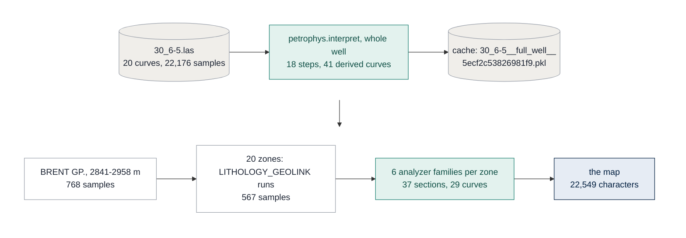
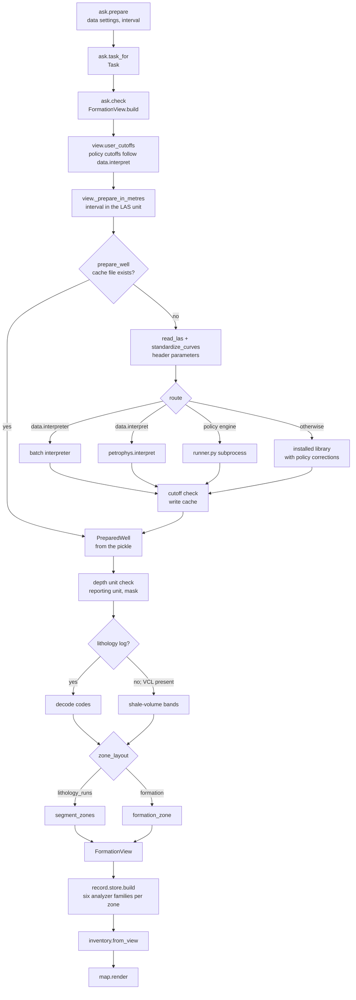
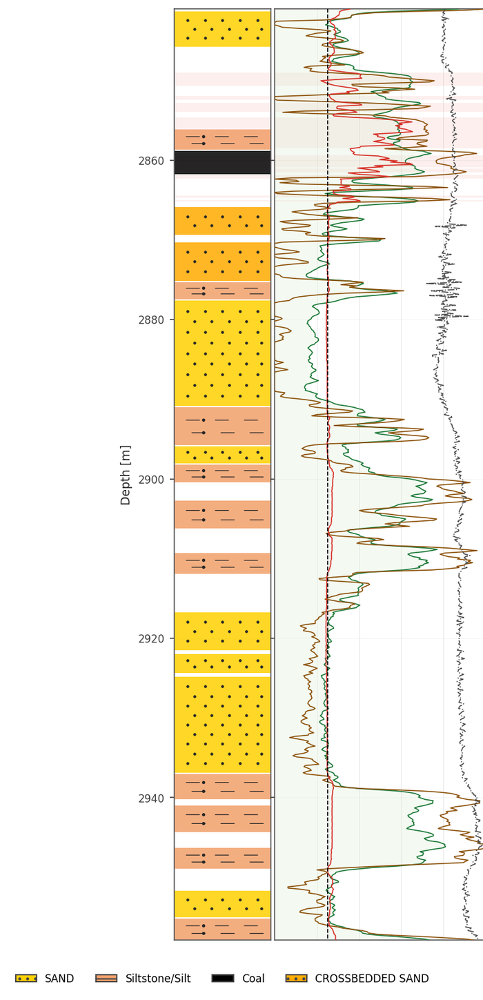

# Well preparation

Everything between a raw LAS file and the interval the model investigates: the LAS read and standardized, depth
units, the tops, the interval, the Petrophys interpretation and its cache, the zones, the analyzer sections, what the
model is shown first and the status every curve carries. The examples prepare the Brent Group of GeoLink well 30/6-5;
the commands themselves are in [Evaluate a formation](../USAGE.md).

## 1. At a glance



The Brent Group of 30/6-5, prepared as `petroharness` does before the first model call; the numbers are the run's.

| Fact | Value | Where |
|---|---|---|
| Entry points | `ask.ask`, `Conversation.start` (and `/set`), the web UI's question and preview; benchmark tasks through `FormationView.build` | [ask.py](../../src/petroharness/ask.py), [session/conversation.py](../../src/petroharness/session/conversation.py), [ui/adapter.py](../../src/petroharness/ui/adapter.py) |
| Interpretation (`petroharness`, `chat`, the UI) | `petrophys.interpret(las_path, **data.interpret)` on the whole LAS | `prepare._interpret_with_petrophys` |
| Default Petrophys options | `{vcl_cutoff: 0.3, sw_cutoff: 0.7}` (the policy's cutoffs), or `{context_profile: NAME}` with `--profile` | `ask._settings`, `ask.POLICY_CUTOFFS` |

## 2. How it works

The path of `petroharness`, `petroharness chat` and the web UI, function by function. Benchmark tasks start at
`FormationView.build`, with the data config's settings.



## 3. Data settings

`ask._settings` builds the data settings from the LAS, or starts from a settings file (`--settings`, else
`PETROHARNESS_DATA`). For 30/6-5 with no settings file (paths shortened):

```json
{"las_dir": ".../petrophys/datasets/geolink", "cache_dir": "./petroharness-out/30_6-5/.cache",
 "interpret": {"vcl_cutoff": 0.3, "sw_cutoff": 0.7}, "depth_unit": "las"}
```

After `ask.check`, `used` says what was asked about and `litho` how it was zoned (real output):

```json
{"used": {"name": "BRENT GP.", "top": 2841.0, "base": 2958.0, "unit": "m", "samples": 768,
          "from": "tops file formations_30_6-5.csv, base: stated base"},
 "litho": {"source": "lithology log", "curve": "LITHOLOGY_GEOLINK", "how": "detected"}}
```

<details>
<summary><code>DataPaths</code></summary>

The data settings every preparation runs under; a misspelt key is an error (`extra="forbid"`). `petroharness` builds
them from the LAS; benchmark mode reads them from a data config ([DEVELOPMENT.md](../DEVELOPMENT.md#the-data-config)).
Every field is defined in `config.DataPaths` unless noted.

| Name | Type | Default | Meaning |
|---|---|---|---|
| `las_dir` | path | required (`ask` sets the LAS's folder) | folder of the data's LAS files |
| `tops_csv` | path | `null` | the data config's tops table, read by `formation.resolve_interval` when a formation is named without depths or `--tops` |
| `interpreter` | text | `null` | a Petrophys batch interpreter, `"module:function"` or `"/path/adapter.py:function"` |
| `interpret` | table | `null` (`ask` always sets it) | options for `petrophys.interpret` |
| `depth_unit` | text | `null`: the policy's `depth_unit` (`m`) | the reporting unit: `m`, `ft`, or `las` for the LAS's own |
| `lithology_nomenclature` | path | `null` | a workbook of lithology codes and labels, over the library's code table |
| `lithology_columns` | table | `{code: code, label: lithology}` | the workbook's code and label columns (`config.LithologyColumns`) |
| `lithology_curve` | text or list | `null`: detected | the lithology log's mnemonic, or several (the first with data is used) |
| `zone_layout` | `lithology_runs` or `formation` | `lithology_runs` | runs of one lithology, or the interval as one zone |
| `zone_min_thickness_m` | number | `null`: policy `zones.min_thickness_m` (2.0) | minimum zone thickness, metres |
| `zone_vcl_bands` | two numbers | `null`: policy `zones.fallback_vcl_bands` (`[0.3, 0.6]`) | VCL edges of the bands for a well without a lithology log |
| `basis` | `all` or `zones` | `all` | statistics bases; `zones` leaves out the whole-interval lines |
| `analyzer_class_tables` | text | `null`: policy `analyzers.class_tables` (`current`) | the class-table set the analyzers classify with: a set a Petrophys context package ships, for data its context interprets |
| `conventions` | list of text | `[]` | the data's reporting conventions |
| `cache_dir` | path | `<repository>/.cache/wells` (`ask`: `<out>/.cache`) | the interpreted-well cache |
| `engines_dir` | path | `null` | folder of pinned engines, one per engine name |
| `tops_columns` | table | `{well: uwi, name: form, top: top}` | column names of `tops_csv` |
| `top_name_pattern` | regex | `null` (every top counts) | which upper-cased top names of `tops_csv` count |
| `tops_depth_unit` | `m` or `ft` | `null`: the LAS's own unit | the depth unit of `tops_csv` |

- `ask._settings` uses `setdefault` for `las_dir`, `cache_dir` and the cutoffs, so a settings file's own values win;
  `--lithology-curve` and `--profile` overwrite the file's. `ask._interpretation` then checks the interpretation
  settings (`settings.validate`), puts Petrophys's into `data.interpret` and the zone rule into `data.zone_*`.
- A settings file holds `data` and optionally `eval` sections only (`config._read_settings`); the keys are those of
  [configs/data.example.yaml](../../configs/data.example.yaml).
- `data.interpret` from a settings file reaches `petrophys.interpret` without the settings-sheet check; Petrophys's
  own validation applies ([Limits and errors](#17-limits-and-errors)).

</details>

<details>
<summary><code>Prepared</code></summary>

One interval of one LAS, ready for questions: what `ask.prepare` returns and `ask.check` completes (`ask.Prepared`).

| Name | Type | Default | Meaning |
|---|---|---|---|
| `las` | path | required | the LAS file, resolved |
| `key` | text | required | the model registry key |
| `data` | table | required | the data settings built for this LAS |
| `source` | text | required | the settings file's path, or `built from the LAS` |
| `span` | table | required | the interval asked about (`ask._interval`) |
| `said` | text | required | the operator's lithology (`--formation-lithology`) |
| `given` | table | required | `{"data": ..., "eval": {}}`, with `skills` when a library is given: the settings every question runs under |
| `view` | `FormationView` | `None` until `check` | the interval view |
| `used` | table | `{}` until `check` | `name`, `top`, `base`, `unit`, `samples`, `from` |
| `litho` | table | `{}` until `check` | how the interval was zoned |
| `notes` | table | `{}` | the field notes in force (`well.notes.load`) |

- `litho.source` is `lithology log` (with `curve` and `how`: `named` or `detected`), `shale-volume bands` (with
  `bands`) or `none` (no lithology log and no VCL).
- The answer header and the stderr record print `used` and `litho` through `ask._interval_text` and
  `ask._lithology_text`.

</details>

## 4. The interpretation policy

The packaged policy, `src/petroharness/resources/policy/reference_v2.yaml` (`config.ResourcePaths.policy_file`),
holds the cutoffs, the zone rule, the depth unit and the code table every route reads.
`load_policy` reads it; `view.user_cutoffs` replaces its cutoffs with the user's for one view. The keys that decide
preparation, as packaged:

```yaml
interpretation_scope: full_well
value_range_qc: true
cutoffs: {vcl_max: 0.30, phie_min_clastic: 0.08, phie_min_carbonate: 0.045, sw_max: 0.70}
depth_unit: m
lithology: {codes: library}
zones: {min_thickness_m: 2.0, fallback_vcl_bands: [0.3, 0.6]}
```

<details>
<summary><code>reference_v2.yaml</code></summary>

Every key is read from the policy file unless noted.

| Name | Type | Default | Meaning |
|---|---|---|---|
| `name` | text | `reference_v2` | names the cache folder |
| `engine` | text | a pinned engine's name | the engine of the data-config route when neither `data.interpret` nor `data.interpreter` is set; `installed` or absent: the installed library |
| `interpretation_scope` | `full_well` or `formation` | `full_well` | interpret the whole log once, or the interval's slice (installed-library route only) |
| `value_range_qc` | yes/no | `true` | apply Petrophys's value-range QC after the engine and installed-library routes |
| `cutoffs.vcl_max` | number | `0.30` | NET_ROCK clay cutoff |
| `cutoffs.phie_min_clastic` | number | `0.08` | NET_RES porosity cutoff, clastic |
| `cutoffs.phie_min_carbonate` | number | `0.045` | NET_RES porosity cutoff, carbonate |
| `cutoffs.sw_max` | number | `0.70` | NET_PAY saturation cutoff |
| `depth_unit` | text | `m` | the reporting unit when `data.depth_unit` is unset |
| `reporting.profile` | path | `profiles/report_style.yaml` | the report style (the zone table's style among it) |
| `lithology.codes` | text | `library` | the code table: `library` (Petrophys's table, overridden code by code by the nomenclature workbook) or a YAML file of code to label |
| `analyzers.class_tables` | text | `current` (the library's own tables) | the class tables the analyzers are built with, where they accept the argument; `data.analyzer_class_tables` replaces it for a view (`FormationView.build`) |
| `zones.min_thickness_m` | number | `2.0` | minimum zone thickness, metres |
| `zones.fallback_vcl_bands` | two numbers | `[0.3, 0.6]` | VCL band edges for a well without a lithology log |
| `gr_endpoints` | text | not set | `auto` lets the installed-library route pick GR endpoints (`prepare._interpret`) |
| `rw.header_rw_without_rwt`, `rw.rwa_fallback` | text, table | not set | Rw corrections of the installed-library route (`prepare._interpret`) |

- The policy may not name the lithology curve: `lithology.curve` in it stops `FormationView.build` with an error;
  the curve is the data's (`data.lithology_curve`).
- The policy's `confidence`, `flow_roles` and `qc_thresholds` blocks are read by the evidence catalog, not by
  preparation.
- `engine`, `gr_endpoints`, `rw` and `value_range_qc` act only in the data-config routes; `petroharness`, `chat` and
  the UI always set `data.interpret` ([section 9](#9-the-petrophys-interpretation)).

</details>

## 5. Reading the LAS

`prepare_well` reads the LAS with Petrophys and standardizes it once, before any route runs. Petrophys's
`normalization` step then aliases mnemonics, standardizes units, masks implausible readings and records each change.
30/6-5 needs none of it ("No canonical working aliases were required"); two wells that do:

**Blank and wrong units.** KGS 1046123714 (Morgan No. 1-17) leaves most units blank and labels both calipers `GAPI`
(real output, abridged; data: Kansas Geological Survey, kgs.ku.edu):

```text
raw units:       RILD '', RHOB '', GR '', CNLS '', DPOR '', SP 'MV', DCAL 'GAPI', MCAL 'GAPI'
working_aliases: {'RILD': 'RDEP', 'RILM': 'RMED', 'RLL3': 'RSHA', 'RHOC': 'DRHO', 'CNLS': 'NPHI', 'DT': 'DTC', 'DCAL': 'CALI'}
unit_changes:    {'SP': {'from': 'MV', 'to': 'mV'}, 'DPOR': {'from': '', 'to': 'v/v'}, 'CNLS': {'from': '', 'to': 'v/v'}, 'SPOR': {'from': '', 'to': 'v/v'}}
labels:          RDEP = Resistivity - Deep (...); CALI [GAPI] = Caliper (...); BVTX = unknown (input curve)
```

Units Petrophys can read are standardized; a blank resistivity, density or gamma-ray unit stays blank, and a unit
wrong for its log (a caliper in `GAPI`) is kept, so every label shows it. Unrecognised curves (BVTX, MI, ITT, ...)
keep their names, with the status `input curve`.

**Readings out of range.** On GeoLink 16/7-1, 2100-2600 m (data: GeoLink, CC BY-SA 4.0), more than half of the sonic
lies outside its plausible range and is masked whole (the map then lists DTC among logs with no values here,
[section 15](#15-what-the-model-is-shown-at-the-start)); the deep resistivity of the 414 m Zechstein halite stays as
logged (real output, abridged):

```text
range_screening: "DTC": {"low": 38.5, "high": 300.0, "unit": "us/ft", "masked": 4914, "finite": 9427, ..., "whole_curve": true},
                 "RDEP": {"low": 0.0, "high": 100000.0, "unit": "ohm.m", "masked": 4, "finite": 14777, ...}
stats:           Z4 HALITE 2154.6799-2568.446 m, RDEP: n 2716 of 2716, mean 3481.5028, median 3689.899, ..., max 4852.8579
```

<details>
<summary>Reading and standardizing</summary>

| Name | Default | Meaning | Defined in |
|---|---|---|---|
| `_read(path)` | warnings silenced | `petrophys.io.read_las(path)` | `prepare._read` |
| `standardize_curves` | `rename_curves=True, convert_units=True` | standard mnemonics and units (RDEP, NPHI, RHOB, GR, ...) | `prepare.prepare_well` |
| `header_parameters` | from `well._parameters` | the LAS header parameters; a value JSON cannot hold is kept as text | `prepare.prepare_well` |
| `read_depth(path)` |  | the LAS depth index as floats | `prepare.read_depth` |
| `las_curve_descriptions(path)` | cached, 256 files | `{MNEMONIC: description}` from the LAS header (lasio, without data) | `view.las_curve_descriptions` |
| `las_depth_unit(path)` | `""` when none | the index curve's unit from the LAS header | `view.las_depth_unit` |
| `_las_header(las)` |  | the depth unit as `m`/`ft` and the names the well goes by: file stem, `WELL`, `UWI`, `API`, `APIN` | `ask._las_header` |

</details>

<details>
<summary>Curve aliasing and units</summary>

How a vendor mnemonic becomes a standard one, and what the record shows of both.

| Name | Type | Default | Meaning | Defined in |
|---|---|---|---|---|
| Petrophys `normalization` step | workflow step | runs in `petrophys.interpret` | adds standard aliases (RDEP, RHOB, NPHI) while keeping the vendor mnemonics (RESD, DENS, NEUT) | Petrophys |
| `curve_aliases` | `petrophys.interpret` option | not set | `{YOUR_MNEMONIC: STANDARD}` or a CSV path with curve,standard columns; set under `data.interpret` | settings file |
| `standardize_input`, `rename_input_curves` | interpretation settings | Petrophys's | whether Petrophys standardizes, and renames instead of aliasing | [INTERPRETATION_SETTINGS.md](INTERPRETATION_SETTINGS.md) |
| `UNIT_SPELLINGS` | table | `{gapi: API, m3/m3: v/v, frac: v/v, dec: v/v}` | unit spellings a pinned engine keeps, respelled as the installed library writes them | `prepare.UNIT_SPELLINGS` |
| copies | inventory source | | a curve with the same values as a supplied curve is listed as a copy (KGS 1046123714: "RDEP = Resistivity - Deep (same values as RILD)") | `record.card.curve_origin` |

A settings file that maps an unrecognised medium resistivity:

```yaml
data:
  interpret:
    curve_aliases: {RESM: RMED}
```

- A curve an alias renames is in the interpreted well under its standard name, but is not an input curve: the
  harness's own standardized copy of the LAS does not hold it (`PreparedWell.input_curves` is the curves both hold).
- A curve Petrophys does not recognise keeps its own name, is used by no calculation, and is shown as an `input
  curve` (BVTX, AVTX, RXORT, CILD, MI, MN and ITT on KGS 1046123714).
- A path given as an option value that is a file is hashed into the cache key ([section 10](#10-the-cache)).

</details>

## 6. Depth units

Every depth is in m or ft. A depth's unit comes from the tops file (a unit column, or the top column's header), else
`--depth-unit`, else the LAS's index. Depths in another unit are converted, and the answer reports in `--depth-unit`
when given, else in the unit the interval was given in. KGS 1046123714 is logged in feet (real output; data: Kansas
Geological Survey, kgs.ku.edu):

```text
--tops 1046123714_formation_tops.csv --formation Topeka
    used: Topeka 3782-3884 ft, 204 samples; report ft
--top 1152.7536 --base 1183.8432 --depth-unit m
    used: 1152.7536-1183.8432 m, 205 samples; report m; depth_scale 0.3048 (metres per LAS foot)
```

The depth window holds one sample more: it includes its base, while a base taken from the next top does not.

<details>
<summary>Where a depth's unit comes from</summary>

`tops.depth_unit_name` reads the spellings `m`, `meter`, `meters`, `metre`, `metres`, and `ft`, `f`, `feet`, `foot`
(case, spaces and dots ignored).

| Name | Type | Default | Meaning | Defined in |
|---|---|---|---|---|
| tops unit column | column | none | `depth_unit`, `depth_units`, `units`, or `unit` when every value is m or ft; per row, first in order | `tops.read_tops` |
| unit in the top column's header | header | none | `Top (ft)`, `TOP [M]`, `top_md_m`; applies to rows without a unit cell | `tops._header` |
| `--depth-unit` / `depth_unit=` | `m` or `ft` | none | unit of `--top`/`--base` and of a tops file that states none; the reporting unit | `ask._interval` |
| LAS index unit | LAS header | none | `DEPT.M`, `DEPT.FT`, `DEPT.F`; used for everything not stated otherwise | `ask._las_header` |
| `FEET_PER_METRE` | constant | `1 / 0.3048` | conversion factor | `tops.FEET_PER_METRE` |
| `metres_per(unit, source)` | function | | metres per unit via `petrophys.model.units` (`normalize_depth_unit`, `UnitRegistry.DEPTH_TO_M`); refuses any unit but m and ft | `view.metres_per` |

A semicolon-separated tops file whose unit is in its headers (real output of `read_tops`):

```text
Zone;Top (ft);Base (ft)
A sand;1950;2010
B shale;2010;2100

columns: {name: Zone, top: Top (ft), base: Base (ft)}; rows: (A sand, 1950, 2010, ft), (B shale, 2010, 2100, ft)
with --depth-unit m: ValueError: WHAT: the tops file tops_header_unit.csv states its depths in ft and the depth unit
given is m. WHY: one of them is wrong. FIX: drop --depth-unit (the file's unit is used) or correct the file.
```

</details>

<details>
<summary>How the interval and the answer get their unit</summary>

| Name | Type | Default | Meaning | Defined in |
|---|---|---|---|---|
| `span["unit"]` | `m`, `ft` or `None` | the tops row's unit, the stated unit, else the LAS's | the unit the interval's depths are written in | `ask._interval` |
| `span["report"]` | text | `--depth-unit`, else `span["unit"]`, else the LAS's | the unit the answer's depths are shown in | `ask._interval` |
| `data.depth_unit` | text | `las` when the reporting unit is the LAS's own, else `m` or `ft` | passed to the view | `ask.prepare` |
| `Task.depth_unit` | text | `las` or `m`/`ft`; `None` for the data-config tops route | the unit of `Task.top`/`Task.base` | `ask.task_for` |
| `reporting_unit(wanted, prep)` | function | `data.depth_unit`, else policy `depth_unit` | `(label, metres per unit)`; `las` reads the prepared well's own unit | `view.reporting_unit` |
| `check_depth_unit(prep, policy)` | function | a well without a unit: the policy's (`m`) | metres per LAS depth unit | `view.check_depth_unit` |
| `FormationView.depth_scale` | number | `1.0` | reporting units per LAS unit (0.3048 for a feet LAS shown in metres) | `view.FormationView` |
| `FormationView.m_per_unit` | number | `1.0` | metres per reporting unit; converts thresholds stated in metres | `view.FormationView` |

- Mixed units work: a tops file's rows may each state their own unit, and the next deeper top is converted to the
  named row's unit (`tops._in_unit`).
- `view._prepare_in_metres` converts the interval to the LAS's unit before `prepare_well` (which slices in that
  unit), then to the reporting unit for the view.
- A LAS that states no depth unit is read by Petrophys as feet; the view then stops, since a unit it would apply is
  not one the file states (`view._converted_depths` allows a well another route converted on purpose).

</details>

## 7. The tops reader

`read_tops` reads a tops table as people keep one (CSV, TSV, semicolon-separated, or Excel); columns are found by
meaning, never by one dataset's layout. `TopsTable.interval` then gives a formation's interval, and records where
its base came from:

| Situation | Base | Included | `base_from` |
|---|---|---|---|
| the row has a base value | the stated base | yes (`closed=True`) | `stated base` |
| no base; a deeper top exists anywhere in the table | the next deeper top, of any rank | no | `next top <name>` |
| no base, no deeper top | end of the log (`None`) | yes | `end of log` |

Rows of the sample tops file `formations_30_6-5.csv`:

```csv
formation_name,top_depth,bottom_depth,lithology,depth_unit,rank,parent
VIKING GP.,2452.0,2841.0,Shale,m,group,
BRENT GP.,2841.0,2958.0,Sandstone,m,group,
Ness Fm.,2841.0,2865.0,Sandstone,m,formation,BRENT GP.
Etive Fm.,2865.0,2958.0,Sandstone,m,formation,BRENT GP.
```

The reader maps it as `{unit: depth_unit, name: formation_name, top: top_depth, base: bottom_depth}` (it reads no
other column) and gives BRENT GP. 2841 to 2958 m and Ness Fm. 2841 to 2865 m, both `stated base`. `--formation "brent
gp"` finds BRENT GP. too. Tops files kept other ways (real output):

| Tops file | What the reader does | Result |
|---|---|---|
| KGS `1046123714_formation_tops.csv`: formation, top, unit; no base column | the base is the next deeper top | Topeka 3782-3884 ft, `next top Lecompton` (base excluded); the last top, Mississippian: `end of log` |
| COSTA `formations_costa.csv`: one row per well, a `well` column | keeps the rows of this LAS's well (its stem, `WELL` and `UWI` all read HW-3) | KHARAIB-2 7805-8020 ft, `stated base` |
| Taranaki `formations_tuhua-7.csv`: Manganui listed twice | refuses the name and asks for the row's top, or the depths | the message below |

```text
WHAT: formation 'Manganui' is listed 2 times in formations_tuhua-7.csv (line 3: top 874.014,
base 1250.75; line 10: top 2164.99, base 2347.42). WHY: a repeated name (e.g. a repeated section)
does not say which interval is meant. FIX: choose the one you mean by its top: --formation NAME
--tops FILE --top D, or give its depths alone: --formation NAME --top D --base D.
```

With `--formation Manganui --top 2164.9944 --base 2347.4172` the run goes ahead (1198 samples, 17 zones). Data: Kansas
Geological Survey (kgs.ku.edu); Costa Gomes, Geiger and Arnold (2022), COSTA model, Heriot-Watt University, CC BY;
Taranaki Basin Curated Well Logs Dataset (New Zealand Petroleum & Minerals), CDLA-Sharing-1.0.

<details>
<summary><code>read_tops</code> and <code>TopsTable.interval</code></summary>

Defined in `tops.read_tops` unless noted; constants as `tops.<NAME>`.

| Name | Default | Meaning |
|---|---|---|
| `NAME_COLUMNS` | `formation`, `formation_name`, `name`, `top_name`, `zone`, `horizon`, `unit` | the formation name (required) |
| `TOP_COLUMNS` | `top`, `top_depth`, `top_md`, `md`, `depth` | the top depth (required) |
| `BASE_COLUMNS` | `bottom`, `bottom_depth`, `bottom_md`, `base`, `base_depth`, `base_md` | a stated base (optional) |
| `UNIT_COLUMNS` | `depth_unit`, `depth_units`, `units`, `unit` | the depth unit (optional) |
| `WELL_COLUMNS` | `well`, `well_name`, `wellname`, `well_id`, `uwi`, `api` | the well (optional) |
| header matching |  | lower case, any run of other characters read as `_`, a unit in brackets or a `_m`/`_ft` suffix taken off (`tops._header`) |
| separator |  | tab if the first line has one; `;` if it has one and no comma; else `,` (`tops._read_frame`) |
| no header line |  | 2 or 3 columns whose second header cell is a number: read as name, top[, base] |
| well filter |  | with a well column, only rows whose well matches a name of the LAS (file stem, `WELL`, `UWI`, `API`, `APIN`), case and punctuation ignored |
| name matching |  | `name_key`: case, spaces and punctuation ignored (`BRENT GP.` = `brent gp`) (`tops.name_key`) |

- A name the table lacks raises `FormationNotFound` with up to three close names (`difflib`, cutoff 0.6, on the names
  as written) and every name the table lists: "WHAT: formation 'BRENT GRP.' is not in the tops file
  formations_30_6-5.csv. Did you mean 'BRENT GP.'? ..." (real output).
- A row with a name and no numeric top, or the reverse, is an error with its line number; a fully empty row is
  skipped. A stated base at or above its top is an error.
- A header unit is read from the top column's header only; a base on that row is taken in the same unit.
- A file without a header line must give every row the same number of fields (`BRENT GP.,2841,`); otherwise it is
  refused ([Limits and errors](#17-limits-and-errors)).
- Tops in true vertical depth or subsea are not converted: the reader takes them on the LAS's depth index.

</details>

<details>
<summary><code>resolve_interval</code></summary>

The data config's tops reader (`data.tops_csv`), used when a task or `--formation` names a formation without depths
or `--tops`.

| Name | Default | Meaning | Defined in |
|---|---|---|---|
| `tops_columns` | `{well: uwi, name: form, top: top}` | column names; no stated base | `config.DataPaths` |
| `top_name_pattern` | `null` | which upper-cased names count | `config.DataPaths` |
| name matching |  | upper case, spaces collapsed (`normalize_top_name`) | `formation.normalize_top_name` |
| well matching |  | `/` read as `_` (`normalize_well`); the well is the LAS stem | `formation.normalize_well` |
| top |  | the smallest top of the matching rows | `formation.resolve_interval` |
| base |  | the next deeper top of any rank; none: end of log (open base) | `formation.resolve_interval` |
| unit |  | `data.tops_depth_unit`, else the LAS's own | `view._prepare_in_metres` |

```yaml
data:
  tops_csv: /path/to/formation_tops.csv
  tops_columns: {well: uwi, name: form, top: top}
  top_name_pattern: null
  tops_depth_unit: null
```

</details>

## 8. The interval

`ask._interval` resolves the interval asked about into one table, `span`, in one of four modes:

| Mode | Given | Top | Base | `closed` | `from` |
|---|---|---|---|---|---|
| Formation of a tops file | `--tops`, `--formation` | the row's top | [section 7](#7-the-tops-reader) | stated base only | `tops file <file>, base: <base_from>` |
| Depth window | `--top` and/or `--base` | given, else the log's first depth | given, else the log's last depth | yes | `depths given` |
| Formation of the data config | `--formation` and `data.tops_csv` | `formation.resolve_interval` | next deeper top | no | `the settings' tops table <file>` |
| Whole well (default) | nothing | the log's first depth | the log's last depth | yes | `the whole log (no formation or depths given)` |

The stderr record of a run on the Brent Group:

```text
petroharness: 30_6-5.las, BRENT GP.: 2841-2958 m (768 samples; tops file formations_30_6-5.csv, base: stated base)
  lithology: zones from the lithology log LITHOLOGY_GEOLINK (detected); 20 zones
```

<details>
<summary><code>ask._interval</code></summary>

| Name | Type | Default | Meaning |
|---|---|---|---|
| `name` | text | the formation, or `depth interval T-B <unit>`, or `whole well` | the interval's label |
| `top`, `base` | number | from the mode | the interval's depths in `unit`; `None` for the data-config tops route |
| `closed` | yes/no | | the base sample is included |
| `unit` | `m`, `ft`, `None` | | the unit of `top`/`base` |
| `from` | text | | where the interval came from |
| `las_unit` | text | | the LAS's own unit |
| `report` | text | | the reporting unit |

- `Interval.contains` keeps `depth >= top`, and `depth <= base` when closed or `depth < base` when the base is the
  next top (`formation.Interval`); a depth within `1e-9` (relative) of a limit counts as on it.
- With `zone_layout: formation` and a base, the mask is widened by half the median sample step at each end
  (`FormationView.build`).
- A long log has many zones: the whole of 30/6-5 (176.61-3556.0803 m, 22,176 samples) gives 137 zones at the default
  rule, 206 with a 1.0 m minimum.

</details>

<details>
<summary><code>Task</code></summary>

What one question runs on; `ask.task_for` builds it from the span.

| Name | Type | Default | Meaning | Defined in |
|---|---|---|---|---|
| `task_id` | text | `a` + 10 hex of SHA-256 of LAS, question and span | opaque id | `ask.task_for` |
| `question` | text | | the question, with `(The operator states this formation's lithology: ...)` unless `zone_layout` is `formation`, the tops file's units inside the interval, and the field notes statement | `ask.task_for` |
| `well` | text | | the LAS stem | `tasks.Task` |
| `formation` | text | | `span["name"]` | `tasks.Task` |
| `top`, `base` | number | `None` | the interval's depths | `tasks.Task` |
| `depth_unit` | text | `None` (metres) | `las`, `m` or `ft` | `tasks.Task` |
| `base_closed` | yes/no | `False` | a stated base is included | `tasks.Task` |
| `formation_lithology` | text | `None` | the operator's lithology, upper case | `tasks.Task` |

Preparing and checking an interval without asking a question:

```python
import petrophys
from pathlib import Path
from petroharness import ask as A

p = A.prepare(Path(petrophys.sample("30/6-5")), "preview", formation="BRENT GP.",
              tops=petrophys.sample("formations_30_6-5.csv"), cache=Path("cache"))
task, _ = A.task_for(p, "(the interval)")
A.check(p, task)
print(p.used, p.litho, [z.zone_id for z in p.view.zones])
```

</details>

## 9. The Petrophys interpretation

`prepare_well` interprets the whole well by exactly one route. On 30/6-5 at the defaults, `petrophys.interpret` runs
with `{"vcl_cutoff": 0.3, "sw_cutoff": 0.7}` and records 18 steps (real output):

```text
normalization, input_context, temperature, bad_hole, vclay, rcl, rmf, porosity, lithology, core_correction, rw,
invasion, saturation, permeability, rock_quality, bvw, mhi, net_pay
```

What each step does depends on the well. COSTA HW-3, a carbonate (Kharaib-2, 7805-8020 ft) with no lithology log and
no PEF, is read with Petrophys's clastic defaults unless the domain is stated (real output; data: Costa Gomes, Geiger
and Arnold (2022), COSTA model, Heriot-Watt University, CC BY):

| Record | 30/6-5 Brent | HW-3, defaults | HW-3, `lithology_domain: carbonate` |
|---|---|---|---|
| lithology | the vendor log LITHOLOGY_GEOLINK | LITHO from mineral volumes (431 of 431 solved) | calcite and dolomite, generic calibration (410 of 431 solved) |
| matrix | per lithology from the log (sandstone 2.65, coal 1.35 g/cm3, ...) | sandstone, 2.65 g/cm3 | 2.71 g/cm3, nphi_ma 0, dt_ma 47.6 |
| saturation | archie+simandoux by VCL and lithology; a by lithology, m 2, n 2 | archie, all 431 samples; a 1, m 2.03, n 2 (the LAS header's) | the same |
| net-pay porosity cutoff | 0.08 clastic, 0.045 carbonate, by lithology family | 0.08 (clastic) | 0.045 (carbonate) |
| NET_RES, NET_PAY | 413, 185 samples | 380, 380 samples (190.0 ft each) | 390, 388 samples (195.0, 194.0 ft) |

### The four routes

Setting both `data.interpreter` and `data.interpret` is an error.

| Route | When | What runs | Defined in |
|---|---|---|---|
| `data.interpret` | set; always for `petroharness`, `chat` and the UI | `petrophys.interpret(las_path, **options)` on the whole LAS | `prepare._interpret_with_petrophys` |
| `data.interpreter` | set (a data config) | `module:function(source_dir, out_dir, well_names=[stem])` on a temporary folder holding a link to the LAS; one result expected | `prepare._interpret_with_interpreter` |
| pinned engine | neither set; policy `engine` names one other than `installed` | the engine's own Petrophys in a subprocess, on the raw LAS | `prepare._interpret_with_engine`, `well/runner.py` |
| installed library | neither set; no engine, or `installed` | `run_dynamic_workflow_with_zones` with the policy's cutoffs and corrections, at most twice | `prepare._interpret` |

The two data-config keys that choose a route (keep one of them):

```yaml
data:
  interpret: {context_profile: NAME}            # petrophys.interpret's options
  # interpreter: /path/to/adapter.py:function   # or "module:function", a Petrophys batch interpreter
```

<details>
<summary><code>petrophys.interpret</code> options</summary>

What `data.interpret` holds on the `petroharness` route.

| Name | Type | Default | Meaning | Defined in |
|---|---|---|---|---|
| `vcl_cutoff`, `sw_cutoff` | number | policy `vcl_max` 0.30, `sw_max` 0.70 | the net-pay cutoffs, set because the library's own defaults differ | `ask.POLICY_CUTOFFS` |
| `context_profile` | text | not set | a Petrophys context profile (`--profile`); no cutoffs are added and Petrophys settings are refused | `ask._settings` |
| any interpretation setting | value | not set | `m`, `rw`, `sw_model`, ... from `interpretation=`, the UI or field notes | `ask._interpretation` |
| `curve_aliases` | table or path | not set | a curve-name mapping (settings file only) | `ask._settings` |

- Petrophys decides which steps run from the curves present; the record holds the steps it executed
  (`result.steps_executed`). A step that could not run is recorded by Petrophys, not fatal; a result with errors or no
  usable interpretation stops preparation with a `RuntimeError`.
- The input curves are the curves of the harness's standardized LAS that the interpreted well holds; every other
  curve of the interpreted well is a derived curve (`PreparedWell.input_curves`, `derived_curves`).
- With a context profile, Petrophys keeps the workflow's own well before the profile's QC and recomputation
  (`result._context_run.well`); the harness keeps it as `PreparedWell.workflow_well` and builds each zone's well from
  it (`calculations.as_context_group`).

</details>

<details>
<summary>The step record</summary>

Each step of the record, as `prepare.step_entry` keeps it (other functions noted).

| Name | Default | Meaning |
|---|---|---|
| `method` |  | the step's method |
| `parameters` |  | as recorded; a nested step record is replaced by its steps' names; a value-range QC's `changes` move to `decisions` |
| `decisions` |  | the record's lines, plus one line per curve a value-range QC changed |
| `inputs`, `outputs`, `removed` | absent when not listed | curves read, written (with `also_written`) and removed |
| `stage` | `workflow` | `preparation` (name `preparation_*`), `after` (name `context_*`) or `workflow`; `data.interpret` route only (`prepare.step_stage`) |
| repeated step |  | a name recorded twice keeps both, the later as `name_2` (`prepare._step_record`) |
| bad-hole thresholds | `thresholds_source: library defaults` | `cali_minus_bs_threshold_in`, `drho_threshold_g_cc`, `large_hole_threshold_in` from `generate_bad_hole_flags`'s defaults; the record's own values win (`runner.bad_hole_thresholds`) |

The bad-hole and net-pay record of 30/6-5 (real output, abridged; the record counts the whole well, the map scopes
its lines to the interval):

```text
bad_hole parameters: cali_minus_bs_threshold_in 1.5; ...; thresholds_source library defaults; bit_size_used 12.25; ...
bad_hole decisions:  12631 bad-hole samples flagged out of 22176
net_pay parameters:  vcl_cutoff 0.3; phie_cutoff lithology_dependent; sw_cutoff 0.7; lithology per-depth; ...
net_pay decisions:   NET_ROCK: VCL < 0.3 -> 10472 samples (1595.4 m); ...; NET_PAY:  + SW < 0.7 -> 1954 samples (297.7 m); ...
```

</details>

<details>
<summary>The cutoff check</summary>

Net pay must follow the policy's cutoffs, as `view.user_cutoffs` set them for this view.

| Name | Default | Meaning | Defined in |
|---|---|---|---|
| `_check_engine_cutoffs(steps, cut, well=None)` | tolerance `1e-12` | compares the net-pay step's recorded `vcl_cutoff`, `sw_cutoff`, `phie_cutoff` with `vcl_max`, `sw_max` and `phie_min_clastic` or `phie_min_carbonate`; `data.interpret` and engine routes | `prepare._check_engine_cutoffs` |
| `_check_porosity_cutoff_on_curves` |  | engine route without one recorded porosity cutoff: no NET_RES sample at or below the lowest policy cutoff, no net-rock sample above the highest left out | `prepare._check_porosity_cutoff_on_curves` |
| `_check_cutoffs(result, cut)` |  | the same comparison on a workflow result; installed-library and interpreter routes | `prepare._check_cutoffs` |
| domain | `clastic` | read from the net-pay parameters: `lithology_domain`, else `lithology` (as Petrophys records it); `carbonate` compares `phie_min_carbonate`, any other domain `phie_min_clastic` | `prepare.lithology_domain` |
| `user_cutoffs(policy, interpret)` | unchanged without user cutoffs | `vcl_cutoff` -> `vcl_max`, `sw_cutoff` -> `sw_max`, `phie_cutoff` -> both porosity cutoffs | `view.user_cutoffs` |

The refusal when a recorded cutoff differs (real output of `_check_engine_cutoffs` on a clastic net-pay record with
`phie_cutoff` 0.1 against the policy's 0.08):

```text
RuntimeError: WHAT: the engine used cutoffs {'phie_cutoff': (0.1, 0.08)} (engine, policy). WHY: the policy
describes the engine's workflow. FIX: make the policy's cutoffs match the engine.
```

- With `lithology_domain: carbonate` and no `phie_cutoff`, Petrophys uses its carbonate porosity cutoff (0.045) and
  records the domain as `lithology`; the check compares it with `phie_min_carbonate` (0.045) and passes (COSTA HW-3
  above: `phie_cutoff 0.045; lithology carbonate`).
- A cutoff recorded as text (per depth, by lithology) is not compared; the engine route checks it on the curves.
  30/6-5 records `phie_cutoff: lithology_dependent` (0.08 clastic, 0.045 carbonate, by lithology family).

</details>

<details>
<summary>Pinned engine (<code>runner.py</code>)</summary>

A Petrophys source tree pinned as a policy's workflow of record, run in its own interpreter.

| Name | Default | Meaning | Defined in |
|---|---|---|---|
| engine folder | `<data.engines_dir>/<engine>` | holds `ENGINE.json` whose `name` is the engine's | `prepare.engine_dir` |
| command |  | `python runner.py <engine_dir> <las> <out_prefix> '{"value_range_qc": <policy>}'` | `prepare._interpret_with_engine` |
| outputs |  | `<prefix>.npz` (curves, `__depth__`, `__qc__<curve>` masks) and `<prefix>.json` (units, input curves, header, steps, warnings, engine, QC report) | `runner.main` |
| scope |  | `interpretation_scope` must be `full_well` | `prepare.prepare_well` |
| dropped curves |  | LAS curves the engine's reader dropped are added back when the depths match, and QC'd as the engine's own | `prepare.prepare_well` |
| after QC | when `value_range_qc` | BVW, PHI_NORM, RQI and FZI recomputed from the cleaned curves | `prepare._sync_after_qc` |

```text
<engines_dir>/<engine name>/ENGINE.json      {"name": "<engine name>", ...}
<engines_dir>/<engine name>/src/petrophys/   the engine's Petrophys (or petrophys/ at the folder's root)
```

</details>

<details>
<summary>Installed library with the policy's corrections (<code>_interpret</code>)</summary>

The data-config route when the policy names no engine.

Defined in `prepare._interpret` unless noted.

| Name | Default | Meaning |
|---|---|---|
| configuration |  | Petrophys's context workflow configuration, with the policy's `vcl_max` and `sw_max` as `vcl_cutoff` and `sw_cutoff` |
| `gr_endpoints: auto` | not set | `gr_min` and `gr_max` left to the library |
| `rw.header_rw_without_rwt` | not set | `median_formation_temperature`: a header Rw without its temperature is referenced to the median TEMP |
| `rw.rwa_fallback` | not set | `{a_sandstone, a_other, m, vcl_max, phie_min, percentile}`: an Rwa clean-wet Rw recomputed at the clean-wet median temperature (Arps) (`prepare._rwa_p5_fix`) |
| porosity cutoff |  | the policy's cutoff of the net-pay domain where the library's differs |
| second pass |  | the workflow runs again with the adjustments when there are any |
| `formation` scope |  | the well is sliced to the interval before interpreting (`prepare.prepare_well`) |

The packaged policy sets none of these corrections.

</details>

<details>
<summary><code>PreparedWell</code></summary>

The interpreted well and the record of how it was interpreted; what the cache holds (`prepare.PreparedWell`).

| Name | Type | Default | Meaning |
|---|---|---|---|
| `name` | text | | the LAS stem |
| `policy` | text | | the policy's `name` |
| `scope` | text | | `full_well` or `formation:<name>` |
| `well` | Petrophys `Well` | | raw and derived curves |
| `input_curves`, `derived_curves` | list | | the LAS's curves and the rest |
| `steps` | table | | step name -> step entry |
| `header_parameters` | table | | the LAS header parameters |
| `policy_adjustments` | table | `{}` | `{"interpret": options}`, `{"interpreter": spec}`, `{"engine": identity}`, or the installed route's adjustments |
| `value_qc` | table | `{}` | `{"rules": {curve: {low, high, action}}, "changed": {curve: bool array}}` |
| `workflow_well` | Petrophys `Well` | `None` | a context profile's workflow well before its QC |
| `context_profile` | property | `None` | `policy_adjustments["interpret"]["context_profile"]` |

The prepared well of 30/6-5 at the defaults (real output, abridged):

```text
name: 30_6-5; policy: reference_v2; scope: full_well; context_profile: None
policy_adjustments: {"interpret": {"vcl_cutoff": 0.3, "sw_cutoff": 0.7}}
input_curves: BS, CALI, DRHO, DTC, DTE, GDEN, GR, KH_CORE, KV_CORE, LITHOLOGY_GEOLINK, NPHI, PEF, PHIC, RDEP, RHOB, ...
derived_curves: BAD_HOLE, BVW, CROSSOVER_FLAG, FZI, INVASION_RATIO, MHI, NET_PAY, NET_RES, NET_ROCK, PERM, ... (41)
value_qc: {}
```

When the LAS uses vendor mnemonics, `derived_curves` also holds them beside the standard ones Petrophys adds: CNLS,
DCAL, DT, RHOC, RILD, RILM and RLL3 on KGS 1046123714 ([section 16](#16-curve-sources-and-statuses)).

</details>

## 10. The cache

Prepared wells are pickled, keyed by the LAS content and the interpretation settings, so a later question on the
same LAS skips the interpretation. The cache file of 30/6-5 at the default settings (real output; the hex parts
depend on the install and the file):

```text
<out>/.cache/reference_v2_81e94bcb/30_6-5__full_well__5ecf2c53826981f9.pkl
```

| Entry point | Cache folder |
|---|---|
| `petroharness` | `<out>/.cache` (default out: `./petroharness-out/<LAS stem>/`); a temporary folder when `ask(out=None)` |
| `petroharness chat` | `<session>/.cache` |
| web UI | `<runs>/.cache`, shared by every run (each run's `.cache` links to it) |
| a data config | `data.cache_dir` (default `<repository>/.cache/wells`) |

<details>
<summary><code>_cache_path</code></summary>

Defined in `prepare._cache_path` unless noted.

| Name | Default | Meaning |
|---|---|---|
| policy keys |  | `name`, `engine`, `interpretation_scope`, `gr_endpoints`, `rw`, `cutoffs`, `value_range_qc` (`prepare.INTERPRETATION_KEYS`) |
| `_version` | `13` | the interpretation code's version (`prepare.INTERPRETATION_VERSION`) |
| `_library` |  | `<version>@<commit>[+dirty]` for a source checkout, else `<version>@<pip commit>`, `<version>@files-<12 hex>` or `<version>@no-git` (`prepare.library_identity`) |
| `_lithology_curve` |  | the named lithology curve (not with an engine) |
| `_engine` |  | the engine's `ENGINE.json` text |
| `_interpreter`, `_interpreter_file` |  | the spec, and 16 hex of an adapter file's SHA-256 |
| `_interpret`, `_interpret_files` |  | each option as text, and 16 hex of the SHA-256 of any option value that is a file |
| folder |  | `<policy name>_<first 8 hex of the key's SHA-256>` |
| file |  | `<LAS stem>__<scope>__<first 16 hex of the LAS bytes' SHA-256>.pkl` |
| write |  | a temporary file renamed into place (`os.replace`), so a reader never sees a partial file (`prepare._write_cache`) |

- The zone rule, `basis`, `conventions` and the reporting unit are not in the key: changing them reuses the
  interpreted well. Any Petrophys setting changes `data.interpret` and so the key.
- A revised LAS under the same name gets a file of its own, since its bytes key the file. Delete `.cache` to
  interpret again.
- A settings file's `cache_dir` wins over `<out>/.cache`, so several runs can share one cache
  ([USAGE.md](../USAGE.md)).

</details>

## 11. Zones

Every answer reports zone by zone. With a lithology log the zones are its runs; without one, runs of one shale-volume
band (VCL below 0.3, 0.3 to 0.6, above 0.6). Either way a run must be thicker than 2.0 m to be a zone
(`formation.segment_zones`, policy `zones`).

 , CDLA-Sharing-1.0.")

The Brent Group's lithology log reads 51 runs; 20 are thicker than 2 m and become zones, which hold 567 of the 768
samples (real output, abridged):

```text
Z1  SAND_GROUP_1              2841.3242-2845.7439 m  30 samples
Z2  SILT_GROUP_4              2856.1069-2858.6977 m  18 samples
...
Z7  SAND_GROUP_3              2877.5955-2890.8542 m  88 samples
...
Z20 SILT_GROUP_20             2955.167-2957.9102 m   19 samples
```

Z7 is `SAND_GROUP_3` because the second sand run (2846.9629-2848.0298 m, 8 samples) was too thin and dropped; group
numbers count every run of a label.

<details>
<summary>The lithology log</summary>

`find_lithology_curve` decides whether the interval has a lithology log, and which.

Defined in `formation.find_lithology_curve` unless noted; constants as `formation.<NAME>`.

| Name | Default | Meaning |
|---|---|---|
| named | `data.lithology_curve` | the first named mnemonic with any finite value |
| detected | when none is named | an input curve (never one the workflow computed) whose mnemonic or description matches `LITHOLOGY_LOG`, with finite values that are whole numbers (values below 0 ignored) |
| `LITHOLOGY_LOG` | `LITH\ | FACIES`, any case (the mnemonic or description of a lithology or facies log) | `formation.LITHOLOGY_LOG` |
| two detected |  | `ValueError` naming both; name one in `data.lithology_curve` |
| code table | policy `lithology.codes: library` | Petrophys's `GROUND_TRUTH_NAMES`, overridden code by code by `data.lithology_nomenclature` (`formation.lithology_table`, `lithology_names`) |
| decoding |  | a code rounds to an integer; a missing, negative or unknown code reads `NO_LITHOLOGY_DATA` (`formation.decode_lithology`) |
| `MISSING_LITHOLOGY` | `NO_LITHOLOGY_DATA` | the label of a sample without lithology |

On 30/6-5, LITHOLOGY_GEOLINK is detected and decoded with the library's table (codes 1 and 2 `SAND`, 3 `CROSSBEDDED
SAND`, 5 and 6 `SILT`, 18 `COAL`, ...). Naming the log in a settings file, with a nomenclature workbook:

```yaml
data:
  lithology_curve: [LITH, FACIES_CODE]       # the first a well has with data is used
  lithology_nomenclature: /path/to/lithology_codes.xlsx
  lithology_columns: {code: code, label: lithology}
```

</details>

<details>
<summary>Shale-volume bands</summary>

The labels of a well without a lithology log (`formation.vcl_band_labels`), when it has VCL. The edges are
`data.zone_vcl_bands`, else policy `zones.fallback_vcl_bands` (`[0.3, 0.6]`), set in `FormationView.build`.

| Label | When |
|---|---|
| `CLEAN (VCL BAND)` | VCL < 0.3 |
| `SHALY (VCL BAND)` | 0.3 <= VCL < 0.6 |
| `SHALE-PRONE (VCL BAND)` | VCL >= 0.6 |
| `NO_LITHOLOGY_DATA` | VCL missing |

Taranaki tuhua-7, Mount Messenger Formation, which has no lithology log (real output; `SHALE-PRONE (VCL
BAND)_GROUP_5` was no thicker than 2 m and dropped):

```text
lithology: no lithology log: zones from shale-volume bands (VCL below 0.3, 0.3-0.6, above 0.6); 6 zones
Z1 NO_LITHOLOGY_DATA_GROUP_1       590.55-604.4184 m    92 samples
Z2 SHALE-PRONE (VCL BAND)_GROUP_1  604.5708-625.7544 m  140 samples
...
Z6 SHALE-PRONE (VCL BAND)_GROUP_6  859.6884-873.8616 m  94 samples
```

- VCL is Petrophys's clay volume, so the bands follow its GR endpoints; state endpoints you know with `gr_min` and
  `gr_max` ([INTERPRETATION_SETTINGS.md](INTERPRETATION_SETTINGS.md)).
- A well with neither a lithology log nor VCL has every sample labelled `NO_LITHOLOGY_DATA`.

</details>

<details>
<summary><code>segment_zones</code> and <code>formation_zone</code></summary>

Turn the per-sample labels into zones.

Defined in `formation.segment_zones` unless noted.

| Name | Default | Meaning |
|---|---|---|
| runs | `zone_layout: lithology_runs` | contiguous samples with one label |
| minimum | 2.0 m | a run is kept only when base minus top (first to last sample) is strictly greater than the minimum; the minimum is in metres and converted to the reporting unit (`formation.segment_zones`, `FormationView.build`) |
| ids |  | `Z1`, `Z2`, ... over the kept zones, top down |
| names |  | `<LABEL>_GROUP_<k>`, k counting every run of that label, dropped ones too |
| one zone | `zone_layout: formation` | `Z1` over every sample, labelled by the majority label other than `NO_LITHOLOGY_DATA`, else the operator's lithology, else `NO_LITHOLOGY_DATA` (`formation.formation_zone`) |
| `stated` |  | the operator's lithology kept on the one zone where the log reads another (`formation.formation_zone`) |

`Zone` fields (`formation.Zone`): `zone_id`, `name`, `lithology`, `top` and `base` (first and last sample depth,
rounded to 4 decimals), `n_samples`, `indices` (interval sample indices), `stated`, and the property `thickness`
(`base - top`).

- A run of `NO_LITHOLOGY_DATA` thicker than the minimum is a zone too (Z1 of tuhua-7 above, where VCL has no value).
- Samples outside every zone stay in the interval: the whole-interval statistics include them and say how many
  ([section 14](#14-statistics-and-the-summary-layer)); on the Brent Group, 201 samples.
- With one zone the map says how to read it; on COSTA HW-3 (Kharaib-2, every sample in one clean band): `One zone:
  its variation is read by depth (runs of a condition, profile's upper, middle and lower thirds, crossplot with x
  DEPTH), not zone by zone`.

</details>

## 12. The interval view

`FormationView` is the interval every later layer reads: samples, zones, curves and units, with depths in the
reporting unit. Petrophys draws it as the interval display; the map's first lines state it:

 of GeoLink well 30/6-5. Left to right: the lithology log, the measured logs, and the curves Petrophys computed, with core points where the well has them. Data: GeoLink, CC BY-SA 4.0.")

```text
WELL 30_6-5, FORMATION BRENT GP.
Interval: 2841.0193-2957.9102 m (gross 116.8909 m); 768 samples every 0.1523 m
Zones: 20, covering 83.3629 m (71% of the interval)
```

<details>
<summary><code>FormationView</code></summary>

Every member is defined in `view.FormationView`.

| Name | Type | Default | Meaning |
|---|---|---|---|
| `task`, `prep`, `interval`, `policy` | objects | | the task, the prepared well, the interval (reporting unit) and the policy under the user's cutoffs and zone rule |
| `mask` | bool array | | the interval's samples among the well's |
| `zones`, `labels` | list, array | | the zones, and the label of each interval sample |
| `lithology_curve` | text | `None` | the lithology log the zones come from |
| `vcl_bands` | two numbers | `None` | set when the zones are shale-volume bands |
| `code_table` | table | `{}` | code -> label |
| `report_unit`, `depth_scale`, `m_per_unit` | text, numbers | `m`, `1.0`, `1.0` | [section 6](#6-depth-units) |
| `basis`, `conventions` | text, list | `all`, `[]` | `data.basis`, `data.conventions` |
| `analyzer_curves`, `analyzer_fills` | tables | `{}` | curves the analyzers derived, and their values where the workflow's curve is empty ([section 13](#13-analyzer-sections-and-derived-curves)) |
| `calculated` | table | `{}` | curves Petrophys computed on the model's request |
| `values(c)` | method | | the curve over the interval, with the analyzers' fills |
| `own_values(c)` | method | | the workflow's curve, else the analyzers', else a calculated one; no fills |
| `well_values(c)` | method | | the curve over every sample of the well |
| `zoned` | property | | interval samples inside a zone |
| `good_hole()` | method | | samples with `BAD_HOLE <= 0.5`; all without a BAD_HOLE curve; a sample without a flag fails |
| `at_bound(c, min_count=3, min_fraction=0.005)` | method | | samples held at the curve's interval minimum or maximum, and samples a value-range QC clipped |
| `zone_well(z)`, `interval_well()` | methods | | the Petrophys well restricted to the zone's or interval's samples, depths in the reporting unit |
| `resolve_curves(curves)` | method | | `measured` and family names (`sonic`, `resistivity`, ...) expanded to the curves present |

Display helpers in the same module: `sig` and `fmt` round to 4 significant figures, `fmt_depth` to 0.1, and `fmt_pct`
writes a nonzero share that rounds to zero as `<1%`.

</details>

## 13. Analyzer sections and derived curves

The question graph's `build` node (`agent.loop.Session.build`) builds the view again (a cache hit) and has
`catalog.zone_results` run each of six Petrophys analyzer families on exactly each zone's samples, once per view;
their classes become sections of located depth runs, and the curves they derive join the record. The sections of the
Brent Group, as the map lists them (real output, 37 sections):

```text
Analyzer sections
  hydrocarbon (4): petrophysical_hydrocarbon_indicators, geophysical_hydrocarbon_indicators, ...
  saturation (6): water_saturation_estimation_analysis, ...
  permeability (6): permeability_distribution_analysis, ..., mhi_confirmation
  porosity (5): ...
  lithology (7): ...
  numerical (9): ...
```

<details>
<summary>The analyzers</summary>

Defined in `catalog._ANALYZERS` unless noted.

| Name | Meaning |
|---|---|
| `hydrocarbon` | `petrophys.evaluation.diagnostics.hydrocarbon_analysis.HydrocarbonAnalysis` |
| `saturation` | `...saturation_analysis.SaturationAnalysis` |
| `permeability` | `...permeability_analysis.PermeabilityAnalysis` |
| `porosity` | `...porosity_analysis.PorosityAnalysis` |
| `lithology` | `...lithology_analysis.LithologyAnalysis` |
| `numerical` | `...numerical_statistical_analysis.NumericalStatisticalAnalysis` |
| class tables | policy `analyzers.class_tables` (`current`), or `data.analyzer_class_tables` when set; passed where the analyzer's constructor takes `class_tables` (`catalog.make_analyzer`, `FormationView.build`) |
| calculations | run inside `calculations(context_profile)`: a context profile's package calculations, else the library's (`well.calculations.calculations`) |
| call | `analyzer.analyze(view.zone_well(z), add_curves=False)` (`catalog.zone_results`) |

One family's results, zone by zone, on a checked interval `p` ([section 8](#8-the-interval)):

```python
from petroharness.record.catalog import zone_results

for zone, result in zone_results(p.view, "porosity"):
    print(zone.zone_id, sorted(result.sections))
```

</details>

<details>
<summary><code>analyzer_sections</code> and the store</summary>

How the analyzers' results become sections and curves (`record.sections.analyzer_sections`, `record.store.build`).

| Name | Default | Meaning | Defined in |
|---|---|---|---|
| `Section` |  | `family`, `name`, `description`, `methodology`, `thresholds`, `classes` (label -> runs), `values` (per-zone summaries); key `family.name` | `sections.Section` |
| `Run` |  | `zone`, `top`, `base`, `thickness` (the zone's thickness times the share of its samples in the run) | `sections.Run` |
| class runs |  | each section's per-sample labels (`raw_labels`) as depth runs (`catalog.label_runs`, Petrophys `flag_intervals`), sorted top down | `sections.analyzer_sections` |
| value sections |  | the result's scalar metadata per zone (lists and tables left out) | `sections.analyzer_sections` |
| derived curves |  | a curve the analyzer derived that the well lacks becomes `view.analyzer_curves`; one the workflow left empty in a zone becomes `view.analyzer_fills` | `well.derived.DerivedCurves` |
| `PHI_NORM` |  | added when neither the workflow nor the analyzers made it: `calculate_phi_z` on PHIE_CC, PHIE, PHIT depth-wise | `store.phi_norm` |
| background classes |  | `topics.yaml` `background_classes`, listed after the others | `store.build` |
| `store_curves` |  | curves with data in the interval, depth and the lithology log left out | `sections.store_curves` |
| `OBS_CHARS` | `14000` | above this, a section lists fewer runs per zone | `sections.OBS_CHARS` |
| `_KEEP` | `(None, None), (None, 4), (None, 0), (8, 0), (4, 0), (2, 0), (1, 0), (0, 0)` | runs per zone for indicator and background classes, tried in order until the section fits | `sections._KEEP` |

- The analyzers' curves are never added to the workflow's well, so the record and every analyzer run see the
  workflow's curves as Petrophys made them. On the Brent Group the analyzers add 29 curves (ND_SEPARATION, KH,
  ELECTROFACIES, PHI_NORM, ...).
- Each section has a basis line where `rules/curves.yaml` `section_basis` names the curve its classes rest on
  (`sections.basis_line`).

</details>

## 14. Statistics and the summary layer

Every statistic is Petrophys's `curve_statistics`; the summary layer decides the bases, the statistics and what the
values are ([ARCHITECTURE.md](../ARCHITECTURE.md) describes its rules). Each result reads each zone, then these
bases; on the Brent Group, whose 20 zones hold 567 of its 768 samples:

```text
zones pooled
whole interval (201 samples outside any zone)
outside any zone (201 samples; not a zone)
```

<details>
<summary><code>well.stats</code> and <code>well.summary</code></summary>

Defined in `well/summary.py` (`summary.<NAME>`; the bases in `summary.bases`) unless noted.

| Name | Default | Meaning |
|---|---|---|
| `DEFAULT` | `n, mean, median, p10, p90, min, max` | the default set |
| `SHAPE_DECADES` | `2.0` | positive values spanning more decades are log-shaped: geometric mean added, percentiles on log10 |
| `STATISTICS` | `n, mean, median, geo_mean, harmonic_mean, mode, min, max, range, std, variance, cv, iqr` | plus any percentile `p1` to `p99` |
| `CLASS_MAX`, `CLASS_SHARE` | `30`, `0.05` | whole-number values with 2 to 30 distinct values, fewer than 5% of the samples, are class codes (`summary.kind_of`) |
| kinds |  | `values`, `flag` (only 0 and 1), `classes`, `one value`; read on the whole well's values (`summary.curve_kind`) |
| bases |  | each zone, the zones pooled, the whole interval (with the count of samples outside any zone) |
| `OUTSIDE_STATISTICS` | `n, mean, min, max` | what a value line shows of the samples outside the zones |
| `ORDER_MIN_ZONES` | `5` | fewer zones cannot show an order with depth |
| `LIBRARY_NAMES`, `PERCENTILES` | `p10, p25, p75, p90` | harness name -> Petrophys name (`stats.LIBRARY_NAMES`, `stats.PERCENTILES`) |

A tool's description of the samples outside the zones says what they are: on the Brent Group, `outside any zone (201
samples, lithology-log runs no thicker than the zone minimum of 2 m; not a zone)` (`summary.outside_label`).

</details>

<details>
<summary><code>basis.py</code></summary>

The methods and parameters an answer rests on, read by code from the record after the answer is final; nothing in it
reaches a prompt.

| Name | Meaning | Defined in |
|---|---|---|
| `used(s, cited, answer)` | `[{step, method, curves, inputs, parameters, why}]` for the curves the answer and its cited results name, and the steps those read from | `basis.used` |
| `markdown(rows)` | the answer file's section "Methods and parameters this answer rests on" | `basis.markdown` |
| `MAX_PARAMETERS` | `24` parameters shown per step | `evidence.record.MAX_PARAMETERS` |

The saturation line of that section in an answer about the Brent Group (real output, abridged):

```text
- **saturation**: archie+simandoux. computed SW, SXO. read RDEP, PHIE_CC, VCL. parameters sw_model = archie+simandoux; ...; m = 2; n = 2; ...
```

</details>

## 15. What the model is shown at the start

Code builds every block below from the record; no model call is involved.

| Block | Read by | Built by |
|---|---|---|
| The inventory | every later part (as data, not as text) | `agent.inventory.from_view` |
| The map, with its notes | the READ call and every step prompt (`THE MAP`); the writer without the notes | `agent.map.render` |
| The first look | the step prompts, before step 1 | `agent.graph.first_look` |
| The zone table and the provenance card | the writer only | `agent.writer.zone_table`, `agent.writer.curve_card` |

The map of the Brent Group is 22,549 characters (22,004 once the READ call scoped its notes to the chosen topics).
Lines of it (real output, abridged):

```text
Raw input (the LAS as given, before the workflow)
  measured logs not in the input: DTS (sonic log), RXO (Resistivity - Flushed Zone)
  header: ...; RW 0.07 ohmm (Rw (NPD well data)); RWT 230 degF (Rw measurement temperature); ...
After the workflow (the record of the whole well's run; lines that say 'in this interval' are computed from this interval's samples)
  step rw: method las_metadata_temperature_profile_corrected
    record: Rw corrected from LAS metadata: 0.0700 ohm.m @ 230F along the temperature profile
Notes on this interval
  - Rw: route=las_metadata_temperature_profile_corrected; median in interval 0.07195 ohm.m
  - Cutoffs: NET_ROCK VCL<0.3; NET_RES +PHIE_CC>0.08; NET_PAY +SW<0.7
```

A well missing logs is said the same way: what is absent, how each step worked around it, and what could not be
tested. GeoLink 16/7-1, 2100-2600 m (real output, abridged; data: GeoLink, CC BY-SA 4.0):

```text
  measured logs not in the input: NPHI (Neutron Porosity), PEF (Photoelectric Factor), DTS (sonic log), RXO (Resistivity - Flushed Zone)
  measured logs in the input with no values in this interval: DTC, RMED
porosity record: Density-only porosity: PHIT = PHID because PHIN was unavailable || 418 samples read as halite on the
  logs (...) where no lithology group calls them an evaporite: halite endpoints rho_ma 2.032 g/cm3, ...
  - PERM: Coates-Denoo with SWIRR=0.2, a fallback default (only 8 samples where RESFLAG and RDEP>5); clipped <= 10000 mD
  - hydrocarbon.geophysical_hydrocarbon_indicators: NO_INDICATION on 100% of the samples, but its method needs DTS, DTC, not here: samples it could not compute, not a negative result
```

<details>
<summary>The inventory</summary>

`agent.inventory.from_view` models the interval for every later part.

Fields of `inventory.Inventory`; where each is built is noted.

| Name | Meaning |
|---|---|
| `well`, `formation`, `depth_unit`, `top`, `base`, `gross`, `step`, `samples` | the interval (`inventory.Inventory`) |
| `zones` | id, lithology, top, base, thickness, n, name, `log_shares` (the log's shares where the zone carries another label), `stated` (`inventory.Zone`) |
| `curves` | name -> `Curve`: unit, meaning, `meaning_from`, source, step, inputs, `copy_of`, coverage, `zone_coverage`, `percent`, `flat`, `measured_log`, `codes`, `well_value`, `catalog` (`inventory.Curve`) |
| `properties` | porosity, permeability, water saturation: curves ranked plug (1), core-calibrated (2), log model (3) (`inventory._properties`) |
| `methods` | each step: method, inputs, outputs, parameters, equations, decisions, the lines scoped to this interval, stage (`inventory.Method`) |
| `header` | LAS header parameters with `NAME__UNIT` and `NAME__DESCR` folded in (`inventory._header`) |
| `value_qc` | each QC rule and the interval samples it changed (`inventory._value_qc`) |
| `sections` | each section's method, basis, classes with their criteria (`inventory._section`) |
| `logs_present`, `logs_absent`, `logs_empty` | the registry's measured logs present, absent, and present without values here (`inventory.from_view`) |
| `notes` | the notes on this interval (`agent.notes.notes`) |

On the Brent Group, `properties` ranks porosity PHIC (plug, 199 samples), PHIE_CC, then PHIE and PHIT; permeability
KH_CORE (197), PERM_CC, PERM; water saturation SWC (74), SW. `logs_absent`: SGR, CGR, THOR, URAN, POTA, DTS, RXO.

The inventory and the map of a checked interval `p` ([section 8](#8-the-interval)), without a model:

```python
from petroharness.agent.inventory import from_view
from petroharness.agent.map import render
from petroharness.record.store import build

inv = from_view(p.view, build(p.view))
print(render(inv))
```

A curve's meaning is read in this order: the curve catalog (`rules/curves.yaml` `meanings`; the lithology log takes
its `lithology_log` line), Petrophys's label, Petrophys's description, the LAS header, the registry family of a
measured log, `output of the <step> step`, else `unknown`.

</details>

<details>
<summary>The map</summary>

`agent.map.render` writes the inventory as plain facts. The model reads it in the READ call and in every step prompt
under `THE MAP`; the writer reads it without its notes (`writer.writer_map`).

Defined in `map.render` unless noted.

| Name | Meaning |
|---|---|
| head | `WELL ..., FORMATION ...`; the interval with gross, samples and step; the zones and the share they cover |
| zone lines | `Z<k> <name> <top>-<base> <unit> (<thickness> <unit>)`, or `Z<k> (<name>) <lithology> ...` when the name does not start with the lithology; then the log's shares and the stated lithology where they apply |
| one zone | read variation by depth (runs, profile thirds, crossplot with DEPTH) |
| `Raw input` | the LAS's input curves with their meanings; measured logs not in the input (Petrophys's `PRIMARY_LOGS_FOR_COMPLETENESS`); logs in the input without values here; the header (`map.render`, `map.primary_absent`) |
| `After the workflow` | each step: method and inputs (fallback lists in words), curves, equations, values (whole well, as recorded), record lines (scoped to this interval) |
| preparation, QC and recomputation | a context profile's steps before and after the workflow, one line each (`map._compact`) |
| other curves | copies and curves of unknown source |
| `Computed by the analyzers` | the analyzers' curves with their catalog lines |
| `Analyzer sections` | sections per family |
| `Notes on this interval` | the notes, scoped after READ to the families of the chosen topics (`map.scoped_notes`) |
| skipped parameters | parameters ending `_source`, `_requested`, `_min`, `_max`, `_count`, `_counts`, `_samples`, `_reason`, `_basis`, `_metadata`, `_sources`, `_attempted_methods`, `_rejected_models`, `_used` (`map._SKIP_SUFFIX`) |
| numbers | integers as integers; at least 1: up to 4 decimals; below 1: 4 significant figures; never exponents (`map.num`) |

</details>

<details>
<summary>Notes on this interval</summary>

`agent.notes.notes` builds the notes from the record and the curves; they state facts and draw no conclusion.

| Name | Default | Meaning | Defined in |
|---|---|---|---|
| record facts |  | Rw route and interval median; SW model(s) with well counts and parameters; SXO route; MHI; PERM method and SWIRR; core-calibrated curves; mineral volumes; cutoffs; VCL method and GR endpoints | `record.card.provenance_facts` |
| bad hole | `BAD_HOLE_SHOWN = 5.0` | zones with at least 5% bad-hole samples, at most 8 named | `agent.notes._bad_hole_note` |
| could not run | `NOT_RUN_SHARE = 99.0` | a negative-sounding class over at least 99% of the samples whose method needs an input this interval lacks | `agent.notes.not_run` |
| carbonate, mismatch, consistency, gas screen |  | what the lithology and saturation analyzers' rules could not test or test alone here | `agent.notes` |

Two notes of the Brent Group (real output):

```text
- Bad hole (BAD_HOLE > 0.5): Z2 88.9%, Z3 65% of the zone's samples; there the pad tools read mud (RHOB low, density porosity high; NPHI, PEF affected)
- hydrocarbon.geophysical_hydrocarbon_indicators: NO_INDICATION on 100% of the samples, but its method needs DTS, not here: samples it could not compute, not a negative result
```

</details>

<details>
<summary>The first look</summary>

Before step 1, code opens one `stats` result for the model (`agent.graph.first_look`).

| Name | Default | Meaning | Defined in |
|---|---|---|---|
| topic curves | at most 8 | the `overview` curves of the topics the model chose (`topics.yaml`) | `agent.direction.overview` |
| named curves | up to 12 with the above | the curves the READ reply names | `agent.graph.first_look` |
| reservoir curves | `CORE_CURVES = (VCL, PHIE, SW, PERM)` | always added where present; `MINERAL_VOLUMES` (VCL, VQUAR, VCALC, VDOLO, VANHY, VSAND, VSILT, VSHALE, VCOAL) too when the topic `lithology_mineralogy` is chosen | `agent.loop` |
| cap | `CORE_LOOK_CAP = 14` | the other curves are cut to 14 less the reservoir curves, and never below 8 | `agent.loop.CORE_LOOK_CAP` |
| twins |  | each curve's core-calibrated twin beside it (X and X_CC) | `agent.inventory.calibrated_twins` |

The first look of the Brent conversation's first question opened `stats` on PHIT, PHIE, PHIE_CC, PHID, PHIN, PHIS,
PHI_SEC, VCL, SW, PERM and PERM_CC (real output, abridged):

```text
FIRST LOOK (each zone's key curves for the topics you chose: porosity, water_saturation, permeability_rock_quality, hydrocarbon_detection; opened for you):
[E1] Each zone, every curve (its mean; a flag: the share set; class codes: each class's share):
  Z1: PHIT mean 0.1912; PHIE mean 0.1382; PHIE_CC mean 0.1264; ...; SW mean 0.7765; PERM mean 37.4195; PERM_CC mean 135.9845
  ...
```

</details>

<details>
<summary>The zone table and the provenance card</summary>

Two more code-made blocks, shown to the writer only.

Defined in `agent.writer.zone_table` unless noted; constants as `agent.writer.<NAME>`.

| Name | Default | Meaning |
|---|---|---|
| zone table, `by_interval` | the packaged report style's `format.zone_table` | `Depth Interval (<unit>)`, `Lithology`, then each curve's zone mean (`Mean X`), a geometric mean beside it for a log-shaped curve, `X fraction` for a flag; up to 6 curves (those the question names, then the topics' overview curves), then other curves the question and the settled claims name, 9 in all |
| zone table, `by_curve` | one zone, or a report style without `zone_table` | `Zone`, `Lithology`, `Depth`, `Curve`, `n`, `Min`, `Median`, `Mean`, `Max`; the curves the question and settled claims name (no flags or class codes), at most 8 and at most 80 rows; one zone: the topics' overview curves first |
| when |  | answers of the `list` and `report` shapes, when the question or the claims name a curve with data (`agent.writer.prompt`) |
| `TABLE_ROWS` | `60` | row budget (plus 20 for the wide table) |
| provenance card |  | `WHAT THE CURVES ARE`: one line per curve the opened results and claims name, in order of first mention: its label and its limits (`agent.writer.curve_card`, `agent.engine.provenance`) |

Provenance card lines of the Brent Group (real output of `engine.provenance`):

```text
- PHIE [v/v] = effective porosity, v/v (model output of the porosity step; uncalibrated: the core-calibrated PHIE_CC is in this interval); at its minimum 0 in 17% of the zoned samples (a limit or a default value)
- NET_PAY = flag, NET_RES and SW below the cutoff (flag of the net_pay step)
```

</details>

## 16. Curve sources and statuses

Every curve of the record has one source, decided by `record.card.curve_origin` and `inventory._source` from the
record and the LAS, never from its name. Every label line then says what the curve is (`NAME [unit] = meaning
(status)`) and what qualifies its values here. On the Brent Group (real output):

```text
input (14):    LITHOLOGY_GEOLINK, CALI, NPHI, RHOB, DTE, RDEP, SP, RSHA, RMED, BS, PHIC, GDEN, KH_CORE, KV_CORE
computed (47): DRHO, PEF, GR, DTC, SWC, SOC, TEMP, BAD_HOLE, VCL, ..., NET_PAY, PRIME_OIL_TARGET
analyzer (29): ND_SEPARATION, PHIT_GAS_CORR, KH, ..., PHI_NORM

RHOB [g/cm3] = Bulk Density (measurement)
PHIE [v/v] = effective porosity, v/v (model output of the porosity step; uncalibrated: the core-calibrated PHIE_CC is in this interval)
```

<details>
<summary>Sources</summary>

| Source | When | Defined in |
|---|---|---|
| `computed` | a recorded step lists it among its outputs (a workflow step first; a preparation or after step otherwise); or, not in the LAS and no copy, Petrophys's curve-to-step map names its step | `card.curve_origin`, `card.producer` |
| `input` | the LAS supplies it and no workflow step wrote it; `measured_log` when the registry lists it (`inventory.raw` and `families`) | `card.curve_origin` |
| `copy` | neither, and it holds the same values as a supplied curve (equal where both are defined, defined at 95% of the same samples) | `card._same_values` |
| `analyzer` | derived by an analyzer | `inventory._source` |
| `unknown` | none of these | `inventory._source` |

- GR, DRHO, PEF, DTC, SWC and SOC are LAS curves of 30/6-5, but the record lists them as outputs of Petrophys's
  `normalization` workflow step, so they are `computed`. 30/6-5 has no copy; KGS 1046123714 has one, RLL3 (the same
  values as RSHA).

</details>

<details>
<summary>Status heads</summary>

The first part of a curve's status, from `engine.status`.

| Status | When | Example |
|---|---|---|
| `measurement` | an input the registry lists as a measured log | RHOB: `measurement` |
| `input curve` | an input the registry does not list | BVTX of KGS 1046123714: `input curve` |
| `<kind>, supplied in the input` | an input whose catalog line gives another kind | LITHOLOGY_GEOLINK: `class, supplied in the input` |
| `<kind> of the <step> step` | a computed curve; the kind is the catalog line's (`measurement`, `model output`, `flag`, `class`, `parameter`), else `model output` | NET_PAY: `flag of the net_pay step`; GR of 30/6-5: `model output of the normalization step` |
| `<kind> of the analyzers` | an analyzer's curve | ND_SEPARATION: `model output of the analyzers` |
| `copy of <curve>` | a copy | RLL3 of KGS 1046123714: `copy of RSHA` |
| the kind, else the source | an `unknown` source | `unknown` |

</details>

<details>
<summary>Cautions</summary>

What the record knows that qualifies a curve's values here (`engine.cautions`). The full text follows the head in the
label; the short tag follows the curve's name on every value line (`engine.tagged`: `PHIE (uncalibrated)`).

| Tag | When | Text | Defined in |
|---|---|---|---|
| `one value` | a computed curve (not a copy, flag or class) with one value over the whole well | `one value over the whole well (0)` (VANHY of 30/6-5) | `inventory._well_value` |
| `uncalibrated` | a core-calibrated twin (catalog meaning `core-calibrated <meaning>`) has data here and different values | `uncalibrated: the core-calibrated PHIE_CC is in this interval` | `engine.calibrated_twin` |
| `quicklook` | a registry construction entry with `sxo_quicklook`, when the interval's SXO route is quicklook or mixed | `quicklook: a quicklook transform of SW, not a shallow-resistivity reading` | `engine._quicklook`, `card.sxo_route` |
| `quicklook input` | computed from a quicklook curve | `from a quicklook input: SXO` | `engine.cautions` |
| `fallback input` | a fallback input (`PHIE+PHIT`, `SWIRR/SW`) whose later member fed the curve at some samples here | `fallback input: PHIT where PHIE has no value, at k of n samples here` | `engine._fallback_used` |
| `not computed by the workflow` | an analyzer's own computation of a curve the registry lists among the workflow's (`inventory.derived`) | `not computed by the workflow: an analyzer's own computation` | `engine.cautions` |
| `not computed here` | a flag never set whose catalog inputs have no data in the interval | `not computed here: SW has no value in this interval, and the flag is never set` | `engine.cautions` |

Status and value-line tags (real output): 30/6-5 Brent; GeoLink 15/9-14 at 1968-2088 m, with no RXO there; KGS
1046123714, with no RMF (data: GeoLink, CC BY-SA 4.0; Kansas Geological Survey, kgs.ku.edu):

```text
PHIE           | model output of the porosity step; uncalibrated: the core-calibrated PHIE_CC is in this interval | PHIE (uncalibrated)
PERM           | model output of the permeability step; uncalibrated: the core-calibrated PERM_CC is in this interval | PERM (uncalibrated)
VANHY          | model output of the lithology step; one value over the whole well (0) | VANHY (one value)
INVASION_RATIO | model output of the invasion step; fallback input: RSHA where RXO has no value, at 787 of 787 samples here | INVASION_RATIO (fallback input)
SXO            | model output of the saturation step; quicklook: a quicklook transform of SW, not a shallow-resistivity reading | SXO (quicklook)
```

- The SXO route is the record's one SXO method when the well used one (quicklook when it is in
  `sxo_quicklook_methods`, `fifth_root_quicklook`); otherwise read from the curves: quicklook where SXO equals
  SW^(1/5) within 0.001 at 95% of the non-water-bearing samples, measured at 5% or less, mixed between. On the Brent
  Group the route is measured (SXO from shallow resistivity), so SXO carries no quicklook tag; KGS 1046123714 has no
  RMF, and its note reads `SXO: quicklook SW^(1/5) (RMF unavailable)`.
- A flag is also `not computed` sample by sample where an input has no value (`engine.uncomputed`): its value lines
  say `not computed (SW has no value)`, and its label notes at how many samples.
- On the provenance card, `engine.limits` adds what the zoned values show: `constant: v in every zoned sample`, or
  `at its maximum v in p% of the zoned samples (a limit or a default value)` when at least `LIMIT_SHARE` (0.05) of
  them sit at that value; at least 5 finite values are needed. On the Brent Group, SW sits at its maximum 1 in 36% of
  the zoned samples; in the halite interval of 16/7-1, PHIE at its minimum 0 in 90% and SW at 1 in 94%.

</details>

## 17. Limits and errors

Wrong inputs exit with status 2 and a failed interpretation with status 1; most messages state WHAT went wrong, WHY
and the FIX.

<details>
<summary>Every refusal and error, and where it is raised</summary>

| Situation | What happens | Where |
|---|---|---|
| No LAS file | `FileNotFoundError`; exit status 2 | `ask.ask` |
| Depth unit other than m or ft | `ValueError: depth unit 'yd' is not m or ft` | `ask._interval`, `tops.read_tops` |
| Tops file and `--top`/`--base` both given | `ValueError`: keep one | `ask._interval` |
| Tops file without `--formation` | `ValueError` listing the file's names | `ask._interval` |
| Formation not in the tops file | `FormationNotFound` with close names and every name | `tops.TopsTable.interval` |
| Formation listed twice | `FormationNotFound` with each line; give its depths | `tops.TopsTable.interval` |
| Tops file with no name or top column | `ValueError` listing the accepted header names | `tops.read_tops` |
| Tops unit differs from `--depth-unit` | `ValueError`: drop `--depth-unit` or correct the file | `tops.read_tops` |
| Tops file with a well column but no row for this well | `FormationNotFound` naming the well's names and the column's values | `tops.read_tops` |
| Tops file that cannot be read as a table (header-less with uneven rows, a row with an extra field, empty) | `ValueError` naming the file and what pandas reports (the line, for uneven rows), with the FIX; exit status 2 | `tops._read_frame`, `formation._tops_table` |
| `--formation` without depths or a tops table | `ValueError`: add `--tops` or depths | `ask._interval` |
| Base at or above the top | `ValueError` | `ask._interval` |
| Interval outside the log | `ValueError` naming the log's range | `ask.check` |
| Named lithology curve without data | `ValueError` listing the input curves | `ask.check` |
| Two lithology logs detected | `ValueError` naming both | `formation.find_lithology_curve` |
| Policy names `lithology.curve` | `ValueError`: the curve belongs in the data | `FormationView.build` |
| LAS depth unit not m or ft, or stated none but read as feet | `ValueError`: state `DEPT.M` or `DEPT.F` | `view.metres_per`, `view._prepare_in_metres` |
| Petrophys gives errors or no usable interpretation | `RuntimeError`; exit status 1 | `prepare._interpret_with_petrophys` |
| Recorded net-pay cutoff differs from the policy's | `RuntimeError` naming both values; exit status 1 | `prepare._check_engine_cutoffs` |
| Invalid value in a settings file's `data.interpret` | Petrophys's `ValueError` (exit status 2) | `petrophys.interpret` |
| Unknown option name in a settings file's `data.interpret` | `ValueError: WHAT: data.interpret names settings Petrophys does not have: <names>. ...` (exit status 2): neither a parameter of `petrophys.interpret` nor a field of `DynamicWorkflowConfig` | `prepare._interpret_with_petrophys`, `prepare.unknown_interpret_options` |
| Both `data.interpreter` and `data.interpret` | `ValueError` | `prepare.prepare_well` |
| `--profile` with Petrophys settings | `ValueError`: a profile fixes its own settings | `ask._interpretation` |
| Engine named, no `engines_dir` or no `ENGINE.json` | `ValueError` or `FileNotFoundError` | `prepare.engine_dir` |
| Engine with `interpretation_scope: formation` | `ValueError` | `prepare.prepare_well` |
| Engine subprocess fails | `RuntimeError` with the last 1,200 characters of its output | `prepare._interpret_with_engine` |

</details>

## 18. Related pages

- [Evaluate a formation](../USAGE.md): the commands, intervals, tops files, units and output.
- [INTERPRETATION_SETTINGS.md](INTERPRETATION_SETTINGS.md): every setting Petrophys interprets with, and field notes.
- [ARCHITECTURE.md](../ARCHITECTURE.md): the layers, the summary layer's rules, the tools.
- [GRAPH.md](../GRAPH.md): the question graph from `build` to `finalize`.
- [SESSIONS.md](../SESSIONS.md): conversations, settings changes and resume.
- [DEVELOPMENT.md](../DEVELOPMENT.md): the data config, benchmark mode and the code layout.
- [EVIDENCE.md](../EVIDENCE.md): the audit trail from an answer back to the LAS file.
- [CONFIGURATION.md](CONFIGURATION.md): every key of the data config and the environment variables.
- [TOOLS_REFERENCE.md](TOOLS_REFERENCE.md): the tools that read the prepared record.
- [WRITER_AND_CHECKER.md](WRITER_AND_CHECKER.md): the writer's prompt, where the zone table and the provenance card go.
