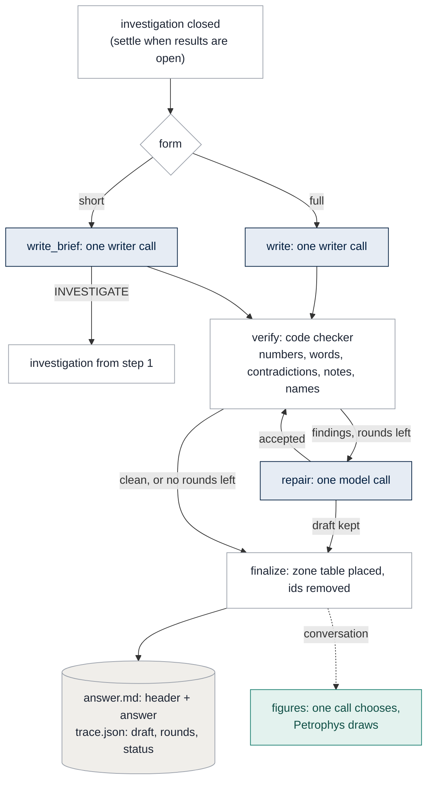

# Writer and checker reference

When the investigation closes, one model call writes the answer from the computed results. Code then checks the
draft's numbers, words, statements and curve names against the record, sends what it flags back for repair, and delivers the
answer with its header, its zone table and, in a conversation, its figures. This page is for developers who change
the writer and for auditors who want to know exactly what an answer was checked against. Paths are relative to
`src/petroharness/`.

## 1. At a glance



What the checker found in a conversation on GeoLink 30/6-5, Brent Group (2841-2958 m), as the traces record it:

| | Question 1: porosity, SW, permeability, hydrocarbons | Question 2: best zone, log vs core permeability |
|---|---|---|
| Form, shape | full, `report` | full, `report` |
| Round 0 | 4 numbers no result shows (`4.86`, `0.055`, `0.060`, `0.756`); 2 process words (`not opened`, `the MAP`) | 1 contradiction (core-calibrated porosity/permeability said unavailable where PHIE_CC and PERM_CC exist); 1 process word (`the map`) |
| Repairs | 1, accepted; round 1 clean | 2, both accepted; the contradiction is still listed in rounds 1 and 2 |
| Status | `ok` | `ok`: only numbers left in the last round change the status |

- **Writer:** one call on the question's points, every result (up to 60,000 characters), what the curves are, the
  zone table and the map.
- **Checker:** code; up to 2 repair rounds in user runs; status `ok`, `unresolved_numbers` or `error: empty answer`.
- **Delivery:** zone table placed, evidence ids removed; the draft as written stays in the trace.
- **Figures** (conversations): at most 3, chosen by one call, drawn by Petrophys; the text never changes.

## 2. How it works

The writer nodes of the question graph are `write`, `write_brief`, `verify`, `repair` and `finalize`
(`agent/graph.py`).

1. **Pick the form.** `after_close` sends a direct question to `write_brief`, an investigated one to `settle` and then
   `write` (straight to `write` when no result was opened). On a later question, `after_close_later` and `reply_form`
   choose `write_brief` when step 1 said `"reply": "brief"`.
2. **Write.** `_write` switches the client to normal thinking (`_light(llm, False)`), builds the prompt with
   `writer.prompt` (section 3) and makes one call, stage `writer`, capped at the card's `max_tokens_writer` (32768 in
   the K2-Horizon-7B card, 16384 in the generic card, 6000 when a card sets none). An empty reply is asked once more
   as `writer_retry` with the card's retry settings.
3. **Remove working notes.** `writer.clean_reply` keeps the answer after the model's notes, or returns `""`; on `""` the
   writer is asked again as `writer_again`, and if that is also notes the first draft is kept.
4. **Hand over** (short form only): a direct question's draft `INVESTIGATE` goes to an investigation (section 4).
5. **Check and repair.** `verify` runs `_check` and appends a round record (section 7); `after_verify` sends a draft
   with findings to `repair` while rounds are left and the draft is not empty (section 8), otherwise to `finalize`.
6. **Finalize.** `finalize` stores the last draft, the zone table and the rounds in the trace, delivers the answer with
   `delivered` and sets the status (section 9).
7. **After the answer.** In a conversation the session graph reads the methods and number links off the answer
   (`project`) and draws figures (`figures`); neither changes the text (section 11).

## 3. The writer's prompt

`writer.prompt(s, fmt, brief)` returns `(system, user, table, shape)`. The system message is C9's form text
(section 4); the user message joins up to ten parts in a fixed order. The second Brent question's message (contents
cut): its `RESULTS` reached the 60,000-character limit, so the end of E16 and all of E17 and E18 were cut from the
writer's view; the checker still counts their numbers as shown.

```text
QUESTION:
Which zone has the best reservoir quality, and how does the log permeability compare with the core?

EARLIER IN THIS SESSION (the same well and interval, oldest first; the ids are results listed in OPENED, read them with get):
Question 1: What are the porosity, water saturation and permeability of the Brent Group, and is any of it hydrocarbon-bearing?
  Answered: ...

THE QUESTION'S POINTS (the answer covers each):
Point 1: Which zone has the best reservoir quality, separating pure rock quality from reservoir quality with hydrocarbon potential?
...

LIMITS THE INVESTIGATION FOUND (in some results or their methods, by point; weigh them as you read the results):
Point 1: PERM_CC rests on the same-well core transform (porosity r2=0.55, n=200) ...

RESULTS (everything the investigation computed, by id):
[E1] Each zone, every curve (its mean; a flag: the share set; class codes: each class's share):
  ...
... (cut)

WHAT THE CURVES ARE (from the record: each curve's meaning, status and what its values show):
...

THE ZONE TABLE (inserted where you write {{ZONE_TABLE}}; computed from the data, its values are exact and are evidence like the results: what you write must agree with it, and an empty cell is a zone without that curve):
...

THE MAP
WELL 30_6-5, FORMATION BRENT GP.
...
```

<details>
<summary>The user message</summary>

| Part (its first line) | Shown when | Content | Built by |
|---|---|---|---|
| `QUESTION:` | always | The question as sent to the model, with the operator's lithology and the field notes appended when given | `interval.py`, `task_for` |
| `EARLIER IN THIS SESSION (...)` | a later question of a conversation | Each earlier question, how its answer opened, its settled claims with their result ids | `session/earlier.py`, `block` |
| `Named but not in this well's record: ...` | the question names a measurement with no data here | One line: C10 `absent_note` filled with each name and its curves | `agent/vocabulary.py`, `note` |
| `THIS DATA'S REPORTING CONVENTIONS (...)` | the data config sets `data.conventions` | One `- ` line per convention | `agent/writer.py`, `conventions_block` |
| `THE QUESTION'S POINTS (the answer covers each):` | always | `Point k: <point>` for each point of step 1; a direct question has one point, the question cut to 240 characters | `agent/writer.py`, `readings` |
| `LIMITS THE INVESTIGATION FOUND (...)` | a settled claim has a weakness note | `Point k: <weak note>` ([The limits by point](#the-limits-by-point)) | `agent/writer.py`, `readings`, `doubts` |
| `RESULTS (everything the investigation computed, by id):` | always | `[E<k>] <result text>` per result, blank line between; cut at 60,000 characters with `... (cut)` | `agent/writer.py`, `prompt` |
| `WHAT THE CURVES ARE (...)` | always | The provenance card ([The provenance card](#the-provenance-card)) | `agent/writer.py`, `curve_card` |
| `THE ZONE TABLE (...)` | full form, shape `list` or `report`, and a table could be built | The code-composed table (section 6) | `agent/writer.py`, `zone_table` |
| `THE MAP` | always | The map without its `Notes on this interval` block | `agent/writer.py`, `writer_map` |

- The settled claims themselves are not in the message. They reach the writer through the points, the limits
  (`doubts`), the curves the card and the zone table name, and, on a later question, the earlier results they cite.
- `writer.readings` builds the points and the limits; the checker counts the same block as shown (section 7).

</details>

<details>
<summary>Which results the writer reads</summary>

| Case | Results listed in `RESULTS` | Defined in |
|---|---|---|
| First question, or a single run (direct or investigated) | every result in the ledger | `agent/writer.py`, `prompt` |
| Later question of a conversation | this question's results (ledger index `>= Session.turn_start`), the earlier results any of its claims cites, and the earlier results its look steps were shown | `agent/writer.py`, `prompt` |
| What a look step was shown | the result each lookup opened, and the results a `get` or `find` printed lines of, recorded in `Session.fetched` | `agent/graph.py`, `_seen` |

</details>

<a id="the-provenance-card"></a>
<details>
<summary>The provenance card</summary>

`writer.curve_card` finds every curve-like name (`\b[A-Z][A-Z0-9_]{1,}\b`, `writer._MNEMONIC`) in the text of every
result in the ledger and in the claims block (`writer.claims_block`), keeps the curves of the interval in order of
first mention, and has `engine.provenance` write one line per curve. The card is stored as `Session.card`, and its
numbers count as shown for the checker. Each line is built in `agent/engine/`:

| Line part | When | Meaning | Function |
|---|---|---|---|
| `- <NAME> [<unit>] = <meaning>` | always (no unit when none) | The curve's label from the curve catalog | `label` |
| `(<status>` | always | What the curve is (`measurement`, `model output of the <step> step`, `flag of the <step> step`, `copy of X`) and the record's cautions | `status` |
| `; values in percent` | a percent curve whose unit has no `%` | The values are percentages | `label` |
| `; X holds the same values)` | a copy exists | Curves holding the same values (`engine.same_as`); the parenthesis closes here | `label` |
| `; constant ...`, `; at its maximum ...` or `; at its minimum ...` | value curves with at least 5 zoned values | Constant, or held at a limit on at least 5% of the zoned samples (`LIMIT_SHARE`) | `limits` |

A line of the second Brent question's card, as sent:

```text
- RQI [microns] = reservoir quality index, micrometre (model output of the rock_quality step; fallback input: PERM where PERM_CC has no value, at 144 of 576 samples here)
```

</details>

<a id="the-limits-by-point"></a>
<details>
<summary>The limits by point</summary>

`writer.doubts` returns `[(point, weak note)]` from the settled claims, ordered by point: every claim not graded
`hypothesis`, each note text once. A note is left out when empty or when it matches `(?:none|n/?a)\b|-+\s*$` at the
start, case-insensitive (`none ...`, `n/a`, `na`, or only dashes such as `-` or `--`); a note that goes on after a
dash (`- low n`) is kept.

</details>

<details>
<summary>Constants of the writer module</summary>

All in `agent/writer.py`:

| Name | Value | Meaning |
|---|---|---|
| `RESULTS_CHARS` | 60000 | The `RESULTS` part is cut here |
| `TABLE_ROWS` | 60 | Row budget of the zone table (plus 20 when wide) |
| `OPEN_CHARS` | 24000 | Budget of `writer.opened_results`, the settle step's view of every result (not the writer's) |
| `LINES_CHARS` | 9000 | Budget of `writer.cited_lines`; only its length is recorded (`trace.cited_lines_chars`), it is not in any prompt |
| `TABLE_RULE` | C9 `table_rule` | Appended to the full form's rules as rule 9 when a table is inserted |

</details>

## 4. Answer forms

| Form | Node | Used for | Zone table |
|---|---|---|---|
| Full | `write` | every investigated question, unless a later question chose the short form | `list` and `report` shapes |
| Short | `write_brief` | a direct question; a later question whose step 1 said `"reply": "brief"` | never |

Both forms go through the same checker and repair rounds. Step 1's intent picks the shape (`report`, `list` or
`direct_value`), which decides whether a zone table is built. The texts are component C9's, in
`agent/components/C9_answer/<entry>.md`: `write`, `table_rule`, `points_rule`, `later_rule`, `reply_brief`,
`brief_later`, `brief_direct` and `figures`; its `aspects_rule` is the settle step's, not the writer's.

<details>
<summary>Full form</summary>

The writer node `write`; `writer.prompt` assembles its system message.

| Rule | Text entry | Shown when | What it asks |
|---|---|---|---|
| 1-8 | `write` | always | Open with the answer in the form asked; then the evidence; screens graded by their logs; trends with numbers; fluids and contacts log-indicated; start from the workflow's sections; limitations from WHAT THE CURVES ARE; only what bears on the question |
| 9 | `table_rule` | a zone table is inserted | Put `{{ZONE_TABLE}}` on its own line; do not write that table |
| 10 | `points_rule` | always | One part per point, in order: finding, numbers and intervals, limit |
| 11 | `later_rule` | a later question | Answer in the form asked; refer to earlier answers, do not repeat them |

Rule 10 keeps its number when no table is inserted, so the list then runs 1-8, 10.

</details>

<details>
<summary>Short form</summary>

The writer node `write_brief`, for a direct question (the READ call said `"depth": "direct"`) and for a later question
whose step 1 said `"reply": "brief"`. It never carries a zone table, whatever the shape.

| Rule | Text entry | Shown when | What it asks |
|---|---|---|---|
| 1-5 | `reply_brief` | always | The answer first; then only what it rests on, about 150 words, no title, sections or table unless asked; numbers as the results show them; log-indicated wording; a gap in one sentence |
| 6 | `brief_later` | a later question | Refer to earlier answers; say when this reply rests on or changes an earlier finding |
| (unnumbered) | `brief_direct` | a direct question | Reply with the one word `INVESTIGATE` when the results neither state the answer nor show why it cannot be had |

</details>

<details>
<summary>Hand-over to an investigation</summary>

`graph.write_brief` reads the short draft as a hand-over when the question was read as direct
(`Session.depth == "direct"`), the draft has fewer than 200 characters after `strip()`, and it opens with the word
(`HANDS_OVER = re.compile(r"\W*INVESTIGATE\b", re.I)`). The trace then records, as the code writes it:

```json
{"read": "direct", "investigated_from": "the writer",
 "why": "the writer found that the results do not state what is asked"}
```

as `trace.depth`. The session's claims, points and `fetched` list are cleared and the graph goes to `ask` at step 1,
with the results already open. The investigation's own writer later overwrites the writer keys of the trace.

</details>

<details>
<summary>Answer shapes</summary>

The shape comes from step 1's intent through `Registry.shape_for` (`registry.py`) and `resources/rules/shapes.yaml`,
and is recorded as `trace.shape` (both Brent answers: `report`, intents `characterize` and `compare`).

| Shape | Intents | Zone table |
|---|---|---|
| `direct_value` | `value` (every direct question) | no |
| `list` | `locate` | yes, full form |
| `report` | `characterize`, `compare`, `explain`, `qc_check`; also the `default` for any other intent | yes, full form |

Each shape also has an `instructions` text in `shapes.yaml`. No code reads it, so it does not reach the writer.

</details>

## 5. Report styles and formats

The report style is a YAML file the interpretation policy names. The code reads one key of it, `format.zone_table`,
the zone table's style; its other keys describe the intended layout and reach no prompt. A run with `--format
default` ignores the file, and its zone table is then `by_curve`. Both Brent answers ran with the packaged style
(`trace.writer_format`: `profile`).

<details>
<summary>The report style file</summary>

The policy names the file (`reporting.profile` in `resources/policy/reference_v2.yaml`, value
`profiles/report_style.yaml`). `profile.profile(policy)` loads it, relative to `resources/` unless the path is
absolute, and caches up to 16 files.

| Field | Packaged value | Meaning | Read by code |
|---|---|---|---|
| `format` | present | The format block; `writer.reader_format` returns it | `agent/writer.py`, `reader_format` |
| `format.zone_table` | `by_interval` | The zone table's style: `by_interval` or `by_curve` (any other value or none: `by_curve`) | `agent/writer.py`, `prompt` |
| `format.shapes.report`, `.list`, `.direct_value` | section lists | The intended layout of each shape's answer | not read |
| `format.words` | `[350, 1200]` | The intended answer length in words | not read |
| `format.zone_names` | `lithology_and_depth` | How intervals are named | not read |
| `format.rules` | one rule on the limitations section | Extra layout rules | not read |

- A missing file named by the policy raises `FileNotFoundError` with `WHAT: report style ... not found`.
- A policy without `reporting.profile` gives `{}`: no format block.

</details>

<details>
<summary>How a format block is chosen</summary>

1. `fmt == "default"`: no block (`{}`), the writer's own format (`writer.reader_format`).
2. Otherwise the `format` mapping of the report style the policy names, or `{}` (`writer.reader_format`).
3. The trace records `writer_format: "profile"` when the block is not empty, else `"default"` (`graph._write`).
4. The block's `zone_table` picks the table style; with no block the style is `by_curve` (`writer.prompt`).

</details>

<details>
<summary>The format option</summary>

| Option | Default | Meaning | Defined in |
|---|---|---|---|
| `petroharness benchmark --format` (`profile` or `default`) | `profile` | The answer format of a benchmark run | `cli.py`, `benchmark` |
| `petroharness benchmark --writer` (`open` or `""`) | `open` | The writer variant: two repair rounds or one | `cli.py`, `benchmark` |
| `ask(...)`, `petroharness`, `petroharness chat`, the web UI | fixed: `open`, `profile` | User runs always use the profile format and two rounds | `ask.py`, `ask`; `session/conversation.py` |
| `Conversation.on_tasks(..., writer=, fmt=)` | `open`, `profile` | A conversation on prepared tasks | `session/conversation.py` |

The setup record keeps both values (`writer`, `fmt`), so they enter the setup hash
([RECORDS.md](RECORDS.md#9-the-setup-record)).

</details>

## 6. The zone table

For a full answer of shape `list` or `report`, code composes a table of every zone's values of the curves the question
and the settled claims name, shows it to the writer, and inserts it where the draft writes `{{ZONE_TABLE}}`, once: a table the writer makes of every zone, with nothing the
zone table lacks, is left out at delivery (section 9). The packaged style, `by_interval`, gives one row per zone. The
second
Brent answer's table, as delivered (first columns and rows): PERM_CC is log-shaped, so its geometric mean follows its
mean, and Z2 (silt) and Z3 (coal) have no PERM_CC.

```text
| Depth Interval (m) | Lithology | Mean PERM (mD) | Mean PERM_CC (mD) | Geometric mean PERM_CC (mD) | Mean PHIE (v/v) | ...
|---|---|---|---|---|---|
| 2841.3242-2845.7439 | Sand | 37.4195 | 135.9845 | 61.1339 | 0.1382 | ...
| 2856.1069-2858.6977 | Silt | 17.0211 | - | - | 0.1473 | ...
| 2858.8503-2861.7458 | Coal | 10.9049 | - | - | 0.1359 | ...
```

The rules below are in `agent/writer.py` (`prompt`, `zone_table`) unless named otherwise.

<details>
<summary>When it is inserted</summary>

- Full form only (`brief=False`), shape `list` or `report`.
- At least one curve named in the question or the settled claims ([Which curves it holds](#which-curves-it-holds)).
- The interval has at least one zone.
- `TABLE_RULE` (rule 9) and the `THE ZONE TABLE` part are shown only when the table is not empty.

</details>

<a id="which-curves-it-holds"></a>
<details>
<summary>Which curves it holds</summary>

The writer calls `writer.zone_table(s, claims, wide=True, style)`.

| Step | Rule |
|---|---|
| Named curves | Tokens matching `(?<![A-Za-z0-9_])[A-Z][A-Z0-9_]{1,}(?![A-Za-z0-9_])` in the question and in each settled claim's text and meaning, in order, that are curves of the interval |
| Left out | class-code curves; flags unless the style is `by_interval`; a curve holding the same values as one already named (`engine.same_as`) |
| Curve budget | `min(8, (TABLE_ROWS + 20) // zones)` named curves when wide (`min(5, TABLE_ROWS // zones)` otherwise), at least 1; it sets the curves of a `by_curve` table over several zones, and for `by_interval` only whether any named curve is left |
| One zone | a `by_interval` style falls back to `by_curve` (a row per curve with its spread) |

With the 20 Brent zones the budget is `min(8, 80 // 20)` = 4 named curves (the `by_curve` example below).

</details>

<details>
<summary>Style <code>by_interval</code></summary>

One row per zone. The columns are the standard curves of the model's topics (`direction.overview(topics)`, curves with
values, no class codes, at most 6), led by the named curves the question itself writes (`vocabulary.written`), then
the other named curves, up to 9 curves.

| Column | Content |
|---|---|
| `Depth Interval (<unit>)` | `<top>-<base>` of the zone |
| `Lithology` | the zone's lithology in title case, or `no lithology data` |
| `Mean <CURVE> (<unit>)` | the zone mean, written by `map.num`; `-` when there is no value |
| `Geometric mean <CURVE> (<unit>)` | after the mean, for a value curve that `summary.log_shaped` finds log-shaped (positive, more than two orders of magnitude) |
| `<FLAG> fraction` | a flag's zone mean, the share of samples it covers |

Without a lithology log the zones are runs of the lithology Petrophys's mineral solver gives, and its label is
title-cased like a logged one. Taranaki tuhua-7, McKee: `writer.zone_table` for a question naming VCL, PHIE and SW,
topics porosity and water saturation, no claims (no model run); the 11 zones are shale and sandstone. Data: Taranaki
Basin Curated Well Logs Dataset (New Zealand Petroleum & Minerals), CDLA-Sharing-1.0.

```text
| Depth Interval (m) | Lithology | Mean VCL (v/v) | Mean PHIE (v/v) | Geometric mean PHIE (v/v) | Mean SW (v/v) | ...
|---|---|---|---|---|---|
| 1936.3944-1940.3568 | Shale | 0.5482 | 0.05997 | 0.04684 | 0.9995 | ...
| 1941.576-1944.7764 | Sandstone | 0.3477 | 0.1109 | 0.1097 | 0.9537 | ...
...
```

</details>

<details>
<summary>Style <code>by_curve</code></summary>

One row per zone and curve: `Zone` (the zone id, with its name in brackets when it has one), `Lithology` (as above),
`Depth (<unit>)`, `Curve` (joined with `=` to curves holding the same values), then `n`, `Min`, `Median`, `Mean` and
`Max` (`engine.statistic` over the zone's samples). With one zone, the standard curves of the topics (no flags or
classes, at most 6) lead, then the named curves. The first Brent answer's claims and question in this style
(`writer.zone_table(..., style="by_curve")` on 30/6-5; first rows):

```text
| Zone | Lithology | Depth (m) | Curve | n | Min | Median | Mean | Max |
|---|---|---|---|---|---|---|---|---|
| Z1 (SAND_GROUP_1) | Sand | 2841.3242-2845.7439 | SW | 30 | 0.4706 | 0.8176 | 0.7765 | 1 |
| Z1 (SAND_GROUP_1) | Sand | 2841.3242-2845.7439 | PERM | 29 | 0 | 4.3714 | 37.4195 | 180.0791 |
| Z2 (SILT_GROUP_4) | Silt | 2856.1069-2858.6977 | PERM_CC | 0 | - | - | - | - |
...
```

</details>

<details>
<summary>Placing the table</summary>

| Step | Rule | Defined in |
|---|---|---|
| Token | `ZONE_TABLE_TOKEN = "{{ZONE_TABLE}}"` | `agent/compose.py` |
| Own lines | `graph.delivered` first rewrites `[ \t]*\{\{ZONE_TABLE\}\}[ \t]*` as the token between blank lines | `agent/graph.py`, `delivered` |
| Token present | the first token becomes the table, any further tokens are removed | `agent/compose.py`, `compose` |
| Token missing, two or more `## ` sections | the draft is split before each line that starts with `## ` (`(?m)^(?=## )`), into the text before the first heading (maybe none) and the sections; the table goes after the first section, whether or not text comes before it | `agent/compose.py`, `compose` |
| Token missing, fewer sections | the table is appended at the end | `agent/compose.py`, `compose` |
| No table | every token is removed and the text stripped | `agent/compose.py`, `compose` |

Real outputs of `compose`:

```python
compose("# T\nintro\n## A\ntext\n## B\nmore", "|t|")   # '# T\nintro\n## A\ntext\n\n|t|\n\n## B\nmore'
compose("## A\ntext\n## B\nmore", "|t|")              # '## A\ntext\n\n|t|\n\n## B\nmore'
compose("intro {{ZONE_TABLE}} more", "|t|")           # 'intro |t| more'
```

The table's numbers count as shown for the checker (section 7). It is stored in the trace as `zone_table`, not in the
draft. The first Brent draft wrote the token under its `## Point 2` heading, the second under `### Evidence and zone
table`.

</details>

## 7. The checker

`graph.verify` calls `graph._check(draft, run)` and appends one round record. It runs five rules:

| Finding list | Flags |
|---|---|
| `unsupported` | numbers no result, the card, the map, the zone table, the points or the question shows |
| `process` | words about the investigation or the display rather than the formation |
| `contradictions` | statements the record contradicts |
| `leaks` | working notes left in the text |
| `names` | curve-like names the record does not hold, close to one it holds (in the round record only when there are some) |

The round records of the first Brent answer, as `trace.verify_rounds` holds them:

```json
[{"round": 0, "unsupported": ["4.86", "0.055", "0.060", "0.756"], "process": ["not opened", "the MAP"], "contradictions": [], "leaks": []},
 {"round": 1, "unsupported": [], "process": [], "contradictions": [], "leaks": []}]
```

<details>
<summary>What it runs</summary>

Every rule but the contradictions reads the draft with its ids removed as delivery removes them
(`writer.strip_ids(draft)`), so a finding names text the reader would see; the contradiction rules strip the ids
themselves. The zone table is not inserted for the check; its numbers count as shown instead.

| Finding list | Function | Defined in |
|---|---|---|
| `unsupported` | `writer.unsupported(strip_ids(draft), session, w_table)` | `agent/writer.py`, `agent/checks.py` |
| `process` | `writer.process_words(strip_ids(draft))` | `agent/writer.py` |
| `contradictions` | `writer.contradictions(draft, session)` | `agent/writer.py`, `agent/checks.py`, `record/routes.py` |
| `leaks` | `writer.leaks(strip_ids(draft))` | `agent/writer.py` |
| `names` | `writer.unknown_names(strip_ids(draft), session, shown)`: a name shaped like a mnemonic (`_MNEMONIC_NAME`) that the record does not hold and the writer's messages did not show, within `difflib` cutoff 0.85 of a record curve; `[(name, the record's curve)]` | `agent/writer.py` |

</details>

<details>
<summary>Numbers no result shows</summary>

`writer.unsupported` calls `checks.number_provenance(text, card, items, checks, (well,), question)` and returns the
unsupported numbers once each, in order.

| What counts as shown | From | Defined in |
|---|---|---|
| Result values | every ledger item of the conversation: each item's shown values (`ledger.shown_values`), plus the magnitude of each negative value (`writer._Magnitudes`) | `agent/writer.py`, `unsupported` |
| Result text | every number in each item's `[E<k>] <text>`, and the negative of a number after a band or minus sign ("PHIN - 0.02" also shows -0.02; `±`, `+/-`) | `agent/checks.py`, `_allowed_numbers`; `agent/numbers.py`, `shown_values` |
| The card text | every number in what the writer is shown besides the results: the map without its notes (`writer.writer_map`), the zone table, the provenance card, and the points with the limits (`writer.readings`) | `agent/writer.py`, `unsupported` |
| The question | with `numbers.question: true`, every number of the question; a percentage there also as a fraction | `agent/checks.py`, `_allowed_numbers` |

| Matching rule | Value | Defined in |
|---|---|---|
| Number pattern | `NUM = (?<![A-Za-z_\d.])(-?(?:\d{1,3}(?:,\d{3})+\|\d+)(?:\.\d+)?(?:[eE][-+]?\d+)?)(?!\d\|(?:st\|nd\|rd\|th)\b)(\s*%\|\s+percent\b)?`, case-insensitive: thousands separators (`20,700`) and exponents are read; an ordinal (`25th`) is no number | `agent/numbers.py` |
| Precision | supported when an allowed value lies within `0.5 x 10^-decimals + 1e-9` of it, decimals as written | `agent/checks.py`, `_supported` |
| Percent | a percentage also matches any shown value x 100, its complement `100 x (1 - v)`, or `100 - v` of a shown value between 0 and 100 | `agent/checks.py`, `_supported` |
| Derived | `numbers.derived: true`: also supported when it equals, for two supported numbers a and b of the same sentence, `a - b`, `b - a`, `\|a - b\|`, `a + b`, `a x b`, `a / b` or `b / a`, and, for a number written as a percentage, `100 x \|a - b\| / \|b\|`, `100 x \|b - a\| / \|a\|` or `100 x a / b`; or the total of a run of 3 or more, or the mean of a run of 2 or more, consecutive supported numbers of the sentence (without `%` for a number without one); at its own precision | `agent/checks.py`, `_derived` |
| Counts with their population | "k of N", "k out of N", "k/N" with both whole and at least `skip_integers_below`: passes only when one shown line holds N with k or with N - k, or k is a total of other numbers of the sentence while N is shown; else the whole phrase is flagged (`658 of 848`), and its two numbers are not checked again | `agent/checks.py`, `number_provenance`, `_PAIR` |
| Small integers | an integer below `numbers.skip_integers_below` (20) without a percent sign is not checked | `agent/checks.py`, `number_provenance` |
| Sentences | split at `(?<=[.!?])\s+` and at line breaks (clauses joined by `;` are one sentence) | `agent/checks.py`, `SENTENCE` |
| Read first | every citation removed (`compose.strip_citations`), the task's well name removed from the draft and the question (`checks.well_name_pattern`), each `numbers.ignore` pattern removed; numbers written in words read as digits where 20 or more or with a decimal (`numbers.spelled_as_digits`); thousands grouped by spaces ("3 114.1112") read as one number where that number is shown (`checks._regrouped`) | `agent/checks.py`, `_prepared` |
| Minus signs | U+2212, U+FE63 and U+FF0D read as `-` (`checks.ascii_minus`); an en or em dash right before a digit, not after a word character, `.`, `%`, `)` or `]`, reads as `-` (`writer._DASH_MINUS`) | `agent/checks.py`, `agent/writer.py` |

Real results on 30/6-5 Brent, against one result (`stats` of PHIE and SW: SW means 0.2265 in Z7 and 0.314 in Z5),
for the question "What is SW at the 25th percentile?":

```python
number_provenance("SW is 23% in Z7 and 77% elsewhere.", ...)         # ([], 2)         fraction and its complement
number_provenance("Z5 SW 0.314 exceeds Z7 0.2265 by 0.0875.", ...)   # ([], 3)         a difference in the sentence
number_provenance("Z5 SW 0.314 exceeds Z7 by 0.0875.", ...)          # (['0.0875'], 2)
number_provenance("Z7 is 30/6-5's thickest sand.", ...)              # ([], 0)         the well's name is no number
number_provenance("SW 0.42 at the 25th percentile.", ...)            # (['0.42'], 1)   25th is an ordinal, no number
```

The settings, in `resources/rules/checks.yaml`: `numbers: {skip_integers_below: 20, derived: true, question: true,
ignore: []}`.

</details>

<details>
<summary>Words about the process</summary>

`writer.process_words` returns the matches of two patterns of `agent/writer.py`, once each: every `PROCESS` match in
the order of the text, then every `DISPLAY` match. On the first
Brent draft it found `not opened` and `the MAP`.

| Name | Flags | Matches |
|---|---|---|
| `PROCESS` | `re.I` (two parts case-sensitive) | Words about the investigation: `workflow record`, `opened record`, `opened` (not `opened up`), `the ledger`, `the tool`, `the claim(s)` (not before `that`), `result line(s)`, `the map`, `the record shows`, `NEW` in capitals, a bare evidence id |
| `DISPLAY` | `re.I` | A view's size limit read as a fact: `left out to keep this short`, `display/view/output limit`, `truncated in the records`, `rows were cut off`, `not shown in this view` |

The patterns as written:

```text
PROCESS = \b(?:workflow|opened) record\b|\b(?:not )?opened\b(?! up)|\bthe (?:ledger|tool)\b|\bthe claims?\b(?! that)|\bresult lines?\b|\bthe map\b|\bthe record shows\b|(?-i:\bNEW\b)|(?-i:(?<![\w\[(./-])E\d{1,3}\b)

DISPLAY = \bleft out to keep (?:this|it) short\b|\b(?:display|view|output)(?:'s)? (?:size )?limit\b|\btruncated (?:in|from) the (?:records?|results?|outputs?|tables?|summar(?:y|ies))\b|\b(?:records?|results?|outputs?|tables?|summar(?:y|ies)|zone rows|rows) (?:were |was |are |is )?(?:truncated|cut off)\b|\bnot shown in this view\b
```

</details>

<details>
<summary>Statements the record contradicts</summary>

`writer.contradictions(draft, session)` returns repair messages, each stating a fact; `[]` for an empty draft.

| Check | Code | Fires when | Message |
|---|---|---|---|
| Core calibration said absent (V4) | `checks.availability_issues` | `PHIE_CC` or `PERM_CC` has data, and a clause denies core-calibrated porosity or permeability (`availability.denial` and `about_poroperm`, not `hypothetical`) where those curves exist (the curves and zones it names) | the Brent message below |
| Core calibration used where absent (V4) | `checks.availability_issues` | neither curve has data, and a clause names `PHIE_CC` or `PERM_CC` without a negation | `WHAT: the answer cites PHIE_CC/PERM_CC. WHY: no core-calibrated curves exist in this interval. FIX: ...` |
| Data said missing (V9) | `checks.data_denials` | a `data_denials` pattern matches and one of its curves has data | `WHAT: the answer says '<match>', but this interval has <curves>. WHY: ... FIX: ...` |
| Well-wide route read as this interval's | `routes.contradictions` | a sentence with no negation (not, no, never, rather than, instead of ...) says `INVASION_RATIO` uses the RMED/RDEP fallback where every sample here has a recorded pair, or that `SXO` is the quicklook where some samples are measured; at most one message per route | `WHAT: the answer says ... FIX: state the route this interval uses.` |

The V4 message on the second Brent answer, in full (30/6-5 has core, so PHIE_CC and PERM_CC exist):

```text
WHAT: the answer says core-calibrated porosity/permeability is unavailable. WHY: PHIE_CC/PERM_CC exist in this interval (calibrated on core from this well; see the card). FIX: report the core-calibrated values from the evidence and label them as such. Statements about core plugs inside the interval may stay.
```

- `availability_issues` returns at most one message; it splits the text into clauses at sentence ends, line breaks,
  `;` and `: `. Its WHY names the origin: `calibrated on core from this well`, or `supplied in the LAS as
  core-corrected values` when the LAS itself holds them.
- The patterns live in `resources/rules/checks.yaml` (`availability`, `data_denials`), matched case-insensitively.
  The `data_denials` entries name their curves, for example `shallow resistivity` (`RSHA`, `RXO`, `RMIC`) and
  `spectral gamma ray` (`THOR`, `URAN`, `POTA`, `SGR`, `CGR`), each with a pattern such as
  `\b(no|without|lack of|absence of|missing)\b[^.;:]{0,30}\b(shallow|flushed[- ]zone|invaded[- ]zone)[- ]resistivit\w*|...`.

</details>

<details>
<summary>Working notes left in the text</summary>

All in `agent/writer.py`:

| Name | Value | Meaning |
|---|---|---|
| `LEAK` (`re.I`) | `(?:\.\.\.\|…)\s*(?:wait\|hmm\|oops\|sorry\|no wait)\b\|\b(?:wait\|hmm\|oops)\s*[,!:]\|\bscratch that\b` | A self-correction such as `SIL... wait, ...` |
| `DRAFT` (`re.I \| re.M`) | `^\s*(?:we )?need (?!to\b\|for\b\|of\b\|not\b)[a-z]+\b` | A drafting line that opens on `need` and a verb (`Need ensure ...`) |
| `drafting(text)` | two or more `DRAFT` lines | The drafting lines, only when there are at least two |
| `leaks(text)` | in order, once each | Each `LEAK` match with 12 characters before and 24 after, then at most 4 drafting lines |

```python
leaks("Need check numbers.\nNeed ensure format.\n## Answer\n... The result shows SW... wait, SW 0.45.")
# ['ult shows SW... wait, SW 0.45.', 'Need check', 'Need ensure']
```

</details>

<details>
<summary>Working notes before the checker</summary>

`writer.clean_reply(text, draft="")` runs on every writer and repair reply before the checker sees it. Notes are
present when `META` matches or `drafting` finds two or more lines. With none, the reply is returned unchanged.
Otherwise the first `#`, `##` or `###` heading of the draft (else of the reply) is searched from the end, and the reply
from its last occurrence is kept when that part has no notes; else `""`.

`META`, flags `re.I | re.M`:

```text
\bthe user (?:asks|asked|wants|is asking|is pointing|points|said|says|wrote)\b|\bLet me\b|\bI need to\b|\bI will (?:now )?(?:rewrite|check|fix|remove|go)|\b(?:my|the) previous (?:answer|draft|version|reply)\b|\bActually,|\brewrite the answer\b|\bthese need to go\b|^\s*-\s*"[^"]{3,}"\s*[—-]
```

When the writer's first reply was cleaned, the trace records `draft_notes_removed`: `true` when an answer was found
after the notes, `false` when the writer had to be asked again. Neither Brent answer needed it.

</details>

## 8. The repair loop

The first Brent answer's repair request, as sent:

```text
These numbers are not shown by any result, the map or the question: 4.86 (in "<its clause>"); 0.055 (in "<its clause>"); 0.060 (in "<its clause>"); 0.756 (in "<its clause>"). A total, a difference or a share you worked out passes when the shown numbers it comes from stand beside it in the same sentence, and only when it is right: where one is named after a number above, keep the number and write those beside it. Any other: take it exactly as a claim or a result shows it (with its id in brackets), or remove it. These words talk about the investigation, not the formation: 'not opened', 'the MAP'. Say each as a fact about this well's data (what it shows, or which data it lacks), or remove it. Keep everything else as it is. Reply with the whole corrected answer only, starting with its first heading: no notes about what you changed.
```

The repaired draft passed round 1 clean. The rules below are in `agent/graph.py` (`after_verify`, `repair`,
`after_repair`, `finalize`).

<details>
<summary>The repair request</summary>

`graph.repair` builds one user message from the last round's findings, in this order, from component C2's texts
(`agent/components/C2_guardrails/`):

| Part | Text entry | Items shown | Template |
|---|---|---|---|
| Contradictions | `repair_contradictions` | first 4 messages, joined by spaces | `These statements contradict this interval's data; correct each: ` |
| Numbers | `repair_numbers` | first 12 numbers, joined by `; `, each with the clause it stands in (`x (in "<clause>")`, `where_said`, up to `WHERE_CHARS` = 180 characters around it); where the answer's other numbers give it (`writer.derived`), ` = <arithmetic>, numbers the answer states elsewhere: keep it and write them beside it`, and where arithmetic the answer writes out gives another value, `: <expression> is <v>, write <v>` | `These numbers are not shown by any result, the map or the question: {numbers}. A total, a difference or a share you worked out passes when the shown numbers it comes from stand beside it in the same sentence, and only when it is right: where one is named after a number above, keep the number and write those beside it. Any other: take it exactly as a claim or a result shows it (with its id in brackets), or remove it.` |
| Process words | `repair_words` | first 8, each quoted with `repr` | `These words talk about the investigation, not the formation: {words}. Say each as a fact about this well's data (what it shows, or which data it lacks), or remove it.` |
| Working notes | `repair_leaks` | first 4, each quoted with `repr` | `These are working notes, not part of the answer: {leaks}. Write each passage as its final text only.` |
| Names | `repair_names` | first 6, each `NAME (the record holds CURVE)`, joined by `; ` | `These names are not curves of this record: {names}. Use the record's name, or drop the name.` |
| Closing | `repair_keep` | always | ` Keep everything else as it is. Reply with the whole corrected answer only, starting with its first heading: no notes about what you changed.` |

The call's messages: the writer's system message, the writer's user message, the current draft as an assistant turn
(`llm.assistant_turn`: with an empty reasoning field for a reasoning model, the card's `replay_reasoning_field` when
set, else its `reasoning`, or when the last call logged returned reasoning), then the repair request.

</details>

<details>
<summary>Rounds and acceptance</summary>

| Name | Value | Meaning |
|---|---|---|
| Round limit | 2 when `Run.writer == "open"`, else 1 | `after_verify` repairs while `len(rounds) - 1 < limit` |
| Repair trigger | any finding list not empty, and the draft not empty | Otherwise `finalize` |
| Stage names | `repair_<n>`, then `repair_<n>_again` | `n` is the number of rounds so far (1 for the first repair); `_again` is asked once when the cleaned reply is `""` |
| Acceptance | `repaired.strip()` and `len(repaired) > 0.6 * len(draft)` | The repaired text becomes the draft and goes back to `verify` |
| Kept draft | round record `{"round": n, "kept_draft": true, ...}` | The old draft stays; the record repeats the last findings; the graph goes to `finalize` |
| Writer cap | `max_tokens_writer` | Output cap of each repair call (`Run`) |

The second Brent answer used both rounds (`repair_1`, `repair_2`); both repairs were accepted, the process word went
after the first, and the same V4 contradiction is listed in rounds 0, 1 and 2.

</details>

<details>
<summary>When the rounds run out</summary>

- Findings remain after the last allowed repair: `finalize` delivers the last draft as it is.
- Numbers remain in the last round: status `unresolved_numbers`.
- Only process words, contradictions or notes remain: status `ok`; they stay listed in `verify_rounds` (the second
  Brent answer).
- A repair was refused (`kept_draft`): no further round; the status follows the repeated findings.

</details>

## 9. Delivery

`graph.delivered(draft, table)` gives the text a reader gets: the zone table placed, evidence ids and claim ids taken
out. An id that is the noun of its phrase becomes "the result"; one that only cites is deleted. Lines of the Brent
drafts and the delivered answers:

| Draft (`trace.draft`) | Delivered (`answer.md`) |
|---|---|
| `... PHIE_CC 0.181 v/v, VCL 0.156 (E1).` | `... PHIE_CC 0.181 v/v, VCL 0.156.` |
| `- FZI/RQI fallback: E11/E16 state that FZI and RQI use PERM where PERM_CC is absent ...` | `- FZI/RQI fallback: The results state that FZI and RQI use PERM where PERM_CC is absent ...` |

<details>
<summary>The delivered answer</summary>

`finalize` keeps the draft itself in the trace (`draft`), so a change to delivery can be measured on the same drafts;
`delivered(trace["draft"], trace["zone_table"])` gives back each Brent answer exactly.

| Step | Function | Effect | Defined in |
|---|---|---|---|
| 1 | regex `[ \t]*\{\{ZONE_TABLE\}\}[ \t]*` | the token on lines of its own | `agent/graph.py`, `delivered` |
| 2 | `compose.compose(draft, table)` | the zone table placed (section 6); a heading with no text left out; a table of the draft's own that repeats the zone table (every zone's interval, and every other column headed as one of the zone table's, bold, case and units aside: a median, a count, a thickness or a role is the writer's own) left out, with a bold label naming it alone | `agent/compose.py`, `_without_repeats` |
| 3 | `writer.strip_ids` | claim ids, `[MAP]` and every evidence id taken out ([How ids are removed](#how-ids-are-removed)) | `agent/writer.py` |
| 4 | `writer.report_numbers` | numbers as written (no rounding in code; the function returns its input) | `agent/writer.py` |
| 5 | regex `\n{3,}` to `\n\n` | blank lines collapsed | `agent/graph.py`, `delivered` |
| 6 | `compose.leftover_citations` | ids still present are recorded as `trace.render_leftovers` | `agent/graph.py`, `finalize` |

```python
delivered("## A\nSee {{ZONE_TABLE}} here [E2].", "| a |\n|---|")   # '## A\nSee\n\n| a |\n|---|\n\nhere.'
```

</details>

<a id="how-ids-are-removed"></a>
<details>
<summary>How ids are removed</summary>

`writer.strip_ids(text)` removes claim-id brackets with `_CLAIM_IDS`, then runs `compose.strip_citations`, then
removes spaces before `.`, `,`, `;` and `:`. `strip_citations` applies these steps in order.

| Step | Pattern or function | Form handled | Example (input, output) |
|---|---|---|---|
| Claim brackets | `_CLAIM_IDS` (`writer.py`) | a bracket opening with `C<n>` or `MAP` | `(C3, E7)` removed |
| Possessive | `_ID_POSSESSIVE` | `E5's` becomes `the` (`The` at a sentence start) | `rebuilt from E5’s zone means` -> `rebuilt from the zone means` |
| Named result | `_RESULT_ID` | `Result E3` becomes `The result` | `Result E3 shows 0.2` -> `The result shows 0.2` |
| Bracketed noun | `_BRACKET_NOUN`, `_BRACKET_AND` | a bracketed id after a preposition or a verb that takes a noun loses its brackets, then is read as a noun | `Per [E2] and [E4], permeability is` -> `Per the results, permeability is` |
| Square citation | `_SQUARE_CITATION` | a square bracket with an id and at most 80 characters on each side, removed whole with what it says; also `[card]`, `[formation card]` | `unflagged [E1; borehole quality: 14% per card]. SP` -> `unflagged. SP` |
| Square group | `_SQUARE_GROUP` with `_group` | a longer square bracket (up to 400 characters) with an id: the id goes, what it says stays in a parenthesis | `only [E8 pooled n=772, slope ≈17; ...]` -> `only (pooled n=772, slope ≈17; ...)` |
| Unclosed | regex | a square bracket never closed at a line end | `ohm.m [E1,` -> `ohm.m` |
| Paren citation | `_PAREN_CITATION` | `(E3)`, `(E2, E3)`, `(card)` | `named statistics (E2, E3). The` -> `named statistics. The` |
| Paren group | `_PAREN_GROUP` with `_group` | a parenthesis that cites and says something | `PHIE 0.21 (E10, n = 161). Next` -> `PHIE 0.21 (n = 161). Next` |
| Scaffold label | `_SCAFFOLD` in `_group` | a remainder that only names a part of the prompt | `not solved (E1, MAP).` -> `not solved.` |
| Section names | `_SECTION_REF` | `(THE MAP, WHAT THE CURVES ARE)` with no id | removed |
| Id as noun | `_CHAIN_AT` with `_as_noun` | an id that is its phrase's noun becomes `the result(s)` | `from the Pearson lines of E6 alone.` -> `from the Pearson lines of the result alone.` |
| Id as qualifier | `_CHAIN_AT` with `_as_noun` | an id that qualifies a noun is deleted | `in the E7 zone contrast` -> `in the zone contrast` |
| Chains | `_CHAIN` | `E2/E5`, `E3-E7`, `C8b/E7`, `E1/Map` go as one | `Gas flags in E9/E5 carry no VCL` -> `Gas flags in the results carry no VCL` |
| Bare ids | `_BARE_RANGE`, `_BARE_ID` | ranges and single ids left | `ranges E1–E3 show` -> `ranges show` |
| Tidy | regexes | emptied bold markers, list items opening with `:`, double commas, `, )`, empty `()`, double spaces | `(n = 18, E4)` -> `(n = 18)` |

- A claim id alone is not removed (`C1-C5` also names mud gases); it goes only inside a bracket that opens with a
  claim id or `MAP`, or when joined to an evidence id by a slash. Ordinary text is kept, for example `C1-C5 gas ratios
  (C1/C2 = 12) and the C3 map` and `porosity from the E-log (Z2/Z3) and E3.5 units`.
- `tests/test_citations.py` holds every form with its expected output; the examples are taken from it, except
  `(n = 18, E4)`, the case `compose.py` documents. Each was rerun through `strip_ids` for this page.

</details>

<details>
<summary>The leftover check</summary>

`compose._CITATION` (`\[E\d+|\(E\d+|(?<![\w./-])E\d{1,3}(?!\w)`) finds ids still present after stripping;
`finalize` records them as `trace.render_leftovers` (absent when none) and delivers the answer anyway. Neither Brent
answer has any.

</details>

<details>
<summary>What stays in the trace</summary>

`finalize` (`agent/graph.py`) stores `draft` (the writer's last draft as written, after note cleaning and repairs,
with its ids and the `{{ZONE_TABLE}}` token), `zone_table` (`""` for none) and `verify_rounds` (every round record);
`answer` is the delivered text, `graph.delivered(draft, zone_table)` (`ask.py`, `session/graph.py`, `cli.py`).

`_write` also records `writer_format`, `writer_user_chars`, `shape`, `writer_variant`, `cited_lines_chars` and
`draft_chars` (the first draft's length, after note cleaning). The first Brent answer: `profile`, 87563, `report`,
`open`, 1124 and 11955.

</details>

## 10. The answer header

`ask._answer_md` writes the head of `answer.md` for a single run and for each question of a conversation on a LAS
file ([RECORDS.md](RECORDS.md#4-answermd)). The first Brent answer's header, then a well without a lithology log,
Taranaki tuhua-7, McKee: `_answer_md` on the prepared interval with a stand-in result, no model run, so its model,
status and answer are not shown. Data: Taranaki Basin Curated Well Logs Dataset (New Zealand Petroleum & Minerals),
CDLA-Sharing-1.0.

```markdown
# 30_6-5: BRENT GP.

- **Question:** What are the porosity, water saturation and permeability of the Brent Group, and is any of it hydrocarbon-bearing?
- **Interval:** 2841-2958 m (768 samples; tops file formations_30_6-5.csv, base: stated base)
- **Lithology:** zones from the lithology log LITHOLOGY_GEOLINK (detected)
- **Model:** K2-Horizon-7B
- **Skill library:** researched (version 18c03ad5d3f8)
- **Status:** ok, 8 investigation steps

---
```

```markdown
# tuhua-7: McKee

- **Question:** What are the VCL, PHIE and SW of the McKee Formation, and which zones are clean?
- **Interval:** 1935.02-2017.78 m (544 samples; tops file formations_tuhua-7.csv, base: stated base)
- **Lithology:** no lithology log: lithology zones from Petrophys's mineral solver (LITHO, clastic domain, canonical multi mineral solver)
...
```

<details>
<summary>Header lines</summary>

Built in `ask.py` (`_answer_md`, `_interval_text`, `_lithology_text`, `_model_label`, `_skills_text`,
`_settings_lines`); the route on the status line is `agent/graph.py`, `route_text`.

| Line | Shown when | Content |
|---|---|---|
| `# <LAS stem>: <interval name>` | always | the well and the interval |
| `- **Question:**` | always | the question as asked (without appended notes) |
| `- **Interval:**` | always | `<top>-<base> <unit> (<samples> samples; <source>)`, depths with `:g` |
| `- **Lithology:**` | always | the zoning source: lithology log (named or detected), Petrophys's mineral solver (its curve, domain and method), shale-volume bands, or `no lithology log and no shale volume: the interval is not zoned by lithology` |
| `- **Model:**` | always | the model's name as people read it (`--model`, else the card's label) |
| `- **Skill library:**` | always | `<name> (version <v>)`, or `none (no guides)` |
| `- **Status:**` | always | `<status>, <route>`: `a direct answer, N look step(s)`, `an investigation after a first look, N steps`, or `N investigation step(s)` |
| `- **Field notes:**` | field notes given | `<name> (<settings>); <n> note(s) with the question` |
| `- **Settings changed for this question:**` | a settings change took effect at this question | `<key> <from> -> <to>; ...` (`settings.describe`) |
| `- **Settings changed before question N:**` | an earlier change in the conversation | one line per earlier change |
| `---` | always | ends the header; the answer follows |

- With no answer the body is `(no answer: <trace error, else the status>)`.
- A conversation on prepared tasks writes `**Question N:** <question>`, `---` and the answer instead of this header.

</details>

## 11. Figures after the answer

In a conversation, once the answer is final, one model call chooses up to 3 figures among the plots of the cited
results and the interval's standard displays; Petrophys draws them, and `answer.md` gains a `## Figures` section. The
text is never changed. Both Brent answers chose 3 of 16 candidates:

 from result E17. Data: GeoLink, CC BY-SA 4.0.") . Data: GeoLink, CC BY-SA 4.0.")

<details>
<summary>The figures step</summary>

In a conversation with figures on (`Conversation.start(..., figures=True)`, the default; `petroharness chat
--no-figures` turns it off), the session graph's `figures` node runs `Conversation._figures`, which calls
`figures.attach`. A benchmark run and a conversation on prepared tasks draw none, and an answer that is empty or an
error goes straight to `commit`. All steps are in `figures.py` unless named otherwise.

| Step | Function | Rule |
|---|---|---|
| 1. Candidates | `candidates(s, cited)` | the plots of the cited results (`forms`: up to 3 histograms and a log viewer of up to 6 curves for `stats`, a crossplot for `crossplot` and `compare`, a log viewer for `profile` or a `crossplot` against depth), at most `MAX_RESULT_PLOTS = 10`; then the standard displays (`DISPLAYS`) the interval can draw from the curves the answer rests on, up to `MAX_CANDIDATES = 16` |
| 2. Choice | `pick` | one call, stage `figures` (retry `figures_retry`), system text C9 `figures`, JSON schema of at most `MAX_FIGURES = 3` offered ids; light thinking (`session/conversation.py`); cap: the card's `max_tokens_spec` (else 3000) |
| 3. Reading | `chosen` | `{"figures": [...]}` or a bare list or the `F<n>` ids named; unknown ids dropped; at most 3 |
| 4. Drawing | `draw` | Petrophys draws each on the interval's well; files `figures/figure_<n>_<kind>.png` in the question's folder |
| 5. Caption | `caption` | `Figure <n>. <title>; <samples> samples. Drawn by Petrophys (<function>) from result <E id>.` or `... from the interval's curves.` |
| 6. Record | `attach` | `{candidates, chosen, figures, errors}` plus `usage`, in `trace.figures`; one `figure` event per drawn figure (`session/graph.py`) |
| 7. Answer file | `markdown` | a `## Figures` section after the answer |

One entry of `trace.figures.figures`: the first Brent answer's Pickett display F14, drawn and captioned as figure 3:

```json
{"id": "F14", "kind": "pickett", "source": "interval",
 "spec": {"function": "create_pickett_plot", "curves": ["PHIE", "RDEP"]},
 "caption": "Figure 3. Pickett plot from well data (the interval's PHIE, RDEP; rw 0.07195 (median of RW over the interval); a 1 (Petrophys' default); m 2 (record, saturation); n 2 (record, saturation)); 768 samples. Drawn by Petrophys (create_pickett_plot) from the interval's curves.",
 "file": "figures/figure_3_pickett.png", "samples": 768}
```

- `cited` is the ids the settled claims cite in point order; an answer without claims passes the results its look
  steps were shown and the results it opened.
- The figures call is attributed in `trace.calls` (stage `figures`) like the question's calls; its token use is in
  `trace.figures.usage` (the second Brent answer: 5481 prompt and 173 completion tokens).

</details>

## 12. Limits and errors

An answer is always delivered when there is text to deliver; what could not be checked or repaired stays in the
trace.

<details>
<summary>Every situation and what happens</summary>

| Situation | What happens | Where |
|---|---|---|
| The writer's reply is empty, or working notes throughout | `writer_retry`, or `writer_again` and then the first draft (section 2) | `agent/graph.py`, `_write` |
| A reasoning model's writer reply is cut at the token cap | the client returns `""` and logs `discarded` in the usage entry; the retry rules apply | `llm.py`, `LLM.chat` |
| A reply typed by a schema (READ, the figure choice) runs whitespace on end | the client ends the call after `WHITESPACE_RUN` (400) characters of whitespace, returns `""` and logs `discarded`; the call is asked again as after an empty reply | `llm.py`, `LLM._streamed` |
| The final draft is empty | no repair; answer `""`, status `error: empty answer (the writer's last draft was empty)`, `trace.error` `the writer's last draft was empty`; `answer.md` shows `(no answer: the writer's last draft was empty)`; a conversation draws no figures for it | `agent/graph.py`, `after_verify`, `finalize`, `answer_status` |
| `RESULTS` exceeds 60,000 characters | cut with `... (cut)`; the checker still accepts numbers from every result (section 3) | `agent/writer.py`, `prompt` |
| A number survives the last round | status `unresolved_numbers` (only numbers change the status) | `agent/graph.py`, `answer_status` |
| A repair reply is empty, notes or at most 60% of the draft | the draft kept and the loop ended (section 8); the status follows the findings repeated | `agent/graph.py`, `repair` |
| An id survives stripping | delivered; listed in `trace.render_leftovers` (section 9) | `agent/graph.py`, `finalize` |
| The report style file named by the policy is missing | `FileNotFoundError` with WHAT and FIX (section 5) | `profile.py`, `profile` |
| A direct question's writer replies `INVESTIGATE` | an investigation from step 1 (section 4) | `agent/graph.py`, `write_brief` |
| A figure cannot be drawn, or the figures reply cannot be read | listed in `trace.figures.errors` and the others drawn; or no figures, with `the model gave no readable choice of figures` | `figures.py`, `attach` |
| Any exception in the question graph | status `error: <type>`, `trace.error` and `trace.traceback` (last 4,000 characters) | `agent/graph.py`, `turn` |

</details>

## 13. Related pages

- [RECORDS.md](RECORDS.md): every record a run or conversation writes, field by field.
- [../GRAPH.md](../GRAPH.md): the question graph, its nodes and routes, and the session graph that runs `project` and
  `figures`.
- [../ARCHITECTURE.md](../ARCHITECTURE.md): the parts of the harness and how a question flows through them.
- [../EVIDENCE.md](../EVIDENCE.md): the number links the checker's matching produces.
- [agent/writer.py](../../src/petroharness/agent/writer.py), [agent/compose.py](../../src/petroharness/agent/compose.py),
  [agent/components/C9_answer/](../../src/petroharness/agent/components/C9_answer/): the writer, its checker rules,
  citation removal, table placement and the writer's texts.
